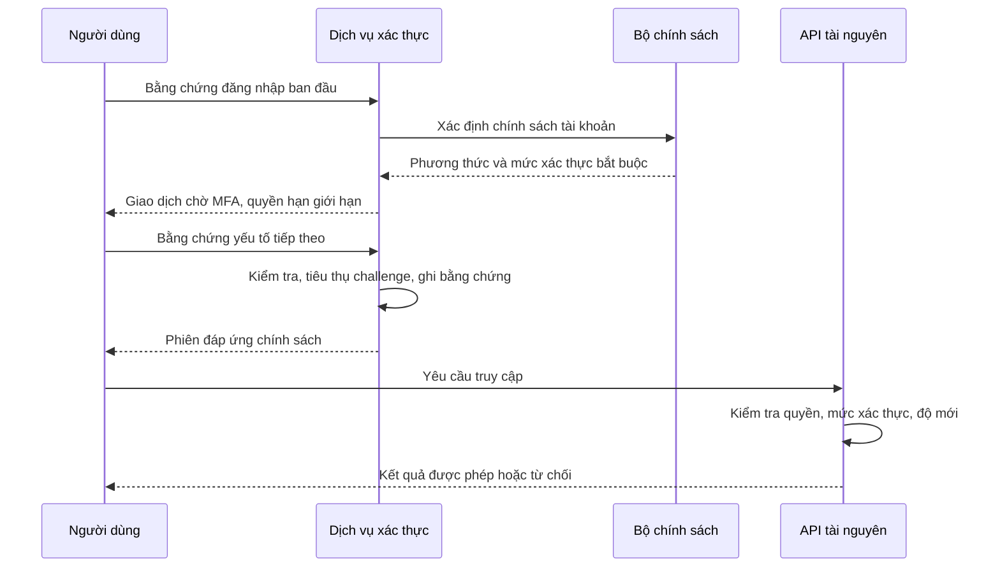

# Multi-factor authentication

## 1. Từ mục tiêu an toàn đến yêu cầu MFA

Multi-factor authentication (MFA), hay xác thực đa yếu tố, là cơ chế yêu cầu người dùng chứng minh danh tính bằng ít nhất hai yếu tố thuộc các nhóm khác nhau. Trong chương **Yêu cầu xác thực**, bài học này tập trung vào cách chuyển rủi ro liên quan đến tài khoản thành những yêu cầu MFA cụ thể, đo được và có thể kiểm chứng.

Mục tiêu “hệ thống hỗ trợ MFA” chưa đủ để thiết kế hoặc nghiệm thu. Nó chưa nói rõ ai phải dùng, khi nào phải dùng, phương thức nào được chấp nhận, điều gì xảy ra khi mất thiết bị và cách bảo vệ những đường đăng nhập khác.

Ví dụ, với một nền tảng quản trị có khả năng xuất dữ liệu khách hàng:

- **Mục tiêu:** hạn chế việc chiếm đoạt tài khoản dẫn đến lộ dữ liệu.
- **Mối đe dọa:** kẻ tấn công lấy được mật khẩu qua phishing rồi đăng nhập từ thiết bị khác.
- **Yêu cầu xác thực:** mọi tài khoản quản trị phải hoàn tất MFA trước khi được cấp phiên có quyền quản trị.
- **Yêu cầu tăng cường:** thao tác xuất dữ liệu khách hàng phải có lần xác thực đủ mạnh trong thời gian gần và có quyền xuất dữ liệu tương ứng.
- **Tiêu chí kiểm thử:** chỉ có mật khẩu, phiên đăng nhập chưa hoàn tất MFA hoặc phiên đã quá thời hạn xác thực tăng cường đều không thể gọi API xuất dữ liệu.

MFA làm giảm một số rủi ro chiếm đoạt tài khoản; hiệu quả phụ thuộc vào phương thức, cách triển khai và toàn bộ vòng đời của nó. MFA không thay thế phân quyền, bảo vệ phiên, chống mã độc trên thiết bị hay kiểm soát hành vi sau đăng nhập.

## 2. Xác định đúng yếu tố và tính độc lập

### 2.1. Ba nhóm yếu tố

| Nhóm | Người dùng chứng minh điều gì? | Ví dụ | Điểm phải kiểm tra khi đặc tả |
|---|---|---|---|
| Điều người dùng biết | Biết một bí mật | Mật khẩu, PIN kích hoạt thiết bị xác thực | Bí mật được kiểm tra ở đâu, có thể dò hoặc bị lộ bằng cách nào? |
| Điều người dùng có | Kiểm soát một thiết bị hoặc bí mật xác thực | Khóa bảo mật, ứng dụng TOTP, khóa riêng của authenticator | Kẻ tấn công có thể sao chép, đồng bộ hoặc khôi phục yếu tố này không? |
| Đặc điểm của người dùng | Vượt qua kiểm tra đặc điểm cá nhân | Vân tay, khuôn mặt trong cơ chế xác minh người dùng của thiết bị | Kết quả được gắn với bằng chứng xác thực như thế nào? |

Hai bước không tự động tạo thành hai yếu tố. Mật khẩu rồi câu hỏi bí mật vẫn là hai bằng chứng thuộc nhóm “điều người dùng biết”. Mật khẩu rồi một PIN cũng không trở thành MFA chỉ vì giao diện có hai màn hình.

Sinh trắc học thường được kiểm tra cục bộ để mở quyền sử dụng khóa riêng; máy chủ nhận bằng chứng mật mã và thông tin xác minh người dùng, không nhất thiết nhận dữ liệu vân tay hoặc khuôn mặt. Đặc tả phải mô tả cơ chế thực tế thay vì yêu cầu gửi mẫu sinh trắc học lên máy chủ.

### 2.2. Một thiết bị có thể thực hiện nhiều yếu tố

Một authenticator có thể kết hợp quyền sở hữu khóa riêng với PIN hoặc sinh trắc học để kích hoạt sử dụng khóa. Vì vậy, MFA không bắt buộc luôn có hai thiết bị hoặc hai thao tác tách rời.

Ngược lại, hai ứng dụng trên hai màn hình chưa chắc tạo ra hai yếu tố độc lập. Cần xem một sự cố có làm mất cả hai bằng chứng hay không:

- Mật khẩu và mã dự phòng lưu cùng trong một kho bị chiếm quyền.
- TOTP bị lộ cùng bản sao lưu chứa khóa bí mật.
- Hộp thư vừa nhận mã xác thực vừa cho phép đặt lại mật khẩu và vô hiệu hóa MFA.
- Thiết bị bị kiểm soát có thể phê duyệt đăng nhập và đánh cắp phiên sau xác thực.

MFA không đòi hỏi loại bỏ mọi điểm lỗi chung, nhưng yêu cầu bảo mật phải chỉ ra các phụ thuộc được chấp nhận và rủi ro còn lại. Địa chỉ IP, vị trí, dấu vân tay trình duyệt và mức độ tuân thủ của thiết bị là tín hiệu hỗ trợ đánh giá rủi ro; không nên tự đếm chúng thành một yếu tố xác thực độc lập.

## 3. Chọn phương thức theo mối đe dọa

| Phương thức | Rủi ro giúp giảm | Giới hạn đáng chú ý | Hướng đặc tả |
|---|---|---|---|
| Mật khẩu kết hợp TOTP | Kẻ tấn công chỉ có mật khẩu chưa đăng nhập được | Mã có thể bị phishing và chuyển tiếp trong thời gian còn hiệu lực; khóa TOTP có thể bị sao chép | Quy định cửa sổ thời gian, giới hạn thử, chống phát lại và bảo vệ khóa bí mật |
| Mật khẩu kết hợp OTP qua SMS | Giảm nguy cơ khi chỉ lộ mật khẩu | Có rủi ro chiếm quyền số điện thoại, chuyển tiếp mã và phishing | Chỉ cho phép ở nhóm tài khoản, tác vụ và mức rủi ro được chấp nhận |
| Mật khẩu kết hợp mã qua email | Có thể bổ sung kiểm soát hộp thư | Phụ thuộc độ an toàn của email và luồng khôi phục; không mặc nhiên là yếu tố sở hữu đủ mạnh | Đánh giá rõ trước khi công nhận là MFA cho một chính sách |
| Mật khẩu kết hợp push | Giảm việc nhập mã thủ công | Dễ bị yêu cầu dồn dập và phê duyệt nhầm; không tự động chống phishing | Hiển thị ngữ cảnh, giới hạn yêu cầu, dùng đối sánh số khi phù hợp |
| WebAuthn/FIDO2 với khóa bảo mật hoặc passkey | Có thể ràng buộc xác thực với RP và origin hợp lệ, giảm phishing chuyển tiếp | Mức bảo đảm phụ thuộc xác minh người dùng, loại authenticator và cơ chế sao lưu/khôi phục | Xác minh challenge, RP ID, origin, chữ ký và yêu cầu user verification theo chính sách |

TOTP là mã dùng một lần được tạo từ khóa bí mật dùng chung và thời gian. WebAuthn là cơ chế xác thực khóa công khai; RP (Relying Party) là bên cung cấp dịch vụ dựa vào kết quả xác thực.

Không gắn nhãn “chống phishing” cho mọi phương thức MFA. Một trang giả có thể thu mật khẩu và TOTP rồi chuyển chúng đến dịch vụ thật. Push có đối sánh số giúp giảm phê duyệt nhầm nhưng không mặc nhiên có khả năng ràng buộc với origin như WebAuthn.

Passkey có thể đáp ứng yêu cầu đa yếu tố khi bằng chứng sở hữu khóa được kết hợp với xác minh người dùng theo chính sách. Chỉ tên “passkey” chưa đủ để kết luận. Cần phân biệt:

- **User presence:** người dùng có tương tác với authenticator, chẳng hạn chạm khóa.
- **User verification:** authenticator đã xác minh người dùng bằng PIN, sinh trắc học hoặc cơ chế phù hợp.
- **Khóa đồng bộ:** có thể được cung cấp trên các thiết bị thông qua hệ sinh thái đồng bộ; mô hình rủi ro phải xét tài khoản và khôi phục của hệ sinh thái đó.
- **Khóa gắn với thiết bị:** có chính sách khác về sao chép, thay thế và khôi phục.

Nếu yêu cầu khóa không được xuất hoặc chỉ chấp nhận thiết bị được quản lý, phải xác định bằng chứng và năng lực nền tảng nào dùng để thực thi. Không suy ra thuộc tính đó chỉ từ tên phương thức hoặc một cờ do ứng dụng khách tự gửi.

## 4. Biến rủi ro thành phạm vi bắt buộc

### 4.1. Phân nhóm người dùng và hành động

Một chính sách MFA cần xác định ít nhất:

1. **Chủ thể:** người dùng thông thường, hỗ trợ vận hành, quản trị, đối tác.
2. **Tài nguyên và hành động:** đọc dữ liệu cá nhân, thay đổi thông tin đăng nhập, xuất dữ liệu, cấp quyền.
3. **Điểm thực thi:** đăng nhập web, mobile, API cấp token, cổng quản trị, liên kết tài khoản, SSO.
4. **Mức xác thực chấp nhận:** phương thức, yêu cầu xác minh người dùng, độ mới của lần xác thực.
5. **Điều kiện từ chối hoặc nâng mức xác thực:** thiếu yếu tố, phiên cũ, thay đổi vai trò, dấu hiệu rủi ro.
6. **Ngoại lệ và khôi phục:** người chịu trách nhiệm, thời hạn, quyền được phép và bằng chứng kiểm tra.

Ví dụ chính sách cho một ứng dụng giả định:

| Nhóm hoặc hành động | Yêu cầu mẫu | Tiêu chí chấp nhận mẫu |
|---|---|---|
| Người dùng xem hồ sơ thông thường | Cho phép mật khẩu; cung cấp đăng ký MFA | Không tự quảng bá phiên này là đã hoàn tất MFA |
| Nhân viên xem dữ liệu khách hàng | Bắt buộc MFA trước khi cấp quyền truy cập | Có mật khẩu nhưng thiếu MFA không thể đọc dữ liệu qua giao diện hoặc API |
| Quản trị viên đăng nhập | Bắt buộc phương thức chống phishing có xác minh người dùng | TOTP hoặc SMS không đáp ứng chính sách quản trị |
| Thay đổi yếu tố xác thực | Yêu cầu xác thực gần đây bằng yếu tố hiện có hoặc luồng khôi phục được phê duyệt | Phiên bị đánh cắp nhưng không tái xác thực không thể thêm yếu tố mới |
| Cấp quyền quản trị, xuất dữ liệu hàng loạt | Kiểm tra quyền và xác thực tăng cường còn mới | Kết quả xác thực tăng cường không thể dùng ngoài phạm vi cho phép |

Các giá trị và lựa chọn trong bài là ví dụ thiết kế cho ứng dụng giả định, không phải mức chuẩn áp dụng cho mọi hệ thống.

Tài khoản dịch vụ và tác vụ tự động cần cơ chế xác thực máy phù hợp như danh tính workload hoặc chứng thư ngắn hạn. Không ép chúng nhập OTP của con người rồi tạo ngoại lệ dùng chung thiếu kiểm soát.

### 4.2. Công thức viết một yêu cầu

Một yêu cầu MFA có thể được viết theo mẫu:

> Với **chủ thể**, khi **điều kiện hoặc hành động**, **thành phần chịu trách nhiệm** phải kiểm tra **bằng chứng cụ thể**, áp dụng **ngưỡng hoặc thời hạn**, và thực hiện **kết quả thất bại**; sự kiện phải có **dấu vết kiểm chứng**.

Ví dụ:

> Với tài khoản thuộc vai trò quản trị, dịch vụ xác thực chỉ được cấp phiên có quyền quản trị sau khi xác minh thành công WebAuthn với user verification bắt buộc. API quản trị phải từ chối phiên thiếu bằng chứng đáp ứng chính sách, ghi nhận sự kiện từ chối và không thực hiện thay đổi dữ liệu.

Yêu cầu này tốt hơn “quản trị viên nên dùng MFA mạnh” vì xác định được chủ thể, điểm quyết định, bằng chứng, kết quả và cách kiểm thử.

## 5. Đặc tả toàn bộ vòng đời MFA

### 5.1. Đăng ký và kích hoạt

Đăng ký yếu tố là một hành động nhạy cảm. Nếu kẻ tấn công có thể thêm yếu tố của mình chỉ bằng một phiên bị đánh cắp, MFA sẽ bảo vệ chính kẻ tấn công sau đó.

Yêu cầu đăng ký cần nêu rõ:

- Bằng chứng cần có để bắt đầu và hoàn tất đăng ký.
- Luồng dành cho tài khoản chưa có yếu tố và luồng thêm yếu tố khi đã có MFA.
- Cách gắn yếu tố với đúng tài khoản, đúng giao dịch đăng ký.
- Thời hạn dữ liệu đăng ký tạm và cách xử lý khi bị bỏ dở.
- Điều kiện kích hoạt: phải chứng minh sử dụng được yếu tố, không chỉ lưu bản ghi.
- Thông báo cho chủ tài khoản khi thêm, thay hoặc xóa yếu tố.
- Chính sách số lượng yếu tố, yếu tố dự phòng và tên hiển thị an toàn.

Với tài khoản quản trị mới, có thể dùng một giao dịch cấp quyền được người có thẩm quyền phê duyệt và chỉ hoàn tất cấp quyền sau khi đăng ký yếu tố hợp lệ. Không dùng cơ chế “ai biết mật khẩu đầu tiên thì được tự nhận quyền quản trị” khi mô hình rủi ro không cho phép.

Đối với TOTP, khóa bí mật phải được bảo vệ khi lưu trữ và chỉ được truy cập bởi thành phần cần xác minh. Không thể chỉ băm khóa như băm mật khẩu vì máy chủ thường cần dùng khóa đó để tính mã đối chiếu. Không ghi khóa, mã QR hoặc URI đăng ký vào log, analytics hay công cụ theo dõi lỗi.

Đối với WebAuthn, máy chủ lưu khóa công khai và thông tin credential cần thiết; khóa riêng thuộc authenticator. Nếu dùng chính sách attestation, phải xác định mục đích, tập tin cậy, cách cập nhật và tác động đến quyền riêng tư, khả năng tương thích.

### 5.2. Challenge và xác minh

Challenge là giao dịch yêu cầu người dùng cung cấp bằng chứng xác thực. Các thuộc tính cần đặc tả gồm:

| Thuộc tính | Yêu cầu cần làm rõ |
|---|---|
| Định danh | Challenge khó đoán, do máy chủ sinh, gắn với một giao dịch |
| Ràng buộc | Gắn với tài khoản, ngữ cảnh đăng nhập và mục đích được phép |
| Thời hạn | Máy chủ quyết định hạn dùng và kiểm tra tại thời điểm xác minh |
| Số lần thử | Giới hạn theo tài khoản, giao dịch và tín hiệu nguồn phù hợp |
| Tính dùng một lần | Thành công chỉ tiêu thụ được một lần, kể cả khi gửi đồng thời |
| Kết quả | Chỉ máy chủ có thẩm quyền nâng mức xác thực của phiên |
| Dữ liệu khách gửi | Không tin các cờ như `mfaComplete=true` hoặc tên phương thức do khách tự khai |

Với TOTP, ví dụ một cấu hình có bước thời gian 30 giây và chỉ chấp nhận bước hiện tại cùng một bước lân cận mỗi phía. Cửa sổ này phải được quyết định theo rủi ro và sai lệch đồng hồ được chấp nhận; mở rộng cửa sổ làm tăng tập mã có thể hợp lệ.

Yêu cầu chống phát lại phải áp dụng cho yếu tố và bước thời gian đã được chấp nhận, không chỉ cho một challenge. Nếu hai challenge khác nhau cùng nhận một mã hợp lệ của một yếu tố trong cùng bước thời gian, máy chủ vẫn phải ngăn việc sử dụng lại bước đã tiêu thụ. Việc kiểm tra và đánh dấu phải bảo đảm tính nguyên tử trên các nút xử lý.

Với WebAuthn, yêu cầu phải bao gồm xác minh challenge, origin cho phép, RP ID, chữ ký, liên kết credential với tài khoản và cờ user verification khi chính sách yêu cầu. Trạng thái chống phát lại không thể dựa duy nhất vào bộ đếm chữ ký, vì đặc tính bộ đếm có thể khác giữa các authenticator. Challenge dùng một lần và ràng buộc giao dịch vẫn là điều kiện cốt lõi.

### 5.3. Cấp phiên sau MFA

Sau khi mật khẩu đúng, hệ thống có thể tạo một giao dịch tiền xác thực. Giao dịch đó không được có khả năng truy cập tài nguyên yêu cầu MFA.

Một luồng mẫu:



Cần xác định rõ cách thay hoặc vô hiệu hóa định danh phiên tiền xác thực sau thành công, cách ngăn session fixation và cách giới hạn token tạm. Không cấp access token có đầy đủ quyền rồi chỉ che chức năng bằng màn hình nhập OTP.

Bằng chứng trong phiên hoặc token nên thể hiện các thuộc tính có ý nghĩa với chính sách, chẳng hạn phương thức đã xác minh, thời điểm xác thực và mức bảo đảm do máy chủ đánh giá. Danh sách phương thức đã đăng ký của tài khoản không chứng minh rằng phiên hiện tại đã dùng chúng.

### 5.4. Xác thực tăng cường và độ mới

Step-up authentication là yêu cầu nâng mức xác thực hoặc tái xác thực khi phiên hiện tại không đủ cho một hành động.

Ví dụ chính sách: thao tác thêm quản trị viên yêu cầu phương thức chống phishing có user verification và lần xác thực đáp ứng yêu cầu đó không quá 5 phút. Cần phân biệt thời điểm xác thực phù hợp với:

- Thời điểm refresh token được đổi.
- Thời điểm người dùng mở trang.
- Thời điểm người dùng bấm nút.
- Thời điểm mật khẩu được kiểm tra nếu thao tác yêu cầu bằng chứng mạnh hơn.

Làm mới token không được tự cập nhật thời điểm đã hoàn tất MFA. “Ghi nhớ thiết bị” cũng không được tự bỏ qua yêu cầu xác thực gần đây đối với hành động nhạy cảm.

Nếu kết quả step-up được dùng để xác nhận một giao dịch cụ thể, phải ràng buộc với người dùng, phiên, loại hành động và dữ liệu giao dịch liên quan; phải kiểm tra lại quyền tại lúc thực hiện. Việc xác thực một người không tự chứng minh rằng họ đã đồng ý với mọi giao dịch. Muốn có xác nhận giao dịch cụ thể còn cần hiển thị đúng nội dung và chống thay đổi nội dung giữa lúc xác nhận và thực thi.

### 5.5. Mất yếu tố, khôi phục và thay thế

Khôi phục là một đường xác thực có tác động tương đương hoặc lớn hơn đăng nhập. Chính sách mạnh ở luồng chính nhưng cho phép hỗ trợ tắt MFA chỉ bằng thông tin công khai sẽ mất hiệu quả.

Cần đặc tả:

1. Bằng chứng nào đủ để bắt đầu và hoàn tất khôi phục.
2. Mức quyền được cấp trong lúc chờ khôi phục.
3. Vai trò của nhân viên hỗ trợ và khi nào cần phê duyệt bổ sung.
4. Thời gian chờ cho thay đổi có rủi ro cao và điều kiện xử lý khẩn cấp.
5. Cách thu hồi yếu tố bị mất, phiên, refresh token và trạng thái tin cậy thiết bị.
6. Kênh thông báo độc lập khi phù hợp, cùng hướng xử lý nếu người dùng không thực hiện yêu cầu.
7. Nhật ký quyết định và thời hạn lưu bằng chứng theo chính sách dữ liệu.

Mã khôi phục cần ngẫu nhiên đủ mạnh, chỉ hiển thị trong điều kiện được phép, lưu dưới dạng kiểm chứng phù hợp như băm và chỉ sử dụng một lần. Việc kiểm tra và tiêu thụ phải nguyên tử. Sau khi cấp bộ mới, bộ cũ phải hết hiệu lực theo chính sách.

Một mã khôi phục không tự trở thành MFA. Nếu nó được chấp nhận để vượt yêu cầu yếu tố thường dùng, đó là một luồng khôi phục có mức bảo đảm và quyền hạn riêng cần đánh giá.

Không dùng câu hỏi bí mật dựa trên thông tin dễ tìm như phương thức duy nhất để vô hiệu hóa MFA. Không cho phép ngoại lệ hỗ trợ kéo dài vô hạn hoặc chỉ tồn tại trong ghi chú ngoài hệ thống.

## 6. Bộ yêu cầu mẫu có thể nghiệm thu

Bộ dưới đây áp dụng cho ứng dụng giả định có người dùng nội bộ và quản trị viên. Các ngưỡng minh họa phải được nhóm sản phẩm, bảo mật và vận hành thống nhất trước khi trở thành cam kết thực tế.

| ID | Yêu cầu | Tiêu chí kiểm chứng |
|---|---|---|
| MFA-01 | Tài khoản quản trị phải dùng phương thức chống phishing có user verification trước khi được cấp phiên quản trị | Mật khẩu đúng kết hợp TOTP hoặc WebAuthn thiếu user verification đều không tạo được phiên quản trị |
| MFA-02 | Mọi API thuộc phạm vi bảo vệ phải thực thi mức xác thực ở phía máy chủ | Gọi API trực tiếp bằng token tiền xác thực bị từ chối và không làm thay đổi dữ liệu |
| MFA-03 | Thêm hoặc xóa yếu tố yêu cầu xác thực bằng yếu tố hiện có đáp ứng chính sách trong vòng 5 phút, trừ luồng khôi phục riêng | Phiên đã 6 phút hoặc chỉ có mật khẩu không thể thay đổi yếu tố |
| MFA-04 | Challenge đăng nhập hết hạn sau 120 giây, dùng một lần, gắn với tài khoản và giao dịch | Tại thời điểm bằng hạn hết hiệu lực phải bị từ chối; không dùng challenge tài khoản A cho B |
| MFA-05 | Giao dịch OTP cho phép tối đa 5 lần sai trước khi bị đóng; tổng số lần thử sai OTP của một tài khoản không vượt 10 lần trong cửa sổ trượt 15 phút | Tạo giao dịch mới hoặc đổi IP không đặt lại bộ đếm tài khoản; mã đúng không được chấp nhận qua giao dịch đã đóng |
| MFA-06 | Với TOTP, bước thời gian đã được chấp nhận cho một yếu tố không được sử dụng lại; kiểm tra và tiêu thụ phải nguyên tử | Hai yêu cầu đồng thời dùng cùng mã/bước chỉ có một yêu cầu thành công, kể cả đi qua hai nút khác nhau |
| MFA-07 | Thao tác thêm quản trị viên và xuất dữ liệu hàng loạt yêu cầu xác thực mạnh không quá 5 phút và quyền thao tác hợp lệ | Refresh token không kéo dài độ mới; hết ngưỡng phải step-up trước khi thực thi |
| MFA-08 | Khôi phục không trực tiếp tạo phiên quản trị; phải hoàn tất quy trình phê duyệt và đăng ký lại yếu tố trước khi lấy lại quyền | Email đặt lại mật khẩu đơn lẻ không thể khôi phục quyền quản trị |
| MFA-09 | Sự kiện thêm, xóa, thay thế, khôi phục yếu tố phải được ghi nhận và phát thông báo trong 60 giây ở điều kiện vận hành bình thường | Đối chiếu thời điểm giao dịch với thời điểm hệ thống thông báo tiếp nhận; kiểm tra hàng đợi và cảnh báo khi trễ |
| MFA-10 | Dịch vụ xác minh không khả dụng thì các hành động bắt buộc MFA phải bị từ chối, không cấp quyền theo cơ chế bỏ qua | Mô phỏng timeout hoặc mất kho challenge không tạo phiên đủ mức xác thực |
| MFA-11 | Thu hồi yếu tố do nghi lộ phải làm mất hiệu lực những phiên, token và trạng thái tin cậy thuộc phạm vi thu hồi đã xác định trong 60 giây | Token tạo trước sự kiện thu hồi không thể gọi API được bảo vệ sau thời hạn lan truyền |
| MFA-12 | Log và telemetry không được chứa OTP, khóa TOTP, mã khôi phục, khóa riêng hoặc token dùng để truy cập | Kiểm tra các nhánh thành công, thất bại và ngoại lệ không xuất hiện các giá trị bí mật mẫu đã dùng |

MFA-04 quy định tuổi thọ giao dịch, còn mã TOTP được chấp nhận theo bước thời gian riêng. Hai điều kiện phải cùng đúng; challenge còn hạn không làm cho mã TOTP cũ trở lại hợp lệ.

MFA-05 là ngưỡng minh họa cho OTP, không phải một chính sách giới hạn thử dùng chung cho mọi loại authenticator. Khi đạt ngưỡng, cần quy định rõ trạng thái, phản hồi và cách lấy lại quyền thử. Tránh để kẻ tấn công chỉ cần biết tên tài khoản là khóa vĩnh viễn người dùng; có thể kết hợp thời gian chờ, cảnh báo và đường khôi phục có kiểm soát.

MFA-11 đòi hỏi cơ chế thực thi phù hợp. Token tự chứa sống lâu và không kiểm tra trạng thái thu hồi sẽ không đáp ứng thời hạn này. Kiến trúc cần hỗ trợ kiểm tra phiên, phiên bản bảo mật, danh sách thu hồi hoặc giới hạn thời gian sống đủ ngắn cùng các kiểm soát liên quan.

## 7. Liên kết yêu cầu với rủi ro, kiến trúc và kiểm thử

### 7.1. Ma trận truy vết

| Rủi ro | Yêu cầu liên quan | Thành phần thực thi | Kiểm thử đại diện |
|---|---|---|---|
| R-01: Kẻ tấn công có mật khẩu quản trị | MFA-01, MFA-02 | Dịch vụ xác thực, API quản trị | Không cấp quyền quản trị khi chỉ có mật khẩu hoặc phương thức yếu hơn |
| R-02: Mã bị dùng lại hoặc gửi đồng thời | MFA-04, MFA-06 | Kho challenge, bộ xác minh | Replay sau thành công; đồng thời qua nhiều nút |
| R-03: Chiếm phiên rồi thêm yếu tố mới | MFA-03, MFA-07 | Quản lý yếu tố, bộ chính sách | Phiên cũ không thể thay yếu tố hoặc nâng quyền |
| R-04: Lợi dụng hỗ trợ để tắt MFA | MFA-08, MFA-09 | Khôi phục, hệ thống phê duyệt | Thiếu bằng chứng hoặc thiếu phê duyệt không thể lấy lại quyền |
| R-05: Lỗi dịch vụ dẫn đến bỏ qua MFA | MFA-10 | Dịch vụ xác thực, API tài nguyên | Timeout, mất trạng thái challenge, dependency lỗi |
| R-06: Yếu tố đã lộ nhưng phiên cũ còn sống | MFA-11 | Kho phiên, bộ phát và kiểm tra token | Kiểm tra hiệu lực thu hồi trên toàn bộ nút phục vụ |
| R-07: Bí mật lọt vào hệ thống quan sát | MFA-12 | Logging, tracing, xử lý lỗi | Kiểm tra payload, exception và telemetry bằng bí mật thử nghiệm |

Ma trận cho thấy yêu cầu nào xử lý mối đe dọa nào và bằng chứng nào dùng để nghiệm thu. Nếu một rủi ro chưa có kiểm soát hoặc một yêu cầu không có nơi thực thi, cần làm rõ trước khi triển khai.

### 7.2. SSO và hệ thống phân tán

Khi dùng Identity Provider (IdP), ứng dụng có thể dựa vào bằng chứng xác thực từ IdP, nhưng vẫn chịu trách nhiệm quyết định quyền truy cập của mình.

Đặc tả tích hợp cần trả lời:

- IdP phát những thông tin nào về phương thức, mức xác thực và thời điểm xác thực?
- Ứng dụng tin cậy những issuer, audience, chữ ký và quy tắc ánh xạ nào?
- Giá trị nào thực sự chứng minh phương thức chống phishing và user verification theo hợp đồng tích hợp?
- Ứng dụng yêu cầu tái xác thực hoặc nâng mức tại IdP bằng cách nào?
- Nếu IdP không trả bằng chứng được yêu cầu, ứng dụng từ chối hay đi vào luồng nào?
- Thay đổi vai trò, thu hồi phiên và thay đổi yếu tố được lan truyền ra sao?

Trong OIDC, các thông tin như `amr`, `acr` và `auth_time` có thể hỗ trợ quyết định, nhưng giá trị cụ thể phải được diễn giải theo hợp đồng với IdP. Không mặc định mọi IdP dùng chúng giống nhau. Một lần đăng nhập SSO thành công cũng không tự chứng minh rằng MFA vừa được thực hiện.

Các đường đăng nhập cục bộ, tài khoản khẩn cấp và API cấp token cũ phải xuất hiện trong phạm vi yêu cầu. Nếu chỉ thực thi MFA trên SSO nhưng vẫn còn luồng mật khẩu trực tiếp cấp cùng quyền, chính sách có thể bị vượt qua.

Tài khoản khẩn cấp cần kiểm soát riêng: quyền tối thiểu cần thiết, bảo quản thông tin truy cập, giám sát, giới hạn thời gian sử dụng và rà soát sau sự kiện. Không biến nó thành lối bỏ qua thường trực.

## 8. Minh họa logic quyết định ở phía máy chủ

Đoạn mã giả sau minh họa thứ tự kiểm tra cho một thao tác cần step-up. Nó không đại diện cho một giao thức xác thực hoàn chỉnh.

```text
function executeSensitiveAction(request):
    session = validateSession(request.sessionToken)
    if session is absent or session.isRevoked:
        return authenticationRequired()

    action = resolveActionFromServerRoute(request.route)
    resource = loadTargetResource(request)

    if not authorization.allows(session.subject, action, resource):
        return accessDenied()

    policy = policies.forAction(session.subject, action, resource)
    evidence = trustedEvidenceFor(session)

    if not evidence.satisfies(policy.requiredProperties):
        return stepUpRequired(policy.allowedMethods)

    if serverNow() >= evidence.verifiedAt + policy.maxAge:
        return stepUpRequired(policy.allowedMethods)

    if policy.requiresTransactionConfirmation:
        confirmation = loadServerSideConfirmation(request.confirmationId)
        if not confirmation.matches(
            session.subject,
            session.id,
            action,
            canonicalTransactionData(request)
        ):
            return transactionConfirmationRequired()

        # Kiểm tra hạn, tiêu thụ một lần và ghi nhận hành động
        # phải dùng cơ chế giao dịch/idempotency phù hợp.
        return executeWithAtomicConfirmationConsumption(
            confirmation, action, resource, request
        )

    return executeWithCurrentAuthorization(action, resource, request)
```

Các điểm cần rút ra:

- Quyết định dựa vào bằng chứng máy chủ đã xác minh; khách không được tự khai mức xác thực.
- Phân quyền và MFA là hai điều kiện cùng cần thỏa mãn.
- Mốc hết hạn phải có quy tắc ranh giới rõ ràng; ví dụ này coi đúng thời điểm hết hạn là không còn hợp lệ.
- Thao tác nhạy cảm cần kiểm tra trạng thái hiện tại tại thời điểm thực thi, tránh tách xác nhận khỏi tác dụng nghiệp vụ.
- Việc tiêu thụ xác nhận phải phối hợp với thực thi để chống dùng lại; nếu gọi hệ thống ngoài, cần thiết kế idempotency và xử lý lỗi tương ứng.

Với hệ thống có nhiều API, chính sách nên được quản lý nhất quán và có kiểm thử ở các điểm thực thi. Chỉ kiểm tra tại giao diện hoặc chỉ tại một gateway trong khi tài nguyên còn đường truy cập khác là chưa đủ.

## 9. Thiết kế kiểm thử theo đường tấn công

### 9.1. Các ca kiểm thử chức năng và lạm dụng

| Tình huống | Thao tác kiểm thử | Kết quả mong đợi |
|---|---|---|
| Luồng hợp lệ | Tài khoản có quyền dùng đúng phương thức và challenge | Cấp đúng mức xác thực, ghi đúng thời điểm, cho phép đúng tài nguyên |
| Chưa xong MFA | Dùng token tiền xác thực gọi API nhạy cảm | Từ chối, không có thay đổi nghiệp vụ |
| Phương thức không đủ mạnh | Dùng TOTP cho tài khoản chỉ chấp nhận phương thức chống phishing | Không nâng phiên lên mức yêu cầu |
| Challenge sai ngữ cảnh | Dùng bằng chứng của tài khoản hoặc giao dịch khác | Từ chối dù mã hoặc chữ ký hợp lệ trong ngữ cảnh gốc |
| Hết hạn | Gửi ngay trước, đúng lúc và ngay sau thời điểm hết hạn | Kết quả đúng quy tắc ranh giới đã đặc tả |
| Replay | Gửi lại bằng chứng đã thành công | Không tạo lần xác thực hoặc giao dịch thành công thứ hai |
| Đồng thời | Gửi nhiều yêu cầu cùng mã qua nhiều nút | Chỉ một lần tiêu thụ hợp lệ |
| Vượt giới hạn thử | Tạo challenge mới, đổi IP, thử nhiều mã sai | Không bỏ qua giới hạn theo tài khoản và giao dịch |
| Giả thuộc tính | Sửa cờ MFA, phương thức hoặc thời điểm trong dữ liệu khách gửi | Máy chủ không chấp nhận dữ liệu tự khai |
| Refresh token | Đổi token sau khi độ mới MFA đã hết | Vẫn phải step-up cho tác vụ yêu cầu xác thực gần đây |
| Thay yếu tố | Dùng phiên cũ hoặc phiên chỉ có mật khẩu | Không thêm/xóa yếu tố nếu thiếu bằng chứng được yêu cầu |
| Khôi phục | Đặt lại mật khẩu rồi thử lấy quyền quản trị ngay | Tuân thủ chính sách khôi phục, không tự bỏ yêu cầu MFA |
| Dependency lỗi | Làm dịch vụ xác minh hoặc kho trạng thái timeout | Từ chối có kiểm soát, không bỏ qua xác thực |
| Đường đăng nhập khác | Dùng mobile, endpoint cũ, SSO và đăng nhập trực tiếp | Cùng mức yêu cầu cho cùng quyền được cấp |

Với WebAuthn, thêm các ca origin ngoài danh sách, RP ID không đúng, challenge không khớp, chữ ký sai, credential không thuộc tài khoản và thiếu user verification. Với push, kiểm tra gửi dồn dập, yêu cầu hết hạn, đối sánh số sai và người dùng bấm từ chối.

### 9.2. Bằng chứng nghiệm thu

Một kết quả HTTP đơn lẻ chưa đủ để kết luận chính sách được thực thi. Ví dụ, API có thể trả lỗi sau khi đã thực hiện thay đổi. Bằng chứng nên bao gồm:

- Phản hồi giao thức và trạng thái phiên trước/sau.
- Dữ liệu nghiệp vụ chứng minh thao tác bị từ chối không tạo tác dụng.
- Bản ghi tiêu thụ challenge hoặc xác nhận giao dịch.
- Sự kiện audit có định danh tương quan phù hợp.
- Kết quả trên các nút khác nhau khi yêu cầu liên quan tính nguyên tử hoặc thu hồi.
- Thời điểm máy chủ dùng cho các kiểm tra hạn và cửa sổ giới hạn thử.

Dùng tài khoản và bí mật thử nghiệm để kiểm chứng; không đưa OTP hoặc khóa sản xuất vào báo cáo kiểm thử.

## 10. Logging, vận hành và khả năng sử dụng

### 10.1. Log đủ để điều tra

Sự kiện MFA nên có loại sự kiện, thời điểm máy chủ, định danh người dùng nội bộ, loại yếu tố, kết quả, mã lý do nội bộ, định danh tương quan và ngữ cảnh thiết bị/nguồn truy cập phù hợp với chính sách dữ liệu.

Ví dụ các sự kiện:

```text
mfa.challenge.created
mfa.verification.succeeded
mfa.verification.failed
mfa.rate_limit.applied
mfa.factor.enrolled
mfa.factor.revoked
mfa.recovery.requested
mfa.recovery.approved
mfa.step_up.denied
```

Không log nội dung OTP, khóa TOTP, mã khôi phục, khóa riêng hoặc bearer token. Định danh tương quan không nên là giá trị bí mật có thể dùng để tiếp tục đăng nhập. Log cũng cần kiểm soát truy cập, tính toàn vẹn và thời hạn lưu.

Thông báo lỗi cho người dùng phải đủ để họ xử lý nhưng không tiết lộ không cần thiết về sự tồn tại tài khoản, cấu hình yếu tố hoặc trạng thái nội bộ. Mã lý do chi tiết có thể được lưu trong kênh audit được kiểm soát.

### 10.2. Chỉ số có định nghĩa

Một chỉ số chỉ có ích khi rõ tử số, mẫu số và cửa sổ đo.

| Chỉ số | Cách định nghĩa mẫu | Ý nghĩa |
|---|---|---|
| Tỷ lệ bao phủ MFA bắt buộc | Số tài khoản đang hoạt động thuộc nhóm bắt buộc đã có yếu tố hợp lệ / tổng số tài khoản đang hoạt động thuộc nhóm đó | Phát hiện thiếu đăng ký; không tự chứng minh thực thi đúng |
| Tỷ lệ phiên tuân thủ | Số phiên được cấp quyền thuộc phạm vi có bằng chứng đạt chính sách / tổng số phiên được cấp quyền thuộc phạm vi | Theo dõi hiệu lực kiểm soát; mục tiêu ví dụ 100% |
| Tỷ lệ hoàn tất | Số giao dịch MFA hợp lệ hoàn tất / số giao dịch MFA hợp lệ được bắt đầu trong kỳ | Đánh giá trở ngại sử dụng; phải phân biệt lưu lượng tấn công |
| Độ trễ xác minh | Phân vị p95 từ lúc máy chủ nhận yêu cầu xác minh đến khi trả kết quả | Đánh giá hiệu năng; tách khỏi thời gian người dùng thao tác |
| Tỷ lệ ngoại lệ còn hạn | Số ngoại lệ có chủ sở hữu và chưa hết hạn / tổng số ngoại lệ đang có hiệu lực | Kiểm soát ngoại lệ và nợ vận hành |
| Thời gian lan truyền thu hồi | Từ lúc chấp nhận lệnh thu hồi đến lúc điểm kiểm soát liên quan từ chối bằng chứng cũ | Xác nhận mục tiêu thu hồi trên thực tế |

Một ví dụ mục tiêu hiệu năng là p95 xử lý xác minh phía máy chủ không quá 500 ms dưới tải 100 yêu cầu/giây với hạ tầng và dependency được mô tả trước. Nếu không nêu tải, môi trường và phạm vi đo, yêu cầu “MFA phải nhanh” khó kiểm chứng.

### 10.3. Tính sẵn sàng và khả năng tiếp cận

Yêu cầu vận hành phải bao gồm sự cố nhà cung cấp OTP/push, lệch đồng hồ TOTP, thiết bị hỏng, người dùng không có điện thoại và người dùng cần công nghệ hỗ trợ.

Có thể hỗ trợ nhiều authenticator phù hợp cùng chính sách, đăng ký yếu tố dự phòng và giao diện thao tác bằng bàn phím. Khi hạ tầng lỗi, cung cấp trạng thái và đường hỗ trợ rõ ràng. Không âm thầm hạ mức xác thực để đạt chỉ tiêu đăng nhập thành công.

Nếu có chế độ “ghi nhớ thiết bị”, phải định nghĩa thời hạn, bảo vệ bí mật ghi nhớ, phạm vi được miễn thử thách, điều kiện thu hồi và những tác vụ vẫn bắt buộc step-up. Một cookie ghi nhớ bị đánh cắp là một rủi ro cần tính đến, không phải bằng chứng tuyệt đối rằng đúng thiết bị đang được dùng.

## 11. Những đặc tả dễ gây hiểu sai

| Cách viết chưa đủ | Vì sao khó triển khai hoặc nghiệm thu | Cách viết cụ thể hơn |
|---|---|---|
| “Hệ thống phải có MFA” | Không rõ ai, lúc nào, ở đâu | Nêu nhóm tài khoản, hành động, phương thức và điểm thực thi |
| “Mọi đăng nhập đều bảo mật” | Không có thuộc tính hoặc ngưỡng đo | Nêu mức xác thực, bảo vệ phiên và tiêu chí từ chối |
| “OTP hết hạn nhanh” | Không có giới hạn thời gian và quy tắc ranh giới | Chỉ ra hạn challenge, cửa sổ mã và thời điểm so sánh |
| “Đã bật MFA thì tài khoản an toàn” | Bỏ qua phương thức thực dùng trong từng phiên và các đường khôi phục | Kiểm tra bằng chứng của phiên, luồng thay yếu tố và khôi phục |
| “MFA được kiểm tra ở frontend” | Có thể gọi API trực tiếp | Máy chủ kiểm tra trước khi cấp quyền và thực thi hành động |
| “Hỗ trợ có thể tắt MFA khi cần” | Không có điều kiện, thời hạn hoặc dấu vết | Đặc tả bằng chứng, phê duyệt, giới hạn quyền, thu hồi và audit |
| “Hai thiết bị nghĩa là hai yếu tố” | Không chứng minh được hai nhóm yếu tố hoặc tính độc lập | Mô tả loại bằng chứng, cách kiểm tra và điểm lỗi chung |
| “Dịch vụ lỗi thì tạm bỏ qua” | Sự cố trở thành đường vượt chính sách | Từ chối có kiểm soát và dùng quy trình khẩn cấp được quản lý |

## 12. Bài tập áp dụng

Một cổng quản trị đang dùng mật khẩu và TOTP. Nó cho phép nhớ thiết bị 30 ngày, đặt lại mật khẩu qua email và nhờ hỗ trợ xóa TOTP. Endpoint xuất dữ liệu kiểm tra vai trò quản trị nhưng chưa kiểm tra bằng chứng xác thực của phiên.

Hãy lập đặc tả cải tiến với các đầu ra sau:

1. Xác định ít nhất bốn đường tấn công, bao gồm chiếm mật khẩu, đánh cắp phiên, lạm dụng khôi phục và phát lại mã.
2. Viết yêu cầu có ID cho đăng nhập quản trị, xuất dữ liệu, thay yếu tố, thu hồi phiên và hỗ trợ khôi phục.
3. Nêu nơi thực thi từng yêu cầu trong kiến trúc.
4. Chọn ngưỡng đo cho độ mới, giới hạn thử và thời gian thu hồi; giải thích quan hệ với rủi ro.
5. Viết ít nhất một ca hợp lệ, một ca vượt qua API trực tiếp và một ca đồng thời.
6. Liên kết mỗi yêu cầu với rủi ro và bằng chứng nghiệm thu.

Một hướng phân tích là xem xét phương thức chống phishing cho quyền quản trị, buộc xác thực tăng cường khi xuất dữ liệu, giới hạn tác dụng của nhớ thiết bị và đưa khôi phục vào cùng mô hình bảo đảm. Tuy nhiên, không chỉ đổi TOTP sang một công nghệ khác: nếu endpoint xuất dữ liệu vẫn tin token thiếu mức xác thực hoặc hỗ trợ vẫn có thể bỏ qua mọi kiểm soát, yêu cầu bảo mật chưa được thực thi trọn vẹn.

