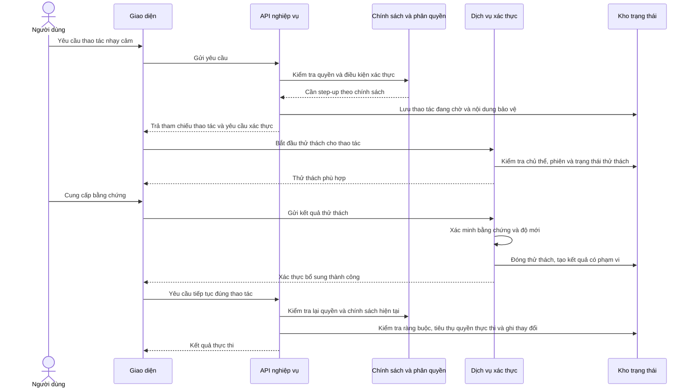

# Step-up authentication

## 1. Step-up authentication giải quyết vấn đề gì?

Một phiên đăng nhập hợp lệ không có nghĩa người đang sử dụng phiên được thực hiện mọi thao tác nhạy cảm mà không cần xác minh thêm. Phiên có thể đã tồn tại quá lâu, được tạo bằng phương thức chưa đủ mạnh cho hành động sắp diễn ra hoặc bị người khác sử dụng sau khi thiết bị mất kiểm soát.

**Step-up authentication** là quá trình yêu cầu chủ thể cung cấp bằng chứng xác thực đáp ứng điều kiện cao hơn hoặc cụ thể hơn trước khi hệ thống cho phép tiếp tục một hành động. Điều kiện đó có thể liên quan đến phương thức xác thực, độ mới của lần xác thực, việc người dùng hiện diện hoặc sự gắn kết giữa bằng chứng với một thao tác xác định.

Ví dụ, một hệ thống cho phép nhân viên đọc tài liệu sau khi đăng nhập bằng mật khẩu và mã xác thực. Khi nhân viên muốn thay tài khoản ngân hàng nhận thanh toán, hệ thống yêu cầu xác thực lại bằng một phương thức được phê duyệt cho thao tác đó và chỉ chấp nhận kết quả cho đúng thay đổi đang chờ.

Yêu cầu bảo mật không nên dừng ở câu “thao tác quan trọng phải có MFA”. Cần đặc tả rõ:

- Thao tác hoặc điều kiện nào kích hoạt yêu cầu bổ sung?
- Bằng chứng nào được chấp nhận, và điều gì khiến bằng chứng đó đủ cho mục đích này?
- Bằng chứng được phép cũ bao lâu?
- Kết quả áp dụng cho chủ thể, phiên, tenant và thao tác nào?
- Kết quả được dùng bao nhiêu lần, trong thời hạn nào?
- Hệ thống xử lý thế nào khi không thể xác minh, khi rủi ro thay đổi hoặc khi dịch vụ phụ thuộc lỗi?
- Dữ liệu, log và ca kiểm thử nào chứng minh yêu cầu đã được thực hiện?

Trong thiết kế yêu cầu bảo mật, step-up là một điểm kiểm soát nối rủi ro chiếm dụng danh tính với quyết định thực thi. Nó phải có điều kiện kiểm chứng được và phải được bảo vệ trên mọi đường thực hiện thao tác.

## 2. Phân biệt những khái niệm dễ bị trộn lẫn

| Khái niệm | Câu hỏi chính | Quan hệ với step-up |
|---|---|---|
| Xác thực ban đầu | Ai đang thiết lập phiên, dựa trên bằng chứng nào? | Tạo ngữ cảnh xác thực ban đầu để chính sách so sánh |
| Xác thực nhiều yếu tố, MFA | Những loại yếu tố độc lập nào đã được kiểm tra? | Có thể là một yêu cầu của step-up, nhưng không mô tả đầy đủ độ mới và phạm vi sử dụng |
| Xác thực lại, reauthentication | Chủ thể có thể chứng minh lại danh tính ở thời điểm này không? | Có thể đáp ứng yêu cầu về độ mới; nhập lại cùng mật khẩu không tự nâng sức chống chịu của phương thức |
| Step-up authentication | Ngữ cảnh hiện tại còn thiếu bằng chứng gì để thực hiện hành động này? | Bổ sung hoặc làm mới bằng chứng theo một chính sách xác định |
| Phân quyền | Chủ thể có quyền thực hiện hành động trên tài nguyên này không? | Vẫn bắt buộc, dù step-up thành công |
| Phê duyệt nghiệp vụ | Hành động đã được người có trách nhiệm chấp thuận chưa? | Là điều kiện riêng; có thể yêu cầu người phê duyệt cũng step-up |
| Xác nhận ý định giao dịch | Người dùng đang xác nhận chính xác nội dung nào? | Cần thiết kế riêng nếu phải bảo vệ số tiền, người nhận hoặc dữ liệu cụ thể |

Nhập hai mật khẩu hoặc nhập cùng một mật khẩu hai lần không tự tạo thành hai yếu tố độc lập. Một lần xác thực bằng nhiều yếu tố từ nhiều giờ trước cũng không tự thỏa yêu cầu “xác thực trong vòng năm phút gần nhất”.

Tương tự, người dùng có thể hoàn thành step-up nhưng vẫn không có quyền xóa dữ liệu của tenant khác. Xác thực mạnh hơn không tạo thêm vai trò hoặc mở rộng phạm vi quyền.

## 3. Bắt đầu từ tài sản, rủi ro và hành động cần bảo vệ

Không nên quyết định step-up chỉ dựa trên tên màn hình. Cần liệt kê thao tác thực tế và hậu quả nếu phiên bị chiếm dụng hoặc bằng chứng xác thực bị sử dụng sai.

| Tài sản hoặc tình huống | Đe dọa cần xử lý | Điều kiện bảo vệ cần đặc tả |
|---|---|---|
| Email khôi phục và phương thức MFA | Kẻ giữ phiên thay đường khôi phục rồi chiếm tài khoản lâu dài | Xác minh bằng phương thức đã tin cậy; kiểm soát thay đổi và thông báo phù hợp |
| Tài khoản nhận thanh toán | Người dùng bị dẫn dắt hoặc kẻ chiếm phiên đổi người nhận | Yêu cầu bằng chứng mới và ràng buộc kết quả với nội dung thay đổi |
| Xuất dữ liệu khách hàng | Phiên bị lấy cắp được dùng để tải dữ liệu nhạy cảm hàng loạt | Kiểm tra quyền, độ mới và phương thức trước khi tạo bản xuất hoặc cấp quyền tải |
| Cấp vai trò quản trị | Phiên thông thường bị dùng để nâng đặc quyền | Step-up của người thực hiện, kiểm tra quyền cấp vai trò và quy trình phê duyệt nếu có |
| Xóa hoặc khôi phục dữ liệu quan trọng | Hành động khó đảo ngược hoặc làm thay đổi trạng thái bảo vệ | Xác thực phù hợp và ràng buộc với tập dữ liệu, phiên bản, phạm vi thao tác |
| Tạo khóa truy cập dịch vụ | Phiên bị chiếm dụng được đổi thành quyền truy cập dài hạn | Bảo vệ khâu cấp khóa, phạm vi khóa, thời hạn và khả năng thu hồi |

Tín hiệu như thiết bị mới, hành vi bất thường hoặc vị trí truy cập thay đổi có thể làm chính sách yêu cầu thêm bằng chứng. Chúng không tự chứng minh danh tính và không thay thế các yêu cầu cố định cho thao tác nhạy cảm.

Đặc tả nên xác định trường hợp nào được step-up và trường hợp nào phải từ chối, khóa luồng hoặc chuyển sang quy trình phục hồi. Một phiên đã bị xác định là không đáng tin có thể cần chấm dứt thay vì chỉ hiện thêm một thử thách.

## 4. Mô hình hóa ngữ cảnh và kết quả quyết định

### 4.1. Những dữ liệu chính sách cần biết

Một quyết định step-up thường phụ thuộc vào:

- **Chủ thể:** mã danh tính nội bộ ổn định, trạng thái tài khoản và phương thức được phép sử dụng.
- **Phiên:** mã phiên hoặc họ phiên, thời điểm tạo, trạng thái thu hồi và liên kết với thiết bị nếu thiết kế có hỗ trợ.
- **Tenant:** miền tổ chức và quan hệ thành viên đang áp dụng.
- **Hành động:** loại thao tác, tài nguyên đích, phiên bản và các tham số nhạy cảm.
- **Bằng chứng đã có:** phương thức, các thuộc tính bảo đảm đã được xác minh và thời điểm thực sự xác thực.
- **Tín hiệu rủi ro:** nguồn, độ tin cậy, thời điểm cập nhật và trạng thái thiếu dữ liệu.
- **Chính sách:** phiên bản quy tắc, tập phương thức chấp nhận, độ mới và phạm vi sử dụng kết quả.

Không lấy `userId`, vai trò, mức bảo đảm hoặc thời điểm xác thực từ dữ liệu do trình duyệt tự khai rồi coi là bằng chứng. Các thuộc tính ảnh hưởng đến quyết định phải được tạo, xác minh hoặc tra cứu qua thành phần được tin cậy.

### 4.2. Ba kết quả cần phân biệt

Có thể mô hình hóa kết quả của chính sách như sau:

```text
DENY
    Chủ thể không đủ quyền, tài khoản bị khóa, phiên bị thu hồi
    hoặc trạng thái không cho phép tiếp tục theo chính sách.

REQUIRE_STEP_UP
    Chủ thể có thể tiếp tục luồng nhưng đang thiếu bằng chứng
    đáp ứng phương thức, độ mới hoặc phạm vi bắt buộc.

ALLOW
    Quyền hiện tại và các điều kiện xác thực đều đã được đáp ứng
    cho đúng hành động, tài nguyên và ngữ cảnh.
```

Tên kết quả là ví dụ thiết kế, không phải giao thức bắt buộc. Điều quan trọng là không đánh đồng “chưa xác thực bổ sung” với “không có quyền”, và không cho phép một bước xác thực bổ sung tự biến `DENY` thành `ALLOW`.

Nếu tài khoản đã có bằng chứng đáp ứng đầy đủ chính sách, hệ thống có thể không hỏi lại. Tuy nhiên, chính sách có thể bắt buộc bằng chứng mới cho từng giao dịch; khi đó một kết quả dùng chung trong cửa sổ thời gian không đủ.

## 5. Đặc tả phương thức, độ mới và phạm vi hiệu lực

### 5.1. Phương thức được chấp nhận

Không nên chỉ lưu một biến `mfaDone=true`. Cần biết phương thức nào đã được kiểm tra, các thuộc tính bảo đảm liên quan và nguồn phát hành bằng chứng.

Ví dụ, dự án có thể chấp nhận mật khẩu kết hợp mã từ ứng dụng xác thực cho một số thay đổi hồ sơ, nhưng yêu cầu phương thức có khả năng chống giả mạo trang đăng nhập và có xác minh người dùng cho hành động quản trị nhạy cảm. Hai tập điều kiện này cần được ghi riêng, không suy ra từ số lượng màn hình đã đi qua.

Nếu cho phép passkey hoặc khóa bảo mật, phải đặc tả những thuộc tính thực tế cần kiểm tra, chẳng hạn ngữ cảnh dịch vụ phù hợp và kết quả xác minh người dùng. Không giả định mọi cách cấu hình cùng một tên phương thức đều đáp ứng chính sách giống nhau.

Yêu cầu cũng phải bao phủ việc đăng ký phương thức. Không cho phép kẻ chỉ giữ phiên mức thấp tự thêm một phương thức mới rồi dùng ngay phương thức đó để vượt qua step-up bảo vệ tài khoản. Việc đăng ký, thay thế và phục hồi phương thức cần một đường tin cậy riêng.

### 5.2. Độ mới của lần xác thực

Cần phân biệt ít nhất ba thời điểm:

| Thời điểm | Ý nghĩa | Lỗi thường gặp |
|---|---|---|
| `authenticated_at` | Lần kiểm tra bằng chứng đáp ứng chính sách đã diễn ra khi nào | Dùng thời điểm đăng nhập ban đầu cho mọi phương thức bổ sung |
| `issued_at` | Kết quả hoặc token được phát hành khi nào | Làm mới token rồi coi như vừa xác thực lại |
| `expires_at` | Kết quả hết hiệu lực khi nào | Chấp nhận kết quả chưa hết hạn dù lần xác thực đã quá cũ |

Một yêu cầu có thể quy định: tại thời điểm thực thi hành động, thời gian kể từ lần xác thực phù hợp không vượt quá 300 giây. Khi đó, việc cấp lại token sau một phút không được đặt lại `authenticated_at` nếu không có lần xác thực mới.

Các phép so sánh thời gian phải dùng nguồn thời gian phía máy chủ. Nếu các dịch vụ có độ lệch đồng hồ được chấp nhận, cần ghi giới hạn và cách tính để không vô tình kéo dài cửa sổ sử dụng. Thời điểm xác thực bất hợp lý trong tương lai phải bị xử lý theo chính sách, không mặc định là “rất mới”.

### 5.3. Phạm vi hiệu lực

Có ba mô hình phổ biến, và dự án phải chọn rõ cho từng hành động:

1. **Theo phiên trong một cửa sổ ngắn:** kết quả được tái sử dụng cho một tập hành động xác định trong cùng phiên.
2. **Theo nhóm thao tác:** kết quả chỉ hợp lệ cho một nhóm quyền hoặc tài nguyên đã khai báo.
3. **Theo một thao tác cụ thể:** kết quả gắn với một yêu cầu đang chờ, nội dung xác định và số lần sử dụng giới hạn.

Thời hạn và phạm vi là hai điều kiện độc lập. Kết quả còn hạn cho thao tác “xem thông tin nhạy cảm” không tự hợp lệ để “tạo khóa quản trị”. Chuyển tenant cũng không được mang theo kết quả nếu chính sách không cho phép rõ ràng.

## 6. Ràng buộc step-up với thao tác thực sự được thực thi

### 6.1. Vì sao chỉ xác thực đúng người vẫn có thể chưa đủ?

Giả sử người dùng bắt đầu đổi tài khoản nhận tiền từ A sang B, hoàn thành step-up, rồi yêu cầu cuối cùng lại chứa C. Nếu hệ thống chỉ kiểm tra biến “đã step-up”, việc xác thực có thể bị dùng để thực hiện một thay đổi khác với thay đổi đã được bảo vệ.

Với thao tác cần bảo vệ nội dung, máy chủ phải giữ một bản mô tả có thẩm quyền của thao tác đang chờ. Bằng chứng hoặc quyền thực thi sau step-up phải gắn với bản mô tả đó.

Các trường ràng buộc có thể gồm:

```text
subject_id
session_id
tenant_id
operation_id
action
resource_id
resource_version
parameters_digest
policy_version
authenticated_at
expires_at
```

`tenant_id` là trường riêng, không được suy tùy tiện từ tài nguyên do người gọi gửi.

`parameters_digest` biểu diễn dấu kiểm tra của các tham số quan trọng theo cách mã hóa chuẩn đã thống nhất. Một giá trị hash tự nó không chứng minh ai đã chấp thuận nội dung. Nó chỉ giúp phát hiện nội dung thay đổi khi nằm trong một bản ghi hoặc thông điệp đã được bảo vệ tính toàn vẹn.

Kết quả step-up có thể được lưu hoàn toàn ở máy chủ hoặc được biểu diễn bằng một thông điệp được bảo vệ. Nếu dùng thông điệp ký, chữ ký không tự ngăn phát lại; vẫn cần cơ chế kiểm soát trạng thái hoặc số lần sử dụng khi chính sách yêu cầu dùng một lần.

### 6.2. Xác thực bổ sung khác với xác nhận ý định giao dịch

Một thử thách xác thực thông thường có thể chứng minh người dùng vừa sử dụng phương thức hợp lệ, nhưng chưa chắc chứng minh họ đã thấy và xác nhận đúng số tiền hoặc người nhận.

Nếu mô hình đe dọa bao gồm việc sửa nội dung giao dịch, đặc tả phải nêu cách hiển thị các dữ liệu quan trọng, cách gắn chúng với bằng chứng và thành phần nào được tin để hiển thị. Chỉ thêm một màn hình “Bạn có chắc?” trong cùng trình duyệt bị kiểm soát không tự tạo được kênh xác nhận đáng tin cậy.

Không tuyên bố step-up xử lý được mọi tình huống trình duyệt hoặc thiết bị đã bị chiếm quyền. Phải xác định giới hạn bảo vệ và bổ sung cơ chế xác nhận giao dịch khi rủi ro đòi hỏi.

### 6.3. Thay đổi nội dung làm mất hiệu lực kết quả cũ

Nếu người nhận, số tiền, quyền được cấp, tài nguyên đích hoặc phiên bản dữ liệu thay đổi, hệ thống phải đánh giá lại theo chính sách. Với mô hình ràng buộc từng thao tác, thay đổi trường được bảo vệ làm kết quả cũ không còn hợp lệ cho thao tác mới.

Không để trình duyệt gửi một mã thao tác đã xác thực cùng một bộ tham số tùy ý. Máy chủ phải đối chiếu hoặc thực thi từ dữ liệu đang chờ do chính mình quản lý.

## 7. Luồng tham chiếu và ranh giới kiến trúc



Sơ đồ thể hiện luồng thành công. Mọi điểm lỗi vẫn cần hành vi xác định. API nghiệp vụ là nơi quyết định cho phép thực thi; giao diện chỉ hướng dẫn người dùng hoàn tất yêu cầu.

Các yêu cầu kiến trúc quan trọng gồm:

- Không bảo vệ riêng màn hình trong khi API trực tiếp, API cũ hoặc giao diện quản trị vẫn thực hiện được thao tác mà không kiểm tra.
- Không chấp nhận cờ `stepUp=true`, mức bảo đảm hoặc thời điểm xác thực do phía gọi tự đặt.
- Kiểm tra tính hợp lệ, nguồn tin cậy, đích sử dụng, phạm vi và thời hạn của kết quả trước khi dùng.
- Kiểm tra lại quyền và trạng thái tài khoản tại thời điểm thực thi, vì chúng có thể thay đổi trong lúc người dùng xác thực.
- Chống giả mạo yêu cầu và bảo vệ phiên theo mô hình ứng dụng; màn hình step-up không tự thay thế các kiểm soát đó.
- Ràng buộc kết quả với phiên hoặc ngữ cảnh thực thi thích hợp, tránh dùng kết quả của một phiên để mở quyền cho phiên khác.

Nếu dùng nguồn danh tính ngoài, phải quy định bằng chứng nào đủ để suy ra phương thức và độ mới. Không mặc định một lần chuyển hướng đăng nhập thành công luôn có nghĩa nguồn ngoài vừa hỏi lại người dùng. Hệ thống phải xác minh kết quả từ nguồn đã cấu hình tin cậy và có quy tắc ánh xạ vào chính sách nội bộ.

## 8. Vòng đời thử thách, kết quả và thao tác

### 8.1. Không trộn ba loại trạng thái

| Đối tượng | Vòng đời ví dụ | Điều cần bảo vệ |
|---|---|---|
| Thử thách xác thực | Tạo → chờ → xác minh thành công, hết hạn hoặc hủy | Đúng chủ thể, phiên, mục đích, giới hạn thử và chống dùng lại |
| Kết quả cho phép tiếp tục | Phát hành → còn hiệu lực → đã dùng, hết hạn hoặc bị thu hồi | Phạm vi, ràng buộc, số lần dùng và tính toàn vẹn |
| Thao tác nghiệp vụ | Đang chờ → được thực thi hoặc bị hủy | Nội dung, quyền hiện tại, tính nhất quán và chống thực hiện trùng |

Một thử thách đã được xác minh không nên tiếp tục tạo thêm nhiều kết quả độc lập. Một kết quả chỉ dùng một lần không được phục hồi thành chưa dùng chỉ vì máy khách không nhận được phản hồi.

### 8.2. Đồng thời, phát lại và retry

Hai yêu cầu gửi cùng một kết quả có thể tới hai máy chủ gần như cùng lúc. Mô hình “kiểm tra chưa dùng, thực hiện, rồi đánh dấu đã dùng” bằng các bước rời rạc có thể cho phép cả hai cùng vượt qua.

Với dữ liệu trong cùng một kho giao dịch, có thể tiêu thụ quyền thực thi và ghi thay đổi nghiệp vụ trong một giao dịch nguyên tử, kèm điều kiện trạng thái phù hợp. Mục tiêu là chỉ một lần chuyển trạng thái hợp lệ tạo ra tác dụng nghiệp vụ.

Nếu hành động trải qua nhiều dịch vụ hoặc có tác dụng bên ngoài, phải đặc tả cơ chế phối hợp trạng thái, khóa chống lặp và xử lý lỗi từng phần. Không giả định có thể bao mọi hệ thống trong một giao dịch cơ sở dữ liệu duy nhất.

Yêu cầu retry cần phân biệt:

- Gửi lại đúng thao tác đã hoàn tất: trả trạng thái hoặc kết quả đã lưu theo chính sách mà không thực thi thêm.
- Gửi một thao tác khác bằng kết quả cũ: từ chối do sai phạm vi hoặc đã tiêu thụ.
- Không rõ lần thực thi trước đã thành công chưa: tra cứu trạng thái có thẩm quyền thay vì tự cấp lại quyền hoặc tự chạy lại tác dụng bên ngoài.

### 8.3. Thu hồi và thay đổi trạng thái

Chính sách phải xác định tác động của đăng xuất, thu hồi phiên, khóa tài khoản, mất phương thức xác thực, thay đổi quyền và thay đổi chính sách đối với kết quả đang còn hạn.

Với hành động yêu cầu vô hiệu hóa ngay khi phiên bị thu hồi, việc chỉ kiểm tra chữ ký của một token còn hạn có thể chưa đủ. Thành phần thực thi cần cách biết trạng thái thu hồi hoặc một thiết kế khác đáp ứng được thời hạn vô hiệu hóa đã cam kết.

Đối với tác vụ chạy nền, cần chỉ rõ quyền và điều kiện xác thực được kiểm tra khi đưa vào hàng đợi hay khi thực sự tạo tác dụng. Nếu tác dụng xảy ra sau nhiều giờ, không nên vô tình diễn giải bằng chứng cũ thành một lần xác thực mới.

## 9. Bộ yêu cầu mẫu có thể đo và kiểm chứng

Bối cảnh ví dụ: một cổng quản trị nhiều tenant cho phép quản trị viên đổi tài khoản ngân hàng nhận thanh toán. Mục tiêu là hạn chế việc dùng phiên bị chiếm dụng để thay đổi người nhận và ngăn dùng lại kết quả cho thao tác khác.

Các mốc thời gian dưới đây là **quyết định minh họa của hệ thống giả định**, không phải giá trị mặc định bắt buộc cho mọi sản phẩm. Dự án thực tế phải chọn theo rủi ro, tác động và khả năng vận hành.

| Mã | Yêu cầu đặc tả | Bằng chứng chấp nhận |
|---|---|---|
| SU-01 | Mọi đường gọi thực hiện `CHANGE_PAYOUT_ACCOUNT` phải kiểm tra điều kiện step-up tại máy chủ, bao gồm API trực tiếp và luồng quản trị | Kiểm thử bỏ qua giao diện không thay đổi được dữ liệu khi thiếu bằng chứng |
| SU-02 | Người thực hiện phải có quyền đổi tài khoản nhận thanh toán trong đúng tenant tại thời điểm thực thi | Thu hồi quyền sau khi tạo thử thách làm thao tác cuối bị từ chối |
| SU-03 | Chính sách hành động phải có danh sách phương thức và thuộc tính bảo đảm được chấp nhận; phương thức yếu hơn không được tự động thay thế khi có lỗi | Kiểm thử từng phương thức và từng đường dự phòng cho kết quả đúng bảng chính sách |
| SU-04 | Lần xác thực đáp ứng chính sách phải cách thời điểm thực thi không quá 300 giây; việc làm mới token không đổi thời điểm này | Bằng chứng ở 300 giây được xét theo giới hạn đã quy định; ở 301 giây bị từ chối |
| SU-05 | Thử thách phải gắn với chủ thể, phiên và thao tác; hết hiệu lực sau 120 giây kể từ lúc tạo nếu chưa được hoàn tất | Đổi phiên, đổi chủ thể hoặc gửi sau hạn không tạo được kết quả thành công |
| SU-06 | Kết quả step-up chỉ hợp lệ cho một `operation_id`, tenant, tài nguyên và nội dung thay đổi đã lưu; hết hạn sau 60 giây kể từ lúc phát hành và vẫn phải thỏa SU-04 | Đổi người nhận, tenant hoặc mã thao tác làm kết quả bị từ chối dù còn hạn |
| SU-07 | Mỗi kết quả chỉ cho phép một lần thực thi có tác dụng; việc tiêu thụ và thay đổi dữ liệu phải chống tranh chấp đồng thời | Hai yêu cầu đồng thời không tạo hai lần thay đổi có tác dụng |
| SU-08 | Mỗi thử thách cho phép tối đa 5 lần nộp bằng chứng không hợp lệ; sau đó hủy thử thách; đồng thời áp dụng giới hạn tích lũy trên chủ thể để việc tạo thử thách mới không đặt lại toàn bộ ngân sách thử | Lần sai thứ 6 không được kiểm tra tiếp bằng thử thách đó; nhiều thử thách liên tiếp vẫn chịu giới hạn tích lũy đã cấu hình |
| SU-09 | Khi không thể xác minh bằng chứng hoặc không thể xác định chính sách bắt buộc, hệ thống không thực thi thay đổi | Giả lập lỗi phụ thuộc cho thấy dữ liệu không bị thay đổi và có kết quả lỗi xác định |
| SU-10 | Trước khi thực thi, hệ thống phải kiểm tra phiên chưa bị thu hồi và tài khoản còn được phép sử dụng | Thu hồi phiên sau step-up khiến thao tác cuối bị từ chối |
| SU-11 | Phải ghi sự kiện yêu cầu, thành công, thất bại, hết hạn, từ chối thực thi và thực thi thành công với mã liên kết phù hợp | Có thể lần theo một thao tác từ quyết định chính sách đến kết quả cuối mà không ghi bí mật xác thực |
| SU-12 | Nếu nội dung hoặc phiên bản dữ liệu được bảo vệ thay đổi trước lúc thực thi, kết quả cũ không được áp dụng cho nội dung mới | Thay đổi song song tài nguyên làm thao tác phải được đánh giá lại và xác thực bổ sung lại khi cần |

SU-08 cần được bổ sung bằng cấu hình giới hạn tích lũy cụ thể trước khi triển khai, ví dụ tối đa 10 lần sai trong cửa sổ trượt 15 phút trên mỗi chủ thể. Giới hạn theo mạng hoặc thiết bị có thể hỗ trợ, nhưng không nên là lớp duy nhất vì nhiều người có thể dùng chung mạng và người tấn công có thể đổi địa chỉ.

Đối với phương thức có giới hạn hoặc cách xác minh riêng, phải thống nhất ngân sách thử giữa các thành phần. Một giới hạn ở giao diện không bảo vệ được API xác minh trực tiếp.

## 10. Dự phòng, mất phương thức và khả năng sử dụng

### 10.1. Đường dự phòng là một phần của cùng yêu cầu bảo mật

Nếu hành động bắt buộc bằng chứng có thuộc tính bảo đảm cụ thể, không được tự hạ yêu cầu sang một phương thức khác chỉ vì người dùng không hoàn tất được phương thức chính.

Ví dụ, đường “không dùng được khóa bảo mật” rồi cho đổi tài khoản nhận tiền chỉ bằng email có thể làm mất mục tiêu của chính sách ban đầu. Đường thay thế chỉ hợp lệ nếu đã được đánh giá và quy định cho đúng hành động hoặc thuộc một quy trình phục hồi có kiểm soát riêng.

Cần xem xét mọi đường thay thế: ứng dụng khác, thiết bị cũ, mã dự phòng, hỗ trợ khách hàng, tài khoản quản trị và cơ chế khẩn cấp. Đường vận hành thủ công cũng phải có quyền, bằng chứng và log phù hợp; nhân viên hỗ trợ không nên có một nút bỏ qua không chịu chính sách.

### 10.2. Phục hồi không đồng nghĩa với cho phép hành động ngay

Quy trình mất phương thức có thể gồm xác minh bổ sung, phê duyệt độc lập, thông báo và thời gian chờ nếu rủi ro đòi hỏi. Dự án phải quy định những hành động nào còn bị hạn chế sau phục hồi và khi nào trạng thái tin cậy được thiết lập lại.

Kết quả phục hồi cần thu hồi hoặc đánh giá lại những phiên, thử thách và quyền thực thi có thể không còn đáng tin. Không tự xem phương thức vừa đăng ký trong một quy trình yếu hơn là đủ để thực hiện ngay mọi hành động nhạy cảm.

### 10.3. Trải nghiệm người dùng phải hỗ trợ đúng hành vi

Giao diện nên nêu thao tác đang được bảo vệ, thời gian còn lại khi có ích và cách tiếp tục hợp lệ. Khi thử thách hết hạn, người dùng cần biết liệu thao tác đang chờ còn được giữ hay phải bắt đầu lại.

Các yêu cầu về khả năng tiếp cận và phương thức thay thế cần được thiết kế từ đầu. Điều này giúp tránh việc người vận hành tạo một đường bỏ qua tùy tiện để xử lý người dùng không thể hoàn tất giao diện mặc định.

Không gửi thử thách xác nhận lặp vô hạn. Cần kiểm soát tần suất và cho phép hủy để hạn chế việc người dùng bị thúc ép chấp thuận một yêu cầu mà họ không khởi tạo.

## 11. Dữ liệu, logging và giám sát

### 11.1. Dữ liệu tối thiểu phục vụ quyết định

Hệ thống có thể cần giữ bản ghi thao tác đang chờ, chủ thể, phạm vi, thời điểm xác thực, phương thức, phiên bản chính sách, trạng thái sử dụng và thời hạn. Cần quy định quyền truy cập, thời gian lưu và việc dọn dữ liệu hết hạn.

Nếu thao tác chứa dữ liệu nhạy cảm, chỉ lưu phần cần thiết để thực thi và chứng minh ràng buộc. Không sao chép toàn bộ nội dung sang log chỉ để tiện điều tra.

### 11.2. Sự kiện kiểm toán cần trả lời được gì?

Một sự kiện có thể gồm:

```json
{
  "event_type": "STEP_UP_EXECUTION_DENIED",
  "subject_id": "subject-demo-017",
  "tenant_id": "tenant-demo-a",
  "operation_id": "operation-demo-921",
  "correlation_id": "request-demo-104",
  "action": "CHANGE_PAYOUT_ACCOUNT",
  "policy_version": "payout-policy-v3",
  "reason_code": "EVIDENCE_EXPIRED",
  "occurred_at": "2026-01-15T08:30:00Z"
}
```

Đây là ví dụ cấu trúc sự kiện. Các mã minh họa không phải token sử dụng thật. Với thông tin liên kết tới phiên, có thể dùng mã tham chiếu kiểm toán riêng hoặc giá trị dẫn xuất phù hợp thay vì ghi cookie hay bearer token.

Không ghi mật khẩu, mã dùng một lần, khóa bí mật, token có thể phát lại hoặc toàn bộ bằng chứng chứa dữ liệu nhạy cảm. Quyền đọc log và khả năng sửa/xóa log cũng phải được kiểm soát.

Mã lỗi nội bộ nên đủ để phân biệt sai phương thức, sai phạm vi, quá hạn, đã dùng và lỗi phụ thuộc. Thông báo cho người dùng phải có mức chi tiết phù hợp với khả năng lộ thông tin hoặc bị lợi dụng để dò tìm.

### 11.3. Chỉ số vận hành không được làm hạ chính sách

Có thể theo dõi tỷ lệ kích hoạt, hoàn tất, hết hạn, bị từ chối, số lần thử sai và độ trễ của dịch vụ xác thực. Phải phân biệt người dùng hủy với bằng chứng không hợp lệ hoặc lỗi dịch vụ.

Nếu tỷ lệ hoàn tất thấp, cần xác định nguyên nhân trong phương thức, giao diện hoặc vận hành. Không tự giảm yêu cầu bảo đảm để cải thiện tỷ lệ thành công mà chưa đánh giá lại rủi ro và phê duyệt thay đổi chính sách.

## 12. Liên kết yêu cầu với kiến trúc và kiểm thử

Một yêu cầu step-up có thể truy vết theo chuỗi:

```text
Rủi ro
  → Hành động và tài sản cần bảo vệ
  → Điều kiện phương thức, độ mới và phạm vi
  → Thành phần ra quyết định và thành phần thực thi
  → Trạng thái, bằng chứng và log
  → Ca kiểm thử chấp nhận
```

Ví dụ rủi ro “kẻ lấy được phiên đổi tài khoản nhận tiền” dẫn tới SU-01, SU-03, SU-04 và SU-06. API nghiệp vụ phải chặn đường gọi thiếu bằng chứng; dịch vụ xác thực phải tạo bằng chứng phù hợp; kho trạng thái phải giữ ràng buộc; kiểm thử phải chứng minh một phiên cơ bản không đủ để thực thi thay đổi.

| Ca kiểm thử | Thao tác kiểm tra | Kết quả mong đợi |
|---|---|---|
| Đường hợp lệ | Đúng quyền, phương thức, độ mới, tenant và nội dung | Thực thi đúng một lần, có sự kiện liên kết |
| Gọi API trực tiếp | Bỏ qua màn hình step-up | Không có tác dụng nghiệp vụ |
| Giả mạo kết quả | Gửi `stepUp=true` hoặc thời điểm mới do máy khách tự đặt | Không được coi là bằng chứng xác thực |
| Sai phương thức | Có bằng chứng mới nhưng thiếu thuộc tính bắt buộc | Yêu cầu phương thức phù hợp hoặc từ chối theo chính sách |
| Sai độ mới | Kết quả vừa được cấp lại nhưng xác thực đã quá cũ | Không thực thi; yêu cầu bằng chứng mới nếu còn được phép tiếp tục |
| Sai chủ thể hoặc phiên | Dùng kết quả của A trong yêu cầu của B, hoặc chuyển sang phiên khác | Từ chối do ràng buộc không khớp |
| Chuyển tenant | Dùng kết quả ở tenant A cho tài nguyên tenant B | Từ chối; không mở rộng phạm vi |
| Đổi tham số | Đổi người nhận sau khi hoàn tất step-up | Kết quả cũ không áp dụng cho nội dung mới |
| Phát lại và đồng thời | Gửi cùng kết quả nhiều lần và từ nhiều máy chủ | Chỉ một tác dụng nghiệp vụ hợp lệ; retry không tạo thêm tác dụng |
| Quyền thay đổi giữa luồng | Thu hồi quyền sau lúc tạo thử thách | Kiểm tra cuối từ chối thực thi |
| Phiên bị thu hồi | Thu hồi phiên sau lúc nhận kết quả | Không thực thi theo yêu cầu SU-10 |
| Phụ thuộc lỗi | Dịch vụ xác minh hoặc chính sách không trả kết quả tin cậy | Không tự bỏ qua step-up, dữ liệu không thay đổi |
| Phục hồi và dự phòng | Thử đi qua đường mất phương thức hoặc hỗ trợ thủ công | Áp dụng đúng chính sách phục hồi, không mở đường yếu hơn ngoài đặc tả |
| Hết hạn và biên thời gian | Kiểm tra ngay trước, tại và sau giới hạn bằng thời gian máy chủ được kiểm soát | Phù hợp quy tắc so sánh; không dựa vào đồng hồ trình duyệt |
| Dữ liệu kiểm toán | Kiểm tra sự kiện qua toàn bộ luồng | Truy vết được quyết định và kết quả, không có bí mật xác thực |

Trong vòng đời phát triển, cần rà soát lại tập yêu cầu khi thêm API, tích hợp nguồn danh tính mới, thay phương thức, đổi quy tắc phục hồi hoặc chuyển thao tác sang xử lý bất đồng bộ. Một thay đổi tưởng chỉ liên quan giao diện có thể làm xuất hiện đường thực thi chưa được bảo vệ.

## 13. Mẫu đặc tả để áp dụng cho một hành động

Thay vì ghi “yêu cầu xác thực mạnh”, có thể viết theo mẫu sau:

> Trước khi thực thi hành động **[action]** trên **[tài nguyên]** trong **[phạm vi tenant]**, hệ thống phải kiểm tra quyền hiện tại của chủ thể và bằng chứng xác thực đáp ứng **[phương thức cùng thuộc tính bảo đảm]**. Lần xác thực đó phải nằm trong **[cửa sổ độ mới]** tại thời điểm **[điểm kiểm tra]**. Kết quả chỉ hợp lệ cho **[chủ thể, phiên, thao tác và nội dung được ràng buộc]**, có thời hạn **[TTL]** và được dùng **[số lần/phạm vi tái sử dụng]**. Khi thiếu, sai, hết hạn, bị thu hồi hoặc không thể xác minh bằng chứng, hệ thống phải **[hành vi không tạo tác dụng và cách tiếp tục]**. Việc thực thi phải tạo **[sự kiện kiểm toán]** và được chứng minh bằng **[ca kiểm thử]**.

Đặc tả hoàn chỉnh còn phải nêu đường dự phòng, tác động của thay đổi quyền và phiên, giới hạn thử, cơ chế chống thực thi trùng và yêu cầu bảo vệ dữ liệu. Khi các điều kiện này có giá trị cụ thể và được gắn với rủi ro, kiến trúc cùng kiểm thử, step-up mới trở thành một yêu cầu bảo mật có thể triển khai và kiểm chứng.
