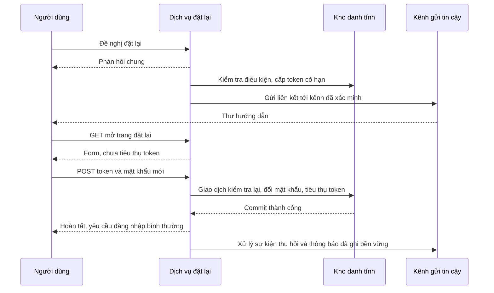

# Password reset — Đặc tả yêu cầu đặt lại mật khẩu

## 1. Vì sao đặt lại mật khẩu là một đường xác thực?

Password reset là quy trình cho phép chủ tài khoản thiết lập mật khẩu mới khi không thể dùng mật khẩu hiện tại. Quy trình này thường dựa vào bằng chứng thay thế, chẳng hạn quyền kiểm soát một hộp thư đã được xác minh. Người có bằng chứng đặt lại hợp lệ có thể thay đổi bí mật đăng nhập, vì vậy đây là một đường xác thực có ảnh hưởng trực tiếp tới quyền kiểm soát tài khoản.

Trong chương **Yêu cầu xác thực**, nhiệm vụ của người đặc tả là chuyển mục tiêu “người dùng lấy lại quyền truy cập mà kẻ tấn công không chiếm được tài khoản” thành các hành vi cụ thể, đo được và kiểm chứng được. Yêu cầu phải bao phủ từ lúc gửi yêu cầu, tạo token, chuyển liên kết, kiểm tra mật khẩu mới đến thu hồi phiên, thông báo và điều tra sự cố.

Một luồng đăng nhập dùng mật khẩu được bảo vệ tốt vẫn có thể bị vượt qua nếu trang đặt lại cho phép đoán token, lộ tài khoản, tin một địa chỉ email chưa xác minh hoặc sử dụng lại liên kết cũ. Thiết kế phục hồi phải được đưa vào mô hình đe dọa ngay từ đầu.

### Phân biệt các thao tác có vẻ giống nhau

| Thao tác | Bằng chứng thường dùng | Hệ quả cần đặc tả |
|---|---|---|
| Đổi mật khẩu | Phiên hợp lệ và xác thực lại bằng credential hiện tại hoặc phương thức được phê duyệt | Người đang kiểm soát tài khoản chủ động thay mật khẩu |
| Đặt lại mật khẩu | Token hoặc bằng chứng thay thế được cấp qua quy trình phục hồi | Không yêu cầu người dùng nhớ mật khẩu cũ; phải bảo vệ bằng chứng thay thế |
| Phục hồi tài khoản | Quy trình rộng hơn khi mất nhiều yếu tố hoặc mất kênh nhận thông báo | Có thể cần xác minh danh tính và kiểm soát thủ công |
| Khôi phục MFA | Bằng chứng để thay hoặc đăng ký lại yếu tố thứ hai | Không được tự thực hiện chỉ vì đã đặt lại mật khẩu |
| Quản trị viên hỗ trợ đặt lại | Quyền vận hành cùng bằng chứng và phê duyệt theo chính sách | Phải có trách nhiệm giải trình, hạn mức và nhật ký |

Trong bài này, mô hình chính là ứng dụng quản lý mật khẩu cục bộ và gửi liên kết đặt lại tới email đã xác minh trước đó. Nếu nhà cung cấp danh tính bên ngoài có thẩm quyền quản lý mật khẩu, ứng dụng cần chuyển người dùng tới quy trình được phê duyệt của nhà cung cấp đó. Không tự thêm một đường đặt mật khẩu cục bộ để vượt chính sách danh tính liên kết.

## 2. Xác định tài sản, ranh giới tin cậy và rủi ro

Các tài sản cần bảo vệ gồm quyền kiểm soát tài khoản, mật khẩu mới, token đặt lại, địa chỉ khôi phục, phiên đang tồn tại và dữ liệu kiểm toán. Token đặt lại thường là **bearer secret**: ai nắm được token còn hiệu lực có thể sử dụng quyền đặt lại mà token cấp.

Một luồng gửi email đi qua nhiều ranh giới: trình duyệt, gateway, ứng dụng, kho token, hàng đợi, nhà cung cấp email và hộp thư người nhận. Mỗi nơi sao chép URL hoặc nội dung yêu cầu đều có thể trở thành nơi rò rỉ token.

| Mã rủi ro | Kịch bản đe dọa | Mục tiêu kiểm soát |
|---|---|---|
| R-01 | Thử nhiều email và quan sát phản hồi để tìm tài khoản tồn tại | Giảm khả năng dò tài khoản qua nội dung, trạng thái và thời gian phản hồi |
| R-02 | Đoán hoặc tái tạo token từ dữ liệu dễ biết | Token có đủ độ ngẫu nhiên và giới hạn thử |
| R-03 | Đánh cắp liên kết qua log, referrer, trang phân tích hoặc nội dung email | Hạn chế nơi xuất hiện và thời gian tồn tại của secret |
| R-04 | Dùng lại token hoặc gửi hai yêu cầu đồng thời | Một token chỉ có thể hoàn tất tối đa một lần đặt lại |
| R-05 | Chèn Host hoặc URL chuyển hướng để đưa người dùng tới trang giả | Liên kết và điều hướng dựa trên cấu hình tin cậy |
| R-06 | Gửi yêu cầu liên tục để làm mất hiệu lực liên kết của nạn nhân hoặc gây email flooding | Hạn mức cấp phát và bảo vệ khả năng sử dụng |
| R-07 | Phiên bị đánh cắp vẫn hoạt động sau khi chủ tài khoản đặt lại mật khẩu | Thu hồi phiên và token liên quan theo thời gian đã cam kết |
| R-08 | Đặt lại mật khẩu làm tắt MFA hoặc đổi email khôi phục | Giới hạn quyền của bằng chứng đặt lại |
| R-09 | Nhân viên hỗ trợ vượt quy trình bằng một thao tác quản trị | Kiểm soát quyền, bằng chứng, phê duyệt và nhật ký |
| R-10 | Khôi phục bản sao lưu làm token đã dùng hoạt động trở lại | Quy trình phục hồi dữ liệu giữ được trạng thái an toàn |

Nếu hộp thư là bằng chứng duy nhất, việc chiếm hộp thư có thể cho phép đặt lại mật khẩu. Đây là giả định tin cậy cần được ghi rõ. Với tài khoản đặc quyền, nhóm thiết kế có thể yêu cầu thêm bằng chứng độc lập hoặc quy trình phục hồi khác; không xem email là đủ cho mọi mức rủi ro.

## 3. Viết yêu cầu theo hợp đồng có thể đo

Mỗi yêu cầu nên có mã, đối tượng, điều kiện kích hoạt, hành vi bắt buộc, điểm thực thi và bằng chứng nghiệm thu. Các giới hạn thời gian phải chỉ rõ mốc bắt đầu và mốc kết thúc.

Ví dụ chưa đủ rõ:

> Liên kết đặt lại phải an toàn, hết hạn nhanh và chỉ dùng một lần.

Ví dụ có thể kiểm thử:

> **PR-TOK-01:** Dịch vụ đặt lại phải sinh phần bí mật của token bằng bộ sinh ngẫu nhiên mật mã với ít nhất 32 byte ngẫu nhiên. Token có hạn 15 phút tính từ thời điểm cấp được ghi nhận tại server. Token chỉ hợp lệ cho một tài khoản và mục đích đặt lại mật khẩu. Sau khi một giao dịch đặt lại thành công, token đó và các token đặt lại còn hiệu lực của cùng tài khoản phải bị vô hiệu hóa.

Các ngưỡng trong bài là **cấu hình minh họa**, không phải tuyên bố đáp ứng một tiêu chuẩn hay nghĩa vụ cụ thể. Nhóm phát triển phải chọn giá trị phù hợp với rủi ro, khả năng vận hành và trải nghiệm thực tế, rồi ghi lý do lựa chọn.

Một hồ sơ mẫu:

| Thuộc tính | Quyết định minh họa | Mốc kiểm tra |
|---|---|---|
| Bí mật token | Ít nhất 32 byte ngẫu nhiên trước mã hóa biểu diễn | Tại thành phần sinh token |
| Thời hạn token | 15 phút từ lúc cấp | Token không hợp lệ khi thời gian server lớn hơn hoặc bằng `expires_at` |
| Hạn mức gửi theo tài khoản | Tối đa 3 thông báo trong cửa sổ trượt 15 phút | Tại dịch vụ cấp và gửi thông báo |
| Hạn mức yêu cầu theo nguồn | Tối đa 20 yêu cầu trong 5 phút trước khi hạn chế bổ sung | Tại gateway kết hợp tín hiệu chống lạm dụng |
| Phiên và token truy cập liên quan | Ngừng chấp nhận trong tối đa 60 giây sau khi giao dịch đặt lại hoàn tất | Tại mọi vùng và mọi điểm xác minh thuộc phạm vi |
| Thông báo đã đổi mật khẩu | Đưa sự kiện vào cơ chế gửi tin cậy cùng giao dịch; bắt đầu gửi trong 1 phút khi dịch vụ gửi hoạt động | Từ lúc commit đến lần thử gửi đầu tiên |

Không coi IP là định danh của một người: mạng công ty có thể dùng chung IP, còn kẻ tấn công có thể phân tán nguồn. Hạn mức theo nguồn phải kết hợp với tài khoản đích và tín hiệu tổng hợp. Độ trễ của nhà cung cấp email cũng không nằm hoàn toàn trong quyền kiểm soát của ứng dụng, nên cần tách mục tiêu xử lý nội bộ khỏi thời gian thư tới hộp thư.

## 4. Yêu cầu tiếp nhận đề nghị đặt lại

### 4.1. Không tiết lộ tài khoản qua phản hồi công khai

Endpoint đề nghị đặt lại nên trả cùng cấu trúc và cùng thông điệp cho tài khoản tồn tại, không tồn tại, bị vô hiệu hóa hoặc không được phép đặt lại theo cách này. Ví dụ:

> Nếu thông tin phù hợp với một tài khoản có thể đặt lại mật khẩu, chúng tôi sẽ gửi hướng dẫn tới kênh đã đăng ký.

Một đặc tả cụ thể:

> **PR-REQ-01:** Với yêu cầu có cú pháp hợp lệ, API trả `202 Accepted` và cùng thông điệp công khai bất kể tài khoản có tồn tại hoặc đã đạt hạn mức gửi theo tài khoản. Không đưa email đã che một phần, tên người dùng, mã nội bộ hay lý do phân loại tài khoản vào phản hồi.

Giới hạn theo nguồn có thể trả lỗi hạn mức nếu quyết định đó độc lập với việc tài khoản đích tồn tại. Sự cố toàn hệ thống có thể có phản hồi khác nếu áp dụng nhất quán. Không dùng mã trạng thái riêng cho trường hợp “email không có trong hệ thống”.

Thời gian xử lý cũng có thể tiết lộ thông tin. Cần tránh việc nhánh tồn tại chờ gửi email còn nhánh không tồn tại trả ngay. Có thể tiếp nhận qua một đường bất đồng bộ chung rồi xử lý điều kiện cấp phát ở phía sau. Không khẳng định thêm một khoảng ngủ cố định sẽ làm mọi phản hồi giống nhau; kiểm thử phải so sánh phân bố thời gian dưới tải và điều kiện gần thực tế.

### 4.2. Chỉ gửi tới kênh có thẩm quyền

- Địa chỉ nhận phải lấy từ hồ sơ tài khoản đã xác minh, không lấy trực tiếp từ một trường “email nhận liên kết” do người gọi tự chọn.
- Việc tra cứu định danh phải dùng quy tắc chuẩn hóa của hệ thống tài khoản; không tự thêm quy tắc có thể ghép nhầm hai tài khoản.
- Đổi địa chỉ khôi phục phải là luồng riêng có xác thực và thông báo phù hợp.
- Không yêu cầu mật khẩu cũ tại bước đề nghị đặt lại; người dùng có thể đã quên mật khẩu đó.
- Gửi đề nghị không được đổi mật khẩu hiện tại, khóa tài khoản hoặc tạo phiên đăng nhập.

### 4.3. Chống lạm dụng mà không tự tạo đường khóa tài khoản

Phải có hạn mức cho đề nghị đặt lại, số lần gửi thư, số token đang hiệu lực và thao tác kiểm tra token. Nếu vượt hạn mức theo tài khoản, phản hồi công khai vẫn tuân theo PR-REQ-01; hệ thống ghi nhận nội bộ và hạn chế công việc phía sau.

Không tự động vô hiệu hóa một liên kết còn hạn chỉ vì nhận thêm yêu cầu chưa xác thực. Nếu mỗi lần gửi lại đều làm liên kết trước mất hiệu lực, kẻ tấn công có thể liên tục yêu cầu đặt lại để nạn nhân không sử dụng được thư vừa nhận.

Một lựa chọn là cho phép tối đa 3 token còn hiệu lực trong cùng cửa sổ 15 phút, giữ nguyên các token đã cấp và ngừng cấp thêm khi đạt giới hạn. Khi một token hoàn tất đặt lại, toàn bộ token còn lại của tài khoản bị vô hiệu hóa. Lựa chọn này vẫn cần đánh giá nguy cơ làm đầy hạn mức và các biện pháp hỗ trợ người dùng; không có hạn mức đơn lẻ nào tự giải quyết mọi dạng lạm dụng.

## 5. Yêu cầu tạo và lưu token

### 5.1. Thuộc tính bắt buộc

Token đặt lại cần có các thuộc tính sau:

1. **Khó đoán:** sinh từ nguồn ngẫu nhiên mật mã, không từ thời gian, email, số tài khoản, UUID dự đoán được hoặc bộ sinh ngẫu nhiên phục vụ mô phỏng.
2. **Đúng chủ thể:** liên kết với tài khoản ở server; không cho người gọi đổi `account_id` để sử dụng cùng token cho người khác.
3. **Đúng mục đích:** token đặt lại không được dùng làm token xác minh email, đăng nhập hoặc thay MFA.
4. **Có hạn:** server kiểm tra thời hạn theo nguồn thời gian được quản lý; client không quyết định hiệu lực.
5. **Dùng một lần:** trạng thái sử dụng được bảo vệ trước tranh chấp đồng thời.
6. **Có thể thu hồi:** bị vô hiệu hóa sau sự kiện như đặt lại thành công, vô hiệu hóa tài khoản hoặc xử lý sự cố đã định nghĩa.

Chuỗi Base64url hay hex chỉ là cách biểu diễn; nó không làm tăng entropy. Tiền tố để nhận diện loại token hoặc mã tra cứu công khai cũng không được tính vào số byte bí mật.

### 5.2. Kho xác minh và dữ liệu cần lưu

Với token ngẫu nhiên có entropy cao, server có thể lưu digest mật mã hoặc HMAC của phần bí mật thay cho token nguyên văn. Cơ chế này khác password hashing: token do máy sinh không có đặc điểm dễ đoán như mật khẩu do con người chọn. Nếu dùng HMAC, khóa HMAC phải được quản lý ngoài kho bản ghi token, có phiên bản và quy trình xử lý khi bị lộ.

Một bản ghi khái niệm:

```text
PasswordResetRecord
  token_id                 mã tra cứu không phải bí mật
  account_id               tài khoản đích
  purpose                  PASSWORD_RESET
  token_verifier           digest hoặc HMAC của phần bí mật
  verifier_key_version     nếu cơ chế xác minh cần khóa có phiên bản
  issued_at
  expires_at
  consumed_at              rỗng khi chưa dùng
  revoked_at               rỗng khi chưa thu hồi
  credential_version       phiên bản credential lúc cấp
```

Tên trường chỉ minh họa trách nhiệm dữ liệu. Verifier phải kiểm tra trạng thái tài khoản hiện tại và phiên bản credential khi hoàn tất, không chỉ tin dữ liệu lúc cấp. So sánh giá trị bí mật dẫn xuất theo cách tránh tạo rò rỉ thời gian có thể khai thác.

Token có chữ ký và tự chứa thông tin không tự đáp ứng tính dùng một lần. Nếu verifier chỉ kiểm tra chữ ký và thời hạn, cùng token có thể được gửi lại nhiều lần. Muốn giới hạn sử dụng cần trạng thái tiêu thụ, phiên bản credential hoặc cơ chế tương đương có khả năng xử lý đồng thời.

### 5.3. Phân biệt verifier với dữ liệu dùng để gửi thư

Kho xác minh có thể không lưu token nguyên văn, nhưng hệ thống vẫn cần chuyển liên kết tới người dùng. Nếu dùng hàng đợi hoặc outbox chứa liên kết, dữ liệu đó vẫn chứa secret có khả năng sử dụng.

> **PR-TOK-STORE-01:** Kho xác minh không lưu token nguyên văn. Payload gửi thư chứa token phải được mã hóa khi lưu, chỉ thành phần gửi được đọc, có thời hạn giữ ngắn và không được xuất vào log, giao diện hỗ trợ hoặc hệ thống phân tích. Quy tắc xóa phải bao phủ bản sao và chính sách sao lưu liên quan.

Không dùng câu “chỉ lưu hash” để bỏ qua hàng đợi, bộ nhớ đệm hoặc công cụ kiểm tra thư. Cần vẽ được đường đi thực tế của secret và chỉ ra nơi có quyền đọc nó.

## 6. Yêu cầu liên kết và trang đặt lại mật khẩu

### 6.1. Chống liên kết độc hại và rò rỉ URL

Liên kết phải sử dụng HTTPS và tên miền được cấu hình tin cậy. Không tạo liên kết bằng cách ghép trực tiếp `Host`, `X-Forwarded-Host` hoặc tham số chuyển hướng từ yêu cầu công khai. Nếu dùng nhiều tên miền theo tenant, ánh xạ tenant sang tên miền phải lấy từ cấu hình được quản lý và kiểm tra quyền sở hữu.

Trang tiếp nhận token cần có các yêu cầu:

- Không tải tài nguyên, analytics hoặc script bên thứ ba có thể tiếp cận token hay dữ liệu nhập mật khẩu.
- Áp dụng `Referrer-Policy: no-referrer` và `Cache-Control: no-store` cho các phản hồi chứa dữ liệu phục hồi nhạy cảm.
- Lọc token khỏi log tại gateway và các tầng phía trước ứng dụng; lọc ở ứng dụng là quá muộn nếu proxy đã ghi URL.
- Giảm thời gian token tồn tại trong thanh địa chỉ bằng cơ chế chuyển sang ngữ cảnh phục hồi có bảo vệ hoặc làm sạch URL phù hợp. Không tuyên bố thao tác này có thể xóa mọi bản sao đã tồn tại trong lịch sử hoặc hạ tầng.
- Chỉ cho phép điều hướng sau hoàn tất tới đích nội bộ hoặc danh sách đích đã phê duyệt; không chuyển tiếp token tới URL tùy ý.
- Không trả lại token hoặc mật khẩu trong HTML lỗi, phản hồi JSON, báo cáo crash hay thông điệp hỗ trợ.

### 6.2. Mở liên kết không làm tiêu thụ token

Trình duyệt, trình xem trước và công cụ quét an toàn email có thể tự mở một liên kết. Vì vậy, một yêu cầu GET chỉ được hiển thị hoặc kiểm tra sơ bộ; không được đổi mật khẩu hoặc đánh dấu token đã dùng chỉ vì trang được mở.

> **PR-WEB-01:** Token chỉ bị tiêu thụ khi một thao tác xác nhận hợp lệ hoàn tất giao dịch đặt lại mật khẩu. Yêu cầu GET, HEAD, kiểm tra trước hoặc tải lại trang không được làm thay đổi mật khẩu hay tiêu thụ token.

Nếu ứng dụng đổi token lấy một ngữ cảnh phục hồi tạm thời để làm sạch URL, ngữ cảnh đó phải có mục đích hẹp, thời hạn không vượt token gốc và không phải phiên đăng nhập đầy đủ. Việc tạo ngữ cảnh không được làm công cụ quét thư vô tình vô hiệu hóa quyền đặt lại của người dùng.

Thao tác xác nhận cuối phải dùng POST hoặc cơ chế ghi tương ứng, có kiểm soát giả mạo yêu cầu phù hợp. Nếu dùng cookie phục hồi tạm thời, cần thuộc tính cookie bảo vệ, kiểm tra origin và biện pháp CSRF theo kiến trúc. Không yêu cầu người dùng phải có cookie từ thiết bị đã khởi tạo đề nghị: họ có thể mở thư trên một thiết bị khác.

## 7. Yêu cầu kiểm tra token và mật khẩu mới

Trước khi thay đổi dữ liệu, server phải kiểm tra token đúng định dạng, tồn tại, đúng mục đích, chưa hết hạn, chưa dùng, chưa thu hồi và còn phù hợp với trạng thái tài khoản. Mọi bước được kiểm tra lại tại điểm ghi để tránh trạng thái thay đổi giữa lúc xem trang và lúc xác nhận.

Thông báo cho token không hợp lệ nên hướng dẫn người dùng yêu cầu liên kết mới mà không công khai chi tiết có ích cho việc dò token. Nguyên nhân như hết hạn, đã dùng hoặc sai verifier có thể phân biệt trong sự kiện nội bộ đã lọc bí mật.

### 7.1. Áp dụng cùng chính sách mật khẩu

Đường đặt lại phải áp dụng chính sách mật khẩu có thẩm quyền giống các đường đặt mật khẩu khác. Không cho đặt mật khẩu yếu hơn chỉ vì người dùng vào qua email.

Ví dụ chính sách của sản phẩm:

- Từ 15 đến 128 Unicode code point sau chuẩn hóa NFC; quy tắc chuẩn hóa nhất quán khi đăng nhập.
- Cho phép dán và sử dụng trình quản lý mật khẩu; giữ nguyên khoảng trắng theo chính sách đã công bố, không cắt ngắn âm thầm.
- Từ chối mật khẩu nằm trong danh sách bị cấm theo quy tắc so khớp của hệ thống.
- Không gửi mật khẩu nguyên văn tới dịch vụ bên ngoài để kiểm tra độ mạnh hoặc tình trạng đã lộ.
- Lưu password verifier bằng hàm dẫn xuất chuyên dụng như Argon2id với salt riêng và cấu hình đã được đánh giá trên hạ tầng thực tế.

Các giá trị trên là ví dụ cho sản phẩm trong bài. Nếu tổ chức đã có chính sách khác, yêu cầu đặt lại phải tham chiếu đúng phiên bản và kiểm thử việc áp dụng đồng nhất.

Giới hạn kích thước request và độ dài token phải được áp dụng trước các thao tác tốn tài nguyên. Không tính password hash đắt cho một chuỗi yêu cầu rõ ràng không hợp lệ; đồng thời tránh tạo khác biệt phản hồi giúp phân loại tài khoản.

### 7.2. Giới hạn quyền của bằng chứng đặt lại

Token đặt lại chỉ cho phép đặt mật khẩu mới của tài khoản đã gắn. Nó không cho phép đọc hồ sơ, thay email, cấp khóa API, tắt MFA hoặc đăng ký thêm authenticator. Sau khi hoàn tất, trang hướng người dùng tới đăng nhập bình thường và không tự tạo phiên đăng nhập đầy đủ.

MFA đang cấu hình vẫn phải được yêu cầu ở lần đăng nhập tiếp theo. Nếu người dùng mất MFA, họ phải sử dụng luồng phục hồi tương ứng. Với tài khoản không có mật khẩu cục bộ, không được dùng token này để tự tạo thêm một phương thức đăng nhập ngoài chính sách.

## 8. Giao dịch nguyên tử và xử lý đồng thời

Tính “dùng một lần” phải được bảo đảm ở nơi ghi dữ liệu, không chỉ bởi một lần đọc `consumed_at` trên ứng dụng. Hai tiến trình có thể cùng đọc token chưa dùng rồi cùng cập nhật nếu không có cơ chế đồng bộ phù hợp.

Một hợp đồng giao dịch cần bao gồm:

1. Xác minh lại token và điều kiện tài khoản tại thời điểm ghi.
2. Cập nhật password verifier và tăng phiên bản credential hoặc trạng thái bảo mật tương ứng.
3. Đánh dấu token đã tiêu thụ và vô hiệu hóa các token đặt lại khác của cùng tài khoản.
4. Ghi ý định thu hồi phiên và sự kiện thông báo theo cơ chế có khả năng khôi phục.

Các thay đổi cốt lõi cần nhất quán: không được commit trạng thái “token đã dùng” trong khi mật khẩu chưa đổi, hoặc đổi mật khẩu thành công mà token vẫn có thể sử dụng lại. Có thể dùng giao dịch cơ sở dữ liệu, khóa bản ghi hoặc cập nhật có điều kiện, tùy kiến trúc.

Mã giả minh họa trách nhiệm, không phải mã triển khai sẵn:

```text
completeReset(token, newPassword):
    enforceRequestSizeAndAttemptLimits()
    record = lookupAndVerifyToken(token)
    validatePasswordPolicy(newPassword)
    newVerifier = derivePasswordVerifier(newPassword)

    begin transaction
        lock account and reset record using a consistent lock order
        recheck current account state, expiry, verifier and credential version
        reject if token is consumed or revoked
        update password verifier
        advance account security version
        consume this token and revoke sibling reset tokens
        append durable session-revocation and notification events
    commit

    return reset completed; require normal sign-in
```

Việc dẫn xuất mật khẩu có thể thực hiện trước giao dịch để giảm thời gian giữ khóa, sau khi qua kiểm tra ban đầu và hạn mức. Sau đó vẫn phải kiểm tra lại điều kiện trong giao dịch. Khi hai token khác nhau của cùng tài khoản được dùng đồng thời, cơ chế khóa hoặc phiên bản phải khiến tối đa một giao dịch thay đổi thành công với thế hệ credential đó.

Nếu client gửi lại do mất phản hồi, không thực hiện lần đổi thứ hai bằng token đã tiêu thụ. Nếu dùng cơ chế idempotency để trả lại kết quả trước đó, phải ràng buộc nó với giao dịch và không cho bằng chứng đã dùng thực hiện thay đổi mới. Không tiết lộ mật khẩu hoặc tự đăng nhập để giúp client suy ra kết quả.



Trong triển khai thực tế, việc cấp token và lưu ý định gửi thư cũng cần tính nhất quán. Nếu gửi thất bại, hệ thống phải có khả năng thử lại trong thời hạn token; không gửi một liên kết đã hết hạn sau khi hàng đợi bị tồn lâu.

## 9. Thu hồi phiên và thông báo sau khi đặt lại

### 9.1. Xác định chính xác thứ phải mất hiệu lực

Đổi password hash không tự động làm mọi phiên đăng nhập mất hiệu lực. Cookie phiên, refresh token và access token tự chứa có thể vẫn được xác minh độc lập.

> **PR-SES-01:** Trong mô hình sản phẩm minh họa, sau khi giao dịch đặt lại mật khẩu commit tại thời điểm T0, mọi phiên đăng nhập, refresh token và access token người dùng thuộc tài khoản phải bị từ chối cho các yêu cầu mới tại hoặc sau T0 cộng 60 giây trên mọi vùng production.

Yêu cầu này kéo theo quyết định kiến trúc: verifier phải biết phiên bản bảo mật hiện tại, kiểm tra trạng thái thu hồi hoặc sử dụng cách khác đáp ứng được giới hạn. Một access token sống 30 phút và chỉ được kiểm tra chữ ký không đáp ứng hợp đồng thu hồi 60 giây.

Phải nêu cách xử lý khi mất kết nối tới kho trạng thái hoặc một vùng không nhận được sự kiện. Hệ thống không được báo đã bảo đảm thu hồi toàn bộ chỉ vì sự kiện đã được đưa vào hàng đợi.

Đối với khóa API, credential tích hợp hoặc các phiên do nhà cung cấp khác quản lý, cần một quyết định riêng theo mô hình rủi ro và phạm vi quyền kiểm soát. Nếu mục tiêu ứng cứu là chấm dứt mọi truy cập của kẻ chiếm quyền, phải kiểm kê các đường này; đổi mật khẩu đơn thuần không bảo đảm đạt mục tiêu đó.

### 9.2. Thông báo và quan sát vận hành

Thông báo đã đổi mật khẩu phải gửi tới kênh được xác minh trước sự kiện, không tới một địa chỉ do yêu cầu đặt lại mới cung cấp. Nội dung cần có thời điểm, hướng xử lý nếu người dùng không thực hiện và cách truy cập kênh hỗ trợ tin cậy. Không gửi mật khẩu mới hoặc token đã dùng trong thư.

Sự kiện thông báo phải được ghi bền vững để có thể thử lại. Nếu nhà cung cấp email lỗi sau khi mật khẩu đã đổi, không rollback mật khẩu theo một tác vụ bất đồng bộ và không nói người dùng rằng chưa đổi. Trạng thái thay đổi mật khẩu và trạng thái gửi thông báo cần được theo dõi riêng.

## 10. Logging, dữ liệu và quy trình hỗ trợ

### 10.1. Bằng chứng cần giữ

Sự kiện nên ghi được thời điểm, mã yêu cầu, chủ thể hoặc mã tài khoản nội bộ, loại thao tác, kết quả, nguyên nhân đã phân loại và thông tin nguồn theo chính sách dữ liệu. Quyền xem, thời hạn lưu và mục đích sử dụng phải được xác định.

| Có thể cần cho kiểm toán | Không được ghi nguyên văn |
|---|---|
| Mã token tra cứu không phải secret, mã sự kiện và mã tương quan | Phần bí mật token, liên kết đặt lại đầy đủ |
| Thời điểm cấp, hết hạn, hoàn tất hoặc thu hồi | Mật khẩu cũ, mật khẩu mới và nội dung trường xác nhận |
| Kết quả kiểm tra và nhãn nguyên nhân nội bộ | Header Authorization, cookie phiên và cookie phục hồi |
| Tài khoản đích được kiểm soát quyền truy cập | Seed TOTP, OTP hoặc recovery code |
| Trạng thái gửi thông báo và số lần thử | Payload gửi thư chứa secret trên log hoặc giao diện hỗ trợ |

Cần kiểm tra gateway, reverse proxy, trace, analytics, báo cáo lỗi và công cụ hỗ trợ. Một ứng dụng không ghi token vẫn có thể làm lộ token nếu tầng trước ghi toàn bộ query string.

### 10.2. Hỗ trợ thủ công không được trở thành đường vòng

Quy trình hỗ trợ cần nêu người có quyền xử lý, bằng chứng nhận diện chấp nhận được, trường hợp cần phê duyệt thêm và thông báo sau thao tác. Không dựa vào câu hỏi bảo mật dễ tìm trên mạng hoặc lời khai “tôi là chủ tài khoản”.

Nhân viên hỗ trợ không được yêu cầu người dùng đọc mật khẩu, token, OTP hoặc gửi ảnh seed xác thực. Nếu có công cụ kích hoạt gửi lại hướng dẫn, công cụ phải có hạn mức và nhật ký, và vẫn gửi tới kênh có thẩm quyền. Nếu kênh đó đã mất, chuyển sang quy trình phục hồi danh tính riêng.

### 10.3. Khôi phục hệ thống và làm sạch dữ liệu

Sau khi khôi phục một bản sao cũ, token đã dùng hoặc đã thu hồi không được tự có hiệu lực trở lại. Một lựa chọn an toàn là vô hiệu hóa toàn bộ token đặt lại được tạo trước thời điểm phục hồi và yêu cầu phát hành lại sau khi hệ thống sẵn sàng. Cách này cũng cần áp dụng với payload gửi thư cũ để tránh gửi liên kết không còn hợp lệ.

Nếu khôi phục dữ liệu có thể đưa password verifier hoặc phiên bản bảo mật về trạng thái cũ, quy trình phải đối soát hoặc vô hiệu hóa các phiên và credential bị ảnh hưởng trước khi mở truy cập. Mục tiêu phục hồi phải bao gồm tính đúng của trạng thái bảo mật, không chỉ khả năng khởi động lại cơ sở dữ liệu.

## 11. Ma trận truy vết và tiêu chí nghiệm thu

| Rủi ro | Yêu cầu cần hiện thực | Thành phần chịu trách nhiệm | Bằng chứng nghiệm thu |
|---|---|---|---|
| R-01: dò tài khoản | PR-REQ-01 và yêu cầu thời gian phản hồi | API, hàng đợi và gateway | So sánh cấu trúc, mã trạng thái và phân bố thời gian cho nhiều trạng thái tài khoản |
| R-02: đoán token | PR-TOK-01 và hạn mức thử | Bộ sinh token, verifier | Kiểm tra nguồn ngẫu nhiên, độ dài secret và cách cưỡng chế hạn mức |
| R-03: lộ token | PR-TOK-STORE-01 và quy tắc trang phục hồi | Kho dữ liệu, mailer, proxy, công cụ quan sát | Token giả có dấu nhận diện không xuất hiện trong log hoặc bên thứ ba |
| R-04: phát lại và tranh chấp | PR-WEB-01 và hợp đồng giao dịch | Dịch vụ danh tính, cơ sở dữ liệu | GET không tiêu thụ; gửi đồng thời chỉ một giao dịch thay đổi thành công |
| R-05: liên kết độc hại | Yêu cầu nguồn URL tin cậy | Bộ tạo liên kết và cấu hình tenant | Host hoặc URL chuyển hướng giả không thay đổi đích liên kết |
| R-06: lạm dụng gửi lại | Hạn mức và quy tắc không hủy token vì yêu cầu mới | Dịch vụ cấp phát và gửi thư | Đề nghị lặp không đổi mật khẩu, không hủy link còn hạn và không vượt quota |
| R-07: phiên còn sống | PR-SES-01 | Kho phiên, gateway và mọi verifier | Yêu cầu bằng phiên/token cũ bị từ chối tại mọi vùng sau mốc cam kết |
| R-08: vượt MFA | Giới hạn quyền token đặt lại | API đặt lại và hệ thống xác thực | MFA giữ nguyên; token không gọi được API thay yếu tố hoặc thay email |
| R-09: thao tác hỗ trợ trái phép | Quy trình hỗ trợ có quyền và bằng chứng | Công cụ vận hành | Vai trò không đủ quyền bị từ chối; thao tác hợp lệ có dấu vết |
| R-10: khôi phục sai trạng thái | Yêu cầu vô hiệu hóa khi phục hồi | Quy trình sao lưu và phục hồi | Token cũ và phiên đã thu hồi không hoạt động sau khôi phục |

### Kịch bản kiểm thử hành vi

```gherkin
Scenario: Không tiết lộ tài khoản qua đề nghị đặt lại
  Given một định danh tồn tại và một định danh không tồn tại
  When gửi hai yêu cầu có cùng cấu trúc và trong cùng điều kiện hạn mức
  Then phản hồi công khai có cùng mã trạng thái và cấu trúc thông điệp
  And không có trường mô tả tài khoản hoặc địa chỉ nhận

Scenario: Công cụ quét liên kết không tiêu thụ token
  Given một token đặt lại còn hiệu lực
  When công cụ quét thực hiện GET và HEAD tới liên kết
  Then mật khẩu hiện tại không thay đổi
  And người dùng vẫn có thể hoàn tất một lần đặt lại bằng token đó

Scenario: Hai yêu cầu đồng thời không đổi mật khẩu hai lần
  Given một token hợp lệ và hai mật khẩu mới khác nhau đều đạt chính sách
  When gửi đồng thời hai yêu cầu hoàn tất bằng cùng token
  Then đúng một giao dịch thay đổi mật khẩu thành công khi không có lỗi hạ tầng
  And token không còn thực hiện được một thay đổi mới

Scenario: Từ chối đúng tại biên hết hạn
  Given token có expires_at là E
  When server xử lý yêu cầu hoàn tất tại thời điểm E
  Then token bị từ chối
  And mật khẩu và phiên bản bảo mật không bị thay đổi

Scenario: Yêu cầu gửi lại không phá liên kết đang dùng
  Given người dùng đã nhận một liên kết còn hiệu lực
  When có thêm các đề nghị đặt lại chưa xác thực từ bên ngoài
  Then liên kết đó không mất hiệu lực chỉ vì các đề nghị mới
  And hạn mức gửi thông báo vẫn được cưỡng chế

Scenario: Đặt lại thành công không bỏ qua MFA
  Given tài khoản đang bật MFA
  When một lần đặt lại mật khẩu hoàn tất thành công
  Then không tự tạo phiên đăng nhập đầy đủ
  And lần đăng nhập bằng mật khẩu mới vẫn yêu cầu MFA

Scenario: Phiên cũ bị thu hồi theo hợp đồng
  Given tài khoản có phiên và token truy cập đang dùng tại mọi vùng
  When giao dịch đặt lại commit tại T0
  Then các yêu cầu mới bằng phiên và token cũ bị từ chối tại hoặc sau T0 cộng 60 giây
  And kết quả vẫn đúng khi một verifier đang có cache cũ
```

Kiểm thử đồng thời cũng cần trường hợp dùng hai token khác nhau của cùng tài khoản và trường hợp tài khoản bị vô hiệu hóa giữa lúc mở trang và xác nhận. Kiểm thử thời gian nên dùng nguồn thời gian có thể điều khiển trong môi trường thử để kiểm tra chính xác biên trước, tại và sau thời điểm hết hạn.

Không dùng credential thật để tạo bằng chứng kiểm thử. Việc quan sát log và tải xác thực phải dùng tài khoản, secret giả cùng môi trường được phép.

## 12. Những lỗi cần tránh khi đặc tả

| Quyết định chưa đầy đủ | Vấn đề | Yêu cầu cần bổ sung |
|---|---|---|
| “Token có chữ ký nên chỉ dùng một lần” | Chữ ký chỉ chứng minh tính xác thực của dữ liệu | Có trạng thái tiêu thụ hoặc cơ chế tương đương, kiểm tra nguyên tử |
| “Xóa token ngay khi mở link” | Trình quét email có thể làm người dùng mất quyền đặt lại | Chỉ tiêu thụ khi giao dịch xác nhận hoàn tất |
| “Đổi mật khẩu là đã đăng xuất mọi nơi” | Phiên và access token có thể độc lập với password hash | Có hợp đồng thu hồi và cơ chế cưỡng chế tại mọi verifier |
| “Gửi link tới email người gọi nhập thêm” | Kẻ tấn công có thể thay kênh nhận bằng chứng | Chỉ dùng kênh có thẩm quyền đã được xác minh |
| “Không log token ở backend là đủ” | URL có thể đã được ghi ở proxy hoặc analytics | Lọc tại tất cả điểm thu thập, trước khi xuất dữ liệu |
| “Mỗi yêu cầu mới hủy link cũ” | Tạo cơ hội gây từ chối dịch vụ cho người đang phục hồi | Chính sách gửi lại bảo toàn link còn hạn cùng hạn mức phù hợp |
| “Đặt lại xong tắt MFA cho tiện” | Bằng chứng email bị nâng quyền ngoài phạm vi | Phục hồi yếu tố là luồng riêng với mức bảo đảm tương ứng |
| “Email báo lỗi thì coi như chưa đổi” | Mật khẩu có thể đã commit thành công | Tách kết quả thay đổi và kết quả gửi; thông báo có thử lại |

## 13. Đầu ra cần có trước khi triển khai

Đặc tả password reset cần cung cấp luồng người dùng và API, vòng đời token, các điều kiện đủ để thay đổi mật khẩu, hành vi khi lỗi và trách nhiệm của từng thành phần. Các mã yêu cầu phải nối được với rủi ro và bằng chứng nghiệm thu.

Nhóm thiết kế cần chốt rõ các quyết định sau:

1. Bằng chứng nào được phép đặt lại mật khẩu của từng nhóm tài khoản, và ai quản lý bằng chứng đó.
2. Token được tạo, lưu, gửi, kiểm tra, tiêu thụ và thu hồi như thế nào, với giới hạn thời gian nào.
3. Cách chống dò tài khoản, hạn chế thử và gửi lại mà vẫn bảo đảm khả năng sử dụng.
4. Ranh giới giao dịch giữa đổi mật khẩu, vô hiệu hóa token, thu hồi phiên và ghi sự kiện.
5. Phạm vi ảnh hưởng tới MFA, email khôi phục, phiên, access token và credential tích hợp.
6. Dữ liệu nào được giữ để điều tra, dữ liệu nào phải loại bỏ và cách phục hồi hệ thống an toàn.

Một yêu cầu đặt lại mật khẩu hoàn chỉnh phải cho phép người triển khai biết chính xác khi nào được đổi bí mật, người kiểm thử biết cách chứng minh hành vi, và người vận hành biết cách phát hiện cũng như xử lý khi đường phục hồi bị lạm dụng.
