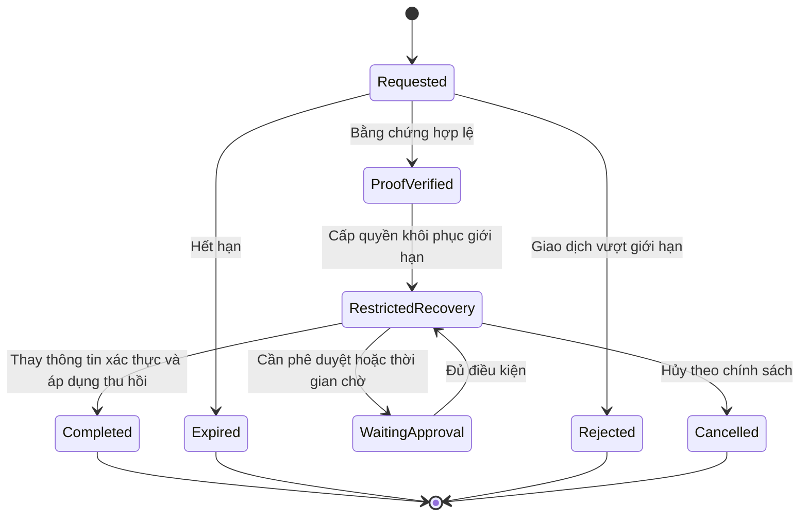

# Account recovery

## 1. Khôi phục tài khoản là một đường xác thực

Account recovery, hay khôi phục tài khoản, là quy trình giúp chủ thể hợp lệ lấy lại khả năng truy cập khi không còn sử dụng được một hoặc nhiều phương thức xác thực đã đăng ký. Tình huống có thể là quên mật khẩu, mất điện thoại chứa TOTP, hỏng khóa bảo mật, mất quyền truy cập email hoặc nghi ngờ tài khoản đã bị chiếm đoạt.

Trong chương **Yêu cầu xác thực**, khôi phục cần được đặc tả như một đường cấp lại khả năng xác thực và có thể khôi phục quyền truy cập. Nếu luồng đăng nhập yêu cầu MFA nhưng nhân viên hỗ trợ có thể tắt MFA chỉ từ một cuộc gọi, mức bảo vệ thực tế sẽ bị quyết định bởi luồng hỗ trợ đó.

Mục tiêu của bài là chuyển các rủi ro này thành yêu cầu bảo mật cụ thể, đo được và kiểm chứng được; đồng thời liên kết yêu cầu với kiến trúc, logging, phân quyền và tiêu chí kiểm thử trong vòng đời phát triển.

Một yêu cầu như “người dùng có thể khôi phục tài khoản qua email” chưa trả lời được:

- Email đã được xác minh từ khi nào, và có vừa bị thay đổi không?
- Kênh đó đủ để đặt lại mật khẩu hay đủ để thay cả MFA?
- Sau khôi phục, phiên cũ của kẻ tấn công có còn hiệu lực không?
- Người dùng có được lấy lại quyền quản trị ngay không?
- Khi mất luôn email, bằng chứng thay thế là gì?
- Làm thế nào chứng minh token chỉ dùng được một lần, kể cả khi gửi đồng thời?

Đặc tả phải bao phủ các câu hỏi này trước khi chọn giao diện hoặc nhà cung cấp gửi mã.

## 2. Phân biệt các thao tác thường bị gộp chung

| Thao tác | Mục đích | Bằng chứng thường có thể sử dụng | Điều không được tự suy ra |
|---|---|---|---|
| Đổi mật khẩu | Thay mật khẩu khi còn kiểm soát tài khoản | Phiên hợp lệ và tái xác thực phù hợp | Có phiên không đồng nghĩa được phép đổi mọi yếu tố |
| Đặt lại mật khẩu | Tạo mật khẩu mới khi không nhớ mật khẩu cũ | Bằng chứng khôi phục đã chấp nhận | Đặt lại mật khẩu không tự cho phép xóa MFA |
| Khôi phục yếu tố MFA | Thay thế yếu tố bị mất hoặc hỏng | Yếu tố dự phòng, mã khôi phục hoặc quy trình đã phê duyệt | Email đơn lẻ không mặc nhiên đủ cho tài khoản yêu cầu MFA mạnh |
| Khôi phục kênh liên hệ | Thay email hoặc số điện thoại không còn dùng được | Bằng chứng độc lập với chính kênh đang mất | Biết địa chỉ email cũ không chứng minh quyền sở hữu tài khoản |
| Khôi phục quyền sau sự cố | Cho phép sử dụng lại quyền sau khi cô lập tài khoản | Bằng chứng danh tính, xử lý sự cố và phê duyệt phù hợp | Thay mật khẩu thành công không chứng minh đã loại bỏ mọi truy cập trái phép |
| Mở khóa tài khoản | Gỡ hạn chế do thử sai hoặc trạng thái vận hành | Chính sách mở khóa và xác minh cần thiết | Tài khoản bị khóa không phải lúc nào cũng cần thay thông tin xác thực |

Tách các thao tác giúp tránh cấp quyền vượt mục đích. Một token đặt lại mật khẩu không nên được dùng cho endpoint thay email, xóa MFA hoặc cấp quyền quản trị.

Khôi phục tài khoản cũng khác với phục hồi dữ liệu. Lấy lại quyền đăng nhập không tự khôi phục khóa giải mã đầu cuối hoặc dữ liệu đã mã hóa bằng bí mật bị mất. Nếu thiết kế không giữ cơ chế khôi phục khóa, sản phẩm phải diễn đạt giới hạn đó rõ ràng.

## 3. Bắt đầu từ mô hình đe dọa và tài sản

### 3.1. Tài sản cần bảo vệ

Ngoài mật khẩu và yếu tố xác thực, cần xem xét:

- Phiên đăng nhập, refresh token và trạng thái ghi nhớ thiết bị.
- Email, số điện thoại, mã khôi phục và thông tin định tuyến khôi phục.
- Quyền quản trị, quyền xuất dữ liệu, quyền thay đổi người thụ hưởng.
- Khóa API, ứng dụng được ủy quyền và liên kết tài khoản bên ngoài.
- Bằng chứng xác minh và thông tin cá nhân được thu thập trong hỗ trợ.
- Nhật ký quyết định, thông báo và lịch sử thay đổi kênh liên hệ.

Một tài khoản được đặt lại mật khẩu nhưng còn refresh token của kẻ tấn công có thể tiếp tục bị kiểm soát. Một tài khoản đã đổi email nhưng vẫn giữ khóa API được tạo trong thời gian bị chiếm đoạt cũng chưa chắc an toàn.

### 3.2. Các đường tấn công điển hình

| Rủi ro | Cách khai thác | Hệ quả cần ngăn |
|---|---|---|
| R-01: Dò sự tồn tại tài khoản | So sánh thông báo, mã phản hồi hoặc thời gian xử lý | Lộ danh sách người dùng và hỗ trợ tấn công có chủ đích |
| R-02: Chiếm kênh khôi phục | Kiểm soát email, số điện thoại hoặc tài khoản đồng bộ | Thay thông tin xác thực và chiếm tài khoản |
| R-03: Đoán hoặc đánh cắp token | Thử mã ngắn, đọc log, lấy token từ URL bị rò | Hoàn tất khôi phục trái phép |
| R-04: Phát lại và tranh chấp đồng thời | Gửi lại token đã dùng hoặc gửi đồng thời qua nhiều nút | Thay đổi thông tin xác thực nhiều lần ngoài dự kiến |
| R-05: Lừa bộ phận hỗ trợ | Dùng thông tin công khai, giả người quản lý, tạo tình huống khẩn cấp | Bỏ qua MFA và quy trình phê duyệt |
| R-06: Chiếm phiên rồi thay kênh | Thêm email mới và dùng ngay để khôi phục | Biến truy cập tạm thời thành quyền kiểm soát lâu dài |
| R-07: Phiên cũ còn sống | Tiếp tục dùng token sau khi chủ tài khoản khôi phục | Duy trì quyền truy cập trái phép |
| R-08: Lạm dụng để gây gián đoạn | Gửi hàng loạt yêu cầu hoặc cố ý làm hết số lần thử | Spam thông báo, khóa người dùng hợp lệ |
| R-09: Nhầm tài khoản hoặc tổ chức | Ánh xạ sai email, tenant hoặc danh tính liên kết | Khôi phục sang tài khoản của chủ thể khác |
| R-10: Lộ hồ sơ hỗ trợ | Thu thập và lưu quá nhiều giấy tờ hoặc dữ liệu nhạy cảm | Tạo thêm điểm rò rỉ dữ liệu |

Từ mỗi rủi ro phải xác định điều kiện bảo vệ và bằng chứng kiểm thử. Không chỉ kiểm tra người dùng hợp lệ có nhận được email hay không.

## 4. Định nghĩa mức bảo đảm và bằng chứng được chấp nhận

### 4.1. Không đồng nhất “biết thông tin” với “kiểm soát tài khoản”

Tên, ngày sinh, địa chỉ, lịch sử bài đăng hoặc mã nhân viên có thể giúp tìm hồ sơ, nhưng không mặc nhiên chứng minh người yêu cầu có quyền kiểm soát tài khoản. Câu hỏi bí mật dựa vào thông tin công khai không nên là bằng chứng duy nhất để thay MFA.

Các loại bằng chứng cần được đánh giá theo mục đích:

| Bằng chứng | Có thể hỗ trợ điều gì? | Phụ thuộc và giới hạn |
|---|---|---|
| Yếu tố đã đăng ký còn dùng được | Chứng minh quyền kiểm soát yếu tố hiện có | Phải kiểm tra độ mới, phương thức và trạng thái thu hồi |
| Mã khôi phục đã cấp trước | Chứng minh nắm giữ bí mật khôi phục | Có thể bị sao chép; cần entropy đủ mạnh và dùng một lần |
| Kênh email đã xác minh từ trước | Chứng minh kiểm soát hộp thư tại thời điểm thử thách | Có thể đã bị chiếm; không tự chứng minh mọi yêu cầu về MFA |
| Thiết bị từng tin cậy | Bổ sung ngữ cảnh hoặc bằng chứng nếu có cơ chế mật mã phù hợp | Cookie hoặc dấu vân tay thiết bị có thể bị đánh cắp, giả mạo |
| Hồ sơ nhân sự và phê duyệt tổ chức | Hỗ trợ luồng nội bộ có nguồn thẩm quyền xác định | Cần chống giả mạo người phê duyệt và thông đồng |
| Tài liệu định danh | Có thể hỗ trợ đối chiếu nếu tài khoản đã gắn với danh tính đó | Tăng rủi ro riêng tư; tài liệu giả hoặc bị đánh cắp vẫn có thể xuất hiện |

Không mặc định yêu cầu giấy tờ là phương án tốt nhất. Với một tài khoản dùng biệt danh chưa từng xác minh danh tính thực, một giấy tờ mang tên người gửi chưa chứng minh được mối liên hệ với tài khoản đó.

Hai kênh không tự tạo thành hai yếu tố độc lập. Nếu email khôi phục và số điện thoại cùng có thể bị đặt lại qua một tài khoản đã bị chiếm, chúng có điểm lỗi chung cần đưa vào mô hình rủi ro.

### 4.2. Ma trận chính sách theo trường hợp

Ví dụ cho một ứng dụng giả định:

| Tình huống | Đường xử lý mẫu | Quyền sau khi xác minh |
|---|---|---|
| Người dùng quên mật khẩu, còn MFA | Xác minh kênh khôi phục đã đăng ký và tiếp tục yêu cầu MFA | Được đặt mật khẩu mới; quyền sử dụng theo chính sách phiên |
| Người dùng mất một yếu tố, còn yếu tố dự phòng phù hợp | Tái xác thực bằng yếu tố dự phòng, thay thế yếu tố bị mất | Có thể cấp lại phiên theo mức xác thực thực tế |
| Người dùng mất yếu tố, còn mã khôi phục | Kiểm tra mã một lần và các điều kiện bổ sung theo mức rủi ro | Phiên giới hạn để đăng ký lại yếu tố khi chính sách yêu cầu |
| Người dùng mất mọi kênh đã đăng ký | Xử lý thủ công với bằng chứng độc lập hoặc từ chối nếu không đủ | Không cấp quyền chỉ vì người yêu cầu biết thông tin hồ sơ |
| Quản trị viên mất yếu tố mạnh | Xác minh qua quy trình tổ chức, phê duyệt tách nhiệm vụ, đăng ký lại yếu tố mạnh | Chỉ khôi phục quyền quản trị khi mọi điều kiện đã hoàn tất |
| Có dấu hiệu tài khoản bị chiếm | Luồng xử lý sự cố kết hợp khôi phục, thu hồi và rà soát | Giới hạn thao tác rủi ro đến khi đáp ứng điều kiện an toàn |

Không phải hệ thống nào cũng có thể khôi phục mọi tài khoản. Nếu không có bằng chứng đủ tin cậy, từ chối khôi phục có thể là kết quả đúng theo thiết kế. Quyết định này cần được xác định trước và diễn đạt rõ trong sản phẩm.

## 5. Đặc tả luồng và trạng thái khôi phục

### 5.1. Trạng thái có ý nghĩa bảo mật

Một mô hình trạng thái mẫu:



Đây là mô hình khái niệm; triển khai có thể tách thêm trạng thái cho phê duyệt, đăng ký lại yếu tố hoặc xử lý sự cố. Điểm quan trọng là mỗi trạng thái phải xác định quyền và điều kiện chuyển.

- **Requested:** mới nhận yêu cầu; chưa có quyền đổi thông tin xác thực.
- **ProofVerified:** bằng chứng đã được kiểm tra cho đúng tài khoản và mục đích; chưa tự tạo phiên đầy đủ.
- **RestrictedRecovery:** chỉ có quyền cần thiết để hoàn tất luồng đã được cho phép.
- **WaitingApproval:** chưa thể hoàn tất thay đổi trước khi đạt điều kiện.
- **Completed:** thay đổi được ghi nhận theo giao dịch, bằng chứng một lần đã bị tiêu thụ, trạng thái thu hồi được áp dụng theo chính sách.
- **Expired, Rejected, Cancelled:** không tiếp tục chuyển đổi thông tin xác thực bằng giao dịch đó.

Một yêu cầu khôi phục chưa xác minh không được tự động khóa tài khoản, xóa yếu tố hoặc thu hồi toàn bộ phiên. Nếu ai cũng gây ra được các tác dụng đó, endpoint khôi phục trở thành công cụ từ chối dịch vụ.

### 5.2. Tách phiên khôi phục khỏi phiên sử dụng bình thường

Sau khi xác minh token, hệ thống có thể cấp một recovery session có thời hạn ngắn và quyền hẹp, ví dụ:

```text
subject: account-123
purpose: replace-lost-factor
allowed_actions:
  - enroll-approved-factor
  - confirm-recovery
expires_at: thời điểm do máy chủ quyết định
recovery_transaction: giao dịch tương ứng
```

Đây chỉ là minh họa dữ liệu do máy chủ quản lý. Không chấp nhận cấu trúc này do trình duyệt tự khai mà không có cơ chế bảo vệ và kiểm tra tin cậy.

Recovery session không được gọi API đọc dữ liệu khách hàng, tạo khóa API hoặc cấp quyền quản trị. Nếu cần đăng nhập sau khôi phục, phải cấp phiên mới đáp ứng chính sách; không nâng phiên giới hạn chỉ bằng thay một cờ phía khách.

## 6. Yêu cầu đối với token, OTP và mã khôi phục

### 6.1. Thuộc tính bắt buộc của token

Token khôi phục phải:

1. Được sinh bằng bộ sinh số ngẫu nhiên phù hợp cho mật mã.
2. Có độ khó đoán tương xứng với thời hạn, số lần thử và tác động.
3. Gắn với tài khoản nội bộ và mục đích cụ thể.
4. Có thời điểm phát hành, thời điểm hết hạn và trạng thái sử dụng do máy chủ kiểm soát.
5. Chỉ dùng được một lần cho tác dụng được phép.
6. Bị vô hiệu hóa sau những thay đổi liên quan theo chính sách, chẳng hạn khôi phục đã hoàn tất.
7. Không xuất hiện dưới dạng dùng được trong log, analytics hoặc thông báo lỗi.
8. Được lưu dưới dạng kiểm chứng phù hợp thay vì giữ bản rõ không cần thiết.

Ví dụ, token ngẫu nhiên 128 bit có thể được mã hóa thành 22 ký tự Base64url không có phần đệm. Đây là một lựa chọn minh họa cho token có entropy cao, không phải công thức dùng cho mọi sản phẩm.

Với token ngẫu nhiên đủ mạnh, có thể lưu giá trị băm hoặc giá trị kiểm chứng có khóa phù hợp để đối chiếu. Với OTP ngắn, cần xem xét riêng bảo vệ khi lộ cơ sở dữ liệu: không gian mã nhỏ khiến việc dò ngoại tuyến có thể khả thi dù đã băm. Giới hạn thử trực tuyến không giải quyết được toàn bộ tình huống lộ dữ liệu kiểm chứng.

Nếu dùng token tự chứa có chữ ký, chữ ký chỉ bảo vệ tính toàn vẹn và nguồn phát hành. Token vẫn cần kiểm soát mục đích, đối tượng nhận, thời hạn và trạng thái tiêu thụ/thu hồi phía máy chủ nếu yêu cầu dùng một lần. Chữ ký không tự mã hóa nội dung.

### 6.2. Thời hạn và giới hạn thử

Ví dụ chính sách cho luồng đặt lại mật khẩu của người dùng thông thường:

- Token liên kết có hiệu lực tối đa 15 phút.
- Recovery session sau xác minh có hiệu lực tối đa 10 phút.
- Nếu dùng OTP ngắn, một giao dịch cho phép tối đa 5 lần sai.
- Áp dụng thêm giới hạn theo tài khoản, nguồn truy cập và tải tổng để ngăn tạo giao dịch mới rồi thử tiếp.
- Tại thời điểm máy chủ bằng thời điểm hết hạn, bằng chứng bị coi là hết hiệu lực.

Các con số này là tham số giả định. Đặc tả thực tế phải thống nhất độ dài mã, thời hạn, giới hạn thử, khả năng chậm kênh gửi và mức rủi ro.

Mỗi lần yêu cầu gửi lại phải có quy tắc rõ về mã cũ, thời hạn và bộ đếm. Không để thao tác gửi lại vô tình đặt lại toàn bộ giới hạn chống dò. Đồng thời, không thiết kế việc tạo yêu cầu ẩn danh mới luôn hủy yêu cầu hợp lệ cũ, vì kẻ tấn công có thể liên tục phá luồng của người dùng.

Một lựa chọn là cho phép số lượng giao dịch chờ có giới hạn và vô hiệu hóa toàn bộ giao dịch liên quan sau khi một lần khôi phục thực sự hoàn tất. Cách chọn cụ thể cần cân bằng chống dò và chống gây gián đoạn.

### 6.3. Truyền token qua liên kết

Liên kết chứa token có thể đi qua lịch sử trình duyệt, hệ thống gửi email, gateway và công cụ quét liên kết. Vì vậy:

- Liên kết phải hướng đến origin tin cậy được cấu hình trước; không tạo từ Host header không kiểm soát.
- Tham số chuyển hướng phải được kiểm soát, tránh open redirect làm rò token.
- Trang tiếp nhận không nên tải tài nguyên bên thứ ba có thể nhận thông tin nhạy cảm.
- Đặt chính sách referrer phù hợp và loại token khỏi logging, tracing, analytics.
- Sau bước trao đổi hợp lệ, loại bí mật khỏi URL và dùng phiên khôi phục giới hạn khi phù hợp.
- Không dùng yêu cầu GET mở liên kết để thay mật khẩu, xóa yếu tố hoặc hoàn tất khôi phục.
- Thiết kế bước xác nhận có chủ đích để công cụ xem trước email không tiêu thụ bằng chứng hoặc gây thay đổi ngoài ý muốn.

Việc đổi token trong URL thành recovery session vẫn là một thao tác bảo mật. Phải quy định thời điểm tiêu thụ, chống phát lại và hành vi khi trình quét liên kết hoặc người dùng mở lại trang. Không chỉ chuyển bí mật sang một cookie rồi bỏ qua các yêu cầu này.

## 7. Thực thi thay đổi và thu hồi một cách nhất quán

### 7.1. Điểm quyết định cuối cùng

Trước khi hoàn tất khôi phục, máy chủ phải kiểm tra lại:

- Giao dịch còn hạn và chưa bị tiêu thụ, hủy hoặc thu hồi.
- Bằng chứng đủ cho loại thay đổi đang thực hiện.
- Tài khoản, tenant và mục đích đúng với giao dịch.
- Phê duyệt, thời gian chờ hoặc đăng ký yếu tố mới đã hoàn tất nếu bắt buộc.
- Các thay đổi bảo mật gần đây không làm mất hiệu lực của quyết định.
- Nội dung yêu cầu không vượt quyền của recovery session.

Việc “đã kiểm tra ở màn hình trước” không đủ. Trong khoảng thời gian đó, tài khoản có thể bị cô lập, giao dịch có thể bị hủy hoặc một lần khôi phục khác có thể đã hoàn tất.

### 7.2. Tính nguyên tử và đồng thời

Kiểm tra trạng thái rồi cập nhật ở hai bước rời rạc có thể khiến hai yêu cầu cùng thành công. Yêu cầu dùng một lần phải được thực thi bằng cơ chế nhất quán phù hợp như giao dịch cơ sở dữ liệu hoặc cập nhật có điều kiện.

Mã giả:

```text
function completeRecovery(recoverySession, requestedChange):
    session = validateRestrictedRecoverySession(recoverySession)
    require(session.allows(requestedChange.type))

    begin transaction:
        recovery = lockRecoveryTransaction(session.transactionId)
        account = lockAccount(recovery.accountId)

        require(recovery.status == "PROOF_VERIFIED")
        require(serverNow() < recovery.expiresAt)
        require(recovery.purpose == requestedChange.requiredPurpose)
        require(recovery.accountSecurityVersion == account.securityVersion)
        require(requiredApprovalsAreValid(recovery))
        require(requiredWaitingPeriodHasEnded(recovery))

        applyAllowedCredentialChange(account, requestedChange)
        revokeReplacedCredentials(account, requestedChange)
        incrementAccountSecurityVersion(account)
        markRelatedRecoveryTransactionsInvalid(account)
        markRecoveryCompleted(recovery)

        appendDurableAuditEvent(account, recovery)
        appendNotificationOutboxEvent(account, recovery)
    commit transaction

    return requireFreshAuthentication()
```

Khóa, thứ tự khóa và xử lý tranh chấp cần được thiết kế nhất quán để tránh deadlock hoặc ghi đè thay đổi. Mã giả chỉ minh họa các bất biến cần bảo vệ.

Sự kiện audit và thông báo có thể được ghi bền vững qua cơ chế outbox trong cùng giao dịch. Việc gửi email bên ngoài không cần diễn ra bên trong giao dịch cơ sở dữ liệu; phải có cơ chế gửi lại, chống gửi trùng phù hợp và theo dõi thất bại.

### 7.3. Phạm vi thu hồi

Đặc tả phải liệt kê rõ đối tượng bị thu hồi theo từng loại khôi phục:

| Đối tượng | Câu hỏi cần quyết định |
|---|---|
| Mật khẩu cũ | Có còn được xác minh sau khi giao dịch hoàn tất không? |
| Yếu tố bị mất | Credential cụ thể nào bị thu hồi, yếu tố dự phòng nào được giữ? |
| Phiên đang tồn tại | Thu hồi mọi phiên hay phạm vi được xác định theo rủi ro? |
| Refresh token | Chuỗi token và các bản thay thế có bị vô hiệu hóa không? |
| Ghi nhớ thiết bị | Có buộc xác thực lại trên các thiết bị từng tin cậy không? |
| Mã và giao dịch khôi phục | Bộ mã cũ, token chờ và recovery session cũ hết hiệu lực khi nào? |
| Khóa API và ứng dụng được ủy quyền | Cần thu hồi ngay hay rà soát trong luồng xử lý sự cố? |
| Kênh liên hệ | Có thay đổi nào do kẻ tấn công thực hiện cần xem xét lại không? |

Ví dụ một ứng dụng yêu cầu mọi phiên và refresh token cũ mất hiệu lực trong 60 giây sau khi hoàn tất khôi phục do nghi chiếm tài khoản. Đây là yêu cầu kiến trúc: token tự chứa sống lâu mà không có kiểm tra trạng thái sẽ không đáp ứng chỉ nhờ thao tác đổi mật khẩu.

Phiên bản bảo mật của tài khoản chỉ có tác dụng nếu các điểm kiểm soát thực sự kiểm tra nó hoặc nhận trạng thái thu hồi trong thời hạn đã cam kết. Cần tính cả cache, nút ở vùng khác và tác vụ nền.

## 8. Khôi phục qua hỗ trợ và tài khoản đặc quyền

### 8.1. Không biến bộ phận hỗ trợ thành yếu tố dễ giả mạo

Một quy trình hỗ trợ cần xác định:

- Ai có quyền tiếp nhận, kiểm chứng, phê duyệt và thực thi.
- Bằng chứng bắt buộc cho từng nhóm tài khoản.
- Bằng chứng nào không được chấp nhận nếu đứng một mình.
- Cách liên hệ nguồn xác minh qua thông tin đã có từ trước.
- Khi nào cần người thứ hai phê duyệt và quy tắc tránh tự phê duyệt.
- Thời hạn hiệu lực của quyết định, quyền được cấp và cách ghi audit.
- Cách xử lý yêu cầu khẩn cấp, khiếu nại và nghi ngờ gian lận.

Không gọi xác minh đến một số điện thoại mới chỉ do người đang yêu cầu cung cấp rồi coi đó là kênh độc lập. Không chấp nhận “người quản lý xác nhận” nếu danh tính và thẩm quyền người xác nhận chưa được kiểm tra qua nguồn tin cậy.

Nhân viên hỗ trợ nên thao tác qua công cụ có chính sách thực thi phía máy chủ. Một tài liệu quy trình không đủ nếu công cụ vẫn có nút tắt MFA bỏ qua mọi điều kiện.

### 8.2. Tài khoản quản trị

Với quản trị viên, khôi phục yếu tố có thể dẫn đến quyền thay đổi toàn bộ hệ thống. Một chính sách mẫu là:

1. Xác minh theo quy trình tổ chức có nguồn thẩm quyền.
2. Có hai vai trò độc lập thực hiện kiểm chứng và phê duyệt.
3. Cấp phiên khôi phục giới hạn, không có quyền quản trị dữ liệu.
4. Đăng ký và kiểm tra thành công yếu tố mạnh được phép.
5. Thu hồi yếu tố mất và trạng thái truy cập thuộc phạm vi chính sách.
6. Tái xác thực trước khi khôi phục quyền quản trị.
7. Ghi nhận và thông báo mọi ngoại lệ.

Thời gian chờ có thể giảm rủi ro cho một số thay đổi như thay kênh liên hệ hoặc lấy lại quyền đặc quyền. Cần nêu thời lượng, điểm bắt đầu, quyền bị hạn chế trong thời gian chờ và điều kiện hủy. Thời gian chờ tự nó không tạo thêm bằng chứng danh tính.

Tài khoản truy cập khẩn cấp cần chính sách riêng về bảo quản, người có quyền sử dụng, giám sát và rà soát sau sự kiện. Không dùng nó làm lối tắt thường xuyên để tránh quy trình khôi phục.

## 9. Bộ yêu cầu mẫu có thể nghiệm thu

Bộ yêu cầu dưới đây dành cho ứng dụng giả định, gồm người dùng thông thường và quản trị viên. Các ngưỡng là ví dụ thiết kế, không phải chuẩn bắt buộc áp dụng cho mọi hệ thống.

| ID | Yêu cầu | Tiêu chí kiểm chứng |
|---|---|---|
| REC-01 | Endpoint khởi tạo công khai phải trả phản hồi công khai thống nhất cho định danh có và không tồn tại | Mã phản hồi, cấu trúc và nội dung thông báo không tiết lộ tài khoản; kiểm tra riêng các khác biệt thời gian có thể khai thác |
| REC-02 | Khởi tạo chưa xác minh không được thay thông tin xác thực, khóa tài khoản hoặc thu hồi phiên | Gửi hàng loạt yêu cầu không làm thay đổi trạng thái đăng nhập của chủ tài khoản |
| REC-03 | Token liên kết phải được sinh ngẫu nhiên bằng cơ chế mật mã, có ít nhất 128 bit entropy và hết hạn sau 15 phút | Kiểm tra cấu hình/cách sinh; kiểm thử ranh giới thời hạn bằng thời gian máy chủ |
| REC-04 | Bằng chứng phải gắn với tài khoản, tenant, mục đích và trạng thái bảo mật liên quan | Token đặt lại mật khẩu không dùng được để xóa MFA, thay tài khoản hoặc chuyển tenant |
| REC-05 | Token hoặc mã khôi phục chỉ được tiêu thụ một lần bằng cơ chế nguyên tử | Hai yêu cầu đồng thời qua hai nút chỉ có một giao dịch thay đổi thành công |
| REC-06 | Luồng OTP cho phép tối đa 5 lần sai mỗi giao dịch và tối đa 10 lần sai theo tài khoản trong cửa sổ trượt 15 phút | Tạo giao dịch mới, gửi lại mã hoặc đổi IP không đặt lại giới hạn tài khoản |
| REC-07 | Recovery session có hạn tối đa 10 phút và chỉ gọi được API phục vụ mục đích đã cấp | Không thể đọc dữ liệu nghiệp vụ, xuất dữ liệu hoặc tạo khóa API bằng phiên khôi phục |
| REC-08 | Đặt lại mật khẩu không được tự xóa MFA hoặc bỏ điều kiện MFA của lần đăng nhập tiếp theo | Sau đặt lại, tài khoản vẫn phải hoàn tất yếu tố bắt buộc; nếu mất yếu tố phải đi luồng riêng |
| REC-09 | Khôi phục quản trị viên phải có kiểm chứng, phê duyệt tách nhiệm vụ và đăng ký lại yếu tố mạnh trước khi khôi phục quyền | Thiếu một điều kiện hoặc tự phê duyệt đều không hoàn tất được |
| REC-10 | Sau khôi phục do nghi chiếm tài khoản, toàn bộ phiên và refresh token cũ phải bị từ chối trong 60 giây | Kiểm tra bằng chứng cũ trên các nút, vùng và bộ nhớ đệm liên quan |
| REC-11 | Email/số điện thoại mới thay chưa đủ 24 giờ không được dùng làm bằng chứng duy nhất để thay MFA | Thay kênh rồi yêu cầu khôi phục ngay không vượt được chính sách |
| REC-12 | Giao dịch hoàn tất phải tạo audit bền vững và đưa thông báo đến kênh tin cậy đã có trước vào hàng đợi trong 60 giây | Đối chiếu thời điểm commit, audit và thời điểm tiếp nhận hàng đợi; có xử lý khi kênh cũ không còn sử dụng được |
| REC-13 | Log, trace và analytics không chứa token, OTP, mã khôi phục hay tài liệu định danh vượt chính sách | Kiểm tra các nhánh thành công, lỗi và retry bằng bí mật thử nghiệm |
| REC-14 | Nếu không đọc được trạng thái tiêu thụ hoặc không xác minh được phê duyệt bắt buộc, hệ thống không được hoàn tất khôi phục | Mô phỏng timeout, mất kết nối và lỗi nhất quán không tạo thay đổi trái chính sách |

REC-01 không có nghĩa mọi lần phản hồi phải mất chính xác cùng một số mili giây. Cần dùng đường xử lý và cơ chế gửi bất đồng bộ phù hợp, sau đó đánh giá khác biệt có thể khai thác dưới tải xác định. Tránh hứa “không thể dò” chỉ từ một thông báo chung.

REC-06 cần đi cùng giới hạn gửi, cơ chế chống bot và hỗ trợ lấy lại quyền thử phù hợp. Không biến bộ đếm thành khóa vĩnh viễn có thể bị người ngoài kích hoạt. Các đường dùng khóa công khai hoặc token entropy cao có thể cần chính sách chống lạm dụng khác.

REC-11 là biện pháp bổ sung cho một mô hình rủi ro cụ thể. Sau 24 giờ, kênh không tự trở thành bằng chứng đủ mạnh cho mọi thay đổi. Điều kiện tuổi kênh phải kết hợp với yêu cầu về bằng chứng và loại tài khoản.

REC-12 phân biệt đưa thông báo vào hàng đợi với việc người dùng đã nhận hoặc đọc email. Không cam kết thời điểm giao thư từ một chỉ số chỉ đo thời điểm hệ thống nội bộ tiếp nhận.

## 10. Truy vết sang kiến trúc và tiêu chí kiểm thử

### 10.1. Ma trận rủi ro – yêu cầu – thành phần

| Rủi ro | Yêu cầu chính | Thành phần thực thi | Bằng chứng nghiệm thu |
|---|---|---|---|
| R-01: Dò tài khoản | REC-01 | API khởi tạo, hàng đợi thông báo | So sánh phản hồi và đánh giá thời gian theo kịch bản tải |
| R-02: Chiếm kênh | REC-08, REC-09, REC-11 | Bộ chính sách, quản lý kênh, khôi phục MFA | Email đơn lẻ không thể xóa MFA hoặc lấy quyền quản trị |
| R-03: Đoán/đánh cắp token | REC-03, REC-04, REC-06, REC-13 | Bộ sinh token, kho kiểm chứng, giới hạn thử, telemetry | Kiểm tra cấu hình, giới hạn và dữ liệu ghi nhận |
| R-04: Replay/đồng thời | REC-05, REC-14 | Kho giao dịch, cơ chế khóa hoặc cập nhật có điều kiện | Hai yêu cầu cạnh tranh chỉ có một thay đổi |
| R-05: Lừa hỗ trợ | REC-09 | Công cụ hỗ trợ, bộ phê duyệt | Không tự phê duyệt, không bỏ qua bằng gọi API trực tiếp |
| R-06: Thay kênh để chiếm lâu dài | REC-04, REC-11, REC-12 | Lịch sử kênh, chính sách thay đổi, thông báo | Kênh vừa thêm không đủ cho luồng thay MFA |
| R-07: Phiên cũ còn sống | REC-10 | Kho phiên, token, kiểm tra phiên bản bảo mật | Token cũ bị từ chối trong thời hạn cam kết |
| R-08: Gây gián đoạn | REC-02, REC-06 | Chống lạm dụng, quản lý giao dịch | Yêu cầu ẩn danh không khóa hoặc thu hồi phiên |
| R-09: Nhầm tài khoản/tenant | REC-04, REC-07 | Ánh xạ danh tính, API khôi phục | Không chuyển tác dụng khôi phục sang chủ thể khác |
| R-10: Lộ hồ sơ hỗ trợ | REC-13 | Kho hồ sơ, phân quyền và thời hạn lưu | Chỉ vai trò được phép đọc, dữ liệu được xóa theo chính sách |

Ma trận giúp nhận ra yêu cầu chưa có nơi thực thi và rủi ro chưa có kiểm soát. Nó cũng tạo đầu vào cho kiểm thử bảo mật và rà soát thay đổi kiến trúc.

### 10.2. Những thành phần cần phối hợp

Một luồng khôi phục thường đi qua API công khai, dịch vụ xác thực, kho giao dịch, dịch vụ thông báo, hệ thống phê duyệt, kho phiên và API tài nguyên.

Ranh giới tin cậy phải được thể hiện trong thiết kế:

- API công khai nhận dữ liệu chưa tin cậy; không tự quyết định mức bảo đảm.
- Bộ xác minh chuyển bằng chứng thành kết quả có nguồn gốc rõ ràng.
- Bộ chính sách xác định quyền khôi phục được cấp.
- Dịch vụ thay thông tin xác thực kiểm tra lại điều kiện tại điểm commit.
- API tài nguyên nhận trạng thái thu hồi và giới hạn quyền trong thời hạn quy định.
- Hệ thống audit và thông báo hỗ trợ điều tra, phát hiện thay đổi trái phép.

Không lưu quyết định quan trọng chỉ trong trình duyệt hoặc dựa vào một trường như `recoveryApproved=true` do khách gửi.

### 10.3. SSO, liên kết tài khoản và tenant

Nếu danh tính do Identity Provider (IdP) quản lý, cần phân định:

- Bên nào chịu trách nhiệm khôi phục mật khẩu và yếu tố của danh tính.
- Bên nào thu hồi phiên ứng dụng và quyền cục bộ.
- Điều gì xảy ra nếu IdP đã khôi phục nhưng ứng dụng vẫn giữ phiên cũ.
- Cách ánh xạ danh tính sau thay đổi email hoặc liên kết tài khoản.
- Ai có quyền xác nhận người dùng trong một tổ chức cụ thể.

Không tự tạo mật khẩu cục bộ cho tài khoản chỉ dùng SSO để “hỗ trợ khôi phục” nếu đó là đường vượt chính sách tổ chức. Không gộp hai tài khoản chỉ vì chúng có cùng email mà thiếu bằng chứng và quy tắc liên kết được chấp nhận.

Email là địa chỉ liên hệ có thể thay đổi; khóa định danh ổn định và ngữ cảnh tenant cần được quản lý riêng. Một người có quyền hỗ trợ ở tenant A không được khôi phục tài khoản thuộc tenant B.

## 11. Kiểm thử theo đường lạm dụng và sự cố

### 11.1. Bộ tình huống kiểm thử

| Tình huống | Thao tác | Kết quả mong đợi |
|---|---|---|
| Luồng hợp lệ | Dùng đúng bằng chứng và hoàn tất trước hạn | Thay đúng thông tin được phép, ghi audit, yêu cầu xác thực mới theo chính sách |
| Định danh không tồn tại | Gửi yêu cầu với tài khoản giả | Phản hồi công khai thống nhất, không gửi thông báo đến địa chỉ tùy ý |
| Nhầm mục đích | Dùng token đặt lại mật khẩu gọi API xóa MFA | Từ chối, không có thay đổi |
| Nhầm tài khoản/tenant | Đổi account ID hoặc tenant ID trong yêu cầu | Không chuyển tác dụng sang tài khoản khác |
| Ranh giới thời gian | Thử ngay trước, đúng lúc và sau hết hạn | Đúng lúc hết hạn bị từ chối theo quy tắc đã nêu |
| Replay | Gửi lại token hoặc mã đã hoàn tất | Không tạo lần thay đổi thứ hai |
| Đồng thời nhiều nút | Gửi cùng bằng chứng đồng thời qua hai nút | Chỉ một giao dịch thành công |
| Gửi lại mã | Yêu cầu gửi lại rồi thử mã cũ/mới và tạo giao dịch khác | Tuân thủ quy tắc hiệu lực và giữ giới hạn thử tổng |
| Chỉ có recovery session | Gọi API dữ liệu, tạo khóa API, cấp quyền | Từ chối mọi hành động ngoài phạm vi |
| Đặt lại mật khẩu có MFA | Hoàn tất reset rồi đăng nhập chỉ bằng mật khẩu | Vẫn cần yếu tố bắt buộc |
| Kênh mới thay | Dùng email vừa cập nhật làm bằng chứng duy nhất để thay MFA | Không đáp ứng chính sách |
| Hỗ trợ tự phê duyệt | Người kiểm chứng cũng gửi lệnh phê duyệt | Máy chủ từ chối, có audit |
| Bỏ qua giao diện | Gọi trực tiếp endpoint thực thi trước khi có đủ phê duyệt | Không hoàn tất được |
| Phiên cũ | Dùng access token và refresh token trước khôi phục | Bị từ chối trong thời hạn thu hồi cam kết |
| Quét liên kết | Mở email/link bằng trình quét, GET hoặc xem trước | Không đổi thông tin xác thực và không hoàn tất ngoài ý muốn |
| Lỗi phụ thuộc | Làm kho giao dịch, hệ thống phê duyệt hoặc thông báo bị lỗi | Không bỏ qua điều kiện; sự kiện thông báo được gửi lại theo thiết kế |
| Lạm dụng khởi tạo | Gửi nhiều yêu cầu chưa xác minh | Không khóa tài khoản, không xóa yếu tố, có giới hạn chống spam |
| Khôi phục tranh chấp | Một luồng hoàn tất khi luồng khác còn mở | Bằng chứng cũ hết hiệu lực theo chính sách, không ghi đè bí mật mới |

Với thay đổi dựa trên cookie, kiểm tra thêm chống CSRF, thuộc tính cookie và kiểm soát origin phù hợp. Với liên kết, kiểm tra Host header, open redirect, referrer và dữ liệu đi vào proxy log. Với app di động, kiểm tra liên kết mở đúng ứng dụng và không trao token cho thành phần không được phép.

### 11.2. Bằng chứng cần thu thập khi nghiệm thu

Không chỉ dựa vào mã HTTP. Một endpoint có thể trả lỗi sau khi đã thay mật khẩu hoặc ghi nhận trạng thái không nhất quán. Bằng chứng nên gồm:

- Trạng thái tài khoản và credential trước/sau.
- Trạng thái giao dịch, token đã tiêu thụ và phiên khôi phục.
- Tác dụng nghiệp vụ chứng minh không cấp thêm quyền ngoài phạm vi.
- Hiệu lực access token, refresh token và trạng thái ghi nhớ trên các điểm kiểm soát.
- Audit, sự kiện hàng đợi và thời điểm theo đồng hồ máy chủ.
- Kết quả khi retry, timeout và tranh chấp đồng thời.

Dùng tài khoản và bí mật thử nghiệm. Báo cáo không nên sao chép token hoặc tài liệu định danh thật để chứng minh rằng log đang bảo vệ chúng.

## 12. Logging, thông báo và dữ liệu riêng tư

### 12.1. Sự kiện cần ghi

Các sự kiện mẫu:

```text
recovery.request.accepted
recovery.proof.failed
recovery.proof.verified
recovery.rate_limit.applied
recovery.approval.granted
recovery.approval.denied
recovery.credentials.replaced
recovery.sessions.revoked
recovery.completed
recovery.cancelled
recovery.notification.failed
```

Mỗi sự kiện nên có thời điểm máy chủ, định danh tài khoản nội bộ nếu đã xác định, tenant, định danh giao dịch không có khả năng cấp quyền, người hoặc dịch vụ thực hiện, kết quả và mã lý do nội bộ phù hợp.

Không ghi token dùng được, OTP, mã khôi phục, mật khẩu mới hoặc bản sao hồ sơ nhạy cảm vào log chung. Định danh tương quan phải khác bí mật được dùng để tiếp tục khôi phục.

Thông báo cho người dùng nên diễn đạt loại thay đổi, thời điểm, cách xử lý nếu không phải họ thực hiện và đường liên hệ tin cậy. Tránh yêu cầu phản hồi email bằng mật khẩu, OTP hoặc mã khôi phục.

### 12.2. Chọn đúng kênh thông báo

Nếu một phiên bị chiếm đã đổi email, chỉ gửi thông báo đến email hiện tại có thể giúp kẻ tấn công che giấu thay đổi. Chính sách nên xem xét kênh tin cậy đã tồn tại trước thay đổi và lịch sử kênh trong phạm vi lưu trữ được phép.

Tuy nhiên, gửi đến kênh cũ cũng có thể lộ thông tin cho người đã sở hữu kênh đó trước đây. Cần xác định thời hạn sử dụng lịch sử, nội dung tối thiểu và cách xử lý trường hợp không còn kênh độc lập. Không coi thông báo là bằng chứng rằng chủ tài khoản đã biết hoặc đồng ý.

Một yêu cầu phản đối hoặc hủy khôi phục cũng có thể gây gián đoạn. Phải xác định bằng chứng và tác dụng được phép của nút “không phải tôi”, tránh cho phép một yêu cầu chưa xác minh xóa yếu tố hoặc khóa tài khoản vô thời hạn.

### 12.3. Tối thiểu hóa dữ liệu hỗ trợ

Nếu cần hồ sơ xác minh, đặc tả phải nêu mục đích, trường dữ liệu tối thiểu, nơi lưu, người được đọc và thời hạn xóa. Phân biệt dữ liệu thô như ảnh tài liệu với kết quả quyết định như “đã kiểm chứng theo quy trình X”.

Không lưu hồ sơ định danh vô thời hạn chỉ vì từng có yêu cầu khôi phục. Cũng không cho mọi nhân viên hỗ trợ truy cập toàn bộ hồ sơ nếu công việc của họ chỉ cần xem trạng thái quyết định.

## 13. Vận hành và chỉ số đo

Chỉ số phải có định nghĩa, mẫu số và cửa sổ đo rõ ràng.

| Chỉ số | Định nghĩa mẫu | Cách sử dụng |
|---|---|---|
| Tỷ lệ hoàn tất hợp lệ | Số giao dịch hợp lệ hoàn tất / số giao dịch hợp lệ đã bắt đầu trong kỳ | Đánh giá khả năng sử dụng; tách lưu lượng tấn công |
| Thời gian hoàn tất | Từ yêu cầu hợp lệ đến hoàn tất, tách tự động và thủ công | Phân biệt thời gian người dùng, thời gian chờ và xử lý hệ thống |
| Tỷ lệ ngoại lệ | Số lần khôi phục đi đường ngoại lệ / tổng lần hoàn tất | Phát hiện phụ thuộc quá nhiều vào thao tác bỏ qua |
| Độ trễ thu hồi | Từ commit khôi phục đến khi mọi điểm trong phạm vi từ chối bằng chứng cũ | Kiểm chứng mục tiêu như 60 giây |
| Độ trễ thông báo | Từ commit đến hàng đợi tiếp nhận hoặc nhà cung cấp xác nhận, đo riêng từng mốc | Không nhầm với thời điểm người dùng đọc |
| Tỷ lệ nghi khôi phục gian lận | Số giao dịch được báo cáo/xác nhận gian lận theo định nghĩa / tổng lần hoàn tất | Hỗ trợ phát hiện; phụ thuộc chất lượng báo cáo và điều tra |
| Hồ sơ quá hạn lưu | Số hồ sơ chưa xóa khi đã quá hạn / tổng hồ sơ đến hạn | Kiểm soát chính sách dữ liệu |

Không đánh giá an toàn chỉ từ tỷ lệ hoàn tất cao. Một luồng dễ bị chiếm tài khoản cũng có thể có tỷ lệ hoàn tất rất cao. Cần kết hợp kết quả kiểm thử, sự cố, ngoại lệ và bằng chứng thực thi chính sách.

Về tính sẵn sàng, cần có phương án cho email chậm, nhà cung cấp lỗi, người dùng mất thiết bị và người dùng cần công nghệ hỗ trợ. Luồng dự phòng vẫn phải tuân thủ mức bằng chứng đã được chấp nhận; sự cố không tự cho phép tắt xác minh.

## 14. Những đặc tả cần sửa trước khi triển khai

| Cách viết chưa đủ | Vấn đề | Cách làm rõ |
|---|---|---|
| “Cho phép quên mật khẩu qua email” | Không rõ tác dụng và mức bằng chứng | Chỉ ra kênh hợp lệ, token, thời hạn, phạm vi thay đổi và MFA sau đó |
| “Token dùng một lần” | Có thể vẫn bị race condition | Quy định kiểm tra và tiêu thụ nguyên tử, có ca đồng thời nhiều nút |
| “Đổi mật khẩu thì đăng xuất mọi nơi” | Không rõ loại token và thời hạn | Liệt kê phiên, refresh token, ghi nhớ và thời hạn lan truyền |
| “Hỗ trợ xác minh thủ công” | Không có nguồn bằng chứng và thẩm quyền | Nêu bằng chứng, vai trò, phê duyệt, quyền công cụ và audit |
| “Có giấy tờ là khôi phục được” | Thiếu liên kết với danh tính đã đăng ký | Chỉ chấp nhận khi có cơ sở đối chiếu hợp lệ và chính sách dữ liệu |
| “Gửi email báo là đủ” | Không chứng minh người dùng đã biết; có thể gửi vào kênh bị chiếm | Quy định kênh, mốc đo, xử lý thất bại và đường phản đối |
| “Mất mọi yếu tố thì tắt MFA tạm” | Tạo đường vượt mức xác thực | Dùng quy trình khôi phục riêng, quyền giới hạn và đăng ký lại phù hợp |
| “Khôi phục xong là an toàn” | Có thể còn phiên, khóa API và thay đổi của kẻ tấn công | Liên kết với thu hồi, rà soát quyền và xử lý sự cố |

## 15. Bài tập áp dụng

Một cổng quản trị bắt buộc WebAuthn khi đăng nhập. Luồng quên mật khẩu gửi liên kết qua email; người dùng bấm liên kết là được cấp phiên đầy đủ. Nhân viên hỗ trợ có thể xóa mọi yếu tố từ một màn hình nội bộ. Đổi mật khẩu chưa làm mất hiệu lực refresh token.

Hãy tạo đặc tả cải tiến gồm:

1. Ít nhất năm rủi ro, bao gồm luồng email, công cụ hỗ trợ và phiên tồn tại sau khôi phục.
2. Ma trận bằng chứng cho người dùng thường, quản trị viên và trường hợp mất mọi kênh.
3. Yêu cầu có ID cho token, phiên giới hạn, phê duyệt, thay yếu tố và thu hồi.
4. Sơ đồ trạng thái kèm quyền được phép tại mỗi trạng thái.
5. Ca kiểm thử replay, đồng thời, sai tenant, mất phụ thuộc và gọi API trực tiếp.
6. Bằng chứng nghiệm thu cho thời hạn thu hồi và giới hạn quyền.
7. Chính sách lưu hồ sơ và thông báo khi khôi phục hoàn tất.

Một hướng xử lý là ngăn liên kết email trực tiếp cấp phiên đầy đủ, giữ yêu cầu MFA sau đặt lại mật khẩu, tách quyền hỗ trợ, yêu cầu đăng ký lại yếu tố phù hợp và đưa thu hồi vào giao dịch khôi phục. Mỗi thay đổi cần có nơi thực thi và ca kiểm thử chứng minh; một mô tả quy trình không thể thay thế các kiểm soát phía máy chủ.
