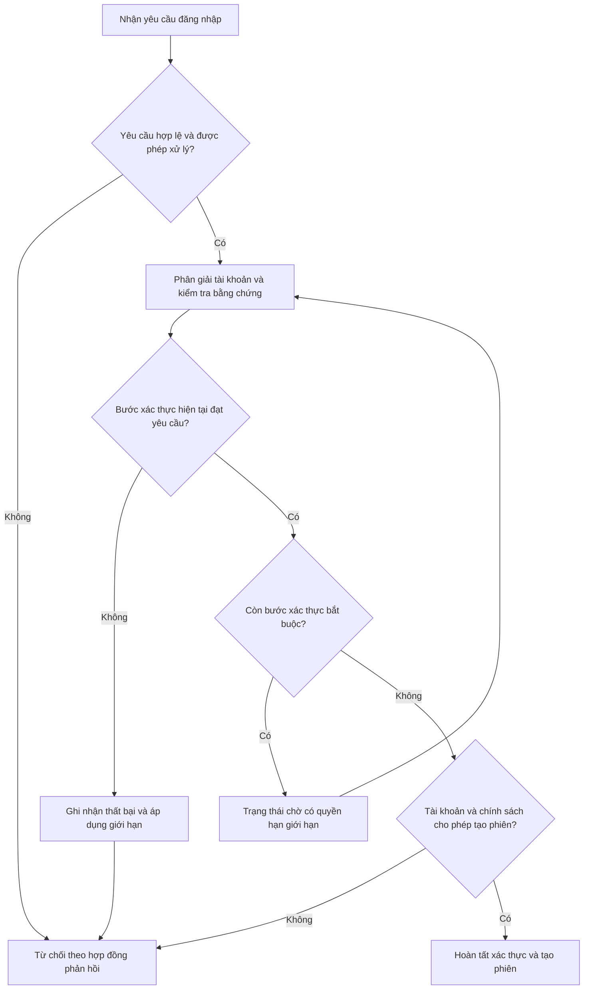

# Login failure handling

## 1. Xử lý đăng nhập thất bại là một yêu cầu bảo mật

**Login failure handling** là tập quy tắc xác định hệ thống phải làm gì khi một lần đăng nhập không thể hoàn tất: phản hồi cho người gọi, cập nhật giới hạn thử, quản lý trạng thái xác thực, ghi nhận sự kiện và cung cấp đường tiếp tục hoặc phục hồi phù hợp.

Mục tiêu không chỉ là hiển thị câu “Sai mật khẩu”. Cách xử lý thất bại có thể làm lộ tài khoản đang tồn tại, tạo điều kiện thử mật khẩu hàng loạt, khóa nhầm người dùng hợp lệ hoặc vô tình cấp quyền khi một dịch vụ phụ thuộc gặp lỗi.

Trong thiết kế yêu cầu bảo mật, cần chuyển những rủi ro đó thành điều kiện đo được: trường hợp nào bị từ chối, phản hồi nào được phép khác nhau, bộ đếm tính theo đối tượng nào, thời hạn hạn chế bao lâu, ai được mở khóa và bằng chứng nào chứng minh cơ chế hoạt động.

Ví dụ, với một cổng học tập nhiều tổ chức, người dùng nhập tổ chức, tên đăng nhập và mật khẩu. Nếu hệ thống trả “không có tài khoản” cho tên chưa đăng ký nhưng trả “sai mật khẩu” cho tên đã đăng ký, người ngoài có thể xây danh sách tài khoản. Nếu hệ thống khóa vĩnh viễn sau ba lần sai, người ngoài lại có thể cố tình làm người dùng thật mất quyền truy cập. Hai rủi ro này phải được xét đồng thời.

## 2. Xác định phạm vi của một lần đăng nhập

### 2.1. Đăng nhập chưa hoàn tất khác với đăng nhập thành công

Một luồng có thể gồm nhiều bước: xác định không gian tài khoản, kiểm tra mật khẩu, kiểm tra yếu tố bổ sung, đánh giá trạng thái tài khoản và phát hành phiên. Thành công ở một bước không đồng nghĩa đã được tạo phiên có quyền sử dụng ứng dụng.

Có thể mô hình hóa trạng thái như sau:



Trạng thái chờ MFA chỉ được phép tiếp tục hoặc hủy luồng xác thực theo phạm vi đã thiết kế. Nó không được có quyền đọc dữ liệu nghiệp vụ như một phiên đăng nhập hoàn chỉnh.

Nếu người dùng đang có một phiên hợp lệ rồi thử đăng nhập tài khoản khác và thất bại, hệ thống không được âm thầm chuyển danh tính của phiên hiện có. Mọi thay đổi hoặc thu hồi phiên phải tuân theo chính sách riêng, tránh để người ngoài tùy ý gây đăng xuất cho nạn nhân chỉ bằng cách nhập sai mật khẩu của họ.

### 2.2. Phân loại nội bộ để xử lý đúng

| Nhóm kết quả nội bộ | Ví dụ | Ý nghĩa đối với quyết định |
|---|---|---|
| Dữ liệu đầu vào không hợp lệ | Thiếu trường bắt buộc, độ dài vượt giới hạn | Có thể từ chối trước bước kiểm tra danh tính |
| Bằng chứng không hợp lệ | Mật khẩu sai, mã xác thực sai | Không hoàn tất xác thực; cập nhật ngân sách thử tương ứng |
| Không phân giải được tài khoản | Tên không tồn tại trong không gian đăng nhập | Xử lý phản hồi sao cho không tiết lộ sự tồn tại của tài khoản |
| Trạng thái tài khoản không cho phép | Tài khoản bị vô hiệu hóa hoặc chịu hạn chế | Không tạo phiên; không tự công khai trạng thái cho người chưa được xác minh |
| Giới hạn thử bị vượt | Một nguồn hoặc một định danh bị hạn chế tạm thời | Từ chối hoặc trì hoãn theo chính sách chống lạm dụng |
| Luồng xác thực không hợp lệ | Thử thách hết hạn, sai phiên, bị dùng lại | Không chấp nhận bằng chứng cho ngữ cảnh sai |
| Phụ thuộc gặp lỗi | Kho tài khoản, dịch vụ MFA hoặc bộ đếm không khả dụng | Không diễn giải lỗi kỹ thuật thành xác thực thành công |

Mã nguyên nhân nội bộ có thể chi tiết hơn thông báo công khai. Điều này giúp điều tra và vận hành mà không buộc giao diện phải tiết lộ toàn bộ trạng thái tài khoản.

## 3. Nối đe dọa với điều kiện bảo vệ

| Đe dọa | Biểu hiện | Yêu cầu cần có |
|---|---|---|
| Dò tài khoản | So sánh thông báo, mã trạng thái hoặc thời gian phản hồi | Hợp đồng phản hồi nhất quán trong cùng lớp thất bại |
| Brute force | Thử nhiều mật khẩu vào một tài khoản | Giới hạn theo định danh và theo nguồn, có trạng thái dùng chung |
| Credential stuffing | Dùng các cặp tên và mật khẩu bị lộ từ nơi khác | Kiểm soát lưu lượng, quan sát chiến dịch và yêu cầu xác thực bổ sung phù hợp |
| Password spraying | Thử một vài mật khẩu trên nhiều tài khoản | Giám sát tổng hợp theo nguồn và mẫu hành vi, không chỉ từng tài khoản |
| Tấn công phân tán | Đổi địa chỉ mạng để tiếp tục thử cùng một tài khoản | Không dựa riêng vào địa chỉ IP |
| Gây khóa tài khoản | Cố tình nhập sai để nạn nhân không thể đăng nhập | Hạn chế có thời hạn và đường phục hồi được bảo vệ; không kéo dài khóa vô hạn vì yêu cầu bị chặn |
| Cạn tài nguyên xác minh | Gửi lượng lớn yêu cầu làm đầy CPU, bộ nhớ hoặc kho bộ đếm | Kiểm tra kích thước, hạn mức sớm và giới hạn số khóa trạng thái |
| Bỏ qua MFA khi lỗi | Lợi dụng lỗi dịch vụ yếu tố bổ sung | Không phát hành phiên khi thiếu điều kiện bắt buộc |
| Dùng lại trạng thái chờ | Phát lại mã thử thách hoặc đổi chủ thể giữa luồng | Ràng buộc thử thách với mục đích, chủ thể, phiên và thời hạn |

Không có một ngưỡng duy nhất giải quyết được mọi đe dọa. Giới hạn quá lỏng để lại nhiều lượt thử; giới hạn quá chặt có thể biến thành công cụ từ chối dịch vụ đối với người dùng thật.

## 4. Thiết kế hợp đồng phản hồi tránh dò tài khoản

### 4.1. Thống nhất các trường hợp tiết lộ trạng thái danh tính

Với người chưa xác thực, những trường hợp như tên không tồn tại, mật khẩu sai hoặc tài khoản không được phép đăng nhập nên được ánh xạ vào một phản hồi công khai chung theo mô hình rủi ro của hệ thống.

Ví dụ thông báo:

> Không thể hoàn tất đăng nhập. Hãy kiểm tra thông tin hoặc sử dụng quy trình hỗ trợ truy cập.

Không trả nguyên nhân nội bộ như “Tài khoản này có tồn tại nhưng đã bị khóa”. Cũng không đưa nguyên nhân vào một thuộc tính JSON ít được hiển thị rồi cho rằng giao diện đã che giấu được thông tin.

Những bề mặt cần kiểm tra gồm:

- Nội dung và cấu trúc body, bao gồm mã lỗi máy đọc được.
- Mã trạng thái, header và độ dài phản hồi có ý nghĩa phân biệt.
- Cookie được đặt hoặc bị xóa, chuyển hướng và URL tiếp theo.
- Nội dung trang, thông báo trợ năng và hành vi nút phục hồi.
- Thời gian phản hồi và số bước mà người gọi quan sát được.
- Hành vi trên ứng dụng di động, API cũ và các endpoint phụ trợ.

Tính nhất quán phải được xét theo **cùng một lớp đầu vào và kết quả công khai**. Ví dụ, lỗi thiếu trường bắt buộc có thể mô tả rõ trường cần nhập vì điều đó không phụ thuộc việc tài khoản tồn tại. Một giới hạn chung theo nguồn có thể có phản hồi riêng nếu nó được áp dụng đồng đều, không dùng trạng thái tài khoản làm tín hiệu phân biệt.

### 4.2. Ví dụ hợp đồng API

Một hệ thống có thể chọn hợp đồng sau:

| Điều kiện quan sát công khai | Phản hồi minh họa | Ràng buộc |
|---|---|---|
| Yêu cầu sai cấu trúc | `400`, mã `INVALID_LOGIN_REQUEST` | Chỉ phản ánh quy tắc đầu vào, không tiết lộ kết quả tra cứu tài khoản |
| Yêu cầu hợp lệ nhưng không hoàn tất vì thông tin, trạng thái tài khoản hoặc hạn chế theo định danh | `401`, mã `LOGIN_NOT_COMPLETED` | Cùng cấu trúc và thông báo cho tài khoản có thật lẫn không tồn tại |
| Vượt hạn mức chung theo nguồn gửi | `429`, mã `LOGIN_RATE_LIMITED` | Áp dụng cho mọi định danh theo cùng quy tắc nguồn |
| Dịch vụ đăng nhập chung không khả dụng | `503`, mã `LOGIN_TEMPORARILY_UNAVAILABLE` | Không dùng lỗi phụ thuộc chỉ xảy ra sau khi tìm thấy tài khoản để tạo tín hiệu tồn tại |

Đây là lựa chọn minh họa cho một API; dự án phải thống nhất với giao thức và kiến trúc của mình. Điều cần kiểm chứng là các khác biệt công khai không vô tình mã hóa trạng thái bí mật của danh tính.

Nếu hệ thống chỉ phát hiện lỗi phụ thuộc trên nhánh tài khoản có thật, việc trả `503` cho nhánh đó và `401` cho nhánh không tồn tại có thể làm lộ danh tính. Cần thiết kế chế độ suy giảm hoặc ánh xạ phản hồi phù hợp cho cả lớp yêu cầu, thay vì chỉ thay câu chữ ở giao diện.

### 4.3. Thời gian phản hồi cũng thuộc hợp đồng

Một nhánh trả ngay khi không tìm thấy tài khoản trong khi nhánh còn lại thực hiện phép kiểm tra mật khẩu tốn tài nguyên có thể tạo khác biệt đo được.

Có thể dùng đường xác minh giả với cấu hình chi phí phù hợp cho trường hợp không tồn tại, kết hợp cách xử lý nhất quán đối với các trạng thái từ chối khác. Không cần dùng mật khẩu thật của một tài khoản khác cho bước này.

Thiết kế phải đồng thời giữ được ngân sách tài nguyên: áp dụng giới hạn nguồn và kiểm tra đầu vào trước khi thực hiện công việc xác minh đắt. Đường xác minh giả không được trở thành lý do cho phép lượng công việc không giới hạn.

Không nên tuyên bố mọi phản hồi mạng sẽ có thời gian bằng nhau tuyệt đối. Thêm một khoảng ngủ cố định hoặc nhiễu ngẫu nhiên không tự loại bỏ một chênh lệch có hệ thống. Cần đo nhiều mẫu trong điều kiện kiểm soát và đánh giá cùng những kênh lộ thông tin khác.

## 5. Định nghĩa bộ đếm trước khi chọn con số

### 5.1. Đếm theo đối tượng nào?

| Khóa giới hạn | Mục tiêu | Hạn chế cần xét |
|---|---|---|
| Định danh trong không gian đăng nhập | Hạn chế thử vào cùng một đích | Người ngoài có thể cố tình gây hạn chế cho nạn nhân |
| Nguồn mạng | Giảm lưu lượng và chi phí xử lý | Nhiều người có thể dùng chung mạng; người tấn công có thể đổi nguồn |
| Luồng hoặc thử thách | Ngăn thử vô hạn một mã MFA hay trạng thái chờ | Tạo luồng mới không được xóa toàn bộ giới hạn tích lũy |
| Thiết bị hoặc tín hiệu máy khách | Bổ sung ngữ cảnh rủi ro | Dữ liệu máy khách có thể bị thay đổi hoặc thiếu |
| Toàn dịch vụ hoặc tuyến API | Bảo vệ năng lực hệ thống | Không phân biệt được đầy đủ tấn công với tăng trưởng lưu lượng hợp lệ |

Tên đăng nhập phải được đưa vào khóa theo đúng quy tắc chuẩn hóa và không gian danh tính đã đặc tả. Nếu chỉ giới hạn theo chuỗi thô, thay đổi chữ hoa hoặc cách biểu diễn được coi là tương đương có thể tạo thêm ngân sách thử.

Với hệ thống nhiều tenant, cần xác định tenant hoặc thư mục là một phần của khóa hay không. Không tự gộp hai tài khoản trùng tên ở hai miền, cũng không bỏ qua khả năng một chiến dịch thử trên nhiều tenant.

Đối với tên không tồn tại, vẫn cần cơ chế hạn chế và hình dạng phản hồi tương ứng. Việc chỉ tạo bộ đếm khi tìm thấy tài khoản có thể làm chính cơ chế chống dò trở thành một kênh dò tài khoản.

Khóa trạng thái có thể được dẫn xuất bằng một hàm có khóa bí mật từ không gian và định danh chuẩn hóa để hạn chế lộ trực tiếp dữ liệu trong kho bộ đếm. Cách này không làm dữ liệu trở thành vô danh và vẫn cần kiểm soát truy cập, vòng đời khóa cùng chính sách lưu.

### 5.2. Khi nào tăng, hết hạn hoặc đặt lại?

Đặc tả phải trả lời:

1. Sự kiện nào là một lần sai: bằng chứng sai, yêu cầu bị chặn hay lỗi kỹ thuật?
2. Cửa sổ là cố định, trượt hay một cơ chế cấp ngân sách khác?
3. Lượt thử song song được tính bằng thao tác nguyên tử nào?
4. Khi bị chặn, yêu cầu mới có kéo dài thời gian hạn chế không?
5. Thành công ở bước nào được phép đặt lại loại bộ đếm nào?
6. Khi tạo thử thách mới, ngân sách tích lũy có được giữ không?
7. Khi trạng thái hết hạn hoặc một máy chủ khởi động lại, điều kiện bảo vệ còn được giữ thế nào?

Không gộp mọi lỗi kỹ thuật vào “người dùng nhập sai”. Nếu dịch vụ MFA lỗi, tăng sai bộ đếm có thể khóa hàng loạt người dùng hợp lệ. Ngược lại, yêu cầu lỗi kỹ thuật vẫn có thể cần được tính vào hạn mức lưu lượng để bảo vệ tài nguyên.

Một lần xác thực hoàn chỉnh có thể xóa một số hạn chế gắn với tài khoản theo chính sách. Nó không nên tự xóa bằng chứng về chiến dịch lạm dụng từ một nguồn, và thành công ở bước mật khẩu không được tự đặt lại ngân sách thử MFA vô hạn.

## 6. Hạn chế tạm thời, khóa tài khoản và chống gây khóa

### 6.1. Phân biệt các cơ chế

**Rate limiting** giới hạn tốc độ hoặc số yêu cầu được xử lý. **Hạn chế tạm thời** có thể từ chối kiểm tra bằng chứng cho một đích trong một khoảng ngắn. **Khóa tài khoản** là thay đổi trạng thái tài khoản theo chính sách và có thể cần một quy trình mở khóa riêng.

Không dùng ba tên này thay cho nhau trong yêu cầu. “Khóa sau nhiều lần sai” chưa cho biết khóa gì, trong bao lâu, trên thiết bị nào và ai được khôi phục.

Có thể kết hợp giới hạn nguồn với thời gian chờ tăng dần hoặc yêu cầu bằng chứng bổ sung. Những biện pháp đó phải có mức trần và quy tắc xử lý người dùng hợp lệ. CAPTCHA hoặc tín hiệu thiết bị chỉ là lớp hỗ trợ chống tự động hóa, không tự thay thế xác thực hay kiểm tra giới hạn phía máy chủ.

### 6.2. Tránh kéo dài hạn chế vô hạn bằng yêu cầu bị chặn

Giả sử sau một số lần sai hệ thống đặt `blocked_until`. Nếu mỗi yêu cầu bị chặn lại đặt thời điểm đó thành “bây giờ cộng thêm thời gian chờ”, người ngoài có thể duy trì trạng thái không truy cập được chỉ bằng cách gửi yêu cầu liên tục.

Một chính sách có thể quy định yêu cầu bị chặn không kéo dài hạn chế theo định danh; chỉ một lần kiểm tra bằng chứng mới thực sự được chấp nhận xử lý rồi thất bại mới tạo kỳ chờ tiếp theo. Hạn mức nguồn vẫn có thể tính mọi yêu cầu để bảo vệ tài nguyên.

Đây là lựa chọn thiết kế cần ghi rõ. Hạn chế có thời hạn vẫn có thể bị lợi dụng để gây gián đoạn, nên cần giám sát và đường tiếp tục dành cho người dùng có bằng chứng phù hợp.

### 6.3. Đường phục hồi phải có chính sách riêng

Người dùng có thể cần chờ, dùng phương thức đã đăng ký khác, thực hiện phục hồi hoặc liên hệ hỗ trợ. Mỗi đường phải có điều kiện tin cậy, giới hạn thử và khả năng kiểm toán riêng.

Không để nhân viên hỗ trợ chỉ dựa vào việc người gọi biết tên đăng nhập để mở khóa hoặc đổi thông tin xác thực. Cũng không biến “quên mật khẩu” thành đường vừa làm lộ tài khoản vừa cho phép bỏ qua yêu cầu MFA bắt buộc.

Nếu gửi thông báo về nhiều lần thất bại, cần giới hạn tần suất và tránh ghi mật khẩu hay tạo thông báo có thể bị người ngoài dùng để quấy rối nạn nhân. Endpoint yêu cầu gửi thông báo hoặc phục hồi cũng cần hợp đồng phản hồi chống dò tài khoản.

## 7. Trạng thái và tính nhất quán trong hệ thống nhiều máy chủ

### 7.1. Giới hạn bắt buộc phải có hiệu lực xuyên nút

Nếu mỗi máy chủ ứng dụng giữ một bộ đếm cục bộ, cùng một người gọi có thể nhận thêm ngân sách khi yêu cầu được chuyển sang nút khác. Cần chỉ rõ trạng thái nào là giới hạn bắt buộc dùng chung và trạng thái nào chỉ là bộ lọc hỗ trợ tại từng nút.

Việc kiểm tra và cập nhật ngân sách phải được thiết kế cho yêu cầu đồng thời. Hai nút cùng đọc “còn một lượt” rồi cùng chấp nhận sẽ làm vượt giới hạn nếu không có cơ chế đặt chỗ hoặc cập nhật nguyên tử phù hợp.

Với giới hạn số lần bằng chứng sai, nhiều lần xác minh có thể đang chạy trước khi biết kết quả sai. Nếu yêu cầu là một trần tuyệt đối về số lần được thử, cần giữ chỗ cho lượt đang xử lý hoặc giới hạn đồng thời theo khóa. Nếu thiết kế cho phép một độ vượt nhỏ vì yêu cầu đang chạy, phải định lượng độ vượt đó thay vì mô tả cơ chế là tuyệt đối.

Các quy tắc thời gian, thời hạn lưu và khởi tạo lại bộ đếm phải được thống nhất. Không dùng đồng hồ trình duyệt để quyết định đã hết thời gian chờ, và không coi khởi động lại ứng dụng là một cách mở khóa.

### 7.2. Bảo vệ chính kho trạng thái chống lạm dụng

Người tấn công có thể gửi tên ngẫu nhiên để tạo hàng triệu khóa. Vì vậy, cần giới hạn kích thước định danh trước khi dẫn xuất khóa, thời gian lưu khóa, số trạng thái có thể tồn tại và tốc độ tạo khóa mới.

Quy tắc giới hạn dung lượng không nên dựa vào việc định danh có tồn tại rồi tạo phản hồi phân biệt. Có thể kết hợp hạn mức sớm theo nguồn, dữ liệu có thời hạn và cơ chế bảo vệ tổng thể theo thiết kế dung lượng của dịch vụ.

Khi đổi khóa bí mật dùng để dẫn xuất khóa bộ đếm hoặc đổi quy tắc chuẩn hóa, cần kế hoạch chuyển tiếp để không vô tình cấp lại toàn bộ ngân sách thử. Đây là một thay đổi ảnh hưởng tới yêu cầu bảo mật, không chỉ là bảo trì lưu trữ.

### 7.3. Retry và thông điệp bị gửi lại

Đặc tả phải nêu một yêu cầu được gửi lại có được xem là một lượt mới không. Nếu có cơ chế chống lặp, máy khách không được tự chọn một khóa cố định để gửi nhiều bằng chứng khác nhau nhưng chỉ bị tính một lần.

Đối với mã dùng một lần hoặc thử thách, kiểm tra trạng thái và đánh dấu đã dùng phải chống tranh chấp. Không phát hành nhiều phiên từ một kết quả xác thực chỉ dùng một lần chỉ vì hai phản hồi đến gần nhau.

Khi người gọi không nhận được phản hồi, hệ thống cần hành vi retry rõ ràng. Không để việc “thử lại cho chắc” vô tình bỏ qua giới hạn, dùng lại thử thách hoặc đổi chủ thể của một luồng đang chờ.

## 8. Xử lý lỗi phụ thuộc và chế độ suy giảm

Lỗi hạ tầng không phải bằng chứng danh tính. Khi một điều kiện xác thực bắt buộc chưa được kiểm tra, hệ thống không được phát hành phiên có quyền tương ứng.

| Thành phần gặp lỗi | Hành vi cần đặc tả | Hành vi phải ngăn |
|---|---|---|
| Kho tài khoản hoặc thông tin xác thực | Không hoàn tất đăng nhập khi không thể xác minh; ánh xạ phản hồi phù hợp | Coi lỗi đọc dữ liệu như mật khẩu đúng hoặc tự tạo tài khoản |
| Dịch vụ MFA | Giữ hoặc hủy trạng thái chờ theo thời hạn; cung cấp đường thay thế đã được cho phép | Bỏ qua MFA vì timeout hoặc lỗi mạng |
| Kho giới hạn thử bắt buộc | Dùng chế độ thay thế có ngân sách rõ hoặc dừng tạo phiên mới theo chính sách | Bỏ mọi giới hạn và cho thử vô hạn |
| Dịch vụ đánh giá rủi ro | Áp dụng chính sách khi thiếu tín hiệu đã được phê duyệt | Tự coi thiếu tín hiệu là rủi ro thấp |
| Kênh gửi mã hoặc thông báo | Báo trạng thái có thể tiếp tục phù hợp; giới hạn gửi lại | Xem việc gửi mã thất bại như xác minh thành công |
| Kênh chuyển log | Đệm an toàn theo thiết kế và giữ được bằng chứng bắt buộc | Làm mất sự kiện âm thầm hoặc ghi bí mật vào log dự phòng |

Cần phân biệt lỗi chuyển log tới hệ thống tập trung với việc không còn khả năng lưu sự kiện bắt buộc. Nếu có hàng đợi bền vững đáp ứng chính sách, việc chuyển log chậm không nhất thiết làm dừng đăng nhập. Nếu không thể lưu bằng chứng mà chính sách bắt buộc phải có trước khi cấp phiên, hành vi từ chối phải được đặc tả rõ.

Một chế độ suy giảm dùng bộ đếm cục bộ có thể giúp bảo vệ tài nguyên nhưng không tự tương đương giới hạn toàn hệ thống. Phải xác định ngân sách tổng, số nút, thời gian tồn tại của chế độ đó và điều kiện ngừng sử dụng. Không mô tả một cơ chế thay thế yếu hơn như vẫn đáp ứng đầy đủ yêu cầu ban đầu.

## 9. Bộ yêu cầu mẫu có thể đo và kiểm chứng

Bối cảnh minh họa: cổng học tập nhiều tổ chức hỗ trợ mật khẩu và MFA. Tài khoản được phân giải trong một không gian đăng nhập đã xác định; chỉ khi hoàn tất mọi bước bắt buộc mới được tạo phiên ứng dụng.

Các giá trị dưới đây là **tham số của hệ thống giả định**, không phải ngưỡng chuẩn dùng cho mọi sản phẩm. Khi áp dụng thực tế, phải đánh giá lưu lượng hợp lệ, mức rủi ro, khả năng phục hồi và năng lực vận hành.

### 9.1. Chính sách giới hạn minh họa

- Mỗi nguồn mạng được xử lý tối đa 100 yêu cầu đăng nhập trong cửa sổ trượt 60 giây trên toàn cụm; mọi yêu cầu tới tuyến này đều thuộc hạn mức nguồn.
- Theo từng cặp không gian và định danh chuẩn hóa, theo dõi số lần mật khẩu sai trong cửa sổ trượt 15 phút; thực hiện cơ chế tương ứng cả khi định danh không tồn tại.
- Sau lần mật khẩu sai thứ 5 trong cửa sổ đó, từ chối kiểm tra mật khẩu tiếp theo trong 60 giây. Hết thời gian chờ, cho phép thử lại; nếu lần kiểm tra mới thất bại và vẫn thuộc điều kiện giới hạn, bắt đầu một kỳ chờ 60 giây mới.
- Yêu cầu bị chặn trong kỳ chờ không được tính là một lần mật khẩu sai mới và không kéo dài kỳ chờ. Nó vẫn được tính vào hạn mức nguồn.
- Mỗi thử thách MFA có thời hạn 5 phút và tối đa 5 lần nộp bằng chứng sai. Khi đạt giới hạn hoặc hết hạn, thử thách bị hủy.
- Ngoài giới hạn từng thử thách, duy trì giới hạn MFA tích lũy tối đa 10 lần sai trong cửa sổ trượt 15 phút theo chủ thể. Khi đạt ngưỡng, hạn chế xác minh MFA thêm 60 giây; yêu cầu đang bị chặn không kéo dài kỳ chờ. Tạo thử thách mới không đặt lại giới hạn này.
- Trạng thái bộ đếm được giữ ít nhất đến khi các lần sai liên quan hết cửa sổ và thời gian hạn chế đã kết thúc. Việc xác thực hoàn chỉnh có thể đặt lại bộ đếm theo chủ thể theo chính sách; không đặt lại hạn mức nguồn hoặc xóa sự kiện kiểm toán.

Khi nhiều người dùng chung một địa chỉ mạng, ngưỡng theo nguồn có thể ảnh hưởng người hợp lệ. Cần theo dõi tác động này và có thiết kế bổ sung phù hợp; không tự miễn giới hạn chỉ vì máy khách gửi một header khai báo địa chỉ khác.

Nguồn mạng phải được xác định tại ranh giới tin cậy đã cấu hình. Nếu có proxy, chỉ tin thông tin chuyển tiếp từ proxy được cho phép, không lấy nguyên giá trị do người gọi Internet tự đặt.

### 9.2. Yêu cầu và bằng chứng chấp nhận

| Mã | Yêu cầu | Bằng chứng chấp nhận |
|---|---|---|
| LF-01 | Với yêu cầu đúng cấu trúc, tên không tồn tại, mật khẩu sai, trạng thái tài khoản bị từ chối và hạn chế theo định danh phải dùng cùng hợp đồng `LOGIN_NOT_COMPLETED` | So sánh body, mã trạng thái, header, cookie và chuyển hướng trong cùng lớp yêu cầu |
| LF-02 | Mọi endpoint xác minh thông tin đăng nhập phải thực hiện giới hạn phía máy chủ, kể cả API trực tiếp và phiên bản ứng dụng còn được hỗ trợ | Gọi bỏ qua giao diện vẫn chịu cùng chính sách bắt buộc |
| LF-03 | Hạn mức 100 yêu cầu mỗi 60 giây theo nguồn phải có hiệu lực trên toàn cụm, không nhân lên theo số nút | Phân phối yêu cầu sang nhiều nút không làm tăng ngân sách xử lý |
| LF-04 | Các biểu diễn tương đương theo hợp đồng định danh phải dùng cùng khóa giới hạn; không gian tài khoản phải được đưa vào khóa theo thiết kế | Đổi hoa–thường hoặc biểu diễn tương đương không tạo ngân sách mới |
| LF-05 | Giới hạn mật khẩu phải tuân theo cửa sổ, ngưỡng và kỳ chờ ở mục 9.1; yêu cầu bị chặn không kéo dài kỳ chờ | Kiểm thử bằng thời gian máy chủ được điều khiển chứng minh đúng thời điểm bắt đầu và kết thúc |
| LF-06 | Giới hạn thử thách và giới hạn MFA tích lũy phải cùng được áp dụng; tạo thử thách mới không khôi phục toàn bộ ngân sách | Tạo nhiều thử thách liên tiếp vẫn bị giới hạn khi đạt 10 lần sai tích lũy |
| LF-07 | Luồng chưa hoàn tất MFA không được nhận phiên hoặc token có quyền truy cập nghiệp vụ | Mật khẩu đúng nhưng MFA sai, thiếu hoặc hết hạn không truy cập được API nghiệp vụ |
| LF-08 | Thử thách phải gắn với đúng chủ thể, mục đích và ngữ cảnh phiên, có thời hạn và kiểm soát phát lại | Đổi chủ thể, đổi phiên hoặc gửi lại kết quả đã dùng bị từ chối |
| LF-09 | Khi không thực thi được giới hạn bắt buộc hoặc không xác minh được một bước bắt buộc, hệ thống không được cấp phiên mới theo chính sách mẫu này | Giả lập lỗi kho bộ đếm, kho tài khoản và MFA không tạo phiên ứng dụng |
| LF-10 | Cập nhật ngân sách phải chống tranh chấp; chính sách mẫu không cho phép vượt ngân sách được cấp vì yêu cầu song song | Kiểm thử đồng thời ở sát ngưỡng cho số lượt được xử lý không vượt trần đã đặc tả |
| LF-11 | Thành công ở bước mật khẩu không được đặt lại giới hạn MFA; xác thực hoàn chỉnh không được xóa hạn mức nguồn | Lặp mật khẩu đúng rồi MFA sai không tạo chuỗi thử vô hạn |
| LF-12 | Mọi quyết định thất bại, hạn chế, mở khóa và lỗi phụ thuộc phải tạo sự kiện tương ứng; không ghi bí mật xác thực | Đối chiếu một luồng có đủ mã liên kết và không có mật khẩu, OTP hoặc token sử dụng thật |
| LF-13 | Mở khóa thủ công phải yêu cầu quyền được chỉ định, lý do và bằng chứng theo quy trình; không mở rộng quyền nghiệp vụ của người dùng | Người không có quyền không mở khóa được; thao tác hợp lệ có dấu vết kiểm toán |
| LF-14 | Thời gian phản hồi cho các trường hợp ở LF-01 phải được kiểm tra về khả năng phân biệt trong một kịch bản đo đã định trước | Có kế hoạch đo, dữ liệu nhiều mẫu và kết quả so với ngưỡng chấp nhận của dự án |

LF-14 cần một phụ lục đo cụ thể trước nghiệm thu. Ví dụ, trong môi trường tải được kiểm soát, lấy 2.000 mẫu cho mỗi nhóm tên không tồn tại, mật khẩu sai và tài khoản không được phép; trộn ngẫu nhiên thứ tự và kiểm tra chênh lệch phân vị 95 không vượt 20 mili giây theo tiêu chí giả định của dự án. Kiểm tra thêm đường đi và chi phí xác minh để tìm chênh lệch có hệ thống.

Con số 20 mili giây chỉ minh họa cách biến một điều kiện thành tiêu chí đo. Đạt một phép đo như vậy không chứng minh đã loại bỏ mọi kênh thời gian; độ nhiễu và môi trường thực tế có thể khác. Không dùng khoảng ngủ nhân tạo để thay cho việc xử lý nguyên nhân lộ thông tin.

## 10. Logging, dữ liệu và quyền riêng tư

### 10.1. Ghi đủ để giải thích quyết định

Một sự kiện thất bại nên cho phép trả lời: luồng nào xảy ra, tại ranh giới nào, chính sách nào được áp dụng và vì sao quyết định không cho tiếp tục.

```json
{
  "event_type": "LOGIN_ATTEMPT_REJECTED",
  "correlation_id": "request-demo-204",
  "login_flow_id": "flow-demo-091",
  "identity_key_ref": "identity-ref-demo-37",
  "namespace_id": "directory-demo-a",
  "authentication_stage": "PASSWORD",
  "internal_reason": "CREDENTIAL_INVALID",
  "public_result": "LOGIN_NOT_COMPLETED",
  "policy_version": "login-policy-v2",
  "limiter_scope": "IDENTITY",
  "occurred_at": "2026-01-15T09:00:00Z"
}
```

Các giá trị trên là dữ liệu minh họa. `identity_key_ref` là tham chiếu được bảo vệ theo thiết kế, không phải mật khẩu hoặc mã có thể dùng để đăng nhập. Khi đã phân giải được chủ thể, hệ thống có thể ghi mã chủ thể nội bộ trong phạm vi quyền truy cập log phù hợp.

Không ghi mật khẩu, OTP, mã phục hồi, cookie phiên, bearer token hoặc toàn bộ nội dung yêu cầu đăng nhập. Với địa chỉ mạng, định danh và tín hiệu thiết bị, cần xác định mục đích sử dụng, quyền xem, thời gian lưu và cách bảo vệ.

Dữ liệu do người gọi cung cấp phải được ghi theo cấu trúc an toàn, giới hạn độ dài và xử lý ký tự điều khiển phù hợp. Không để một tên đăng nhập chứa xuống dòng làm giả thêm sự kiện trong log.

### 10.2. Theo dõi cả tấn công và ảnh hưởng tới người hợp lệ

Có thể theo dõi tỷ lệ thất bại, số định danh bị hạn chế, số nguồn thử trên nhiều định danh, số luồng MFA bị hủy, tỷ lệ phục hồi và lỗi phụ thuộc. Cần tách sai bằng chứng, yêu cầu bị chặn và lỗi hạ tầng để tránh kết luận sai.

Một đợt password spraying có thể tạo ít lần sai trên mỗi tài khoản nhưng xuất hiện ở nhiều tài khoản. Ngược lại, một nhóm người dùng hợp lệ dùng chung mạng có thể làm ngưỡng theo nguồn bị kích hoạt. Quan sát tổng hợp giúp đánh giá cả hai tình huống.

Cảnh báo và thông báo cho người dùng phải có giới hạn tần suất. Không để mỗi lần sai lập tức gửi một email hoặc tin nhắn mà người ngoài có thể tạo vô hạn.

## 11. Ma trận kiểm thử chấp nhận

| Nhóm kiểm thử | Tình huống | Kết quả cần kiểm chứng |
|---|---|---|
| Chức năng cơ bản | Mật khẩu sai, tên không tồn tại, tài khoản bị vô hiệu hóa | Không tạo phiên; phản hồi tuân hợp đồng chung |
| Chống dò tài khoản | So sánh các nhánh từ chối trên giao diện, API và ứng dụng khác | Không có trường, cookie hoặc chuyển hướng riêng làm lộ trạng thái |
| Thời gian phản hồi | Đo nhiều mẫu theo kịch bản LF-14, kiểm tra cấu hình chi phí | Không vượt tiêu chí đo; khác biệt phát hiện được phải có phân tích |
| Chuẩn hóa định danh | Dùng các biểu diễn được hợp đồng coi là tương đương | Cùng ngân sách thử và cách phân giải |
| Ranh giới thời gian | Thử trước, tại và sau thời điểm hết chờ hoặc hết cửa sổ | Đúng quy tắc so sánh đã chọn, không dựa vào đồng hồ máy khách |
| Chống gây khóa kéo dài | Gửi liên tục trong thời gian bị chặn | Không gia hạn kỳ chờ theo định danh trái chính sách |
| Nhiều nút | Phân phối yêu cầu qua các máy chủ | Giới hạn bắt buộc vẫn là giới hạn toàn cụm |
| Đồng thời | Nhiều yêu cầu tới khi chỉ còn một lượt xử lý | Không vượt trần của chính sách mẫu |
| Nguồn giả mạo | Tự đặt header địa chỉ chuyển tiếp | Không đổi được nguồn tin cậy dùng tính hạn mức |
| Password spraying | Một nguồn thử ít lần trên nhiều định danh | Hạn mức nguồn và tín hiệu tổng hợp hoạt động theo yêu cầu |
| MFA | Mật khẩu đúng nhưng mã sai, hết hạn hoặc thiếu | Không có quyền nghiệp vụ; ngân sách MFA được giữ đúng |
| Tạo lại thử thách | Hủy và tạo nhiều luồng MFA | Không vượt giới hạn tích lũy theo chủ thể |
| Phát lại | Gửi lại thử thách đã dùng hoặc đổi phiên | Không hoàn tất xác thực bằng ngữ cảnh không hợp lệ |
| Lỗi phụ thuộc | Kho bộ đếm, kho tài khoản, MFA hoặc kênh log lỗi | Đúng chế độ suy giảm; không cấp quyền khi thiếu điều kiện bắt buộc |
| Phục hồi | Thử mở khóa, đổi mật khẩu hoặc nhờ hỗ trợ | Không bỏ qua chính sách xác minh; có quyền và log phù hợp |
| Bảo vệ log | Tên dài, ký tự điều khiển, bằng chứng nhạy cảm | Log có cấu trúc, không bị chèn sự kiện và không chứa bí mật |
| Tính sẵn sàng | Người dùng hợp lệ cùng mạng, nhiều tên ngẫu nhiên, tải tăng | Có số liệu ảnh hưởng và kiểm soát dung lượng đúng thiết kế |

Đo thời gian và tải cần môi trường, dữ liệu và quyền thực hiện phù hợp. Kiểm thử có thể dùng danh tính giả lập và nguồn thời gian được kiểm soát để kiểm tra biên; không cần thử mật khẩu hàng loạt trên tài khoản thật để chứng minh logic giới hạn.

## 12. Truy vết yêu cầu trong vòng đời phát triển

Có thể liên kết yêu cầu theo chuỗi sau:

```text
Rủi ro: dò danh sách tài khoản
  → Yêu cầu: LF-01 và LF-14
  → Thiết kế: ánh xạ lỗi, đường xác minh, hợp đồng API
  → Dữ liệu: mã nguyên nhân nội bộ và mã phản hồi công khai
  → Kiểm thử: so sánh bề mặt phản hồi và đo nhiều mẫu

Rủi ro: thử bằng chứng từ nhiều nút
  → Yêu cầu: LF-03, LF-06 và LF-10
  → Thiết kế: bộ đếm dùng chung, cập nhật nguyên tử, giữ chỗ lượt thử
  → Dữ liệu: cửa sổ, ngân sách, trạng thái thử thách và thời hạn
  → Kiểm thử: phân phối qua nút, sát ngưỡng và đồng thời
```

Khi thêm endpoint đăng nhập, đổi nhà cung cấp danh tính, triển khai thêm vùng, thay quy tắc chuẩn hóa hoặc thay cơ chế phục hồi, cần xác định lại những yêu cầu nào bị ảnh hưởng. Đặc biệt, một giới hạn từng hoạt động đúng ở một nút có thể không còn đúng sau khi mở rộng kiến trúc.

Với đăng nhập qua nguồn danh tính ngoài, cần tách lần thất bại tại nguồn ngoài với lần từ chối tạo phiên tại ứng dụng. Ứng dụng phải xác minh kết quả và ngữ cảnh được trả về; một tham số lỗi hoặc thành công do trình duyệt tự gửi không đủ làm căn cứ cấp phiên. Các giới hạn và phản hồi ở hai phía phải được phối hợp trong phạm vi trách nhiệm đã xác định.

Đội vận hành cần biết ngưỡng hiện hành, ai được thay ngưỡng, cách áp dụng thay đổi và dấu vết phê duyệt. Tắt giới hạn trong lúc có sự cố cũng là một thay đổi bảo mật và phải có phạm vi, thời hạn cùng cơ chế khôi phục rõ ràng.

## 13. Mẫu đặc tả áp dụng cho một luồng đăng nhập

> Khi một lần đăng nhập tại **[endpoint và giai đoạn]** không đạt **[điều kiện xác thực]**, hệ thống phải trả **[hợp đồng phản hồi công khai]** và ghi **[nguyên nhân nội bộ]**. Hệ thống cập nhật **[khóa giới hạn]** theo **[sự kiện được tính]**, với **[ngưỡng và cửa sổ]**. Khi vượt ngưỡng, áp dụng **[hành vi, thời hạn và mức trần]**; yêu cầu bị chặn **[có hoặc không kéo dài hạn chế]**. Trạng thái được đồng bộ trong **[phạm vi triển khai]** và xử lý đồng thời theo **[cơ chế hoặc giới hạn độ vượt]**. Khi phụ thuộc lỗi, thực hiện **[chế độ suy giảm]**. Việc tiếp tục hoặc phục hồi yêu cầu **[bằng chứng và quyền]**, được chứng minh bằng **[ca kiểm thử và sự kiện kiểm toán]**.

Một đặc tả đầy đủ cần liên kết phản hồi, chống lạm dụng, trạng thái phiên, dữ liệu và phục hồi với cùng mô hình đe dọa. Khi các quyết định này được ghi thành điều kiện cụ thể, nhóm phát triển có thể triển khai, nhóm kiểm thử có thể xác minh và nhóm vận hành có thể giải thích hành vi mà không làm lộ thông tin xác thực.
