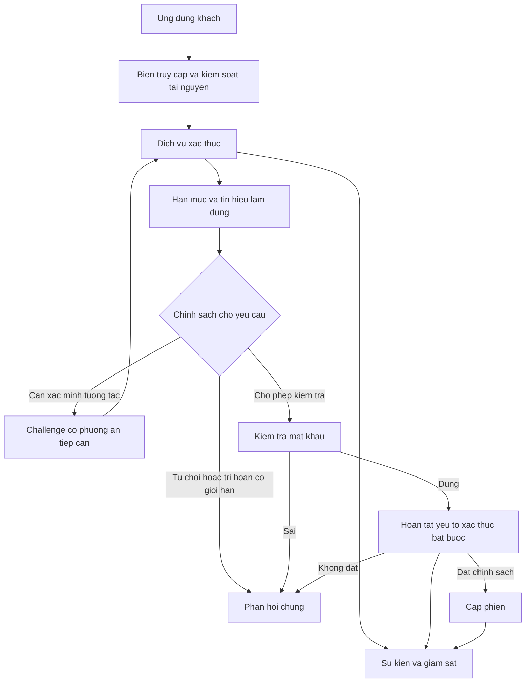

# Credential stuffing defense

## 1. Mục tiêu của bài học

**Credential stuffing** là hành vi thử đăng nhập bằng các cặp định danh và mật khẩu đã bị lộ từ nguồn khác, dựa trên khả năng người dùng tái sử dụng thông tin đăng nhập. Kẻ tấn công có thể đưa ra mật khẩu hoàn toàn đúng ngay ở lần thử đầu tiên đối với một tài khoản.

Trong chương **Yêu cầu xác thực**, phòng vệ credential stuffing cần được đặc tả thành hành vi bắt buộc của hệ thống: đường đăng nhập nào được bảo vệ, tín hiệu nào được sử dụng, khi nào cần xác minh bổ sung, hệ thống xử lý lỗi phụ thuộc ra sao và bằng chứng nào xác nhận các lớp bảo vệ hoạt động.

Mục tiêu của bài là giúp người học:

- Phân biệt credential stuffing với các hình thức lạm dụng xác thực khác.
- Chuyển kịch bản chiếm đoạt tài khoản thành yêu cầu cụ thể và có thể kiểm chứng.
- Kết hợp giới hạn lưu lượng, phát hiện bất thường, xác thực mạnh và bảo vệ vòng đời tài khoản.
- Tránh để cơ chế phòng vệ trở thành công cụ khóa tài khoản hoặc làm nghẽn đăng nhập.
- Liên kết yêu cầu với kiến trúc, logging, phản ứng sự cố và tiêu chí kiểm thử.

Mọi con số trong ví dụ là **tham số minh họa cho một hệ thống giả định**. Chúng cần được điều chỉnh bằng phân tích rủi ro, dữ liệu sử dụng hợp lệ và thử nghiệm tải; không phải ngưỡng khuyến nghị chung cho mọi ứng dụng.

## 2. Hiểu đúng mô hình đe dọa

### 2.1. Phân biệt những hành vi dễ bị nhầm lẫn

| Hành vi | Đặc điểm chính | Hệ quả đối với phòng vệ |
|---|---|---|
| Credential stuffing | Dùng lại các cặp tài khoản và mật khẩu đã lộ | Chỉ đếm mật khẩu sai không đủ, vì mật khẩu có thể đúng |
| Đoán mật khẩu trên một tài khoản | Thử nhiều mật khẩu cho cùng một định danh | Tín hiệu theo tài khoản và số lần thất bại có ích |
| Password spraying | Thử một số mật khẩu phổ biến trên nhiều tài khoản | Cần quan sát nhiều tài khoản và tương quan nguồn |
| Dò tìm tài khoản tồn tại | So sánh phản hồi để xác định định danh hợp lệ | Cần hạn chế khác biệt phản hồi có thể quan sát |
| Đánh cắp phiên | Dùng cookie hoặc token phiên đã bị lấy | Phải bảo vệ và thu hồi phiên; phòng vệ đăng nhập không bao phủ hết |
| Lừa người dùng cung cấp yếu tố xác thực | Dùng trang giả, yêu cầu phê duyệt giả hoặc thủ thuật xã hội | Cần đánh giá phương thức xác thực và luồng khôi phục riêng |

Những hành vi này có thể xuất hiện cùng một chiến dịch. Tuy nhiên, yêu cầu phòng vệ phải phản ánh đúng điều kiện thành công của từng hành vi.

Ví dụ, lưu mật khẩu bằng hàm băm có salt và chi phí tính toán phù hợp giúp bảo vệ khi kho mật khẩu bị lộ. Biện pháp đó không ngăn một người cầm mật khẩu đúng sử dụng giao diện đăng nhập bình thường.

### 2.2. Tài sản, chủ thể và đường truy cập

Các tài sản cần bảo vệ thường gồm:

- Quyền truy cập tài khoản và các phiên đang hoạt động.
- Dữ liệu cá nhân, dữ liệu nghiệp vụ và chức năng nhạy cảm sau đăng nhập.
- Cấu hình MFA, thiết bị tin cậy và phương thức khôi phục.
- Hạ tầng xác thực, tài nguyên xử lý băm mật khẩu và các dịch vụ phụ thuộc.
- Dữ liệu sự kiện phục vụ phát hiện, điều tra và phản ứng sự cố.

Phạm vi không chỉ là biểu mẫu đăng nhập trên web. Cần liệt kê API đăng nhập của ứng dụng di động, cổng quản trị, đường đăng nhập cũ, giao thức còn được hỗ trợ, dịch vụ danh tính tập trung và luồng cấp token có sử dụng mật khẩu.

Nếu ứng dụng chuyển xác thực sang nhà cung cấp danh tính, phải làm rõ bên nào chịu trách nhiệm cho từng lớp bảo vệ và ứng dụng nhận được tín hiệu gì. Một đường đăng nhập cục bộ còn tồn tại có thể làm suy yếu chính sách đã áp dụng tại nhà cung cấp danh tính.

### 2.3. Giả định phải công khai trong yêu cầu

Một mô hình minh họa có các giả định:

1. Kẻ tấn công có thể sở hữu mật khẩu đúng của một số tài khoản.
2. Lưu lượng tấn công có thể phân tán trên nhiều địa chỉ mạng.
3. Một địa chỉ mạng có thể đại diện cho nhiều người dùng hợp lệ dùng chung NAT.
4. Người dùng có thể đổi thiết bị, di chuyển hoặc sử dụng mạng riêng tư.
5. Các dịch vụ phát hiện rủi ro, bộ đếm và nhà cung cấp MFA có thể bị lỗi.
6. Luồng khôi phục tài khoản có thể trở thành đường vượt qua xác thực mạnh.

Từ giả định thứ nhất suy ra một yêu cầu quan trọng: **mật khẩu đúng không tự động là bằng chứng đủ để cấp phiên theo mọi mức rủi ro**. Từ giả định thứ ba suy ra rằng chặn cả địa chỉ mạng có thể gây thiệt hại cho nhiều người không liên quan.

## 3. Xác định mục tiêu bảo vệ và giới hạn

Một đặc tả nên xác định đồng thời mục tiêu an toàn và mục tiêu khả dụng.

| Mục tiêu | Ví dụ thuộc tính cần đặc tả |
|---|---|
| Giảm nguy cơ chiếm đoạt tài khoản | Mật khẩu bị lộ đơn lẻ không đủ vượt qua chính sách xác thực đã chọn |
| Hạn chế tự động hóa quy mô lớn | Có hạn mức và phản ứng theo nhiều chiều tín hiệu |
| Hạn chế dò tài khoản | Phản hồi không tiết lộ trực tiếp tài khoản có tồn tại hay không |
| Bảo vệ người dùng hợp lệ | Không khóa tài khoản vô thời hạn chỉ vì yêu cầu không xác thực từ bên ngoài |
| Duy trì dịch vụ | Hàng đợi, tài nguyên băm mật khẩu và dịch vụ phụ thuộc có giới hạn sử dụng |
| Phát hiện và xử lý sự cố | Có sự kiện, cảnh báo, trách nhiệm và thao tác thu hồi phù hợp |
| Bảo vệ dữ liệu phòng vệ | Không thu thập mật khẩu hoặc token vào log; tín hiệu thiết bị có vòng đời xác định |

Không nên đặt mục tiêu “chặn 100% bot” hoặc “không có false positive” nếu không định nghĩa được phép đo. Có thể đặt yêu cầu có phạm vi như: mọi đường đăng nhập bằng mật khẩu phải đi qua cùng chính sách phòng vệ, và mọi lần cấp phiên phải có bằng chứng hoàn tất các yếu tố được yêu cầu.

Hệ thống cũng cần công khai giới hạn. Cơ chế chống credential stuffing không tự giải quyết mọi trường hợp mất tài khoản, đặc biệt khi kẻ tấn công đã đánh cắp phiên hoặc chiếm luôn phương thức khôi phục.

## 4. Phòng vệ theo nhiều lớp



Sơ đồ thể hiện các lớp logic, không bắt buộc chúng nằm trong các dịch vụ riêng. Với đăng nhập không dùng mật khẩu, hệ thống có nhánh xác minh riêng theo chính sách của phương thức đó; không ép người đã có phương thức mạnh phải quay về nhập mật khẩu.

Ba nguyên tắc phối hợp:

- **Kiểm soát tự động hóa không thay thế xác thực.** Một challenge thành công không chứng minh người dùng là chủ tài khoản.
- **Tín hiệu rủi ro không tự tạo quyền.** IP quen thuộc hoặc thiết bị đã gặp trước đây không phải lý do bỏ qua yếu tố bắt buộc nếu chính sách chưa cho phép.
- **Mọi đường cấp phiên phải tuân thủ chính sách.** Chặn bot ở giao diện web không đủ nếu API hoặc luồng cũ cấp phiên dễ hơn.

## 5. Yêu cầu về bề mặt xác thực và phản hồi

### 5.1. Bao phủ toàn bộ đường đăng nhập

**CS-SURFACE-01 — Phạm vi áp dụng**

> Mọi giao diện còn được hỗ trợ có thể chuyển mật khẩu thành phiên hoặc token phải được liệt kê, có chủ sở hữu và thực thi chính sách phòng vệ tương ứng. Đường chưa đáp ứng chính sách không được dùng làm phương án dự phòng để bỏ qua kiểm soát trên đường chính.

Bằng chứng cần có: danh mục đường cấp phiên, sơ đồ luồng và kiểm thử đối chiếu trên web, di động, API, cổng quản trị và đường tích hợp liên quan.

Phân biệt danh tính người dùng với tài khoản dịch vụ. Nếu một tích hợp đang dùng tài khoản người dùng và mật khẩu để tự động đăng nhập, cần thiết kế cơ chế danh tính dịch vụ phù hợp thay vì miễn toàn bộ phòng vệ cho một địa chỉ mạng.

### 5.2. Hạn chế dò tài khoản qua phản hồi

**CS-ENUM-01 — Phản hồi không tiết lộ trực tiếp sự tồn tại**

> Đối với thất bại xác thực ở cùng loại luồng, hệ thống không được trả thông báo trực tiếp phân biệt “tài khoản không tồn tại” với “mật khẩu sai”. Mã trạng thái, cấu trúc nội dung, header và hành vi chuyển hướng phải được xem xét cùng thông điệp hiển thị.

Ví dụ phản hồi giao diện:

> Không thể đăng nhập với thông tin đã cung cấp. Hãy kiểm tra lại hoặc dùng phương án hỗ trợ truy cập.

Thông báo chung không tự bảo đảm không còn kênh dò tìm. Cần đánh giá thời gian phản hồi, challenge, thông báo khóa, luồng quên mật khẩu và các khác biệt quan sát được.

Đối với thời gian xử lý, nên đặt mục tiêu kiểm thử khả năng phân biệt trên tập mẫu có kiểm soát thay vì yêu cầu mọi phản hồi có số mili giây giống hệt nhau. Thêm một khoảng ngủ cố định có thể vẫn để lại khác biệt và còn tiêu tốn tài nguyên nếu triển khai sai.

### 5.3. Chuẩn hóa định danh mà không thay đổi mật khẩu

**CS-IDENTIFIER-01 — Định danh nhất quán**

> Các bí danh đăng nhập của cùng tài khoản phải liên kết với cùng ngữ cảnh phòng vệ theo quy tắc định danh của hệ thống. Tenant phải là một phần của phạm vi khi các tenant có thể sử dụng cùng định danh. Không được tự ý chuẩn hóa, cắt khoảng trắng hoặc thay đổi mật khẩu để tạo khóa bộ đếm.

Trong xử lý trước xác thực, có thể dùng khóa dẫn xuất từ định danh theo quy tắc nhất quán để không lưu nguyên văn định danh trong bộ đếm. Với tài khoản không tồn tại, vẫn cần hành vi phòng vệ hợp lý mà không vô tình tiết lộ sự khác biệt.

Nếu dùng HMAC cho khóa định danh, khóa bí mật phải được quản lý, xoay vòng và hạn chế truy cập. HMAC giảm việc lộ trực tiếp định danh trong kho bộ đếm, nhưng không biến dữ liệu liên kết với người dùng thành dữ liệu vô danh. Tài liệu phải nêu thời gian lưu và những bên có thể liên kết lại dữ liệu.

Không được chuẩn hóa email theo một quy tắc suy đoán áp dụng cho mọi nhà cung cấp nếu hệ thống định danh chưa định nghĩa như vậy. Quy tắc gộp sai có thể làm một người ảnh hưởng tới hạn mức của người khác.

## 6. Giới hạn lưu lượng và bảo vệ tài nguyên

### 6.1. Không phụ thuộc vào một chiều tín hiệu

Các chiều quan sát có vai trò khác nhau:

| Chiều tín hiệu | Có thể phát hiện điều gì? | Hạn chế |
|---|---|---|
| Theo định danh tài khoản | Nhiều nguồn cùng nhắm một tài khoản | Có thể bị lợi dụng để gây khó cho chủ tài khoản |
| Theo nguồn truy cập | Một nguồn thử nhiều tài khoản | NAT có nhiều người; địa chỉ mạng có thể thay đổi |
| Theo thiết bị hoặc phiên tiền xác thực | Hành vi lặp lại trong một ngữ cảnh | Cookie có thể bị xóa; dấu vết thiết bị có thể bị giả mạo |
| Theo tenant hoặc nhóm nghiệp vụ | Một nhóm bị nhắm tới hoặc dùng quá nhiều tài nguyên | Tenant lớn có đặc điểm sử dụng khác tenant nhỏ |
| Theo toàn hệ thống | Chiến dịch diện rộng và cạn tài nguyên chung | Cần phân biệt đợt tăng hợp lệ với lạm dụng |

Hệ thống nên quan sát cả số yêu cầu, số định danh khác nhau, kết quả xác thực và chuỗi hành vi. Tỷ lệ mật khẩu sai thấp không đủ để kết luận lưu lượng là hợp lệ.

**CS-RATE-01 — Kiểm soát nhiều chiều**

> Chính sách phải kết hợp tín hiệu theo định danh, nguồn truy cập và mức sử dụng tài nguyên chung; không được chỉ dựa vào một hạn mức theo IP. Mỗi chiều phải có phạm vi, cửa sổ thời gian, cách tính và hành động khi vượt ngưỡng được cấu hình rõ.

### 6.2. Định nghĩa chính xác điều đang được đếm

“Cho phép 10 lần đăng nhập trong một phút” còn thiếu nhiều thông tin:

- Đếm yêu cầu được nhận, lần kiểm tra mật khẩu hay chỉ lần thất bại?
- Cửa sổ cố định, cửa sổ trượt hay cơ chế tích lũy token?
- Gộp các instance, vùng triển khai và bí danh tài khoản như thế nào?
- Kết quả mật khẩu đúng nhưng MFA chưa hoàn tất được tính ra sao?
- Việc đăng nhập thành công có xóa dấu hiệu lạm dụng trước đó không?
- Các yêu cầu đang xử lý đồng thời có chiếm hạn mức không?
- Khi client thử lại do lỗi mạng, việc thử lại có tạo tác dụng phụ lặp không?

**CS-RATE-02 — Bộ đếm có ngữ nghĩa xác định**

> Hệ thống phải lưu các loại sự kiện cần phân biệt, gồm yêu cầu xác thực, kết quả kiểm tra mật khẩu và kết quả hoàn tất xác thực. Thành công ở một bước không được mặc định xóa toàn bộ lịch sử lạm dụng theo nguồn hoặc chiến dịch.

Cách tính phải phù hợp với hành động. Hạn mức trước bước băm mật khẩu cần dựa vào thông tin có sẵn trước khi biết mật khẩu đúng hay sai; một bộ đếm chỉ cập nhật sau thất bại không tự giới hạn số yêu cầu tốn tài nguyên đang chạy.

### 6.3. Hoạt động nhất quán khi có nhiều instance

**CS-DIST-01 — Không nhân hạn mức theo số instance**

> Hạn mức được đặc tả là dùng chung phải tiếp tục có hiệu lực khi yêu cầu đi qua nhiều instance. Cơ chế kiểm tra và ghi nhận phải kiểm soát được yêu cầu đồng thời; không được để mỗi instance cấp toàn bộ hạn mức riêng ngoài thiết kế.

Nhóm phải chọn một trong các cách phù hợp với kiến trúc, chẳng hạn kho bộ đếm dùng chung hoặc phân bổ ngân sách rõ ràng. Nếu cho phép sai số trong khoảng đồng bộ, cần ghi **mức vượt tối đa được chấp nhận và khoảng thời gian có thể xảy ra**, rồi kiểm chứng trong tải đồng thời.

Không nhất thiết mọi hạn mức đều dùng chung toàn cầu. Hạn mức bảo vệ một tiến trình có thể cục bộ; hạn mức theo tài khoản trên toàn dịch vụ cần được đặc tả ở phạm vi khác. Nhầm hai loại này khiến kết quả kiểm thử trên một instance không còn đúng khi mở rộng.

### 6.4. Ngăn cơ chế phòng vệ gây khóa tài khoản hàng loạt

Khóa vĩnh viễn một tài khoản sau vài lần nhập sai có thể biến giao diện đăng nhập công khai thành công cụ từ chối dịch vụ. Kẻ tấn công không cần biết mật khẩu để kích hoạt điều kiện đó.

**CS-LOCK-01 — Hành động tăng dần và có đường truy cập hợp lệ**

> Lưu lượng thất bại chưa xác thực không được tự động gây khóa tài khoản vô thời hạn. Chính sách phải nêu thời hạn, cách giảm mức hạn chế và phương án xác minh hợp lệ, đồng thời giới hạn chính phương án hỗ trợ để tránh lạm dụng.

Các lựa chọn có thể gồm:

- Yêu cầu challenge trước khi tiếp tục kiểm tra mật khẩu.
- Áp dụng ngân sách xử lý thấp hơn cho nguồn hoặc nhóm yêu cầu nghi vấn.
- Dùng phương thức xác thực mạnh đã đăng ký trên một đường có ngân sách riêng.
- Tạm từ chối một lớp lưu lượng có độ tin cậy phát hiện cao, với thời hạn và khả năng thu hồi quyết định.
- Hỗ trợ khôi phục truy cập có kiểm soát khi chủ tài khoản bị ảnh hưởng.

Không có lựa chọn nào loại bỏ hoàn toàn đánh đổi giữa khả dụng và phòng vệ. Đặc tả phải nêu loại người dùng nào có thể bị ảnh hưởng và cách đo, thay vì tuyên bố cơ chế tăng độ trễ không gây tác dụng phụ.

### 6.5. Kiểm soát chi phí trước bước đắt tiền

**CS-RESOURCE-01 — Ngân sách tài nguyên hữu hạn**

> Trước các thao tác tốn tài nguyên, hệ thống phải có cơ chế kiểm soát tiếp nhận phù hợp. Số tác vụ xác minh mật khẩu đồng thời, độ dài hàng đợi, timeout và chính sách khi quá tải phải có giới hạn. Việc trì hoãn không được giữ vô hạn luồng xử lý hoặc kết nối.

Cần tránh thiết kế tạo một tác vụ chờ cho mọi yêu cầu rồi giữ chúng trong bộ nhớ. Việc thu thập khóa bộ đếm cho số lượng lớn định danh giả cũng phải có TTL, giới hạn dung lượng và chiến lược khi vượt sức chứa.

Nếu hệ thống nằm sau proxy, nguồn truy cập chỉ được lấy từ chuỗi proxy tin cậy đã cấu hình. Header do client tự gửi không được mặc định là địa chỉ gốc đáng tin cậy.

## 7. Phát hiện rủi ro, challenge và xác thực mạnh

### 7.1. Sử dụng tín hiệu rủi ro đúng vai trò

Những tín hiệu có thể hữu ích gồm tốc độ yêu cầu, số tài khoản theo nguồn, nhiều nguồn cùng nhắm một tài khoản, thay đổi thiết bị, kết quả challenge và hành vi sau đăng nhập.

Mỗi tín hiệu đều có giới hạn. Vị trí địa lý có thể sai, người dùng có thể di chuyển, thiết bị có thể được thay mới, còn dấu vết trình duyệt không phải bằng chứng sở hữu tài khoản.

**CS-RISK-01 — Quyết định có thể giải thích và quản lý**

> Mỗi quyết định phòng vệ phải gắn với phiên bản chính sách và mã lý do đủ cho vận hành. Tín hiệu rủi ro chỉ được thay đổi hành động trong phạm vi chính sách cho phép; không được tự giảm các yếu tố xác thực bắt buộc.

Quy tắc và ngưỡng phải có chủ sở hữu, lịch sử thay đổi, phạm vi áp dụng và cách quay về phiên bản trước. Nhóm vận hành cần biết cách xử lý nếu một quy tắc mới thách thức quá nhiều người dùng hợp lệ.

### 7.2. Challenge không phải giấy phép đăng nhập

CAPTCHA hoặc bài kiểm tra tương tác có thể tăng chi phí tự động hóa, nhưng có thể bị vượt qua hoặc được chuyển cho người khác giải. Không nên coi kết quả challenge là danh tính đã được xác thực.

**CS-CHALLENGE-01 — Ràng buộc challenge**

> Kết quả challenge phải có thời hạn, chống sử dụng lại và được ràng buộc với ngữ cảnh hoặc hành động đã xác định. Challenge thành công chỉ cho phép bước tiếp theo theo chính sách, không được cấp phiên hoặc bỏ qua MFA bắt buộc.

Ví dụ, một challenge hợp lệ có thể chỉ cho phép một lần kiểm tra mật khẩu trong vòng hai phút. Cơ chế cần được xác minh ở phía máy chủ; thay đổi trạng thái giao diện không đủ làm bằng chứng.

**CS-ACCESS-01 — Khả năng tiếp cận**

> Luồng yêu cầu challenge phải có phương án phù hợp cho người dùng gặp hạn chế tiếp cận hoặc lỗi tương thích. Phương án thay thế phải được đánh giá cùng mức rủi ro và có kiểm soát lạm dụng, không tạo một đường bỏ qua mọi kiểm tra.

Có thể ưu tiên phương thức xác thực mạnh đã đăng ký hoặc quy trình hỗ trợ có xác minh. Không mặc định rằng tất cả người dùng đều có thể giải cùng một bài kiểm tra hình ảnh.

### 7.3. MFA và phương thức không phụ thuộc mật khẩu dùng lại

**CS-MFA-01 — Không cấp phiên trước khi hoàn tất chính sách**

> Khi chính sách yêu cầu yếu tố bổ sung, kiểm tra mật khẩu thành công chỉ được tạo trạng thái tiền xác thực có quyền hạn tối thiểu và thời hạn ngắn. Chỉ sau khi hoàn tất mọi yếu tố bắt buộc, hệ thống mới được cấp phiên có quyền truy cập tài khoản.

Trạng thái tiền xác thực không được dùng để đọc dữ liệu tài khoản, thay đổi cấu hình bảo mật hoặc gọi API dành cho người đã đăng nhập.

Với hệ thống có rủi ro cao, có thể yêu cầu MFA cho mọi lần đăng nhập bằng mật khẩu thay vì chỉ khi phát hiện bất thường. Một phương thức như passkey, khi được xác minh theo chính sách phù hợp, có thể giảm phụ thuộc vào bí mật người dùng tái sử dụng. Vòng đời đăng ký, thiết bị và khôi phục vẫn phải được bảo vệ.

Không phải mọi MFA có mức chống lạm dụng giống nhau. OTP có thể bị lừa lấy; thông báo push có thể gây mệt mỏi phê duyệt. Yêu cầu cần nêu mức bảo đảm mong muốn và các phương thức được chấp nhận.

**CS-MFA-02 — Hạn chế lạm dụng bước thứ hai**

> Số lần gửi yêu cầu phê duyệt, phát OTP và thử xác minh phải có hạn mức riêng, thời hạn và cơ chế chống phát lại. Hệ thống không được gửi một thông báo mới cho mọi yêu cầu đăng nhập chưa xác thực mà không kiểm soát.

Một chiến dịch có mật khẩu đúng có thể không tạo nhiều lỗi mật khẩu nhưng lại tạo hàng loạt yêu cầu MFA. Vì vậy phải theo dõi trạng thái “mật khẩu đúng, chưa hoàn tất yếu tố tiếp theo”, đồng thời bảo vệ chi phí và khả năng tiếp cận của kênh MFA.

## 8. Bảo vệ vòng đời mật khẩu, MFA và khôi phục

### 8.1. Phát hiện mật khẩu đã bị lộ

**CS-PASSWORD-01 — Kiểm tra ở điểm thiết lập mật khẩu**

> Khi tạo hoặc thay đổi mật khẩu, hệ thống phải áp dụng chính sách ngăn mật khẩu thuộc nguồn dữ liệu bị lộ hoặc dễ đoán mà tổ chức đã chọn. Cơ chế kiểm tra không được gửi mật khẩu nguyên văn tới bên thứ ba hoặc đưa mật khẩu vào log.

Yêu cầu cần nêu nguồn dữ liệu, tần suất cập nhật, hành vi khi nguồn kiểm tra không hoạt động và cách bảo vệ truy vấn nếu dùng dịch vụ ngoài. Chặn mật khẩu đã biết bị lộ giúp giảm rủi ro, nhưng không chứng minh mật khẩu được chấp nhận chưa từng bị lộ.

Không nên tự động yêu cầu tất cả người dùng đổi mật khẩu chỉ vì một đợt đăng nhập sai. Cần phân biệt tín hiệu lạm dụng với bằng chứng rằng thông tin xác thực của một tài khoản đã bị chiếm.

### 8.2. Đăng ký và thay đổi yếu tố xác thực

**CS-ENROLL-01 — Không để mật khẩu bị lộ tự tạo yếu tố mới**

> Việc thêm, thay hoặc gỡ yếu tố xác thực phải yêu cầu bằng chứng phù hợp với mức bảo đảm của tài khoản. Không được cho phép người chỉ biết mật khẩu bị lộ tự đăng ký một yếu tố mới rồi dùng chính yếu tố đó để hoàn tất đăng nhập.

Đăng ký ban đầu cần được gắn với quy trình tạo hoặc xác minh tài khoản đã được thiết kế. Thay đổi yếu tố hiện có thường cần xác thực lại bằng phương thức đã đăng ký hoặc quy trình khôi phục được phê duyệt.

Thông báo thay đổi bảo mật là lớp phát hiện bổ sung, không thay thế điều kiện cho phép thay đổi. Thông báo cũng phải được giới hạn để tránh biến hệ thống thành công cụ gửi thư hoặc tin nhắn hàng loạt.

### 8.3. Luồng khôi phục không làm yếu chính sách

**CS-RECOVERY-01 — Chính sách tương xứng trên đường khôi phục**

> Quên mật khẩu, mất MFA, mã dự phòng và hỗ trợ thủ công phải có giới hạn thử, chống phát lại, điều kiện xác minh và sự kiện audit tương ứng. Không được dùng luồng khôi phục như phương án tự động bỏ qua yếu tố bắt buộc khi người gọi cung cấp mật khẩu đúng.

Một số điểm cần nêu rõ:

- Token khôi phục có thời hạn và dùng một lần.
- Tạo yêu cầu khôi phục mới ảnh hưởng thế nào đến yêu cầu cũ.
- Mã dự phòng được lưu và sử dụng ra sao.
- Người hỗ trợ được phép làm gì và cần bằng chứng nào.
- Có trì hoãn hoặc thông báo cho thay đổi nhạy cảm hay không.
- Sau đổi mật khẩu hoặc phục hồi, phiên và token hiện có được xử lý thế nào.

Nếu email khôi phục cũng được bảo vệ bằng cùng mật khẩu đã bị dùng lại, không thể mặc định kênh email luôn độc lập với rủi ro ban đầu.

## 9. Hành vi khi phụ thuộc phòng vệ gặp lỗi

Một cơ chế chống lạm dụng có thể cần kho bộ đếm, dịch vụ đánh giá rủi ro, challenge, MFA và hệ thống ghi sự kiện. Không nên dùng một quy tắc “lỗi thì cho qua” hoặc “lỗi thì dừng mọi thứ” cho tất cả phụ thuộc.

**CS-DEGRADE-01 — Chế độ suy giảm được định nghĩa trước**

> Với từng phụ thuộc, đặc tả phải nêu cách phát hiện lỗi, ngân sách cục bộ hoặc phương án thay thế, hành động còn được phép, thời gian tối đa ở chế độ suy giảm và điều kiện phục hồi. Phụ thuộc lỗi không được tự làm mất yêu cầu xác thực bắt buộc.

| Phụ thuộc lỗi | Ví dụ cách xử lý cần được đánh giá |
|---|---|
| Kho hạn mức dùng chung | Dùng ngân sách cục bộ bảo thủ đã phân bổ, hạn chế tiếp nhận và cảnh báo; không cấp lại toàn bộ ngân sách cho từng instance |
| Dịch vụ chấm điểm rủi ro | Chuyển sang chính sách tĩnh đã phê duyệt và giữ yếu tố xác thực bắt buộc |
| Challenge | Dùng phương thức thay thế đủ mức bảo đảm hoặc từ chối lớp yêu cầu cần challenge bằng thông báo phù hợp |
| Nhà cung cấp MFA | Dùng phương thức mạnh đã đăng ký khác hoặc quy trình khôi phục; không âm thầm chấp nhận mật khẩu đơn lẻ |
| Bộ thu sự kiện | Dùng vùng đệm có giới hạn và cảnh báo; quy định hành vi khi không còn ghi nhận được sự kiện bắt buộc |

Phiên đã xác thực và lần đăng nhập mới là hai đối tượng khác nhau. Sự cố ở cơ chế chống lạm dụng đăng nhập không tự động là lý do thu hồi mọi phiên hợp lệ. Quyết định đó phải dựa trên rủi ro và kế hoạch ứng phó.

Chế độ suy giảm phải được diễn tập. Một tài liệu có tên phương án dự phòng chưa chứng minh rằng hệ thống giữ đúng chính sách khi dịch vụ phụ thuộc thực sự không phản hồi.

## 10. Logging, phát hiện và phản ứng sự cố

### 10.1. Ghi đủ để điều tra nhưng không thu thập bí mật

**CS-AUDIT-01 — Sự kiện xác thực có cấu trúc**

> Các quyết định hạn chế, yêu cầu challenge, kết quả xác thực theo giai đoạn, cấp phiên, thay đổi yếu tố và thao tác khôi phục phải tạo sự kiện có cấu trúc. Sự kiện phải cho phép liên kết chuỗi xử lý mà không ghi mật khẩu, OTP, token phiên, mã khôi phục hoặc toàn bộ nội dung yêu cầu.

Một sự kiện có thể gồm:

```json
{
  "eventType": "AUTH_FLOW_DECISION",
  "correlationId": "example-flow-17",
  "tenantKey": "tenant-example",
  "subjectKey": "pseudonymous-subject-key",
  "sourceKey": "restricted-source-reference",
  "stage": "PRE_PASSWORD",
  "action": "REQUIRE_CHALLENGE",
  "reasonCode": "IDENTIFIER_FAILURE_THRESHOLD",
  "policyVersion": "auth-defense-v3",
  "occurredAt": "example-timestamp"
}
```

Đây là ví dụ cấu trúc, không phải dữ liệu sự cố thật. Trường thời gian thực tế cần có định dạng thống nhất và hỗ trợ tương quan giữa các thành phần.

Các trường do client điều khiển cần được giới hạn độ dài và xử lý an toàn trước khi đưa vào hệ thống log. Định danh đã giả danh hóa, dữ liệu nguồn mạng và tín hiệu thiết bị vẫn cần quyền truy cập, thời hạn lưu và mục đích sử dụng rõ ràng.

Không đưa kết quả chi tiết nội bộ như “mật khẩu đúng nhưng bị đánh giá là nguy cơ cao” vào phản hồi công khai. Người vận hành có thể cần thông tin đó để điều tra, nhưng quyền đọc phải tương ứng với độ nhạy cảm.

### 10.2. Chỉ số phải có mẫu số và cách diễn giải

| Chỉ số | Cách sử dụng | Điều không thể suy ra trực tiếp |
|---|---|---|
| Yêu cầu đăng nhập theo thời gian và nguồn | Phát hiện biến động và tập trung lưu lượng | Tăng lưu lượng không tự chứng minh tấn công |
| Số định danh khác nhau theo nhóm nguồn | Tìm dấu hiệu thử nhiều tài khoản | Một nguồn dùng chung có thể phục vụ nhiều người hợp lệ |
| Mật khẩu đúng nhưng không hoàn tất MFA | Tín hiệu cần tương quan, nhất là khi tăng bất thường | Không phải mọi lần bỏ dở đều là chiếm đoạt |
| Tỷ lệ yêu cầu bị challenge hoặc từ chối | Theo dõi tác động của chính sách | Không bằng tỷ lệ chặn đúng kẻ tấn công |
| Tỷ lệ hoàn tất của nhóm truy cập hợp lệ đã xác định | Đánh giá false positive và trải nghiệm | Không đại diện mọi nhóm nếu tập mẫu bị lệch |
| Độ trễ và mức sử dụng tài nguyên xác thực | Xác minh tính khả dụng | CPU thấp không chứng minh tài khoản an toàn |
| Sự cố chiếm đoạt được xác nhận | Đánh giá tác động và cải thiện phòng vệ | Không xác nhận được sự cố không có nghĩa không xảy ra |

Một số chỉ số cần được chia theo tenant, nền tảng, khu vực hoặc loại phương thức để tránh số trung bình che giấu nhóm bị ảnh hưởng. Việc chia nhóm phải tôn trọng giới hạn thu thập dữ liệu và không làm lộ định danh không cần thiết.

“Tỷ lệ ngăn chiếm đoạt” chỉ có ý nghĩa khi có cách xác định tập thử hoặc nhãn sự cố đáng tin cậy. Không lấy số lần đăng nhập thất bại chia tổng lưu lượng rồi coi là tỷ lệ phát hiện chính xác.

### 10.3. Quy trình phản ứng có mức độ

**CS-IR-01 — Phản ứng dựa trên bằng chứng**

> Khi tín hiệu vượt điều kiện cảnh báo đã định, hệ thống phải tạo cảnh báo tới vai trò phụ trách, có mã chính sách, phạm vi ảnh hưởng và hướng dẫn điều tra. Những hành động ảnh hưởng tài khoản phải tương ứng với mức bằng chứng và có audit.

Một chuỗi phản ứng có thể gồm:

1. Xác nhận nguồn cảnh báo, độ mới và phạm vi chiến dịch.
2. So sánh với thay đổi sản phẩm, đợt đăng nhập hợp lệ hoặc lỗi cấu hình.
3. Tăng mức phòng vệ có thời hạn ở phạm vi phù hợp.
4. Điều tra dấu hiệu cấp phiên hoặc hoạt động sau đăng nhập đáng ngờ.
5. Với tài khoản bị xác nhận chiếm đoạt, thu hồi phiên hoặc token theo phạm vi cần thiết, thay thông tin xác thực và kiểm tra cấu hình MFA, khôi phục.
6. Thông báo cho chủ tài khoản bằng kênh đã xác minh và tránh gửi bí mật trong thông báo.
7. Phục hồi truy cập, giảm hạn chế khi đủ điều kiện và lưu kết quả điều tra.

Nhiều lần thất bại từ bên ngoài không phải bằng chứng đủ để kết luận chủ tài khoản đã mất quyền kiểm soát. Ngược lại, chỉ đổi mật khẩu có thể chưa chấm dứt sự cố nếu phiên của kẻ tấn công hoặc yếu tố do chúng đăng ký vẫn còn hiệu lực.

**CS-SESSION-01 — Thu hồi có phạm vi và có thời hạn**

> Với tài khoản được xác nhận bị chiếm đoạt, quy trình phải xác định các phiên, refresh token và phương thức khôi phục cần vô hiệu hóa; phải đặc tả thời gian tối đa để quyết định thu hồi có hiệu lực trên các thành phần liên quan.

Nếu dùng token tự chứa, thời hạn token, cache và cơ chế kiểm tra trạng thái phải được đối chiếu với yêu cầu thu hồi. “Đã bấm thu hồi” chưa chứng minh mọi API đã từ chối token cũ.

## 11. Ví dụ đặc tả cho một cổng doanh nghiệp

### 11.1. Bối cảnh và quyết định bảo vệ

Một cổng doanh nghiệp phục vụ nhiều tenant, có giao diện web và ứng dụng di động. Tài khoản có thể đăng nhập bằng mật khẩu kết hợp yếu tố đã đăng ký, hoặc phương thức không dùng mật khẩu đã đáp ứng chính sách. Dữ liệu sau đăng nhập bao gồm hồ sơ nhân sự và chức năng phê duyệt.

Giả định quan trọng: mật khẩu của một số người dùng có thể đã bị lộ từ dịch vụ khác. Vì vậy, trong ví dụ này, **mọi luồng đăng nhập bằng mật khẩu đều phải hoàn tất MFA trước khi cấp phiên**, kể cả khi đánh giá rủi ro thấp. Không có ngoại lệ “nhớ thiết bị” trong phạm vi minh họa.

Các ngưỡng sau chỉ nhằm làm rõ cách viết yêu cầu:

| Tham số | Giá trị minh họa | Hành động |
|---|---|---|
| Thất bại kiểm tra mật khẩu theo định danh | Từ 8 lần trong cửa sổ trượt 15 phút | Yêu cầu challenge cho các lần thử mật khẩu tiếp theo |
| Yêu cầu xác thực theo nguồn truy cập | Từ 30 yêu cầu trong cửa sổ trượt 60 giây | Chuyển lớp lưu lượng tương ứng sang chính sách challenge hoặc hạn chế đã xác định |
| Hiệu lực kết quả challenge | Tối đa 120 giây | Chỉ dùng cho một lần kiểm tra mật khẩu và đúng ngữ cảnh |
| Hiệu lực trạng thái tiền xác thực | Tối đa 5 phút | Không hoàn tất MFA thì không cấp phiên |
| Độ trễ chuyển cảnh báo | Không quá 60 giây từ khi bộ phát hiện ghi nhận đủ điều kiện | Cảnh báo tới tuyến vận hành đang trực |

Cần định nghĩa thêm khi nào trạng thái tăng mức phòng vệ giảm xuống. Trong ví dụ này, tín hiệu theo định danh hết hiệu lực khi không còn thất bại nằm trong cửa sổ 15 phút; đăng nhập thành công không xóa sự kiện lịch sử. Một phương thức mạnh đã đăng ký có thể dùng nhánh riêng theo chính sách, không phải giải challenge mật khẩu chỉ vì kẻ khác tạo thất bại.

Ngưỡng theo định danh là ngưỡng tăng xác minh, không phải thông báo tài khoản bị khóa. Các giới hạn tài nguyên vẫn áp dụng để người giải challenge không thể dùng vô hạn công suất xác minh.

Chính sách theo nguồn phải tính đến mạng dùng chung. Không mặc định từ chối toàn bộ NAT vì một số yêu cầu có vấn đề; lựa chọn hành động cần được kiểm thử với nhóm người dùng hợp lệ đại diện.

### 11.2. Một yêu cầu được viết đầy đủ

**Mã:** CS-EXAMPLE-01  
**Nguồn rủi ro:** R-01 — Kẻ tấn công dùng mật khẩu bị lộ để được cấp phiên.  
**Phạm vi:** Đăng nhập bằng mật khẩu trên web và di động, qua mọi instance được hỗ trợ.

**Phát biểu bắt buộc:**

> Sau khi xác minh mật khẩu thành công, dịch vụ chỉ được tạo trạng thái tiền xác thực có thời hạn tối đa 5 phút. Trạng thái này chỉ cho phép hoàn tất hoặc hủy luồng xác thực theo thiết kế. Chỉ khi yếu tố thứ hai đã đăng ký được xác minh thành công và còn gắn với cùng luồng, dịch vụ mới được cấp phiên truy cập tài khoản. Lỗi hoặc timeout của nhà cung cấp MFA không được làm phát sinh nhánh cấp phiên chỉ dựa trên mật khẩu.

**Tiêu chí chấp nhận:**

- Mật khẩu đúng và không có yếu tố thứ hai không nhận được phiên truy cập tài khoản.
- Trạng thái tiền xác thực không gọi được API dữ liệu hoặc thay đổi cấu hình bảo mật.
- Trạng thái hết hạn bị từ chối, kể cả khi client gửi lại yêu cầu cũ.
- Bằng chứng của một luồng không được sử dụng để hoàn tất luồng khác.
- Yếu tố bị phát lại bị từ chối theo cơ chế của phương thức.
- Lỗi phụ thuộc không thay đổi điều kiện cấp phiên.
- Sự kiện thể hiện đúng giai đoạn, không chứa bí mật xác thực.

**Bằng chứng:** kiểm thử tích hợp trên các đường cấp phiên, kiểm tra chính sách tại điểm phát hành phiên và kết quả thử lỗi nhà cung cấp MFA.

### 11.3. Bảng truy vết rủi ro, yêu cầu và kiến trúc

| Rủi ro | Yêu cầu liên quan | Điểm thực thi | Bằng chứng |
|---|---|---|---|
| R-01: dùng mật khẩu bị lộ để lấy phiên | CS-MFA-01, CS-EXAMPLE-01 | Dịch vụ xác thực và điểm cấp phiên | Mật khẩu đúng nhưng thiếu MFA không được cấp phiên |
| R-02: phân tán nguồn để vượt hạn mức | CS-RATE-01, CS-DIST-01 | Bộ đánh giá hạn mức theo định danh và nguồn | Thử đồng thời qua nhiều instance, nhiều nguồn mô phỏng |
| R-03: làm chủ tài khoản không thể truy cập | CS-LOCK-01, CS-ACCESS-01 | Máy trạng thái phòng vệ và đường xác thực thay thế | Tình huống người dùng hợp lệ bị nhắm tới vẫn có phương án được kiểm soát |
| R-04: đường đăng nhập cũ bỏ qua chính sách | CS-SURFACE-01 | Mọi điểm cấp phiên hoặc token | Kiểm kê và kiểm thử bao phủ các đường còn hỗ trợ |
| R-05: gây mệt mỏi phê duyệt MFA | CS-MFA-02 | Bộ phát hành yêu cầu yếu tố bổ sung | Hạn mức phát thông báo và thử mã có hiệu lực |
| R-06: dùng khôi phục để vượt MFA | CS-RECOVERY-01, CS-ENROLL-01 | Khôi phục, đăng ký và thay yếu tố | Mật khẩu đơn lẻ không đủ thay yếu tố; token dùng lại bị từ chối |
| R-07: dịch vụ rủi ro lỗi tạo nhánh cho qua | CS-DEGRADE-01 | Chính sách suy giảm và điểm cấp phiên | Thử lỗi từng phụ thuộc, giữ nguyên yếu tố bắt buộc |
| R-08: chiếm phiên còn hiệu lực sau xử lý | CS-SESSION-01 | Kho phiên, bộ thu hồi, các API kiểm tra token | Token thuộc phạm vi thu hồi bị từ chối trong hạn đã chọn |
| R-09: lộ bí mật qua dữ liệu phòng vệ | CS-AUDIT-01 | Bộ sinh log, bộ thu sự kiện và kho quan sát | Đối chiếu schema, quyền đọc và mẫu sự kiện không có bí mật |

Một rủi ro có thể cần nhiều yêu cầu và một yêu cầu có thể xử lý nhiều rủi ro. Bảng chỉ hỗ trợ truy vết; nó không thay thế tiêu chí chấp nhận chi tiết.

## 12. Thiết kế kiểm chứng ngay từ lúc viết yêu cầu

Các tình huống dưới đây dành cho môi trường kiểm thử và tài khoản do nhóm kiểm soát. Dùng thông tin xác thực tổng hợp để mô phỏng mật khẩu đã lộ; không cần dữ liệu mật khẩu thật của người dùng để xác nhận cơ chế.

### 12.1. Ma trận kiểm thử trọng yếu

| Tình huống | Kết quả cần quan sát |
|---|---|
| Người dùng hợp lệ hoàn tất mọi yếu tố | Có phiên đúng quyền và sự kiện đầy đủ |
| Mật khẩu đúng nhưng không có yếu tố bắt buộc | Không có phiên truy cập tài khoản; chỉ có trạng thái tiền xác thực nếu được phép |
| Nhiều nguồn cùng nhắm một định danh | Bộ đếm dùng chung và hành động theo định danh có hiệu lực |
| Một nguồn thử nhiều định danh | Tín hiệu theo nguồn và liên kết chiến dịch được ghi nhận |
| Lưu lượng có nhiều mật khẩu đúng nhưng MFA bỏ dở | Không chỉ dựa vào số lỗi mật khẩu; có tín hiệu theo giai đoạn |
| Yêu cầu phân bố qua nhiều instance | Không nhân hạn mức ngoài sai số đã đặc tả |
| Yêu cầu tới sát ranh giới cửa sổ thời gian | Kết quả đúng thuật toán và cách tính đã chọn |
| Một lần đăng nhập hợp lệ xen giữa nhiều yêu cầu nghi vấn | Không xóa tùy tiện lịch sử theo nguồn hoặc chiến dịch |
| Dùng bí danh khác của cùng tài khoản | Áp dụng phạm vi phòng vệ đúng theo quy tắc định danh |
| Hai tenant có cùng định danh đăng nhập | Không gộp nhầm bộ đếm theo tài khoản giữa hai tenant |
| Mạng NAT có nhiều người đăng nhập hợp lệ | Đạt tiêu chí khả dụng của nhóm đại diện; không khóa toàn nhóm ngoài chính sách |
| Dùng lại hoặc chuyển kết quả challenge sang luồng khác | Bị từ chối; không bỏ qua MFA |
| Thử gửi hàng loạt yêu cầu MFA hoặc mã khôi phục | Hạn mức riêng có hiệu lực; không tạo thông báo vô hạn |
| Kho hạn mức hoặc dịch vụ rủi ro không phản hồi | Chế độ suy giảm có giới hạn, không làm mất yếu tố bắt buộc |
| Client tự đặt header nguồn mạng | Không làm thay đổi nguồn tin cậy ngoài cấu hình proxy |
| Dùng trạng thái tiền xác thực gọi API dữ liệu | Bị từ chối ở mọi API được bảo vệ |
| Khôi phục bằng token hết hạn hoặc đã sử dụng | Bị từ chối, không đổi được mật khẩu hoặc yếu tố |
| Thu hồi phiên của tài khoản bị xác nhận chiếm đoạt | Các điểm truy cập từ chối trong thời hạn đã đặc tả |
| Đầu vào chứa dữ liệu nhạy cảm và ký tự gây nhiễu log | Log giữ cấu trúc, không chứa mật khẩu hoặc token |

Với một lần bị từ chối, cần kiểm tra tác dụng phụ. Phản hồi lỗi nhưng đã phát hành token, gửi thông báo MFA hoặc thay yếu tố xác thực vẫn là sai yêu cầu.

### 12.2. Tiêu chí dạng kịch bản

```gherkin
Feature: Khong cap phien chi dua vao mat khau bi lo

  Scenario: Mat khau dung nhung khong hoan tat MFA
    Given tai khoan thu nghiem U da dang ky yeu to thu hai
    And chinh sach yeu cau MFA cho dang nhap bang mat khau
    When mot yeu cau cung cap dung mat khau cua U
    And khong cung cap bang chung yeu to thu hai hop le
    Then he thong khong cap phien truy cap tai khoan
    And trang thai tien xac thuc khong doc duoc du lieu cua U
    And su kien the hien dung giai doan xac thuc
    And su kien khong chua mat khau hoac token
```

Một kịch bản khác nên thử cùng điều kiện khi nhà cung cấp MFA timeout. Nếu kết quả chuyển thành đăng nhập thành công thì phương án suy giảm đã phá vỡ yêu cầu.

### 12.3. Kiểm chứng bộ đếm và tính đồng thời

Kiểm thử chỉ gửi tuần tự đến một instance thường bỏ sót khoảng trống quan trọng. Kế hoạch cần:

1. Tạo tập định danh thử và xác nhận giá trị bộ đếm ban đầu.
2. Phân bố yêu cầu đồng thời qua các instance thuộc cùng phạm vi hạn mức.
3. Đối chiếu số yêu cầu được tiếp nhận, được xác minh mật khẩu và bị tăng mức xác minh.
4. Kiểm tra sai số so với mức vượt được phép, nếu thiết kế cho phép sai số.
5. Thử thay đổi số instance hoặc mất kết nối kho bộ đếm.
6. Xác nhận TTL và cách phục hồi bộ đếm không gây mở lại ngân sách ngoài chính sách.

Đồng hồ, cửa sổ thời gian và thứ tự sự kiện cần được xác định đủ rõ để tái hiện kết quả. Kết luận “kho bộ đếm hỗ trợ thao tác nguyên tử” chưa chứng minh toàn bộ luồng kiểm tra rồi cập nhật đã được triển khai nguyên tử đúng cách.

### 12.4. Đo tác động tới người dùng hợp lệ

Cần dùng nhóm truy cập hợp lệ có đặc điểm đại diện: mạng dùng chung, thiết bị mới, người cần phương án tiếp cận, web, di động và tenant có quy mô khác nhau.

Đặc tả nên nêu:

- Mốc bắt đầu và kết thúc khi đo thời gian đăng nhập.
- Phần nào là thời gian xử lý của hệ thống, phần nào là thời gian tương tác của người dùng.
- Tỷ lệ hoàn tất trong nhóm có thông tin xác thực và yếu tố hợp lệ.
- Tỷ lệ challenge, từ chối nhầm và sử dụng hỗ trợ.
- Cách thu thập nhãn hoặc phản hồi để biết quyết định nào gây ảnh hưởng.
- Phân đoạn nào phải được xem riêng và ngưỡng nào kích hoạt điều chỉnh.

Không thể kết luận không có false positive chỉ vì không nhận được ticket hỗ trợ. Người bị ảnh hưởng có thể bỏ cuộc mà không báo cáo.

## 13. Triển khai chính sách và quản lý thay đổi

Quy tắc chống lạm dụng có thể thay đổi thường xuyên, nhưng vẫn cần quản lý như một phần của thiết kế bảo mật.

Một quy trình phù hợp có thể là:

1. **Xác định đường cơ sở:** thu thập chỉ số cần thiết với giới hạn dữ liệu rõ ràng.
2. **Quan sát quyết định giả định:** ghi nhận chính sách mới sẽ tác động thế nào mà chưa áp dụng hành động mới, nếu điều đó phù hợp với rủi ro hiện tại.
3. **Áp dụng có phạm vi:** chọn tập đối tượng, thời gian theo dõi và người chịu trách nhiệm.
4. **So sánh an toàn và khả dụng:** xem cả tín hiệu lạm dụng, tỷ lệ hoàn tất hợp lệ và chi phí tài nguyên.
5. **Mở rộng hoặc điều chỉnh:** dựa trên tiêu chí đã thỏa thuận.
6. **Lưu phiên bản và bằng chứng:** bảo đảm có thể giải thích một quyết định đã xảy ra.

Chế độ quan sát của một quy tắc mới không phải lý do tắt các yếu tố xác thực bắt buộc đang có. Khi quay về phiên bản trước, cần chỉ rõ phần cấu hình được quay lại; không vô tình bỏ cả MFA hoặc cơ chế quản lý phiên.

Các thay đổi nên kích hoạt đánh giá lại gồm:

- Thêm đường đăng nhập hoặc nhà cung cấp danh tính.
- Thêm tenant có đặc điểm sử dụng khác.
- Thay cách cân bằng tải, mở rộng vùng hoặc số instance.
- Đổi phương thức MFA, challenge hoặc khôi phục.
- Thay ngữ nghĩa định danh, bí danh hoặc ranh giới tenant.
- Có chiến dịch mới vượt qua ngưỡng hoặc gây ảnh hưởng người dùng hợp lệ.
- Có sự cố thu thập dữ liệu phòng vệ vượt mục đích ban đầu.

## 14. Những sai lầm thường gặp

| Sai lầm | Hệ quả | Cách sửa yêu cầu |
|---|---|---|
| Chỉ giới hạn theo IP | Bỏ sót lưu lượng phân tán và ảnh hưởng NAT | Kết hợp định danh, nguồn và ngân sách chung |
| Chỉ đếm mật khẩu sai | Bỏ sót mật khẩu đúng bị dùng lại | Theo dõi toàn luồng và áp dụng chính sách xác thực mạnh |
| Khóa vĩnh viễn sau vài lỗi | Tạo công cụ làm mất truy cập tài khoản | Quy định hành động tăng dần, thời hạn và đường xác minh hợp lệ |
| Coi giải CAPTCHA là xác thực thành công | Bot vượt challenge có thể lấy tài khoản | Challenge chỉ mở bước tiếp theo và không thay MFA |
| Mỗi instance giữ toàn bộ hạn mức riêng | Mở rộng hạ tầng làm tăng ngân sách ngoài dự kiến | Xác định phạm vi và sai số của hạn mức dùng chung |
| Cho phép khi dịch vụ rủi ro lỗi | Tạo đường bỏ qua vào đúng lúc hệ thống suy yếu | Có chính sách suy giảm được phê duyệt và kiểm thử |
| Dùng mật khẩu để gỡ hoặc thêm MFA | Mật khẩu bị lộ đủ làm chủ tài khoản | Bảo vệ đăng ký, thay đổi và khôi phục yếu tố |
| Gửi thông báo cho mọi lần thử | Gây spam và mệt mỏi phê duyệt | Giới hạn phát thông báo và gộp sự kiện phù hợp |
| Ghi nguyên yêu cầu đăng nhập vào log | Làm lộ mật khẩu, OTP hoặc token | Dùng schema sự kiện với danh sách trường được phép |
| Đổi mật khẩu nhưng không xét phiên | Kẻ tấn công có thể tiếp tục dùng phiên đã cấp | Có chính sách thu hồi phiên và kiểm chứng hiệu lực |
| Dùng số lần từ chối làm tỷ lệ chặn đúng | Đánh giá sai hiệu quả và false positive | Định nghĩa tập đo, mẫu số và nguồn nhãn đáng tin cậy |

## 15. Bài tập vận dụng

Một ứng dụng di động thêm API đăng nhập mới. API này gọi trực tiếp dịch vụ kiểm tra mật khẩu, trong khi giao diện web đi qua lớp đánh giá rủi ro. Hệ thống đang khóa tài khoản trong 24 giờ sau 5 lần sai, bộ đếm được lưu riêng trên từng instance. Luồng “mất MFA” cho phép đăng ký lại yếu tố sau khi nhập đúng mật khẩu và nhận email.

Hãy thực hiện:

1. Liệt kê các tài sản và đường cấp phiên cần đưa vào phạm vi.
2. Viết bốn kịch bản đe dọa, gồm dùng mật khẩu đúng đã lộ, lạm dụng khóa tài khoản, vượt hạn mức dùng chung và khôi phục yếu tố.
3. Với mỗi kịch bản, viết một yêu cầu có phạm vi, hành vi bắt buộc, điều kiện lỗi và cách kiểm chứng.
4. Đề xuất phương án cho người dùng hợp lệ bị kẻ khác nhắm tới.
5. Chọn các sự kiện và chỉ số cần có mà không ghi bí mật xác thực.
6. Nêu bằng chứng phải thu trước khi cho phép API mới phục vụ người dùng.

Gợi ý tự đối chiếu:

- API mới phải tuân thủ chính sách tại điểm cấp phiên, không chỉ có thông báo giống giao diện web.
- Cần xem email khôi phục có đủ mức bảo đảm và có thực sự độc lập với mật khẩu bị lộ hay không.
- Bộ đếm theo instance không đáp ứng một hạn mức được tuyên bố là dùng chung nếu không có cơ chế phân bổ.
- Khóa 24 giờ do yêu cầu bên ngoài kích hoạt có tác động khả dụng cần đánh giá.
- Mật khẩu đúng ở bước đầu không được tự chứng minh rằng người gọi có quyền thay yếu tố bảo vệ tài khoản.

## 16. Danh sách tự kiểm tra đặc tả

Trước khi coi yêu cầu phòng vệ đã đủ rõ, hãy xác nhận:

- Đã mô tả kịch bản mật khẩu đúng bị dùng lại, thay vì chỉ thử sai nhiều lần chưa?
- Đã kiểm kê mọi đường cấp phiên, token, đăng ký yếu tố và khôi phục chưa?
- Mỗi hạn mức có đối tượng, thuật toán thời gian, phạm vi phân tán và hành động rõ chưa?
- Có phân biệt kiểm tra mật khẩu, hoàn tất MFA và cấp phiên chưa?
- Có kiểm soát challenge, thông báo MFA và phương án tiếp cận chưa?
- Có tránh việc bên ngoài tự khóa tài khoản vô thời hạn chưa?
- Có đặc tả hành vi khi kho hạn mức, dịch vụ rủi ro và nhà cung cấp MFA lỗi chưa?
- Logging có đủ khả năng điều tra và giới hạn dữ liệu nhạy cảm chưa?
- Có cách đo tác động tới người dùng hợp lệ, không chỉ đếm lần bị từ chối chưa?
- Mỗi yêu cầu đã gắn với điểm thực thi, tiêu chí chấp nhận và bằng chứng chưa?

Phòng vệ credential stuffing cần duy trì một chuỗi nhất quán từ **rủi ro mật khẩu bị dùng lại → chính sách xác thực → kiểm soát tự động hóa → bảo vệ vòng đời tài khoản → bằng chứng vận hành và kiểm thử**. Khi chuỗi này rõ ràng, nhóm có thể thay đổi ngưỡng hoặc công nghệ mà vẫn biết thuộc tính bảo mật nào phải được giữ nguyên.
