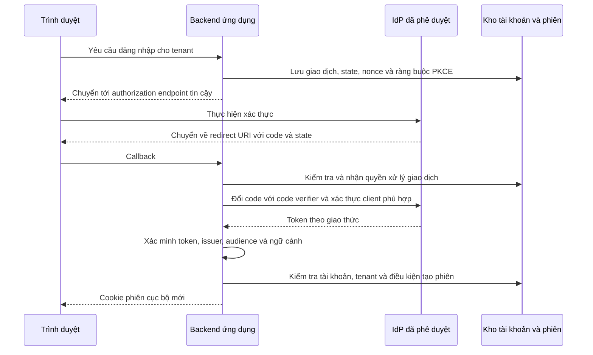

# External identity provider — Yêu cầu tích hợp nhà cung cấp danh tính bên ngoài

## 1. Tích hợp IdP thay đổi bài toán xác thực như thế nào?

External identity provider, gọi tắt là IdP bên ngoài, là hệ thống có thẩm quyền xác thực người dùng mà ứng dụng dựa vào thông qua một giao thức và thỏa thuận tin cậy. Người dùng chứng minh quyền kiểm soát credential với IdP; ứng dụng kiểm tra bằng chứng do IdP phát hành rồi quyết định có tạo phiên và cho phép truy cập hay không.

Trong chương **Yêu cầu xác thực**, tích hợp IdP cần được đặc tả như một ranh giới tin cậy. Mục tiêu “đăng nhập qua tài khoản doanh nghiệp” phải trở thành các yêu cầu cụ thể về nhà phát hành được chấp nhận, đối tượng sử dụng bằng chứng, tài khoản đích, mức bảo đảm, thời hạn, thu hồi và hành vi khi một thành phần gặp lỗi.

Chuyển nơi kiểm tra mật khẩu sang IdP không chuyển toàn bộ trách nhiệm bảo mật của ứng dụng. Ứng dụng vẫn phải bảo vệ phiên cục bộ, kiểm soát tenant, ánh xạ danh tính đúng, thực thi phân quyền và ngừng truy cập khi người dùng mất quyền. Một chữ ký hợp lệ không đủ để kết luận rằng người mang bằng chứng được phép truy cập mọi dữ liệu.

Ví dụ xuyên suốt bài là một cổng quản trị nhiều tenant. Mỗi doanh nghiệp có thể kết nối IdP riêng. Người dùng thuộc tenant A không được truy cập tenant B chỉ vì hai bên cùng sử dụng một dịch vụ danh tính hoặc có email giống nhau.

## 2. Thuật ngữ và phạm vi trách nhiệm

| Thành phần | Vai trò | Điều cần làm rõ trong đặc tả |
|---|---|---|
| IdP hoặc OpenID Provider | Xác thực chủ thể và phát hành bằng chứng theo giao thức | Nhà phát hành nào được tin, bằng phương thức nào và với mức bảo đảm nào |
| Relying Party hoặc Service Provider | Ứng dụng dựa vào kết quả xác thực | Cách xác minh bằng chứng và điều kiện tạo phiên |
| Authorization Server | Phát hành token cho quyền truy cập API theo OAuth | Không mặc định mọi token phát ra đều dùng để đăng nhập |
| Resource Server | API tiếp nhận access token | Kiểm tra token dành cho API đó và thực thi quyền truy cập |
| Identity store cục bộ | Lưu tài khoản ứng dụng và liên kết danh tính | Định danh nội bộ, tenant, trạng thái hoạt động và lịch sử liên kết |
| Provisioning service | Tạo, cập nhật, đình chỉ hoặc xóa tài khoản theo nguồn quản lý | Thời gian đồng bộ và nguồn nào có quyền quyết định trạng thái |
| Session service | Duy trì phiên của ứng dụng sau đăng nhập | Tuổi phiên, xác thực lại, thu hồi và phản ứng khi IdP không khả dụng |

### Chọn đúng giao thức cho đúng trách nhiệm

| Giao thức hoặc cơ chế | Vai trò chính trong tình huống này | Điều không được suy ra tự động |
|---|---|---|
| OpenID Connect, OIDC | Cung cấp lớp xác thực và thông tin danh tính trên nền OAuth | Có ID token không đồng nghĩa người dùng có mọi quyền trong ứng dụng |
| OAuth | Ủy quyền truy cập tài nguyên qua token | Một access token bất kỳ không phải bằng chứng đăng nhập hợp lệ cho mọi ứng dụng |
| SAML | Truyền assertion xác thực và thuộc tính trong liên kết danh tính | Chữ ký hợp lệ không thay thế kiểm tra audience, recipient, thời hạn và giao dịch |
| SCIM hoặc kết nối provisioning tương đương | Đồng bộ vòng đời tài khoản và thuộc tính | Đồng bộ thành công không chứng minh một giao dịch đăng nhập đã được xác thực |

IdP có thể nằm trong tổ chức hoặc do một bên khác vận hành. Trong cả hai trường hợp, ứng dụng cần một hợp đồng tin cậy rõ ràng. Không dùng vị trí triển khai làm lý do bỏ qua kiểm tra giao thức.

## 3. Từ mô hình đe dọa đến yêu cầu

Trước khi chọn thư viện hoặc viết callback, cần xác định tài sản và tình huống thất bại. Tài sản gồm quyền truy cập tenant, tài khoản đặc quyền, token, credential của client, khóa xác minh và dữ liệu danh tính.

| Mã rủi ro | Kịch bản đe dọa | Mục tiêu yêu cầu |
|---|---|---|
| R-01 | Chấp nhận token từ IdP hoặc tenant ngoài phạm vi | Ràng buộc nhà phát hành, kết nối và tenant được phê duyệt |
| R-02 | Dùng token được phát cho ứng dụng hoặc API khác | Kiểm tra đúng loại token, audience và client |
| R-03 | Kẻ tấn công gắn tài khoản nạn nhân với danh tính của mình | Liên kết dựa trên bằng chứng kiểm soát, không tự ghép theo email |
| R-04 | Chèn hoặc phát lại phản hồi đăng nhập | Ràng buộc giao dịch, chống CSRF và chống phát lại |
| R-05 | Người đã nghỉ việc vẫn có phiên ứng dụng hoạt động | Đồng bộ đình chỉ và thu hồi phiên trong giới hạn đo được |
| R-06 | Thuộc tính từ IdP tự nâng người dùng thành quản trị viên | Ánh xạ quyền có nguồn và phạm vi rõ ràng |
| R-07 | Endpoint discovery hoặc URL khóa bị lợi dụng để truy cập mạng nội bộ | Chỉ nạp metadata và khóa từ cấu hình tin cậy có kiểm soát mạng |
| R-08 | IdP gián đoạn khiến ứng dụng mở đường đăng nhập yếu hơn | Quy định hành vi lỗi và phục hồi không phá mức bảo đảm |
| R-09 | Token, client secret hoặc dữ liệu cá nhân lọt vào log | Giảm thu thập, bảo vệ bí mật và lọc dữ liệu tại nguồn |
| R-10 | Khóa ký bị lộ hoặc cấu hình tenant bị sửa trái phép | Quy trình thay khóa, thu hồi tin cậy và kiểm soát thay đổi |

Mỗi yêu cầu cần gắn với rủi ro nguồn và thành phần chịu trách nhiệm. Ví dụ “hỗ trợ SSO an toàn” chưa đủ để nghiệm thu. Cần biết ứng dụng phải từ chối phản hồi nào, chặn ở đâu và bằng chứng kiểm thử nào chứng minh điều đó.

## 4. Hồ sơ tin cậy cho từng kết nối IdP

Không nên chỉ có một trường `sso_enabled`. Mỗi kết nối phải có hồ sơ cấu hình và chủ sở hữu chịu trách nhiệm.

| Thuộc tính | Nội dung cần đặc tả |
|---|---|
| Mã kết nối | Định danh nội bộ ổn định, tenant ứng dụng được phép sử dụng và trạng thái kết nối |
| Giao thức | OIDC hoặc SAML cùng các lựa chọn được hỗ trợ |
| Nhà phát hành | Issuer hoặc entity ID chính xác được chấp nhận |
| Client hoặc SP | Client ID, audience hoặc entity ID của ứng dụng theo môi trường |
| Endpoint và metadata | Nguồn cấu hình tin cậy, quy tắc tải lại và quyền truy cập mạng |
| Khóa và thuật toán | Nguồn khóa xác minh, thuật toán cho phép và quy trình thay khóa |
| Mức bảo đảm | Phương thức xác thực, yêu cầu MFA hoặc chống phishing, cách diễn giải bằng chứng |
| Ánh xạ danh tính | Khóa liên kết bên ngoài, thuộc tính bắt buộc và quy tắc tenant |
| Vòng đời | Điều kiện tạo tài khoản, đình chỉ, gỡ liên kết và thu hồi phiên |
| Vận hành | Chủ sở hữu, liên hệ sự cố, thời hạn xử lý, nhật ký và cách ngừng tin cậy |

### Yêu cầu cấu hình mẫu

> **EIP-TRUST-01:** Ứng dụng chỉ được khởi tạo và hoàn tất đăng nhập qua kết nối IdP đang hoạt động, đã được phê duyệt và thuộc tenant đích. Issuer, client ID, redirect URI và các nguồn khóa phải lấy từ cấu hình được quản lý; không lấy trực tiếp từ claim hoặc URL do người dùng cung cấp tại callback.

Với OIDC, issuer cần được so khớp theo quy tắc của giao thức; không tự bỏ đường dẫn, bỏ dấu gạch cuối hoặc dùng phép kiểm tra chuỗi con để “linh hoạt”. Một hệ sinh thái có thể phục vụ nhiều tổ chức qua cùng nền tảng; ngoài issuer còn có thể cần điều kiện tenant riêng theo ngữ nghĩa đã thỏa thuận với nhà cung cấp.

Discovery giúp lấy metadata, nhưng không tự tạo ra lòng tin. Ứng dụng phải biết trước nhà phát hành nào được phép dùng, kiểm tra metadata phù hợp với issuer và kiểm soát các endpoint nhận được. Cấu hình không được trở thành cơ chế tùy ý gọi URL nội bộ, chuyển hướng qua miền lạ hoặc gửi credential tới một endpoint chưa được phê duyệt.

Đăng ký client cần tách môi trường production và thử nghiệm, có redirect URI cụ thể, không dùng wildcard rộng. Nếu phải hỗ trợ nhiều URI, từng URI cần được đăng ký và kiểm thử theo quy tắc so khớp của nhà cung cấp. Thay đổi kết nối, issuer, nguồn khóa hoặc ánh xạ quyền phải có kiểm soát quyền và nhật ký.

## 5. Yêu cầu luồng OIDC minh họa

Giả sử cổng quản trị dùng backend quản lý đăng nhập và phiên. Hồ sơ sản phẩm chọn Authorization Code Flow kết hợp PKCE với `S256`; token được xử lý ở backend, trình duyệt nhận cookie phiên của ứng dụng. Đây là lựa chọn thiết kế cho ví dụ, không phải hướng dẫn dùng cùng một cách triển khai cho mọi loại client.

Ứng dụng di động hoặc ứng dụng công khai không có khả năng giữ client secret giống backend. Không nhúng một secret vào mã JavaScript hoặc gói cài đặt rồi coi client đó có bí mật chỉ server biết. Cấu hình xác thực client phải phù hợp với loại client và khả năng của IdP.



### 5.1. Ràng buộc giao dịch đăng nhập

> **EIP-OIDC-01:** Mỗi lần đăng nhập phải có giao dịch ngắn hạn phía server, gắn với kết nối IdP, tenant, redirect URI và ngữ cảnh trình duyệt khởi tạo. `state` và `nonce` phải được sinh ngẫu nhiên, có thời hạn và được kiểm tra theo mục đích; giao dịch không được tạo phiên thành công nhiều lần.

`state` dùng để liên kết phản hồi với giao dịch và hỗ trợ chống giả mạo yêu cầu đăng nhập. `nonce` liên kết ID token với yêu cầu xác thực. PKCE ràng buộc việc đổi authorization code với bên giữ code verifier. Ba cơ chế này có trách nhiệm khác nhau; không bỏ một cơ chế chỉ vì đã triển khai cơ chế khác.

Giao dịch cần lưu đích điều hướng sau đăng nhập dưới dạng được kiểm soát, không cho callback chuyển tới URL bất kỳ. Không đặt secret hoặc thông tin cá nhân không cần thiết vào `state` hay query string.

Phải kiểm thử cả nhiều tab và giao dịch đồng thời. Không được lấy tenant đang hiển thị ở giao diện để thay cho tenant đã ràng buộc trong giao dịch. Callback thiếu giao dịch, sai state, sai kết nối hoặc quá hạn phải bị từ chối trước khi tạo phiên.

Thuộc tính cookie phải phù hợp với cách IdP trả phản hồi. Callback qua điều hướng GET và callback qua POST có thể khác nhau về hành vi SameSite. Cần chọn cơ chế cookie và chống CSRF theo luồng thực tế, không cấu hình tùy tiện để chữa lỗi callback rồi bỏ mất ràng buộc trình duyệt.

### 5.2. Đổi authorization code

Code chỉ được gửi tới token endpoint của kết nối đã ràng buộc. Backend phải sử dụng code verifier tương ứng, redirect URI đúng và cơ chế xác thực client theo hồ sơ đã phê duyệt. Nếu dùng client secret hoặc khóa riêng của client, vật liệu đó phải nằm trong kho bí mật với quyền đọc hẹp và quy trình thay thế.

Không đưa code, code verifier, client secret hoặc token vào log. Không cho người gọi tự chỉ định token endpoint trong callback. Lỗi đổi code không được chuyển thành đăng nhập thành công hoặc tự tạo một tài khoản cục bộ dự phòng.

### 5.3. Xác minh ID token

Xác minh phải sử dụng thư viện giao thức phù hợp và một hồ sơ kiểm tra rõ ràng. Danh sách dưới đây mô tả các điều kiện cần đặc tả, không thay thế toàn bộ quy tắc của giao thức và hồ sơ triển khai.

| Điều kiện | Hành vi bắt buộc |
|---|---|
| Loại bằng chứng | Chỉ xử lý ID token ở nơi dự kiến nhận ID token; không dùng access token bất kỳ để suy ra danh tính đăng nhập |
| Thuật toán | Chỉ chấp nhận các thuật toán đã cấu hình; không để header của token tự mở rộng danh sách |
| Chữ ký | Xác minh bằng khóa thuộc nguồn tin cậy của đúng kết nối |
| Issuer | Khớp chính xác nhà phát hành đã ràng buộc với giao dịch |
| Audience và authorized party | Kiểm tra `aud` và `azp` theo quy tắc áp dụng để bảo đảm token dành cho client này |
| Thời gian | Kiểm tra `exp`, các ràng buộc thời gian khác theo giao thức và độ lệch đồng hồ được giới hạn |
| Nonce | Khớp nonce của giao dịch khi hồ sơ yêu cầu và đã gửi nonce |
| Subject | Có `sub` hợp lệ để tạo khóa liên kết danh tính |
| Các ràng buộc bổ sung | Kiểm tra tenant, mức bảo đảm và dữ liệu liên quan theo hồ sơ đã phê duyệt |

Không tin claim đã giải mã trước khi xác minh. Có thể đọc trường định tuyến ở mức hạn chế, nhưng quyết định tin cậy phải dựa trên cấu hình giao dịch đã biết. Header như `kid` chỉ là gợi ý chọn khóa trong tập khóa tin cậy; không phải giấy phép tải một khóa tùy ý từ URL trong token.

Nếu ứng dụng gọi UserInfo, endpoint và access token phải thuộc đúng kết nối; subject trả về phải khớp subject của ID token đã xác minh trước khi kết hợp thuộc tính. Nếu API của sản phẩm nhận access token, API đó cần hồ sơ xác minh riêng, gồm audience dành cho API và quyền truy cập; không chỉ kiểm tra rằng token đến từ cùng IdP.

## 6. Khi tích hợp SAML

SAML có cấu trúc khác OIDC nhưng vẫn cần cùng mức rõ ràng về nguồn tin cậy, giao dịch, đối tượng nhận và chống phát lại. Không dịch từng tên claim của OIDC sang tên trường SAML rồi coi hai giao thức hoàn toàn tương đương.

Hồ sơ cho SAML cần xác định:

- Entity ID của IdP và SP, nguồn metadata tin cậy, chứng thư hoặc khóa xác minh được phép.
- Endpoint nhận assertion, binding, audience, recipient và destination theo luồng áp dụng.
- Yêu cầu chữ ký đối với Response hoặc Assertion và cách bảo đảm dữ liệu được sử dụng chính là dữ liệu đã được bảo vệ.
- Liên kết `InResponseTo` với yêu cầu đã phát trong luồng do SP khởi tạo, cùng cách kiểm soát `RelayState`.
- Điều kiện thời gian và xác nhận chủ thể; độ lệch đồng hồ tối đa được phép.
- Cơ chế ghi nhận ID của Response hoặc Assertion để ngăn phát lại trong toàn bộ cửa sổ chấp nhận, bao gồm độ lệch đồng hồ.
- Cách diễn giải định danh ổn định, thuộc tính và mức bảo đảm xác thực.

Chữ ký XML cần được kiểm tra cùng cách parser chọn phần tử. Nếu mã xác minh một assertion nhưng ứng dụng lại đọc một assertion khác, chữ ký hợp lệ vẫn không bảo vệ quyết định đăng nhập. Phải dùng thư viện được thiết kế cho giao thức, cấu hình parser an toàn và kiểm thử các cấu trúc trùng lặp hoặc gây nhầm phần tử.

Trong ví dụ sản phẩm, chỉ chấp nhận luồng do SP khởi tạo. Phản hồi không gắn với yêu cầu đã phát bị từ chối. Nếu cần đăng nhập do IdP khởi tạo, phải có hồ sơ và đánh giá rủi ro riêng; không tắt kiểm tra liên kết giao dịch cho tất cả phản hồi để hỗ trợ một ngoại lệ.

## 7. Liên kết danh tính ngoài với tài khoản ứng dụng

### 7.1. Dùng khóa ổn định có phạm vi nhà phát hành

Với OIDC, một khóa liên kết thường dựa trên cặp **issuer và subject**. Cần lưu thêm kết nối và phạm vi tenant phù hợp với mô hình sản phẩm. Không coi `sub` là duy nhất toàn cầu khi không đi cùng issuer.

Với SAML, định danh phải dựa trên một thỏa thuận ổn định với nhà cung cấp, gồm phạm vi nhà phát hành và ngữ nghĩa của định danh chủ thể. Không mặc định mọi NameID đều bất biến hoặc đều phù hợp làm khóa tài khoản.

Email là thuộc tính liên hệ có thể thay đổi, bị tái cấp hoặc có ý nghĩa khác giữa các tổ chức. `email_verified` cũng không chứng minh hai chủ thể từ hai issuer là cùng một người, hoặc người đó có quyền tham gia một tenant cụ thể.

> **EIP-ID-01:** Ứng dụng không được tự động liên kết danh tính ngoài với tài khoản hiện có chỉ do email, tên hiển thị hoặc miền email trùng nhau. Liên kết phải dựa trên danh tính đã được ràng buộc hoặc quy trình chứng minh quyền kiểm soát được phê duyệt.

### 7.2. Tạo tài khoản lần đầu

Just-in-time provisioning là tạo tài khoản khi đăng nhập lần đầu. Quy trình này cần điều kiện rõ ràng, ví dụ lời mời còn hiệu lực, thành viên đã được cấp trước hoặc chính sách onboarding của tenant đã được phê duyệt.

Một token hợp lệ có email thuộc miền doanh nghiệp không tự đủ để cấp tài khoản quản trị. Nếu chấp nhận tạo tài khoản theo miền, phải nêu cách xác minh quyền sở hữu miền, điều kiện membership và phạm vi vai trò ban đầu. Tài khoản mới nên nhận mức quyền tối thiểu theo chính sách sản phẩm.

### 7.3. Liên kết, gỡ liên kết và chuyển IdP

Liên kết thêm danh tính phải yêu cầu chứng minh quyền kiểm soát tài khoản hiện tại và danh tính mới ở mức phù hợp. Thao tác cần có nhật ký, thông báo và kiểm tra xung đột: một danh tính ngoài không được âm thầm chuyển từ tài khoản A sang tài khoản B.

Gỡ liên kết không được khiến tài khoản mất mọi phương thức truy cập hợp lệ mà không có quy trình được quản lý. Chuyển IdP, thay issuer hoặc thay cách phát subject cần kế hoạch di trú; không cập nhật hàng loạt theo email rồi coi đó là cùng một danh tính.

Nếu một người rời tổ chức rồi email được cấp cho người khác, người mới không được thừa hưởng tài khoản cũ chỉ nhờ email giống nhau. Trạng thái liên kết và lịch sử tài khoản phải xử lý được tình huống này.

## 8. Mức bảo đảm xác thực và phân quyền

### 8.1. Xác định IdP đã chứng minh điều gì

Ứng dụng cần biết giao dịch đã dùng phương thức nào, xảy ra lúc nào và có đáp ứng mức bảo đảm của thao tác đích hay không. Một lần đăng nhập thành công ở IdP không mặc nhiên chứng minh đã dùng MFA hoặc phương thức chống phishing.

Với OIDC, các claim như `acr`, `amr` và `auth_time` có thể giúp đánh giá, nhưng ý nghĩa phải dựa trên hợp đồng với nhà cung cấp. Có một chuỗi `mfa` trong claim không tự đủ để kết luận đã dùng phương thức chống phishing. Với SAML, cần thỏa thuận tương tự về ngữ cảnh xác thực.

> **EIP-ASSUR-01:** Thao tác quản trị nhạy cảm phải yêu cầu mức bảo đảm đã được sản phẩm phê duyệt và bằng chứng về thời điểm xác thực. Trong hồ sơ minh họa, sự kiện xác thực đáp ứng yêu cầu phải xảy ra không quá 5 phút trước thao tác. Thiếu hoặc không hiểu bằng chứng phải dẫn tới yêu cầu xác thực lại hoặc từ chối, không tự hạ mức bảo đảm.

Nếu dùng `max_age`, yêu cầu ngữ cảnh xác thực hoặc cơ chế tương đương, ứng dụng phải kiểm tra phản hồi chứng minh điều kiện đã được đáp ứng. Chỉ gửi tham số tới IdP không đủ. Khi cần xác thực lại, việc IdP trả ngay một phiên SSO cũ cũng không tự đáp ứng yêu cầu về độ mới.

### 8.2. Quyền truy cập vẫn có chính sách riêng

Các group, role hoặc thuộc tính từ IdP là dữ liệu đầu vào cho quyết định quyền. Chính sách phải xác định claim nào có thẩm quyền, kết nối nào được phép cấp thuộc tính đó và phạm vi tenant tương ứng.

- Không ánh xạ một group tên `admin` từ mọi IdP thành quản trị viên toàn hệ thống.
- Không để claim tùy ý ghi đè tenant đã ràng buộc trong giao dịch đăng nhập.
- Thuộc tính thiếu, không hợp lệ hoặc không ánh xạ được phải dẫn tới mức quyền an toàn theo hợp đồng, không mặc định cấp quyền cao.
- Trạng thái đình chỉ tại ứng dụng phải thắng một kết quả xác thực thành công từ IdP.
- Thay đổi ánh xạ group sang quyền phải được kiểm soát và có thể truy vết như thay đổi chính sách phân quyền.

Ví dụ, group có mã `finance-reviewers` chỉ được cấp quyền duyệt báo cáo trong tenant của kết nối. Quyền quản trị cấu hình toàn sản phẩm phải có một chính sách khác và nguồn cấp có thẩm quyền tương ứng.

## 9. Vòng đời tài khoản và thu hồi truy cập

### 9.1. Tách đăng nhập khỏi đồng bộ vòng đời

Có SSO không đồng nghĩa có deprovisioning. Nếu ứng dụng chỉ hỏi IdP khi đăng nhập, người đã bị vô hiệu hóa ở nguồn có thể tiếp tục dùng phiên cục bộ nhiều giờ.

Đặc tả cần trả lời ai có quyền tạo tài khoản, nguồn nào quyết định trạng thái hoạt động, cách phát hiện thay đổi và khi nào mọi điểm kiểm soát phải áp dụng. Có thể dùng provisioning API, sự kiện, kiểm tra trạng thái hoặc đồng bộ định kỳ; lựa chọn nào cũng phải chứng minh được giới hạn thời gian.

| Mã | Yêu cầu minh họa | Bằng chứng cần có |
|---|---|---|
| EIP-LIFE-01 | Khi quản trị viên ứng dụng đình chỉ một tài khoản, các yêu cầu mới bằng phiên và token ứng dụng thuộc phạm vi phải bị từ chối trên mọi vùng trong tối đa 60 giây từ khi thao tác commit | Kiểm thử mọi verifier, gồm cache đang có dữ liệu cũ |
| EIP-LIFE-02 | Khi nguồn danh tính có thẩm quyền ghi nhận vô hiệu hóa người dùng, truy cập ứng dụng thuộc phạm vi phải dừng trong tối đa 5 phút | Đo từ sự kiện tại nguồn, qua đồng bộ, tới lần từ chối tại từng vùng |
| EIP-LIFE-03 | Đình chỉ hoặc gỡ quyền thành viên phải ngăn tạo phiên mới, kể cả khi ID token hoặc assertion vẫn hợp lệ về mật mã | Đăng nhập bằng bằng chứng hợp lệ cho tài khoản đã đình chỉ phải thất bại |

Các ngưỡng 60 giây và 5 phút là quyết định minh họa. Để đạt 5 phút, ngân sách phát hiện, vận chuyển, xử lý và hội tụ cache phải cộng lại trong giới hạn đó. Chẳng hạn phát hiện tối đa 4 phút và áp dụng tối đa 1 phút mới đủ ngân sách; một tác vụ polling mỗi 5 phút cộng thêm 1 phút xử lý không đáp ứng.

Nếu IdP chỉ cung cấp dữ liệu đồng bộ chậm hơn mục tiêu, nhóm thiết kế phải thay kiến trúc hoặc điều chỉnh yêu cầu qua quyết định rủi ro rõ ràng. Không ghi cam kết mà ứng dụng không có khả năng quan sát hoặc cưỡng chế.

### 9.2. Phạm vi thu hồi phải được kiểm kê

Phiên web, refresh token, access token của ứng dụng, token do IdP cấp và credential tích hợp có thể có cơ chế thu hồi khác nhau. Đăng xuất cục bộ không bảo đảm phiên SSO tại IdP hoặc phiên ở ứng dụng khác đã kết thúc.

Một access token tự chứa có thể vẫn được chấp nhận đến khi hết hạn nếu API chỉ kiểm tra chữ ký. Nếu yêu cầu dừng truy cập trong 60 giây, kiến trúc phải có kiểm tra trạng thái, phiên bản bảo mật hoặc cơ chế tương đương đáp ứng giới hạn. Đưa một sự kiện vào hàng đợi không chứng minh mọi API đã áp dụng.

Ứng dụng cần phân biệt:

1. Người dùng đăng xuất khỏi phiên hiện tại.
2. Thu hồi tất cả phiên cục bộ của tài khoản.
3. Kết thúc phiên SSO hoặc xử lý thông báo logout của IdP.
4. Ngừng chấp nhận một kết nối IdP vì sự cố tin cậy.
5. Thu hồi credential hoặc quyền truy cập API ngoài vòng đời phiên web.

Nếu hỗ trợ back-channel logout hoặc thông báo tương tự, thông báo đó cũng phải được xác minh nguồn, đối tượng nhận, nội dung sự kiện và chống phát lại theo giao thức. Không để một request công khai chứa `sub` hoặc `sid` tùy ý trở thành lệnh đăng xuất người khác.

### 9.3. Không bật lại tài khoản do dữ liệu đến muộn

Sự kiện provisioning có thể được gửi lại hoặc đến sai thứ tự. Cần có phiên bản, thời điểm nguồn hoặc cơ chế thứ tự phù hợp để một bản cập nhật cũ không tự kích hoạt lại tài khoản đã đình chỉ. Việc phục hồi tài khoản phải là chuyển trạng thái được phép và có bằng chứng nguồn.

## 10. Quản lý khóa, credential của client và sự cố tin cậy

### 10.1. Khóa xác minh của IdP

Ứng dụng phải có chiến lược tải và cache khóa. Khi IdP thay khóa bình thường, khóa cũ và mới có thể cùng tồn tại trong một giai đoạn; khi khóa bị lộ, phản ứng cần nhanh hơn quy trình thay theo kế hoạch.

Một hồ sơ yêu cầu cần nêu:

- Nguồn metadata và JWKS hoặc chứng thư đã được tin cậy cho từng kết nối.
- Chu kỳ làm mới, thời hạn dùng cache và giới hạn sử dụng dữ liệu cũ khi nguồn khóa lỗi.
- Cách xử lý `kid` không biết: có thể làm mới có giới hạn, sau đó từ chối nếu vẫn không tìm được khóa hợp lệ.
- Giới hạn tần suất và gộp yêu cầu làm mới để token lạ không gây bão truy vấn tới IdP.
- Cơ chế khẩn cấp để chặn một khóa hoặc kết nối, kể cả khi khóa vẫn còn trong cache.

> **EIP-KEY-01:** Không có khóa tin cậy phù hợp hoặc xác minh chữ ký thất bại thì không được tạo phiên. Lỗi tải khóa không được dẫn tới bỏ kiểm tra chữ ký, chấp nhận thuật toán ngoài cấu hình hoặc dùng khóa của một kết nối khác.

Nếu cho phép dùng khóa đã cache khi mạng lỗi, phải có thời hạn và điều kiện rõ ràng. Một cache còn dùng được không chứng minh khóa chưa bị thu hồi. Khả năng đình chỉ khẩn cấp cần có đường điều khiển độc lập phù hợp với mục tiêu xử lý sự cố.

### 10.2. Credential dùng để ứng dụng gọi IdP

Client secret hoặc khóa xác thực client phải được quản lý như secret của dịch vụ: tách môi trường, quyền truy cập tối thiểu, không ghi log, có chủ sở hữu và quy trình thay thế. Nếu cho phép chồng lấp credential khi thay theo kế hoạch, phải giới hạn thời gian và thu hồi credential cũ sau chuyển đổi.

Không dùng cùng một secret cho nhiều môi trường chỉ để đơn giản hóa triển khai. Không gửi credential tới endpoint có được từ một URL không tin cậy. Khi nghi lộ, cần thu hồi và thay credential, đồng thời đánh giá token, phiên và quyền có thể đã bị cấp sai.

### 10.3. Ngừng tin cậy một kết nối

> **EIP-INC-01:** Sản phẩm phải có thao tác quản trị được kiểm soát để đình chỉ kết nối IdP. Trong hồ sơ minh họa, việc đình chỉ phải ngăn đăng nhập mới và chặn các phiên gắn với kết nối đó trên mọi vùng trong tối đa 60 giây từ khi thao tác commit.

Cần lưu nguồn kết nối của phiên để thực thi yêu cầu này. Nếu chỉ lưu một `user_id` và không có thông tin nguồn hoặc phiên bản tin cậy, việc thu hồi theo kết nối có thể không thực hiện được đúng phạm vi.

## 11. Khả dụng và phục hồi khi IdP gặp sự cố

Gián đoạn IdP không được biến thành lý do cho phép đăng nhập mà không có bằng chứng hợp lệ. Đồng thời, ứng dụng cần dự đoán tác động tới người dùng và vận hành.

| Tình huống | Hành vi cần quy định |
|---|---|
| Authorization hoặc token endpoint không phản hồi | Có timeout và ngân sách thử lại; không tạo phiên mới; thông báo có thể thử lại |
| Không tải được khóa nhưng có cache hợp lệ | Chỉ dùng cache trong điều kiện và thời hạn đã phê duyệt; không tự nới chính sách |
| Không có khóa phù hợp | Từ chối đăng nhập; ghi nguyên nhân nội bộ đã lọc secret |
| Không đồng bộ được trạng thái người dùng | Áp dụng ngưỡng độ cũ dữ liệu và chính sách rủi ro; cảnh báo khi sắp vi phạm hợp đồng thu hồi |
| Phiên cục bộ còn hiệu lực | Có thể tiếp tục thao tác được chính sách cho phép nếu vẫn qua kiểm tra cục bộ; không tự kéo dài phiên vì IdP lỗi |
| Thao tác yêu cầu xác thực lại mới | Chưa có bằng chứng đáp ứng thì chưa được thực hiện |
| Kết nối hoặc khóa nghi bị lộ | Dùng quy trình đình chỉ và thu hồi khẩn cấp, không dùng chính sách cache thông thường để tiếp tục tin cậy |

Không âm thầm bật đăng nhập bằng mật khẩu cục bộ cho mọi người khi SSO lỗi. Nếu tổ chức cần tài khoản khẩn cấp, phải có phạm vi hẹp, phương thức bảo vệ đã phê duyệt, quyền rõ ràng, cảnh báo mỗi lần dùng và rà soát sau sử dụng. Đường khẩn cấp không được trở thành cách thường xuyên vượt chính sách tenant.

Khôi phục cấu hình hoặc cơ sở dữ liệu từ bản sao cũ không được tự bật lại kết nối đã đình chỉ, phục hồi secret bị thu hồi hoặc làm phiên cũ hoạt động trở lại. Quy trình phục hồi phải đối soát trạng thái tin cậy và sự kiện thu hồi trước khi mở dịch vụ.

## 12. Dữ liệu, logging và bằng chứng vận hành

Chỉ yêu cầu các scope và thuộc tính cần cho mục đích đã xác định. Tên hiển thị, ảnh đại diện, nhóm tổ chức hoặc danh sách thành viên có thể là dữ liệu cá nhân và có phạm vi sử dụng khác nhau. Không xin thêm dữ liệu chỉ vì nhà cung cấp có sẵn.

| Dữ liệu | Yêu cầu bảo vệ minh họa |
|---|---|
| Client secret, khóa riêng, code verifier | Kho bí mật hoặc lưu tạm được bảo vệ; giới hạn quyền và tuổi dữ liệu |
| Authorization code, ID token, access token, refresh token, SAML assertion | Không ghi nguyên văn vào log, URL điều hướng nội bộ, analytics hoặc thông báo lỗi |
| Cookie phiên và dữ liệu giao dịch | Bảo vệ theo mô hình server/client; không để lộ cho script khi kiến trúc không cần |
| Issuer, subject và liên kết tài khoản | Kiểm soát quyền đọc, thay đổi, lưu giữ và xóa theo chính sách dữ liệu |
| Sự kiện đăng nhập, liên kết, đình chỉ và đổi cấu hình | Ghi mã tương quan, kết nối, tenant, tài khoản nội bộ, kết quả và nhãn nguyên nhân |

Với backend quản lý phiên trong ví dụ, token không cần xuất cho mã JavaScript ở trình duyệt. Cookie phiên cần thuộc tính bảo vệ, thời hạn và cơ chế chống giả mạo phù hợp. Các loại client khác cần hồ sơ bảo vệ riêng thay vì sao chép nguyên mô hình này.

Phải kiểm tra cả gateway, proxy, hệ thống trace, công cụ báo lỗi và dashboard hỗ trợ. Không chỉ tắt một dòng log trong callback rồi kết luận không còn rò rỉ.

Các chỉ số có ích gồm tỷ lệ đăng nhập thành công theo kết nối, lỗi xác minh theo loại, tuổi cache khóa, độ trễ đồng bộ đình chỉ và thời gian hội tụ thu hồi. Đặt cảnh báo dựa trên ngưỡng của hợp đồng. Không dùng token thật làm dữ liệu chẩn đoán hoặc nhãn metric.

## 13. Hồ sơ yêu cầu mẫu và truy vết kiểm thử

Giả sử tenant doanh nghiệp yêu cầu OIDC, tạo tài khoản qua lời mời, quyền quản trị dùng phương thức chống phishing đã thống nhất với IdP và ứng dụng phải dừng truy cập khi người dùng rời tổ chức. Hồ sơ sản phẩm có thể chốt các yêu cầu sau:

| Mã | Yêu cầu cụ thể | Rủi ro và nơi thực thi |
|---|---|---|
| EIP-PROF-01 | Chỉ nhận issuer và tenant IdP nằm trong kết nối đã phê duyệt; tenant ứng dụng lấy từ giao dịch phía server | R-01; cấu hình và callback |
| EIP-PROF-02 | Dùng Authorization Code cùng PKCE S256; giao dịch có hạn 5 phút và hoàn tất tối đa một lần | R-04; backend đăng nhập và kho giao dịch |
| EIP-PROF-03 | ID token phải qua kiểm tra chữ ký, thuật toán, issuer, audience, thời gian, nonce và điều kiện hồ sơ | R-02, R-04; verifier |
| EIP-PROF-04 | Tài khoản lần đầu chỉ được tạo khi có lời mời hợp lệ; không tự ghép tài khoản theo email | R-03; dịch vụ danh tính |
| EIP-PROF-05 | Chỉ ánh xạ group từ nguồn được phê duyệt trong phạm vi tenant; quyền đặc quyền có chính sách riêng | R-06; dịch vụ phân quyền |
| EIP-PROF-06 | Đình chỉ cục bộ có hiệu lực trong 60 giây; đình chỉ tại nguồn có hiệu lực trong 5 phút, gồm phiên đang tồn tại | R-05; provisioning, kho phiên và mọi verifier |
| EIP-PROF-07 | Thiếu khóa hoặc IdP lỗi không được tạo phiên bằng cách bỏ kiểm tra; dữ liệu cache có giới hạn tuổi rõ ràng | R-08, R-10; dịch vụ khóa và điều phối đăng nhập |
| EIP-PROF-08 | Không ghi code, token, assertion hoặc secret vào log; có sự kiện cho mọi thay đổi liên kết và cấu hình | R-09, R-10; toàn bộ đường thu thập dữ liệu |

Các giá trị 5 phút và 60 giây là lựa chọn minh họa cho hồ sơ này. Trước triển khai phải ghi được khả năng của IdP, ngân sách độ trễ và điều kiện hạ tầng để thực hiện. Một yêu cầu phụ thuộc bên ngoài chưa có cam kết hoặc phép đo cần được ghi nhận là khoảng trống thiết kế.

### Kịch bản nghiệm thu hành vi

```gherkin
Scenario: Token có chữ ký đúng nhưng sai audience
  Given giao dịch đăng nhập của client A
  And ID token hợp lệ về chữ ký nhưng chỉ dành cho client B
  When callback xử lý token đó
  Then không tạo phiên ứng dụng
  And ghi nhãn lỗi nội bộ mà không ghi token

Scenario: Không ghép tài khoản theo email trùng nhau
  Given tài khoản nội bộ đã liên kết với issuer I1 và subject S1
  And một danh tính từ issuer I2 có cùng email
  When danh tính I2 đăng nhập lần đầu
  Then không tự liên kết vào tài khoản hiện có
  And chỉ tiếp tục qua quy trình onboarding hoặc liên kết được phê duyệt

Scenario: Không chuyển tenant qua dữ liệu callback
  Given giao dịch phía server thuộc tenant A và kết nối IA
  When callback chứa tham số hoặc claim đề nghị truy cập tenant B
  Then không tạo phiên cho tenant B
  And không cấp quyền của tenant B cho người dùng

Scenario: Callback cũ không tạo thêm phiên
  Given một giao dịch đã hoàn tất đăng nhập thành công
  When gửi lại cùng callback hoặc gửi hai yêu cầu đồng thời
  Then giao dịch không thể hoàn tất thành công lần thứ hai

Scenario: Khóa không biết không được tự động tin cậy
  Given token chứa kid chưa có trong tập khóa tin cậy
  When làm mới khóa có giới hạn vẫn không tìm được khóa phù hợp
  Then đăng nhập bị từ chối
  And không tải khóa từ URL tùy ý trong token

Scenario: Đình chỉ chặn cả phiên đã có
  Given người dùng có phiên đang hoạt động tại mọi vùng
  When đình chỉ cục bộ commit tại T0
  Then mọi yêu cầu mới thuộc phạm vi bị từ chối tại hoặc sau T0 cộng 60 giây
  And đăng nhập mới cũng bị từ chối dù bằng chứng từ IdP còn hợp lệ

Scenario: IdP gián đoạn không hạ mức bảo đảm
  Given thao tác quản trị yêu cầu xác thực mới trong 5 phút
  And người dùng chỉ có bằng chứng cũ hơn giới hạn
  When IdP không khả dụng
  Then thao tác quản trị chưa được phép thực hiện
  And không tự bật đường đăng nhập yếu hơn
```

Với SAML cần thêm ca kiểm thử sai recipient, audience, `InResponseTo`, thời hạn, assertion bị phát lại và cấu trúc XML khiến phần tử đã xác minh khác phần tử ứng dụng sử dụng. Với provisioning cần thử sự kiện đến trễ, gửi lại, sai thứ tự và mất kết nối. Với thay khóa cần thử chồng lấp bình thường, khóa bị thu hồi và nhiều yêu cầu có `kid` lạ.

## 14. Những lỗi đặc tả thường gặp

| Cách viết hoặc quyết định | Vì sao chưa đủ | Cách làm rõ |
|---|---|---|
| “Tin mọi token từ hệ sinh thái đã chọn” | Có thể gồm nhiều issuer, tenant và ứng dụng khác | Chốt issuer, audience, kết nối và điều kiện tenant cụ thể |
| “Email khớp thì đó là cùng người” | Email thay đổi, tái cấp hoặc xuất hiện ở nhiều nguồn | Dùng khóa danh tính ổn định có phạm vi và quy trình liên kết |
| “Có chữ ký thì cho đăng nhập” | Bỏ qua thời gian, mục đích và liên kết giao dịch | Kiểm tra đầy đủ theo giao thức và hồ sơ sản phẩm |
| “Bật SSO là đã thu hồi người nghỉ việc” | Phiên ứng dụng có vòng đời độc lập | Đặc tả provisioning, trạng thái cục bộ và SLA thu hồi |
| “Claim role nào cũng ánh xạ trực tiếp” | IdP của tenant có thể cấp quyền vượt phạm vi | Kiểm soát nguồn claim và không gian quyền |
| “Có MFA là đủ cho thao tác đặc quyền” | Không rõ phương thức, độ mới và khả năng chống phishing | Thỏa thuận ngữ nghĩa mức bảo đảm và kiểm tra bằng chứng |
| “IdP lỗi thì tạm bỏ xác minh” | Chuyển lỗi phụ thuộc thành chiếm quyền | Quy định hành vi lỗi và đường khẩn cấp được kiểm soát |
| “Đăng xuất ở ứng dụng nghĩa là đăng xuất mọi nơi” | Phiên SSO và các ứng dụng khác có thể vẫn hoạt động | Nêu đúng phạm vi và khả năng của từng cơ chế logout |

## 15. Đầu ra cần có trước khi triển khai

Một đặc tả tích hợp IdP hoàn chỉnh cần cung cấp hồ sơ tin cậy của từng kết nối, sơ đồ luồng, quy tắc xác minh giao thức, khóa liên kết tài khoản và điều kiện tạo phiên. Cần có quyết định riêng cho phân quyền, mức bảo đảm, vòng đời người dùng, thu hồi, dữ liệu và hành vi khi phụ thuộc gián đoạn.

Nhóm phát triển phải truy được từ mỗi rủi ro tới yêu cầu, thành phần thực thi và bằng chứng kiểm thử. Nhóm vận hành phải biết cách thay khóa, đình chỉ kết nối, xử lý người dùng mất quyền và phục hồi hệ thống mà không khôi phục lại trạng thái tin cậy đã bị thu hồi.

Kết quả mong muốn là một hợp đồng rõ ràng: ứng dụng tin bằng chứng nào, trong phạm vi nào, trong bao lâu, với điều kiện gì và sẽ dừng tin bằng cách nào khi điều kiện đó không còn đúng.
