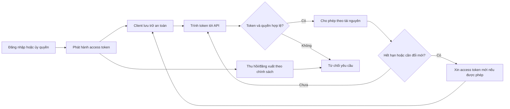

# Security token là gì và giải quyết bài toán nào?

## 1. Từ bài toán đăng nhập đến nhu cầu sử dụng token

Giả sử một hệ thống bán hàng có ứng dụng web, ứng dụng di động và các API quản lý đơn hàng. Một nhân viên đăng nhập một lần, sau đó liên tục xem danh sách đơn, cập nhật trạng thái giao hàng và tải báo cáo. Mỗi yêu cầu HTTP đều cần trả lời hai câu hỏi:

1. **Ai hoặc ứng dụng nào đang thực hiện yêu cầu?** Đây là phần liên quan đến **xác thực** (*authentication*).
2. **Chủ thể đó được phép thực hiện hành động này trên tài nguyên cụ thể này hay không?** Đây là **phân quyền** (*authorization*).

Nếu API yêu cầu gửi lại mật khẩu trong mọi lần gọi, mật khẩu sẽ phải đi qua nhiều thành phần, khó giới hạn quyền và khó vô hiệu hóa riêng một phiên truy cập. Nếu chỉ tin vào giá trị `userId` do trình duyệt gửi, kẻ tấn công có thể sửa `userId` để giả danh người khác. Cần một loại bằng chứng mà API có thể kiểm tra theo quy tắc tin cậy đã thống nhất, có phạm vi quyền và thời hạn sử dụng rõ ràng.

**Security token (token bảo mật)** trong ngữ cảnh hệ thống phần mềm là một giá trị hoặc cấu trúc dữ liệu dùng làm **thông tin xác thực được cấp phát** (*security credential*) để bên nhận đưa ra quyết định truy cập. Token thường được phát hành sau một bước xác thực, cấp quyền hoặc ủy quyền; bên nhận không cần nhận lại mật khẩu của người dùng ở mỗi yêu cầu. Token có thể là chuỗi ngẫu nhiên, chuỗi có cấu trúc chứa claims hoặc giá trị được ràng buộc với khóa mật mã.

> **Ví dụ trực quan:** Mật khẩu giống như thông tin để chứng minh danh tính khi làm thủ tục cấp thẻ. Access token giống một thẻ ra vào có thời hạn và phạm vi sử dụng: chỉ những cửa hoặc dịch vụ được chỉ định mới chấp nhận nó. Phép so sánh chỉ giúp hình dung; một *bearer token* bị sao chép có thể bị người khác dùng lại nếu không có cơ chế bảo vệ bổ sung.

Token không tự chứng minh một người “tốt” hay một yêu cầu “an toàn”. Độ tin cậy phụ thuộc vào **ai phát hành**, **bên nhận kiểm tra bằng cách nào**, **token được phép dùng ở đâu**, **token còn hiệu lực không** và **quyền truy cập có phù hợp với tài nguyên được yêu cầu không**.

## 2. Token giải quyết những bài toán nào?

| Bài toán | Vai trò của token | Điều token không tự giải quyết |
| --- | --- | --- |
| Không muốn gửi lại mật khẩu tới từng API | Ứng dụng gửi thông tin xác thực đã được phát hành, ví dụ access token | Vẫn cần quy trình đăng nhập hoặc cơ chế ủy quyền ban đầu an toàn |
| Nhiều dịch vụ cần kiểm soát truy cập | Các API xác minh token theo một quan hệ tin cậy chung với bên phát hành | Mỗi API vẫn phải kiểm tra quyền đối với dữ liệu của chính mình |
| Cần giới hạn quyền cho ứng dụng hoặc người dùng | Token có thể mang `scope`, `audience`, thời hạn và các ràng buộc khác | `scope` rộng hoặc kiểm tra sai vẫn dẫn đến lộ dữ liệu |
| Muốn giảm tác động khi lộ thông tin xác thực | Token sống ngắn, chỉ dành cho API đích và có cơ chế thu hồi/đổi mới | Bearer token còn hiệu lực vẫn có thể bị sử dụng trái phép |
| Cần duy trì trải nghiệm sau khi đăng nhập | Access token cho các yêu cầu hiện tại; refresh token có thể xin access token mới | Cần quản lý an toàn refresh token, phiên và chính sách đăng xuất |

Vì vậy, security token là **một thành phần của hệ thống xác thực và phân quyền**, không phải cơ chế thay thế toàn bộ đăng nhập, kiểm soát truy cập, truyền tải an toàn hay quản lý phiên.

## 3. Các bên tham gia và ranh giới tin cậy

Trong một hệ thống OAuth 2.0/OIDC điển hình, cần phân biệt các vai trò:

- **Resource owner:** chủ thể có khả năng cấp quyền đối với tài nguyên; thường là người dùng, nhưng không phải mọi luồng OAuth đều có người dùng tương tác.
- **Client:** ứng dụng yêu cầu quyền truy cập, chẳng hạn ứng dụng web hoặc di động.
- **Authorization server (AS):** máy chủ xác thực/ủy quyền và phát hành token theo chính sách.
- **Resource server (API):** nơi nắm giữ dữ liệu và chấp nhận access token hợp lệ cho API tương ứng.
- **Identity provider (IdP):** thành phần cung cấp thông tin đăng nhập/danh tính; trong thực tế có thể cùng triển khai với authorization server.

```mermaid
sequenceDiagram
    actor U as Người dùng
    participant C as Ứng dụng (Client)
    participant AS as Authorization Server
    participant API as Resource Server (API)
    U->>C: Yêu cầu sử dụng ứng dụng
    C->>AS: Khởi tạo đăng nhập/ủy quyền (ví dụ: OAuth + PKCE)
    AS->>U: Xác thực và lấy chấp thuận nếu cần
    AS-->>C: Kết quả luồng ủy quyền; cấp access token
    C->>API: GET /orders + Authorization: Bearer <token>
    API->>API: Xác minh token, audience, quyền và dữ liệu
    API-->>C: Trả dữ liệu hoặc từ chối truy cập
```

Sơ đồ chỉ mô tả khái niệm. Trong **Authorization Code + PKCE**, kết quả chuyển hướng ban đầu là *authorization code*; client đổi code lấy token qua token endpoint theo yêu cầu của luồng. Nếu hệ thống dùng kiến trúc backend-for-frontend (BFF), backend có thể giữ token và trình duyệt chỉ giữ cookie phiên. OAuth 2.0 quy định cơ chế **ủy quyền**; **OpenID Connect (OIDC)** bổ sung một lớp **xác thực danh tính**, trong đó có ID token.

Ranh giới tin cậy quan trọng nhất là: **API không được tin một token chỉ vì client gửi nó**. API phải tin đúng bên phát hành thông qua cơ chế mật mã hoặc kiểm tra với máy chủ có thẩm quyền, và vẫn phải áp dụng chính sách phân quyền của chính API.

## 4. Ba trục cần phân biệt: mục đích, định dạng và cách sử dụng

Một nhầm lẫn phổ biến là gọi mọi token là “JWT”. Thực tế, **mục đích sử dụng**, **định dạng** và **cơ chế trình token** là ba đặc tính khác nhau.

### 4.1. Phân loại theo mục đích

| Loại | Được dùng để làm gì? | Bên nhận đúng | Điểm cần nhớ |
| --- | --- | --- | --- |
| **Access token** | Cho client quyền truy cập một hoặc một nhóm API theo phạm vi đã cấp | Resource server/API được chỉ định | Dùng trong yêu cầu API; thường có thời hạn ngắn |
| **Refresh token** | Cho client xin access token mới khi access token hết hạn hoặc cần đổi mới | Authorization server/token endpoint | Không gửi refresh token tới API nghiệp vụ; phải bảo vệ nghiêm ngặt |
| **ID token (OIDC)** | Chuyển thông tin về sự kiện xác thực và danh tính người dùng cho client | OIDC client được chỉ định | Không dùng ID token thay access token để gọi API |
| **Session token/session ID** | Liên kết yêu cầu với một phiên ứng dụng do server quản lý | Máy chủ phiên/ứng dụng | Thường nằm trong cookie; mô hình phiên có thể khác OAuth |

Access token không nhất thiết đại diện cho một người dùng: trong luồng **client credentials**, token có thể đại diện cho một ứng dụng hoặc workload. Vì thế không thể mặc định luôn có `sub` là ID người dùng khi kiểm tra quyền.

### 4.2. Phân loại theo định dạng

| Đặc tính | JWT (*JSON Web Token*) | Opaque token |
| --- | --- | --- |
| Hình thức | Chuỗi có cấu trúc; thường gồm `header.payload.signature` khi là JWT ký số (JWS) | Chuỗi không mang nội dung có thể tự diễn giải đối với client/API |
| Thông tin về quyền/hạn dùng | Có thể chứa claims như `iss`, `aud`, `exp`, `scope` | Thường được tra cứu hoặc kiểm tra qua hệ thống cấp phát/introspection |
| Cách API kiểm tra | Xác minh chữ ký và claims theo cấu hình tin cậy; có thể kết hợp kiểm tra trạng thái | Gọi introspection hoặc tra cứu an toàn tại nơi có thẩm quyền |
| Ưu điểm thường gặp | API có thể kiểm tra tại chỗ, giảm phụ thuộc tra cứu trên từng yêu cầu | Dễ giữ chi tiết token phía server; trạng thái thu hồi có thể được kiểm tra tập trung |
| Đánh đổi | Khó thu hồi tức thời nếu API chỉ kiểm tra chữ ký và thời hạn | Phụ thuộc dịch vụ kiểm tra/trạng thái hoặc bộ nhớ đệm; cần tính tới độ trễ/sự cố |

**JWT không đồng nghĩa với access token**: JWT là một **định dạng** có thể dùng cho access token, ID token hoặc mục đích khác. Ngược lại, một access token hoặc refresh token có thể có định dạng opaque. Opaque không tự động an toàn hơn JWT, và JWT không tự động mạnh hơn opaque.

### 4.3. Phân loại theo cơ chế trình token

Với **bearer token**, bên nào *cầm được token* hợp lệ thì có thể trình nó để yêu cầu truy cập. Ví dụ:

```http
GET /orders/42 HTTP/1.1
Host: orders-api.example.com
Authorization: Bearer <access_token>
```

Đây là lý do bearer token phải được coi như một bí mật. Các cơ chế **sender-constrained token** như mTLS hoặc DPoP có thể ràng buộc token với bằng chứng sở hữu khóa mật mã, làm cho việc chỉ sao chép giá trị token khó đủ để sử dụng lại. Việc triển khai phải kiểm tra cả token lẫn bằng chứng ràng buộc theo đúng giao thức.

## 5. Một JWT chứa gì, và API kiểm tra điều gì?

JWT ký số thông dụng gồm ba phần được mã hóa bằng **Base64url**:

```text
BASE64URL(header).BASE64URL(payload).BASE64URL(signature)
```

- **Header:** thông tin phục vụ việc xử lý, như thuật toán ký (`alg`) và mã định danh khóa (`kid`).
- **Payload:** tập các *claims* (khẳng định) về chủ thể, nơi phát hành, đối tượng nhận, thời gian hiệu lực và phạm vi quyền.
- **Signature:** chữ ký để bên nhận kiểm tra tính toàn vẹn và tính xác thực theo khóa tin cậy tương ứng.

Ví dụ minh họa **payload** của một JWT access token (không phải token hoàn chỉnh có thể sử dụng):

```json
{
  "iss": "https://auth.example.com",
  "sub": "user-123",
  "aud": "https://orders-api.example.com",
  "iat": 1800000000,
  "nbf": 1800000000,
  "exp": 1800003600,
  "scope": "orders:read",
  "jti": "example-token-identifier"
}
```

| Claim | Ý nghĩa | Câu hỏi kiểm tra |
| --- | --- | --- |
| `iss` (*issuer*) | Ai phát hành token? | Có đúng authorization server được API tin cậy không? |
| `sub` (*subject*) | Chủ thể của token | Chủ thể này là ai, và hệ thống hiểu `sub` theo ngữ cảnh nào? |
| `aud` (*audience*) | Đối tượng nhận token | API hiện tại có nằm trong audience được phép không? |
| `iat` (*issued at*) | Thời điểm phát hành | Có hợp lý theo chính sách và đồng hồ hệ thống không? |
| `nbf` (*not before*) | Thời điểm sớm nhất được dùng | Token đã đến lúc có hiệu lực chưa? |
| `exp` (*expiration*) | Thời điểm hết hạn | Token còn trong khoảng hiệu lực không? |
| `scope` | Các quyền được cấp, theo quy ước của authorization server/API | Hành động được yêu cầu có thuộc phạm vi cho phép không? |
| `jti` | Định danh token khi bên phát hành cung cấp | Có cần dùng cho nhật ký, thu hồi hoặc phát hiện dùng lại theo thiết kế không? |

Các mốc thời gian trên là giá trị Unix timestamp minh họa. Không phải mọi loại token đều có tất cả claims này; API cần áp dụng **profile và hợp đồng token đã được cấu hình**. Chẳng hạn `scope` trong OAuth 2.0 thường là chuỗi chứa các giá trị ngăn bởi dấu cách, nhưng cách thể hiện quyền có thể phụ thuộc hệ thống.

**Base64url chỉ là cách mã hóa dữ liệu, không phải mã hóa bí mật.** Bất cứ ai có JWT dạng thông thường đều có thể giải mã và đọc header/payload. Chữ ký giúp phát hiện sửa đổi và xác minh nguồn phát hành; nó **không che giấu nội dung**. Nếu cần tính bí mật của payload, thiết kế có thể sử dụng token không chứa dữ liệu nhạy cảm, opaque token hoặc cơ chế mã hóa phù hợp như JWE.

Một quy trình kiểm tra JWT access token ở API thường có các bước:

1. Chỉ nhận token qua kênh truyền an toàn (thông thường HTTPS/TLS) và vị trí được phép, chẳng hạn `Authorization` header.
2. Xác định **loại token mong đợi** và cấu hình issuer, thuật toán, khóa tin cậy; không cho dữ liệu header chưa kiểm chứng tự quyết định chính sách xác minh.
3. Kiểm tra chữ ký với khóa hợp lệ, đồng thời giới hạn thuật toán được phép. Không chấp nhận `alg: none` hoặc nhầm lẫn khóa đối xứng/bất đối xứng ngoài thiết kế.
4. Xác minh các claims bắt buộc như `iss`, `aud`, `exp`, `nbf` và các ràng buộc thời gian, loại token, client hoặc subject nếu profile yêu cầu.
5. Kiểm tra `scope`/quyền và **quyền trên tài nguyên cụ thể** theo chính sách nghiệp vụ. Kiểm tra thêm trạng thái thu hồi khi kiến trúc yêu cầu.

Đối với opaque token, API không suy đoán quyền từ hình dáng chuỗi. API nhờ thành phần có thẩm quyền xác nhận token đang hoạt động, dành cho API nào và có các thuộc tính gì, ví dụ bằng **token introspection**.

> **Cảnh báo về ranh giới tin cậy:** `kid`, `jku` hoặc các trường khác trong header JWT là dữ liệu do bên gửi mang tới. Chỉ dùng khóa từ tập khóa và endpoint đã được cấu hình tin cậy; không tự tải khóa từ URL tùy ý bên trong token. Khi xoay vòng khóa ký, resource server phải cập nhật khóa theo quy trình kiểm soát.

## 6. Vòng đời của token: cấp phát, sử dụng, hết hạn, đổi mới và thu hồi



Trong thực tế, “thu hồi” không tự động làm mọi bản JWT đã phát hành mất hiệu lực ngay: nếu API chỉ xác minh chữ ký và `exp` tại chỗ thì token có thể vẫn được chấp nhận cho tới khi hết hạn. Muốn phản ứng nhanh với sự kiện đăng xuất, khóa tài khoản hoặc lộ token, hệ thống cần **cơ chế quản lý trạng thái** tương ứng, ví dụ introspection, danh sách từ chối, token version hoặc thời hạn access token ngắn kết hợp chính sách phía server. Mỗi cách có chi phí và giới hạn riêng.

Một thiết kế phổ biến là cấp **access token sống ngắn** và cho một số loại client đủ điều kiện dùng **refresh token** để lấy token mới. Refresh token thường có quyền sử dụng lâu hơn nên cần biện pháp bảo vệ mạnh: lưu trữ phù hợp với loại client, gắn với client hoặc khóa khi có thể, **refresh token rotation** và phát hiện token cũ bị dùng lại, cùng khả năng thu hồi khi nghi ngờ xâm nhập. Không phải client nào hoặc luồng OAuth nào cũng được cấp refresh token.

### Một lần gọi API bị từ chối diễn ra như thế nào?

Giả sử ứng dụng gửi access token chỉ có `orders:read` để sửa đơn hàng `42`:

```http
PATCH /orders/42 HTTP/1.1
Host: orders-api.example.com
Authorization: Bearer <access_token_chi_co_orders_read>
Content-Type: application/json

{"status":"SHIPPED"}
```

Ngay cả khi chữ ký hợp lệ, `aud` đúng và token chưa hết hạn, API vẫn phải **từ chối thao tác ghi** vì thiếu quyền, chẳng hạn `orders:write`. Nếu token có quyền ghi thì API vẫn phải kiểm tra người dùng hoặc ứng dụng có được sửa **đơn hàng 42** theo quy tắc nghiệp vụ hay không.

Trong HTTP, **401 Unauthorized** thường cho biết yêu cầu thiếu thông tin xác thực hợp lệ; **403 Forbidden** thường cho biết thông tin xác thực được hiểu nhưng không đủ quyền thực hiện thao tác. API cần trả mã và thông tin lỗi theo đúng quy ước giao thức đang sử dụng, tránh làm lộ dữ liệu nhạy cảm.

## 7. Tình huống xuyên suốt: hệ thống đơn hàng có ba API

Một công ty dùng một authorization server `https://auth.example.com` và ba API: đơn hàng, thanh toán, báo cáo. Nhân viên An đăng nhập qua ứng dụng quản lý. Ứng dụng được cấp access token có `aud = https://orders-api.example.com` và `scope = orders:read`.

1. **Gọi Orders API:** Orders API xác minh issuer, audience, chữ ký hoặc trạng thái token, thời hạn và `orders:read`. Sau đó kiểm tra An được xem đơn hàng được yêu cầu hay không.
2. **Thử gọi Payments API:** Payments API phải từ chối token dành cho Orders API vì **audience không khớp**, kể cả khi cả hai API dùng chung authorization server.
3. **Thử sửa đơn hàng:** Orders API phải từ chối nếu thiếu `orders:write`. Token hợp lệ về mặt mật mã không có nghĩa là mọi hành động đều hợp lệ.
4. **Access token hết hạn:** Client có thể thực hiện luồng xin token mới nếu có quyền và cơ chế đổi mới hợp lệ; nếu không, người dùng cần xác thực/ủy quyền lại theo chính sách.
5. **Thiết bị bị mất hoặc bị phát hiện lộ token:** Hệ thống cần thu hồi phiên/refresh token và áp dụng chiến lược giới hạn hoặc chặn access token còn hiệu lực. Chỉ xóa token ở client không bảo đảm bản token đã bị sao chép sẽ ngừng hoạt động.

Ví dụ này thể hiện ba lớp bảo vệ khác nhau: **token được phát hành từ nguồn đáng tin**, **token dành cho đúng API và quyền**, cuối cùng là **quyền trên từng tài nguyên**. Không thể bỏ lớp thứ ba chỉ vì token có claim `sub` hoặc `scope`.

## 8. Rủi ro thường gặp và cách giảm thiểu

| Rủi ro | Vì sao xảy ra? | Hướng phòng vệ |
| --- | --- | --- |
| **Đánh cắp bearer token** | XSS, mã độc, log, trình gỡ lỗi, URL/query, thiết bị bị chiếm quyền | HTTPS, tránh đưa token vào URL/log, giới hạn thời hạn và audience, giảm nơi token xuất hiện, bảo vệ phía client |
| **Phát lại token (*replay*)** | Kẻ tấn công gửi lại token hoặc yêu cầu đã chặn được khi token vẫn hợp lệ | Sender-constrained token (DPoP/mTLS) khi phù hợp; nonce, `jti` và cơ chế phát hiện dùng lại đối với giao thức/thao tác cần chống replay |
| **Chấp nhận token giả hoặc sai mục đích** | Không kiểm tra chữ ký, sai thuật toán, bỏ qua `iss`/`aud`, dùng ID token như access token | Xác minh theo profile rõ ràng, tập khóa tin cậy, đúng issuer, audience, loại token và thuật toán |
| **Quyền cấp quá rộng** | Scope không tối thiểu hoặc API chỉ kiểm tra `scope` mà bỏ kiểm tra tài nguyên | Nguyên tắc ít quyền nhất, audience phù hợp, kiểm tra cấp đối tượng và chính sách nghiệp vụ |
| **Refresh token bị lộ** | Lưu ở nơi dễ bị đọc hoặc dùng chung lâu dài | Lưu trữ an toàn, rotation và reuse detection, thu hồi, ràng buộc client/khóa nếu thích hợp |
| **Vô hiệu hóa chậm** | API xác minh JWT độc lập nên không biết sự kiện thu hồi | Access token ngắn hạn, introspection/denylist/trạng thái phiên tùy yêu cầu phản ứng |
| **Lạm dụng cookie phiên** | Trình duyệt tự gửi cookie trong một số yêu cầu chéo trang, dẫn đến CSRF | Cookie `Secure`, `HttpOnly`, `SameSite` phù hợp; CSRF token và kiểm tra Origin/Referer khi cần |

**Về nơi lưu token:** không có một lựa chọn áp dụng cho mọi ứng dụng. Với ứng dụng web, kiến trúc **BFF giữ token ở server và trình duyệt dùng cookie phiên `HttpOnly; Secure`** thường giúp giảm việc token bị JavaScript đọc trực tiếp; vẫn phải xét CSRF, XSS và bảo vệ phiên. Nếu ứng dụng trực tiếp giữ access token phía trình duyệt, giữ ngắn hạn trong bộ nhớ có thể hạn chế lưu vết nhưng không loại bỏ rủi ro XSS. Tránh mặc định cất token nhạy cảm, đặc biệt refresh token, trong `localStorage` vì JavaScript chạy trong cùng origin có thể đọc được. Ứng dụng di động nên dùng kho lưu trữ bí mật do nền tảng cung cấp và áp dụng chính sách riêng cho public client.

Token **không thay thế TLS**. Cơ chế chữ ký không ngăn người khác đọc token trên đường truyền khi truyền sai kênh; bearer token bị lộ vẫn có thể bị trình lại. Tương tự, phát hiện token bị sao chép không đồng nghĩa phát hiện được mọi yêu cầu gian lận từ một thiết bị đã bị xâm nhập.

## 9. Những nhầm lẫn cần tránh

1. **“JWT đã có chữ ký thì dữ liệu bên trong được mã hóa.”** Sai: payload của JWT ký số thông dụng đọc được khi có chuỗi token; chữ ký chủ yếu bảo vệ tính toàn vẹn và nguồn phát hành.
2. **“Có `scope = orders:read` là xem được mọi đơn hàng.”** Sai: scope chỉ thể hiện quyền ở mức phạm vi; API phải kiểm tra quyền truy cập vào đơn hàng cụ thể.
3. **“Đã đăng xuất là mọi JWT cũ đều vô hiệu ngay.”** Không mặc định đúng nếu API chỉ xác minh chữ ký và thời hạn mà không kiểm tra trạng thái thu hồi.
4. **“ID token dùng để gọi API cũng như access token.”** Sai: ID token phục vụ client trong OIDC; resource server cần access token đúng audience và profile mong đợi.
5. **“OAuth 2.0 bắt buộc dùng JWT.”** Sai: OAuth 2.0 không buộc access token có định dạng JWT; token có thể opaque.
6. **“Chỉ cần giấu token trên trình duyệt là an toàn.”** Chưa đủ: phải tính tới XSS, CSRF, quyền của token, thời hạn, đường truyền, logging và khả năng thu hồi.

## 10. Ghi nhớ trước khi học sâu về token security

Khi thiết kế hoặc đánh giá một luồng dùng token, hãy lần lượt hỏi:

- **Nguồn gốc:** Ai được phép phát hành token và API thiết lập niềm tin vào bên phát hành như thế nào?
- **Mục đích:** Đây là access token, refresh token, ID token hay session token? Bên nào phải nhận nó?
- **Giới hạn:** Token dành cho audience nào, có những quyền gì, hết hạn khi nào?
- **Kiểm chứng:** API xác minh chữ ký/khóa hay introspection và kiểm tra những claims nào?
- **Phân quyền:** Ngoài scope, API có kiểm tra quyền trên dữ liệu cụ thể không?
- **Bảo vệ vòng đời:** Token được lưu, truyền, đổi mới, xoay vòng, thu hồi và giám sát như thế nào?
- **Sự cố:** Nếu token bị đánh cắp hoặc phát lại, cơ chế nào giảm tác động và thời gian khai thác?

**Kết luận:** Security token là một cách chuyển quyết định xác thực/ủy quyền thành thông tin xác thực có thể kiểm tra và giới hạn cho từng yêu cầu. Giá trị của token nằm ở **mô hình tin cậy** và **kiểm soát vòng đời** bao quanh nó. Hiểu rõ sự khác nhau giữa JWT và opaque token, access và refresh token, bearer và token ràng buộc người gửi là nền tảng để học các cơ chế OAuth 2.0/OIDC, kiểm tra claims, lưu trữ, thu hồi và phòng chống đánh cắp/phát lại ở những bài tiếp theo.
