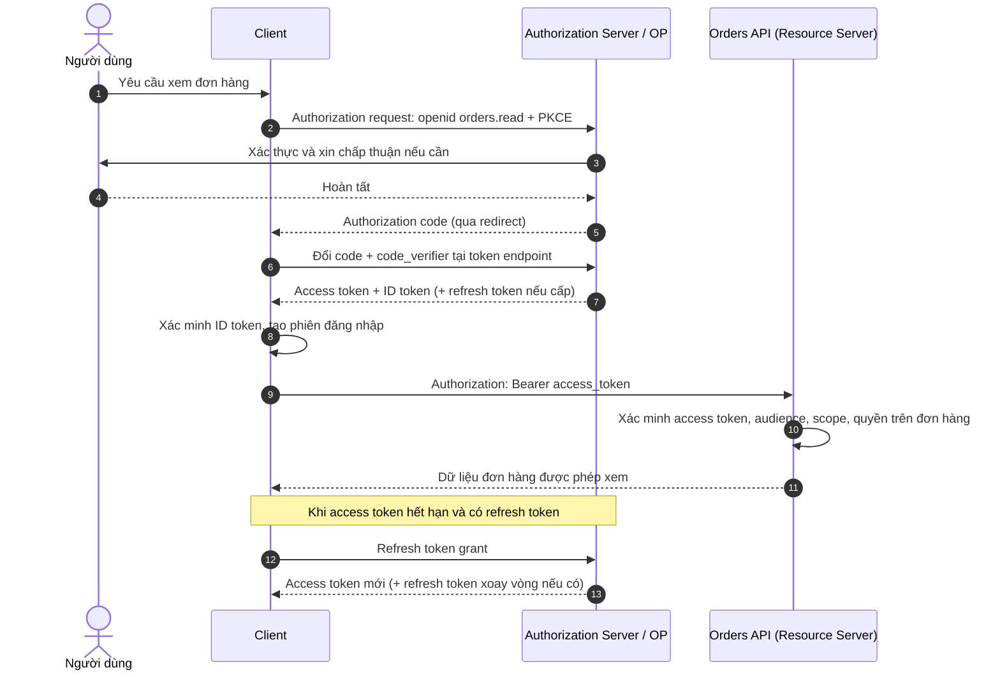

# Access token, refresh token và identity token

Trong hệ thống đăng nhập hiện đại, một ứng dụng có thể nhận nhiều token trong cùng một lần xác thực. Ba loại thường gặp là **access token**, **refresh token** và **identity token** (trong OpenID Connect gọi chính xác là **ID token**). Chúng liên quan với nhau nhưng phục vụ **ba mục đích khác nhau**: truy cập tài nguyên, duy trì quyền truy cập và thông báo kết quả xác thực danh tính.

Bài học thuộc phần **Nhập môn** của chủ đề bảo mật token. Mục tiêu là hiểu mô hình tin cậy và vòng đời của token trong OAuth 2.0/OpenID Connect (OIDC), từ đó biết gửi token cho đúng bên nhận, kiểm tra các claims cần thiết và tránh những lỗi làm lộ hoặc bị phát lại token.

## 1. Bối cảnh và các bên tham gia

Giả sử người dùng đăng nhập ứng dụng quản lý đơn hàng để xem danh sách đơn hàng:

- **Người dùng** (resource owner/end-user): người sở hữu dữ liệu và thực hiện đăng nhập.
- **Client**: ứng dụng web/mobile muốn gọi API thay mặt người dùng.
- **Authorization Server (AS)**: hệ thống cấp phát token và xử lý ủy quyền. Khi cung cấp OIDC, nó còn đóng vai trò **OpenID Provider (OP)**.
- **Resource Server (RS)**: API đơn hàng, nơi thực sự bảo vệ dữ liệu và thực thi quyền truy cập.

**OAuth 2.0** chuẩn hóa việc cấp quyền truy cập tài nguyên; bản thân OAuth 2.0 không định nghĩa một giao thức đăng nhập xác thực danh tính. **OIDC** bổ sung lớp xác thực trên OAuth 2.0, trong đó ID token là thông điệp cho client biết người dùng nào đã được xác thực và một số thông tin về lần xác thực đó.

## 2. So sánh ba loại token

| Đặc điểm | Access token | Refresh token | ID token (identity token trong OIDC) |
|---|---|---|---|
| Câu hỏi cần trả lời | Client được phép truy cập tài nguyên nào? | Client có thể xin access token mới không? | Người dùng nào đã được xác thực cho client này? |
| Bên sử dụng/tiếp nhận | **Resource Server** (API) | **Authorization Server** (token endpoint) | **Client** (relying party) |
| Công dụng chính | Ủy quyền gọi API trong phạm vi đã cấp | Gia hạn phiên cấp quyền mà không bắt người dùng đăng nhập lại mỗi lần | Xác thực danh tính và tạo phiên đăng nhập phía client |
| Định dạng | Có thể là JWT hoặc opaque token | Thường là chuỗi opaque; định dạng do AS quyết định | Là **JWT** theo OIDC, thường được ký |
| Thời gian sống | Thường ngắn | Có thể dài hơn nhưng chịu hạn dùng, xoay vòng và thu hồi | Có `exp`; không dùng để gia hạn quyền truy cập |
| Nơi gửi | Ví dụ: `Authorization: Bearer <access_token>` khi gọi API | Chỉ gửi đến token endpoint để đổi token | Được client kiểm tra sau khi nhận từ OP; **không** dùng làm Bearer token cho API |

**Không thể phân loại token chỉ bằng hình thức của chuỗi.** Access token dạng JWT và ID token đều có thể chứa các claims như `iss`, `sub`, `aud`, `exp`, nhưng **mục đích, đối tượng nhận và quy tắc kiểm tra** khác nhau. Một JWT có chữ ký hợp lệ vẫn có thể là token không phù hợp với API đang nhận.

## 3. Access token: quyền truy cập tài nguyên

Sau khi client được cấp quyền, AS phát hành access token để client trình cho API:

```http
GET /orders HTTP/1.1
Host: api.example.test
Authorization: Bearer AT_EXAMPLE
```

`AT_EXAMPLE` chỉ là giá trị minh họa, không phải token hoạt động. Với **Bearer token**, bên nào sở hữu token hợp lệ thường có thể dùng token đó, vì thế token phải được giữ kín và truyền qua HTTPS.

Nếu access token là JWT, các claims thường liên quan đến việc kiểm tra gồm:

| Claim | Ý nghĩa cần hiểu |
|---|---|
| `iss` (issuer) | Ai phát hành token; phải là AS mà API tin cậy. |
| `aud` (audience) | Token dự định được API/tài nguyên nào chấp nhận; API đơn hàng phải từ chối token chỉ dành cho API thanh toán. |
| `exp`, `nbf` | Hết hạn và thời điểm bắt đầu hợp lệ (nếu có). |
| `sub` | Chủ thể của token; tùy luồng có thể đại diện người dùng hoặc client, không mặc định luôn là người dùng. |
| `scope` / `scp` | Phạm vi quyền được cấp, ví dụ `orders.read`; tên và cách biểu diễn phụ thuộc hệ thống/hồ sơ token. |
| `client_id`, `azp` hoặc claim tương đương | Thông tin client liên quan nếu định dạng/hồ sơ token cung cấp; không thay thế việc kiểm tra `aud`. |

Ví dụ, một JWT access token theo hồ sơ phù hợp có thể mang payload **minh họa** sau:

```json
{
  "iss": "https://login.example.test",
  "sub": "user-123",
  "aud": "orders-api",
  "scope": "orders.read",
  "iat": 1795410000,
  "exp": 1795410900
}
```

Các số thời gian chỉ minh họa khoảng hiệu lực 15 phút. **Payload JWT mã hóa Base64URL không đồng nghĩa với mã hóa bí mật**: người có chuỗi JWT thường đọc được nội dung. Không đưa dữ liệu nhạy cảm vào token khi không cần thiết.

Resource Server phải xác minh **độ tin cậy của token** (chẳng hạn chữ ký/khoá ký của issuer tin cậy với JWT, hoặc trạng thái qua introspection với opaque token), kiểm tra hiệu lực, `iss`, `aud` và các quyền cần cho thao tác. Sau đó API vẫn cần kiểm tra quyền trên **đối tượng cụ thể**, ví dụ người dùng chỉ được xem đơn hàng thuộc tài khoản được phép truy cập. Có `orders.read` không có nghĩa được đọc mọi đơn hàng.

Một token có chữ ký hợp lệ nhưng `aud = payments-api` **không hợp lệ đối với** `orders-api`. Tương tự, một ID token có `aud` bằng mã client không trở thành access token chỉ vì API có thể xác minh chữ ký của nó.

**JWT hay opaque?** JWT giúp API kiểm tra nội dung tại chỗ khi có khoá công khai và quy tắc xác thực chính xác; việc thu hồi tức thì khó hơn nếu API chỉ kiểm tra JWT cục bộ. Opaque token là chuỗi không tự mô tả quyền cho API; API thường tra trạng thái và metadata qua cơ chế do AS cung cấp, chẳng hạn **OAuth 2.0 Token Introspection**. Lựa chọn định dạng không thay đổi mục đích của access token.

## 4. Refresh token: xin access token mới

Khi access token hết hạn, client có thể dùng refresh token (nếu được cấp) để gửi yêu cầu đến **AS**, không gửi đến API:

```http
POST /oauth2/token HTTP/1.1
Host: login.example.test
Content-Type: application/x-www-form-urlencoded

grant_type=refresh_token&refresh_token=RT_1_EXAMPLE&client_id=orders-client
```

Phản hồi ví dụ:

```json
{
  "access_token": "AT_2_EXAMPLE",
  "token_type": "Bearer",
  "expires_in": 900,
  "refresh_token": "RT_2_EXAMPLE",
  "scope": "orders.read"
}
```

Ví dụ này mô tả **refresh token rotation**: khi đổi `RT_1`, AS cấp `RT_2` và vô hiệu hóa `RT_1`. Nếu `RT_1` xuất hiện lại, đây có thể là dấu hiệu token bị sao chép và phát lại; AS có thể thu hồi cả chuỗi token liên quan và buộc cấp quyền lại theo chính sách. Hệ thống phải xử lý hợp lý các yêu cầu refresh đồng thời để tránh nhận nhầm việc dùng lại do đua tranh thành tấn công.

Một vài nguyên tắc quan trọng:

- Refresh token là thông tin xác thực có giá trị cao: ai lấy được nó có thể tìm cách xin thêm access token. Với **public client**, chuẩn thực hành bảo mật OAuth 2.0 yêu cầu cơ chế như **rotation** hoặc **sender-constrained token** khi phát hành refresh token để phát hiện hoặc hạn chế phát lại.
- Refresh token gắn với **client** và quyền đã được cấp. Refresh không được tự ý mở rộng sang scope hoặc tài nguyên người dùng chưa ủy quyền.
- Refresh token **không được bảo đảm luôn tồn tại**. AS quyết định có phát hành hay không, đặt hạn dùng theo thời gian, thời gian không hoạt động và chính sách rủi ro. Trong OIDC, yêu cầu `offline_access` thường liên quan quyền truy cập khi người dùng không hiện diện, nhưng không tự bảo đảm client nhận refresh token.
- Với **confidential client**, AS còn xác thực client theo cơ chế đã cấu hình; ví dụ request trên được giản lược để làm rõ grant type, không phải toàn bộ yêu cầu bảo mật của mọi client.
- Nếu refresh token hết hạn, bị thu hồi hoặc bị từ chối, client cần đưa người dùng qua luồng cấp quyền/đăng nhập thích hợp; không thể tự tạo refresh token mới.

## 5. ID token: xác thực người dùng cho client

Khi client yêu cầu OIDC (thường có scope `openid`) và luồng thành công, OP phát hành **ID token** cho client. ID token là JWT dùng để client xác nhận kết quả xác thực. Payload minh họa:

```json
{
  "iss": "https://login.example.test",
  "sub": "user-123",
  "aud": "orders-client",
  "iat": 1795410000,
  "exp": 1795410900,
  "auth_time": 1795409900,
  "nonce": "n-unique-from-request"
}
```

Trong ID token:

- `iss` xác định OP; `sub` là định danh người dùng trong phạm vi issuer; cặp **(`iss`, `sub`)** là cơ sở tốt hơn email để nhận diện tài khoản, vì email có thể thay đổi hoặc được tái sử dụng.
- `aud` phải chứa **client ID của ứng dụng nhận ID token**, không phải ID của API. Nếu ID token có nhiều audience, client còn cần xử lý `azp` theo quy tắc OIDC áp dụng.
- `exp` và `iat` cho biết thời điểm hết hạn và phát hành. Client cần kiểm tra chúng cùng chữ ký và thuật toán được phép, issuer và audience.
- `nonce` phải đối chiếu với giá trị đã gửi trong yêu cầu xác thực **khi luồng/yêu cầu sử dụng nonce**, để ràng buộc phản hồi với đúng yêu cầu và chống phát lại. `auth_time` cho biết thời điểm xác thực; cần kiểm tra khi yêu cầu `max_age` hoặc khi quy tắc áp dụng đòi hỏi.
- Các claims như `name`, `email`, `email_verified`, `amr`, `acr` có thể xuất hiện tùy scope và chính sách; không mặc định có mặt và không tự động tương đương quyền gọi API.

Sau khi xác minh ID token, client có thể thiết lập **phiên đăng nhập của ứng dụng** (ví dụ session cookie phía server). Phiên ứng dụng và các token OAuth/OIDC là các khái niệm liên quan nhưng không đồng nhất: phiên có thể tồn tại theo chính sách riêng; một ID token còn hạn không bảo đảm access token còn hạn, và đăng xuất khỏi ứng dụng không tự động vô hiệu hóa mọi access token đã phát hành.

**Không dùng ID token để gọi API.** ID token chứng minh kết quả xác thực cho một client cụ thể. API cần access token có đúng audience và quyền, kể cả khi hai token được phát hành cùng lúc và đều là JWT có chữ ký hợp lệ.

## 6. Ba token đi qua hệ thống như thế nào?

Luồng phổ biến cho ứng dụng có người dùng là **Authorization Code + PKCE**. Đây là một ví dụ OIDC vì yêu cầu `openid`; `orders.read` là scope minh họa do hệ thống định nghĩa.



Không có yêu cầu rằng **mọi** luồng OAuth phải trả đủ ba token. Ví dụ, luồng `client_credentials` phục vụ giao tiếp máy với máy thường cấp **access token**, không có người dùng đăng nhập nên không mặc định có ID token hoặc refresh token. Trong luồng OAuth 2.0 không dùng OIDC, AS không cần phát hành ID token.

## 7. Kiểm tra token ở đúng vị trí

| Vị trí | Nhận token nào? | Điều phải kiểm tra |
|---|---|---|
| Client OIDC | ID token | Chữ ký từ OP tin cậy, thuật toán cho phép, `iss`, `aud` chứa client ID, `exp`, `iat`, `nonce`/`auth_time` khi áp dụng; không suy ra quyền API từ ID token. |
| Resource Server | Access token | Chữ ký/metadata introspection, trạng thái và hạn dùng, `iss`, `aud` dành cho API, scope/authority cần thiết; kiểm tra quyền sở hữu tài nguyên ở nghiệp vụ. |
| Authorization Server | Refresh token | Token còn hiệu lực, thuộc client được phép, chưa bị thu hồi/dùng lại trái phép, quyền và chính sách cho phép làm mới. |

Với JWT, **giải mã payload chưa phải xác minh token**. Thành phần kiểm tra phải xác minh chữ ký bằng khóa tin cậy từ issuer đã cấu hình, dùng danh sách thuật toán cho phép (không tùy tiện tin giá trị `alg` do token tự công bố), kiểm tra loại token/audience để tránh nhầm lẫn giữa các JWT. Với profile **JWT access token** theo RFC 9068, `typ` như `at+jwt` giúp phân biệt token; không nên giả định mọi access token JWT của mọi nhà cung cấp đều có header này. Khóa ký cần hỗ trợ xoay vòng an toàn.

Khi API dùng access token dạng opaque, chỉ nhìn vào chuỗi token không cho biết quyền; API cần cơ chế xác nhận phù hợp với AS, ví dụ kiểm tra `active`, audience và scope từ introspection. Token không hợp lệ hoặc không xác thực được thường dẫn đến **401 Unauthorized**; token hợp lệ nhưng thiếu quyền thường dẫn đến **403 Forbidden**.

## 8. Lưu trữ, thu hồi và phòng chống đánh cắp token

1. **Giảm giá trị khi bị lộ:** dùng access token thời gian sống ngắn, audience hẹp, scope tối thiểu; tránh cấp quyền rộng không cần thiết. Không coi chỉ có `scope` là đủ để bỏ qua kiểm tra quyền nghiệp vụ.
2. **Bảo vệ lúc truyền:** luôn dùng HTTPS; gửi Bearer access token qua header `Authorization`. Tránh đưa token vào URL, history, log, analytics, thông báo lỗi hoặc công cụ theo dõi.
3. **Bảo vệ khi lưu:** lưu refresh token ở phía server khi kiến trúc cho phép, ví dụ mô hình Backend for Frontend (BFF). Với ứng dụng browser, cân nhắc session cookie `HttpOnly`, `Secure`, `SameSite` phù hợp và biện pháp chống CSRF. `localStorage` có thể bị script độc hại đọc khi có XSS. Ứng dụng native nên dùng kho lưu bí mật của hệ điều hành như Keychain/Keystore.
4. **Hạn chế phát lại:** sử dụng PKCE trong luồng Authorization Code và các cơ chế ràng buộc yêu cầu phù hợp (`state`, `nonce` khi áp dụng). Với token, có thể dùng **refresh token rotation** và/hoặc sender constraint như **DPoP** hoặc mTLS khi hạ tầng hỗ trợ. Rotation giúp phát hiện sử dụng lại refresh token; sender constraint làm token lấy cắp khó bị dùng từ thiết bị khác.
5. **Thu hồi và kết thúc phiên:** AS nên có cơ chế thu hồi refresh token khi đăng xuất, mất thiết bị hoặc phát hiện rủi ro; OAuth 2.0 có **Token Revocation** (RFC 7009). Access token JWT kiểm tra độc lập có thể tiếp tục hợp lệ đến `exp` nếu không có thêm cơ chế thu hồi/tra cứu; opaque token có thể được AS từ chối qua introspection. Đăng xuất OIDC, thu hồi grant và xóa session là các hoạt động cần phối hợp, không phải một thao tác duy nhất luôn xử lý hết mọi token.

Một sự cố điển hình: kẻ tấn công lấy được refresh token trong log. Dù access token hiện tại sắp hết hạn, kẻ tấn công có thể thử lấy token mới. Giảm thời gian sống của **chỉ** access token không giải quyết triệt để rủi ro này; cần bảo mật refresh token, giới hạn vòng đời, rotation/sender constraint, phát hiện sử dụng lại và thu hồi phù hợp.

## 9. Các nhầm lẫn thường gặp

| Nhầm lẫn | Cách hiểu đúng |
|---|---|
| “Đã đăng nhập thì cứ gửi ID token cho API.” | ID token dành cho client; API chỉ nhận access token có audience và quyền phù hợp. |
| “Access token luôn là JWT.” | OAuth 2.0 không bắt buộc định dạng; access token có thể opaque. |
| “JWT có chữ ký đúng là API phải chấp nhận.” | Phải kiểm tra cả issuer, audience, loại token, thời hạn, quyền và ngữ cảnh nghiệp vụ. |
| “Refresh token là một access token sống lâu.” | Refresh token chỉ dùng với AS để xin token mới, không mang vai trò gọi resource API. |
| “`scope=openid` nghĩa là ứng dụng được đọc mọi thông tin người dùng.” | `openid` kích hoạt OIDC; thông tin bổ sung phụ thuộc scope, claims và chính sách cho phép. |
| “Có refresh token thì đăng nhập tồn tại mãi.” | Refresh token có thể hết hạn, bị xoay vòng, vô hiệu hóa, hoặc không được cấp ngay từ đầu. |
| “Logout sẽ ngay lập tức vô hiệu mọi JWT access token.” | Còn phụ thuộc thời hạn, cơ chế thu hồi và cách API xác minh token. |

## 10. Bài tập tình huống và tự kiểm tra

**Tình huống A — nhầm đối tượng nhận:** client nhận ID token có `aud = orders-client`, sau đó gửi token đó đến `orders-api`. API phải từ chối ngay cả khi JWT được ký hợp lệ, vì đây là ID token dành cho client chứ không phải access token của API.

**Tình huống B — nhầm phạm vi quyền:** API nhận access token hợp lệ có `aud = orders-api`, `scope = orders.read`. Người dùng yêu cầu xem đơn hàng của người khác. API cần từ chối nếu người dùng không có quyền trên đơn hàng đó: token có scope đọc không bỏ qua kiểm tra phân quyền theo đối tượng.

**Tình huống C — lộ token làm mới:** access token đã hết hạn, nhưng refresh token cũ được dùng lại sau một lần xoay vòng. AS cần đánh giá đây là sự kiện đáng ngờ, có thể chặn/thu hồi chuỗi refresh token và yêu cầu xác thực lại theo chính sách.

Tự trả lời ba câu hỏi: **(1)** Ai phải nhận và xác minh từng loại token? **(2)** Vì sao `aud` của access token và ID token thường khác nhau? **(3)** Vì sao giảm thời hạn access token không đủ nếu refresh token bị lộ?

## 11. Ghi nhớ

- **Access token** là bằng chứng quyền truy cập tài nguyên: **client → Resource Server**.
- **Refresh token** là thông tin để xin cấp access token mới: **client → Authorization Server**.
- **ID token** là kết quả xác thực trong OIDC: **OpenID Provider → client**, không phải giấy phép gọi API.
- **Audience, issuer, hạn dùng, scope và loại token** quyết định token có phù hợp với bên nhận hay không; hình thức JWT hoặc chữ ký đúng chưa đủ.
- **Vòng đời và phòng chống phát lại** phải bao gồm cả nơi lưu, cách truyền, rotation/sender constraint và thu hồi, không chỉ thời hạn access token.

### Tài liệu chuẩn tham khảo

- [RFC 6749 — The OAuth 2.0 Authorization Framework](https://www.rfc-editor.org/rfc/rfc6749): vai trò, access token, refresh token và token endpoint.
- [OpenID Connect Core 1.0](https://openid.net/specs/openid-connect-core-1_0.html): ID token, claims và kiểm tra ID token.
- [RFC 9700 — Best Current Practice for OAuth 2.0 Security](https://www.rfc-editor.org/rfc/rfc9700): PKCE, refresh token rotation/sender constraint và phòng chống tấn công.
- [RFC 9068 — JWT Profile for OAuth 2.0 Access Tokens](https://www.rfc-editor.org/rfc/rfc9068): định dạng JWT access token theo một profile chuẩn.
- [RFC 7662 — OAuth 2.0 Token Introspection](https://www.rfc-editor.org/rfc/rfc7662) và [RFC 7009 — OAuth 2.0 Token Revocation](https://www.rfc-editor.org/rfc/rfc7009): kiểm tra trạng thái và thu hồi token.
