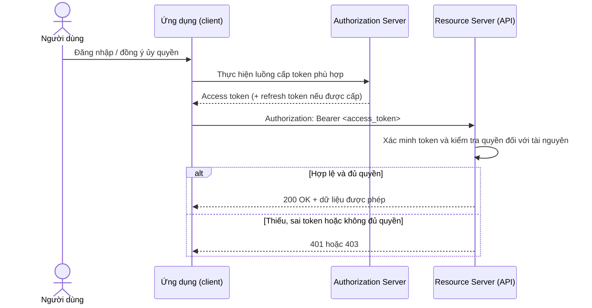

# Bearer token và trách nhiệm bảo vệ người giữ token

## Mục tiêu học tập

Sau bài này, bạn có thể:

1. Giải thích vì sao một **bearer token** hoạt động gần giống “vé vào cửa”: bên nào cầm token hợp lệ có thể trình nó để yêu cầu quyền truy cập.
2. Phân biệt **cơ chế bearer** với **định dạng JWT/opaque token** và **mục đích access token/refresh token** trong OAuth 2.0 và OpenID Connect (OIDC).
3. Nhận diện các đường rò rỉ token, hậu quả của việc **đánh cắp và phát lại (replay)**, cùng trách nhiệm của client, máy chủ phát hành và API.
4. Áp dụng nguyên tắc lưu trữ, truyền, kiểm tra, giới hạn quyền và thu hồi token để giảm thiểu thiệt hại.

## 1. Bearer token là gì?

**Bearer token** là một thông tin xác thực mà quyền sử dụng được trao cho **bất kỳ bên nào đang nắm giữ token** và trình token theo cách dịch vụ chấp nhận. API tiếp nhận bearer token thường không yêu cầu người gửi chứng minh thêm rằng họ sở hữu một khóa mật mã riêng gắn với token ấy.

Ví dụ, ứng dụng gọi API:

```http
GET /api/orders HTTP/1.1
Host: api.example.test
Authorization: Bearer <ACCESS_TOKEN_PLACEHOLDER>
```

Giả sử token còn hiệu lực và cho phép đọc đơn hàng, API có thể trả dữ liệu cho người gửi. Nếu một kẻ tấn công sao chép được **chính token đó**, họ có thể gửi yêu cầu tương tự từ nơi khác và được đối xử như một bên có quyền, trong giới hạn quyền và thời hạn của token. Đây là đặc tính cốt lõi của bearer: **nắm giữ token là đủ để sử dụng token**, trừ khi hệ thống áp dụng cơ chế ràng buộc người gửi bổ sung.

Bearer token **không phải** mật khẩu của người dùng; nó thường là thông tin được cấp sau một bước xác thực hoặc ủy quyền. Tuy vậy, từ góc độ bảo vệ bí mật, một bearer token còn hiệu lực phải được đối xử nghiêm ngặt như một thông tin có thể mở quyền truy cập.

### Mô hình tin cậy



Ba bên có trách nhiệm riêng:

- **Authorization Server (máy chủ ủy quyền)** quyết định phát hành token cho ai, dành cho dịch vụ nào, với quyền và thời hạn ra sao; quản lý khóa ký, refresh token và cơ chế thu hồi thích hợp.
- **Client (bên giữ và sử dụng token)** cần gửi token đến đúng dịch vụ qua kênh an toàn, quản lý nơi lưu và hạn chế để mã độc hay bên thứ ba đọc được.
- **Resource Server (API nhận token)** phải tự kiểm tra token và quyền truy cập cho *từng yêu cầu*; không tin token chỉ vì client khẳng định nó hợp lệ.

Người dùng cũng cần tránh chia sẻ token vô tình qua ảnh chụp, tin nhắn hay công cụ hỗ trợ, nhưng việc giữ an toàn cho token là **trách nhiệm thiết kế chung của hệ thống**, không thể giao toàn bộ cho người dùng.

## 2. Bearer, JWT, opaque, access và refresh khác nhau ở trục nào?

Các thuật ngữ này thường xuất hiện cạnh nhau nhưng mô tả những khía cạnh khác nhau:

| Khía cạnh | Khái niệm | Ý nghĩa |
|---|---|---|
| **Cách sử dụng** | **Bearer token** | Bất cứ ai nắm giữ token có thể trình token để truy cập trong phạm vi được cấp. |
| **Cách sử dụng** | **Sender-constrained token** | Token được ràng buộc với bằng chứng sở hữu khóa/chứng chỉ; chỉ chép riêng token có thể chưa đủ để dùng. |
| **Định dạng** | **JWT (JSON Web Token)** | Chuỗi biểu diễn các claims; JWT ký (JWS) có thể được API kiểm tra chữ ký cục bộ. Nội dung payload của JWT ký thông thường **không được mã hóa bí mật**. |
| **Định dạng** | **Opaque token** | Chuỗi không có ý nghĩa cho client; API xác nhận qua nơi phát hành, ví dụ token introspection hoặc tra cứu nội bộ. |
| **Mục đích** | **Access token** | Cấp quyền truy cập tài nguyên/API, thường ngắn hạn và có giới hạn scope/audience. |
| **Mục đích** | **Refresh token** | Được gửi đến token endpoint để xin access token mới, không phải token gọi API nghiệp vụ; cần bảo vệ đặc biệt vì có thể kéo dài phiên. |
| **Mục đích trong OIDC** | **ID token** | Cho client biết kết quả xác thực danh tính người dùng; **không dùng thay access token** để gọi API. |

Vì vậy, một **access token có thể vừa là JWT vừa là bearer token**; một opaque access token cũng có thể là bearer token. “JWT” không đồng nghĩa với “access token”, “JWT” cũng không mặc nhiên có bảo đảm chống phát lại. Refresh token thường là bí mật bearer, trừ khi được ràng buộc người gửi bằng cơ chế riêng.

Ví dụ claims trong **một access token JWT minh họa**:

```json
{
  "iss": "https://auth.example.test",
  "sub": "user-123",
  "aud": "orders-api",
  "scope": "orders:read",
  "iat": 1795000000,
  "exp": 1795000900
}
```

- `iss` (**issuer**) cho biết nơi phát hành đáng tin cậy dự kiến.
- `sub` (**subject**) xác định chủ thể mà token nói đến; **không chứng minh** người đang gửi HTTP request chính là chủ thể ấy.
- `aud` (**audience**) giới hạn đối tượng nhận được phép sử dụng token, chẳng hạn `orders-api`.
- `scope` thể hiện phạm vi quyền được cấp, ví dụ `orders:read`.
- `iat` và `exp` thể hiện thời điểm cấp và hết hạn, tính theo Unix time.

Claims chỉ trở thành căn cứ tin cậy **sau khi token được xác minh đúng cách**. Đọc hoặc giải mã Base64URL của payload không phải xác minh chữ ký. Các claims khác như `nbf` (chưa có hiệu lực trước thời điểm nhất định) hay `jti` (định danh token) có thể hữu ích tùy chính sách; riêng việc có `jti` **không tự ngăn replay** nếu không có cơ chế kiểm soát tương ứng.

## 3. Vì sao người giữ token phải bảo vệ token?

Hãy xét tình huống:

1. Bạn đăng nhập vào ứng dụng quản lý đơn hàng. Hệ thống cấp access token có scope `orders:read`, hiệu lực 15 phút.
2. Ứng dụng vô tình ghi nguyên chuỗi `Authorization` vào log. Người không được phép đọc log sao chép token.
3. Người đó gọi `GET /api/orders` với header `Authorization: Bearer ...` trước khi token hết hạn.
4. Nếu API chỉ dựa vào bearer token và token còn hợp lệ, yêu cầu có thể được chấp nhận. Chữ ký hợp lệ **chỉ chứng minh token do bên phát hành đáng tin cậy tạo ra**, không chứng minh người trình token là người nhận ban đầu.

Đây là **token theft + replay**: kẻ tấn công lấy một token hợp lệ rồi sử dụng lại. Đổi mật khẩu của người dùng không nhất thiết vô hiệu hóa ngay access token đã phát hành; kết quả phụ thuộc chính sách phiên, thu hồi và loại token. Tương tự, thao tác “đăng xuất” trên giao diện không có nghĩa mọi bearer token đã cấp sẽ lập tức mất hiệu lực.

Các đường rò rỉ thường gặp:

| Đường rò rỉ | Ví dụ | Hậu quả / biện pháp chính |
|---|---|---|
| **Đường truyền** | HTTP không mã hóa, proxy trung gian cấu hình sai | Dùng HTTPS/TLS xuyên suốt, bảo vệ hop nội bộ và giới hạn bên được truy cập. |
| **URL** | `?access_token=...` trong query | Token có thể lọt vào history, log, công cụ phân tích hoặc URL được chia sẻ; ưu tiên header `Authorization`. |
| **Log, trace, lỗi** | In toàn bộ request header hoặc gửi token vào ticket hỗ trợ | Redact các trường nhạy cảm, hạn chế log dữ liệu định danh và quyền đọc log. |
| **Trình duyệt** | XSS đọc token trong `localStorage`/JavaScript | Chống XSS, giảm khả năng mã JavaScript đọc token; cân nhắc BFF và cookie phiên `HttpOnly`. |
| **Thiết bị và phần mềm** | Token lưu dạng plaintext, extension độc hại, gói SDK không tin cậy | Dùng cơ chế lưu bí mật phù hợp nền tảng, giới hạn thư viện/extension và quyền truy cập. |
| **Chia sẻ thủ công** | Dán bearer token vào chat, commit, ảnh chụp màn hình | Không chia sẻ token thật; nếu lộ thì xử lý như sự cố thông tin xác thực. |

Ngay cả khi truyền qua HTTPS, token vẫn có thể bị lấy từ trình duyệt, máy trạm, log hoặc máy chủ đích. **TLS cần thiết nhưng không đủ**.

## 4. Bảo vệ token ở từng chặng trong vòng đời

### 4.1. Phát hành: cấp ít quyền, đúng nơi, trong thời gian phù hợp

- Chỉ cấp token sau quy trình xác thực/ủy quyền phù hợp. Với ứng dụng OAuth 2.0 tương tác qua trình duyệt hoặc ứng dụng di động, **Authorization Code + PKCE** là luồng phổ biến để bảo vệ mã ủy quyền.
- Giới hạn **audience**: access token cho `orders-api` không nên được API thanh toán coi là hợp lệ chỉ vì cùng một hệ thống nhận dạng phát hành.
- Giới hạn **scope** theo nhu cầu thực tế: `orders:read` khác `orders:write`; quyền thực tế vẫn cần được đối chiếu với tài nguyên, chủ sở hữu và tenant.
- Đặt **thời hạn access token ngắn** ở mức cân bằng giữa an toàn và trải nghiệm. Thời hạn ngắn giảm khoảng thời gian token bị đánh cắp còn hữu dụng nhưng không ngăn hành vi lạm dụng khi token vẫn còn hiệu lực.
- Áp dụng chính sách chặt hơn với **refresh token**: bảo vệ khi lưu, quản lý phiên và cân nhắc rotation hoặc ràng buộc người gửi. Refresh token không được chuyển đến Resource Server như access token.

### 4.2. Lưu trữ: bảo vệ theo môi trường chạy

**Trình duyệt web:** `localStorage` và `sessionStorage` có thể bị JavaScript cùng origin đọc. Khi có lỗ hổng XSS, token lưu ở đó có nguy cơ bị lấy. Lưu access token trong bộ nhớ giảm tồn tại lâu dài nhưng mã độc đang chạy trong trang vẫn có thể sử dụng hoặc đọc nó. Một kiến trúc **Backend for Frontend (BFF)** giữ token ở phía máy chủ và dùng cookie phiên có `HttpOnly`, `Secure`, `SameSite` phù hợp thường giảm khả năng JavaScript trích xuất token; đổi lại, cookie tự động đính kèm theo request nên cần xem xét **CSRF**, kiểm tra origin và các phòng vệ liên quan. `HttpOnly` không làm biến mất XSS hay các hành động trái phép do XSS khởi tạo.

**Ứng dụng mobile/desktop:** sử dụng vùng lưu bí mật do hệ điều hành quản lý (chẳng hạn Keychain hoặc Android Keystore và cơ chế lưu trữ bảo mật phù hợp); hạn chế backup, log và sao chép token.

**Backend/service:** cất token hoặc thông tin truy cập trong kho bí mật/biến môi trường được quản lý đúng cách, hạn chế quyền đọc, không hard-code vào repository hoặc log. Chỉ chuyển tiếp token nếu API đích thực sự cho phép audience và luồng ủy quyền đó; không tùy tiện dùng token của một API cho API khác.

Không có một nơi lưu trữ nào bảo đảm tuyệt đối: lựa chọn phải dựa vào mô hình đe dọa, khả năng kiểm soát XSS/CSRF, thời hạn token và kiến trúc ứng dụng.

### 4.3. Truyền và sử dụng: mỗi request chỉ mang đúng quyền cần thiết

Với bearer access token, cách truyền chuẩn phổ biến là:

```http
GET /api/orders/42 HTTP/1.1
Host: api.example.test
Authorization: Bearer <ACCESS_TOKEN_PLACEHOLDER>
```

Chỉ gửi qua **HTTPS** đến endpoint dự kiến. Tránh đặt token trong URL, email, analytics, thông báo lỗi hoặc cấu hình client bị lộ. Không gửi refresh token đến API nghiệp vụ và không dùng ID token làm chứng chỉ gọi API.

CORS chỉ quyết định trình duyệt có cho JavaScript đọc phản hồi xuyên origin theo chính sách hay không; **CORS không thay thế việc kiểm tra token hoặc bảo vệ chống đánh cắp token**.

### 4.4. Kiểm tra tại API: hợp lệ chưa chắc đã đủ quyền

Ở mỗi yêu cầu, Resource Server phải có quy trình xác minh phù hợp với dạng token:

1. Kiểm tra bearer token có mặt, đúng khuôn dạng và đi qua kênh bảo mật.
2. Nếu là **JWT**, kiểm tra chữ ký bằng khóa tin cậy và thuật toán được cho phép; dùng cấu hình issuer/JWKS đáng tin cậy, không tự chấp nhận thuật toán từ header token một cách tùy tiện. Nếu là **opaque token**, sử dụng cơ chế tra cứu hoặc introspection với authorization server theo kiến trúc đã chọn.
3. Xác thực điều kiện hiệu lực: `iss`, `aud`, `exp`, và `nbf` nếu có; với opaque token kiểm tra trạng thái `active` và metadata cần thiết do nơi phát hành cung cấp. Có thể cho phép sai lệch đồng hồ nhỏ theo chính sách.
4. Kiểm tra **loại token, scope/quyền và ngữ cảnh tài nguyên**: người dùng/tenant có được xem **đơn hàng 42** hay không? Có `orders:read` thôi chưa chắc đủ.
5. Từ chối theo nguyên tắc mặc định không cấp quyền; không phản hồi lại nguyên chuỗi token trong log hay thông báo lỗi.

Minh họa logic (mã giả, cần triển khai bằng thư viện xác thực đã được kiểm chứng):

```text
token = get_bearer_token(request)
if token is missing:
    return 401 Unauthorized

metadata = verify_with_trusted_issuer(token)   # JWT verify hoặc opaque introspection
if metadata invalid, expired, or audience != "orders-api":
    return 401 Unauthorized

if "orders:read" not in metadata.scopes:
    return 403 Forbidden

order = load_order(42)
if not permitted(metadata.subject, metadata.tenant, order):
    return 403 Forbidden

return 200 OK with authorized order data
```

Một phân biệt hữu ích:

- **401 Unauthorized**: chưa có hoặc không có thông tin xác thực hợp lệ, chẳng hạn token thiếu, hết hạn hoặc sai chữ ký (thường đi kèm `WWW-Authenticate` phù hợp).
- **403 Forbidden**: bên gửi đã được xác thực nhưng **không đủ quyền** thực hiện hành động.

Chi tiết mã trạng thái có thể tùy chính sách che giấu thông tin tài nguyên, nhưng API không được trả dữ liệu nhạy cảm chỉ vì token được ký hợp lệ.

### 4.5. Hết hạn, làm mới và thu hồi

Với **access token ngắn hạn**, ứng dụng xin token mới khi cần, theo quy trình được cấp phép; không nên kéo dài vô hạn một access token. **Refresh token** nếu được cấp thường tồn tại lâu hơn và được gửi riêng đến token endpoint. **Refresh token rotation** cấp refresh token mới mỗi lần dùng và làm mất hiệu lực token cũ; phát hiện việc token cũ bị dùng lại có thể là dấu hiệu đánh cắp và dẫn đến thu hồi cả chuỗi phiên theo chính sách.

**Thu hồi** cần xét theo cách API kiểm tra token:

- **Opaque token** được tra cứu trạng thái tập trung có thể bị vô hiệu hóa kịp thời khi hệ thống cập nhật trạng thái và API kiểm tra lại; độ trễ phụ thuộc cache/chính sách introspection.
- **JWT tự xác minh cục bộ** thường tiếp tục được chấp nhận cho đến `exp` nếu API chỉ xác minh chữ ký và thời hạn. Muốn thu hồi sớm phải bổ sung cơ chế như denylist, session/version check, introspection hoặc chiến lược vòng đời khác.

Khi nghi token đã lộ: thu hồi phiên và refresh token liên quan nếu hỗ trợ, ngăn tái cấp token trái phép, kiểm tra log truy cập, xử lý nguồn rò rỉ và làm mới thông tin xác thực cần thiết. Không mặc định rằng đổi mật khẩu hoặc đóng trình duyệt sẽ vô hiệu hóa mọi access token cũ.

## 5. Chống replay bằng cách nào?

Hai nhóm biện pháp giải quyết hai vấn đề khác nhau:

| Nhóm | Cơ chế | Điều cần hiểu |
|---|---|---|
| **Giảm khả năng lộ** | HTTPS; kiểm soát XSS; lưu trữ bảo mật; không ghi log token | Làm token khó bị lấy hơn, nhưng một token đã lộ vẫn có thể bị trình lại. |
| **Giảm thiệt hại khi lộ** | TTL ngắn; scope/audience hẹp; thu hồi; theo dõi hành vi bất thường | Giới hạn thời gian và phạm vi truy cập, không mặc nhiên ngăn phát lại ngay lập tức. |
| **Ràng buộc người gửi** | **DPoP** hoặc **mutual TLS (mTLS)** theo thiết kế OAuth phù hợp | API kiểm tra bằng chứng gắn với khóa/chứng chỉ của client, làm cho việc chỉ sao chép riêng access token thường không đủ để sử dụng. |
| **Kiểm soát sử dụng một lần trong trường hợp đặc thù** | Nonce, chống trùng `jti`, cửa sổ thời gian, lưu trạng thái | Chỉ hiệu quả khi phía nhận thực sự kiểm tra và lưu dấu việc sử dụng; có chi phí trạng thái và không áp dụng mặc định cho mọi access token. |

**DPoP** sử dụng bằng chứng ký với khóa của client nhằm gắn request với token; **mTLS** có thể ràng buộc token với chứng chỉ client. Đây là những **sender-constrained token**, tức trường hợp được tăng cường vượt khỏi đặc điểm bearer thuần túy. Chúng vẫn cần bảo vệ khóa riêng: nếu kẻ tấn công chiếm cả token *và* khả năng sử dụng khóa (chẳng hạn kiểm soát ứng dụng), nguy cơ vẫn tồn tại.

Không nên hiểu “JWT có chữ ký”, “có `jti`” hoặc “dùng HTTPS” là đã tự động giải quyết toàn bộ nguy cơ replay.

## 6. Phân chia trách nhiệm trong hệ thống thực tế

| Vai trò | Trách nhiệm tối thiểu |
|---|---|
| **Người dùng/người vận hành** | Không cố ý chia sẻ token; báo cáo ngay nếu dán token vào nơi công khai hoặc nghi tài khoản bị xâm nhập. |
| **Ứng dụng giữ token** | Dùng HTTPS; gửi token tới đúng audience; tránh log; chọn lưu trữ phù hợp; xử lý hết hạn, làm mới và đăng xuất. |
| **Authorization Server** | Xác thực và cấp token đúng chính sách; giới hạn scope/audience/TTL; bảo vệ khóa; quản lý refresh token và thu hồi. |
| **Resource Server** | Xác minh token, issuer, audience, hạn dùng và quyền trên từng tài nguyên; từ chối token sai loại hoặc sai mục đích. |
| **Nền tảng bảo mật/vận hành** | Bảo vệ logging, tracing, secrets và hạ tầng; phát hiện dấu hiệu bất thường, hỗ trợ phản ứng khi token bị lộ. |

Một thiết kế tốt luôn giả định rằng token **có thể** bị lộ ở một khâu nào đó. Bảo vệ nhiều lớp giúp kẻ tấn công khó lấy token, khó mở rộng quyền và có ít thời gian khai thác hơn.

## 7. Tình huống tự kiểm tra

**Tình huống A:** Một developer thấy JWT có `sub: "admin"` và gọi API bằng token đó, dù JWT hết hạn. Có nên cho phép không? **Không.** API phải xác minh chữ ký, issuer, audience, thời gian hiệu lực và quyền đối với tài nguyên. Một chuỗi claims đọc được không phải bằng chứng đáng tin cậy.

**Tình huống B:** Access token cho `orders-api` có scope `orders:read`, nhưng bị gửi tới `payments-api`. Điều gì phải xảy ra? **Payments API phải từ chối** vì audience không phù hợp, kể cả khi chữ ký từ cùng authorization server là hợp lệ.

**Tình huống C:** Người dùng đăng xuất, nhưng một JWT access token đã bị sao chép còn 8 phút mới hết hạn. Token còn dùng được không? **Có thể còn**, nếu API chỉ kiểm tra chữ ký/thời gian và không có cơ chế thu hồi tức thời. Vì thế cần thiết kế TTL và thu hồi phù hợp với mức rủi ro.

**Tình huống D:** Ứng dụng lưu bearer token bằng cookie `HttpOnly`, vậy đã an toàn tuyệt đối trước XSS và CSRF chưa? **Chưa.** Cookie làm JavaScript khó đọc chuỗi token, nhưng XSS vẫn có thể kích hoạt hành động trong phiên; cookie tự gửi còn đòi hỏi phòng vệ CSRF thích hợp.

## Ghi nhớ

**Bearer là cách sử dụng token; JWT/opaque là cách biểu diễn; access/refresh/ID token là mục đích.** Bất kỳ ai lấy được bearer token hợp lệ có thể tận dụng quyền được cấp trong khoảng thời gian token còn hiệu lực. Vì vậy, hệ thống phải bảo vệ token khi cấp, lưu, truyền, kiểm tra, làm mới và thu hồi; đồng thời giới hạn audience, scope và thời hạn, và cân nhắc sender-constrained token nếu nguy cơ phát lại cao.

### Tài liệu kỹ thuật để tìm hiểu thêm

- [RFC 6750 — OAuth 2.0 Bearer Token Usage](https://www.rfc-editor.org/rfc/rfc6750)
- [RFC 7519 — JSON Web Token (JWT)](https://www.rfc-editor.org/rfc/rfc7519)
- [RFC 7662 — OAuth 2.0 Token Introspection](https://www.rfc-editor.org/rfc/rfc7662)
- [RFC 8705 — OAuth 2.0 Mutual-TLS Client Authentication and Certificate-Bound Access Tokens](https://www.rfc-editor.org/rfc/rfc8705)
- [RFC 9449 — OAuth 2.0 Demonstrating Proof of Possession (DPoP)](https://www.rfc-editor.org/rfc/rfc9449)
