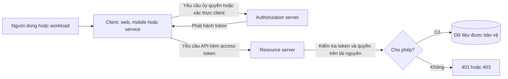
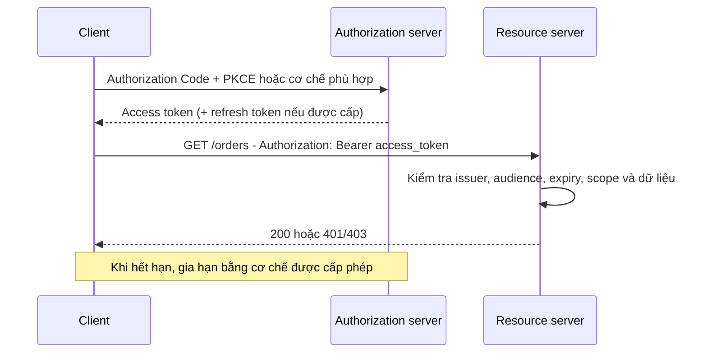
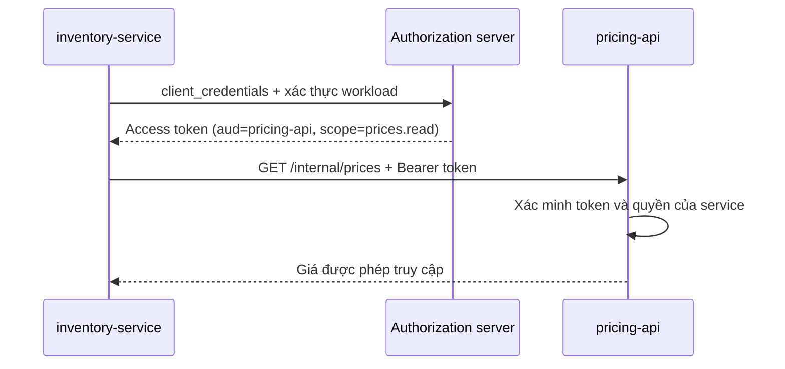

# Token trong ứng dụng web, mobile và service-to-service

Trong một hệ thống có đăng nhập và API, **token** là dữ liệu được bên phát hành tạo ra để bên nhận có thể xác định một yêu cầu đang mang quyền gì, dành cho tài nguyên nào và còn hiệu lực hay không. Có thể hình dung access token như một thẻ ra vào có thời hạn: cầm thẻ không có nghĩa được mở mọi cửa; người gác cửa vẫn phải kiểm tra thẻ được cấp bởi ai, dùng cho cửa nào và có quyền vào khu vực đó không.

Token xuất hiện ở ba môi trường quen thuộc: trình duyệt web, ứng dụng mobile và các dịch vụ gọi nhau trong backend (**service-to-service**, thường viết tắt là S2S hoặc machine-to-machine/M2M). Cả ba cùng dùng nguyên tắc xác thực và phân quyền, nhưng khác nhau về nơi lưu bí mật, khả năng bảo vệ token, cơ chế đăng nhập và cách xử lý khi token bị lộ.

Sau bài này, bạn có thể:

- Phân biệt **access token**, **refresh token**, **ID token**, định dạng **JWT** và **opaque token**.
- Giải thích ai phát hành, ai sử dụng, ai kiểm tra token, cùng các ranh giới tin cậy trong OAuth 2.0/OIDC.
- Chọn luồng và cách lưu token phù hợp cho web, mobile và S2S.
- Mô tả quy trình phát hành, kiểm tra claims, gia hạn, thu hồi và phản ứng với token bị đánh cắp hoặc phát lại.

## 1. Token đứng ở đâu trong mô hình tin cậy?

Một hệ thống OAuth 2.0 thường có các vai trò sau:

| Vai trò | Trách nhiệm | Ví dụ |
| --- | --- | --- |
| **Resource owner** | Chủ thể sở hữu hoặc có quyền đối với dữ liệu | Người dùng quản lý đơn hàng của mình |
| **Client** | Ứng dụng muốn truy cập tài nguyên | Web frontend, mobile app, backend đặt hàng |
| **Authorization server (AS)** | Xác thực/ủy quyền theo chính sách, phát hành token | Máy chủ đăng nhập và cấp token |
| **Resource server (RS)** | API giữ dữ liệu, kiểm tra token và quyết định có cho phép thao tác không | Orders API |

Điểm quan trọng là **client không tự được cấp quyền chỉ vì nó có thể gửi yêu cầu**, và **API không được tin token chỉ vì chuỗi token trông hợp lệ**. API cần xác minh nguồn phát hành, đối tượng nhận, thời hạn và quyền cần thiết. Sau đó, API vẫn phải kiểm tra quy tắc nghiệp vụ, chẳng hạn người dùng có thực sự sở hữu đơn hàng được truy vấn hay không.



**OAuth 2.0** chủ yếu mô tả cách client nhận quyền truy cập tài nguyên; **OpenID Connect (OIDC)** bổ sung lớp xác thực danh tính người dùng và ID token. Một ứng dụng có thể dùng OAuth 2.0 để gọi API nhưng không nhất thiết có đăng nhập tương tác của người dùng, ví dụ luồng S2S.

Trong mô hình phổ biến, access token là **bearer token**: bên nào sở hữu chuỗi token có thể thử sử dụng quyền mà nó đại diện. Vì vậy, đánh cắp bearer token có thể dẫn đến truy cập trái phép trong thời hạn hiệu lực. Một số hệ thống dùng **sender-constrained token** (ví dụ mTLS hoặc DPoP) để ràng buộc token với một khóa/chứng chỉ; điều đó giảm khả năng phát lại token đã bị sao chép, nhưng không thay thế kiểm soát thiết bị, XSS hay phân quyền.

## 2. Không nhầm mục đích, định dạng và cơ chế sử dụng

Ba câu hỏi độc lập cần trả lời là: **Token để làm gì? Token được biểu diễn ra sao? Ai có thể sử dụng token?**

### 2.1. Phân loại theo mục đích

| Loại | Người nhận và cách dùng | Điều không nên làm |
| --- | --- | --- |
| **Access token** | Client gửi đến đúng API/resource server để xin quyền thực hiện thao tác; thường có hạn ngắn | Không coi access token là bằng chứng danh tính dành cho mọi ứng dụng |
| **Refresh token** | Client gửi đến authorization server để xin access token mới, theo chính sách phiên và vòng đời | Không gửi refresh token đến API nghiệp vụ |
| **ID token** (OIDC) | OIDC client kiểm tra để biết kết quả xác thực danh tính người dùng; `aud` thường là client ID | Không lấy ID token thay access token để gọi API |

**Access token** trả lời: “Yêu cầu này có thể được xem xét với phạm vi quyền nào tại API nào?”. **ID token** trả lời: “Authorization server đã xác thực người dùng nào cho client này, trong điều kiện nào?”. **Refresh token** giúp duy trì phiên mà không yêu cầu người dùng đăng nhập lại mỗi khi access token hết hạn. Không phải luồng nào cũng cấp refresh token; chẳng hạn `client_credentials` thường chỉ cần xin access token mới.

### 2.2. Phân loại theo định dạng

| Đặc điểm | JWT (JSON Web Token) | Opaque token |
| --- | --- | --- |
| Dạng dữ liệu | Thường là chuỗi ba phần `header.payload.signature` với JWT ký JWS | Chuỗi không mang cấu trúc mà client/API cần hiểu |
| Nơi lấy thông tin | API có thể xác minh chữ ký và đọc claims trực tiếp, nếu token được thiết kế cho cách dùng đó | API tra cứu trạng thái/metadata qua introspection hoặc kho phiên đáng tin cậy |
| Điểm mạnh | Kiểm tra cục bộ, giảm phụ thuộc tra cứu theo từng request | Dễ quản lý trạng thái và thu hồi tập trung |
| Đánh đổi | Token tự chứa có thể còn hợp lệ đến lúc hết hạn dù người dùng đã logout; claims dễ bị lộ nếu ai đó đọc được payload | Phụ thuộc hạ tầng tra cứu, độ trễ, tính sẵn sàng và chiến lược cache |

**JWT và opaque không phải hai loại quyền**: cả hai đều có thể mang vai trò access token. Tương tự, access token và refresh token là **mục đích sử dụng**, không mặc định xác định định dạng. JWT ký thông thường chỉ bảo vệ tính toàn vẹn/chứng thực nguồn phát hành; **payload JWT được mã hóa Base64URL chứ không được giữ bí mật**. Không đặt mật khẩu, API key hoặc dữ liệu cá nhân nhạy cảm vào claims chỉ vì token có chữ ký.

Ví dụ minh họa các claims của một **JWT access token** đã được giải mã (không phải token thật và chưa có giá trị tin cậy nếu chưa kiểm tra chữ ký):

```json
{
  "iss": "https://auth.example.com",
  "sub": "user-123",
  "aud": "https://api.example.com/orders",
  "scope": "orders.read orders.write",
  "iat": 1760000000,
  "nbf": 1760000000,
  "exp": 1760000900,
  "jti": "token-id-example-001"
}
```

Các claims phổ biến:

- `iss` (**issuer**): bên phát hành đáng tin cậy; `aud` (**audience**): API hoặc client được chỉ định nhận token; `sub` (**subject**): chủ thể mà token nói đến.
- `iat`, `nbf`, `exp`: thời điểm phát hành, bắt đầu có hiệu lực và hết hạn, tính bằng Unix timestamp giây.
- `scope`/`scp`: phạm vi quyền (tên và cách biểu diễn do hợp đồng token quy định); `roles` và các quyền tùy biến không mặc nhiên có cùng ngữ nghĩa giữa các hệ thống.
- `jti`: định danh token, hữu ích cho ghi nhận/sàng lọc phát lại hoặc danh sách thu hồi; sự hiện diện của `jti` **không tự động** chống replay.
- `cnf` (nếu có): thông tin xác nhận khóa dùng cho sender-constrained token; API còn phải kiểm tra bằng chứng sở hữu khóa tương ứng.

## 3. Vòng đời token từ lúc cấp đến khi hết hiệu lực

Một vòng đời thông thường diễn ra theo thứ tự:

1. **Khởi tạo yêu cầu**: ứng dụng chọn luồng ủy quyền phù hợp; với người dùng, có thể chuyển họ đến authorization server để đăng nhập và chấp thuận quyền.
2. **Phát hành**: authorization server kiểm tra client, người dùng hoặc workload, chính sách, scope và audience trước khi cấp token.
3. **Chuyển giao và lưu trữ**: client nhận token qua kênh TLS, lưu tại vị trí có thể bảo vệ phù hợp với nền tảng.
4. **Sử dụng**: client gọi API mục tiêu, thường với header `Authorization: Bearer <access_token>`.
5. **Kiểm tra**: resource server xác minh token và phân quyền ở cấp API **và đối tượng dữ liệu**.
6. **Hết hạn/gia hạn**: access token hết hạn thì client dùng refresh token (nếu có) hoặc xin access token mới bằng luồng thích hợp.
7. **Thu hồi/kết thúc phiên**: khi logout, mất thiết bị, đổi quyền hay nghi ngờ lộ token, hệ thống xử lý phiên và token theo chính sách thu hồi.



HTTP request minh họa:

```http
GET /orders/42 HTTP/1.1
Host: api.example.com
Authorization: Bearer eyJ...example-only
Accept: application/json
```

**Không đưa token vào query string** như `?access_token=...`: URL dễ đi vào browser history, log proxy, analytics hoặc header `Referer`. Luôn dùng HTTPS; tránh ghi nguyên token vào log, tracing, báo lỗi, crash report hay ảnh chụp màn hình.

## 4. Token trong ứng dụng web

Trình duyệt là môi trường đặc biệt: JavaScript phía client có thể bị ảnh hưởng bởi XSS, còn cookie được trình duyệt tự gửi theo quy tắc domain/path có thể tạo rủi ro CSRF. Lựa chọn kiến trúc quyết định token được giữ ở đâu.

### 4.1. Web có backend/BFF

Với mô hình **backend-for-frontend (BFF)** hoặc web ứng dụng render từ server, backend xử lý luồng đăng nhập, giữ access/refresh token ở phía server và chỉ cấp cho browser một **session cookie** được bảo vệ. Browser gửi cookie đến backend; backend xác minh phiên rồi gọi API bằng access token phù hợp.

```mermaid
sequenceDiagram
    participant B as Browser
    participant W as Web backend / BFF
    participant AS as Authorization server
    participant API as Orders API
    B->>W: Bắt đầu đăng nhập
    W->>AS: Authorization Code flow + PKCE
    AS-->>W: Tokens
    W-->>B: Set-Cookie: __Host-session=... (HttpOnly; Secure)
    B->>W: GET /my-orders + session cookie
    W->>W: Kiểm tra session và chống CSRF nếu cần
    W->>API: Authorization: Bearer access_token
    API-->>W: Dữ liệu đã được phân quyền
    W-->>B: Dữ liệu cho giao diện
```

Cookie minh họa:

```http
Set-Cookie: __Host-session=<random-session-id>; Path=/; Secure; HttpOnly; SameSite=Lax
```

`HttpOnly` ngăn JavaScript đọc cookie trực tiếp; `Secure` chỉ gửi cookie qua HTTPS; `SameSite` giúp giảm một số tình huống CSRF. Prefix `__Host-` yêu cầu cookie có `Secure`, `Path=/` và không có `Domain`, giúp hạn chế sai cấu hình phạm vi cookie. Các thao tác thay đổi trạng thái vẫn cần cơ chế **chống CSRF phù hợp** (ví dụ CSRF token và kiểm tra Origin), đồng thời phải chống XSS bằng escape dữ liệu, CSP và kiểm soát script. Không nên hiểu `HttpOnly` hoặc `SameSite` là giải pháp đủ cho mọi cuộc tấn công.

BFF phù hợp khi ứng dụng có backend đáng tin cậy để quản lý phiên và cần giảm mức tiếp xúc của OAuth token với JavaScript. Session cookie **khác access token**: cookie định danh phiên giữa browser với BFF, còn access token dùng giữa BFF với API.

### 4.2. Single-page application (SPA) gọi API trực tiếp

SPA thuần frontend là **public client**: mã JavaScript của nó không thể giữ `client_secret` an toàn. Luồng chuẩn là **Authorization Code + PKCE** với `state` chống tráo đổi phản hồi, và `nonce` khi cần liên kết kết quả xác thực OIDC. Client gửi người dùng đến authorization server, nhận authorization code qua redirect, rồi đổi code với `code_verifier`.

Nếu SPA nhận access token trực tiếp, **giữ token trong bộ nhớ ứng dụng** thường giảm khả năng tồn tại lâu trên thiết bị so với `localStorage`; đổi lại token mất khi tải lại trang. `localStorage`/`sessionStorage` đều có thể bị JavaScript đọc khi xảy ra XSS. Với phiên dài, ưu tiên kiến trúc BFF; trường hợp dùng refresh token cho SPA cần đáp ứng chính sách của authorization server, ví dụ rotation hoặc sender-constraining và cách lưu/giới hạn thời gian phù hợp. Không coi PKCE là cơ chế chống đánh cắp access token sau khi đã phát hành.

Nếu frontend và API khác origin, cần cấu hình CORS chính xác. **CORS không thay thế xác thực/phân quyền**, không chứng minh request đáng tin và không bảo vệ token đã bị lộ.

### 4.3. Ví dụ thực tế với web

Người dùng mở trang quản lý đơn hàng. Browser chỉ giữ cookie phiên BFF; backend ánh xạ phiên đến access token có `aud=orders-api` và scope `orders.read`. Khi người dùng xem `/orders/42`, API kiểm tra token, rồi kiểm tra đơn hàng `42` có thuộc người dùng `sub` hoặc quyền quản lý hợp lệ hay không. Scope `orders.read` **chỉ cho phép xem xét thao tác đọc**; nó không cho phép xem đơn hàng của bất kỳ ai.

## 5. Token trong ứng dụng mobile

Ứng dụng Android/iOS cài trên thiết bị của người dùng cũng là **public client**. Người khác có thể trích xuất hoặc phân tích gói cài đặt, vì vậy nhúng `client_secret`, khóa ký chung hoặc mật khẩu backend vào ứng dụng không tạo được bí mật đáng tin.

Quy trình phổ biến cho đăng nhập người dùng là:

1. Mở luồng **Authorization Code + PKCE** qua thành phần trình duyệt hệ thống được hệ điều hành hỗ trợ (ví dụ Android Custom Tabs hoặc iOS `ASWebAuthenticationSession`), thay cho tự thu mật khẩu trong WebView nhúng.
2. Kiểm tra `state`; xác định redirect URI chính xác, ưu tiên **claimed HTTPS redirect** (Android App Links/iOS Universal Links) khi phù hợp. Với OIDC, kiểm tra ID token, `nonce` và các ràng buộc xác thực áp dụng.
3. Lưu access token ngắn hạn trong bộ nhớ khi có thể; bảo vệ refresh token/credential dài hạn bằng **Android Keystore** hoặc **iOS Keychain** và chính sách truy cập tương ứng.
4. Gửi access token đến đúng API qua TLS; gia hạn khi cần, xử lý token hết hạn và không đưa token vào log, thông báo, bộ nhớ đệm không bảo vệ hoặc backup không kiểm soát.
5. Khi logout, mất thiết bị hoặc có dấu hiệu lộ tài khoản, xóa credential cục bộ **và** yêu cầu phía server thu hồi phiên/refresh token theo khả năng hỗ trợ.

Khóa trong Keystore/Keychain giúp giảm rủi ro trích xuất từ lưu trữ, nhưng ứng dụng đang chạy trên thiết bị bị chiếm quyền vẫn có thể bị lạm dụng. Xác thực sinh trắc học có thể dùng làm **khóa mở truy cập cục bộ**, không mặc nhiên xác minh người dùng với authorization server. Với yêu cầu bảo vệ cao, cân nhắc khóa ràng buộc thiết bị, DPoP/mTLS, phát hiện rủi ro và chính sách phiên; cần đánh giá khả năng triển khai trên từng nền tảng.

**Tình huống:** ứng dụng giao hàng có access token hết hạn sau một khoảng ngắn. Khi tài xế mở lại ứng dụng, client có thể dùng refresh token lưu an toàn để xin access token mới; nếu refresh token đã bị thu hồi vì tài khoản bị khóa, ứng dụng phải yêu cầu đăng nhập lại. Không được tự kéo dài hiệu lực access token ở phía client.

## 6. Token giữa các dịch vụ (service-to-service)

Trong S2S, hai workload giao tiếp mà không có thao tác đăng nhập tương tác của người dùng. Ví dụ `inventory-service` cần gọi `pricing-api` để lấy giá nội bộ. Chủ thể tin cậy ở đây thường là **danh tính service/workload**, không phải một người dùng.

**Client Credentials grant** của OAuth 2.0 là lựa chọn phổ biến: service xác thực với authorization server theo phương thức được cấp phép (chẳng hạn mTLS, private-key JWT hoặc thông tin định danh được bảo vệ), yêu cầu scope và audience phù hợp, rồi nhận access token. Với workload chạy trên nền tảng hỗ trợ, ưu tiên **workload identity/managed identity** và credential ngắn hạn để giảm nhu cầu lưu client secret lâu dài.



Ví dụ nội dung **yêu cầu token** (minh họa, đã lược bỏ cơ chế xác thực client):

```http
POST /oauth2/token HTTP/1.1
Host: auth.example.com
Content-Type: application/x-www-form-urlencoded

grant_type=client_credentials&scope=prices.read
```

Trong thực tế, authorization server còn phải xác thực client; chỉ gửi `grant_type` và `scope` như ví dụ là **chưa đủ** để được cấp token. Một số hệ thống định tuyến `audience` bằng tham số riêng hoặc bằng cấu hình tài nguyên; phải theo đúng hợp đồng của authorization server.

Các nguyên tắc riêng cho S2S:

- **Phân quyền tối thiểu:** chỉ cấp `prices.read` tại `pricing-api` nếu service chỉ đọc giá; tránh token có thể dùng cho mọi API.
- **Tách danh tính:** phân biệt token đại diện cho service với token đại diện cho người dùng; ghi nhận được service nào gọi, thay vì dùng chung một tài khoản kỹ thuật cho toàn bộ hệ thống.
- **Không lưu bí mật trong mã nguồn/image:** quản lý khóa và credential bằng secret manager hoặc workload identity, xoay vòng và giới hạn người được đọc.
- **Tự quản lý vòng đời:** lấy token khi cần, cache an toàn theo đúng audience/scope, gia hạn trước hết hạn với biên thời gian hợp lý và tránh nhiều request gia hạn đồng loạt. Với `client_credentials`, thông thường xin access token mới thay vì dùng refresh token.
- **Giới hạn truyền tiếp:** service A nhận token dành cho A không được tự tiện đưa token đó gọi B nếu `aud` không bao gồm B. Khi cần gọi thay người dùng qua chuỗi service, dùng cơ chế ủy quyền/trao đổi token phù hợp (ví dụ token exchange/on-behalf-of) để giữ ngữ cảnh chủ thể, audience và quyền hạn.

**Tình huống:** `order-service` nhận yêu cầu từ người dùng rồi cần đặt hàng qua `shipping-service`. Nếu nghiệp vụ yêu cầu xác định cả người dùng lẫn service đang hành động thay họ, token S2S thuần `client_credentials` có thể **không** mang đủ ngữ cảnh người dùng. Cần thiết kế rõ delegation, claims và audit; không giả định `sub` luôn là user ID.

## 7. Resource server kiểm tra access token như thế nào?

API phải xác định được **hợp đồng token**: issuer đáng tin cậy, đối tượng nhận (audience), loại token, thuật toán/khoá ký được cho phép, scope cần thiết và quy tắc quyền của dữ liệu. Kết quả phân tích một JWT chưa được xác minh **không phải** đầu vào đáng tin cho phân quyền.

### 7.1. Nếu là JWT access token

1. Chỉ lấy bearer token từ nguồn giao thức được cho phép, thường là header `Authorization`, và yêu cầu HTTPS.
2. Xác minh **chữ ký** bằng khóa thuộc issuer đã cấu hình trước, thường lấy qua JWKS của issuer đáng tin; cache và cập nhật khóa theo cơ chế xoay vòng được kiểm soát.
3. Chỉ chấp nhận **thuật toán cho phép**; không tin thuật toán do header token tự đề xuất, không chấp nhận `alg=none`, và không dùng URL/key từ header token để tự ý truy xuất khóa không đáng tin.
4. Kiểm tra chính xác `iss`, `aud`, `exp`, `nbf` (và `iat` nếu chính sách yêu cầu), có biên sai lệch đồng hồ nhỏ, rõ ràng. Kiểm tra loại token/`typ` hay profile access token khi được quy định để tránh nhầm với ID token.
5. Xác định quyền ở cấp API (`scope`, `scp`, role theo hợp đồng) và **quyền trên từng tài nguyên**: owner, tenant, trạng thái đơn hàng, chính sách nghiệp vụ.
6. Nếu token bị ràng buộc khóa/chứng chỉ, xác minh bằng chứng sở hữu tương ứng cho **chính yêu cầu** đang xử lý.

Đoạn mã giả cho một endpoint đọc đơn hàng:

```text
token = readBearerToken(request.Authorization)
claims = verifyAccessToken(
    token,
    trustedIssuer = "https://auth.example.com",
    expectedAudience = "https://api.example.com/orders",
    allowedAlgorithms = ["RS256"],
    trustedKeySet = configuredIssuerJwks
)

if claims is invalid or expired:
    return 401 Unauthorized

if "orders.read" not in parseScopes(claims.scope):
    return 403 Forbidden

order = loadOrder(request.path.orderId)
if order is missing:
    return 404 Not Found
if !policy.canReadOrder(claims.sub, claims.tenant, order):
    return 403 Forbidden   // hoặc 404 để tránh lộ sự tồn tại

return 200 OK with order
```

Đây là mã giả: hàm `verifyAccessToken` phải do thư viện xác minh token đáng tin cậy thực hiện, cùng các kiểm tra của profile token cụ thể. Không tự triển khai mã hóa/chữ ký từ đầu. `401 Unauthorized` thường thể hiện **chưa có hoặc không có thông tin xác thực hợp lệ**; `403 Forbidden` thể hiện **đã xác thực nhưng thiếu quyền**.

### 7.2. Nếu là opaque access token

API không thể kết luận quyền từ hình dạng chuỗi. Nó liên hệ authorization server hoặc thành phần xác minh đáng tin qua **token introspection** (nếu hệ thống dùng cơ chế này), thường nhận thông tin như `active`, `scope`, `client_id`, `sub`, `aud`, `exp` theo chính sách phát hành. API phải xác thực kết quả introspection, đặc biệt `active=true`, đúng audience và các điều kiện phân quyền. Kênh introspection cần được bảo vệ và resource server phải được xác thực với authorization server theo yêu cầu.

Cache kết quả introspection có thể giảm độ trễ nhưng tạo khoảng trễ khi thu hồi. Vì vậy thời gian cache cần phù hợp yêu cầu bảo mật; trả lời `active=true` từ một lần tra cứu cũ không bảo đảm token còn hợp lệ ở mọi thời điểm sau đó.

### 7.3. Claims không thay thế chính sách nghiệp vụ

Token có `scope=orders.read` chỉ nói client có thể yêu cầu API đọc đơn hàng. Nó **không** tự động cho phép đọc `/orders/42`. API phải kiểm tra `sub`, tenant, quyền owner/manager và trạng thái đối tượng dựa trên dữ liệu hiện hành. Với hệ thống đa tenant, không lấy `tenant_id` từ tham số client rồi coi đó là quyền; phải đối chiếu với danh tính và chính sách phía server.

## 8. Lưu token ở đâu cho từng môi trường?

| Môi trường | Cách tiếp cận điển hình | Rủi ro cần xử lý |
| --- | --- | --- |
| **Web có BFF** | Browser giữ session cookie `Secure`, `HttpOnly`, `SameSite`; BFF lưu access/refresh token phía server có kiểm soát | XSS, CSRF, đánh cắp session, lỗi cấu hình cookie |
| **SPA thuần frontend** | Access token tồn tại ngắn trong memory; refresh token chỉ khi AS hỗ trợ chính sách bảo vệ phù hợp, ưu tiên chuyển sang BFF nếu khả thi | XSS đọc hoặc lạm dụng token, khó duy trì phiên an toàn khi reload |
| **Mobile** | Access token trong memory; credential dài hạn trong Keychain/Keystore và được xóa khi logout | Thiết bị bị chiếm quyền, backup/log lộ token, redirect hijack |
| **S2S backend** | Access token tạm thời trong memory/cache giới hạn; khóa/credential trong secret manager hoặc workload identity | Secret lọt qua CI/CD, log, image, quyền service quá rộng |

Trong mọi môi trường, phải hạn chế số bản sao, thời gian sống, số người/thành phần đọc được token và lượng thông tin đi kèm. **Mã hóa ở nơi lưu trữ có ích nhưng không chữa được mọi lỗi của môi trường đang thực thi**; nếu kẻ tấn công có thể chạy mã trong chính ngữ cảnh client, nó có thể lạm dụng các lời gọi hợp lệ.

## 9. Hết hạn, refresh, thu hồi và logout

### Access token hết hạn

Nên dùng access token với thời hạn ngắn, đủ đáp ứng hiệu năng và trải nghiệm. Ví dụ **5–15 phút chỉ là một phương án minh họa**, không phải ngưỡng áp dụng cho mọi hệ thống. TTL phù hợp phụ thuộc mức độ nhạy cảm, khả năng thu hồi, rủi ro lộ token và chi phí gia hạn.

Với **JWT tự chứa được API xác minh offline**, việc xóa phiên trên authorization server **không tự động** làm JWT đã phát hành mất giá trị trước `exp`. Nếu cần thu hồi gần như ngay lập tức, hệ thống phải có cơ chế bổ sung như denylist theo `jti`/phiên, kiểm tra trạng thái trung tâm, gateway thực thi chính sách hoặc token có thời hạn rất ngắn. Đổi khóa ký là biện pháp tác động rộng, không nên là cách logout một người dùng bình thường.

Với **opaque token**, authorization server có thể phản ánh việc vô hiệu hóa ở introspection; tốc độ thực tế còn phụ thuộc cache và khả năng áp dụng trạng thái thu hồi tại API.

### Refresh token và rotation

Refresh token thường sống lâu hơn access token và phải được bảo vệ nghiêm ngặt hơn. Với **refresh token rotation**, mỗi lần client dùng refresh token hợp lệ để gia hạn, authorization server cấp token mới và vô hiệu hóa token refresh trước đó. Nếu token cũ bị sử dụng lại, hệ thống có thể nhận diện dấu hiệu sao chép và thu hồi cả nhóm token liên quan (**token family**) hoặc phiên theo chính sách. Các yêu cầu refresh đồng thời cần được xử lý đúng để không gây cảnh báo giả do race condition.

Một quy trình logout hoặc phản ứng sự cố đầy đủ có thể gồm: hủy session BFF/mobile cục bộ, thu hồi refresh token/authorization grant tại authorization server, vô hiệu hóa phiên ở server và quyết định cách chặn access token chưa hết hạn. **Chỉ xóa token trên thiết bị không bảo đảm token đã bị đánh cắp hết hiệu lực.**

Thay đổi role hoặc khóa tài khoản cũng cần được cân nhắc: claims trong JWT cũ có thể phản ánh **quyền tại thời điểm phát hành**. Quyền nhạy cảm có thể cần truy vấn chính sách hiện hành hoặc cơ chế thu hồi phiên; không chỉ dựa vào claims cũ.

## 10. Các kiểu tấn công và phòng vệ trọng tâm

| Rủi ro | Ví dụ | Biện pháp chính |
| --- | --- | --- |
| **Đánh cắp token** | XSS đọc token trong `localStorage`, malware đọc token, log ghi nguyên bearer token | Giảm nơi/tuổi thọ token, bảo vệ trình duyệt/thiết bị, tránh log, lưu an toàn và thu hồi được |
| **Replay** | Kẻ tấn công dùng lại bearer token còn hạn | TLS, token sống ngắn, phát hiện lạm dụng, DPoP/mTLS khi phù hợp; với proof token cần kiểm tra thời gian/nonce hoặc `jti` chống phát lại theo profile |
| **Token substitution / nhầm audience** | Token cấp cho API A lại được API B chấp nhận | Kiểm tra `iss`, `aud`, loại token và scope tại từng API; không dùng ID token thay access token |
| **JWT giả mạo/nhầm khóa** | API chấp nhận `alg=none` hoặc khóa từ nơi không đáng tin | Thư viện chuẩn, thuật toán allowlist, issuer/JWKS cấu hình sẵn, quản lý xoay khóa |
| **CSRF với cookie** | Website khác kích hoạt hành động đổi mật khẩu trên phiên đang đăng nhập | CSRF token, kiểm tra Origin, cấu hình `SameSite` phù hợp, không dùng GET cho thao tác thay đổi trạng thái |
| **Lạm quyền theo đối tượng (IDOR/BOLA)** | Có `orders.read` rồi đổi ID để xem đơn của người khác | Kiểm tra owner, tenant và policy ở cấp object trên server |
| **Lộ credential S2S** | `client_secret` nằm trong repo, log hoặc container image | Workload identity, secret manager, scope tối thiểu, luân chuyển khóa và giám sát |
| **Đánh cắp refresh token** | Kẻ xấu gia hạn vô hạn phiên đã bị chiếm | Refresh token rotation, giới hạn phiên, reuse detection, thu hồi token family và phát hiện bất thường |

**Phòng thủ theo nhiều lớp** là cần thiết: PKCE bảo vệ quá trình đổi authorization code; TLS bảo vệ đường truyền; kiểm tra token bảo vệ cổng API; phân quyền ở cấp đối tượng bảo vệ dữ liệu; rotation/thu hồi giảm thời gian lạm dụng sau sự cố. Không cơ chế nào một mình thay thế các lớp còn lại.

## 11. So sánh ba kiến trúc trong cùng một bài toán

Giả sử công ty có hệ thống quản lý đơn hàng, ứng dụng tài xế và dịch vụ kiểm tra tồn kho.

| Tình huống | Ai xin token? | Ai giữ token? | API phải kiểm tra gì? |
| --- | --- | --- | --- |
| **Nhân viên dùng web** | BFF sau khi người dùng đăng nhập qua Authorization Code + PKCE | BFF giữ OAuth token; browser giữ session cookie | Token dành cho Orders API, `orders.read`, quyền đọc đơn hàng theo tenant/user |
| **Tài xế dùng mobile** | Mobile public client với Authorization Code + PKCE | App giữ access token ngắn hạn; refresh token trong secure storage | Token dành cho Delivery API, scope phù hợp, chuyến giao có được phân cho tài xế không |
| **Inventory gọi Pricing API** | `inventory-service` qua Client Credentials | Backend giữ token trong memory/cache | Issuer, audience của Pricing API, `prices.read`, quyền của service |

Cùng một chuỗi `Authorization: Bearer ...` có thể xuất hiện trên cả ba đường gọi, nhưng **nguồn phát hành, chủ thể, audience, phạm vi quyền, nơi lưu trữ và cách gia hạn** khác nhau. Thiết kế dựa trên ngữ cảnh này giúp tránh dùng một token có quyền rộng cho toàn bộ hệ thống.

## 12. Bộ câu hỏi thiết kế trước khi triển khai

Trước khi đưa token vào production, nên trả lời được những câu hỏi sau:

1. **Chủ thể là ai?** Người dùng đang đăng nhập hay workload tự hoạt động? Có cần giữ ngữ cảnh người dùng khi gọi qua nhiều service không?
2. **Client thuộc loại nào?** Browser/mobile public client hay backend confidential client? Có bí mật nào được giữ thực sự ở server?
3. **Token dùng để làm gì?** Access, refresh hay ID token? API nào là audience và scope tối thiểu là gì?
4. **Bên nào phát hành, bên nào kiểm tra?** Issuer/JWKS hoặc introspection endpoint nào được tin cậy? Cách xử lý lỗi chữ ký, hết hạn và nhầm audience ra sao?
5. **Token được lưu và chuyển thế nào?** Cookie phiên, memory, Keychain/Keystore hay workload identity? Có thể rò rỉ qua log, URL, backup hoặc analytics không?
6. **Kết thúc phiên thế nào?** Access token TTL bao lâu, có refresh rotation không, hỗ trợ thu hồi tức thời đến mức nào và ai phát hiện token bị dùng lại?
7. **Quyền chi tiết được kiểm tra ở đâu?** API có kiểm tra owner/tenant/đối tượng, bên cạnh scope và role hay chưa?

Một triển khai an toàn không dừng ở câu hỏi “token có hợp lệ không?” mà còn trả lời được: **token này được cấp cho ai, để gọi đúng API nào, có quyền làm thao tác gì trên tài nguyên cụ thể nào, trong bao lâu và làm sao chấm dứt quyền đó khi cần?**

## Tài liệu chuẩn để đọc thêm

- [RFC 6749 — The OAuth 2.0 Authorization Framework](https://www.rfc-editor.org/rfc/rfc6749)
- [RFC 7636 — Proof Key for Code Exchange (PKCE)](https://www.rfc-editor.org/rfc/rfc7636)
- [RFC 7519 — JSON Web Token (JWT)](https://www.rfc-editor.org/rfc/rfc7519)
- [RFC 7662 — OAuth 2.0 Token Introspection](https://www.rfc-editor.org/rfc/rfc7662)
- [RFC 7009 — OAuth 2.0 Token Revocation](https://www.rfc-editor.org/rfc/rfc7009)
- [RFC 8252 — OAuth 2.0 for Native Apps](https://www.rfc-editor.org/rfc/rfc8252)
- [RFC 9068 — JWT Profile for OAuth 2.0 Access Tokens](https://www.rfc-editor.org/rfc/rfc9068)
- [RFC 9449 — OAuth 2.0 Demonstrating Proof of Possession (DPoP)](https://www.rfc-editor.org/rfc/rfc9449)
- [RFC 9700 — Best Current Practice for OAuth 2.0 Security](https://www.rfc-editor.org/rfc/rfc9700)
- [OpenID Connect Core 1.0](https://openid.net/specs/openid-connect-core-1_0.html)
