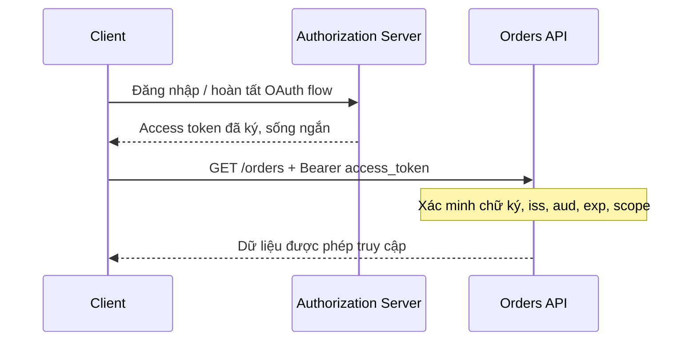

# Khi token giúp giảm state phía server

Trong hệ thống có đăng nhập, **state phía server** là dữ liệu máy chủ cần giữ để biết một yêu cầu thuộc về ai và phiên đăng nhập đó còn hợp lệ hay không. Với cách quản lý phiên truyền thống, client gửi một `session_id`; server phải tìm bản ghi phiên tương ứng để nhận ra người dùng. Khi số lượng người dùng và máy chủ ứng dụng tăng, hệ thống cần duy trì hoặc chia sẻ những bản ghi này.

**Access token tự chứa, có chữ ký số** có thể giảm phần state *phục vụ xác thực*: token mang các thông tin cần thiết và mỗi API xác minh được chữ ký cùng các điều kiện hợp lệ mà không phải tra cứu một phiên riêng cho từng yêu cầu. Đây là một lựa chọn kiến trúc có điều kiện, không phải đặc tính của mọi token. Đặc biệt, dùng JWT không làm biến mất state nghiệp vụ, nhu cầu kiểm tra quyền hiện hành hay bài toán thu hồi token.

Sau bài này, bạn cần phân biệt được state của phiên đăng nhập với state nghiệp vụ, giải thích tại sao một số access token có thể được kiểm tra tại chỗ, và lựa chọn giữa JWT, opaque token và session dựa trên yêu cầu bảo mật thực tế.

## 1. State của phiên đăng nhập nằm ở đâu?

Giả sử người dùng đăng nhập vào ứng dụng bán hàng. Với mô hình **session phía server**:

1. Server xác thực tài khoản và tạo một mã phiên khó đoán, chẳng hạn `sid_a7f...`.
2. Server lưu bản ghi ánh xạ `session_id -> user_id, thời hạn, trạng thái, ...` trong bộ nhớ hoặc kho chung như Redis.
3. Trình duyệt giữ `session_id`, thường trong cookie được cấu hình an toàn.
4. Mỗi lần gọi API, server tra bản ghi phiên, kiểm tra trạng thái và xác định người dùng.

```text
Client                            API                           Session store
  |--- Cookie: session_id -------->|                                  |
  |                                |--- tra cứu session_id ---------->|
  |                                |<-- user_id, trạng thái ----------|
  |<--- kết quả --------------------|                                  |
```

Đây là một mô hình hợp lệ và thường rất thuận tiện khi cần vô hiệu hóa phiên ngay. Tuy nhiên, API cần truy cập nơi quản lý phiên (hoặc một cache tương đương). Nếu session chỉ nằm trong bộ nhớ của một instance, yêu cầu có thể gặp vấn đề khi đi sang instance khác; sử dụng kho phiên chung giải quyết tính nhất quán nhưng thêm một phụ thuộc vận hành.

Cần hiểu đúng từ **state**: cơ sở dữ liệu đơn hàng, số dư, trạng thái giao dịch hay chính sách phân quyền là state nghiệp vụ và vẫn tồn tại bất kể hệ thống dùng session hay token. Ở đây, thứ có thể giảm là *bản ghi phiên mà API phải truy vấn để xác thực mỗi request*.

## 2. Token tự chứa giảm việc tra cứu phiên như thế nào?

Hãy xét một hệ thống có **Authorization Server** phát hành access token và nhiều **Resource Server** cung cấp API. Sau khi người dùng được xác thực, Authorization Server phát hành một access token dạng JWT đã ký bằng khóa tin cậy.

Một JWT thông dụng gồm ba phần `header.payload.signature`, được mã hóa Base64url và ngăn cách bởi dấu chấm. Payload có thể chứa những **claims** như:

```json
{
  "iss": "https://auth.example.com",
  "sub": "user-123",
  "aud": "orders-api",
  "scope": "orders:read",
  "iat": 1760000000,
  "exp": 1760000300
}
```

Đây chỉ là ví dụ về payload, **không phải một token có thể sử dụng**. `iss` là nơi phát hành, `sub` là chủ thể, `aud` là API được phép nhận token, `scope` mô tả phạm vi quyền được cấp, `iat` và `exp` là thời điểm phát hành và hết hạn (Unix timestamp, tính bằng giây). Claim `jti` có thể được bổ sung làm định danh token khi cần theo dõi hoặc thu hồi riêng lẻ.

Với chữ ký bất đối xứng, Authorization Server giữ **private key** để ký; Resource Server dùng **public key** của đúng nhà phát hành để xác minh. Nhờ vậy, Resource Server không cần lưu một bản ghi riêng cho từng access token đã phát hành. Khóa công khai và cấu hình tin cậy vẫn phải được quản lý, thường qua JWKS có cache và cơ chế xoay vòng khóa.



Ở mỗi lần nhận yêu cầu, Orders API có thể xác thực token **tại chỗ**: kiểm tra chữ ký theo thuật toán được cho phép và khóa của issuer tin cậy; kiểm tra `iss`, `aud`, `exp`, `nbf` nếu có; sau đó áp dụng chính sách của endpoint với `scope`/claims phù hợp. Nếu các điều kiện đều đạt, API đã có thông tin nhận diện cơ bản mà không phải gọi lại Authorization Server hoặc tra session cho mỗi request.

Ví dụ yêu cầu gửi lên API:

```http
GET /orders HTTP/1.1
Host: api.example.com
Authorization: Bearer <access_token>
```

Luồng này chỉ giảm số lần tra cứu *để xác thực token*. Nếu API phải kiểm tra người dùng còn sở hữu đơn hàng nào, còn được phép thao tác trên tài nguyên cụ thể nào, hoặc tài khoản đã bị khóa ngay lúc này hay chưa, nó vẫn có thể cần truy vấn dữ liệu hiện hành.

## 3. Không phải token nào cũng khiến API stateless

**Token** là chứng cứ được client mang theo; **JWT** là một định dạng token; **access token** và **refresh token** nói về mục đích sử dụng. Các khái niệm này không thay thế cho nhau.

| Cơ chế | Client mang gì? | API thường xác minh thế nào? | State và khả năng thu hồi |
|---|---|---|---|
| Session phía server | Session ID không chứa dữ liệu người dùng | Tra cứu bản ghi phiên | Cần state phiên; dễ vô hiệu hóa bản ghi ngay |
| JWT access token tự chứa, có chữ ký | Claims và chữ ký | Kiểm tra chữ ký, thời hạn, issuer, audience, quyền tại chỗ | Không cần bản ghi *mỗi token* để xác thực; khó thu hồi riêng token trước hạn nếu không bổ sung cơ chế |
| Opaque access token dạng tham chiếu | Chuỗi không thể suy ra nội dung | Tra trạng thái tại Authorization Server qua introspection hoặc một kho token tin cậy | Thường cần state/tra cứu; thuận lợi hơn cho kiểm soát tập trung và thu hồi |
| Refresh token | Thông tin cho phép xin access token mới | Authorization Server kiểm tra khi đổi token | Thường cần state để quản lý vòng đời, rotation và phát hiện tái sử dụng; không gửi vào API nghiệp vụ |

Một chuỗi opaque **không tự chứng minh tính hợp lệ** chỉ vì tên gọi của nó là token. Trong mô hình thông thường, Resource Server cần introspection hoặc cơ chế tra cứu tương đương. Cache kết quả introspection có thể giảm số lần gọi mạng, nhưng làm xuất hiện khoảng trễ khi token đã bị thu hồi. Ngược lại, JWT cũng có thể được kiểm tra thêm bằng danh sách thu hồi hoặc cơ sở dữ liệu; việc dùng JWT tự nó không đảm bảo hệ thống hoàn toàn stateless.

Trong OAuth 2.0, Authorization Server cấp access token để client gọi Resource Server; **định dạng access token do hệ thống quyết định**, không mặc định phải là JWT. Trong OpenID Connect (OIDC), **ID token** chứng minh kết quả xác thực danh tính cho client là đối tượng nhận phù hợp; không nên đem ID token thay cho access token để gọi API. Resource Server phải chấp nhận đúng token dành cho nó, đặc biệt thông qua claim `aud` khi token là JWT.

## 4. Khi nào lợi ích giảm state thật sự rõ rệt?

Xét một dịch vụ có nhiều instance API sau load balancer. Nếu mỗi request đều cần lấy session từ kho chung, hệ thống phải quản lý lưu lượng tra cứu và độ sẵn sàng của kho đó. Với JWT access token hợp lệ và tự chứa, mỗi instance có thể tự xác minh bằng khóa công khai đã tin cậy và cache; không cần cố định người dùng vào một instance hoặc đọc phiên mỗi lần.

Lợi ích thường rõ khi thỏa các điều kiện sau:

- **Nhiều API hoặc instance cần xác thực độc lập:** các Resource Server tin cậy cùng issuer và có cách cập nhật khóa xác minh an toàn.
- **Access token sống ngắn:** hệ thống chấp nhận rằng thông tin quyền trong token có thể cũ trong thời gian tồn tại token.
- **Không bắt buộc thu hồi tức thời mọi access token:** thời hạn ngắn và kiểm soát refresh token đáp ứng mức rủi ro đã chọn.
- **Claims đủ tối thiểu và ổn định:** API có thể quyết định quyền cơ bản từ `sub`, `aud`, `scope` hoặc claims đã được xác minh mà không cần dựng lại phiên đăng nhập.

Chẳng hạn, Authorization Server phát hành token cho `orders-api` với `scope=orders:read` và thời hạn 5 phút. Trong 5 phút đó, nhiều instance Orders API có thể kiểm tra token độc lập. Con số 5 phút ở đây chỉ là **một ví dụ cấu hình**, không phải thời hạn bắt buộc cho mọi hệ thống; thời hạn cần dựa trên rủi ro, trải nghiệm và cơ chế làm mới token.

Điểm đổi lại là nếu quản trị viên thu hồi quyền của người dùng sau 2 phút, một API chỉ xác minh JWT tại chỗ có thể tiếp tục chấp nhận các claims cũ đến khi token hết hạn. Nếu yêu cầu nghiệp vụ đòi quyền thay đổi có hiệu lực ngay, API phải bổ sung một điểm kiểm tra trạng thái hiện hành hoặc chọn cơ chế kiểm soát tập trung.

## 5. Đánh đổi giữa mở rộng hệ thống và kiểm soát phiên

### 5.1. Thu hồi trước khi hết hạn

Với session, máy chủ có thể xóa hoặc vô hiệu hóa bản ghi phiên. Với opaque token được introspection mỗi lần, Authorization Server có thể báo token không còn `active`. Với JWT được kiểm tra hoàn toàn tại chỗ, token đã ký vẫn có thể xác minh đúng đến `exp`, kể cả sau khi người dùng bấm đăng xuất ở client.

Các cách xử lý tùy nhu cầu:

1. **Access token sống ngắn:** giới hạn thời gian kẻ tấn công có thể dùng access token bị lộ, nhưng không thu hồi tức thời một token đã phát hành.
2. **Thu hồi refresh token và dùng refresh token rotation:** ngăn cấp thêm access token trong tương lai; Authorization Server lưu trạng thái cần thiết để vô hiệu hóa chuỗi refresh token hoặc phát hiện token cũ bị dùng lại.
3. **Denylist theo `jti` hoặc phiên bản token/người dùng:** Resource Server kiểm tra trạng thái bổ sung trước khi chấp nhận; đổi lại một phần lợi ích stateless.
4. **Introspection hoặc kiểm tra quyền hiện hành cho tác vụ nhạy cảm:** chấp nhận chi phí tra cứu để lấy trạng thái gần nhất; cần xác định chính sách cache và độ trễ thu hồi.

Việc đổi khóa ký có thể làm vô hiệu hóa cả nhóm token, nhưng có phạm vi ảnh hưởng lớn và không thích hợp làm thao tác đăng xuất riêng từng người dùng.

### 5.2. Token bị đánh cắp hoặc phát lại

Access token dạng **Bearer** có nghĩa là ai cầm được token hợp lệ thì có thể sử dụng trong phạm vi quyền và thời hạn của token. Chữ ký chống sửa nội dung, **không chống việc sao chép token**. `jti` cũng không tự chặn replay; nó chỉ hỗ trợ khi hệ thống có cơ chế nhận diện và xử lý lần dùng lại.

Biện pháp nền tảng là dùng HTTPS, giới hạn audience/scope, rút ngắn hạn dùng access token, bảo vệ vị trí lưu token, tránh ghi token vào log hoặc URL, và thu hồi/rotation refresh token. Trong các hệ thống đòi hỏi cao hơn, có thể dùng token ràng buộc với bên sở hữu, ví dụ DPoP hoặc mTLS, để giảm khả năng dùng lại token bị lộ, nhưng cần triển khai và kiểm chứng đúng giao thức.

Với trình duyệt, cần cân nhắc mô hình client cụ thể. Cookie `HttpOnly; Secure; SameSite` có thể giảm nguy cơ JavaScript đọc token, nhưng nếu cookie tự được gửi trong request thì vẫn phải thiết kế bảo vệ CSRF phù hợp. Lưu access token trong JavaScript (đặc biệt nơi lưu trữ lâu dài như `localStorage`) làm tăng hậu quả khi ứng dụng bị XSS. Không có một vị trí lưu token tối ưu cho mọi kiến trúc; **refresh token** cần được bảo vệ chặt hơn vì có thể xin thêm access token.

### 5.3. Kiểm tra đúng ranh giới tin cậy

Không được tin payload chỉ vì nó đọc được hoặc trông giống JSON. JWT thông thường **được ký, không được mã hóa**; bất kỳ ai giữ token thường có thể đọc claims. Tránh đặt mật khẩu, thông tin bí mật hoặc dữ liệu cá nhân không cần thiết trong payload.

Resource Server phải tối thiểu:

- Xác minh chữ ký bằng khóa gắn với **issuer đã tin cậy**; giới hạn thuật toán chấp nhận theo cấu hình server, không lấy giá trị `alg` trong token làm quyết định duy nhất.
- Kiểm tra chính xác `iss`, `aud`, `exp`, và `nbf` nếu được sử dụng; xử lý sai lệch đồng hồ trong giới hạn nhỏ, có chủ đích.
- Đối chiếu `scope` hoặc quyền được cấp với hành động thực tế và kiểm tra quyền trên **tài nguyên cụ thể** khi cần. `orders:read` không mặc nhiên cho phép đọc đơn hàng của người khác.
- Từ chối token sai loại, sai audience, hết hạn, chữ ký không hợp lệ hoặc bị thu hồi theo chính sách đã thiết kế.

Ví dụ logic ở mức khái niệm, nên dùng thư viện JWT/OAuth được duy trì và cấu hình đúng thay vì tự viết thuật toán mật mã:

```text
nhận Bearer access_token
→ xác minh chữ ký bằng khóa/thuật toán được cấu hình tin cậy
→ kiểm tra iss == issuer mong đợi
→ kiểm tra aud chứa orders-api
→ kiểm tra thời gian hiệu lực (exp, nbf nếu có)
→ kiểm tra scope cho endpoint, ví dụ orders:read
→ kiểm tra người dùng có quyền với đơn hàng được yêu cầu
→ cho phép hoặc từ chối
```

## 6. Ví dụ một vòng đời token trong hệ thống thực tế

Giả sử ứng dụng đặt hàng có Authorization Server, Orders API và trình duyệt người dùng:

1. Người dùng hoàn tất đăng nhập/OAuth flow. Client nhận access token **dành cho `orders-api`** và, nếu client/flow được phép, refresh token theo chính sách bảo mật.
2. Client gọi `GET /orders` bằng access token. Orders API xác minh chữ ký và claims, rồi kiểm tra quyền xem danh sách đơn hàng. Không cần tìm session đăng nhập riêng trong mỗi request.
3. Access token hết hạn. Client thực hiện luồng đổi refresh token tại Authorization Server; server kiểm tra trạng thái refresh token, có thể phát hành refresh token mới và vô hiệu hóa bản cũ theo cơ chế rotation.
4. Người dùng đăng xuất. Client xóa thông tin xác thực ở phía mình và ứng dụng thu hồi refresh token/phiên có liên quan. **Access token JWT đã phát hành có thể còn hợp lệ tới `exp`**, trừ khi hệ thống triển khai kiểm tra thu hồi bổ sung.
5. Nếu phát hiện refresh token cũ bị sử dụng lại, Authorization Server có thể xem đây là dấu hiệu rò rỉ và vô hiệu hóa họ token liên quan theo chính sách.

Ví dụ này cho thấy một thiết kế có thể **ít state hơn ở Resource Server** nhưng vẫn **có state tại Authorization Server** để quản lý refresh token, phiên đăng nhập hoặc thu hồi. Đây là cách kết hợp phổ biến giữa khả năng mở rộng và kiểm soát rủi ro.

## 7. Chọn cơ chế dựa trên yêu cầu

| Câu hỏi thiết kế | Hướng cân nhắc |
|---|---|
| Mỗi API cần hoạt động độc lập, số lượng instance lớn, có thể chấp nhận quyền cũ trong một khoảng ngắn? | JWT access token tự chứa, sống ngắn, có chữ ký và kiểm tra claims chặt chẽ có thể giảm tra cứu xác thực. |
| Cần chặn một phiên/token ngay khi tài khoản bị khóa hoặc quyền bị thu hồi? | Session tập trung, opaque token được introspection, hoặc JWT kèm kiểm tra trạng thái thu hồi. |
| Có nhiều API nhận token với quyền khác nhau? | Phát token đúng `aud` và `scope`; mỗi Resource Server phải tự kiểm tra audience và quyền. |
| Có nhu cầu đăng nhập lâu nhưng access token sống ngắn? | Dùng refresh token đúng ngữ cảnh và bảo vệ/rotation/thu hồi tại Authorization Server. |
| Chỉ đổi session ID sang một opaque token rồi vẫn tra database mỗi lần? | Không giảm đáng kể state của xác thực chỉ nhờ đổi tên credential. |

**Kết luận:** Token giúp giảm state phía server rõ nhất khi **access token tự chứa có thể xác minh cục bộ**, để nhiều Resource Server xử lý request mà không cần một bản ghi phiên cho từng token. JWT, opaque token, access token và refresh token cần được phân biệt theo **định dạng, mục đích và cách kiểm tra**. Quyết định dùng cơ chế nào phải đi cùng yêu cầu về thu hồi, cập nhật quyền, chống token bị đánh cắp và mô hình tin cậy của OAuth 2.0/OIDC.
