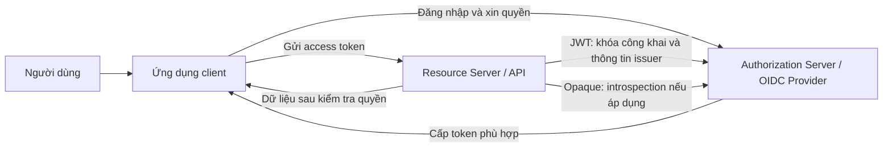
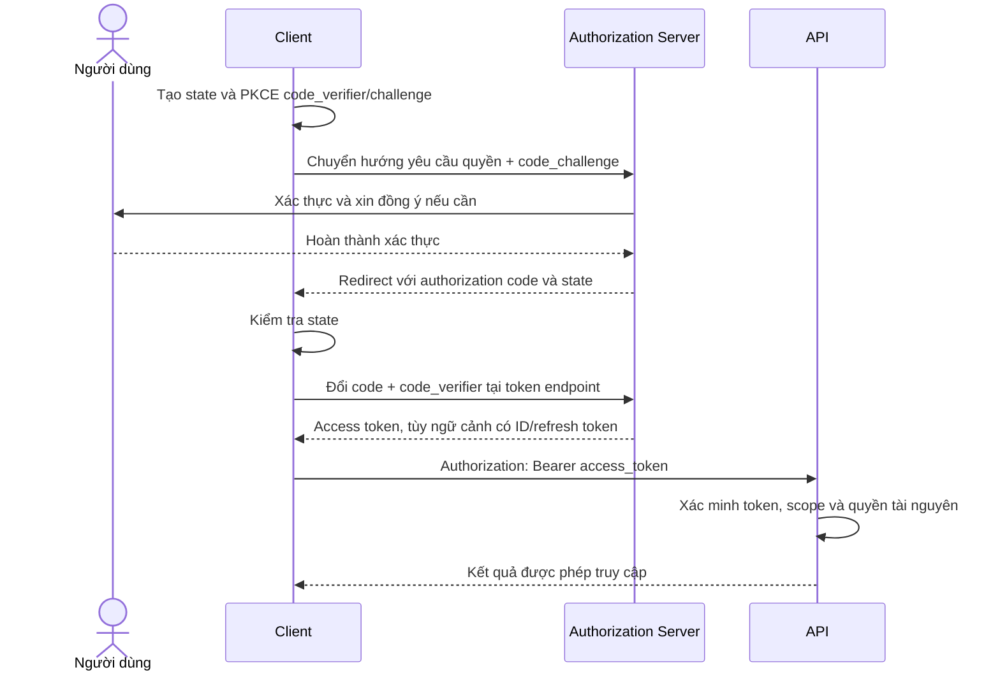
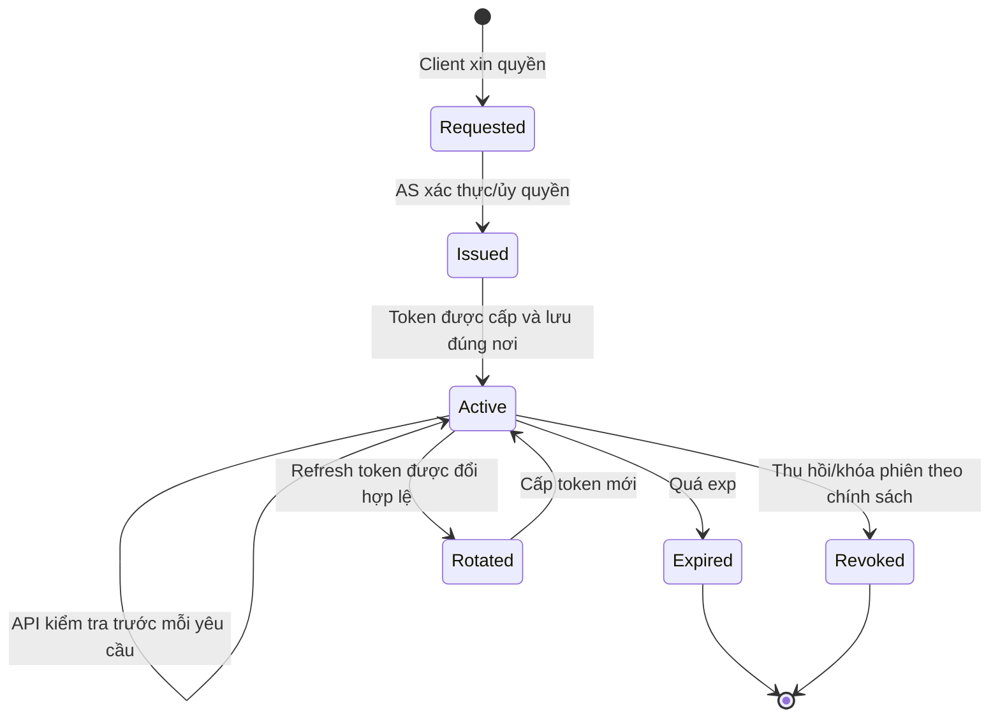

# Lộ trình từ khái niệm token đến vận hành an toàn

Token là một phần quan trọng của xác thực, phân quyền và giao tiếp giữa các hệ thống hiện đại. Tuy nhiên, việc một API nhận được chuỗi token hợp lệ về mặt cú pháp **không đồng nghĩa** với việc yêu cầu đó được phép truy cập tài nguyên. Muốn thiết kế hệ thống an toàn, cần hiểu token do ai phát hành, được gửi cho ai, chứng minh điều gì, có hiệu lực đến khi nào và có thể bị vô hiệu hóa ra sao.

Bài học thuộc phạm vi **SECURITY_TOKEN_SECURITY_FUNDAMENTALS**: xây dựng mô hình tin cậy và theo dõi toàn bộ vòng đời token bảo mật; phân biệt JWT, opaque token, access token và refresh token trong OAuth 2.0/OpenID Connect (OIDC); thực hành tư duy kiểm tra claims, scope, audience, lưu trữ, thu hồi và chống đánh cắp hoặc phát lại token.

## 1. Mục tiêu và bản đồ học tập

Sau bài học, bạn cần có khả năng:

1. Giải thích **token là thông tin xác thực được cấp trong một ngữ cảnh tin cậy**, không phải một “mật khẩu tự động an toàn”.
2. Phân biệt **mục đích sử dụng** (access, refresh, ID token) với **định dạng biểu diễn** (JWT, opaque).
3. Lần theo một luồng OAuth 2.0/OIDC từ đăng nhập, phát hành, sử dụng, hết hạn đến thu hồi token.
4. Chỉ ra những kiểm tra bắt buộc khi API nhận JWT hoặc opaque access token.
5. Chọn cách lưu trữ và luân chuyển token phù hợp cho web, mobile và backend.
6. Nhận diện rủi ro token bị đánh cắp, phát lại, sử dụng sai audience và lập phương án giám sát, ứng phó.

Lộ trình học có sáu chặng liên tiếp:

| Chặng | Câu hỏi phải trả lời | Kết quả thực hành |
| --- | --- | --- |
| 1. Khái niệm và ranh giới tin cậy | Token đại diện cho điều gì, ai phải tin ai? | Vẽ được client, authorization server và API |
| 2. Loại token và định dạng | Access/refresh/ID khác JWT/opaque thế nào? | Phân loại được các mẫu token |
| 3. Phát hành và trao đổi | Token xuất hiện trong OAuth 2.0/OIDC khi nào? | Mô tả Authorization Code + PKCE |
| 4. Kiểm tra và phân quyền | API kiểm chứng những điều gì trước khi trả dữ liệu? | Thiết kế luồng xác thực và kiểm tra scope |
| 5. Bảo quản và thu hồi | Token sống ở đâu, được thay mới/vô hiệu hóa thế nào? | Đề xuất chính sách vòng đời |
| 6. Vận hành an toàn | Phát hiện và xử lý sự cố token ra sao? | Có bộ kiểm thử, quan sát và quy trình ứng phó |

## 2. Chặng 1 — Hiểu đúng token và mô hình tin cậy

### 2.1. Token là gì?

**Token bảo mật** là một giá trị do thành phần có thẩm quyền cấp để bên nhận có thể kiểm tra một số khẳng định hoặc quyền truy cập trong một thời gian và phạm vi nhất định. Trong hệ thống OAuth 2.0, **authorization server** (AS) quyết định cấp token; **resource server** (RS/API) bảo vệ dữ liệu; **client** dùng quyền được cấp để yêu cầu tài nguyên; **resource owner** thường là người dùng sở hữu dữ liệu hoặc có quyền quyết định cấp quyền.

Hai khái niệm cần tách bạch:

- **Xác thực (authentication)**: xác định danh tính hoặc ngữ cảnh của chủ thể. OIDC bổ sung lớp xác thực danh tính trên OAuth 2.0.
- **Phân quyền (authorization)**: xác định chủ thể/client được phép làm gì với tài nguyên cụ thể. Một access token hợp lệ vẫn có thể thiếu quyền xem một hóa đơn nhất định.

Phần lớn access token thường được sử dụng theo mô hình **bearer**: bên nào đang giữ token có thể xuất trình token đó. Vì vậy, đánh cắp bearer token có thể dẫn đến chiếm quyền trong phạm vi hiệu lực của nó. Một số triển khai nâng cao dùng **sender-constrained token** (chẳng hạn mTLS hoặc DPoP) để ràng buộc token với bên giữ khóa, giảm khả năng phát lại từ thiết bị khác.

### 2.2. Ranh giới tin cậy



**Điểm tin cậy cốt lõi:** API chỉ tin một issuer/authorization server đã cấu hình trước, một loại token được thiết kế cho API đó và những claims đã được **xác minh**. API không tin tùy ý vào một chuỗi do client gửi, kể cả khi chuỗi ấy có thể giải mã được thành JSON.

Ví dụ: người dùng đăng nhập ứng dụng bán hàng. Authorization server cấp access token có audience là API đơn hàng và scope `orders:read`. API đơn hàng có thể cho phép đọc những đơn hàng mà người dùng thật sự sở hữu; API thanh toán không thể chấp nhận token này chỉ vì chữ ký đúng.

### 2.3. Token và session cookie

Session cookie thường giữ một **định danh phiên** để máy chủ tra cứu trạng thái; access token dùng để biểu diễn quyền truy cập với API. Cookie là một cơ chế vận chuyển/lưu trữ trên trình duyệt, không phải một loại quyền tương đương access token. Trong kiến trúc **Backend for Frontend (BFF)**, trình duyệt có thể chỉ nắm cookie phiên có bảo vệ, còn backend giữ access/refresh token ở phía máy chủ.

## 3. Chặng 2 — Phân biệt mục đích token và định dạng token

Có **hai trục phân loại độc lập**. Trục thứ nhất nói token dùng làm gì; trục thứ hai nói token có hình thức gì.

### 3.1. Theo mục đích

| Loại | Ai thường sử dụng? | Chức năng | Điều không nên làm |
| --- | --- | --- | --- |
| **Access token** | Client gửi cho Resource Server/API | Chứng minh quyền gọi API trong một phạm vi và thời gian | Dùng như định danh đăng nhập duy nhất hoặc gửi sang API sai audience |
| **Refresh token** | Client gửi cho token endpoint của Authorization Server | Xin access token mới khi token cũ hết hạn | Gửi refresh token cho API nghiệp vụ; lưu công khai trong JavaScript nếu có phương án an toàn hơn |
| **ID token** (OIDC) | OIDC client/relying party | Chứa kết quả xác thực người dùng và thông tin liên quan | Dùng ID token làm access token để gọi API |

**Access token** có thể tồn tại ở dạng JWT hoặc opaque. **Refresh token** cũng có thể dùng các định dạng khác nhau, nhưng client thường phải xem nó là chuỗi bí mật không cần diễn giải. **ID token trong OIDC là JWT**; phải kiểm tra theo quy tắc OIDC dành cho client.

Một access token không nhất thiết “chứa thông tin người dùng”; với client credentials, chủ thể có thể là một dịch vụ. Vì thế cần phân biệt quyền của **client** với quyền của **người dùng** và tránh mặc định mọi token đại diện cho một người đang đăng nhập.

### 3.2. Theo định dạng

| Tiêu chí | JWT | Opaque token |
| --- | --- | --- |
| Bề ngoài | Thường là chuỗi dạng `header.payload.signature` đối với JWT ký số phổ biến (JWS) | Chuỗi không mang cấu trúc có thể suy ra ý nghĩa tại client |
| Cách API xác minh | Kiểm tra chữ ký và claims theo issuer/audience/loại token | Tra cứu trạng thái và metadata qua introspection hoặc cơ chế tra cứu đáng tin cậy |
| Thu hồi | JWT tự chứa thường còn hợp lệ đến `exp` nếu không có kiểm soát bổ sung | Có thể phản ánh thu hồi nhanh qua tra cứu trực tuyến; phụ thuộc cache và hệ thống triển khai |
| Phụ thuộc mạng lúc kiểm tra | Có thể xác minh cục bộ khi có khóa hợp lệ | Thường cần gọi hệ thống xác minh/truy vấn trạng thái |
| Đánh đổi chính | Hiệu năng và tính sẵn sàng so với độ trễ thu hồi | Kiểm soát tập trung so với độ trễ và sự phụ thuộc dịch vụ |

**JWT không mặc định được mã hóa.** Với JWT ký số kiểu JWS phổ biến, nội dung payload chỉ được mã hóa Base64URL nên ai có chuỗi token đều có thể đọc được. Chữ ký giúp kiểm tra tính toàn vẹn và nguồn phát hành; nó không bảo vệ tính bí mật của claims. Không đặt mật khẩu, số thẻ hay dữ liệu nhạy cảm không cần thiết trong payload.

Ví dụ **payload minh họa** của một JWT access token (đây không phải token hợp lệ để sử dụng):

```json
{
  "iss": "https://auth.example.test",
  "sub": "user-42",
  "aud": "https://api.example.test/orders",
  "exp": 1790003600,
  "iat": 1790000000,
  "jti": "token-id-illustrative",
  "scope": "orders:read orders:create"
}
```

Đọc được những trường này **không có nghĩa** chúng đáng tin; API chỉ được sử dụng sau khi hoàn tất việc xác minh.

## 4. Chặng 3 — Phát hành token qua OAuth 2.0 và OIDC

### 4.1. Phân vai rõ ràng

- **OAuth 2.0** là framework ủy quyền: client nhận quyền truy cập một resource server.
- **OIDC** xây dựng trên OAuth 2.0 để client có thể xác thực người dùng và nhận ID token cùng thông tin danh tính theo đặc tả.
- **Authorization server** phát hành token và công bố metadata/khóa tùy triển khai; **resource server** tự chịu trách nhiệm xác minh token trước khi cấp quyền; **OIDC client** phải kiểm tra ID token theo các điều kiện dành cho client.

Một luồng đăng nhập OIDC có thể đồng thời đưa về **ID token** cho client và **access token** để gọi API. Hai token có người nhận và mục đích khác nhau; không tráo đổi vai trò.

### 4.2. Luồng Authorization Code + PKCE

Đây là điểm xuất phát tốt cho ứng dụng có người dùng tương tác, gồm web app và native app. Ứng dụng chuyển người dùng tới authorization endpoint bằng trình duyệt hệ thống hoặc cơ chế phù hợp, không thu mật khẩu trực tiếp.



Các thành phần bảo vệ ở những vị trí khác nhau:

1. **PKCE**: client sinh `code_verifier` bí mật, gửi `code_challenge` (thường dùng S256) lúc bắt đầu; token endpoint yêu cầu đúng verifier để giảm nguy cơ mã `code` bị chặn rồi đổi lấy token.
2. **state**: liên kết phản hồi redirect với yêu cầu ban đầu, giúp chống nhầm lẫn phiên và CSRF trong luồng ủy quyền.
3. **redirect URI**: phải khớp với URI đã đăng ký theo quy tắc của authorization server; không chấp nhận redirect mở.
4. **nonce (OIDC)**: nếu gửi nonce trong yêu cầu xác thực, client phải kiểm tra nonce trong ID token theo quy tắc OIDC để gắn kết phản hồi với phiên xác thực.
5. **TLS**: bảo vệ trao đổi code/token trên đường truyền; client bí mật (confidential client) còn phải xác thực đúng cách tại token endpoint.

Không nên dùng implicit flow hoặc Resource Owner Password Credentials như lựa chọn mặc định cho ứng dụng mới. Với trao đổi giữa dịch vụ với dịch vụ, **Client Credentials** có thể phù hợp nếu quyền chỉ thuộc về client, không đại diện người dùng.

### 4.3. Vòng đời của một token



**Lưu ý:** “Revoked” trong sơ đồ là trạng thái nghiệp vụ mong muốn. Với JWT access token tự chứa, hành động thu hồi tại AS **không tự động** làm mọi API ngừng chấp nhận JWT đã cấp; cần thời hạn ngắn, denylist, introspection hoặc cơ chế tương đương nếu phải vô hiệu hóa gần như ngay lập tức.

## 5. Chặng 4 — Xác minh token và ra quyết định phân quyền

### 5.1. Các claims trọng tâm

| Claim/thuộc tính | Ý nghĩa | Câu hỏi phía nhận phải kiểm tra |
| --- | --- | --- |
| `iss` (issuer) | Bên phát hành | Có khớp issuer tin cậy được cấu hình hay không? |
| `sub` (subject) | Chủ thể được token nói đến | Có phù hợp ngữ cảnh yêu cầu và mô hình dữ liệu không? |
| `aud` (audience) | Những bên nhận được phép | API này có nằm trong audience dự kiến không? |
| `exp` (expiration) | Thời điểm hết hạn | Token còn hiệu lực ở thời điểm hiện tại không? |
| `nbf` (not before) | Chưa được dùng trước thời điểm | Token có bị dùng quá sớm không? |
| `iat` (issued at) | Thời điểm phát hành | Thời điểm có hợp lý theo chính sách không? |
| `jti` (token ID) | Định danh token | Có dùng để đối chiếu thu hồi/phát hiện bất thường không? |
| `scope`/`scp` | Quyền/phạm vi được cấp, tùy provider | Có chứa quyền cần cho thao tác này không? |
| `client_id`, `azp` hoặc tương đương | Client liên quan, tùy profile token | Có khớp client mong đợi theo loại token không? |
| `nonce` (ID token, khi được dùng) | Liên kết phiên xác thực | Có khớp nonce client đã lưu không? |

Không phải mọi claim trong bảng đều bắt buộc với mọi loại token. Chúng chỉ có ý nghĩa khi **được quy định trong hợp đồng token/profile** của hệ thống. Ví dụ `scope` có thể là chuỗi cách nhau bởi khoảng trắng hoặc cấu trúc khác theo nhà cung cấp; quyền nghiệp vụ sau đó vẫn cần được kiểm tra tại API.

### 5.2. Kiểm tra JWT access token đúng thứ tự

API nên sử dụng thư viện bảo mật đã được kiểm chứng, với cấu hình cố định cho issuer và loại token. Một luồng logic:

1. Nhận token từ vị trí cho phép, thường là header `Authorization: Bearer ...`; giới hạn kích thước và tránh ghi token vào log.
2. Xác định profile token mong đợi, chỉ cho phép thuật toán chữ ký đã cấu hình. Dữ liệu header JWT chưa xác minh **không được** quyết định issuer, URL tải khóa hoặc thuật toán mà hệ thống sẽ tin.
3. Lấy khóa thích hợp từ JWKS endpoint **đã gắn với issuer tin cậy**, kiểm tra chữ ký, thuật toán và kiểu khóa. Xử lý `kid` chỉ trong bộ khóa đáng tin; không tải tùy tiện URL `jku`/`x5u` được token đưa vào.
4. Xác minh `iss`, `aud`, `exp`, `nbf` và những thuộc tính bắt buộc của profile. Cho phép sai lệch đồng hồ nhỏ, có giới hạn; không bỏ qua expiry.
5. Bảo đảm đây là **access token dành cho API này**, không phải ID token hoặc token của ứng dụng khác. Nếu profile quy định `typ` hay claim phân loại token thì kiểm tra chúng.
6. Kiểm tra `scope`/quyền cấp ở mức endpoint; sau đó kiểm tra quyền theo tài nguyên (chủ sở hữu đơn hàng, tenant, vai trò, chính sách nghiệp vụ).
7. Trả `401 Unauthorized` khi thiếu/không hợp lệ thông tin xác thực; trả `403 Forbidden` khi đã xác thực nhưng không được phép thực hiện yêu cầu.

Mã giả sau mô tả **chính sách xác minh**, không phải thư viện tự viết mã hóa:

```text
validateAccessToken(rawToken, operation, requestedResource):
    expectedIssuer   = trustedConfig.issuer
    expectedAudience = trustedConfig.ordersApiAudience
    verifier         = configuredJwtVerifier(
        jwksFromTrustedIssuer,
        allowedSigningAlgorithms,
        requiredAccessTokenProfile
    )

    claims = verifier.verifySignatureAndRequiredClaims(rawToken)
    require claims.iss == expectedIssuer
    require audienceContains(claims.aud, expectedAudience)
    require isWithinTimeWindow(claims.nbf, claims.exp, boundedClockSkew)
    require isExpectedAccessTokenType(claims)
    require scopeAllows(claims, operation)
    require resourcePolicyAllows(claims.sub, claims, requestedResource)
    return AUTHORIZED
```

Ví dụ một yêu cầu gọi API:

```http
GET /v1/orders/123 HTTP/1.1
Host: api.example.test
Authorization: Bearer <ACCESS_TOKEN>
```

Ngay cả khi token có `orders:read`, API vẫn phải xác minh đơn hàng `123` thuộc về người dùng/tenant được phép. Scope mang ý nghĩa cấp quyền tổng quát, **không thay thế** kiểm soát truy cập mức đối tượng.

### 5.3. Kiểm tra opaque access token

Với opaque token, API không tự suy ra quyền từ cấu trúc chuỗi. API xác minh qua token introspection endpoint (hoặc dịch vụ kiểm tra nội bộ tương đương), được xác thực và bảo vệ bằng TLS. Phản hồi minh họa:

```json
{
  "active": true,
  "iss": "https://auth.example.test",
  "sub": "user-42",
  "aud": "https://api.example.test/orders",
  "scope": "orders:read",
  "exp": 1790003600,
  "client_id": "web-orders"
}
```

API kiểm tra `active`, audience, quyền, thời gian và chính sách nghiệp vụ dựa trên **kết quả introspection đã được xác thực**. Nếu dịch vụ xác minh không sẵn sàng hoặc trả dữ liệu không hợp lệ, hành động có bảo vệ nên **fail closed** theo chính sách hệ thống; không cho phép truy cập bằng cách phỏng đoán.

Có thể cache kết quả introspection để giảm độ trễ, nhưng TTL của cache tạo ra khoảng trễ trước khi API thấy trạng thái bị thu hồi. Cần chọn TTL theo yêu cầu rủi ro thực tế.

### 5.4. ID token có đường kiểm tra riêng

OIDC client kiểm tra chữ ký và những claims liên quan như `iss`, `aud` (thường chứa `client_id`), `exp`, cùng `nonce`/`azp` khi quy tắc luồng yêu cầu. **API nghiệp vụ không dùng ID token làm bằng chứng quyền truy cập**. Một client đã xác thực danh tính người dùng không có nghĩa là người dùng được phép đọc mọi tài nguyên của API.

## 6. Chặng 5 — Lưu trữ, chuyển giao, làm mới và thu hồi

### 6.1. Bảo vệ token ở nơi lưu trữ

| Môi trường | Cách tiếp cận ưu tiên | Điểm cần bảo vệ |
| --- | --- | --- |
| Web với BFF | Backend giữ access/refresh token; trình duyệt nhận cookie phiên `Secure`, `HttpOnly`, `SameSite` phù hợp | CSRF, XSS, session fixation và giới hạn cookie |
| Single Page Application không có BFF | Giảm tối đa thời gian/token lưu tại browser; nếu cần thì cân nhắc lưu access token trong bộ nhớ và chọn luồng refresh theo mô hình đe dọa | XSS có thể sử dụng token đang nằm trong bộ nhớ; tránh xem `localStorage` là kho bí mật an toàn |
| Ứng dụng native/mobile | Dùng kho khóa/bí mật của nền tảng (Keychain, Keystore hoặc cơ chế tương đương) | Thiết bị bị xâm nhập, sao lưu, debug log, deep link |
| Backend/service | Secret manager hoặc kho bí mật được kiểm soát; hạn chế quyền đọc; mã hóa khi cần | Log, trace, cấu hình, quyền truy cập máy chủ và vòng đời secret |

Luôn dùng HTTPS/TLS, không gửi access/refresh token trong query string của URL, không ghi nguyên token vào log/analytics, không nhúng token vào mã nguồn hoặc tài liệu công khai. Với cookie phiên, `HttpOnly` giảm khả năng JavaScript đọc trực tiếp cookie nhưng **không tự ngăn được** các hành động trái phép do XSS; `SameSite` cũng không thay thế toàn bộ kiểm soát CSRF.

### 6.2. Hết hạn, refresh và rotation

**Access token** nên có thời gian sống phù hợp với rủi ro, thông thường ngắn hơn refresh token. Khi access token hết hạn, client có thể dùng **refresh token** tại token endpoint để xin quyền truy cập mới nếu chính sách cho phép.

**Refresh token rotation** phát hành refresh token mới khi refresh thành công và làm token cũ không còn được dùng bình thường. Việc sử dụng lại token đã xoay vòng có thể là tín hiệu bị đánh cắp; AS nên ghi nhận, xác định token family và áp dụng biện pháp ứng phó đã thiết kế. Triển khai cần xử lý nguyên tử và các yêu cầu làm mới đồng thời để tránh nhầm thao tác hợp lệ thành tấn công.

Refresh token cần gắn với client, phạm vi và quyền thực tế; chính sách có thể đặt hạn tuyệt đối, thời gian không hoạt động, thu hồi khi đăng xuất/đổi mật khẩu hoặc theo rủi ro. **Không đảm bảo** refresh token luôn được phát: điều này tùy grant, client, nhà cung cấp và chính sách cấp quyền.

### 6.3. Thu hồi token và khóa ký

- **Opaque token**: có thể thu hồi và làm introspection trả `active: false`, với độ trễ phụ thuộc cache/hệ thống.
- **JWT access token tự chứa**: muốn vô hiệu hóa sớm phải có cơ chế bổ sung, ví dụ denylist theo `jti`, phiên bản phiên, introspection hoặc giảm TTL.
- **Refresh token**: thu hồi tại AS để chặn khả năng xin thêm access token; những access token đã phát vẫn chịu quy tắc hiệu lực riêng.
- **Khóa ký**: xoay vòng khóa theo kế hoạch; công bố khóa công khai mới trước khi dùng, duy trì khóa cũ đủ để kiểm tra token còn hợp lệ, và có quy trình khẩn cấp khi khóa bị lộ. Khi xác minh, xử lý JWKS cache/mất kết nối có giới hạn và tránh tự động tin khóa ngoài issuer cấu hình.

Đăng xuất khỏi giao diện, xóa cookie, thu hồi refresh token và vô hiệu hóa mọi access token đang tồn tại là **những hành động khác nhau**. Cần xác định rõ kỳ vọng đăng xuất của sản phẩm và kiểm chứng hành vi ở cả client, AS lẫn API.

## 7. Chặng 6 — Đe dọa, phòng thủ và vận hành

### 7.1. Những lỗi thiết kế thường gặp

| Mối đe dọa / lỗi | Hệ quả | Kiểm soát ưu tiên |
| --- | --- | --- |
| Token bị lộ qua XSS, log, URL hoặc thiết bị | Kẻ khác có thể xuất trình bearer token | Giảm nơi lưu và nơi ghi, XSS hardening, CSP, TLS, giới hạn TTL và scope |
| Phát lại token đã đánh cắp | Yêu cầu trái phép vẫn có vẻ hợp lệ | Sender constraint khi phù hợp; TTL ngắn; phát hiện bất thường và thu hồi |
| Không kiểm tra `aud` hoặc `iss` | Token hệ thống/API khác bị chấp nhận nhầm | Khóa issuer/audience bằng cấu hình từng API |
| Tin `alg`, `jku` hoặc khóa theo dữ liệu chưa xác minh | Bỏ qua hoặc đánh tráo kiểm tra chữ ký | Danh sách thuật toán cho phép và JWKS gắn issuer tin cậy |
| Dùng ID token thay access token | Đánh đồng xác thực người dùng với quyền truy cập API | Kiểm tra đúng loại token và profile |
| Access token có scope quá rộng | Một sự cố ảnh hưởng nhiều tài nguyên | Cấp quyền tối thiểu, audience hẹp, phân quyền mức tài nguyên |
| Refresh token dùng lại sau rotation | Phiên có thể đã bị chiếm | Phát hiện reuse, thu hồi token family và điều tra |
| Cache introspection quá lâu | Token bị thu hồi nhưng API tiếp tục chấp nhận | TTL nhỏ theo mức rủi ro và chiến lược vô hiệu hóa cache |
| Lỗi đồng hồ hoặc cấu hình khóa | Từ chối nhầm hoặc nhận token quá hạn | Đồng bộ thời gian, skew có giới hạn, kiểm thử xoay khóa |

### 7.2. Tình huống thực tế: một token bị dùng sai nơi

Một ứng dụng quản lý đơn hàng nhận access token có `aud = orders-api`, `scope = orders:read`. Người dùng thử gửi chính token đó đến `billing-api`.

- Nếu `billing-api` chỉ kiểm tra chữ ký, token có thể bị chấp nhận nhầm dù không được cấp cho billing.
- Nếu API kiểm tra `iss`, `aud`, loại token và scope, token sẽ bị từ chối tại ranh giới xác thực/phân quyền.
- Kể cả tại `orders-api`, yêu cầu đọc đơn hàng của người khác vẫn phải bị chặn bởi chính sách sở hữu/tenant.

Tình huống cho thấy **chữ ký hợp lệ là điều kiện cần, không đủ để cho phép truy cập**.

### 7.3. Quan sát hệ thống mà không rò rỉ bí mật

Nên đo các nhóm tín hiệu: số lần phát hành và refresh; lỗi xác minh theo nguyên nhân (issuer, audience, expiry, signature, scope); số token bị thu hồi; refresh token reuse; biến động bất thường theo client, vùng mạng hoặc tài khoản; tỷ lệ lỗi introspection; độ trễ JWKS/introspection và sự cố xoay khóa.

Để điều tra, log có cấu trúc chỉ nên giữ **metadata an toàn** như request ID, mã lỗi, issuer đã chuẩn hóa, client ID theo chính sách, token ID đã băm/phân đoạn khi thực sự cần. Tránh log toàn bộ JWT, refresh token, authorization code, bí mật client hoặc dữ liệu định danh không cần thiết. Giới hạn quyền truy cập và thời gian lưu log.

### 7.4. Quy trình ứng phó khi nghi token bị lộ

1. **Khoanh vùng**: xác định client, người dùng, phiên, token family, audience và khoảng thời gian bị ảnh hưởng từ metadata đáng tin; hạn chế sao chép token thật.
2. **Ngăn chặn**: thu hồi refresh token/phiên, vô hiệu hóa token theo cơ chế hệ thống; với nghi lộ khóa ký, kích hoạt quy trình thay khóa khẩn cấp.
3. **Đánh giá hiệu lực còn lại**: kiểm tra liệu JWT access token còn sống đến `exp` hay API có denylist/introspection; không mặc định việc đăng xuất đã chặn ngay mọi request.
4. **Điều tra nguồn lộ**: kiểm tra XSS, redirect, log, secret store, quyền truy cập và dấu hiệu reuse; sửa nguyên nhân gốc.
5. **Khôi phục và theo dõi**: cấp lại phiên/quyền cần thiết, giám sát các lỗi xác minh và truy cập bất thường, cập nhật quy trình vận hành.

## 8. Thực hành theo lộ trình

Hãy xây dựng mô hình giả định gồm `auth.example.test` (AS), `orders-api`, `billing-api` và ứng dụng web `storefront`. Không cần token thật hoặc tài khoản người dùng thật.

**Bài thực hành A — Bản đồ tin cậy.** Vẽ sơ đồ client, AS và hai API. Chú thích ai phát hành token, bên nào là audience, ai giữ khóa xác minh và nơi nào đưa ra quyết định quyền sở hữu dữ liệu. Đạt khi chỉ ra được lý do `orders-api` và `billing-api` không dùng chung audience chỉ để tiện cấu hình.

**Bài thực hành B — Đọc ngữ cảnh token.** Cho một token giả định có `iss = https://auth.example.test`, `aud = orders-api`, `scope = orders:read` và `exp` còn hiệu lực. Ghi rõ kết quả của ba yêu cầu: xem đơn của chính chủ, sửa đơn, xem hóa đơn tại billing. Đạt khi giải thích được kết quả khác nhau bằng audience, scope và quyền mức đối tượng.

**Bài thực hành C — Luồng cấp và làm mới.** Viết lại các bước Authorization Code + PKCE; chỉ ra vị trí dùng `state`, `code_verifier` và kiểm tra ID token khi có OIDC. Sau đó mô tả một lần refresh hợp lệ, lần refresh dùng lại token cũ và cách phát hiện/ứng phó.

**Bài thực hành D — Thiết kế kiểm tra.** Lập bảng test cho API gồm ít nhất các trường hợp: sai chữ ký, sai issuer, sai audience, thiếu scope, token hết hạn, chưa đến `nbf`, ID token gửi vào API, opaque token `active: false`, token hợp lệ nhưng truy cập đơn người khác, lỗi introspection. Đạt khi tất cả trường hợp bất hợp lệ đều bị từ chối đúng nguyên nhân; không fail open.

**Bài thực hành E — Vận hành.** Chọn một kiến trúc (BFF web, SPA hoặc mobile), ghi chính sách lưu trữ, TTL, refresh rotation, thu hồi và log. Mô phỏng tình huống lộ access token và trả lời: token còn dùng được bao lâu, cơ chế nào chặn sớm, tín hiệu nào báo động?

## 9. Checklist áp dụng vào hệ thống thực

Trước khi đưa cơ chế token lên môi trường có dữ liệu thật, kiểm tra:

- [ ] Đã xác định **issuer tin cậy**, audience và loại token cho từng API/client.
- [ ] Luồng OAuth 2.0/OIDC, PKCE, `state`, redirect URI và `nonce` (khi áp dụng) được kiểm thử.
- [ ] API xác minh chữ ký/hoạt động, `iss`, `aud`, thời gian và token profile bằng thư viện tin cậy.
- [ ] Có kiểm tra **scope/quyền** và **quyền trên tài nguyên cụ thể**, gồm cả ranh giới tenant.
- [ ] Access/refresh/ID token không bị dùng thay nhau; các flow giữa dịch vụ không giả định có người dùng.
- [ ] Token được truyền qua TLS và lưu tại vị trí phù hợp mô hình đe dọa; không xuất hiện nguyên dạng trong log, URL hoặc repo.
- [ ] Access token có thời hạn phù hợp; refresh token có vòng đời, rotation/reuse detection và thu hồi theo chính sách.
- [ ] Đã định nghĩa rõ tác động của đăng xuất/thu hồi đến **access token đang còn hạn**.
- [ ] JWKS, xoay khóa, cache introspection, sai lệch đồng hồ và mất kết nối được kiểm thử.
- [ ] Có cảnh báo truy cập bất thường, thủ tục ứng phó khi lộ token và kịch bản phục hồi.

## 10. Tự kiểm tra kiến thức

**Câu 1. JWT và access token có phải hai loại đối lập nhau không?** Không. Access token là **mục đích**; JWT là **định dạng**. Một access token có thể là JWT hoặc opaque.

**Câu 2. Vì sao một JWT có chữ ký hợp lệ vẫn có thể bị từ chối?** Vì `iss`, `aud`, `exp`, token type, scope hoặc quyền trên tài nguyên có thể không đáp ứng yêu cầu.

**Câu 3. Có thể dùng ID token gọi API thay access token không?** Không nên và API phải từ chối theo hợp đồng token: ID token chứng minh sự kiện xác thực cho OIDC client, không phải quyền truy cập tài nguyên API.

**Câu 4. Thu hồi refresh token có lập tức vô hiệu hóa mọi JWT access token đã phát không?** Không. API cần một cơ chế riêng để thu hồi sớm; nếu không, JWT tự chứa có thể còn được chấp nhận đến khi hết hạn.

**Câu 5. Vì sao refresh token phải được bảo vệ chặt?** Vì người giữ refresh token có thể xin access token mới trong giới hạn chính sách, khiến sự cố kéo dài hơn việc lộ một access token ngắn hạn.

**Câu 6. Kiểm tra scope có thay thế kiểm tra chủ sở hữu tài nguyên không?** Không. Scope xác định quyền ở mức tổng quát; API vẫn phải kiểm tra chủ thể có quyền đối với tài nguyên cụ thể.

## 11. Kết nối sang các chủ đề chuyên sâu

Khi đã nắm vững lộ trình, có thể học sâu theo thứ tự: (1) cấu trúc JWS/JWE và quản lý khóa; (2) cách OAuth 2.0 cấp token cho từng loại client; (3) OIDC ID token, discovery và claims; (4) scope, RBAC/ABAC và ủy quyền mức tài nguyên; (5) refresh token rotation, token revocation và introspection; (6) chống replay với DPoP/mTLS và giám sát bảo mật.

Một thiết kế token tốt luôn trả lời được năm câu hỏi trước khi cho phép request: **Ai phát hành? Token dành cho ai? Còn hiệu lực không? Cho phép thao tác gì? Chủ thể có quyền trên chính tài nguyên này không?** Đó là nền tảng để tiến từ khái niệm token đến vận hành hệ thống xác thực và phân quyền an toàn.
