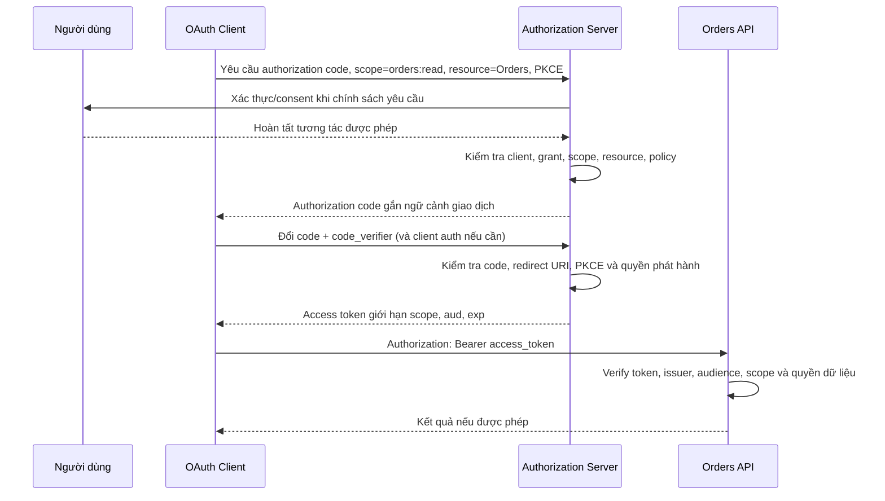
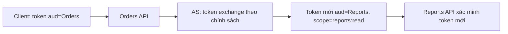
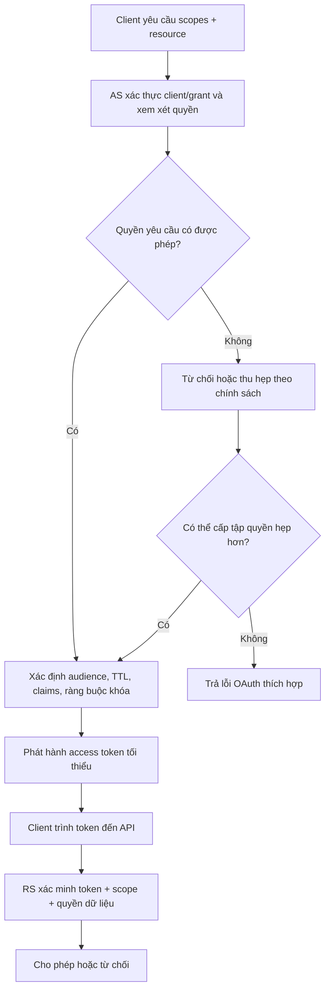

# Cấp token tối thiểu theo yêu cầu

## 1. Bài toán: client xin quyền rộng hơn mức cần dùng

Một ứng dụng quản lý đơn hàng chỉ cần **đọc danh sách đơn hàng** để hiển thị trang tổng quan. Tuy nhiên, khi xin access token, client gửi:

```text
scope=orders:read orders:write payments:refund users:admin
```

Nếu authorization server (AS) cấp nguyên mọi quyền trên mà không kiểm tra, ứng dụng sẽ nhận quyền **sửa đơn, hoàn tiền và quản trị người dùng** dù tính năng hiện tại không cần. Khi token rò rỉ hoặc client bị khai thác, phạm vi thiệt hại tăng rất lớn.

Nguyên tắc **cấp token tối thiểu theo yêu cầu** (*least-privilege token issuance*) là: **mỗi token chỉ nên có quyền hạn, tài nguyên đích, thời gian tồn tại và dữ liệu định danh cần thiết cho mục đích được phép**. Việc client yêu cầu một quyền không có nghĩa AS phải cấp quyền đó.

> **Nguyên tắc cốt lõi:** Quyền trong token là **kết quả quyết định của bên cấp phát**, không phải bản sao mù quáng của tham số do client gửi. AS phải xét đồng thời **client, người dùng hoặc workload, grant, chính sách, tài nguyên đích và sự cho phép hợp lệ** trước khi cấp token.

Bài thuộc chương **Token issuance** trong module `SECURITY_TOKEN_SECURITY_FUNDAMENTALS`. Nội dung tập trung vào quá trình **phát hành có giới hạn** trong OAuth 2.0/OIDC, liên hệ với JWT và opaque token, access/refresh token, claims, scope, audience, lưu trữ, thu hồi và phòng chống token bị đánh cắp hoặc phát lại.

### Mục tiêu học tập

Sau bài này, bạn có thể:

- Giải thích vì sao **ít quyền** phải được áp dụng **ngay khi cấp token**, không chỉ khi API nhận token.
- Phân biệt quyền **client yêu cầu**, quyền **client được đăng ký sử dụng**, quyền **chủ thể có**, quyền **người dùng cho phép** và quyền **AS thực sự cấp**.
- Thiết kế access token giới hạn theo **scope, resource/audience, chủ thể, ngữ cảnh, thời hạn và dữ liệu claims**.
- Biết khi nào nên hoặc không nên cấp refresh token, ID token và token dùng chung cho nhiều APIs.
- Hiểu cách dùng Resource Indicators, Rich Authorization Requests, token exchange và sender-constrained tokens khi phù hợp.
- Viết được luồng cấp phát mẫu, nhận ra lỗi cấu hình và xây dựng bộ kiểm thử cho authorization server.

## 2. “Tối thiểu” gồm những chiều nào?

Không chỉ có `scope`. Một token “ít quyền” cần xét nhiều ranh giới:

| Chiều giới hạn | Câu hỏi khi cấp phát | Ví dụ an toàn hơn |
| --- | --- | --- |
| **Hành động** (*scope/permission*) | Client cần đọc, ghi hay quản trị? | `orders:read` thay vì `orders:*` |
| **Resource/audience** | Token dành cho API nào? | Orders API, không tự thêm Payments API |
| **Chủ thể và client** | Ai đang đại diện cho ai; client nào nhận token? | Token cho workload báo cáo, không phải user quản trị |
| **Đối tượng dữ liệu** | Quyền áp dụng tài nguyên, tenant hay giao dịch nào? | Chỉ cho đơn hàng thuộc tenant hiện tại, bằng policy hiện hành |
| **Thời gian** | Quyền cần tồn tại bao lâu? | Access token vài phút theo rủi ro thay vì nhiều ngày |
| **Dữ liệu claims** | RS cần biết thông tin gì để quyết định? | `sub` và `scope`, không nhúng cả hồ sơ cá nhân |
| **Khả năng sử dụng lại** | Chỉ bearer, hay cần bằng chứng sở hữu khóa? | DPoP/mTLS cho ranh giới rủi ro cao khi hệ thống hỗ trợ |
| **Khả năng làm mới** | Client có thực sự cần duy trì truy cập lâu dài? | Không cấp refresh token nếu không cần phiên dài |

Một access token chỉ có `orders:read` nhưng `aud` bao gồm **mọi API**, sống một tháng và chứa quá nhiều dữ liệu cá nhân **chưa thể coi là tối thiểu**.

Ngược lại, một token đúng audience và sống ngắn nhưng có `payments:refund` không cần thiết cũng gây rủi ro. Các giới hạn phải đi cùng nhau.

### 2.1. Tối thiểu ở thời điểm phát hành không thay thế phân quyền ở API

Một token có scope `orders:read` **không tự cho phép** đọc mọi đơn hàng. Orders API vẫn phải xác minh access token, `iss`, `aud`, thời hạn, loại token, scope và **quyền truy cập bản ghi cụ thể**.

Có thể hình dung:

```text
Quyền có hiệu lực trên request
    = giới hạn quyền AS đã cấp qua token
    ∩ chính sách API
    ∩ quyền hiện hành của chủ thể/client
    ∩ ràng buộc trên tài nguyên cụ thể
```

Đây là **mô hình khái niệm**, không phải một phép giao tập hợp bắt buộc trong mọi hệ thống ABAC/RBAC. Thực tế có các điều kiện động như tenant, trạng thái đơn hàng, hạn mức, thời gian, ngữ cảnh giao dịch và phân tách nhiệm vụ.

**AS không nên dự đoán toàn bộ quyền trên dữ liệu sẽ tồn tại trong suốt tuổi thọ token.** Claim quyền có thể trở nên cũ khi người dùng bị gỡ vai trò; API phải kiểm tra trạng thái hiện hành nếu nghiệp vụ cần.

## 3. Phân biệt “được yêu cầu”, “được phép” và “được cấp”

Giả sử một web client gửi:

```text
requested_scopes = {orders:read, orders:write, payments:refund}
```

Quyết định cấp token cần xét các yếu tố:

1. **Client registration và chính sách client:** Client này có được phép yêu cầu các scope/resource đó không?
2. **Grant và luồng:** Grant đang dùng có phù hợp với loại client, chủ thể và quyền được yêu cầu không?
3. **Chủ thể:** User/workload hiện có những quyền nào theo chính sách?
4. **Sự cho phép hợp lệ:** Với luồng cần consent hoặc ủy quyền từ resource owner, quyền nào đã được chấp thuận?
5. **Resource server:** API đích hỗ trợ những scope và cách giới hạn nào?
6. **Rủi ro và ngữ cảnh:** Cần MFA/step-up, approval hoặc từ chối quyền nhạy cảm không?
7. **Chính sách phát hành:** Có cần token riêng, thời hạn ngắn hơn, ràng buộc thiết bị/khóa hay giới hạn phiên không?

Một cách viết giản lược:

```text
requested ⊆ request do client đề nghị
granted = tập quyền mà AS quyết định cho phép theo tất cả điều kiện
granted không được vượt quyền được chính sách cho phép
```

Trong mô hình scope dạng tập đơn giản, có thể nghĩ đến:

```text
grantedScopes =
    requestedScopes
    ∩ clientAllowedScopes
    ∩ subjectAllowedScopes      # nếu ngữ cảnh có user
    ∩ approvedScopes            # khi cần sự cho phép
    ∩ resourceSupportedScopes
    ∩ issuancePolicyScopes
```

**Cảnh báo:** Đây là cách minh họa tư duy *least privilege*, không phải thuật toán bắt buộc của OAuth 2.0. Một số grant không có user hoặc consent; có thể có quy tắc phụ thuộc giữa scopes, conditional grant, policy ABAC, quyền động và default scopes. AS phải xử lý theo hợp đồng của mình, không đơn giản giao các chuỗi nếu chính sách nghiệp vụ phức tạp.

### 3.1. Khi quyền yêu cầu không thể được cấp

AS có các lựa chọn tùy loại request và policy:

- **Từ chối** yêu cầu không hợp lệ/không được phép, chẳng hạn qua `invalid_scope` trong ngữ cảnh token endpoint phù hợp.
- **Cấp tập scope hẹp hơn** khi profile/luồng và chính sách cho phép, đồng thời thông báo rõ quyền đã được cấp.
- **Yêu cầu tương tác hoặc xác thực bổ sung** khi chính sách đòi hỏi trước khi cấp quyền nhạy cảm.
- **Yêu cầu một luồng ủy quyền mới** nếu client cần quyền rộng hơn sau này.

Theo OAuth 2.0 (RFC 6749), nếu access token response có scope **khác scope đã yêu cầu**, trường `scope` trong phản hồi là **bắt buộc** để client biết phạm vi quyền thực nhận. Client không được suy đoán rằng “đã xin thì chắc chắn đã được cấp”.

## 4. Scope tối thiểu: không xin quyền “để dành”

### 4.1. Scope mô tả phạm vi, không phải hồ sơ toàn quyền

Scope trong OAuth 2.0 là chuỗi định danh phạm vi truy cập; khi có nhiều giá trị, chúng thường được biểu diễn bằng **danh sách phân tách bởi dấu cách** theo RFC 6749. Ví dụ:

```text
orders:read
orders:write
payments:refund
reports:export
```

Tên scope là **quy ước** giữa AS và hệ thống APIs, không phải từ khóa chuẩn buộc mọi nhà cung cấp có cùng nghĩa. Chính sách cần mô tả rõ scope cho phép hành động gì và **không** cho phép hành động gì.

| Tính năng | Scope đề nghị | Không nên tự xin |
| --- | --- | --- |
| Trang danh sách đơn hàng | `orders:read` | `orders:write`, `payments:refund` |
| Công cụ chỉnh trạng thái đơn | `orders:write` cùng điều kiện khác nếu cần | `users:admin` |
| Báo cáo doanh thu chỉ đọc | `reports:read` hoặc scope theo API | `reports:export` khi chưa cần xuất |
| Hoàn tiền có phê duyệt | `payments:refund`, kèm chính sách giao dịch | `payments:*` |
| Ứng dụng kiểm tra trạng thái dịch vụ | Scope đọc trạng thái hoặc token nội bộ chuyên dụng | Scope quản trị toàn hệ thống |

Một scope tên `admin` hoặc `*` có thể tồn tại trong hệ thống, nhưng nên được giới hạn đặc biệt, không làm default cho mọi client. **Không đồng nghĩa scope dài hơn là luôn ít quyền hơn**: chính xác là quyền/điều kiện mà scope đại diện.

### 4.2. Incremental authorization

Thay vì xin tất cả quyền ngay khi đăng nhập:

1. Client yêu cầu **scope cơ bản** cho tính năng đầu tiên.
2. Khi người dùng muốn sử dụng một tính năng mới, client yêu cầu **quyền bổ sung** theo luồng AS hỗ trợ.
3. AS kiểm tra chính sách và consent/step-up nếu cần.
4. Client chỉ sử dụng token đã được cấp cho tính năng đó; có thể giữ token/resource riêng tùy thiết kế.

Ví dụ người dùng chỉ xem đơn hàng không nên phải chấp thuận quyền hoàn tiền. Khi thực sự mở chức năng hoàn tiền, đó mới là lúc yêu cầu quyền cao hơn và có thể xác thực tăng cường.

**Không mọi nhà cung cấp OAuth đều hỗ trợ incremental authorization giống nhau.** Cần kiểm tra đặc tả/contract của nhà cung cấp; không tự gọi lại token endpoint với scope rộng hơn rồi giả định được chấp nhận.

### 4.3. Scope không phải toàn bộ chính sách giao dịch

Ngay cả access token có `payments:refund`, Payments API vẫn cần kiểm tra:

- Hóa đơn/giao dịch có tồn tại và thuộc phạm vi mà người dùng được phép thao tác?
- Số tiền hoàn có vượt hạn mức hoặc yêu cầu duyệt hai người không?
- Giao dịch đã được hoàn trước đó hoặc đang có tranh chấp không?
- Người dùng có còn quyền tại thời điểm thao tác không?

Các ràng buộc này thường nằm ở **policy engine/nghiệp vụ**, không thể thay bằng một scope chung ở thời điểm cấp token.

## 5. Giới hạn audience/resource ngay khi cấp access token

Một AS có thể phục vụ hàng chục resource servers. Access token dùng ở Orders API **không nên tự động hợp lệ ở Payments API**.

### 5.1. Yêu cầu resource theo RFC 8707

**Resource Indicators for OAuth 2.0** (RFC 8707) cho phép client chỉ ra resource mà nó muốn truy cập bằng tham số `resource` khi luồng hỗ trợ. Ví dụ token request trong grant `client_credentials`:

```http
POST /token HTTP/1.1
Host: auth.example.com
Authorization: Basic <client_authentication_example>
Content-Type: application/x-www-form-urlencoded

grant_type=client_credentials&resource=https%3A%2F%2Forders-api.example.com&scope=orders%3Aread
```

Client authentication ở đây chỉ minh họa: thực tế AS xác thực confidential client bằng cơ chế phù hợp và được đăng ký. **Tham số `resource` là đề nghị của client**, không phải quyền ép AS phát hành token cho tài nguyên tùy ý.

AS cần kiểm tra resource này:

- Có được AS biết đến và cấp token cho nó không?
- Client có được phép truy cập resource này không?
- Grant, chủ thể và scope có phù hợp resource không?
- Audience của token mới phải là gì theo hợp đồng của AS và RS?

Ví dụ JWT access token được cấp có thể chứa:

```json
{
  "iss": "https://auth.example.com",
  "sub": "reporting-service",
  "aud": "https://orders-api.example.com",
  "iat": 1900000000,
  "exp": 1900000300,
  "scope": "orders:read"
}
```

Payload chỉ minh họa, **chưa phải JWT hoàn chỉnh đã ký**. Trong các hệ thống dùng tên logic thay URL, mapping `resource` → `aud` có thể được định nghĩa khác; không giả định URI trong request luôn được sao chép vào token.

### 5.2. Một resource thay vì nhiều resources

Giả sử client muốn dùng cả Orders API và Payments API. Có hai thiết kế:

| Thiết kế | Đánh đổi | Khi nên cân nhắc |
| --- | --- | --- |
| **Token riêng cho mỗi API** | Thêm việc xin/quản lý token, nhưng ranh giới rõ | Thường ưu tiên khi APIs có quyền và rủi ro khác nhau |
| **Token nhiều audiences** | Thuận tiện chuyển giữa APIs nhưng mở rộng nơi token lộ có thể dùng | Chỉ khi policy AS/RS cho phép và thật sự có lý do |

Thực hành thường hữu ích là **mỗi access token nhắm vào một resource hoặc một nhóm tài nguyên có cùng ranh giới tin cậy đã xác định**. Không tự thêm mọi audience chỉ vì các API dùng chung issuer.

**Audience không thay scope**: token chỉ có `aud=Orders` nhưng chứa `orders:write` không cần thiết vẫn nguy hiểm. Ngược lại, token có `orders:read` nhưng `aud=Payments` phải bị Orders API từ chối.

## 6. Thời hạn hiệu lực tối thiểu

Một token sống càng lâu, cơ hội bị sử dụng sau khi lộ hoặc sau khi quyền thay đổi càng lớn. Vì thế AS cần chọn thời hạn theo **rủi ro và nhu cầu sử dụng**, không mặc định phát token dài hạn.

| Loại credential | Hướng tiếp cận thời gian | Rủi ro cần kiểm soát |
| --- | --- | --- |
| **Access token** | Thường sống ngắn; thời gian theo ứng dụng/API/rủi ro | Token bị đánh cắp tiếp tục dùng cho đến khi không còn được chấp nhận |
| **Refresh token** | Chính sách dài hạn/idle/absolute expiry và rotation hoặc sender-constraining phù hợp | Bị đánh cắp để xin nhiều access tokens |
| **Authorization code** | Sống ngắn và dùng một lần theo OAuth | Bị chặn và đổi trái phép nếu thiếu ràng buộc |
| **ID token** | Thời hạn phù hợp kết quả xác thực; chỉ dùng ở OIDC client | Nhầm ID token với access token; tin claims đã cũ |
| **Session cookie** | TTL/idle timeout và rotation phù hợp | Chiếm phiên trình duyệt hoặc thiết bị |

Không có một TTL cố định được bảo đảm an toàn cho tất cả hệ thống. Ví dụ nội bộ có thể chọn **5–15 phút cho access token** rủi ro cao, nhưng đây chỉ là khoảng minh họa để thiết kế, **không phải yêu cầu chung của OAuth**. Quyết định thực tế phụ thuộc yêu cầu nghiệp vụ, rủi ro và khả năng thu hồi.

### 6.1. Chọn thời hạn tại AS

AS có thể tính thời hạn token theo ràng buộc chặt nhất:

```text
accessTokenTTL = min(
    policyMaximumTTL,
    clientMaximumTTL,
    resourceMaximumTTL,
    grantRemainingLifetime,
    riskAdjustedTTL
)
```

Đây là **công thức tư duy**. Một số ràng buộc như thời hạn grant, phiên hoặc consent không được mọi nhà cung cấp biểu diễn bằng số giây; AS phải thực thi đúng logic riêng.

Ví dụ:

- Reporting service cần đọc Orders API vài phút → cấp access token 5 phút.
- Token hoàn tiền có tác động tài chính → có thể yêu cầu thời hạn ngắn hơn, PoP hoặc xác thực tăng cường.
- Client dùng access token cũ trong thời gian dài → AS không nên kéo dài `exp` chỉ vì client đang hoạt động.

Dù `exp` còn hạn, **quyền hiện hành có thể đã thay đổi**. Đối với thao tác nhạy cảm, API vẫn cần kiểm tra trạng thái account/quyền hiện hành hoặc dùng cơ chế thu hồi bổ sung.

## 7. Phát hành claims tối thiểu: ít dữ liệu nhưng đủ xác minh

Một JWT access token thường chứa một số claims mà resource server cần kiểm tra. Ví dụ:

```json
{
  "iss": "https://auth.example.com",
  "sub": "user-123",
  "aud": "https://orders-api.example.com",
  "iat": 1900000000,
  "exp": 1900000300,
  "scope": "orders:read"
}
```

Theo **JWT Profile for OAuth 2.0 Access Tokens** (RFC 9068), AS và RS phải tuân thủ các claims và profile bắt buộc tương ứng; ví dụ trên chỉ nhằm nhấn mạnh tính tối thiểu của dữ liệu và **không phải mẫu JWT RFC 9068 đầy đủ**.

Các trường có thể **không cần** ở Orders API:

```json
{
  "email": "user@example.com",
  "phone_number": "+84...",
  "home_address": "...",
  "full_profile": "...",
  "all_groups": ["..."],
  "admin_notes": "..."
}
```

Một JWT dạng JWS thường **có thể bị giải mã để đọc payload**, dù chữ ký bảo vệ tính toàn vẹn. Đừng nhúng thông tin cá nhân, thuộc tính nội bộ hay bí mật chỉ vì client “có thể cần sau này”.

### 7.1. Định danh tối thiểu và ổn định

- `sub` theo issuer thường phù hợp để định danh chủ thể trong ngữ cảnh tin cậy; cần phân biệt người dùng với workload/client.
- Email, số điện thoại và tên hiển thị có thể **thay đổi**, không nên tự dùng làm định danh phân quyền bất biến.
- Với hệ thống nhiều issuer, kết hợp ngữ cảnh `iss` và `sub` khi ánh xạ chủ thể.
- Với multi-tenant, chỉ thêm claim tenant nếu resource server cần và chính sách cấp phát định nghĩa rõ. API vẫn phải kiểm tra membership/quyền trên tài nguyên.
- Giảm tối đa số lượng nhóm/role trong token để tránh token quá lớn, lỗi header và thông tin phân quyền trở nên cũ.

### 7.2. JWT hay opaque token?

| Dạng | Lợi ích | Điều cần chú ý khi cấp |
| --- | --- | --- |
| **JWT access token** | RS có thể xác minh cục bộ; ít round-trip introspection | Không nhúng dữ liệu nhạy cảm; claims đã phát hành không tự cập nhật; kiểm tra issuer/audience/expiry |
| **Opaque access token** | RS dùng tra cứu/introspection để lấy metadata theo hợp đồng | Phải bảo vệ handle, hạn dùng và trạng thái; độ mới phụ thuộc AS/cache |
| **Sender-constrained access token** | Token gắn khóa/chứng chỉ, hạn chế sử dụng nếu chỉ lộ chuỗi token | Cần hỗ trợ và kiểm tra DPoP/mTLS ở AS, client và RS |

JWT hay opaque là lựa chọn **định dạng**, không thay thế quyết định cấp **ít quyền**. Một opaque token có quyền quá rộng cũng nguy hiểm; một JWT có ít quyền và tuổi thọ phù hợp có thể đáp ứng nhiều nhu cầu.

## 8. Hạn chế cấp refresh token và quyền truy cập lâu dài

**Access token** dùng để gọi API. **Refresh token** dùng để xin access token mới tại token endpoint, **không** gửi tới Orders API hay Payments API.

Việc cấp refresh token mở thêm khả năng **duy trì truy cập** sau khi access token hết hạn. Vì thế AS cần tự hỏi:

1. Client có thực sự cần dùng khi người dùng không còn tương tác không?
2. Grant/loại client có được phép nhận refresh token không?
3. Người dùng đã cho phép phạm vi offline/long-lived access khi policy yêu cầu chưa?
4. AS có ràng buộc refresh token với client, grant, scope và resources đã được cấp không?
5. Có **rotation** hoặc **sender-constraining** phù hợp, đặc biệt đối với public client?
6. Có idle timeout, absolute lifetime, thu hồi, phát hiện reuse và xử lý mất thiết bị không?

Theo **OAuth 2.0 Security Best Current Practice (RFC 9700)**, refresh token dành cho **public clients** phải có cơ chế phát hiện replay phù hợp, chẳng hạn **refresh token rotation hoặc sender-constraining**. Không nên coi việc lưu token trong ứng dụng là đủ để loại trừ rủi ro bị sao chép.

### 8.1. `offline_access` trong OIDC không phải quyền tự động

OIDC định nghĩa scope `offline_access` để yêu cầu truy cập có thể tiếp tục khi người dùng không có mặt, cùng các quy tắc consent và cấp refresh token. Client yêu cầu `offline_access` **không buộc AS cấp refresh token**.

Nếu một ứng dụng chỉ đọc đơn trong phiên người dùng đang hoạt động, việc xin `offline_access` ngay từ đầu có thể không cần thiết. AS cần áp dụng loại client, luồng, consent và policy chứ không cấp refresh token một cách mặc định.

### 8.2. Refresh không được nâng quyền

Khi client làm mới token, AS phải đảm bảo access token mới không vượt quá phạm vi mà refresh token/grant và chính sách hiện tại cho phép.

Ví dụ:

```text
Refresh token ban đầu được cấp cho:
    audience = Orders API
    scopes   = orders:read

Client yêu cầu refresh thành:
    audience = Orders + Payments
    scopes   = orders:read payments:refund

Kết quả an toàn:
    Từ chối việc mở rộng trái phép;
    không biến refresh thành một grant mới có quyền cao hơn.
```

Tùy nhà cung cấp, việc refresh có thể được yêu cầu **thu hẹp** scopes/resources, nhưng không được tự mở rộng vượt giới hạn đã cấp. Với scope giảm hoặc thay đổi vai trò, AS cần kiểm tra chính sách quyền hiện hành trước khi phát access token mới nếu contract yêu cầu.

**Thu hồi refresh token không tự làm mọi access token JWT đã cấp mất hiệu lực ngay**. AS/RS cần cơ chế thích hợp để chặn access token còn hạn khi cần ngắt quyền sớm.

## 9. Luồng Authorization Code + PKCE: chỉ cấp những gì đã được ủy quyền

Đối với ứng dụng web/mobile sử dụng OAuth 2.0 với người dùng, **Authorization Code + PKCE** là một luồng phổ biến. PKCE giảm rủi ro authorization code bị chặn rồi đổi trái phép, nhưng **không tự bảo đảm scope/audience ít quyền**. AS vẫn phải quyết định quyền được cấp.



Ví dụ authorization request minh họa:

```http
GET /authorize?response_type=code&client_id=orders-portal&redirect_uri=https%3A%2F%2Fclient.example.com%2Fcallback&scope=openid%20orders%3Aread&resource=https%3A%2F%2Forders-api.example.com&state=<state>&code_challenge=<pkce_challenge>&code_challenge_method=S256 HTTP/1.1
Host: auth.example.com
```

Các chuỗi `<...>` là placeholder, không phải code/challenge thật. Khi triển khai cần dùng bộ mã hóa URL/form đúng chuẩn, sinh `state` và PKCE verifier an toàn, xác minh redirect URI và áp dụng yêu cầu OIDC nếu scope có `openid`.

**Scope `openid` có mục đích OIDC**; nó không đồng nghĩa API được cấp quyền đọc/ghi dữ liệu. Nếu có ID token, client phải xác minh ID token riêng; resource server vẫn chỉ nhận access token phù hợp.

### 9.1. Khi user từ chối hoặc policy không cho phép

Nếu người dùng không đồng ý cho phép quyền nhạy cảm, AS phải phản ánh trạng thái qua **luồng lỗi OAuth hợp lệ** thay vì âm thầm cấp quyền hoặc bỏ qua sự từ chối. Việc có bắt buộc hiển thị màn consent cho mỗi request không do scope tự quyết định: còn phụ thuộc pháp lý, chính sách, tính chất client và grant.

## 10. Client credentials: không có người dùng để “xin hộ”

Luồng `client_credentials` thường dành cho confidential client hoặc workload khi client hành động theo quyền của **chính ứng dụng**. Không có bước người dùng đăng nhập trong grant này.

Ví dụ báo cáo nội bộ chỉ đọc đơn hàng:

```http
POST /token HTTP/1.1
Host: auth.example.com
Authorization: Basic <registered_client_authentication>
Content-Type: application/x-www-form-urlencoded

grant_type=client_credentials&scope=orders%3Aread&resource=https%3A%2F%2Forders-api.example.com
```

AS phải:

- Xác thực client theo phương thức đã đăng ký và được cho phép.
- Kiểm tra client có được dùng grant `client_credentials` không.
- Chỉ cấp scopes và resources mà client đã được phép sử dụng.
- Đặt lifetime và constraints tương ứng workload/API.
- Không giả lập `sub` là người dùng thật nếu token đại diện cho service.

Client credentials **thường không cần refresh token**; client có thể xác thực lại với AS để xin access token mới. Không tự cấp refresh token dài hạn nếu không có nhu cầu và chính sách rõ ràng.

Nếu một workload cần gọi Orders rồi Payments, hãy cân nhắc **hai access tokens riêng audience**, thay vì phát một token có toàn bộ quyền cho mọi backend.

## 11. Rich Authorization Requests: giới hạn theo chi tiết giao dịch

Scope kiểu `payments:refund` có thể vẫn quá rộng. **Rich Authorization Requests (RAR, RFC 9396)** định nghĩa tham số `authorization_details` để mô tả yêu cầu ủy quyền có cấu trúc hơn, khi AS/RS hỗ trợ.

Ví dụ khái niệm về một quyền hoàn tiền giới hạn:

```json
{
  "authorization_details": [
    {
      "type": "payment_refund",
      "actions": ["refund"],
      "locations": ["https://payments-api.example.com"],
      "transaction_id": "payment-456",
      "max_amount": "250000",
      "currency": "VND"
    }
  ]
}
```

**Đây là profile ứng dụng minh họa**, không phải tập trường được RAR chuẩn hóa cho mọi nhà cung cấp. RFC 9396 định nghĩa cấu trúc chung; ý nghĩa `type`, `actions`, `locations` và các thuộc tính mở rộng phải được **AS/RS thỏa thuận và thực thi**. Trường `max_amount` do client yêu cầu phải được AS kiểm tra; không được coi yêu cầu tự khai là quyền đã cấp.

Lợi ích của mô hình này là diễn đạt *“Cho phép hoàn tối đa số tiền X cho giao dịch Y”* thay vì chỉ *“Có quyền hoàn tiền nói chung”*. Nhưng để an toàn cần:

- AS xác thực/ủy quyền chi tiết được yêu cầu.
- Resource server kiểm tra **đúng quyết định được cấp**, tính toàn vẹn metadata và trạng thái giao dịch.
- Không chấp nhận giá trị client tự sửa trong request nghiệp vụ.
- Cân nhắc tính mới của quyền, hạn dùng và chống thực hiện lặp giao dịch.

Scope vẫn hữu ích cho các thao tác chung; RAR là **công cụ bổ sung**, không thay thế kiểm tra audience, issuer hay quyền trên dữ liệu.

## 12. Downscoping và token exchange giữa các dịch vụ

Giả sử Orders API nhận access token từ client để đọc đơn, sau đó cần gọi Reports API lấy báo cáo. **Không mặc định** chuyển tiếp nguyên token có `aud=Orders` tới Reports API.

Nếu AS hỗ trợ **OAuth 2.0 Token Exchange (RFC 8693)**, một dịch vụ có thể trình token hợp lệ theo chính sách để yêu cầu token mới phù hợp với API downstream.



Các điều kiện quan trọng:

- Token exchange là **một yêu cầu tới AS**, không phải quyền tự sửa JWT hoặc tự chép `scope`.
- AS kiểm tra client/actor, subject token, grant, target resource/audience và chính sách delegation.
- Token mới không được cấp quyền ngoài những gì chính sách cho phép; mục tiêu có thể là **thu hẹp** hành động hoặc tách ranh giới tài nguyên.
- Quyền “on behalf of” cần giữ ngữ nghĩa người dùng/actor đúng theo profile; không đồng nhất token workload với quyền người dùng.
- Token downstream có TTL, audience và scope riêng; RS downstream phải xác minh độc lập.

Không phải hệ thống nào cũng cần token exchange. Đối với service-to-service đơn giản, dùng **client credentials** của dịch vụ đích có thể phù hợp hơn, tùy yêu cầu giữ ngữ cảnh user.

## 13. Bearer, DPoP và mTLS: giảm thiệt hại khi token bị lộ

Ít quyền hạn giúp giảm **phạm vi** bị lạm dụng, nhưng bearer token bị lộ vẫn có thể sử dụng được trước khi hết hạn/thu hồi.

Trong hệ thống hỗ trợ, AS có thể cấp **sender-constrained access token**:

| Cơ chế | Ý tưởng | Trách nhiệm đi kèm |
| --- | --- | --- |
| Bearer | Có chuỗi token thì có thể trình token | Bảo vệ kênh/lưu trữ, TTL ngắn, audience/scope, thu hồi |
| **DPoP** (RFC 9449) | Token được ràng buộc với public key; client ký proof HTTP bằng private key | AS phải bind khóa; RS kiểm tra proof, `cnf.jkt`, `htm`, `htu`, `ath`, `iat`, `jti` và nonce theo profile |
| **mTLS-bound** (RFC 8705) | Token gắn thumbprint chứng chỉ client | RS/gateway kiểm tra chứng chỉ TLS thực tế khớp binding token |

Sender-constraining giảm rủi ro **chỉ bị sao chép giá trị token**. Nó không thay thế quyền ít nhất, không ngăn hoàn toàn malware điều khiển client hợp lệ và không tự giải quyết claims stale hoặc quyền trên bản ghi.

AS cần lựa chọn profile dựa trên **khả năng của client, resource server, gateway và chính sách**, không phát token “có ràng buộc” trong payload nhưng để API nhận như Bearer không kiểm tra proof.

## 14. Thiết kế chính sách cấp phát tại authorization server

Một chính sách khái niệm:

```yaml
clients:
  orders-portal:
    allowed_grants: ["authorization_code"]
    allowed_resources:
      - "https://orders-api.example.com"
    allowed_scopes:
      - "openid"
      - "orders:read"
      - "orders:write"
    default_scopes:
      - "openid"
      - "orders:read"
    max_access_token_ttl_seconds: 600
    refresh_token:
      enabled: false

  reporting-service:
    allowed_grants: ["client_credentials"]
    allowed_resources:
      - "https://orders-api.example.com"
    allowed_scopes:
      - "orders:read"
    max_access_token_ttl_seconds: 300
    refresh_token:
      enabled: false
```

Đây là YAML **mô tả chính sách giả định**, không phải cấu hình được công nhận bởi một framework/authorization server cụ thể. Các server thực tế có cách đăng ký client, consent, policy và resource khác nhau. Không lấy tên client/permissions trong request chưa xác thực rồi coi đó là cấu hình tin cậy.

### 14.1. Pseudo-code của quyết định cấp token

```text
function issueAccessToken(validatedTokenRequest):
    # Các thành phần đầu vào phải do AS xác thực/kiểm tra.
    client = authenticateOrValidateClientAsRequired(validatedTokenRequest)
    grant  = validateGrantAndBinding(validatedTokenRequest, client)

    if grant.type not in client.allowedGrantTypes:
        reject("unauthorized_client")

    requestedScopes = parseAndValidateScopes(validatedTokenRequest.scope)
    targetResource  = resolveAndValidateResource(validatedTokenRequest.resource)

    if targetResource not in client.allowedResources:
        rejectAccordingToOAuthProfile()

    # Áp dụng default/consent/user/workload/policy theo grant thực tế.
    granted = evaluateAuthorizationPolicy(
        client = client,
        grant = grant,
        subject = grant.authorizedSubject,
        resource = targetResource,
        requestedScopes = requestedScopes,
        currentPermissions = trustedPermissionSource(),
        approvedPermissions = grant.approvalContext
    )

    if granted.denied or granted.scopes.isEmptyWhenNotAllowed:
        rejectAccordingToOAuthProfile()

    ttl = chooseBoundedAccessTokenLifetime(
        client, grant, targetResource, granted, riskContext()
    )

    token = buildAndProtectAccessToken(
        issuer = TRUSTED_ISSUER,
        subject = granted.subject,
        audience = targetResource.configuredAudience,
        scopes = granted.scopes,
        issuedAt = now(),
        expiresAt = now() + ttl,
        minimalClaims = granted.requiredClaims,
        senderConstraint = evaluateAndBindPoPIfRequired()
    )

    recordAuditableIssuanceWithoutSecrets(client, grant, token.metadata)
    return oauthTokenResponse(
        accessToken = token.value,
        expiresIn = ttl,
        scope = granted.scopes,   # đặc biệt bắt buộc nếu khác scope yêu cầu
        tokenType = token.scheme
    )
```

Đây là **pseudo-code học thuật**, không đủ để đưa vào production. Nó lược bỏ nhiều bước bảo mật và tính đúng đắn: xác thực client, PKCE, redirect URI, state/nonce ở đúng thành phần, consent, chống replay, bảo vệ grant, lưu khóa, xử lý giao dịch, JSON/JWT profile, định dạng phản hồi và trạng thái thu hồi.

Tính thời gian nên lấy **một mốc đáng tin** khi tạo `iat`/`exp` và không để sai lệch đồng hồ kéo dài token không cần thiết. Áp dụng quy định thuật toán khóa/JWKS với thư viện bảo mật có kiểm chứng.

### 14.2. Default scope cần nhỏ và rõ

Nếu client **không truyền `scope`**, RFC 6749 cho phép AS xử lý theo scope mặc định đã định nghĩa hoặc từ chối theo chính sách. Không nên chọn mặc định `*` hoặc `admin`.

Một default phù hợp cần:

- Được đăng ký rõ theo client/grant.
- Không tự thêm resource nguy hiểm.
- Không bao gồm quyền khó thu hồi khi không cần.
- Được kiểm thử cho cả yêu cầu có scope và thiếu scope.

## 15. Ví dụ end-to-end: yêu cầu nhiều, cấp ít

Ứng dụng `orders-portal` chỉ được phép đọc đơn tại Orders API trong màn tổng quan.

### 15.1. Client yêu cầu quyền rộng

```text
Client: orders-portal
Resource: https://orders-api.example.com
Requested scopes:
    orders:read
    orders:write
    payments:refund
```

Chính sách AS:

```text
Registered client allowed scopes:
    orders:read
    orders:write

User current permissions:
    orders:read

Approval/context:
    chỉ dùng màn xem danh sách, không có phê duyệt ghi
```

AS có thể **từ chối yêu cầu** hoặc **cấp phạm vi ít hơn** theo policy; giả sử trường hợp này profile cho phép thu hẹp.

### 15.2. AS cấp token chỉ có `orders:read`

Ví dụ token response:

```http
HTTP/1.1 200 OK
Content-Type: application/json
Cache-Control: no-store
Pragma: no-cache

{
  "access_token": "<signed_or_opaque_access_token>",
  "token_type": "Bearer",
  "expires_in": 300,
  "scope": "orders:read"
}
```

AS phải lưu/nhúng audience của Orders API và các ràng buộc tương ứng, dù access token có thể là opaque nên client không nhìn thấy claims. Vì scope **khác tập client đã yêu cầu**, response đã báo rõ `scope=orders:read`.

Client phải:

- Đọc giá trị `scope` thực nhận, không giả định quyền hoàn tiền đã được cấp.
- Chỉ dùng token với resource được cấp.
- Không tự chỉnh JWT/opaque token để thêm `orders:write`.
- Khi mở chức năng cần quyền cao hơn, đi qua luồng ủy quyền phù hợp.

Orders API vẫn phải xác minh `aud`, `iss`, thời hạn, scope, token type và quyền hiện hành trên đơn hàng cụ thể. **Cấp token tối thiểu và kiểm tra tại resource server là hai lớp bổ trợ, không thay thế nhau.**

### 15.3. Điều gì xảy ra khi quyền của user thay đổi?

Giả sử user có `orders:write` khi token cấp, sau đó bị thu hồi role. Claims trong JWT đã cấp **không tự thay đổi**.

Đối với thao tác ghi nhạy cảm, API cần kiểm tra quyền hiện hành hoặc trạng thái thu hồi theo chính sách. AS cũng cần kiểm tra nguồn quyền mới khi **cấp token tiếp theo**, kể cả qua refresh. **TTL ngắn giảm cửa sổ dùng token cũ**, nhưng không bảo đảm hiệu lực thu hồi tức thì.

## 16. Token issuance và quản lý vòng đời

“Cấp ít nhất” không kết thúc khi trả token. Cần quản lý cả **sau phát hành**:

1. **Phát hành:** giới hạn scope, resource, claims, lifetime và kiểu token.
2. **Phân phối:** chỉ trả credential qua kênh bảo mật; `Cache-Control: no-store` với token response theo yêu cầu giao thức.
3. **Lưu trữ:** client giữ token tại vị trí phù hợp threat model; không đưa vào URL, log, telemetry.
4. **Sử dụng:** resource server kiểm tra token và quyền theo từng request.
5. **Làm mới:** AS kiểm tra lại grant/client/chính sách và không mở rộng trái phép.
6. **Thu hồi/đăng xuất:** có cơ chế ngắt token/phiên phù hợp với mục tiêu thời gian.
7. **Giám sát:** phát hiện token bị dùng sai resource, scope bị từ chối bất thường, refresh reuse và hành vi có dấu hiệu bị đánh cắp.



Đối với ứng dụng trình duyệt, một kiến trúc **backend-for-frontend (BFF)** có thể giữ OAuth tokens phía backend và dùng session cookie phía trình duyệt để hạn chế token lộ qua JavaScript. Cấu trúc BFF không miễn trừ việc giới hạn scope, audience, session duration, CSRF, quyền trên tài nguyên và thu hồi.

## 17. Lỗi bảo mật thường gặp khi phát hành token

| Sai sót | Hậu quả | Cách khắc phục |
| --- | --- | --- |
| AS cấp nguyên mọi scope client gửi | Quyền ngoài nhu cầu hoặc vượt chính sách | Áp dụng allowlist client, grant, chủ thể và consent/policy |
| Default scope là `admin` hoặc `*` | Token ngay từ đầu quá quyền | Default nhỏ và định nghĩa rõ theo client |
| Cấp token dùng chung cho mọi API | Token bị lộ có thể thử ở nhiều dịch vụ | Giới hạn resource/audience, ưu tiên token chuyên dụng |
| Bỏ qua `resource` hoặc copy thẳng không xác minh | Client tác động sai audience/token có ranh giới mơ hồ | Validate resource và mapping theo AS/RS |
| Access token sống quá lâu | Token bị sao chép tiếp tục dùng sau khi lộ | TTL theo rủi ro, khả năng thu hồi và trạng thái |
| Cấp refresh token cho mọi client | Mở rộng khả năng duy trì truy cập trái phép | Chỉ cấp khi cần và đủ điều kiện; rotation/sender-constrain khi phù hợp |
| Refresh cấp scope rộng hơn grant gốc | Tự nâng quyền khi làm mới | Ràng buộc refresh vào scopes/resources/consent và chính sách |
| JWT nhúng toàn bộ hồ sơ user | Rò rỉ dữ liệu từ payload có thể đọc | Chỉ cấp claims tối thiểu cần thiết cho RS |
| Cấp token khi chưa xác thực/ủy quyền grant đúng | Code/grant bị lạm dụng | Kiểm tra client, PKCE/redirect URI/grant theo luồng |
| Coi consent đồng nghĩa mọi quyền hiện hành | Dùng quyền đã bị thu hồi | Kết hợp consent với quyền/chính sách hiện tại |
| Tin client tự khai tenant/role/amount | Cấp token với quyền dữ liệu giả | Rà soát qua nguồn server-side đáng tin |
| Bỏ validation ở resource server vì “AS đã cấp đúng” | Token sai audience hoặc đã hết hạn vẫn được dùng | RS xác minh độc lập token và quyền dữ liệu |
| Cấp DPoP/mTLS token nhưng RS bỏ proof | Sender-constraining mất tác dụng | Xác minh khóa/chứng chỉ đã ràng buộc khi dùng |
| Log access/refresh token để debug | Credential rò rỉ qua log | Ẩn token, dùng request ID và metadata tối thiểu |

## 18. Ma trận kiểm thử authorization server

Giả định `orders-portal` được đăng ký tại AS với Orders API và tối đa `orders:read`, `orders:write`. Phần quản trị tài chính thuộc client khác. Những ca sau cần kiểm thử **quyết định phát hành, response, metadata/token, và đường sử dụng tại API**.

| Tình huống | Kết quả mong đợi | Điều chứng minh |
| --- | --- | --- |
| Client yêu cầu `orders:read`, user được đọc | Cấp `orders:read`, đúng audience | Quyền tối thiểu cơ bản |
| Client xin `payments:refund` ngoài đăng ký | Từ chối hoặc không cấp quyền đó theo policy | Client không tự mở scope |
| User chỉ được đọc, client xin `orders:write` | Không cấp quyền ghi | Quyền user hiện hành giới hạn grant |
| Consent từ chối scope nhạy cảm | Không cấp quyền bị từ chối | Consent/policy được tuân thủ |
| Client bỏ `scope` | Default nhỏ hoặc từ chối theo policy | Không tự cấp scope rộng |
| Client yêu cầu resource Payments API | Không phát token cho resource không được phép | Giới hạn audience |
| Client có thể dùng hai APIs | Hai tokens riêng hoặc multi-audience có policy rõ | Kiểm soát bề mặt chấp nhận |
| Client yêu cầu TTL dài hơn policy | TTL không vượt mức AS cho phép | Cửa sổ hiệu lực bị giới hạn |
| Request thuộc tính profile không cần thiết | Token không tự nhúng thông tin thừa | Data minimization |
| Public client muốn refresh token nhưng thiếu chính sách bảo vệ | Không cấp hoặc bắt buộc biện pháp phù hợp | Không mặc định long-lived access |
| Refresh token chỉ được Orders API nhưng xin Payments API | Từ chối mở rộng trái phép | Refresh không làm tăng resource/scope |
| User bị khóa trước khi refresh | Từ chối cấp mới theo policy | Tính mới của quyền ở AS |
| Token có `aud=Orders` được trình tại Payments | Payments từ chối | RS thực thi audience |
| Access token đúng audience nhưng thiếu `orders:write` | API từ chối thao tác ghi | Không vượt scope đã cấp |
| Token sai issuer/chữ ký/hết hạn | API từ chối | Token issuance không thay validation |
| Token bị thu hồi trong cửa sổ còn hạn | RS xử lý theo cơ chế revocation đã cam kết | Mục tiêu ngắt quyền được kiểm chứng |
| Token sender-constrained nhưng thiếu proof | API từ chối | Không hạ cấp thành bearer |
| Nhiều yêu cầu refresh dùng cùng token đã rotation | Phản ứng theo chính sách reuse detection | Giảm replay refresh token |

### 18.1. Kiểm thử hành vi từ chối và trả scope đã cấp

Với token response hợp lệ bị **thu hẹp scope**, cần xác nhận:

- Trường `scope` phản ánh **chính xác** quyền thực được cấp nếu khác với request.
- Client không tiếp tục dùng chức năng đòi scope bị từ chối.
- API kiểm tra riêng scope thực nhận, không tin giao diện.
- Không có quyền nhạy cảm “ẩn” trong token, metadata introspection hoặc policy downstream.

Với yêu cầu bị từ chối, kiểm tra mã lỗi và điểm gửi theo OAuth 2.0. Không mặc định mọi lỗi đều là HTTP 401; ví dụ token endpoint có lỗi `invalid_scope` phù hợp có thể trả `400` theo RFC 6749. Lỗi `invalid_client` có quy tắc khác khi xác thực client thất bại.

## 19. Vận hành, giám sát và ứng phó sự cố

Chính sách cấp token cần được giám sát bằng những dữ liệu **không chứa bí mật**:

- Số token được cấp theo **client, grant type, resource, scope đã cấp, TTL band**.
- Tỷ lệ yêu cầu scope/resource bị từ chối hoặc thu hẹp bất thường.
- Phát hành token cho audience không thuộc cấu hình dự kiến.
- Tần suất làm mới, refresh token reuse, lỗi `invalid_grant` và thay đổi phiên.
- Các sự kiện nâng quyền/thu hồi role, thay đổi client registration và thời gian lan truyền thu hồi.
- So sánh phân phối scope trước/sau rollout chính sách để phát hiện token rộng hơn dự tính.

**Không ghi** toàn bộ `access_token`, `refresh_token`, ID token, client secret, authorization code, `Authorization` header hoặc claims cá nhân không cần thiết. Có thể dùng `requestId`, dấu thời gian, mã client/resource và quyết định policy đã được bảo vệ để điều tra.

Khi phát hiện token được cấp quá rộng:

1. Xác định client/grant/resource nào bị ảnh hưởng và khóa đường phát hành sai.
2. Hạn chế hoặc thu hồi các token/phiên liên quan theo khả năng kiến trúc.
3. Đánh giá token đã được sử dụng ở APIs nào, theo logs đã ẩn bí mật.
4. Sửa policy; đưa thêm kiểm thử regression cho scope/audience/TTL.
5. Xem xét ràng buộc PoP, giảm tuổi thọ và cải thiện kiểm tra quyền hiện hành để giảm tác động sự cố.

## 20. Checklist cấp token theo nguyên tắc ít quyền nhất

1. **Mục đích:** Client cần token để thực hiện chức năng cụ thể nào ngay lúc này?
2. **Client/grant:** Client đã được đăng ký, xác thực và được phép dùng grant này chưa?
3. **Subject/workload:** Quyền được cấp đang đại diện cho người dùng hay cho service?
4. **Scope:** Có scope nào không thật sự cần cho chức năng, hoặc vượt sự cho phép/chính sách không?
5. **Resource/audience:** Token có chỉ dành cho API/nhóm tài nguyên xác định không?
6. **Claims:** Có dữ liệu cá nhân, vai trò hoặc metadata nào không cần cho RS không?
7. **TTL:** Thời hạn token có phù hợp rủi ro và giới hạn client/resource/grant không?
8. **Refresh:** Client có thực sự cần offline access, và có cơ chế rotation/sender-constraining/thu hồi khi cần không?
9. **Consent và risk:** Quyền nhạy cảm có được đánh giá chính sách, consent và step-up thích hợp không?
10. **Downstream:** Dịch vụ gọi tiếp có token riêng đúng audience/scope hoặc token exchange hợp lệ không?
11. **Validation:** RS có kiểm tra issuer, audience, thời hạn, loại token, scope và quyền trên đối tượng không?
12. **Độ mới:** Khi role/grant/tenant thay đổi, AS cấp token mới theo quyền hiện hành và RS ngắt quyền cũ theo mục tiêu không?
13. **Bảo vệ credential:** Token không nằm trong URL/log/telemetry, private key được bảo vệ và PoP được kiểm tra nếu sử dụng?
14. **Kiểm thử:** Có test xin quá quyền, resource sai, refresh nâng quyền, TTL quá dài, scope thu hẹp và revoked token không?

**Kết luận:** Cấp token tối thiểu theo yêu cầu là **đưa nguyên tắc ít quyền nhất vào thời điểm authorization server quyết định phát hành**. Client có thể đề nghị scope/resource, nhưng chỉ AS mới quyết định **quyền nào, cho ai, tại resource nào, trong bao lâu và với thông tin gì**. Access token nên giới hạn hành động, audience, thời hạn và claims; refresh token chỉ cấp khi thực sự cần. Các lớp như consent, policy hiện hành, DPoP/mTLS, thu hồi và token exchange hỗ trợ giảm rủi ro. Cuối cùng, resource server phải xác minh độc lập token và quyền dữ liệu — vì **token được cấp ít quyền** là điều kiện cần, không phải toàn bộ hệ thống phân quyền an toàn.

## Tài liệu chuẩn để tìm hiểu thêm

- **RFC 6749 — The OAuth 2.0 Authorization Framework:** scope, token issuance, grant types, token response và giới hạn refresh.
- **RFC 8707 — Resource Indicators for OAuth 2.0:** resource parameter và yêu cầu token cho API đích.
- **RFC 9068 — JWT Profile for OAuth 2.0 Access Tokens:** claims và xác minh JWT access token ở resource server.
- **RFC 9396 — OAuth 2.0 Rich Authorization Requests:** `authorization_details` cho các quyền có cấu trúc chi tiết.
- **RFC 8693 — OAuth 2.0 Token Exchange:** yêu cầu token mới cho actor/resource/luồng downstream theo chính sách.
- **RFC 7636 — Proof Key for Code Exchange by OAuth Public Clients:** bảo vệ đổi authorization code bằng PKCE.
- **RFC 9700 — Best Current Practice for OAuth 2.0 Security:** giới hạn quyền, refresh-token replay, và các thực hành tăng cường an toàn OAuth.
- **RFC 9449 — OAuth 2.0 Demonstrating Proof of Possession (DPoP):** access token ràng buộc khóa và proof request.
- **RFC 8705 — OAuth 2.0 Mutual-TLS Client Authentication and Certificate-Bound Access Tokens:** certificate-bound tokens.
- **RFC 7009 — OAuth 2.0 Token Revocation:** thu hồi credential theo giao thức.
- **OpenID Connect Core:** `openid`, ID token, `offline_access` và những điều kiện OIDC liên quan.
