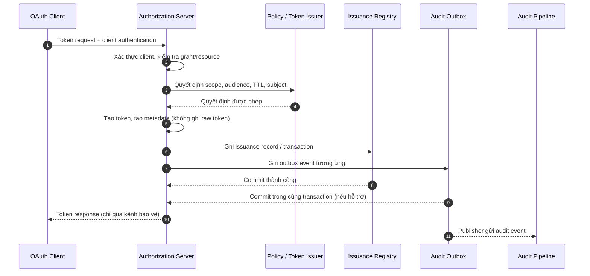
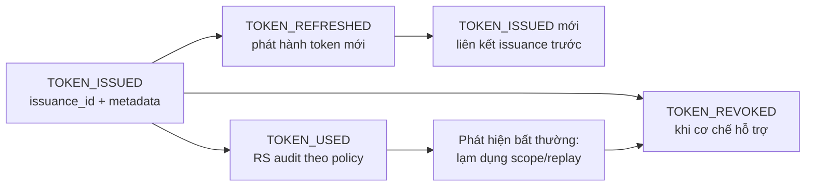

# Ghi metadata issuance

## Mục tiêu học tập

Trong module **SECURITY_TOKEN_SECURITY_FUNDAMENTALS**, quá trình phát hành token (*token issuance*) không chỉ tạo ra một chuỗi access token hoặc refresh token. Authorization Server (AS) còn cần biết **token nào đã được phát hành, cho ai, bằng luồng nào, dành cho API nào, có quyền và thời hạn ra sao, theo quyết định chính sách nào**. Tập thông tin đó là **issuance metadata** — metadata của sự kiện phát hành — giúp vận hành an toàn vòng đời token, điều tra sự cố và kiểm soát việc thu hồi.

Sau bài học, bạn có thể:

- Phân biệt **claims trong token**, **metadata phản hồi token endpoint** và **bản ghi issuance phía máy chủ**.
- Chọn các trường metadata cần thiết để truy vết issuer, client, subject, audience, scope, thời gian, khóa ký, loại token và cơ sở quyết định phát hành.
- Thiết kế bản ghi phát hành cho JWT hoặc opaque access token, refresh token, OIDC ID Token và các luồng OAuth 2.0 khác nhau.
- Ghi sự kiện phát hành **đáng tin cậy, có thể đối chiếu**, đồng thời tránh log raw token, secret, authorization code và dữ liệu cá nhân quá mức.
- Liên kết issuance metadata với các sự kiện sử dụng, làm mới, xoay khóa, thu hồi token và phát hiện token bị đánh cắp hoặc phát lại.
- Nhận biết giới hạn: metadata phát hành **không tự làm token hợp lệ, không thay cho việc Resource Server kiểm chứng token và phân quyền**.

## 1. “Metadata issuance” là gì và vì sao cần ghi?

**Issuance metadata** là thông tin có cấu trúc mô tả **một quyết định và kết quả phát hành token** tại Authorization Server. Nó có thể tồn tại dưới dạng bản ghi trong cơ sở dữ liệu, một sự kiện audit bất biến tương đối, hoặc một bản ghi trong token registry.

Ví dụ, dịch vụ `report-worker` xác thực với AS và xin access token gọi Orders API. Ngoài việc trả về access token, AS có thể ghi:

```text
event            = TOKEN_ISSUED
issuance_id      = iss-8f75...
issuer           = https://identity.example.com
client_id        = report-worker
grant_type       = client_credentials
token_kind       = access_token
token_format     = jwt
audience         = api://orders
granted_scopes   = orders:summary:read
issued_at        = [timestamp UTC]
expires_at       = [timestamp UTC]
signing_key_id   = signing-key-v3
decision         = ALLOWED
```

Đây là **sự kiện phía AS**, không phải ví dụ chuỗi JWT hay cấu hình bắt buộc của một sản phẩm IAM. Giá trị timestamp, tên sự kiện và các trường phải được chuẩn hóa theo nhu cầu hệ thống.

### Ba lớp metadata dễ bị nhầm

| Lớp | Nằm ở đâu? | Ví dụ | Dùng để làm gì? |
| --- | --- | --- | --- |
| **Claims trong token** | Payload JWT được ký/mã hóa hoặc thông tin phía AS tương ứng với opaque token. | `iss`, `sub`, `aud`, `iat`, `exp`, `jti`, `scope`. | Resource Server kiểm chứng token, mục đích và quyền truy cập. |
| **Token response metadata** | HTTP response của token endpoint gửi cho OAuth client. | `token_type`, `expires_in`, `scope` khi cần; bản thân `access_token` là credential, không phải metadata audit. | Client biết cách dùng token, thời hạn và tập scope đã cấp. |
| **Issuance record / audit event** | Kho dữ liệu hoặc luồng sự kiện **được bảo vệ phía AS**. | `issuance_id`, client, grant, policy version, kết quả, key id, correlation id. | Kiểm toán, theo dõi phát hành, điều tra, đối chiếu thu hồi và phát hiện bất thường. |

Không phải tất cả trường audit đều cần đưa vào token. Càng đưa nhiều dữ liệu nội bộ hoặc cá nhân vào JWT payload, càng có nguy cơ lộ thông tin, vì JWT dạng JWS thông thường **đọc được bằng Base64url decode dù không có private key**. Ngược lại, việc đưa metadata vào log không chứng minh token đã được kiểm chứng: audit log và cơ chế bảo mật token có vai trò khác nhau.

## 2. Những câu hỏi một bản ghi issuance nên trả lời

Thiết kế metadata bắt đầu từ **nhu cầu điều tra và vận hành**, thay vì thu thập mọi thông tin có sẵn:

1. **Ai phát hành?** Issuer/Authorization Server tin cậy nào, môi trường hoặc tenant nào?
2. **Vì sao phát hành?** Grant type nào, client nào đã được xác thực, có ủy quyền của người dùng hay chỉ quyền ứng dụng?
3. **Token dùng để làm gì?** Loại token nào, audience/resource đích nào, scope nào đã cấp sau khi kiểm tra chính sách?
4. **Khi nào?** Thời điểm phát hành, thời điểm bắt đầu có hiệu lực và hết hạn, đồng hồ nào được dùng?
5. **Dùng cơ chế bảo vệ nào?** JWT/opaque, thuật toán và phiên bản khóa ký nếu có, loại bearer hay sender-constrained nếu hỗ trợ.
6. **Làm sao đối chiếu về sau?** `issuance_id`, correlation/trace ID, mã tham chiếu token an toàn, chuỗi sự kiện refresh/revoke.
7. **Quyết định do chính sách nào?** Phiên bản policy/quy tắc hoặc lý do từ chối ở mức cho phép ghi audit, không tiết lộ bí mật.

### Vì sao không chỉ đọc lại JWT về sau?

Không thể chỉ dựa vào JWT làm nguồn audit vì:

- Một token có thể **opaque**, không chứa claims công khai để tự đọc.
- JWT tự chứa có thể **không bao gồm** policy version, số hiệu yêu cầu cấp token hoặc chi tiết xác thực client.
- Token có thể **đã hết hạn, bị thu hồi hoặc không còn tồn tại tại client** khi cần điều tra.
- Việc ghi nguyên JWT để “phục vụ audit” biến kho log thành **kho bearer credential có thể bị tái sử dụng**.
- Các sự kiện **từ chối cấp token** không có token thành công nào để đọc lại, nhưng vẫn có giá trị bảo mật.

Do đó, AS nên ghi **một tập dữ liệu tối thiểu nhưng đủ liên kết** các sự kiện, có chính sách bảo vệ riêng.

## 3. Danh mục trường issuance metadata

Không có một schema audit issuance toàn cầu áp dụng cho mọi OAuth Authorization Server. Bảng sau là **mẫu thiết kế hệ thống**, không phải danh sách claim bắt buộc trong RFC.

| Trường | Ví dụ | Ý nghĩa và lưu ý |
| --- | --- | --- |
| `event_id` | `evt-92f...` | Định danh duy nhất sự kiện audit, hỗ trợ chống ghi trùng. |
| `issuance_id` | `issn-3ac...` | Định danh riêng cho một lần cấp token hoặc một nhóm token được cấp cùng giao dịch; **không phải** claim `iss`. |
| `event_type` | `TOKEN_ISSUED` | Phân biệt phát hành thành công, từ chối, refresh, revoke, rotate. |
| `schema_version` | `1` | Giúp bên đọc xử lý thay đổi định dạng sự kiện. |
| `occurred_at` | ISO 8601 UTC | Thời điểm AS ghi nhận sự kiện; có thể khác thời điểm claim `iat` và thời điểm ingest. |
| `issuer` | `https://identity.example.com/realms/store` | Nguồn phát hành được AS kiểm soát; không lấy từ request chưa tin. |
| `client_id` | `report-worker` | Client đã xác thực hoặc đã được nhận diện đáng tin theo loại client/grant. |
| `grant_type` | `client_credentials` | Luồng làm phát sinh quyết định cấp token. |
| `subject_ref` | `user-ref-42` hoặc `service-ref-7` | Tham chiếu chủ thể đủ dùng cho audit; cân nhắc giả danh hóa và giới hạn truy cập. |
| `token_kind` | `access_token`, `refresh_token`, `id_token` | Mục đích token; một response có thể cấp nhiều loại theo flow. |
| `token_format` | `jwt_jws`, `opaque` | Cách token được biểu diễn/xử lý; không suy từ số dấu chấm một cách tùy tiện. |
| `audiences` | `["api://orders"]` | Bên nhận được phép; ràng buộc token với resource đích. |
| `granted_scopes` | `["orders:read"]` | Scope **đã cấp**, khác với scope client chỉ gửi trong yêu cầu. |
| `issued_at` / `not_before` / `expires_at` | Timestamp | Mốc phát hành, bắt đầu hiệu lực và hết hạn tương ứng khi có. |
| `token_reference` | `hmac:7f8...` | Tham chiếu đã được bảo vệ để đối chiếu, **không phải raw token**. |
| `token_jti_ref` | `hmac:5ab...` | Tham chiếu an toàn đến `jti` nếu profile token có `jti`; tránh lưu ID dễ đoán lộ qua log. |
| `signing_key_id` | `signing-key-v3` | Phiên bản/key ID của khóa ký JWT; có thể vắng với opaque token. |
| `policy_version` | `authz-policy-2027-01` | Phiên bản rule được dùng khi cấp quyền, hữu ích khi điều tra quyết định cũ. |
| `sender_constraint` | `none`, `mtls`, `dpop` | Cơ chế ràng buộc token với bên gửi khi triển khai, **không ghi private key hoặc full proof**. |
| `correlation_id` | `req-72bc...` | Liên kết log cấp token với request/tracing theo chính sách bảo mật. |
| `outcome` / `reason_code` | `ALLOWED` hoặc `DENIED_INVALID_SCOPE` | Ghi quyết định và mã nguyên nhân được chuẩn hóa, không ghi secret hoặc nội dung lỗi nhạy cảm. |

**Không phải trường nào cũng có cho mọi grant/profile.** Ví dụ Client Credentials grant không có người dùng cuối mặc định; opaque token không nhất thiết có `kid`, còn token chưa được cấp vì lỗi thì không có `issued_at`/`expires_at` của token thành công. Đừng điền một subject giả hoặc một hạn dùng tưởng tượng chỉ để schema luôn đầy đủ.

### 3.1. Những trường nên cân nhắc riêng

- **`requested_scopes` vs `granted_scopes`:** khác biệt này là bằng chứng AS đã giới hạn quyền. Có thể ghi tập scope yêu cầu đã qua kiểm soát kích thước, và tập scope được cấp; nhưng phải tránh ghi các chuỗi tùy ý không giới hạn hoặc dữ liệu nhạy cảm vào log.
- **`requested_resource` vs `granted_audiences`:** với RFC 8707, client yêu cầu `resource` nhưng AS phải kiểm tra chính sách và quyết định audience cuối cùng. Ghi cả hai nếu cần điều tra lỗi cấp token sai API.
- **`authn_method` và mức bảo đảm:** chỉ lưu loại client authentication (ví dụ `private_key_jwt` hoặc mTLS) và kết quả; không lưu client assertion, chứng chỉ đầy đủ hay secret.
- **`tenant_ref` và tổ chức:** chỉ ghi nếu có ý nghĩa trong mô hình phân quyền; xác thực nguồn tenant và tránh ghi tên/email người dùng khi không cần.
- **`source_network`:** IP/User-Agent có thể hữu ích cho phát hiện bất thường nhưng thuộc dữ liệu nhạy cảm trong nhiều chính sách; cần phân loại, tối thiểu hóa, hạn lưu và quyền truy cập phù hợp.
- **`token_family_id`:** hữu ích khi triển khai refresh-token rotation để liên kết thế hệ token; không dùng chính raw refresh token làm family ID.

## 4. Metadata phát hành và các claim thời gian

Các claim JWT có ý nghĩa riêng theo RFC 7519:

| Giá trị | Nguồn | Cách hiểu đúng |
| --- | --- | --- |
| `iat` (*issued at*) | Claim trong JWT nếu được phát hành. | Thời điểm token được phát hành; thường là NumericDate, **số giây Unix UTC**. |
| `nbf` (*not before*) | Claim JWT khi dùng. | Thời điểm sớm nhất token được coi là hợp lệ. |
| `exp` (*expiration time*) | Claim JWT khi dùng. | Thời điểm sau đó token không còn được chấp nhận, có thể xét leeway rất nhỏ theo policy. |
| `expires_in` | Thuộc tính token response nếu AS cung cấp. | Thời hạn sống được công bố cho client, **tính bằng giây**; không phải một Unix timestamp. |
| `occurred_at` | Trường của issuance event nội bộ. | Lúc sự kiện được ghi nhận, thường ISO 8601 UTC; không tự động đồng nhất với `iat`. |
| `ingested_at` | Nền tảng thu thập log/audit. | Khi bộ thu nhận sự kiện nhìn thấy bản ghi; có thể muộn hơn thời điểm phát hành. |

Ví dụ:

```text
iat = 1800000000
nbf = 1800000000
exp = 1800000900
expires_in = 900
```

Trong ví dụ, token sống 900 giây tính từ `iat` đến `exp`. Đây **không phải** ràng buộc toán học bắt buộc cho mọi token: `nbf` có thể khác `iat`, `expires_in` được tính theo hợp đồng lúc trả response, và AS có thể dùng policy khác. Không tự tạo `exp = iat + expires_in` trong audit nếu **không có căn cứ từ token hoặc trạng thái phát hành thực tế**.

**Đồng bộ thời gian:** hệ thống phát hành, lưu trữ và xử lý sự kiện cần timestamp UTC, độ phân giải thống nhất và giám sát lệch đồng hồ. Resource Server có thể áp dụng clock skew nhỏ khi kiểm tra `exp`/`nbf`; log audit vẫn phải ghi thời gian thực tế từ nguồn được kiểm soát, không tự sửa số để làm token “khớp” kiểm tra.

## 5. Một issuance event minh họa

Giả sử backend `report-worker` được phép dùng Client Credentials grant để lấy JWT access token cho Orders API, scope `orders:summary:read`. AS xác thực client, kiểm tra grant và policy trước khi cấp token.

Một bản ghi JSON **phía AS** có thể là:

```json
{
  "schema_version": 1,
  "event_id": "evt-c5d0aa12",
  "issuance_id": "issn-8b1e7f36",
  "event_type": "TOKEN_ISSUED",
  "outcome": "ALLOWED",
  "occurred_at": "2027-01-15T10:00:00Z",
  "issuer": "https://identity.example.com",
  "client_id": "report-worker",
  "grant_type": "client_credentials",
  "subject_ref": "service:report-worker",
  "token_kind": "access_token",
  "token_format": "jwt_jws",
  "audiences": ["api://orders"],
  "requested_scopes": ["orders:summary:read"],
  "granted_scopes": ["orders:summary:read"],
  "issued_at": "2027-01-15T10:00:00Z",
  "expires_at": "2027-01-15T10:15:00Z",
  "token_jti_ref": "hmac:v2:nonreversible-reference",
  "signing_key_id": "signing-key-v3",
  "sender_constraint": "none",
  "policy_version": "orders-authz-policy-12",
  "correlation_id": "req-7654abcd"
}
```

Đây chỉ là **schema ví dụ do bài học đề xuất**; các chuỗi `hmac:...` là placeholder, **không phải HMAC thực**. Các giá trị timestamp cũng là dữ liệu giả lập. Không mặc định `subject_ref` được phép chứa mọi thông tin cá nhân; ở luồng Client Credentials, subject thường là **service principal**, không phải người dùng.

### Những gì không có trong event

Không lưu:

```text
access_token  = <raw bearer credential>          # KHÔNG GHI
refresh_token = <raw refresh credential>         # KHÔNG GHI
client_secret = <OAuth client secret>            # KHÔNG GHI
assertion     = <signed client assertion>        # KHÔNG GHI
auth_code     = <authorization code>             # KHÔNG GHI
private_key   = <key material>                   # KHÔNG GHI
password      = <user password>                  # KHÔNG GHI
```

Không ghi full `Authorization` header, cookie, DPoP proof, raw `id_token`, session secret hoặc request/response body không được lọc. Việc một chuỗi là **JWT có chữ ký** không làm nó vô hại: JWT access token còn hiệu lực vẫn có thể là bearer credential bị sử dụng lại.

### 5.1. Issuance metadata so với token response

Ví dụ token response theo OAuth 2.0:

```http
HTTP/1.1 200 OK
Content-Type: application/json
Cache-Control: no-store
Pragma: no-cache

{
  "access_token": "<access-token-not-logged>",
  "token_type": "Bearer",
  "expires_in": 900,
  "scope": "orders:summary:read"
}
```

**Client** cần token thực để gọi API, nhưng **audit pipeline không cần token thực** để biết AS đã phát hành token gì. Đừng tự động log toàn bộ response của token endpoint: sự tiện lợi này đánh đổi bằng việc lưu những credential có thể bị đánh cắp.

## 6. Ghi issuance metadata ở điểm nào trong luồng?

Luồng đơn giản có thể diễn tả như sau:



Sơ đồ thể hiện **một phương án thiết kế với registry và transactional outbox nằm trong cùng hệ lưu trữ giao dịch**. Nếu AS không có kiến trúc đó, cách triển khai và bảo đảm nhất quán sẽ khác. Không nên tuyên bố có transaction nguyên tử giữa HSM, nhiều dịch vụ, cơ sở dữ liệu và HTTP response nếu thực tế không có.

Các mốc phải phân biệt rõ:

1. **Request được nhận:** có thể ghi sự kiện yêu cầu hoặc từ chối sơ bộ, chưa phải `TOKEN_ISSUED`.
2. **Xác thực client và quyết định authorization:** xác minh grant, consent/ngữ cảnh user nếu có, resource, scope và policy.
3. **Token được tạo:** xác định token kind, claims, khóa/`kid`, định danh tham chiếu, timestamp đã thực sự được áp dụng.
4. **Bản ghi được lưu bền vững:** theo yêu cầu tuân thủ, việc phát hành có thể chỉ được xem là thành công sau khi ghi nhận registry/audit thiết yếu thành công.
5. **Response được gửi:** đây là thời điểm token có thể rời AS; hệ thống phải có quy tắc rõ khi response thất bại hoặc connection đứt giữa chừng.
6. **Event được giao cho audit pipeline:** có thể chậm hơn một chút; cần retry và deduplication thay vì ghi một lần rồi mất sự kiện.

### Ghi “đã phát hành” khác “client đã nhận”

AS có thể tạo và lưu token thành công, nhưng kết nối HTTP đóng trước khi client nhận response. Bản ghi `TOKEN_ISSUED` **không chứng minh** client đã nhận hoặc sử dụng token. Nếu cần, dùng sự kiện riêng cho kết quả giao HTTP hoặc quan sát việc sử dụng token ở Resource Server; không biến sự kiện gửi response thành bằng chứng chắc chắn về việc người dùng đã sử dụng quyền.

Nếu token đã được tạo trong bộ nhớ nhưng việc ghi audit bắt buộc thất bại **trước khi gửi response**, hệ thống có thể từ chối hoàn tất issuance và loại token chưa phân phối theo chính sách. Với opaque token, phải bảo đảm trạng thái token chưa phát hành không vô tình được RS chấp nhận. Với JWT tự chứa, AS không thể “thu hồi bằng xóa RAM” nếu token đã thoát ra ngoài. Ranh giới xử lý lỗi và retry cần được thiết kế minh bạch.

## 7. Ghi sự kiện từ chối cấp token

Một hệ thống an toàn không chỉ có `TOKEN_ISSUED`, mà còn nên có các sự kiện **phát hành bị từ chối**, nhằm phát hiện brute-force, credential stuffing hoặc client yêu cầu vượt quyền.

Ví dụ:

```json
{
  "schema_version": 1,
  "event_id": "evt-7124ab90",
  "event_type": "TOKEN_ISSUANCE_DENIED",
  "outcome": "DENIED",
  "occurred_at": "2027-01-15T10:01:00Z",
  "issuer": "https://identity.example.com",
  "client_id": "report-worker",
  "grant_type": "client_credentials",
  "requested_resource": "api://identity-admin",
  "requested_scopes": ["users:roles:manage"],
  "reason_code": "RESOURCE_OR_SCOPE_NOT_ALLOWED",
  "correlation_id": "req-7654abce"
}
```

Thông tin `client_id` trên **yêu cầu chưa xác thực** có thể là giá trị tự khai, chưa được chứng minh. Trong event dạng từ chối, nên phân biệt `claimed_client_id` với `authenticated_client_id` và chỉ ghi `authenticated_client_id` sau khi có bằng chứng. Không khẳng định một client đã cố tấn công chỉ dựa vào tên được attacker đưa vào request.

Trường `reason_code` nên dùng danh mục mã chuẩn hóa nội bộ để hỗ trợ vận hành. Không đưa nội dung lỗi chi tiết như “secret đúng 7/8 ký tự”, khóa công khai, assertion hoặc thông tin PII vào log/response. Đối với tấn công có tần suất lớn, cần giới hạn tốc độ, phân tách audit bắt buộc và telemetry tổng hợp để tránh chính hệ thống log trở thành điểm gây DoS.

## 8. Từng loại token cần metadata khác nhau

| Token / luồng | Metadata đáng quan tâm | Cần tránh |
| --- | --- | --- |
| **JWT access token** | Issuer, audience, scope, subject/client, `iat`/`exp`, `kid`, `jti` nếu có, loại token, policy version. | Lưu toàn bộ JWT trong log; coi chữ ký hợp lệ là chưa bị thu hồi. |
| **Opaque access token** | Token registry ID/tham chiếu an toàn, trạng thái `active`, quyền, audience, thời hạn, client/subject. | Đưa raw opaque token vào audit; dùng raw token làm khóa chính dễ truy xuất. |
| **Refresh token** | Client, subject/consent nếu có, token family/rotation generation, thời hạn/chính sách, trạng thái thu hồi và ràng buộc client. | Lưu raw refresh token; giả định Client Credentials grant luôn phát hành refresh token. |
| **OIDC ID Token** | OP/issuer, client audience, subject, thời hạn, event login/issuance và reference an toàn khi thực sự cần. | Dùng ID Token như access token; ghi toàn bộ `nonce` hoặc claims cá nhân vào audit. |
| **Client assertion** (`private_key_jwt`) | Phương thức xác thực client và kết quả kiểm chứng; có thể ghi key ID/credential version được tin cậy. | Nhầm client assertion là access token; log raw assertion hoặc khóa ký. |
| **Token Exchange** (RFC 8693) | Actor/caller, subject reference, source issuance reference khi có, requested/granted resource, scope, kết quả policy. | Sao chép quyền đầu vào sang token mới mà không kiểm tra delegation/audience. |

**Client Credentials grant:** theo RFC 6749, refresh token **SHOULD NOT** được cấp trong luồng này; bài học không giả định mọi token response đều có refresh token. Với Authorization Code/OIDC, issuance metadata có thể gắn với user session và consent nhưng cần hạn chế dữ liệu cá nhân.

### 8.1. Chuỗi refresh-token rotation

Khi triển khai **refresh-token rotation**, issuance metadata có thể mô hình hóa:

```text
family_id = fam-17
refresh generation 1 -> status ROTATED
refresh generation 2 -> status ROTATED
refresh generation 3 -> status ACTIVE

events:
  REFRESH_TOKEN_ISSUED
  TOKEN_REFRESHED
  REFRESH_TOKEN_ROTATED
  REFRESH_REUSE_DETECTED   (nếu có phát hiện)
  TOKEN_FAMILY_REVOKED     (khi policy yêu cầu)
```

Các tên sự kiện này là **quy ước minh họa**. Việc phát hiện reuse thường yêu cầu kho trạng thái đáng tin cậy, thao tác cập nhật nguyên tử và quyết định policy về việc vô hiệu token family. Chỉ ghi audit event mà không kiểm soát trạng thái token **không đủ** để chặn sử dụng refresh token cũ.

### 8.2. Sender-constrained access token

Với token được ràng buộc bằng **mTLS** (RFC 8705) hoặc **DPoP** (RFC 9449), có thể ghi metadata về **loại ràng buộc** và tham chiếu an toàn tới khóa/cert để điều tra. Không ghi private key, DPoP proof chưa lọc hay toàn bộ thông tin chứng chỉ không cần thiết.

Resource Server vẫn phải xác minh bằng chứng sở hữu khóa ở mỗi request phù hợp; chỉ thấy `sender_constraint = "dpop"` trong audit **không chứng minh** một request downstream đã sử dụng DPoP hợp lệ.

## 9. Liên kết issuance metadata với việc xác minh và thu hồi

Metadata phát hành giúp đối chiếu nhưng **không tự quyết định token còn hợp lệ**. Khi API nhận token, nó vẫn phải kiểm chứng theo định dạng:

- **JWT access token:** xác minh chữ ký bằng khóa của issuer tin cậy, `iss`, `aud`, `exp`/`nbf`, token type, scope và quyền theo resource. Nếu yêu cầu thu hồi trước `exp`, cần trạng thái bổ sung/denylist/introspection theo thiết kế.
- **Opaque access token:** dùng introspection endpoint tin cậy (RFC 7662) hoặc hệ thống registry đã được kiểm soát, kiểm tra `active`, audience, scope, client/subject và policy.
- **Refresh token:** được AS kiểm tra tại token endpoint, **không gửi đến Resource Server** để truy cập API.
- **ID Token:** được OIDC client kiểm chứng theo profile OIDC; **không thay access token** cho API.

### Event lifecycle minh họa



Sự kiện `TOKEN_USED`, nếu có, nên được Resource Server ghi ở mức cần thiết và **không ghi raw token**. Việc ghép log issuance với log usage dựa vào một **correlation/trace reference** hoặc token reference được bảo vệ theo thiết kế. Đừng giả định mọi request đều có `jti` hoặc JWT ID được RS công khai.

### `jti`, token reference và tránh lộ credential

`jti` trong JWT là một định danh, **không phải chữ ký hay bí mật**. Nếu có thể dễ đoán hoặc liên kết thông tin cá nhân, không nên đưa nguyên văn vào mọi log/telemetry. Với opaque token, chính token có thể là chuỗi bí mật có entropy cao; **không ghi nguyên chuỗi để làm khóa đối chiếu**.

Giải pháp tham chiếu minh họa:

```text
token_reference = HMAC_SHA256(
    audit_reference_key,
    issuer_id || token_kind || raw_token_or_token_identifier
)
```

Đây là công thức **khái niệm**, không phải giao thức chuẩn. Trong triển khai thực tế phải dùng **mã hóa trường có cấu trúc, ranh giới thành phần rõ ràng**, HMAC key được quản lý riêng, quyền truy cập hạn chế và quy trình xoay khóa. Không ghi dữ liệu gốc, không dùng cùng secret với khóa ký JWT, và không coi HMAC reference là một credential có thể xác thực API.

Nếu token có định danh registry ngẫu nhiên không nhạy cảm hoặc một `issuance_id` nội bộ, có thể dùng **tham chiếu đó** thay cho tính HMAC trên raw token, tùy mô hình đe dọa. Không đưa một hash đơn giản của token có entropy thấp lên hệ thống log công khai.

## 10. Thiết kế lưu trữ audit và tính nhất quán

### 10.1. Immutable events và trạng thái token

Hai mô hình lưu trữ thường đi cùng nhau:

| Kho | Tính chất | Mục tiêu |
| --- | --- | --- |
| **Issuance/audit event log** | Ghi sự kiện append-only, có `event_id`, timestamp, schema version, actor/source và chính sách phân quyền đọc. | Truy vết lịch sử quyết định, điều tra sự cố, phục vụ kiểm toán. |
| **Token registry / session state** | Trạng thái có thể thay đổi: token active/revoked, refresh family, expiry, client binding. | Kiểm tra token còn được sử dụng hay không, xử lý refresh/rotation/revocation. |

Một **audit event nói “đã thu hồi”** không nhất thiết đồng nghĩa mọi Resource Server đã ngừng chấp nhận JWT tự chứa: cần cơ chế đồng bộ trạng thái hoặc kiểm tra chính sách phù hợp. Ngược lại, trạng thái token hiện tại không thể thay thế đầy đủ lịch sử “ai đã cấp, lúc nào, theo chính sách nào”.

### 10.2. Durable writes, outbox, retry và idempotency

Nếu hệ thống yêu cầu **mọi token được gửi ra ngoài phải có issuance record**, nên ưu tiên ghi metadata thiết yếu một cách bền vững trước khi giao token và dùng **transactional outbox** để đưa event sang audit pipeline. Khi registry và outbox cùng cơ sở dữ liệu giao dịch, có thể ghi hai bản ghi cùng transaction.

Khi publish async:

- **At-least-once delivery** có thể sinh event lặp; consumer cần xử lý theo `event_id` hoặc khóa idempotency phù hợp.
- **Retry có giới hạn và dead-letter handling** để không mất sự kiện trong lỗi tạm thời.
- **Monitoring độ trễ và số lượng sự kiện** để phát hiện pipeline audit bị nghẽn hoặc thiếu dữ liệu.
- **Schema evolution** theo `schema_version`; không phá consumer khi thêm trường.
- **Correlation** giữa request, issuance và outbox event để đối chiếu khi response bị mất hoặc request được retry.

Không có bảo đảm rằng một HTTP token request được retry sẽ tự có kết quả cấp token giống lần đầu. Cần xem xét idempotency/token issuance riêng khi nghiệp vụ yêu cầu; không vô tình phát nhiều refresh token đang active hay duplicate token trong các tình huống có trạng thái.

### 10.3. Ví dụ pseudocode Java

Đoạn mã dưới đây diễn giải **một phương án** ghi event sau khi policy cho phép và token được tạo trong vùng bảo vệ của AS. Các class/hàm là pseudocode, **không phải API thực có thể sao chép vào Spring Security**.

```java
TokenResponse issueToken(TokenRequest request) {
    AuthenticatedClient client = authenticateClient(request);
    AuthorizationDecision decision = authorizeGrantAndScope(client, request);
    if (!decision.allowed()) {
        auditWriter.recordDenied(safeDeniedEvent(client, request, decision));
        throw new OAuthAuthorizationException(decision.publicErrorCode());
    }

    // Token/credential chỉ nằm trong đường đi được bảo vệ; không log.
    MintedToken minted = tokenIssuer.mint(decision);
    IssuanceRecord record = IssuanceRecord.fromTrustedData(
        newIssuanceId(),
        securityConfig.issuer(),
        client.id(),
        decision.grantType(),
        decision.grantedAudiences(),
        decision.grantedScopes(),
        minted.kind(),
        minted.format(),
        minted.issuedAt(),
        minted.expiresAt(),
        minted.keyId(),
        auditReference(minted), // chỉ tham chiếu bảo vệ, không raw token
        decision.policyVersion()
    );

    // Ghi registry và outbox cùng transaction nếu dùng chung DB.
    transaction.run(() -> {
        issuanceRegistry.insert(record);
        auditOutbox.insert(eventFrom(record));
    });

    // Chỉ gửi credential cho client sau khi yêu cầu ghi bền vững đã đạt.
    return minted.toOAuthResponse();
}
```

Trong thực tế, ký bằng HSM, ghi DB, đẩy message và trả HTTP **không tạo thành một transaction phân tán nguyên tử**. Vì vậy phải thiết kế trạng thái/phương án bù trừ cho trường hợp token đã được tạo nhưng transaction lỗi, response đứt hoặc consumer nhận trùng. Nếu business chấp nhận kiểu audit *best effort*, phải ghi nhận rõ giới hạn và rủi ro trong thiết kế, không khẳng định đã đảm bảo đủ sự kiện.

## 11. Bảo mật và quyền riêng tư của issuance metadata

Issuance metadata có giá trị cho tấn công gián tiếp: nó cho biết hệ thống có client nào, những scope quản trị nào, ai dùng token lúc nào và key version nào đang hoạt động. Vì thế phải **bảo vệ audit data như dữ liệu bảo mật**, dù không chứa raw credential.

### Nguyên tắc triển khai

1. **Data minimization:** chỉ ghi các trường phục vụ mục tiêu audit/incident response; không sao chép toàn bộ JWT claims.
2. **Không ghi credential:** thiết lập filter/redaction ở token endpoint, reverse proxy, tracing, error handler và application logs; kiểm tra cả payload sự kiện gửi sang message queue.
3. **Access control:** phân quyền riêng cho hệ thống ghi, bộ đọc, đội bảo mật và nhóm vận hành; tránh cho mọi developer xem toàn bộ lịch sử token.
4. **Retention và deletion:** thời gian lưu theo phân loại dữ liệu, nghĩa vụ pháp lý/tổ chức và nhu cầu điều tra; không giữ vô thời hạn chỉ vì “có thể hữu ích”.
5. **Bảo vệ tại nơi lưu/chuyển:** TLS, mã hóa lưu trữ phù hợp, quản lý khóa, backup, giám sát truy cập và bảo vệ chống sửa/xóa trái phép.
6. **Pseudonymization:** tách mapping từ `subject_ref` sang user thực; giới hạn quyền truy cập mapping, tránh dùng email/phone làm khóa audit.
7. **Tamper evidence:** event append-only, kiểm soát sửa đổi, kiểm tra tính toàn vẹn hoặc lưu ở hệ thống bất biến khi yêu cầu bảo đảm cao.
8. **Độ tin cậy:** bảo vệ audit pipeline khỏi sự cố hàng loạt bằng queue/buffer, giới hạn tài nguyên, cảnh báo mất log và kiểm soát backpressure.

### Anti-pattern cần tránh

| Thiết kế sai | Rủi ro | Thay thế |
| --- | --- | --- |
| Log toàn bộ token response. | Lộ access/refresh token có thể bị phát lại. | Log metadata chọn lọc và reference an toàn. |
| Ghi raw `Authorization` header ở gateway. | Biến central log thành kho credential. | Redact header/token ngay tại điểm thu thập. |
| Dùng email hoặc số điện thoại làm khóa chính của audit. | Lộ PII và khó xử lý đổi định danh. | `subject_ref` hoặc cặp định danh nội bộ được bảo vệ. |
| Coi `client_id` trong request từ chối là client đã xác thực. | Dẫn đến quy kết sai cho client hợp lệ. | Phân biệt `claimed_client_id` và `authenticated_client_id`. |
| Dùng `jti` như một bí mật hoặc biện pháp replay prevention tự động. | Không ngăn bearer token được dùng lại. | Token binding, TTL, trạng thái/revocation và policy chống replay khi cần. |
| Ghi `TOKEN_ISSUED` trước khi hoàn tất quyết định và lưu trạng thái. | Audit báo thành công giả. | Sự kiện theo state rõ ràng; commit theo yêu cầu trước response. |
| Chỉ ghi audit async trong RAM và trả token ngay. | Crash có thể làm mất toàn bộ dấu vết phát hành. | Durable queue/outbox và chính sách xử lý lỗi đã xác định. |
| Cho tất cả nhân viên xem metadata scope quản trị, subject và client. | Lộ bức tranh quyền/cấu trúc hệ thống. | RBAC, redaction, phân loại dữ liệu và audit truy cập audit. |
| Giữ log vô hạn, không có schema version. | Rủi ro dữ liệu và khó tương thích truy vấn. | Chính sách retention, versioning, kiểm thử migration. |

## 12. Kịch bản kiểm thử

Thiết lập một AS phát hành token cho Orders API và Billing API. Metadata chuẩn được ghi **chỉ khi phát hành thành công**, từ chối có event riêng, và không log credential.

| Tình huống | Metadata/hành vi mong đợi |
| --- | --- |
| Client Credentials cấp JWT cho `api://orders` với `orders:read`. | Có event `TOKEN_ISSUED`, issuer/client/grant/audience/scope đã cấp, TTL và key id; không có raw JWT. |
| Client xin `orders:read orders:admin` nhưng AS chỉ cấp `orders:read`. | Record phân biệt `requested_scopes` và `granted_scopes`; client xử lý scope được cấp. |
| Client giả mạo `client_id` và gửi secret sai. | Event từ chối ghi `claimed_client_id` (nếu được phép), **không** khẳng định đã xác thực client đó; không log secret. |
| Client yêu cầu access token cho Billing nhưng đăng ký chỉ cho Orders. | Từ chối/giới hạn theo AS policy, có reason code phù hợp; không tạo event cấp Billing sai. |
| Một issuance record được gửi hai lần từ outbox. | Audit consumer deduplicate theo `event_id`, không đếm thành hai lần phát hành. |
| DB registry lỗi trước khi trả token, trong khi thiết kế yêu cầu audit bền vững. | Không gửi token chưa được ghi nhận; xử lý trạng thái lỗi và không đánh dấu thành công giả. |
| Token endpoint gửi `200 OK` nhưng client mất kết nối trước khi đọc response body. | Event issuance không chứng minh client đã nhận token; chỉ ghi nhận phát hành, ghi delivery riêng nếu có bằng chứng. |
| Refresh token được rotate thành công. | Event rotation/refresh liên kết family/generation và cập nhật trạng thái token cũ theo policy. |
| Refresh token cũ bị dùng lại sau rotation. | Phát hiện reuse nếu hệ thống có cơ chế trạng thái; event bảo mật và biện pháp thu hồi theo policy. |
| JWT bị thu hồi nhưng signature vẫn đúng. | Event revoke có thể có; RS phải có cách biết trạng thái thu hồi nếu yêu cầu chặn trước `exp`. |
| Token có `sender_constraint=dpop`. | Metadata ghi loại binding, không ghi private key/proof; RS vẫn kiểm tra DPoP thực tế. |
| Đội vận hành tra cứu issuance bằng `correlation_id`. | Truy xuất đúng event với quyền phù hợp, không lộ credential hoặc PII ngoài phạm vi. |

### Bài tập suy luận

1. Tại sao không nên dùng chuỗi access token làm khóa chính của bảng issuance?
2. `iat` trong JWT, `expires_in` trong token response và `occurred_at` trong audit khác nhau ở đâu?
3. Có thể kết luận client đã **sử dụng** token chỉ vì event `TOKEN_ISSUED` tồn tại không?
4. Vì sao một opaque access token thường cần registry/introspection nhưng vẫn không nên log raw token?
5. Nếu AS cấp token chứa `orders:admin` ngoài dự kiến, bản ghi metadata nên giúp điều tra điều gì?
6. Trong kịch bản retry gửi outbox event, tại sao `event_id` và idempotency quan trọng?
7. Vì sao ghi `TOKEN_REVOKED` chưa đủ để bảo đảm mọi Resource Server lập tức từ chối JWT cũ?
8. Tại sao cần phân biệt client ID **được khai trong request** với client ID **đã xác thực** khi ghi sự kiện từ chối?

**Gợi ý trả lời:**

1. Vì đó là bearer credential nhạy cảm; dùng tham chiếu an toàn và tránh đưa raw token vào kho audit.
2. `iat` là thời điểm phát hành claim trong JWT, `expires_in` là thời lượng tính bằng giây cho client, còn `occurred_at` là thời điểm hệ thống ghi sự kiện; chúng không đồng nhất.
3. Không. Phát hành, gửi response, client nhận và API sử dụng là các mốc khác nhau.
4. Opaque token là bí mật tham chiếu tới trạng thái AS, và khi bị lộ còn có thể bị sử dụng như credential.
5. Tìm policy version, grant, client, requested/granted scopes, audience, quyết định AS, thời điểm, key version và các token liên quan để ứng phó.
6. Để retry không sinh bản ghi giả hoặc nhân đôi số lượng sự kiện phát hành.
7. JWT tự chứa có thể được RS chấp nhận tới `exp` nếu không có cơ chế trạng thái/denylist hoặc kiểm tra policy bổ sung.
8. Vì attacker có thể tự khai `client_id` của client khác; log phải phản ánh đúng mức độ xác thực đã chứng minh.

## 13. Checklist triển khai

- [ ] Phân biệt rõ **token claims**, **token endpoint response** và **issuance audit event**.
- [ ] Đặt schema/version cho issuance event, với `event_id`, `issuance_id` và timestamp UTC.
- [ ] Ghi issuer, client đã xác thực, grant, token kind, audience/resource, scope được cấp, thời hạn và policy version phù hợp.
- [ ] Phân biệt requested scopes/resources với granted scopes/audiences; không coi yêu cầu của client là quyền đã cấp.
- [ ] Dùng `subject_ref`/`token_reference` an toàn; không lưu raw JWT, opaque token, refresh token, authorization code, secret hay private key trong audit.
- [ ] Ghi từ chối với reason code an toàn, phân biệt `claimed_client_id` và `authenticated_client_id`.
- [ ] Chọn điểm ghi event sau quyết định phát hành; xác định bảo đảm durability và hành vi khi lưu DB/queue lỗi.
- [ ] Cân nhắc transactional outbox, retry, deduplication và xử lý schema evolution.
- [ ] Liên kết issuance, refresh, rotation, revocation và token usage mà không cần tiết lộ credential.
- [ ] Giới hạn quyền xem audit, mã hóa, phân loại PII, thiết lập retention và giám sát tính toàn vẹn.
- [ ] Đừng thay thế việc RS kiểm chứng issuer, audience, thời hạn, loại token, scope và quyền trên resource bằng dữ liệu audit.
- [ ] Kiểm thử phát hành thành công/thất bại, response timeout, outbox retry, token revoked, refresh reuse và tình huống log/telemetry vô tình ghi token.

## Tài liệu nền tảng

- **RFC 6749 — The OAuth 2.0 Authorization Framework:** token endpoint, cấp scope, token response và refresh token.
- **RFC 7519 — JSON Web Token (JWT):** `iss`, `sub`, `aud`, `iat`, `nbf`, `exp`, `jti` và NumericDate.
- **RFC 9068 — JSON Web Token (JWT) Profile for OAuth 2.0 Access Tokens:** claims/profile cho JWT access token.
- **RFC 7662 — OAuth 2.0 Token Introspection:** xác minh trạng thái và metadata của opaque access token.
- **RFC 7009 — OAuth 2.0 Token Revocation:** cơ chế client yêu cầu thu hồi token và giới hạn hiệu quả thu hồi.
- **RFC 8707 — Resource Indicators for OAuth 2.0:** yêu cầu token cho Resource Server đích.
- **RFC 8693 — OAuth 2.0 Token Exchange:** trao đổi token và ngữ cảnh actor/subject.
- **RFC 8725 — JSON Web Token Best Current Practices:** cách xử lý JWT an toàn, tránh nhầm token profile.
- **RFC 8705 / RFC 9449:** mTLS và DPoP để ràng buộc access token với bên gửi.

**Ghi nhớ:** **Ghi metadata issuance là ghi bằng chứng về quyết định phát hành**, không phải lưu lại credential. Một sự kiện hữu ích cần cho biết **issuer, client/chủ thể, grant, audience, scope đã cấp, thời hạn và kết quả chính sách** bằng định danh có thể đối chiếu mà **không làm lộ token hoặc secret**. Audit tốt giúp điều tra và thu hồi; chỉ quy trình xác minh token và phân quyền tại Resource Server mới quyết định một request có được truy cập API hay không.
