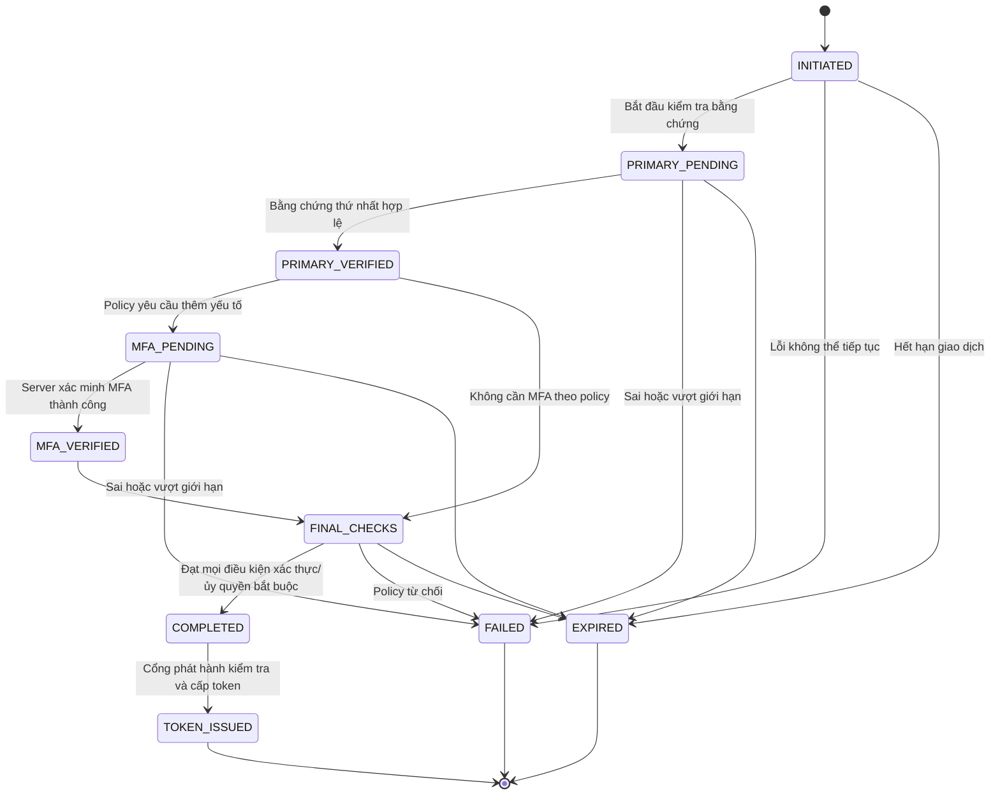
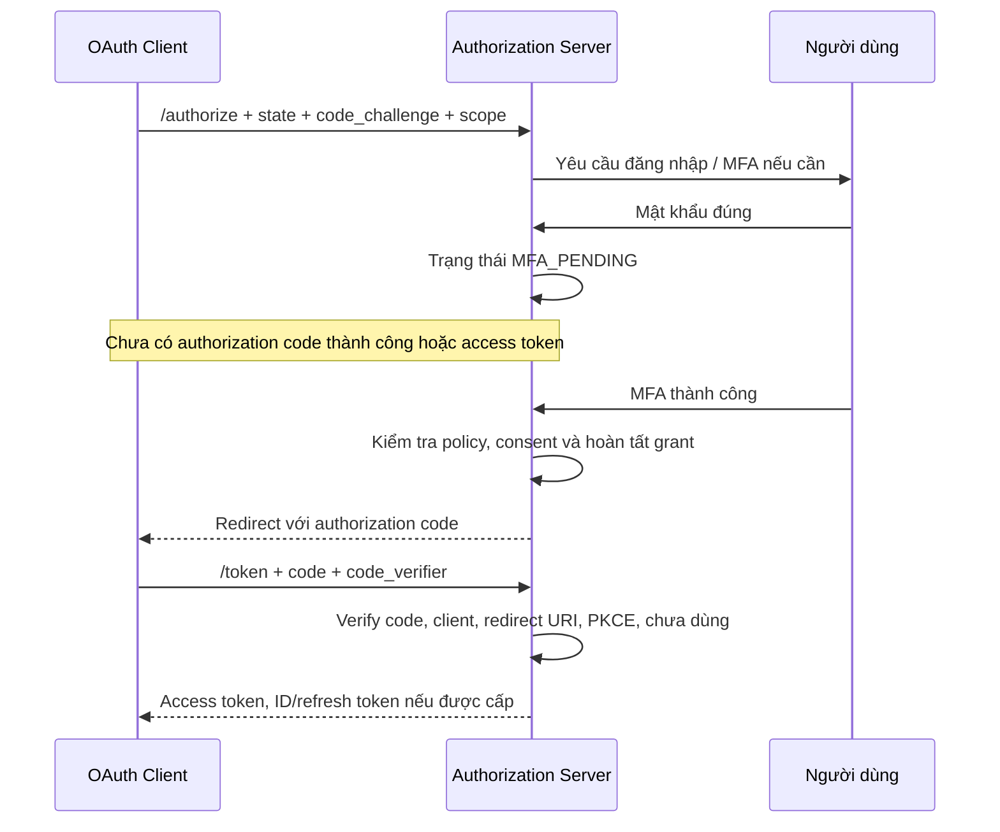
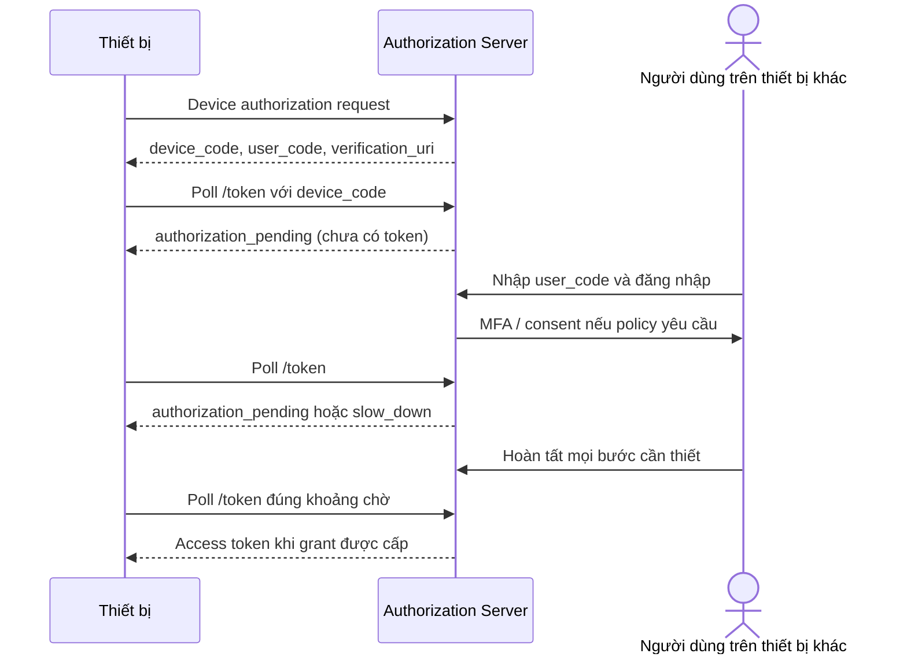
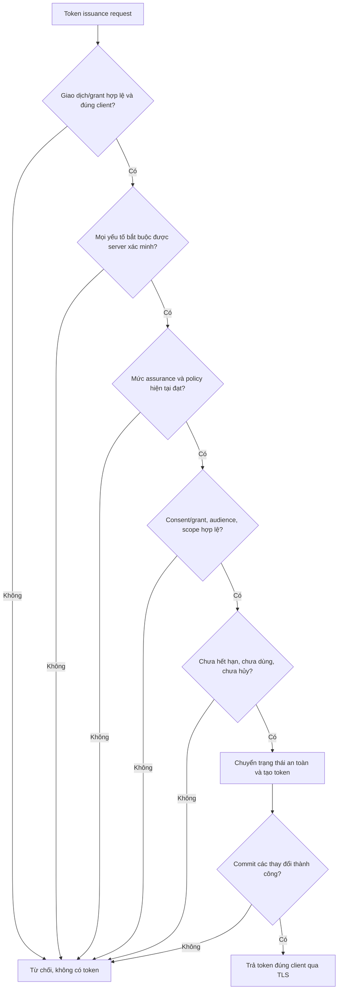

# Không phát token khi authentication chưa hoàn tất

Trong một hệ thống đăng nhập có nhiều bước, **nhập đúng mật khẩu không nhất thiết đồng nghĩa đã hoàn tất authentication**. Nếu chính sách còn yêu cầu mã OTP, xác nhận WebAuthn/passkey, kiểm tra trạng thái tài khoản, đánh giá rủi ro hoặc bước xác thực tăng cường (*step-up authentication*), authorization server **không được phát hành credential cho phép truy cập tài nguyên được bảo vệ** trước khi những điều kiện bắt buộc ấy thành công.

Ví dụ: người dùng đã qua kiểm tra mật khẩu nhưng đang chờ MFA. Nếu máy chủ trả về một JWT access token có `scope=payments:transfer` ngay sau bước mật khẩu, việc bắt buộc MFA sau đó gần như mất tác dụng: client hoặc kẻ tấn công chỉ cần bỏ qua màn hình MFA và gọi API trực tiếp. Chỉ một nhánh xử lý phát token quá sớm cũng có thể phá hỏng toàn bộ cơ chế xác thực nhiều lớp.

**Nguyên tắc cốt lõi:** *authentication chưa đạt mức bảo đảm cần thiết thì chưa phát hành access token, ID token hoặc refresh token cho grant đang chờ hoàn tất*. Có thể tồn tại **mã thử thách/challenge hoặc phiên tiền xác thực** để điều phối các bước đăng nhập, nhưng những giá trị đó phải có **mục đích, audience, thời hạn, trạng thái và quyền hạn khác hoàn toàn** với token dùng để gọi API.

Bài thuộc chương **Token issuance** trong module **SECURITY_TOKEN_SECURITY_FUNDAMENTALS**. Người học kết nối bài với mô hình tin cậy, vòng đời token, JWT và opaque token, access/refresh token, OAuth 2.0/OIDC, claims, scope, audience, lưu trữ, thu hồi và các nguy cơ token bị đánh cắp hoặc phát lại.

## 1. Mục tiêu học tập

Sau khi học, bạn có thể:

1. Phân biệt **xác thực đã hoàn tất**, **một yếu tố xác thực đã thành công**, **quyền đã được cấp** và **token đã được phát hành**.
2. Thiết kế **trạng thái giao dịch xác thực** có các nhánh chờ, thất bại, hết hạn và hoàn tất, không có đường tắt phát token sớm.
3. Hiểu vai trò riêng của mật khẩu, MFA, WebAuthn, điều kiện tài khoản, chính sách rủi ro và cơ chế step-up.
4. Phân biệt **pre-authentication challenge** với OAuth access token, refresh token và OIDC ID token.
5. Áp dụng quy tắc phát hành đúng thời điểm trong Authorization Code + PKCE, Device Authorization Grant, Client Credentials và Refresh Token Grant.
6. Trình bày cách ràng buộc `client_id`, redirect URI, PKCE, transaction ID, state/nonce, scope và audience với kết quả xác thực/ủy quyền.
7. Xử lý race condition, request lặp, callback tới muộn và lỗi khi ký token hoặc lưu phiên để tránh cấp token không hợp lệ.
8. Viết kiểm thử nhằm chứng minh **không thể nhận token sử dụng được trước khi mọi điều kiện bắt buộc đạt**.

## 2. “Authentication hoàn tất” nghĩa là gì?

**Authentication** (*xác thực*) là quá trình hệ thống thu thập và kiểm tra các bằng chứng để xác lập chủ thể theo chính sách. Một quá trình có thể gồm một hoặc nhiều yếu tố, nhiều lần chuyển hướng hoặc dùng phiên SSO hợp lệ đã có.

**Authorization** (*phân quyền/ủy quyền*) là quá trình đánh giá chủ thể hoặc client được phép làm gì, trên tài nguyên nào. **Token issuance** (*phát hành token*) là bước đóng gói kết quả và các quyền đã được cấp theo đúng giao thức thành credential để bên nhận tin cậy kiểm chứng.

Trong một luồng có người dùng, việc phát hành access token thường cần ít nhất:

- Xác thực đạt **mức bảo đảm** mà chính sách yêu cầu cho phiên/luồng này.
- Các điều kiện bắt buộc về **trạng thái tài khoản, khóa truy cập, rủi ro hoặc thiết bị** đã được xét.
- Yêu cầu ủy quyền đã được giải quyết: client, resource, consent nếu áp dụng, scope/audience được **authorization server phê duyệt**.
- Grant đã được tạo và kiểm tra đúng quy tắc giao thức; chẳng hạn authorization code phải hợp lệ, ràng buộc đúng client/redirect URI/PKCE và chỉ dùng một lần.
- Thời hạn, khóa ký, thông tin phiên và các ràng buộc phát hành còn hợp lệ tại thời điểm cấp token.

Một người dùng nhập mật khẩu đúng nhưng chưa xác minh OTP **chưa hoàn tất quy trình yêu cầu MFA**. Tuy nhiên, nếu người dùng đã có **phiên SSO xác thực đầy đủ, còn hiệu lực và đáp ứng chính sách**, hệ thống có thể hoàn tất quy trình cho yêu cầu mới mà **không cần hỏi lại mật khẩu**. Điều quan trọng là trạng thái xác thực **đáng tin và đủ mức**, không phải số lần xuất hiện màn hình nhập mật khẩu.

### 2.1. Không nhầm “một bước thành công” với “toàn bộ luồng thành công”

| Sự kiện | Thực chất chứng minh | Có đủ điều kiện phát access token cho luồng yêu cầu MFA không? |
| --- | --- | --- |
| Tài khoản tồn tại | Có định danh được tra cứu | **Không** |
| Mật khẩu đúng | Một bằng chứng xác thực đã được kiểm tra | **Không**, khi MFA vẫn bắt buộc |
| OTP đã được gửi | Challenge được khởi tạo | **Không** |
| OTP đã được nhập nhưng chưa kiểm chứng | Có dữ liệu do client cung cấp | **Không** |
| WebAuthn challenge được tạo | Một bước xác thực đang chờ | **Không** |
| WebAuthn assertion đã được server xác minh đầy đủ | Bằng chứng tương ứng đã qua kiểm tra | Chỉ **có thể**, nếu còn các yêu cầu khác |
| MFA hợp lệ nhưng tài khoản đã bị khóa | Đã qua yếu tố xác thực, nhưng bị policy chặn | **Không** |
| Mọi yếu tố bắt buộc, trạng thái tài khoản, chính sách và grant đều đạt | Có căn cứ xác thực/ủy quyền để cấp token | **Có thể phát**, sau khi qua cổng phát hành cuối |

Mọi trạng thái `PENDING` đều **không phải** `AUTHENTICATED` cho mục đích truy cập tài nguyên được bảo vệ, trừ khi hệ thống chủ động định nghĩa **một phạm vi quyền cực hẹp cho bước tiền xác thực**, tách biệt hoàn toàn với quyền của phiên đăng nhập hoàn tất.

### 2.2. “Không phát token” cần hiểu đúng phạm vi

Trong thực tế, một luồng nhiều bước có thể cấp một giá trị giống token để người dùng tiếp tục phiên đăng nhập, ví dụ `challenge_id`, `device_code` hoặc một cookie phiên tiền xác thực. Quy tắc ở đây **không cấm mọi chuỗi bí mật tạm thời**; quy tắc cấm **biến trạng thái chưa hoàn tất thành credential có quyền truy cập API hoặc quyền refresh grant**.

Giá trị tiền xác thực chỉ nên:

- Được dùng tại **endpoint hoàn tất challenge** hoặc lấy trạng thái giao dịch, không được chấp nhận ở resource server.
- Ràng buộc với **giao dịch, client và luồng xác thực** cụ thể; có TTL ngắn, giới hạn số lần thử và cơ chế kết thúc.
- Không mang scope nghiệp vụ hay được diễn giải là bearer access token.
- Không chứng minh đã hoàn tất MFA chỉ vì client có thể xuất trình giá trị đó.
- Không được dùng làm ID token, refresh token hoặc token có thể gọi API chỉ bằng thay tên header.

## 3. Ranh giới tin cậy giữa client, AS và API

Trong OAuth 2.0/OIDC:

- **Client** khởi tạo yêu cầu đăng nhập/ủy quyền và sử dụng kết quả. Client có thể hiển thị tiến độ UI nhưng **không tự quyết định** MFA đã đạt hay user đã được cấp scope.
- **Authorization server (AS) / Identity Provider (IdP)** kiểm tra bằng chứng và chính sách, quản lý trạng thái giao dịch xác thực, xét quyền rồi phát hành token.
- **Resource server (RS)** nhận access token đã được phát hành, kiểm tra tính hợp lệ và thực thi policy trên tài nguyên.
- **Resource owner** thường là người dùng, có thể cần xác thực và đồng ý cấp quyền theo mô hình giao thức.

```mermaid
sequenceDiagram
    actor U as Người dùng
    participant C as Client / Giao diện
    participant AS as Authorization Server
    participant DB as Kho danh tính và policy
    participant API as Resource Server
    U->>C: Bắt đầu đăng nhập
    C->>AS: Yêu cầu xác thực theo luồng
    AS->>DB: Đọc policy yếu tố, trạng thái tài khoản
    AS-->>C: Challenge phiên xác thực (chưa phải access token)
    U->>C: Cung cấp mật khẩu
    C->>AS: Bằng chứng bước 1 qua TLS
    AS->>AS: Xác minh mật khẩu thành công
    AS-->>C: MFA_REQUIRED; không cấp access/ID/refresh token
    U->>C: Hoàn tất yếu tố MFA
    C->>AS: Gửi bằng chứng MFA cho đúng giao dịch
    AS->>AS: Xác minh MFA, trạng thái tài khoản, policy và grant
    AS-->>C: Chỉ sau khi hoàn tất: token/authorization code hợp lệ theo luồng
    C->>API: Access token dành cho API
    API->>API: Xác minh iss, aud, exp, type, scope và policy
    API-->>C: Dữ liệu hoặc từ chối
```

Sơ đồ mô tả **ranh giới bảo đảm**, không bắt buộc AS phải trả token trực tiếp ngay sau MFA. Với **Authorization Code Flow**, AS trả **authorization code** sau khi hoàn tất điều kiện tương ứng; client đổi code tại token endpoint để nhận token, kèm các kiểm tra code và PKCE.

Điều tuyệt đối không được làm: client gửi `"mfaCompleted": true` hoặc `"authenticated": true` và AS/RS chấp nhận trường do client tự khai là bằng chứng đã hoàn tất authentication.

## 4. Thiết kế trạng thái giao dịch xác thực

Một mô hình trạng thái giúp chứng minh rằng không có đường đi từ “đang chờ MFA” sang “đã phát token” mà thiếu bước xác minh.



Các tên trạng thái trên **chỉ là một mô hình minh họa**, không phải tập tên bắt buộc theo OAuth. Điều quan trọng là **các chuyển trạng thái được kiểm soát ở server** và cổng phát hành chỉ nhận trạng thái đã đạt đủ yêu cầu.

### 4.1. Những dữ liệu trạng thái cần theo dõi

| Thuộc tính server-side | Mục đích |
| --- | --- |
| `transaction_id` ngẫu nhiên | Nhận diện chính xác một lần đăng nhập/ủy quyền; không cho client tự chọn ID có thể đoán |
| `client_id`, redirect URI, request/grant binding | Tránh chuyển kết quả xác thực sang client hoặc luồng khác |
| `subject_id` đã xác minh | Tránh cấp token cho nhầm người dùng |
| `required_factors` và `verified_factors` | Phân biệt yếu tố **bắt buộc** với yếu tố đã **được server xác minh** |
| `required_acr` hoặc auth assurance policy | Mức xác thực/step-up cần đạt theo giao dịch |
| `status`, `version`, `expires_at` | Điều khiển chuyển trạng thái, chống replay/callback tới muộn |
| `attempt_count` và giới hạn tốc độ | Giảm thử OTP/mật khẩu hàng loạt |
| `approved_scopes`, resource/audience, consent | Chỉ phát quyền đã được AS phê duyệt |
| `account_policy_version`/thông tin khóa phiên khi cần | Đánh giá thay đổi tài khoản/policy trước khi cấp |
| `issuance_state` hoặc marker one-time | Chống cùng một giao dịch cấp token ngoài chủ đích nhiều lần |

Không đưa mật khẩu nguyên văn, OTP, private key, refresh token hoặc chi tiết credential không cần thiết vào trạng thái giao dịch. Dữ liệu challenge nhạy cảm phải được bảo vệ và xóa/hết hạn theo chính sách.

### 4.2. Invariant — điều kiện phải luôn đúng

Có thể viết điều kiện phát hành như sau:

```text
canIssueUserGrantToken(tx, now) =
    tx.belongsToTrustedClientAndFlow
    AND tx.subjectIdentityVerifiedByServer
    AND tx.verifiedFactors satisfy tx.requiredFactors
    AND tx.assuranceLevel >= tx.requiredAssuranceLevel
    AND tx.accountIsAllowedByCurrentPolicy
    AND tx.consentAndAuthorizationResolvedIfRequired
    AND tx.requestedGrantIsValidAndBound
    AND tx.approvedAudienceAndScopesAreValid
    AND now < tx.expiresAt
    AND tx.isNotCancelledOrConsumed
    AND tx.state == COMPLETED
```

Nếu **bất kỳ điều kiện bắt buộc nào chưa được xác định** vì timeout, lỗi kho policy, lỗi MFA provider hoặc dữ liệu thiếu, hệ thống không được suy luận `true` để phát hành token. Đây là nguyên tắc **fail closed**.

**Lưu ý:** mức xác thực `acr` không nên so sánh bằng thứ tự chuỗi tùy ý. Mức assurance phải được đánh giá theo **policy đã cấu hình**, vì định danh `acr` là giá trị ngữ nghĩa trong một hệ thống nhận diện, không tự có toán tử `>=` theo từ điển.

## 5. Các yếu tố xác thực: lúc nào thực sự “hoàn tất”?

### 5.1. Mật khẩu

Đối với username/password, chỉ đánh dấu yếu tố mật khẩu đã xác minh **sau khi** máy chủ so khớp mật khẩu bằng password hasher phù hợp (như Argon2id hoặc cơ chế phù hợp chính sách), kiểm tra giới hạn thử, trạng thái tài khoản và chính sách đăng nhập. Không lưu mật khẩu nguyên văn và không chuyển nó vào claims token.

**Lỗi phổ biến:** vừa tìm thấy username đã tạo session hoàn chỉnh, sau đó mới kiểm tra mật khẩu. Trường hợp mật khẩu sai, một phiên/token đã bị phát ra ngoài và không thể dựa vào phản hồi lỗi để “thu hồi” nguy cơ ấy.

### 5.2. OTP/TOTP hoặc push MFA

Khi phải dùng MFA:

1. Server xác định yêu cầu MFA từ policy đã được đánh giá.
2. Tạo challenge gắn với transaction, chủ thể, client và thời hạn.
3. Kiểm chứng OTP/TOTP/push approval **ở server**, gồm hết hạn, giới hạn thử và cơ chế chống replay hoặc dùng lại theo chính sách.
4. Chỉ sau xác minh thành công mới đánh dấu yếu tố MFA đã đạt.
5. Tiếp tục kiểm tra các điều kiện bắt buộc trước khi phát token.

**Gửi OTP ≠ xác minh OTP.** **Client hiển thị màn hình “MFA thành công” ≠ server đã có bằng chứng.** Với push, cần bảo vệ trước tấn công thúc ép xác nhận (*MFA fatigue*), nhầm thiết bị và callback không ràng buộc đúng giao dịch.

### 5.3. WebAuthn/passkey

Với WebAuthn, **tạo challenge không phải hoàn tất xác thực**. Server chỉ coi assertion thành công khi xác minh đầy đủ theo WebAuthn và policy, bao gồm challenge đã phát, origin, RP ID/rpIdHash, chữ ký, credential đã đăng ký và cờ user presence/user verification khi bắt buộc. Hệ thống phải xử lý replay challenge và các tín hiệu rủi ro theo chính sách.

Một client không được tự gửi `{"passkey_verified": true}` rồi khiến AS cấp access token.

### 5.4. Xác thực tăng cường (step-up)

Một phiên đã đăng nhập bằng một yếu tố có thể đủ để xem hồ sơ cơ bản, nhưng **không đủ để chuyển tiền**. Policy có thể yêu cầu một lần xác thực tăng cường hoặc một mức `acr` cụ thể cho thao tác rủi ro cao.

Quy tắc phát hành phụ thuộc **mức yêu cầu của grant/tài nguyên**. Không cấp token có scope nhạy cảm nếu phiên chưa đạt assurance cần thiết. Nếu một access token quyền thấp được thiết kế cho phiên đã xác thực một phần ở mức phù hợp, đó phải là **một grant và policy được định nghĩa tường minh**, không phải lỗ hổng chuyển một trạng thái `MFA_PENDING` thành token dùng cho mọi API.

## 6. Phân biệt token thật với vật mang trạng thái tiền xác thực

Một số giá trị trông giống token xuất hiện **trước** khi xác thực hoàn tất:

| Giá trị | Được phát khi nào? | Được dùng ở đâu? | Có được gọi API nghiệp vụ không? |
| --- | --- | --- | --- |
| `challenge_id`/login transaction ID | Bắt đầu bước xác thực hoặc MFA | Endpoint kiểm tra challenge | **Không** |
| Cookie/phiên pre-auth | Trong quá trình xác thực nhiều bước | Giao diện/endpoint xác thực giới hạn | **Không** |
| `device_code`/`user_code` của OAuth Device Flow | Khi khởi tạo device authorization | Token endpoint để poll hoặc màn hình xác nhận theo đặc tả | **Không** |
| Authorization code | Sau khi các điều kiện ủy quyền/xác thực của luồng được đáp ứng | Token endpoint, một lần, ràng buộc client và PKCE | **Không** trực tiếp |
| **Access token** | Sau khi grant đủ điều kiện được cấp | Resource server đúng audience | **Có thể**, theo scope và policy |
| **Refresh token** | Theo grant/chính sách cấp phát | Token endpoint của AS | **Không**, không gửi đến API nghiệp vụ |
| **ID token OIDC** | Khi có kết quả xác thực theo OIDC flow | OIDC client | **Không** thay access token |

**Nguyên tắc thiết kế:** tách **kiểu dữ liệu, key, issuer/audience, scope, endpoint và bộ kiểm tra** của pre-auth artifact khỏi access/ID/refresh token. Một pre-auth challenge bị lộ không được có khả năng “nâng cấp” thành access token nếu chưa có thêm bằng chứng cần thiết.

### 6.1. Ví dụ API phản hồi khi MFA chưa xong

**Phản hồi hợp lý ở endpoint đăng nhập tự quản lý** (ví dụ hợp đồng riêng, không phải response định nghĩa bởi OAuth token endpoint):

```http
HTTP/1.1 202 Accepted
Content-Type: application/json
Cache-Control: no-store

{
  "status": "MFA_REQUIRED",
  "transaction_id": "random-one-time-preauth-reference",
  "expires_in": 180
}
```

**Không nên** trả về:

```json
{
  "status": "MFA_REQUIRED",
  "access_token": "JWT_CO_QUYEN_TRUY_CAP",
  "refresh_token": "REFRESH_TOKEN_HOP_LE"
}
```

Ví dụ sai thứ hai đã tạo một grant có thể được sử dụng trước khi hoàn tất chính sách xác thực. Ngay cả nếu UI ẩn hai trường đó, chúng vẫn có thể bị đọc qua network/browser, log hoặc client độc hại.

Với OAuth 2.0/OIDC chuẩn, **không tự tùy tiện áp dụng response `MFA_REQUIRED` này cho token endpoint**; phải dùng luồng, redirect và mã lỗi tương ứng giao thức.

### 6.2. Cookie phiên cũng có thể gây “phát hành quyền sớm”

Nếu sau bước mật khẩu server gắn cookie phiên mà middleware coi là `isAuthenticated=true`, resource server có thể bỏ qua MFA dù chưa có JWT. Vì vậy:

- Phân biệt pre-auth session với fully authenticated session.
- Endpoint có quyền cao phải kiểm tra assurance thực tế từ trạng thái **server xác lập**.
- Sau khi đăng nhập hoàn tất, xoay session identifier/cookie phù hợp để giảm session fixation.
- Không dùng cùng một cookie hoặc session flag làm bằng chứng cho hai trạng thái khác nhau mà không có kiểm tra rõ ràng.

Quy tắc **không phát credential có quyền sớm** áp dụng cho cả **session cookie** lẫn access token.

## 7. OAuth 2.0 Authorization Code + PKCE: từng cổng phải hoàn tất

Trong luồng Authorization Code + PKCE:

1. Client gửi authorization request với `client_id`, `redirect_uri`, scope/resource, `state` và PKCE `code_challenge` theo chính sách.
2. AS xác định người dùng đã có phiên SSO đủ mức hay cần đăng nhập/MFA/step-up.
3. AS giải quyết consent và các điều kiện grant bắt buộc; **không phát authorization code cho một giao dịch chưa đạt những điều kiện ấy**.
4. Khi hoàn tất, AS trả authorization code đến redirect URI được chấp nhận.
5. Client đổi code ở token endpoint và trình `code_verifier` tương ứng; AS kiểm tra code còn hạn, chưa dùng, gắn đúng client và redirect URI, PKCE cùng các điều kiện bắt buộc.
6. Chỉ khi code exchange hợp lệ, AS mới phát access token và các token bổ sung theo grant.



**PKCE không tự thay việc xác thực người dùng.** Nó bảo vệ authorization code exchange khỏi một số hình thức chặn/cướp code. `state` giúp client ràng buộc authorization response với yêu cầu ban đầu và chống CSRF trong cấu hình tương ứng. Với OIDC, `nonce` khi được sử dụng cần được client kiểm tra theo đặc tả. Những biện pháp này **bổ sung** cho việc AS xác thực người dùng và kiểm tra grant.

### 7.1. Authorization code không phải access token

Mặc dù authorization code thường chỉ được cấp **sau** khi người dùng đáp ứng yêu cầu xác thực/ủy quyền, client không thể dùng code đó trực tiếp để gọi API. Code phải được đổi đúng cách và **chỉ một lần** tại token endpoint. Không nhận code ở header `Authorization: Bearer` của API nghiệp vụ.

Nếu một callback MFA đến **sau khi** giao dịch đã hết hạn hoặc bị hủy, AS phải từ chối chuyển trạng thái, không cho nó khôi phục một authorization code/grant đã chết.

### 7.2. Không đồng nhất “authentication xong” với “OAuth grant xong”

Người dùng có thể đã hoàn tất MFA nhưng **chưa đồng ý cấp scope** cho client, hoặc client không có quyền xin resource đang yêu cầu. Khi đó AS vẫn **không được phát hành access token với các scope chưa được phê duyệt**.

Với grant có consent, thứ tự các UI có thể thay đổi theo sản phẩm, nhưng **mọi điều kiện cần thiết phải thành công trước khi grant được phát hành**.

## 8. Device Authorization Grant: chờ người dùng phê duyệt

OAuth 2.0 Device Authorization Grant (RFC 8628) dành cho thiết bị có khả năng nhập liệu hạn chế. Thiết bị khởi tạo luồng và nhận `device_code`, `user_code` và hướng dẫn xác nhận. **Những mã này không phải access token**.



Trước khi người dùng hoàn tất xác thực/phê duyệt, token endpoint trả lỗi chuẩn như `authorization_pending`, hoặc `slow_down` khi cần tăng khoảng đợi; có thể trả `access_denied` hoặc `expired_token` theo trạng thái. Nó **không** trả một access token “tạm” rồi yêu cầu thiết bị tự chặn cho tới khi user xác nhận.

Các kiểm soát quan trọng:

- Ràng buộc `device_code` với yêu cầu cụ thể, client và thời hạn.
- Kiểm tra người dùng thực sự xác nhận đúng thiết bị/giao dịch, phòng lừa nhập mã.
- Giới hạn tần suất poll và số lần thử.
- Không phát token sau khi mã đã hết hạn, bị từ chối hoặc đã được tiêu thụ.

## 9. Các grant không yêu cầu đăng nhập tương tác ở mỗi lần cấp token

Quy tắc “không phát token khi authentication chưa hoàn tất” **không có nghĩa** mọi token OAuth đều phải đợi người dùng nhập mật khẩu/MFA trong request hiện tại. Yêu cầu xác thực phụ thuộc **loại grant**.

### 9.1. Client Credentials

Với **Client Credentials**, client là chủ thể xin quyền cho chính ứng dụng. Không có người dùng tương tác bắt buộc trong grant này. AS cần:

- Xác thực client bằng cơ chế đã đăng ký nếu grant/client type đòi hỏi.
- Kiểm tra client được phép dùng `client_credentials`.
- Chỉ cấp audience/scope đã được phê duyệt cho client.
- Không phát token nếu thông tin xác thực client sai, client bị khóa hoặc policy từ chối.

Đây vẫn là **không phát token khi xác thực bắt buộc chưa thành công**: đối tượng được xác thực ở đây là **client**, không phải một người dùng phải nhập OTP.

**Không** mượn token Client Credentials để tự nhận đang hành động thay mặt `user-42` nếu không có một mô hình delegation hợp lệ.

### 9.2. Refresh Token Grant

Trong **Refresh Token Grant**, người dùng không nhất thiết phải nhập lại mật khẩu mỗi lần làm mới access token. AS đánh giá:

- Refresh token có hợp lệ, còn hiệu lực và được cấp cho client/grant này không?
- Client có được xác thực/ràng buộc theo yêu cầu không?
- Refresh token có bị thu hồi, dùng lại trái quy tắc rotation hoặc bị ràng buộc sai người gửi không?
- Scope yêu cầu (nếu có) có nằm trong phạm vi đã được cấp và được policy hiện tại cho phép không?
- Có chính sách rủi ro yêu cầu đăng nhập lại, MFA hoặc step-up trước khi cấp mới không?

Nếu tất cả điều kiện áp dụng đạt, AS có thể phát hành access token mới dựa trên grant/refresh token hợp lệ, **không cần chạy lại quy trình đăng nhập ban đầu**. Nếu chính sách hiện tại đòi reauthentication/step-up, AS phải **từ chối hoặc yêu cầu tương tác theo cơ chế hợp lệ**, không cấp token quyền cao chỉ vì refresh token còn tồn tại.

Refresh token rotation giúp giảm khả năng sử dụng lại refresh token bị đánh cắp, nhưng **không tự làm các access token đã cấp hết hiệu lực**. Việc thu hồi quyền và trạng thái phiên cần có chiến lược riêng.

### 9.3. Phiên SSO đã đạt mức yêu cầu

Một người dùng truy cập ứng dụng mới khi đang có phiên IdP hợp lệ, còn hạn và đạt yêu cầu `max_age`/`acr` của client có thể được xác thực bằng phiên hiện hữu mà không phải nhập lại mật khẩu. Đây không phải cấp token “khi authentication chưa xong”; là **tái sử dụng kết quả xác thực đã hoàn tất trong phạm vi chính sách**.

Ngược lại, phiên SSO đã cũ hoặc mức assurance thấp hơn yêu cầu mới thì phải tái xác thực/step-up trước khi cấp credential tương ứng.

## 10. OIDC ID token và claims phản ánh mức xác thực

ID token của OpenID Connect được cấp cho **OIDC client** để trình bày kết quả xác thực. Các claims có thể liên quan:

| Claim | Mục đích | Điều không được làm |
| --- | --- | --- |
| `iss` | Issuer của ID token | Tin ID token từ issuer bất kỳ |
| `sub` | Định danh chủ thể | Suy ra người dùng đã hoàn tất MFA chỉ từ `sub` |
| `aud` | OIDC client được nhận ID token | Dùng ID token thay access token tại API |
| `iat`/`exp` | Thời gian phát hành/hết hạn | Chấp nhận token đã quá hạn |
| `auth_time` | Thời điểm xác thực người dùng theo OIDC | Gán thời gian hiện tại giả tạo khi chưa xác thực |
| `amr` | Tập phương thức đã dùng để xác thực | Tự khai `mfa` khi chỉ kiểm tra password |
| `acr` | Authentication Context Class Reference | Gán mức assurance cao khi điều kiện chưa được đáp ứng |
| `nonce` (khi áp dụng) | Ràng buộc phản hồi OIDC với yêu cầu | Bỏ kiểm tra nonce theo yêu cầu của flow |

**`amr` không phải một boolean `mfa_completed` phổ quát**, và `acr` cần được diễn giải theo profile/policy của issuer. Khi ID token khai báo phương thức/mức bảo đảm xác thực, thông tin đó phải phản ánh **bằng chứng thật đã được IdP kiểm chứng**.

Một payload **minh họa sau khi xác thực đầy đủ**:

```json
{
  "iss": "https://id.example.test",
  "sub": "user-42",
  "aud": "web-client-123",
  "iat": 1800000000,
  "exp": 1800000600,
  "auth_time": 1799999980,
  "amr": ["pwd", "otp"],
  "acr": "urn:example:assurance:mfa"
}
```

Giá trị `acr` ở đây là **chuỗi giả định do hệ thống định nghĩa**, không phải mức bảo đảm chung cho mọi nhà cung cấp. AS/IdP **không được** phát hành ID token có `amr=["pwd","otp"]` khi mới xác minh mật khẩu và vẫn chờ OTP.

Một access token có thể mang ngữ cảnh xác thực theo profile để RS dùng cho step-up; RS phải **xác minh issuer, token type, audience, scope và policy** trước khi tin bất kỳ claim nào, không chỉ kiểm tra sự tồn tại của `acr`.

## 11. Cổng phát hành token: kiểm tra cuối trước khi ký

Thiết kế tốt tách các bước:

1. **Thu nhận và xác minh bằng chứng**: password, OTP, passkey, xác thực client; lưu kết quả ở server.
2. **Xác định trạng thái hoàn tất**: tất cả yếu tố và mức assurance bắt buộc đã đạt.
3. **Kiểm tra chính sách cuối**: tài khoản chưa bị khóa, grant/consent hợp lệ, client đúng, session chưa hết hạn, nguồn policy truy cập được.
4. **Quyết định scope và audience**: chỉ cấp quyền AS phê duyệt, không tự tin dữ liệu client cung cấp.
5. **Ràng buộc một lần giao dịch phát hành**: chống hai request song song cùng đi qua một điểm chuyển trạng thái không an toàn.
6. **Tạo access token/refresh token/ID token theo profile** với issuer, subject, audience, lifetime, claims phù hợp.
7. **Lưu trạng thái phiên/refresh token cần thiết** và bảo đảm xử lý commit an toàn trước khi gửi token tới client.
8. **Phát phản hồi thành công qua TLS**; không log token, không đẩy token qua channel ngoài giao dịch chưa hoàn tất.



**Token không phải bằng chứng cho chính việc kiểm tra đã thành công**: phải xác minh những điều kiện trước khi gọi hàm ký. Một khi token sử dụng được đã rời authorization server, không thể giả định các API sẽ nhìn thấy trạng thái xác thực đang chờ.

## 12. Mã Java minh họa: chỉ phát token sau trạng thái hoàn tất

Ví dụ dưới đây mô tả một service có giao dịch xác thực **được lưu ở server**. Các class như `AuthTransaction`, `AuthTransactionRepository`, `AccountPolicy` và `TokenIssuer` là abstraction minh họa; cần hiện thực và kiểm thử phù hợp với kiến trúc.

### 12.1. Cách làm sai: phát access token sau mật khẩu dù MFA vẫn đang chờ

```java
// SAI: một yếu tố đã qua không có nghĩa toàn bộ authentication đã hoàn tất.
TokenResponse login(LoginRequest request) {
    Account account = verifyPassword(request.username(), request.password());

    String accessToken = tokenIssuer.issueAccessToken(
        account.publicId(), "payments-api", Set.of("payments:transfer"));

    otpService.sendChallenge(account);
    return new TokenResponse(accessToken); // Đã phát token quá sớm!
}
```

Ngay cả khi frontend chỉ điều hướng sang màn hình OTP, một client tùy chỉnh vẫn có thể lấy `accessToken` và gọi `payments-api`. Không thể sửa bằng cách “ẩn trường access token trong giao diện”.

### 12.2. Cách đúng: trạng thái tiền xác thực và cổng phát hành tách biệt

```java
// Sau khi mật khẩu được xác minh, chỉ tạo giao dịch cần hoàn tất MFA.
public PreAuthResponse startLogin(LoginRequest request) {
    Account account = accountService.verifyPassword(request);
    AuthTransaction tx = authTransactions.start(
        account.publicId(),
        request.clientId(),
        Set.of(AuthFactor.PASSWORD, AuthFactor.OTP),
        Duration.ofMinutes(3)
    );

    tx.markVerified(AuthFactor.PASSWORD); // Server mới được đánh dấu.
    authTransactions.save(tx);
    otpService.startChallenge(tx.id(), account.publicId());

    return new PreAuthResponse("MFA_REQUIRED", tx.publicReference());
    // Không access_token, refresh_token, id_token.
}

// Endpoint hoàn tất MFA: xác minh bằng chứng của đúng giao dịch.
public TokenResponse verifyMfaAndFinish(
    String preAuthReference, String submittedOtp, String clientId
) {
    return authCompletionService.complete(
        preAuthReference, submittedOtp, clientId
    );
}
```

`startLogin` chỉ minh họa, cần bổ sung giới hạn thử mật khẩu, xử lý tên tài khoản không tồn tại, chống enumeration, transaction binding và lưu dữ liệu theo cơ chế thực tế. Không gửi OTP về client, và không log giá trị `submittedOtp`.

### 12.3. Cổng phát hành với lock/transaction

```java
@Service
public class AuthCompletionService {
    private final AuthTransactionRepository txRepository;
    private final OtpVerifier otpVerifier;
    private final AccountPolicy accountPolicy;
    private final GrantPolicy grantPolicy;
    private final TokenIssuer tokenIssuer;
    private final RefreshTokenStore refreshTokens;

    // Constructor injection được lược bỏ trong ví dụ.

    @Transactional
    public TokenResponse complete(
        String reference, String submittedOtp, String boundClientId
    ) {
        // Lấy trạng thái dưới row lock hoặc cơ chế đồng bộ tương đương.
        AuthTransaction tx = txRepository.findByReferenceForUpdate(reference)
            .orElseThrow(InvalidAuthenticationTransactionException::new);

        if (!tx.isPendingMfa()
                || tx.isExpired()
                || !tx.clientId().equals(boundClientId)
                || tx.isConsumed()) {
            throw new InvalidAuthenticationTransactionException();
        }

        // Chính server phải kiểm chứng OTP và đánh dấu yếu tố đã đạt.
        if (!otpVerifier.verifyAndConsume(tx.id(), submittedOtp)) {
            tx.registerFailedAttempt();
            throw new InvalidMfaException();
        }
        tx.markVerified(AuthFactor.OTP);

        if (!tx.allRequiredFactorsVerified()
                || !tx.requiredAssuranceAchieved()
                || !accountPolicy.canSignInNow(tx.subjectId())
                || !grantPolicy.isApproved(tx.clientId(),
                                          tx.requestedResource(),
                                          tx.approvedScopes())) {
            throw new AuthenticationNotCompleteException();
        }

        // Đạt tất cả điều kiện, giữ lock và đánh dấu giao dịch đã sử dụng.
        tx.markCompletedAndConsumed();
        txRepository.save(tx);

        String access = tokenIssuer.issueAccessToken(
            tx.subjectId(),
            tx.requestedResource(),
            tx.approvedScopes()
        );
        String refresh = tokenIssuer.maybeIssueRefreshToken(tx);
        refreshTokens.storeProtectedGrantIfIssued(tx, refresh);
        return new TokenResponse(access, refresh);
    }
}
```

**Đây là mẫu định hướng, không phải mã production hoàn chỉnh.** Những điểm quan trọng cần hiện thực đúng:

- `findByReferenceForUpdate` sử dụng lock trong database hoặc optimistic compare-and-set để không cho **hai request đồng thời** cùng tiêu thụ một giao dịch.
- `verifyAndConsume` phải bảo đảm OTP/challenge không bị tái sử dụng theo yêu cầu; cần thiết kế cách lưu lỗi và tăng attempt count kể cả khi giao dịch rollback (ví dụ transaction riêng hoặc cập nhật bền vững ở tầng verifier), tránh brute force không bị đếm.
- Nếu phương thức trả lỗi giữa các bước, transaction cần rollback những thay đổi có liên quan; **controller không được gửi token trước khi commit thành công**. Không đẩy response/token qua websocket, queue hoặc log trong lúc transaction chưa commit.
- Refresh token thật phải là bí mật có entropy cao, chỉ phát khi policy cho phép; kho lưu nên giữ **giá trị dẫn xuất không thể sử dụng để đăng nhập trực tiếp** (ví dụ hash phù hợp) thay vì ghi nguyên token vào log.
- Phần account/grant policy phải kiểm tra đầy đủ trạng thái thực tế, client binding, assurance, consent, audience và grant. Không tự cấp `tx.approvedScopes` từ dữ liệu client chưa được AS xét.
- Ký token trong transaction giữ lock có thể làm tăng thời gian khóa; hệ thống tải lớn có thể dùng **một issuance reservation có commit và trạng thái một lần** rồi ký/hoàn tất theo giao thức rõ ràng. Không được đánh đổi bằng việc phát token trước khi quyết định hoàn tất được commit.

Trong thiết kế thật, việc lựa chọn **idempotency, lưu token response an toàn, transaction outbox hoặc token issuance reservation** cần được quyết định rõ để xử lý trường hợp server commit xong nhưng client không nhận được response. Điều không được xảy ra là **retry từ `MFA_PENDING` tự bỏ qua kiểm tra**.

## 13. Race condition và callback tới muộn

### 13.1. Hai request xác minh MFA song song

Giả sử client gửi cùng OTP/challenge response hai lần:

```text
Request A: đọc tx.status = MFA_PENDING
Request B: đọc tx.status = MFA_PENDING
Request A: verify OTP thành công
Request B: verify OTP thành công (nếu không chống replay)
Request A: phát token
Request B: phát token lần nữa
```

Nếu yêu cầu chỉ được **tiêu thụ một lần**, cả A và B không thể cùng được phát hành grant. Dùng row lock, compare-and-set theo version và cơ chế consume challenge atomically. Với trường hợp retry mạng, chọn chính sách trả lỗi rõ ràng hoặc xử lý idempotency bằng **response được bảo vệ**, không dựa vào việc phát grant mới vô hạn.

### 13.2. Callback đến sau khi giao dịch hết hạn

Ví dụ OTP push được phê duyệt sau khi giao dịch đã bị hủy hoặc người dùng đã bắt đầu đăng nhập mới. Callback phải chứa ràng buộc giao dịch/challenge được máy chủ xác minh; **không** dùng một sự kiện “MFA thành công cho user-42” để hoàn tất mọi giao dịch đang chờ của user-42.

Một sự kiện MFA chỉ có hiệu lực cho **giao dịch, client, challenge và cửa sổ thời gian phù hợp**. Callback đến sau phải bị bỏ qua hoặc đánh dấu thất bại, không phát token.

### 13.3. Tài khoản bị khóa ở giữa các bước

Giả sử mật khẩu đúng lúc 09:00, MFA đúng lúc 09:02, nhưng tài khoản bị disable lúc 09:01. Nếu máy chủ chỉ kiểm tra trạng thái tài khoản ở bước đầu, token có thể phát ra sau khi tài khoản đã bị khóa. Với yêu cầu cao, **kiểm tra lại trạng thái/policy ở cổng phát hành**; nếu dữ liệu thay đổi hoặc nguồn chính sách lỗi thì không phát token.

Tuy nhiên, hệ thống phải xác định ranh giới nhất quán và cách áp dụng các thay đổi đồng thời. Sử dụng version, lock hoặc kiểm tra cuối cùng đủ mạnh để tránh *time-of-check/time-of-use* theo mô hình dữ liệu thực.

### 13.4. Không tái sử dụng session pre-auth đã hoàn tất

Sau phát hành thành công, chuyển transaction sang `TOKEN_ISSUED`/`CONSUMED`; không cho client gọi lại endpoint MFA để nhận grant mới từ cùng một challenge. Session đăng nhập hoàn chỉnh và session tiền xác thực nên có định danh/vòng đời được quản lý riêng, giảm nguy cơ **session fixation** và trộn phiên giữa các tab.

## 14. Kiểm tra claims và quyền sau khi phát token

Một authorization server đã xác thực xong nhưng phát hành token sai claims vẫn là lỗi bảo mật. Ví dụ access token JWT sau khi hoàn tất có thể mang:

```json
{
  "iss": "https://auth.example.test",
  "sub": "user-42",
  "aud": "payments-api",
  "iat": 1800000000,
  "exp": 1800000600,
  "jti": "example-issued-token-42",
  "scope": "payments:read"
}
```

Đây là **payload giả định**, không phải token có chữ ký. Những claims cần được AS cấp đúng hồ sơ:

| Claim | Kiểm soát lúc phát hành | Kiểm soát tại resource server |
| --- | --- | --- |
| `iss` | Đúng issuer có thẩm quyền | Chỉ tin issuer đã cấu hình |
| `sub` | Chủ thể đã được xác minh/ủy quyền | Không suy ra user khác từ request |
| `aud` | Resource server được phép nhận | Token phải dành cho **API hiện tại** |
| `exp` / `nbf` / `iat` | Thời hạn phù hợp, đồng hồ và grant | Kiểm tra khoảng thời gian hợp lệ |
| `scope` | Chỉ quyền đã được AS phê duyệt | Phải đủ scope cho action |
| `amr` / `acr` nếu profile quy định | Phản ánh mức xác thực thực sự | Đánh giá theo policy, không tự tin chuỗi `mfa` |
| `jti` | Định danh token nếu cần | Chỉ hỗ trợ chống replay/thu hồi khi có cơ chế tương ứng |

**Với JWT access token dạng JWS**, payload thường đọc được bằng Base64URL; chữ ký bảo vệ tính toàn vẹn, không tự bảo mật nội dung. Không chèn mật khẩu, OTP, mã khôi phục, client secret hoặc refresh token vào JWT.

**Với opaque access token**, resource server có thể introspection qua kênh tin cậy, kiểm tra `active` và metadata scope/audience tương ứng. Opaque token cũng không được “active” nếu AS đã cấp khi authentication bắt buộc vẫn chờ.

Resource server **không nên lấy nhiệm vụ hoàn tất MFA bằng cách tự tin `mfa=true` trong request**. Nó xác minh token đã phát theo profile và, nếu tác vụ yêu cầu assurance cao, áp dụng policy step-up được thiết kế rõ.

## 15. Thu hồi, replay và hậu quả khi phát token quá sớm

Tại sao việc phát token sớm nguy hiểm hơn một bug giao diện?

1. **Access token có thể đã được sao chép** trước khi MFA thất bại.
2. Nếu token là **JWT self-contained**, API chỉ xác minh chữ ký và `exp` có thể tiếp tục chấp nhận nó đến khi hết hạn nếu không có cơ chế thu hồi sớm.
3. **Refresh token** được phát sớm có thể giúp tạo thêm access token sau này, kéo dài sự cố.
4. **ID token** phát sớm có thể khiến OIDC client tin rằng user đã hoàn tất đăng nhập ở mức assurance không có thật.
5. Client độc hại có thể **bỏ qua UI**, gửi token trực tiếp đến API đúng audience và phạm vi.

Các biện pháp bảo vệ bổ sung:

- Access token thời hạn phù hợp, audience hẹp, scope tối thiểu.
- Thu hồi phiên/refresh token khi xác thực bị từ chối, tài khoản bị khóa hoặc phát hiện sự cố.
- Với JWT cần dừng hiệu lực sớm: denylist theo `jti`, kiểm tra trạng thái phiên/permission hoặc cơ chế tương đương theo mức rủi ro.
- TLS, không đưa token vào URL hoặc log, bảo vệ kho lưu trên client/server.
- Sender-constrained access token bằng mTLS/DPoP khi phù hợp để giảm replay bằng cách chỉ sao chép chuỗi token.
- Kiểm soát replay đối với **challenge**: dùng một lần, TTL, transaction binding, giới hạn thử.

**Không giải quyết bug phát token sớm chỉ bằng cách rút `exp` từ 15 phút xuống 5 phút.** Token vẫn có thể được sử dụng trong 5 phút khi lẽ ra chưa hề tồn tại. Cần sửa **cổng phát hành** và đánh giá vô hiệu hóa những token đã bị cấp sai.

## 16. Phản hồi lỗi và cách quan sát an toàn

Ở **endpoint đăng nhập tùy chỉnh**, trạng thái chờ có thể được phản ánh bằng một response không chứa token, như `MFA_REQUIRED` hoặc `AUTHENTICATION_PENDING`. Ở các **endpoint OAuth chuẩn**, phải tuân thủ mã lỗi và response của giao thức tương ứng, không tự tiện trả access token tạm.

| Tình huống | Phản hồi/hành vi mong muốn |
| --- | --- |
| Mật khẩu sai | Không cấp token; lỗi đăng nhập không làm lộ tài khoản tồn tại |
| Mật khẩu đúng, MFA đang chờ | Chỉ trả trạng thái/challenge tiền xác thực được bảo vệ |
| MFA sai hoặc hết hạn | Không token; giới hạn thử, hủy challenge khi cần |
| MFA provider timeout | Không token; fail closed, có thể cho thử lại an toàn |
| Device flow chưa được user phê duyệt | OAuth error `authorization_pending`, không access token |
| Device flow bị poll quá nhanh | OAuth error `slow_down` theo quy tắc |
| Authorization code sai/đã dùng/hết hạn | Token endpoint trả `invalid_grant`; không phát token |
| Client authentication thất bại | Không token; lỗi OAuth tương ứng |
| User đã xác thực nhưng consent/grant bị từ chối | Không cấp access token cho scope chưa được phép |
| Refresh token sai/bị thu hồi/dùng lại trái policy | Không access token mới; xử lý sự cố theo thiết kế |
| Chữ ký JWT tạo không thành công hoặc không lưu được session | Không trả token “thành công”; rollback/đánh dấu lỗi an toàn |

### 16.1. Audit cần phân biệt bước và kết quả cuối

Một nhật ký bảo mật hữu ích có thể ghi:

```text
requestId=... authTransaction=... clientId=storefront
event=MFA_CHALLENGE_CREATED         result=PENDING
event=PRIMARY_FACTOR_VERIFIED       result=SUCCESS
event=MFA_VERIFICATION              result=FAILURE
event=TOKEN_ISSUANCE_GATE           result=DENIED
reason=AUTHENTICATION_INCOMPLETE
```

Đây là **metadata**, không phải giá trị credential. Không ghi mật khẩu, OTP, token nguyên văn, code verifier, mã khôi phục hoặc private key. Có thể log mã giao dịch đã được che/định danh thích hợp và phải kiểm soát quyền đọc log.

Theo dõi các tín hiệu như:

- Tồn tại sự kiện `TOKEN_ISSUED` khi transaction vẫn ở `MFA_PENDING`.
- Số lần thử MFA bất thường hoặc nhiều thiết bị cùng giải quyết một challenge.
- Một transaction phát nhiều grant không theo chính sách.
- Client liên tục poll token endpoint khi user chưa phê duyệt.
- Có token với `amr`/`acr` không khớp bằng chứng thực tế.
- Token bị dùng tại API ngay sau một sự kiện đăng nhập chưa hoàn tất.

## 17. Ma trận kiểm thử: chứng minh không phát token sớm

### 17.1. Kiểm thử chức năng và trạng thái

| Tình huống | Trạng thái thực tế | Kết quả bắt buộc |
| --- | --- | --- |
| Chưa nhập mật khẩu | `PRIMARY_PENDING` | Không access/refresh/ID token |
| Mật khẩu sai | `FAILED` | Không token |
| Mật khẩu đúng nhưng policy yêu cầu MFA | `MFA_PENDING` | Chỉ có challenge/pre-auth reference |
| OTP đã gửi nhưng chưa nhập | `MFA_PENDING` | Không token |
| OTP sai | `MFA_PENDING` hoặc `FAILED` | Không token; đếm lần thử |
| OTP đúng nhưng account bị khóa | Final checks thất bại | Không token |
| OTP đúng nhưng grant/consent bị từ chối | Authentication đạt, authorization không đạt | Không cấp token cho grant bị từ chối |
| OTP đúng và mọi điều kiện đạt | `COMPLETED` | Có thể phát token theo profile đúng |
| Callback MFA đến sau expiry | `EXPIRED` | Không hồi sinh phiên, không token |
| Callback đúng transaction khác | Binding mismatch | Không token cho transaction hiện tại |
| Hai request MFA đồng thời | Cùng challenge | Không có hai lượt consume/phát grant trái chính sách |
| AS mất kết nối policy store | `INDETERMINATE` | Không token |
| Signing/DB commit lỗi | Issuance thất bại | Không có response token thành công |
| WebAuthn challenge mới được tạo | Challenge pending | Không token |
| WebAuthn assertion sai origin/challenge/signature | Failed | Không token |
| SSO đã đủ assurance và còn hiệu lực | Authentication hoàn tất từ phiên tin cậy | Có thể cấp token nếu grant hợp lệ |
| Client Credentials thiếu xác thực client bắt buộc | Client chưa đạt | Không token |
| Refresh token hợp lệ, không yêu cầu reauth | Grant refresh đạt | Có thể cấp access token mới |
| Refresh token bị thu hồi hoặc reuse | Grant không hợp lệ | Không token mới |
| Device flow `authorization_pending` | User chưa phê duyệt | Không access token |

### 17.2. Test ở service Java (mã minh họa)

```java
@Test
void passwordVerifiedButMfaPendingMustNotIssueTokens() {
    AuthTransaction tx = testTransaction(
        AuthStatus.MFA_PENDING,
        Set.of(AuthFactor.PASSWORD, AuthFactor.OTP),
        Set.of(AuthFactor.PASSWORD)
    );
    transactionRepository.save(tx);

    assertThrows(
        AuthenticationNotCompleteException.class,
        () -> tokenIssuanceService.issueForCompletedTransaction(tx.id())
    );

    verifyNoInteractions(tokenIssuer);
    verifyNoInteractions(refreshTokenIssuer);
}

@Test
void clientCannotDeclareMfaCompleted() {
    AuthTransaction tx = pendingMfaTransaction();
    transactionRepository.save(tx);

    ClientCompletionRequest forged = new ClientCompletionRequest(
        tx.publicReference(),
        true // Client tự khai báo "mfaCompleted"
    );

    assertThrows(
        AuthenticationNotCompleteException.class,
        () -> authenticationFacade.completeFromClient(forged)
    );
    verifyNoInteractions(tokenIssuer);
}
```

Các class và method trên là **giả lập cho test thiết kế**; không phải code tự chạy nếu chưa có fixture/mocks. Test cần khẳng định **token issuer không được gọi**, không chỉ kiểm tra HTTP status. Với thử nghiệm tích hợp, kiểm tra thật rằng response không có `access_token`, `refresh_token`, `id_token` hoặc session cookie đủ quyền trước khi hoàn tất.

### 17.3. Test concurrency và transaction rollback

Nên có các kịch bản:

1. **Hai lời gọi verify MFA cùng lúc**: một request có thể hoàn tất theo policy; request còn lại không được sử dụng challenge đã tiêu thụ để mint thêm grant.
2. **MFA success callback và transaction expire cùng lúc**: chỉ một kết quả cuối được commit; không phát token từ trạng thái đã hết hạn.
3. **Khóa tài khoản giữa hai bước**: final policy chặn phát token.
4. **Commit database thất bại sau khi tạo JWT trong bộ nhớ**: response không được gửi token; xử lý rollback an toàn.
5. **Mất kết nối ngay sau commit**: retry phải tuân thủ chính sách one-time/idempotency, không phát vô hạn token từ cùng challenge.
6. **Nhiều tab của cùng user với hai transaction**: một MFA proof không được gán nhầm sang giao dịch khác.
7. **Quy trình nâng mức `acr`**: token scope nhạy cảm không được phát nếu evidence thực tế chưa đạt assurance.
8. **Refresh trong lúc phiên bị thu hồi**: không cấp access token mới trái policy.

### 17.4. Test token thật sau khi phát hành

Sau khi authentication và grant đã hoàn tất, cần kiểm tra các token thật:

- JWT access token có **chữ ký hợp lệ**, `iss`, `aud`, `exp`, `scope` đúng theo yêu cầu.
- JWT access token không tự động có các claim `amr`/`acr` giả mà AS chưa xác minh.
- OIDC ID token chỉ được cấp đúng client, có audience và các claims OIDC hợp lệ.
- Opaque access token có trạng thái introspection phù hợp; không `active=true` khi chưa đủ điều kiện phát hành.
- Resource server từ chối token sai audience, thiếu scope hoặc quyền trên tài nguyên.
- Access token bị thu hồi theo chính sách được chặn trong độ trễ đã thiết kế.

## 18. Tình huống sự cố: access token bị phát sau mật khẩu, trước MFA

Một ứng dụng tài chính triển khai MFA bắt buộc. Sau khi người dùng nhập mật khẩu đúng, API đăng nhập trả một access token JWT với scope `payments:transfer` và trạng thái `MFA_REQUIRED`. Frontend che token và chỉ hiển thị màn hình OTP. Một pentester chặn response bằng công cụ kiểm thử, lấy token và gọi endpoint chuyển tiền mà không nhập OTP.

**Nguyên nhân gốc:** điều kiện phát token bị gắn vào sự kiện **password verified**, thay vì **authentication + authorization grant completed**. Không phải lỗi giao diện; phần API đã nhận một credential hoàn toàn hợp lệ.

Kế hoạch xử lý:

1. **Chặn cấp tiếp**: chuyển lệnh phát access/refresh/ID token ra sau cổng kiểm tra hoàn tất; sửa mọi nhánh web/mobile/SSO/refresh liên quan.
2. **Khoanh vùng**: xác định thời điểm, client, chủ thể, phạm vi token và những token/session có thể đã phát sai; không sao chép nguyên token vào ticket.
3. **Vô hiệu hóa**: thu hồi refresh token/phiên liên quan; nếu access token tự chứa còn hạn, áp dụng denylist/phiên bản session hoặc biện pháp tương ứng, không chỉ chờ `exp`.
4. **Rà soát truy cập**: xem API nhạy cảm có được gọi trong khoảng MFA pending không; phối hợp xử lý giao dịch bất thường theo quy trình sự cố.
5. **Kiểm soát rủi ro**: cân nhắc reset credential, tăng xác thực hoặc khóa phiên/tài khoản theo bằng chứng, không áp dụng tùy tiện.
6. **Hồi quy**: bổ sung test trước/sau từng bước, concurrency, callback tới muộn, pre-auth cookie và token endpoint.
7. **Giám sát**: cảnh báo nếu bất kỳ sự kiện phát hành grant nào không có bằng chứng final policy hợp lệ.

**TTL ngắn không sửa được gốc lỗi.** Một access token có hạn 30 giây vẫn đủ để thực hiện một yêu cầu quan trọng nếu nó được phát khi MFA còn chờ.

## 19. Bài tập thực hành

### Bài A — Chỉ ra thời điểm được phát token

Cho các trạng thái:

```text
T0: Bắt đầu đăng nhập
T1: Username được tìm thấy
T2: Password verified
T3: MFA challenge created
T4: User nhập OTP
T5: Server xác minh OTP thành công
T6: Account policy, grant, audience và scope được phê duyệt
T7: Token response được phát hành
```

Hãy xác định tại thời điểm nào hệ thống có thể cấp access token cho một grant **yêu cầu MFA**, và giải thích vì sao các thời điểm trước đó không đủ. Nếu T6 báo tài khoản đã bị disable, kết quả phải là gì?

**Định hướng:** trước T5 không có đủ yếu tố; trước T6 chưa qua final policy và grant; nếu T6 không đạt thì không có T7.

### Bài B — Tìm lỗi trong API

Một endpoint đăng nhập trả:

```json
{
  "login_status": "OTP_PENDING",
  "access_token": "EXAMPLE_BEARER_TOKEN",
  "scope": "orders:read orders:cancel"
}
```

Đề xuất response thay thế, cách cất trạng thái trên server, kiểm soát challenge TTL/attempts/binding và rule API bảo đảm pre-auth reference không được dùng như access token.

**Tiêu chí đạt:** không trả access/refresh/ID token trước hoàn tất; pre-auth reference giới hạn đúng purpose/endpoint; không tin flag từ client.

### Bài C — Authorization Code và PKCE

Trong một OIDC Authorization Code Flow, người dùng nhập đúng password nhưng chưa hoàn tất passkey step-up. Một developer đề nghị cấp authorization code luôn, rồi để ứng dụng tự yêu cầu passkey trước khi gọi API.

Hãy giải thích vì sao AS không nên cấp grant vượt yêu cầu authentication/authorization chưa được đáp ứng. Mô tả lại các bước để code được cấp sau khi policy đạt và token endpoint vẫn kiểm tra code, PKCE, client binding, redirect URI và dùng một lần.

**Tiêu chí đạt:** không đưa trách nhiệm chứng minh authentication hoàn tất sang frontend; không gọi authorization code là access token.

### Bài D — Thử hai request song song

Hai request MFA dùng cùng challenge và cùng transaction tới AS gần như đồng thời. Hãy thiết kế lock hoặc compare-and-set và test để bảo đảm:

- Một giao dịch không chuyển trạng thái `TOKEN_ISSUED` từ hai request riêng nếu không có idempotency policy.
- Challenge không dùng lại trái chính sách.
- Lỗi commit, timeout hoặc callback tới muộn không tạo token.

**Tiêu chí đạt:** điều kiện phát hành được đánh giá trong một đường đi đồng bộ hóa đáng tin, không dựa vào biến trạng thái ở frontend.

### Bài E — Phân biệt grant

Xác định liệu có cần đăng nhập tương tác cho từng trường hợp:

1. User đăng nhập mới, MFA bắt buộc và chưa hoàn tất.
2. Client Credentials của service với client authentication hợp lệ.
3. Refresh Token Grant còn hiệu lực, chính sách không yêu cầu reauthentication.
4. Phiên SSO đã hết hạn theo `max_age` và resource cần assurance cao.
5. Device Authorization Grant vẫn ở `authorization_pending`.

**Định hướng:** trường hợp 1 và 5 không được phát user access token; trường hợp 2 và 3 có thể cấp token theo grant và policy mà không yêu cầu user nhập mật khẩu; trường hợp 4 phải đáp ứng yêu cầu xác thực lại/step-up.

## 20. Checklist trước khi triển khai

- [ ] Xác định rõ **thời điểm authentication hoàn tất theo policy của grant**, bao gồm các yếu tố bắt buộc và assurance.
- [ ] Không phát access token, ID token hoặc refresh token cho grant đang `MFA_PENDING`, `FAILED`, `EXPIRED` hoặc chưa được phê duyệt.
- [ ] Không coi username tồn tại, password đúng, OTP đã gửi hoặc callback từ client là “authentication hoàn tất”.
- [ ] Mọi kết quả xác minh yếu tố được tạo và lưu bởi **thành phần server đáng tin**, ràng buộc đúng transaction/client.
- [ ] Có pre-auth challenge/session riêng, TTL ngắn, giới hạn thử, ràng buộc purpose/audience; resource server **không chấp nhận** pre-auth reference.
- [ ] Đối với OAuth Authorization Code, code được cấp đúng thời điểm; token endpoint kiểm tra code, client, redirect URI, PKCE và chống dùng lại.
- [ ] Với Device Flow, `authorization_pending`/`slow_down` không bao giờ kèm access token đang sử dụng được.
- [ ] Với Client Credentials và Refresh Token Grant, xác định đúng đối tượng/credential cần xác thực theo grant; không ép mọi request phải có user MFA.
- [ ] Trước phát token, kiểm tra account status, risk policy, grant/consent, approved scope và audience.
- [ ] Cổng phát hành chống race condition, challenge reuse, callback tới muộn, hết hạn và commit lỗi.
- [ ] Claims `acr`/`amr`/`auth_time` nếu phát hành phải phản ánh bằng chứng xác thực đúng profile.
- [ ] Không đặt mật khẩu, OTP, recovery code, private key hoặc refresh token vào access/ID token.
- [ ] Resource server vẫn xác minh issuer, chữ ký hoặc introspection, audience, thời hạn, token type, scope và quyền tài nguyên.
- [ ] Có cơ chế thu hồi token/phiên đã cấp sai, bảo vệ bearer token khỏi lộ qua URL, log, storage và TLS.
- [ ] Test âm tính chứng minh **token issuer không được gọi** ở mọi trạng thái chưa hoàn tất.
- [ ] Giám sát và audit phân biệt `AUTHENTICATION_PENDING`, `AUTHENTICATION_COMPLETE`, `GRANT_APPROVED` và `TOKEN_ISSUED`.

## 21. Câu hỏi tự kiểm tra

**1. Đăng nhập đúng mật khẩu có đủ để phát JWT access token khi tài khoản bắt buộc MFA không?** Không. Chỉ đủ khi toàn bộ bằng chứng/chính sách bắt buộc, gồm MFA, đã được máy chủ xác minh.

**2. Có thể phát một mã challenge trước khi MFA hoàn tất không?** Có thể, nếu đó là **artifact tiền xác thực giới hạn mục đích**, không phải access/ID/refresh token hay credential truy cập API.

**3. Client gửi `mfaCompleted=true` thì server có được tin không?** Không. Chỉ thành phần xác thực đáng tin mới được xác lập trạng thái đã kiểm chứng.

**4. Nếu đã qua MFA nhưng client chưa được cấp scope mong muốn, AS có được cấp token cho scope đó không?** Không. Xác thực hoàn tất chưa đồng nghĩa quyền đã được cấp.

**5. Trong Authorization Code + PKCE, PKCE có thay MFA không?** Không. PKCE ràng buộc code exchange; MFA/assurance là quyết định xác thực độc lập.

**6. Device Flow đang `authorization_pending` thì thiết bị nhận gì?** Nhận lỗi/trạng thái chờ theo OAuth; **không nhận access token** cho tới khi grant được phê duyệt.

**7. Client Credentials có cần người dùng nhập OTP không?** Không mặc định. Grant này dựa trên xác thực/ủy quyền của client; nó không phải một luồng đăng nhập người dùng.

**8. Refresh token hợp lệ có thể dùng để lấy access token mà không yêu cầu nhập lại mật khẩu không?** Có thể theo chính sách, vì đó là grant refresh; AS vẫn phải kiểm tra refresh token, client và trạng thái thu hồi/rủi ro.

**9. Hai request MFA đồng thời có thể cùng phát token không?** Không được tạo các grant trái với chính sách one-time/idempotency. Cần lock/CAS và ràng buộc challenge/transaction.

**10. ID token có `amr=["pwd","otp"]` khi OTP chưa được xác minh là đúng không?** Không. Claim phải phản ánh các phương thức đã được xác thực thực sự.

**11. Vì sao API vẫn kiểm tra audience và scope nếu AS đã phát token sau MFA đầy đủ?** Vì authentication xác định chủ thể/mức bảo đảm; audience và scope xác định token được cấp cho API và quyền nào; policy tài nguyên còn quyết định quyền trên bản ghi cụ thể.

**12. Nếu token đã phát sớm nhưng TTL chỉ vài giây, có cần sửa lỗi không?** Có. Token vẫn có thể bị dùng trong khoảng tồn tại; phải sửa cổng phát hành và đánh giá thu hồi/điều tra.

## 22. Tài liệu tiêu chuẩn liên quan

- **RFC 6749 — The OAuth 2.0 Authorization Framework:** authorization code, client credentials, refresh token, token endpoint và trạng thái grant.
- **RFC 7636 — Proof Key for Code Exchange by OAuth Public Clients (PKCE):** ràng buộc authorization code exchange.
- **RFC 8628 — OAuth 2.0 Device Authorization Grant:** `device_code`, `authorization_pending`, `slow_down` và cơ chế chờ phê duyệt.
- **RFC 6750 — OAuth 2.0 Bearer Token Usage:** cách sử dụng bearer access token ở resource server.
- **RFC 7009 — OAuth 2.0 Token Revocation:** yêu cầu thu hồi token.
- **RFC 7662 — OAuth 2.0 Token Introspection:** trạng thái và metadata của token.
- **RFC 9068 — JWT Profile for OAuth 2.0 Access Tokens:** claims và loại access token JWT theo profile.
- **RFC 9700 — Best Current Practice for OAuth 2.0 Security:** hướng dẫn bảo mật grant và token.
- **OpenID Connect Core 1.0:** xác thực người dùng, ID token, `auth_time`, `amr`, `acr`, `nonce`.
- **Web Authentication (WebAuthn) specification:** thử thách, assertion và xác minh xác thực bằng khóa công khai.

**Kết luận:** một bước xác thực thành công **không được đồng nghĩa** với một grant đã đủ điều kiện. Chỉ khi **mọi yếu tố và chính sách bắt buộc đã được server xác minh**, **quyền/audience đã được AS phê duyệt**, và **giao dịch phát hành đã chuyển trạng thái an toàn**, hệ thống mới được phát credential truy cập thực sự. Các trạng thái đang chờ, thất bại, hết hạn hoặc không thể xác minh phải **kết thúc mà không có access/ID/refresh token sử dụng được**.
