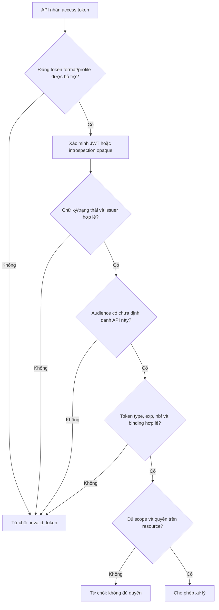
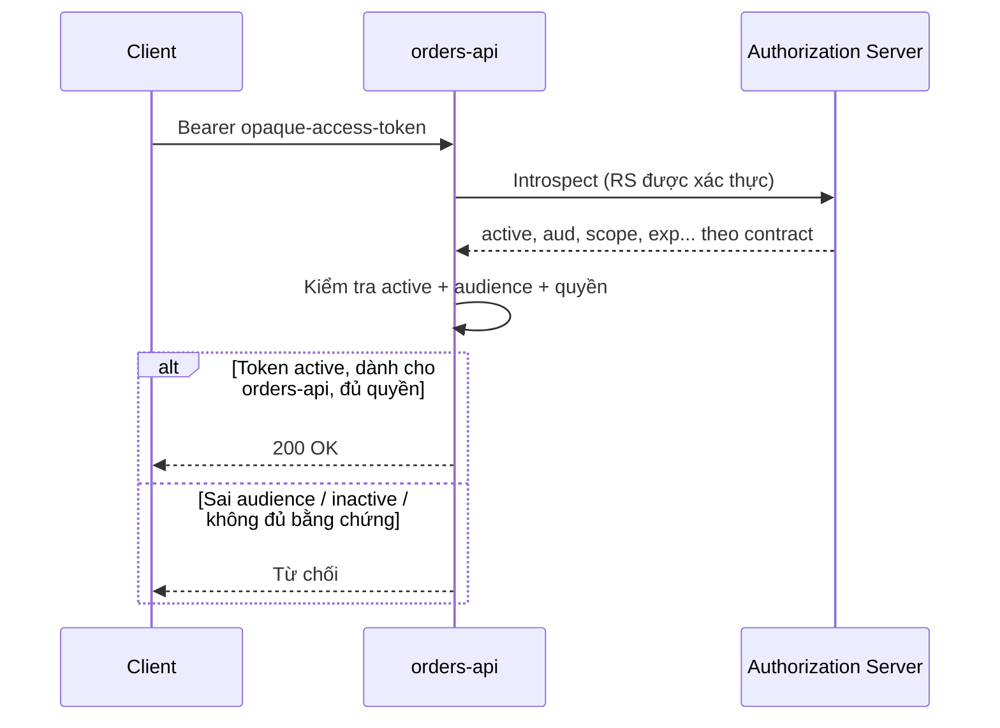

# Kiểm tra audience khi xác minh token

Trong hệ thống OAuth 2.0/OIDC, cùng một authorization server có thể phát hành token cho rất nhiều client và API. Vì vậy, một token có **chữ ký hợp lệ**, do **issuer đáng tin** phát hành và **chưa hết hạn** vẫn có thể **không được phép dùng tại API hiện tại**. Câu hỏi cần trả lời là: **token này có thực sự được phát hành cho bên nhận đang kiểm tra nó không?**

Đó là nhiệm vụ của bước **kiểm tra audience (audience validation)**. Trong chương **Token validation** của module **SECURITY_TOKEN_SECURITY_FUNDAMENTALS**, bước này phải được đặt bên cạnh việc xác minh nguồn phát hành, chữ ký hoặc trạng thái opaque token, thời gian hiệu lực, scope và quyền trên tài nguyên. Kiểm tra audience đúng cách giúp chặn **token substitution**, việc dùng ID token thay access token, việc chuyển tiếp token sai đích giữa microservice và một số đường lạm dụng token bị đánh cắp.

**Quy tắc cốt lõi:** resource server chỉ chấp nhận access token được dành cho **chính resource server đó** theo hợp đồng với authorization server. Không thể suy ra audience từ issuer, chữ ký, scope hay client ID.

## 1. Audience là gì và vì sao bắt buộc phải kiểm tra?

Trong JWT, claim `aud` (*audience*) xác định những bên nhận mà JWT được dành cho. Theo RFC 7519, giá trị có thể là:

- Một chuỗi: `"aud": "orders-api"`.
- Một mảng chuỗi: `"aud": ["orders-api", "reports-api"]`.

Định danh audience có thể là tên logic, URI hoặc một giá trị khác được bên phát hành và bên nhận thống nhất. **Không có quy tắc phổ quát buộc `aud` phải là hostname, URL đang gọi hoặc `client_id`.**

Các claim dễ bị nhầm:

| Claim/khái niệm | Câu hỏi trả lời | Ví dụ | Có thay thế `aud` không? |
| --- | --- | --- | --- |
| `iss` | **Ai phát hành** token? | `https://auth.example.test` | **Không** |
| `aud` | Token **dành cho bên nhận nào**? | `orders-api` | Đây là thông tin cần kiểm tra |
| `sub` | Token biểu diễn **chủ thể nào**? | `user-123` | Không |
| `client_id` | OAuth client nào liên quan đến token? | `shop-web` | Không; client không mặc nhiên là API đích |
| `scope` | Phạm vi quyền được cấp là gì? | `orders:read` | Không; scope không chỉ rõ resource server được nhận token |
| `exp` | Token hết hạn lúc nào? | `1893456900` | Không; token còn hạn vẫn có thể sai audience |
| `jti` | Định danh một token cụ thể | `token-id-123` | Không; có thể phục vụ truy vết hoặc chống phát lại theo thiết kế |

### Ví dụ: một issuer, hai API

Giả sử có `orders-api` và `payments-api` cùng tin `https://auth.example.test`. Client `shop-web` được cấp access token dành cho `orders-api`:

```json
{
  "iss": "https://auth.example.test",
  "sub": "user-123",
  "aud": "orders-api",
  "client_id": "shop-web",
  "scope": "orders:read",
  "iat": 1893456000,
  "exp": 1893456900
}
```

Đây chỉ là **payload minh họa**, chưa phải JWT đã ký. Nếu `payments-api` nhận token này, nó phải **từ chối**, kể cả khi:

- Chữ ký hợp lệ.
- `iss` khớp authorization server mà `payments-api` tin.
- Token chưa hết hạn.
- `sub` là người dùng có tài khoản trong hệ thống.
- Token có một scope trông có vẻ liên quan.

Lý do: **`aud=orders-api` không cho phép `payments-api` tiếp nhận token này**. Kiểm tra `iss` xác minh *nguồn*, còn kiểm tra `aud` xác minh *đích*.

## 2. Xác minh audience nằm ở bước nào trong quy trình token validation?

Một quy trình kiểm tra access token tại resource server nên gồm các lớp:

1. **Nhận token theo cách được phép:** thường là header `Authorization: Bearer ...` qua HTTPS; áp dụng giới hạn độ dài và định dạng đầu vào.
2. **Chọn validator theo cấu hình tin cậy:** API biết trước issuer, token profile, thuật toán/khóa hoặc introspection endpoint được phép. Không chọn một issuer bất kỳ chỉ vì payload khai như vậy.
3. **Xác thực token:** JWT phải có chữ ký hợp lệ theo cấu hình hoặc opaque token phải được tra cứu/introspect bằng kênh đáng tin.
4. **Kiểm tra các ràng buộc định danh token:** đúng `iss`, đúng **`aud`**, đúng loại/profile của access token; kiểm tra `exp`, `nbf` và các claim bắt buộc.
5. **Kiểm tra ràng buộc bên gửi nếu có:** ví dụ proof DPoP hoặc chứng chỉ mTLS tương ứng token sender-constrained.
6. **Phân quyền:** scope, principal, tenant, owner, trạng thái tài nguyên và điều kiện nghiệp vụ.
7. **Chỉ sau tất cả các bước đạt** mới thực hiện thao tác trên tài nguyên.

Với một thư viện JWT, bước kiểm tra chữ ký, issuer, audience và thời hạn có thể được cấu hình thành **một validator tổng hợp**; không nhất thiết thực thi theo đúng thứ tự dòng code trên. Điều bắt buộc là **không dùng claim chưa được xác minh để cấp quyền** và **không bỏ qua audience**.



**Lưu ý:** một token sai audience nên được coi là **không hợp lệ đối với RS hiện tại**, không phải là token hợp lệ rồi được «chữa» bằng cách kiểm tra role, scope hoặc endpoint khác.

## 3. Quy tắc so khớp `aud` chính xác

### 3.1. So khớp thành viên, không so khớp chuỗi con

Giả sử API hiện tại cấu hình:

```text
expectedAudience = "orders-api"
```

Các trường hợp:

| Claim `aud` đã được xác minh | Khớp không? | Giải thích |
| --- | --- | --- |
| `"orders-api"` | Có | Chuỗi trùng chính xác |
| `["orders-api"]` | Có | Mảng chứa audience mong đợi |
| `["orders-api", "reports-api"]` | Có **nếu policy cho phép multi-audience** | Có thành viên trùng chính xác |
| `"orders-api-admin"` | **Không** | Trùng tiền tố không phải trùng audience |
| `"Orders-API"` | **Không** | Không tự bỏ qua khác biệt chữ hoa/thường |
| `"https://api.example.test/orders"` | **Không**, nếu không được cấu hình là audience hợp lệ | URL trông giống resource không có nghĩa là alias hợp lệ |
| `["payments-api", "reports-api"]` | **Không** | Mảng không chứa API hiện tại |
| `null` hoặc không có `aud` | **Không** khi profile yêu cầu audience | Không thể tự suy từ issuer/client ID |
| `123` hoặc `{"service":"orders-api"}` | **Không** | Sai kiểu theo JWT/profile |

Hai lỗi thường gặp:

```java
// SAI: trùng chuỗi con, có thể nhận "orders-api-admin".
if (audience.toString().contains("orders-api")) {
    authorize();
}

// SAI: giả định mọi JWT chỉ có aud dạng chuỗi.
String aud = (String) jwtClaims.get("aud");
```

Thay vào đó, dùng thư viện có validator `aud` theo RFC 7519/profile, **kiểm tra kiểu** rồi so sánh chính xác với tập audience được cấu hình.

### 3.2. Chuỗi, mảng và định danh StringOrURI

Theo RFC 7519, `aud` chứa `StringOrURI`. Nếu giá trị có dấu hai chấm và mang dạng URI, so sánh chuỗi vẫn phải dựa trên định danh được thống nhất; không tự ý:

- Bỏ `/` cuối đường dẫn.
- Đổi `http` thành `https`.
- Bỏ cổng hoặc thay hostname bằng alias.
- Bỏ qua chữ hoa/chữ thường của toàn bộ URI.
- Dùng so khớp wildcard như `https://api.example.test/*` khi contract chỉ công nhận audience cụ thể.

Các thao tác «chuẩn hóa tiện lợi» có thể khiến token dành cho một resource được chấp nhận ở resource khác. Nếu cần đổi audience từ `orders-api` sang `https://api.example.test/orders`, phải có **danh sách audience hợp lệ tường minh và cửa sổ migration**.

### 3.3. Có nên cho phép nhiều audience?

Một JWT có thể dành cho nhiều resource server, nhưng đây phải là **lựa chọn có chủ đích**. Token đa audience có thể làm tăng phạm vi tác động nếu token bị đánh cắp: một bearer token từ API A có thể bị thử tại API B cũng nằm trong `aud`.

Hai chiến lược:

- **Audience đơn:** mỗi access token được cấp cho một API hoặc một resource logic. Dễ kiểm soát phạm vi sử dụng, scope và thu hồi.
- **Multi-audience có kiểm soát:** chỉ chấp nhận nếu AS và tất cả RS liên quan đã có hợp đồng về scope, token type, vòng đời và chính sách. Mỗi RS kiểm tra **audience của chính nó** trong mảng.

Nếu policy của `orders-api` chỉ cho phép access token có đúng một audience, token `["orders-api", "payments-api"]` có thể bị từ chối **dù có chứa orders-api**. Đây là **quy tắc ứng dụng bổ sung** nhằm giảm khả năng token bị dùng ở nhiều nơi; không phải mọi mảng `aud` đều bị JWT cấm.

## 4. Audience phải được gắn với issuer và token profile

API không nên kiểm tra `aud` một cách biệt lập. Cấu hình tin cậy cần ràng buộc:

```text
AcceptedTokenPolicy {
    issuer: "https://auth.example.test",
    audience: "orders-api",
    token_type: "oauth_access_token",
    allowed_signature_algorithms: [theo cấu hình tin cậy],
    trust_keys: JWKS của issuer đã xác thực,
    required_scopes_by_action: {...}
}
```

Một API nhiều tenant có thể tin nhiều issuer, nhưng từng issuer phải có cấu hình khóa, audience và schema/profile riêng nếu cần. Không «thử mọi JWKS công khai trên Internet» đến khi có khóa xác minh được chữ ký. Ngay cả khi hai issuer phát hành `aud=orders-api`, token của issuer không được tin vẫn phải bị từ chối.

### 4.1. `kid`, `alg`, `typ` không thay thế audience

Trong JOSE header:

| Header | Ý nghĩa | Sai lầm thường gặp |
| --- | --- | --- |
| `kid` | Gợi ý khóa trong tập khóa đã tin cậy | Coi `kid` là định danh resource hoặc cho tải khóa từ URL do token chỉ định |
| `alg` | Thuật toán bảo vệ JWT | Chấp nhận mọi thuật toán token tự khai, kể cả ngoài allowlist |
| `typ` | Loại/profile JWT | Chỉ check `typ` mà bỏ qua `aud`, hoặc không phân biệt ID token và access token |

JWT access token theo **RFC 9068** dùng kiểu rõ ràng như `at+jwt` và có quy tắc claim, bao gồm `aud`. Resource server phải sử dụng validator phù hợp với profile đã đăng ký. Một JWT bất kỳ có chữ ký đúng không nhất thiết là access token hợp lệ.

### 4.2. Đừng để token tự chọn expected audience

Ví dụ sai:

```java
// SAI: expectedAudience lấy từ chính token cần xác minh.
String expectedAudience = decodeWithoutVerification(rawToken).getAudience();
validator.setExpectedAudience(expectedAudience);
```

Tương tự, lấy `expectedAudience` từ `X-Audience`, body, query string hoặc hostname do client điều khiển là nguy hiểm. Nó cho phép bên gọi **định nghĩa tiêu chí mà chính token phải vượt qua**. Expected audience phải đến từ cấu hình backend theo resource/route được bảo vệ và hợp đồng với AS.

## 5. Ví dụ Java: viết validator audience trong resource server

Ví dụ sau dùng **Spring Security Resource Server** để minh họa cấu hình audience tường minh cho `orders-api`. Mã giả định ứng dụng có các dependency Spring Security OAuth2 Resource Server/Jose và issuer của môi trường đã được xác thực/cấu hình. Cần kiểm tra phiên bản framework và profile token khi tích hợp thực tế.

```java
import java.util.List;
import org.springframework.context.annotation.Bean;
import org.springframework.context.annotation.Configuration;
import org.springframework.security.oauth2.core.OAuth2Error;
import org.springframework.security.oauth2.core.OAuth2TokenValidator;
import org.springframework.security.oauth2.core.OAuth2TokenValidatorResult;
import org.springframework.security.oauth2.core.DelegatingOAuth2TokenValidator;
import org.springframework.security.oauth2.jwt.Jwt;
import org.springframework.security.oauth2.jwt.JwtDecoder;
import org.springframework.security.oauth2.jwt.JwtValidators;
import org.springframework.security.oauth2.jwt.NimbusJwtDecoder;

@Configuration
public class AccessTokenValidationConfig {
    private static final String ISSUER = "https://auth.example.test";
    private static final String AUDIENCE = "orders-api";

    @Bean
    JwtDecoder jwtDecoder() {
        // Nguồn issuer được cấu hình cố định, không lấy từ token đầu vào.
        NimbusJwtDecoder decoder =
            NimbusJwtDecoder.withIssuerLocation(ISSUER).build();

        OAuth2TokenValidator<Jwt> issuerAndTime =
            JwtValidators.createDefaultWithIssuer(ISSUER);

        OAuth2TokenValidator<Jwt> audienceValidator = jwt -> {
            List<String> audiences = jwt.getAudience();
            if (audiences != null && audiences.contains(AUDIENCE)) {
                return OAuth2TokenValidatorResult.success();
            }
            OAuth2Error error = new OAuth2Error(
                "invalid_token",
                "Access token is not intended for orders-api",
                null
            );
            return OAuth2TokenValidatorResult.failure(error);
        };

        decoder.setJwtValidator(
            new DelegatingOAuth2TokenValidator<>(
                issuerAndTime,
                audienceValidator
            )
        );
        return decoder;
    }
}
```

**Phạm vi ví dụ:** đoạn cấu hình trên thể hiện cách kết hợp validator **issuer/thời gian** với **audience**. Với hệ thống dùng RFC 9068, cần cấu hình/kiểm tra thêm **token type, thuật toán cho phép, claim bắt buộc, quyền scope và sender binding nếu có** theo profile; không mặc định đoạn ví dụ tự kiểm tra toàn bộ tiêu chuẩn. Một số phiên bản Spring Security đã có cơ chế cấu hình audience trực tiếp; mục tiêu ở đây là thấy rõ tiêu chí xác minh.

Phần thực thi API vẫn phải phân quyền nghiệp vụ:

```java
// Pseudocode sau khi JWT đã được xác minh bởi filter/resource server.
Response getOrder(VerifiedAccessToken token, String orderId) {
    if (!token.scopes().contains("orders:read")) {
        return forbidden("insufficient_scope");
    }
    Order order = ordersRepository.findById(orderId);
    if (order == null) {
        return notFound();
    }
    if (!token.tenantId().equals(order.tenantId())) {
        return forbidden("cross_tenant");
    }
    if (!authorization.canReadOrder(token.subject(), order)) {
        return forbidden("object_access_denied");
    }
    return ok(order);
}
```

**Scope hợp lệ và audience đúng vẫn chưa đủ** nếu request nhắm vào đơn hàng người khác hoặc tenant không được phép. Audience giới hạn *nơi token được chấp nhận*, còn authorization trên tài nguyên quyết định *hành động nào được phép*.

### 5.1. Nhiều API trong cùng ứng dụng

Nếu cùng một backend triển khai cả `/orders/**` và `/payments/**`, không nên có một audience chung quá rộng chỉ để tiện cấu hình. Có thể:

- Tách resource server/logical API với audience tương ứng; hoặc
- Cấu hình chuỗi xử lý bảo mật theo route, mỗi nhánh có expected audience riêng; hoặc
- Sử dụng một audience chung **chỉ khi đó thực sự là một resource thống nhất**, có scope/policy rõ và đã được AS thiết kế như vậy.

Không lấy tên API từ URL do client gửi rồi tự động coi đó là audience hợp lệ. Quy tắc route → audience phải do server quản trị và không bị request giả mạo thay đổi.

## 6. OIDC ID token và OAuth access token: kiểm tra audience khác mục đích

Trong **OIDC**, **ID token** được phát hành cho **Relying Party (RP)/client** để biểu diễn kết quả xác thực. Audience của ID token phải bao gồm **`client_id` của RP**. Resource server phục vụ API cần **access token đúng audience**, không phải ID token.

Ví dụ RP `shop-web` nhận hai token:

| Token | Claim `iss` | Claim `aud` | Bên sử dụng |
| --- | --- | --- | --- |
| **ID token** | `https://auth.example.test` | `shop-web` | **RP/client** xác minh kết quả đăng nhập |
| **Access token** | `https://auth.example.test` | `orders-api` | **orders-api** xác minh trước khi cấp truy cập |
| **Refresh token** | Theo thiết kế AS, thường opaque | Không giả định có `aud` tự đọc được | **AS/token endpoint** nhận để gia hạn token |

Nếu `orders-api` chỉ kiểm tra chữ ký và issuer, nó có thể nhận nhầm ID token của `shop-web`. Đây là một trường hợp **cross-JWT confusion**: cùng issuer và cùng thuật toán ký không làm hai loại JWT có thể hoán đổi.

Ví dụ payload ID token:

```json
{
  "iss": "https://auth.example.test",
  "sub": "user-123",
  "aud": "shop-web",
  "iat": 1893456000,
  "exp": 1893456900,
  "nonce": "random-value-bound-to-login-request"
}
```

**`orders-api` phải từ chối** vì audience dành cho `shop-web` và loại token không phải access token của API.

### 6.1. `azp` có thay `aud` được không?

Trong OIDC ID token, `azp` (*authorized party*) có thể xuất hiện khi cần phân biệt bên được ủy quyền, nhất là trong trường hợp nhiều audience. RP vẫn phải kiểm tra `aud` chứa **`client_id` của chính mình**, và kiểm tra `azp` theo quy tắc OIDC tương ứng. **`azp` không cho phép bỏ qua `aud`**.

Với access token, claim `client_id` có thể giúp xác định OAuth client liên quan, nhưng nó cũng **không phải audience**. `client_id=shop-web` chỉ cho biết client xin token, chứ không chứng minh token được cấp cho `orders-api`.

## 7. Audience validation với opaque access token

Một access token **opaque** là giá trị mà resource server không trực tiếp phân tích thành JWT claims. Để xác minh, RS có thể gọi **OAuth 2.0 Token Introspection** (RFC 7662) bằng kênh TLS được bảo vệ và cơ chế xác thực phù hợp.



Ví dụ phản hồi introspection minh họa:

```json
{
  "active": true,
  "iss": "https://auth.example.test",
  "sub": "user-123",
  "aud": "orders-api",
  "client_id": "shop-web",
  "scope": "orders:read",
  "exp": 1893456900
}
```

Trường `aud` có thể xuất hiện trong introspection response, nhưng **không phải mọi AS đều cung cấp đầy đủ các trường tùy chọn**. RS có hai cách thiết kế an toàn:

1. **AS trả audience/resource metadata:** RS đối chiếu giá trị với audience của mình.
2. **AS ràng buộc introspection theo danh tính RS:** nếu hợp đồng với AS **bảo đảm** rằng RS không bao giờ nhận `active=true` cho token dành cho resource khác, RS có thể dựa vào bảo đảm tương đương này.

Nếu phản hồi chỉ có `active=true` mà **không có `aud`, resource binding hoặc cam kết bảo vệ tương đương**, RS chưa có đủ bằng chứng token dành cho API của mình. **Không lấy `active` hoặc `iss` thay thế audience.**

Cache introspection cần được giới hạn tuổi theo lifetime token, yêu cầu thu hồi và mức rủi ro; phản hồi được cache lâu có thể khiến việc thay đổi trạng thái token chậm có hiệu lực. Bảo đảm audience vẫn phải được giữ trong mọi lần kiểm tra, kể cả kết quả từ cache.

## 8. Client xin token cho đúng resource như thế nào?

OAuth 2.0 **Resource Indicators** (RFC 8707) cho phép client chỉ định resource mong muốn qua tham số `resource`, nếu AS hỗ trợ. Ví dụ:

```text
resource=https://api.example.test/orders
scope=orders:read
```

AS quyết định có cấp token cho resource đó hay không dựa trên client registration, grant, scope, consent và chính sách. Access token được cấp có thể mang:

```json
{
  "iss": "https://auth.example.test",
  "aud": "orders-api",
  "scope": "orders:read"
}
```

Đây là payload minh họa rút gọn; **chuỗi `resource` trong request không nhất thiết giống hệt chuỗi `aud` của token**, vì AS và RS có thể thống nhất ánh xạ resource URI sang audience logic. Không được tự chuẩn hóa hoặc suy diễn mapping từ phía RS nếu hợp đồng không có.

```mermaid
sequenceDiagram
    participant Client as OAuth Client
    participant AS as Authorization Server
    participant Orders as orders-api
    participant Payments as payments-api

    Client->>AS: Xin token cho resource=orders
    AS->>AS: Kiểm tra quyền xin token của client
    AS-->>Client: Access token aud=orders-api
    Client->>Orders: Gọi API với access token
    Orders->>Orders: Xác minh iss, aud, type, scope
    Orders-->>Client: Cho phép nếu policy đạt
    Client->>Payments: Gửi lại cùng access token
    Payments->>Payments: expectedAud=payments-api; token aud=orders-api
    Payments-->>Client: Từ chối vì sai audience
```

Ngay cả khi client tự gửi `resource=payments-api` trong request đến `payments-api`, **không thể đổi audience của access token đã phát hành**. Client phải xin token phù hợp thông qua luồng AS cho phép.

## 9. Microservice: không chuyển tiếp token sai audience

Giả sử client được cấp token `aud=checkout-api` để đặt hàng. `checkout-api` cần gọi `inventory-api` để giữ hàng. Nếu chuyển nguyên token đó xuống `inventory-api`, service sau phải từ chối vì **không nằm trong audience của token**.

Các cách xử lý theo kiến trúc:

- **Service-to-service:** `checkout-api` nhận một access token dành cho `inventory-api` bằng grant phù hợp, ví dụ `client_credentials`, với scope và quyền của service principal.
- **Thay mặt người dùng:** sử dụng delegation/token exchange được AS hỗ trợ (ví dụ RFC 8693), cấp token mới với audience `inventory-api` và quyền không vượt quá điều kiện ủy quyền.
- **Token nội bộ:** gateway hoặc backend phát bằng chứng nội bộ theo một trust boundary được quản lý, với issuer/audience/lifetime và ràng buộc phù hợp; service không tin header tự khai từ Internet.

```text
Client token:      aud = checkout-api
    |
    v
checkout-api  --(xin token thích hợp tại AS)-->  token mới
                                                   aud = inventory-api
                                                       |
                                                       v
                                                 inventory-api
```

**Không giải quyết bằng cách cho `inventory-api` bỏ kiểm tra audience.** Làm vậy biến việc gọi sai đích thành một đường mở rộng phạm vi sử dụng token.

### 9.1. API gateway xác minh audience thay cho service được không?

Gateway có thể làm **Policy Enforcement Point** và xác minh token theo audience của endpoint phía sau, nhưng cần thiết kế rõ:

1. Gateway biết tuyến đường/RS đích và expected audience từ **cấu hình đáng tin**.
2. Header danh tính/quyền do gateway gửi xuống **không thể bị client Internet giả mạo**; gateway phải ghi đè/xóa header đến từ ngoài và chặn đường truy cập trực tiếp không được phép.
3. Backend chỉ tin kết quả gateway trên kênh có xác thực/bảo vệ phù hợp.
4. Backend vẫn kiểm tra **quyền trên resource**, tenant, owner và trạng thái nghiệp vụ.

Nếu gateway chỉ kiểm tra `iss` chung cho mọi tuyến rồi đưa bearer token xuống nhiều API, lỗi cross-resource vẫn tồn tại.

## 10. Những sai lầm trong thiết kế audience validation

| Anti-pattern | Nguy cơ | Cách sửa |
| --- | --- | --- |
| Chỉ kiểm tra chữ ký, `iss`, `exp` | Token dành cho API khác vẫn được chấp nhận | Kiểm tra expected audience riêng cho mỗi RS |
| Dùng `iss` làm `aud` mong đợi | Nhầm bên phát hành với bên nhận | Cấu hình audience từ hợp đồng AS–RS |
| So sánh `aud` bằng `contains()` trên chuỗi | Khớp nhầm tiền tố hoặc substring | Dùng membership exact string của JWT audience |
| Chuẩn hóa URI tùy tiện, bỏ qua chữ hoa/thường | Audience khác nhau bị coi tương đương | So khớp đúng định danh đã đăng ký |
| Lấy expected audience từ payload/header/query client | Người gọi tự đặt điều kiện kiểm tra | Dùng cấu hình resource server/route nội bộ |
| Chấp nhận `aud` thiếu vì issuer đã đúng | Token không có bằng chứng dành cho RS | Fail closed theo profile/contract |
| Bỏ qua token type | ID token hoặc JWT khác bị dùng như API token | Validator riêng cho ID token/access token, kiểm tra profile |
| Coi `client_id` hoặc `azp` là audience | Nhầm OAuth client với RS | Kiểm tra `aud` đúng đối tượng nhận |
| Tin `active=true` từ introspection bất kể resource | Opaque token dành cho hệ thống khác được chấp nhận | Kiểm tra aud/resource binding hoặc bảo đảm introspection theo RS |
| Dùng wildcard `aud=*` để giảm lỗi tích hợp | Mọi token từ AS có thể trở thành token dùng chung | Phân tách audience và cấp token đúng resource |
| Cho RS B nhận token của RS A trong microservice | Token bị chuyển ngang giữa trust boundary | Token exchange/delegation hoặc service token đúng audience |
| Multi-audience không có policy rõ | Token lộ ở API A có thể dùng ở API B | Giới hạn audience, scope, lifetime, sender constraints |
| Chỉ dựa audience mà bỏ scope/owner | Truy cập hành động hoặc đối tượng không có quyền | Kiểm tra authorization sau khi token hợp lệ |
| Dùng `jti` hoặc DPoP thay audience | Chống replay/binding không chứng minh đích nhận | Kiểm tra audience và sender binding độc lập |

### 10.1. Audience có chống được token bị đánh cắp không?

**Chỉ một phần.** Audience hạn chế số resource server được phép tiếp nhận token, nhưng **bearer token bị đánh cắp vẫn có thể bị sử dụng tại đúng audience** khi chưa hết hạn. Các biện pháp khác cần thiết gồm HTTPS, lưu trữ an toàn, hạn token phù hợp, thu hồi/introspection, theo dõi hành vi và **sender-constrained token** như DPoP hoặc mTLS khi có yêu cầu.

Tương tự, refresh token rotation và phát hiện reuse là biện pháp quản lý **vòng đời refresh token tại AS**, không thay cho kiểm tra audience của access token tại RS.

## 11. HTTP response khi audience không hợp lệ

Trong OAuth bearer token usage (RFC 6750), resource server thường phản hồi:

- **401 Unauthorized** với `WWW-Authenticate: Bearer` và thông tin `invalid_token` phù hợp khi token không thể được chấp nhận, bao gồm sai audience đối với API hiện tại.
- **403 Forbidden** với `insufficient_scope` khi token được xác minh hợp lệ nhưng thiếu phạm vi cần cho hành động.
- **403** hoặc theo chính sách có thể **404** đối với quyền đối tượng/tenant, dù token và scope đều hợp lệ.

Ví dụ khái quát:

```http
HTTP/1.1 401 Unauthorized
WWW-Authenticate: Bearer error="invalid_token"
Cache-Control: no-store
```

Không cần tiết lộ ra client mọi chi tiết cấu hình issuer, audience hoặc scope nội bộ. Audit phía server có thể ghi lỗi `audience_mismatch` kèm ID request/route, nhưng **không ghi raw access token, refresh token hoặc ID token**.

## 12. Ma trận kiểm thử audience validation

| Ca kiểm thử | Đầu vào | Kỳ vọng tại `orders-api` |
| --- | --- | --- |
| Đúng issuer/audience | `iss` đã tin, `aud="orders-api"`, chữ ký/hạn hợp lệ | Qua bước audience; còn phải xét scope/owner |
| Audience mảng một phần tử | `aud=["orders-api"]` | Qua bước audience |
| Audience mảng nhiều phần tử | `aud=["orders-api", "reports-api"]` | Qua nếu policy cho phép multi-audience |
| Sai audience | `aud="payments-api"` | Từ chối |
| Sai issuer nhưng audience đúng | `iss` không được tin, `aud="orders-api"` | Từ chối |
| Audience là tiền tố gần giống | `aud="orders-api-admin"` | Từ chối, không substring match |
| Khác chữ hoa/thường | `aud="Orders-API"` | Từ chối nếu không có định danh đó trong cấu hình |
| URI khác audience logic | `aud="https://api.example.test/orders"` | Từ chối nếu contract mong `orders-api` |
| Thiếu `aud` | JWT không có claim audience | Từ chối với profile bắt buộc |
| `aud` sai kiểu | Số, object, `null`, mảng chứa phần tử không phải chuỗi | Từ chối |
| JWT chữ ký bị sửa | Payload có `aud` đúng nhưng chữ ký sai | Từ chối |
| Token hết hạn | `exp <= now` | Từ chối |
| Token chưa có hiệu lực | `nbf > now` ngoài độ lệch cho phép | Từ chối |
| ID token của RP | `aud="shop-web"`, issuer hợp lệ | Từ chối vì sai type/audience |
| JWT có `typ` không phù hợp | Token không theo profile access token yêu cầu | Từ chối |
| Token có `client_id="shop-web"` nhưng `aud` sai | Client ID đúng, audience sai | Từ chối |
| Token có scope đúng nhưng `aud` sai | `scope="orders:read"`, `aud="payments-api"` | Từ chối |
| Token có audience đúng nhưng scope thiếu | `aud="orders-api"`, scope không đủ | Từ chối phân quyền |
| Token có audience/scope đúng nhưng tenant sai | Resource thuộc tenant khác | Từ chối đối tượng |
| Opaque introspection báo `active=false` | Token không hoạt động | Từ chối |
| Opaque `active=true` nhưng `aud` sai | Token dành cho API khác | Từ chối |
| Opaque `active=true`, không có resource binding | Không đủ bằng chứng token dành cho RS | Từ chối theo contract an toàn |
| Client gửi `X-Audience: orders-api` | Token thực có audience khác | Từ chối; bỏ qua header tự khai |
| Forward token qua service | Token của `checkout-api` gọi `inventory-api` | Service đích từ chối |
| Multi-issuer | Audience đúng nhưng ký bởi issuer không được phép trên tuyến này | Từ chối |
| Token bị dùng lại ở audience đúng | Bearer token replay trước khi hết hạn | Audience vẫn khớp; replay cần biện pháp độc lập |

**Kiểm thử phải chạy qua validator thực**, với token thử nghiệm được ký hợp lệ và token sai chữ ký, không chỉ parse JSON rồi so sánh một giá trị. Với opaque token cần mock/test introspection và ràng buộc AS–RS; với microservice nên có test tích hợp giữa các tuyến.

## 13. Checklist triển khai

1. **Danh tính resource:** API có expected audience rõ ràng theo hợp đồng với AS, không suy từ issuer hoặc input client?
2. **Nguồn tin cậy:** JWT có issuer/khóa/thuật toán được pin theo cấu hình; opaque introspection có xác thực và kênh bảo vệ?
3. **Audience:** validator chấp nhận `aud` kiểu string hoặc array theo profile, so khớp **chính xác**, xử lý missing/wrong type bằng cách từ chối?
4. **Type và mục đích:** RP kiểm tra audience của ID token theo client ID; RS chỉ nhận access token dành cho API, không chấp nhận ID/refresh token?
5. **Multi-audience:** có chấp nhận hay không được định nghĩa rõ, không mặc nhiên nhận mọi token chứa tên API ở bất kỳ vị trí nào?
6. **Resource indicators:** nếu dùng RFC 8707, AS có mapping được kiểm soát từ `resource` sang `aud`?
7. **Microservices:** các hop có dùng token audience đúng hoặc cơ chế token exchange/service token khi cần?
8. **Quyền:** sau audience còn kiểm tra scope, chủ thể, client, owner, tenant, trạng thái và policy nghiệp vụ?
9. **Vòng đời:** `exp`/`nbf`, revocation/introspection, sender binding và bảo vệ lưu trữ được áp dụng độc lập với audience?
10. **Kiểm thử và quan sát:** test sai audience, thiếu audience, ID token nhầm loại, header giả, đa issuer/đa audience; log lỗi an toàn mà không ghi raw token?

## Tổng kết

**Kiểm tra audience là bước xác minh token được phát hành cho đúng bên nhận.** `iss` cho biết **ai phát hành**, `aud` cho biết **ai được nhận**; cả hai phải được kiểm tra theo cấu hình tin cậy và đúng token profile. Với JWT, resource server phải xác minh chữ ký rồi so khớp `aud` dạng chuỗi hoặc mảng một cách **chính xác**, không suy diễn từ issuer, client ID hoặc scope. Với opaque token, cần introspection và bằng chứng resource binding tương đương. Audience đúng chưa phải đủ quyền: API vẫn phải xét thời hạn, loại token, scope và quyền trên tài nguyên; đồng thời bảo vệ access token trước nguy cơ đánh cắp hoặc phát lại.

**Tài liệu tham khảo:** RFC 7519 (JSON Web Token, `aud`); RFC 8725 (JWT Best Current Practices, audience và token substitution); RFC 9068 (JWT Profile for OAuth 2.0 Access Tokens); RFC 7662 (OAuth 2.0 Token Introspection); RFC 8707 (Resource Indicators for OAuth 2.0); RFC 8693 (OAuth 2.0 Token Exchange); RFC 6750 (Bearer Token Usage); RFC 9700 (OAuth 2.0 Security Best Current Practice); OpenID Connect Core 1.0.
