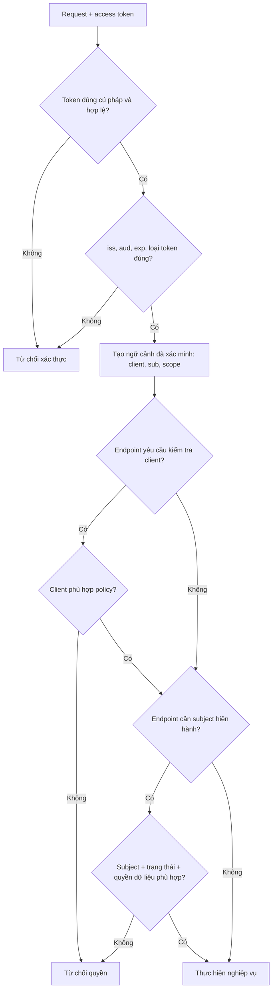
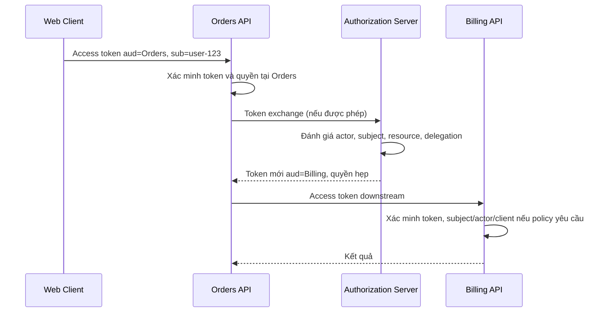

# Kiểm tra client hoặc subject khi cần

## 1. Vấn đề: token hợp lệ chưa đủ để biết *ai* đang được phép làm gì

Một **resource server** (API) nhận access token có chữ ký hợp lệ, issuer đáng tin, audience đúng và chưa hết hạn. API có nên cho phép request ngay không? **Không nhất thiết.** Một số API cần biết thêm:

- Token được cấp cho **client ứng dụng nào**?
- Token đại diện cho **người dùng nào** hay chính một **workload/service**?
- Chủ thể đó có còn tồn tại, đang hoạt động, thuộc đúng tenant hoặc được phép truy cập tài nguyên hiện tại không?
- Client có thuộc nhóm ứng dụng được phép gọi chức năng nhạy cảm không?
- Request đang được thực hiện **thay mặt người dùng**, bởi chính dịch vụ, hay qua một chuỗi ủy quyền?

Giả sử AS cấp access token cho ứng dụng quản lý đơn hàng:

```json
{
  "iss": "https://auth.example.com",
  "sub": "user-123",
  "aud": "https://orders-api.example.com",
  "client_id": "orders-web",
  "scope": "orders:read",
  "exp": 1900000900
}
```

Orders API có thể yêu cầu:

1. Token đã được **xác minh** đúng profile và audience.
2. Client `orders-web` thuộc nhóm client được phép dùng tính năng.
3. User `user-123` có quyền xem **đơn hàng đang yêu cầu**.
4. User còn là thành viên tenant và tài khoản chưa bị vô hiệu hóa nếu chính sách yêu cầu kiểm tra trạng thái hiện hành.

Nhưng với một endpoint khác chỉ hiển thị dữ liệu thống kê không gắn người dùng, API có thể **không cần tra cứu hồ sơ user trong database trên mọi request**. Bài toán là **kiểm tra client hoặc subject khi chính sách của API cần**, thay vì mặc định bỏ qua hoặc truy vấn mọi thứ vô điều kiện.

> **Nguyên tắc:** Access token có thể chứa danh tính client/chủ thể dưới dạng claims đáng tin *sau khi xác minh token*. Các claims đó cung cấp **ngữ cảnh danh tính**, không tự tạo quyền truy cập. Kiểm tra client hay subject phải xuất phát từ chính sách của endpoint, grant và loại token.

Bài thuộc chương **Token validation** của module `SECURITY_TOKEN_SECURITY_FUNDAMENTALS`, liên hệ trực tiếp với JWT/opaque token, OAuth 2.0/OIDC, scope, audience, vòng đời phát hành–sử dụng–thu hồi token và kiểm soát việc token bị đánh cắp hoặc phát lại.

## 2. Phân biệt client, subject, resource owner và actor

### 2.1. Các vai trò không đồng nghĩa

| Khái niệm | Ý nghĩa trong ngữ cảnh OAuth/API | Ví dụ |
| --- | --- | --- |
| **Client** | Phần mềm yêu cầu/nhận access token và gọi API | `orders-web`, `reporting-job` |
| **Client ID** | Định danh client do AS cấp/quản lý; thường **không phải bí mật** | `orders-web` |
| **Subject** (`sub`) | Chủ thể mà token/claim nói đến, theo issuer và profile | `user-123` hoặc một client/workload |
| **Resource owner** | Bên có khả năng cho phép truy cập protected resource theo mô hình OAuth | Người dùng hoặc bên có thẩm quyền |
| **Resource server** | API nhận và xác minh access token | Orders API |
| **Actor** | Bên thực hiện hành động thay mặt một subject trong một mô hình ủy quyền được định nghĩa | Orders Service gọi Payments thay user |
| **Authorization server** | Bên xác thực client/grant và quyết định cấp token | `https://auth.example.com` |

**Client không mặc nhiên là subject.** Trong authorization code grant có người dùng, client là ứng dụng còn subject thường đại diện người dùng. Trong client credentials grant, token có thể đại diện cho **chính client/workload**, vì không có đăng nhập người dùng.

**Subject không tự đồng nghĩa “tài khoản người dùng hiện hành”.** Giá trị `sub` chỉ mang ý nghĩa theo issuer và loại token. Để ánh xạ sang user nội bộ, API cần một hợp đồng nhận diện đáng tin.

### 2.2. Mẫu hai token khác nhau

**Token có ngữ cảnh người dùng:**

```json
{
  "iss": "https://auth.example.com",
  "sub": "user-123",
  "client_id": "orders-web",
  "aud": "https://orders-api.example.com",
  "scope": "orders:read",
  "exp": 1900000900
}
```

**Token cho workload qua client credentials (minh họa):**

```json
{
  "iss": "https://auth.example.com",
  "sub": "reporting-service",
  "client_id": "reporting-service",
  "aud": "https://reports-api.example.com",
  "scope": "reports:read",
  "exp": 1900000300
}
```

Trong một số profile, đặc biệt JWT access token theo RFC 9068, giá trị `sub` khi dùng client credentials phản ánh định danh client theo quy định của profile. **Không suy diễn từ việc `sub == client_id` rằng mọi token đều là client credentials**, hoặc ngược lại rằng hai giá trị này luôn phải giống nhau ở mọi grant/profile.

Các JSON chỉ là **payload minh họa**, không phải token có chữ ký hợp lệ để sử dụng.

## 3. Các điều kiện xác minh token phải có trước

**Kiểm tra client/subject không thay cho kiểm tra access token.** Trước khi tin bất kỳ claim nào, API phải thiết lập rằng token đã được phát hành đúng và còn hợp lệ.

Một quy trình thông thường:

1. **Nhận đúng loại credential** ở vị trí phù hợp (ví dụ `Authorization: Bearer`; hoặc DPoP/mTLS với profile ràng buộc bên gửi).
2. **Xác minh token**: chữ ký và thuật toán/khóa với JWT; hoặc trạng thái qua introspection đáng tin với opaque token.
3. **Kiểm tra issuer** (`iss`) thuộc nhà phát hành mà API cho phép.
4. **Kiểm tra audience** (`aud`) chứa đúng định danh của resource server.
5. **Kiểm tra thời gian** như `exp`, `nbf` theo profile; xử lý thu hồi/trạng thái theo thiết kế.
6. **Kiểm tra loại token/profile**: access token, không chấp nhận ID token hay refresh token để gọi API.
7. **Trích client/subject** từ claims hoặc metadata đã được xác minh **theo quy tắc issuer/profile**.
8. **Áp dụng chính sách endpoint**: scope, client allowlist, user/workload identity, tenant, quyền bản ghi, trạng thái hiện hành.



Sơ đồ là **khung tư duy**, không bắt buộc thứ tự hàm trong thư viện. Việc thiếu claim **bắt buộc theo profile** là lỗi validation ngay cả khi endpoint không cần tra cứu thêm user. “Khi cần” chỉ nói đến **những kiểm tra chính sách bổ sung**, không cho phép bỏ qua `iss`, `aud` hoặc claim bắt buộc của token profile.

### 3.1. Không dùng claims trước khi verify

Dữ liệu payload của JWT ký số thường có thể giải mã Base64url **mà chưa kiểm tra chữ ký**. Vì vậy:

```text
Sai:
  parse JWT -> đọc sub/client_id -> cho phép theo ID
  -> sau đó mới kiểm tra chữ ký

Đúng:
  verify JWT + issuer + audience + time + token profile
  -> tạo verified principal context
  -> quyết định có cần kiểm tra client/subject/ACL hay không
```

Không dùng `client_id`, `sub` hoặc `roles` do client gửi trong header/body thay cho claims đã được xác minh.

## 4. Khi nào phải kiểm tra **client**?

### 4.1. Endpoint chỉ cho phép một số ứng dụng

Có API chỉ phục vụ **ứng dụng nội bộ đã được phê duyệt**, dù nhiều client cùng có access token do một AS phát hành.

Ví dụ: Orders API có endpoint `POST /orders/bulk-import` chỉ được gọi bởi `warehouse-sync`. Ngoài điều kiện access token hợp lệ và scope thích hợp, policy có thể yêu cầu:

```text
token.client_id == "warehouse-sync"
AND "orders:bulk-import" in token.scope
AND token.aud == Orders API
```

Nếu token thuộc `orders-web`, API có thể từ chối dù user của client có quyền rộng. Đây là kiểm soát **theo danh tính ứng dụng**, bổ sung cho quyền của subject.

Tuy nhiên, client ID **không phải mật khẩu**. Việc thấy `client_id = warehouse-sync` trong một token đã được AS ký chỉ cho biết **AS khẳng định token được cấp cho client ấy**. Nó không chứng minh người gọi hiện tại đang sở hữu client secret hay private key, nếu token là **bearer** và có thể đã bị đánh cắp.

### 4.2. API của workload/service-to-service

Với endpoint vận hành theo client credentials grant, API có thể cần danh tính **workload**:

```text
aud:       https://reports-api.example.com
client_id: nightly-reports
scope:     reports:generate
principal: workload, không phải end user
```

API nên:

- Giới hạn các client/service đã được phép gọi chức năng.
- Kiểm tra scope dành cho workload.
- Không tạo một “user giả” có quyền quản trị từ `sub`.
- Ghi audit với loại principal rõ ràng: **client/workload** thay vì “người dùng”.
- Nếu cần ràng buộc bên gửi, áp dụng mTLS/DPoP với kiểm tra PoP thực tế.

**Không kiểm tra “user đã đăng nhập” cho client credentials grant** khi thực sự không tồn tại end-user trong giao thức đó. Một API chỉ dành cho user có thể **từ chối token workload** bằng chính sách token/grant/principal type.

### 4.3. Ràng buộc client trong nhiều luồng và policy

Kiểm tra `client_id` hoặc định danh ứng dụng tương đương thường hữu ích khi:

- Endpoint đặc quyền chỉ dành cho client nội bộ.
- Một resource server phục vụ cả bên thứ ba và first-party clients với quyền khác nhau.
- Workload multi-tenant cần kiểm soát **client nào** được phép truy cập tenant/resource nào.
- Token exchange/on-behalf-of yêu cầu xác định actor hoặc client được ủy quyền.
- Audit cần phân biệt **ứng dụng đã được cấp token** với **chủ thể của token**.

**Không mặc định mọi API phải dùng hard-coded `client_id` allowlist.** API công khai cho nhiều ứng dụng có thể dựa trên registration/policy và scope phù hợp. Chính sách cần rõ tại từng endpoint, tránh “thêm check cho có” gây lỗi khi có client hợp lệ mới.

## 5. Khi nào cần kiểm tra **subject**?

### 5.1. Endpoint truy cập dữ liệu của chính người dùng

Ví dụ:

```http
GET /users/user-123/profile HTTP/1.1
Host: profile-api.example.com
Authorization: Bearer <access_token>
```

Nếu API thiết kế “chỉ người dùng tự xem hồ sơ”, policy có thể yêu cầu chủ thể đã xác minh tương ứng với hồ sơ đang truy cập.

Nhưng **không so sánh mù quáng** `path.userId == token.sub` nếu `sub` là định danh bên ngoài, còn `userId` trong path là ID nội bộ. Cần ánh xạ có kiểm soát:

```text
principalKey = (verifiedIssuer, verifiedSubject)
internalUser = trustedIdentityMapping.lookup(principalKey)
allow only if internalUser.id == requestedProfile.ownerId
```

Trong hệ thống có quyền hỗ trợ khách hàng, một nhánh policy khác có thể cho phép nhân viên được ủy quyền xem hồ sơ người khác. Điều này phải được **quy định rõ**, không mặc định `sub` trùng path cho tất cả use cases.

Với endpoint `GET /me`, API có thể **lấy người dùng từ verified token** và truy vấn bản ghi tương ứng mà không cần client gửi user ID.

### 5.2. Tài khoản bị khóa, xóa hoặc mất quyền

Token có `sub` hợp lệ về mật mã **không đảm bảo** tài khoản còn hoạt động. Sau khi token được cấp, user có thể:

- Bị vô hiệu hóa hoặc bị khóa trong quá trình ứng cứu.
- Rời một tenant hoặc tổ chức.
- Bị thu hồi role hoặc quyền tài chính.
- Mất quyền trên tài nguyên cụ thể.
- Đổi email/số điện thoại hoặc hồ sơ hiển thị.

Nếu endpoint rủi ro cao cần quyền hiện hành, resource server phải có cách **kiểm tra trạng thái/ACL hiện hành** hoặc nhận tín hiệu thu hồi đáng tin cậy. Access token sống ngắn giảm khoảng thời gian token cũ được dùng, nhưng **không tự cập nhật claims đã ký**.

### 5.3. Không phải mọi request cần truy vấn user store

Một API đọc dữ liệu công khai nhưng vẫn yêu cầu token để quản lý quota có thể chỉ cần:

- Xác minh token và client/workload chính xác.
- Kiểm tra audience/scope.
- Áp dụng quota theo principal/client phù hợp.

Việc tra cứu trạng thái subject động trên mọi request có thể thêm độ trễ và phụ thuộc. Nhưng **nếu chính sách yêu cầu xác minh user còn hoạt động**, không được bỏ bước đó chỉ vì database tạm không truy cập được; xử lý **fail closed** theo chính sách.

## 6. `sub` là định danh theo issuer, không phải chuỗi toàn cục

### 6.1. Không đồng nhất subject từ nhiều issuers

Hai AS có thể cùng phát `sub = "123"` cho hai người hoàn toàn khác nhau.

```text
Issuer A: https://auth-a.example.com
sub:      123

Issuer B: https://auth-b.example.com
sub:      123
```

Nếu API chỉ lấy `sub` làm khóa toàn cục, nó có thể gắn nhầm hai người. Đối với danh tính OIDC/user, cặp **(`iss`, `sub`)** thường là khóa liên kết an toàn hơn, cùng với ngữ cảnh tenant/realm nếu hệ thống của bạn yêu cầu.

Token phải được kiểm tra `iss` bằng **giá trị issuer đã cấu hình tin cậy** trước khi tạo khóa danh tính. Không để client gửi issuer tùy ý rồi chọn database hoặc role phù hợp.

### 6.2. Không dùng email làm subject bất biến

Email có thể:

- Thay đổi khi người dùng cập nhật tài khoản.
- Được tái sử dụng bởi người khác.
- Không được xác minh hoặc có trạng thái `email_verified` đã cũ.
- Trùng tên hiển thị hoặc khác cách chuẩn hóa Unicode.

Dùng email làm chỉ dấu hiển thị/liên hệ có thể hợp lý. Dùng email làm khóa phân quyền **không có hợp đồng định danh rõ ràng** có thể gây lẫn tài khoản. Subject từ issuer và identity mapping có thẩm quyền nên là cơ sở cho quyền.

### 6.3. Subject dạng pairwise trong OIDC

OIDC có các cách biểu diễn subject nhằm giảm khả năng liên kết người dùng giữa clients, trong đó có **pairwise subject identifiers**. Cùng một người có thể nhận những giá trị `sub` khác nhau tùy sector identifier theo quy tắc OIDC.

Vì vậy, một hệ thống nhiều client/issuer không nên tự đoán rằng hai `sub` khác nhau là hai người khác nhau, hoặc hai `sub` giống nhau giữa các issuer là cùng một người. Việc liên kết danh tính phải tuân thủ **mô hình issuer và chính sách identity mapping**, không dựa vào so chuỗi ngẫu nhiên.

## 7. Phân biệt `client_id`, `azp` và `aud`

Ba giá trị này thường xuất hiện gần nhau nhưng có chức năng khác.

| Trường | Vai trò điển hình | Không được suy diễn |
| --- | --- | --- |
| `client_id` | Định danh OAuth client được cấp token theo profile/metadata | Không phải secret; không tự chứng minh bên gửi hiện nắm credential |
| `aud` | Định danh resource server/bên nhận token | Không tự cho biết user/client được phép làm gì |
| `azp` | Authorized party trong OIDC ID token theo điều kiện OIDC | Không phải cách thay thế `aud` của access token |
| `sub` | Chủ thể của token theo issuer/profile | Không phải luôn là end-user; không phải ID của mọi client |

**Trong RFC 9068**, JWT access token có ngữ nghĩa profile cho `client_id` cùng các claims bắt buộc khác. API dùng profile này nên xác minh chính xác theo profile thay vì coi `client_id` là một trường tùy tiện do mọi issuer định nghĩa giống nhau.

**Trong OpenID Connect**, ID token thường có `aud` chứa **OAuth client ID** và có quy tắc riêng cho `azp`. Resource server **không được** chấp nhận ID token làm access token chỉ vì chữ ký/issuer đúng hoặc vì `aud` chứa một giá trị quen thuộc.

Ví dụ:

```json
{
  "iss": "https://auth.example.com",
  "sub": "user-123",
  "aud": "orders-web",
  "azp": "orders-web",
  "exp": 1900000900
}
```

Đây là ví dụ **ID token hướng tới OIDC client `orders-web`**, không chứng minh token dành cho `https://orders-api.example.com`. Orders API phải áp dụng validator **access token** riêng.

### 7.1. Không xem client ID là bằng chứng xác thực hiện tại

Tại **token endpoint**, AS có thể xác thực confidential client bằng secret, private-key JWT, mTLS hoặc cơ chế khác theo đăng ký. Kết quả là AS quyết định cấp token cho client đã xác thực.

Tại **resource server**, nếu nhận **bearer access token**, API nhìn thấy claim `client_id` đã được AS xác nhận. Nhưng **token bị sao chép** có thể được trình bởi kẻ khác. Do đó, kiểm tra client ID **không tương đương** việc xác thực lại chính client đang kết nối bằng chứng sở hữu khóa.

Khi threat model đòi giảm khả năng dùng token bị sao chép, cân nhắc **sender-constrained access token** theo DPoP hoặc mTLS và xác minh tại resource server.

## 8. JWT và opaque token: tìm client/subject ở đâu?

### 8.1. JWT access token

Resource server có thể xác minh chữ ký JWT cục bộ rồi đọc claims đã được bảo đảm tính toàn vẹn. Ví dụ:

```json
{
  "iss": "https://auth.example.com",
  "aud": "https://orders-api.example.com",
  "sub": "user-123",
  "client_id": "orders-web",
  "scope": "orders:read",
  "iat": 1900000000,
  "exp": 1900000900
}
```

API chỉ được dùng `sub` và `client_id` **sau** khi:

- Kiểm tra đúng chữ ký và thuật toán được allowlist.
- Ràng buộc khóa với issuer tin cậy; không tin nguồn khóa client tự chỉ định.
- Kiểm tra audience của API và hạn dùng.
- Kiểm tra access token profile, type và claims bắt buộc.
- Áp dụng revocation/denylist khi kiến trúc yêu cầu.

**JWT đọc được không có nghĩa dữ liệu đã xác minh.** Decode Base64url chỉ là thao tác biểu diễn. JWT ký số cũng không mã hóa bí mật claims; đừng đưa nhiều dữ liệu cá nhân vào token ngoài nhu cầu.

### 8.2. Opaque access token và introspection

Opaque token không có format công khai để API đọc claims. API có thể hỏi AS qua **OAuth 2.0 Token Introspection (RFC 7662)**:

```json
{
  "active": true,
  "client_id": "orders-web",
  "sub": "user-123",
  "scope": "orders:read",
  "aud": "https://orders-api.example.com",
  "iss": "https://auth.example.com",
  "exp": 1900000900
}
```

Một số metadata là tùy chọn theo profile/triển khai. Resource server phải:

1. Xác thực/bảo vệ kết nối tới introspection endpoint tin cậy theo hợp đồng.
2. Kiểm tra token `active` trong **ngữ cảnh resource server**.
3. Kiểm tra issuer/audience và các metadata bắt buộc theo profile.
4. Chỉ dùng `client_id`/`sub` nếu AS có bảo đảm chúng đúng định danh theo hợp đồng.
5. Kiểm tra trạng thái/quyền hiện hành nếu endpoint yêu cầu, chú ý TTL và cache.

**`active: true` không tự chứng minh client hoặc subject được phép thực hiện mọi hành động.** Đó chỉ là phần của quyết định token đang hoạt động; các thuộc tính ủy quyền vẫn cần xác minh theo policy.

### 8.3. JWT không luôn cũ hơn opaque

JWT tự chứa thường có dữ liệu “chụp” tại lúc cấp. Opaque token qua introspection có thể phản ánh trạng thái mới hơn **nếu AS cập nhật kịp thời**. Nhưng introspection có thể bị cache, replica có thể trễ và API có thể bỏ qua policy check.

Vì thế, **độ mới của client/subject status và permissions** phụ thuộc nguồn chính sách, cách đồng bộ và cache — không chỉ định dạng JWT/opaque.

## 9. Áp dụng policy theo từng loại endpoint

Một API không nên có cùng một điều kiện “user bắt buộc” cho mọi route.

| Loại route | Ví dụ | Kiểm tra client khi cần | Kiểm tra subject khi cần |
| --- | --- | --- | --- |
| API dữ liệu user tự quản | `GET /me/orders` | Có thể giới hạn client first-party nếu policy yêu cầu | Cần ánh xạ user đã xác minh, membership và quyền dữ liệu |
| API đối tác | `POST /partner/orders` | Allowlist/đăng ký client đối tác, quota, scope | Có thể không có end-user; kiểm tra workload/tenant |
| Batch service | `POST /imports/run` | Chỉ `warehouse-sync`/service được phép | Không tự đòi end-user nếu client credentials |
| Duyệt giao dịch nhạy cảm | `POST /payments/42/approve` | Có thể chỉ client được phê duyệt | User đang hoạt động, quyền hiện hành, giao dịch cụ thể, step-up |
| Truy cập hồ sơ của user khác | `GET /users/456` | Theo policy | So khớp owner hoặc nhánh hỗ trợ được phép |
| API đọc không gắn user | `GET /catalog/public` với token | Có thể chỉ cần client/quota | Không nhất thiết truy vấn bảng user |
| Token endpoint của AS | `POST /token` | **AS** xác thực client/grant theo giao thức | Xác thực/chấp thuận user theo grant khi có |

**Đừng nhầm** một endpoint chỉ cần kiểm tra client với việc “bỏ hết kiểm tra `sub`”. Nếu profile yêu cầu `sub`, token vẫn phải có cấu trúc và claims đúng. Chỉ là API không cần **thực hiện quyết định quyền theo tài khoản người dùng** cho endpoint đó.

## 10. Mô hình kết hợp: ai, qua ứng dụng nào, được làm gì, với dữ liệu nào?

Giả sử hệ thống CRM cho phép nhân viên xử lý khách hàng qua một ứng dụng nội bộ. Quyết định truy cập có thể phụ thuộc đồng thời:

- **Issuer:** AS đáng tin cậy nào phát token?
- **Audience:** CRM API có phải resource đích không?
- **Client:** ứng dụng có được phép gọi route này không?
- **Subject:** nhân viên nào đang thao tác?
- **Scope:** access token có được cấp quyền `customers:write` không?
- **Tenant:** nhân viên thuộc tổ chức nào?
- **Resource:** khách hàng thuộc tenant nào, trạng thái dữ liệu ra sao?
- **Current policy:** vai trò/ủy quyền đã bị thu hồi chưa?
- **Sender constraint:** nếu token yêu cầu DPoP/mTLS, request có proof đúng không?

Có thể mô hình hóa quyết định như sau:

```text
allow(request) =
    validAccessToken(request.token)
    AND trustedIssuerAndAudience(request.token)
    AND allowedClientIfRequired(request.client)
    AND allowedSubjectTypeIfRequired(request.principal)
    AND sufficientScope(request.token)
    AND currentPermissionsPermitAction(request.principal, resource)
    AND resourcePolicySatisfied(resource, action, tenant)
    AND senderConstraintSatisfiedIfRequired(request)
```

Một `client_id` được allowlist **không** thay thế `scope`. Một `sub` đúng người **không** thay thế quyền trên tài nguyên. Một `scope` đúng hành động **không** thay thế `aud`. Các lớp bảo vệ có chức năng độc lập.

### 10.1. Hai cấp của quyết định quyền

**Cấp token/grant:** AS đã cấp token cho client/chủ thể theo grant và policy.

**Cấp tài nguyên/request:** API đánh giá quyền **ngay khi request được xử lý**. Có thể yêu cầu trạng thái user/client hiện hành, kiểm tra ACL, record ownership, tenant và chính sách nghiệp vụ. Vì client/user có thể mất quyền **sau lúc token được cấp**, claims không phải dữ liệu luôn mới nhất.

## 11. OAuth grant ảnh hưởng ý nghĩa client/subject

### 11.1. Authorization Code + PKCE

Một client tương tác với user qua AS:

1. Client khởi tạo authorization request theo đăng ký và PKCE.
2. AS xác thực user, đánh giá grant/consent/policy.
3. Client đổi authorization code hợp lệ lấy token.
4. Token có thể mang `sub` người dùng và `client_id` ứng dụng.
5. API dùng thông tin đã xác minh để áp dụng quyền user **và** giới hạn client khi cần.

**PKCE không thay thế kiểm tra client hay subject ở API**. Nó bảo vệ việc đổi authorization code khỏi một số kiểu tấn công chặn code. Một access token đã cấp vẫn phải được xác minh độc lập khi sử dụng.

### 11.2. Client Credentials

Trong client credentials grant:

- AS xác thực và cấp token cho **client/workload** theo policy.
- Không có user đăng nhập để xác thực theo grant này.
- API kiểm tra loại principal, client/workload và quyền resource được cấp.

Không được tự suy ra “người dùng hiện tại” từ client ID. Nếu API cần thao tác thay mặt user, client credentials đơn thuần có thể **không đủ ngữ cảnh ủy quyền**.

### 11.3. Refresh Token

Khi client dùng refresh token xin access token mới, **AS** phải xác minh refresh token, ràng buộc client/grant và chính sách tương ứng. Không được dùng refresh token làm access token trực tiếp tại resource server.

API nhận access token mới vẫn phải xác minh `client_id`/`sub` theo profile và chính sách. Thu hồi refresh token **không nhất thiết vô hiệu ngay** mọi access token đã phát hành còn hạn; cần cơ chế thu hồi/trạng thái phù hợp.

## 12. Token exchange và ủy quyền nhiều chặng

Giả sử người dùng gọi Orders API qua client `orders-web`. Orders API cần gọi Billing API để lấy trạng thái thanh toán.

Token đầu có thể mang:

```json
{
  "iss": "https://auth.example.com",
  "sub": "user-123",
  "client_id": "orders-web",
  "aud": "https://orders-api.example.com",
  "scope": "orders:read"
}
```

**Không** chuyển nguyên token này tới Billing API nếu audience không chứa Billing. Orders API có thể cần token riêng cho Billing theo grant phù hợp hoặc **OAuth 2.0 Token Exchange (RFC 8693)** nếu AS hỗ trợ.

Một token downstream trong mô hình ủy quyền rõ ràng có thể chứa cả:

- **Subject:** user mà hành động được thực hiện thay mặt.
- **Actor:** service thực sự đang gọi downstream.
- **Audience:** Billing API.
- **Scope:** chỉ những quyền cần cho thao tác.
- **Client context:** định danh client theo quy tắc token exchange/profile được dùng.



RFC 8693 có khái niệm claim `act` trong những ngữ cảnh phù hợp để biểu diễn actor. **Không tự dùng `act` nếu issuer/profile không hỗ trợ hoặc nếu token chưa được xác minh.** Trường `sub` không đủ để kết luận dịch vụ nào đã gọi thay user. API cần biết chính xác token downstream đại diện cho ai và được cấp bởi chính sách ủy quyền nào.

### 12.1. Confused deputy và quyền vượt cấp

Một dịch vụ có nhiều quyền tự thân có thể bị lợi dụng để gọi API khác **nhân danh người dùng** mà không kiểm tra quyền người dùng. Đây là một dạng rủi ro *confused deputy*.

Trước khi gọi downstream hoặc chấp nhận token exchange, hệ thống cần hỏi:

- User có thực sự cho phép/được phép hành động?
- Service/actor được phép đại diện user cho thao tác nào?
- Token mới có audience và scope giới hạn đúng không?
- Tính chất actor/subject có được bảo toàn và audit không?
- Không dùng credential của service để **nâng quyền của user** ngoài chính sách?

Một chuỗi `sub=user-123` do client tự gửi **không phải** bằng chứng ủy quyền thay mặt user.

## 13. Sender-constrained token: client claim khác sở hữu khóa

**Bearer access token** có thể bị dùng lại nếu kẻ khác lấy được chuỗi token. Đối với endpoint rủi ro cao, kiểm tra `client_id` trong claims không phát hiện được người trình token thực tế có phải client gốc hay không.

Hai cơ chế thông dụng:

| Cơ chế | Bên gửi phải chứng minh | Kiểm tra tại resource server |
| --- | --- | --- |
| **Bearer** | Sở hữu giá trị token | Token, issuer, audience, thời hạn, scope; không có bằng chứng khóa bổ sung |
| **DPoP** (RFC 9449) | Có private key tương ứng với binding token | Chữ ký proof, `cnf.jkt`, method/URI, `ath`, freshness/replay/nonce |
| **mTLS certificate-bound token** (RFC 8705) | Có private key của chứng chỉ client được token ràng buộc | Chứng chỉ mTLS thực tế khớp fingerprint `cnf["x5t#S256"]` |

**Client authentication tại AS** và **sender-constraining ở RS** là hai việc liên quan nhưng không đồng nhất. Một confidential client đã chứng minh secret khi đổi token vẫn có thể nhận bearer token. Nếu bearer token lộ, API không thể dựa vào `client_id` để tự kết luận caller hiện tại đang giữ secret.

DPoP/mTLS giảm khả năng lợi dụng **token bị sao chép một mình**, không thay thế ACL, scope, audience hay kiểm tra trạng thái subject hiện hành.

## 14. Pseudo-code kiểm tra client/subject theo chính sách

Ví dụ một Orders API có cả route dành cho user và route dành cho workload. Mọi claim sử dụng sau đây phải lấy từ **ngữ cảnh token đã xác minh**, không từ payload JWT chưa verify hoặc header do caller tự đặt.

```text
function authorizeRequest(request, route):
    verified = tokenVerifier.verifyAccessToken(
        request.token,
        trustedIssuer = AUTH_ISSUER,
        expectedAudience = ORDERS_API,
        requiredTokenProfile = ACCESS_TOKEN_PROFILE
    )

    if not verified.valid:
        return denyAuthentication()

    if verified.senderConstrained:
        verifyBoundProofForThisRequest(verified, request)

    principal = verified.principal
    scopes = verified.scopes

    if not scopes.contains(route.requiredScope):
        return denyInsufficientScope()

    if route.allowedPrincipalType == "WORKLOAD":
        if principal.kind != "WORKLOAD":
            return denyForbidden()

        if verified.clientId not in route.allowedClientIds:
            return denyForbidden()

        workload = trustedClientRegistry.lookup(
            issuer = verified.issuer,
            clientId = verified.clientId
        )
        if workload.unavailable:
            return failClosedServiceError()
        if not workload.active:
            return denyForbidden()

        return evaluateWorkloadResourcePolicy(
            workload, request.resource, request.action
        )

    if route.allowedPrincipalType == "USER":
        if principal.kind != "USER":
            return denyForbidden()

        if route.requiresAllowedClient:
            if verified.clientId not in route.allowedClientIds:
                return denyForbidden()

        # Không dùng sub đơn lẻ làm ID toàn cục.
        identity = trustedIdentityStore.lookup(
            issuer = verified.issuer,
            subject = verified.subject
        )
        if identity.unavailable:
            return failClosedServiceError()
        if not identity.active:
            return denyForbidden()

        resource = loadResource(request.resourceId)
        if not currentPolicy.canAct(
            user = identity,
            action = request.action,
            resource = resource,
            tenant = request.tenant
        ):
            return denyForbiddenOrNotFoundByPolicy()

        return allow()

    return denyForbidden()
```

**Lưu ý:** `principal.kind` là thuộc tính **do ứng dụng/AS xác định theo profile và grant đáng tin**, không phải giá trị lấy trực tiếp từ query hoặc payload người dùng tự tạo. Nếu token profile không có cách xác định loại principal đáng tin, API cần thêm hợp đồng từ AS hoặc nguồn chính sách tương ứng — không đoán chỉ từ `sub`.

Pseudo-code cố ý tách **bằng chứng token hợp lệ** khỏi **chính sách client/subject theo route**. Sản phẩm thực tế cần tích hợp thư viện xác minh, quản lý lỗi, timeout, cache, atomicity và audit đúng với môi trường.

### 14.1. Đoạn Java minh họa kiểm tra danh tính đã xác minh

Giả sử middleware đã cung cấp một đối tượng `VerifiedAccessToken` **không thể được caller tự dựng từ dữ liệu chưa verify**:

```java
import java.util.Set;

record VerifiedAccessToken(
        String issuer,
        String subject,
        String clientId,
        String audience,
        Set<String> scopes
) {}

public final class RoutePolicy {
    private static final String TRUSTED_ISSUER =
            "https://auth.example.com";
    private static final String ORDERS_AUDIENCE =
            "https://orders-api.example.com";

    // Đây chỉ là policy check SAU khi thư viện xác minh token.
    public static boolean mayStartBulkImport(
            VerifiedAccessToken token
    ) {
        return TRUSTED_ISSUER.equals(token.issuer())
                && ORDERS_AUDIENCE.equals(token.audience())
                && "warehouse-sync".equals(token.clientId())
                && token.scopes().contains("orders:bulk-import");
    }
}
```

Đoạn code này **không phải JWT validator đầy đủ**. Nó không kiểm tra chữ ký, `exp`, `nbf`, audience dạng mảng, revocation, binding khóa hoặc tài nguyên. Ở production, dùng **verified token context từ thư viện bảo mật** và policy engine theo profile; không lấy `VerifiedAccessToken` từ một JSON request body.

## 15. Những kiểm tra không được nhầm sang chỗ khác

### 15.1. AS xác thực client; RS đánh giá token và policy

**Authorization server** cần xác thực client hoặc kiểm tra ràng buộc client khi cấp/refresh token theo loại client và grant. Đó là trách nhiệm tại **token endpoint**.

**Resource server** nhận access token, xác minh issuer/audience/claims/trạng thái rồi đánh giá quyền. RS **có thể** yêu cầu sender-constrained proof hoặc giới hạn client ID, nhưng không mặc định được phép yêu cầu **client secret** của OAuth client trong mỗi request API.

Không gửi `client_secret` tới Orders API chỉ để “chứng minh client đúng”. Điều này mở rộng nơi phải lưu secret và có thể tạo rủi ro lộ credential.

### 15.2. Cần kiểm tra loại token

Một **ID token** OIDC có thể chứa `sub` người dùng và `aud` là client ID. Nó không trở thành access token chỉ vì API nhận ra `sub`.

Một **refresh token** là credential để xin access token mới tại AS, không phải token cho API nghiệp vụ.

Một **client assertion** hoặc DPoP proof cũng không phải access token cấp quyền dữ liệu. Mỗi loại phải được xác minh theo profile riêng.

### 15.3. Không tự tin một tên client theo ngữ nghĩa bề mặt

Tên `client_id` có thể là giá trị AS cấp, không nhất thiết có cấu trúc hoặc tiền tố tin cậy. Ví dụ `admin-portal` không tự đồng nghĩa client có quyền admin. API cần **registration/policy/allowlist** do server kiểm soát, không dùng các quy tắc như:

```text
Sai:
  if client_id.startsWith("internal-"): allowAdmin()

Đúng:
  verified client_id được đối chiếu với policy tin cậy
  + token scope
  + subject/workload permissions
  + quyền tài nguyên
```

## 16. Xử lý lỗi và không rò rỉ danh tính

Không nên tiết lộ cho client tùy ý rằng tài khoản `user-123` có tồn tại, thuộc tenant nào hay lý do bị khóa chi tiết. Tách kết quả nội bộ và phản hồi công khai.

| Tình huống | Phản hồi HTTP thường phù hợp | Lý do |
| --- | --- | --- |
| Thiếu access token | `401 Unauthorized` và Bearer challenge | Không có thông tin xác thực API |
| Chữ ký/issuer/audience/token type sai | `401 invalid_token` | Token không hợp lệ cho API |
| Token hợp lệ nhưng client không thuộc allowlist endpoint | `403 Forbidden` | Chính sách ứng dụng từ chối |
| Token hợp lệ nhưng thiếu scope | `403 insufficient_scope` với Bearer khi phù hợp | Quyền đã cấp không đủ |
| Token hợp lệ nhưng user không được xem tài nguyên | `403` hoặc `404` theo chính sách che tồn tại | Quyền bản ghi không đủ |
| Token hợp lệ, user bị khóa theo policy hiện hành | Từ chối; mã cụ thể theo contract của API | Không cho phép vì trạng thái chủ thể |
| Không liên lạc được policy store bắt buộc | Từ chối, lỗi dịch vụ `5xx` phù hợp | Không suy ra credential sai khi dependency lỗi |

Phản hồi minh họa khi access token không hợp lệ:

```http
HTTP/1.1 401 Unauthorized
WWW-Authenticate: Bearer realm="orders-api", error="invalid_token"
Cache-Control: no-store
Content-Type: application/json

{"error":"invalid_token","message":"Thông tin xác thực không hợp lệ."}
```

Nếu token **hợp lệ nhưng bị chính sách client hoặc subject từ chối**, một phản hồi chung như `403 Forbidden` thường phù hợp hơn việc tiết lộ `"user-123 has been disabled"` hoặc danh sách client nội bộ được phép.

Log nội bộ có thể ghi mã nguyên nhân như `client_not_allowed`, `subject_inactive` hoặc `tenant_mismatch` cùng `requestId` và thông tin tối thiểu có kiểm soát. **Không ghi toàn bộ JWT, opaque access token, refresh token, DPoP proof hay client secret**.

## 17. Sai sót triển khai phổ biến

| Sai sót | Hậu quả | Cách phòng tránh |
| --- | --- | --- |
| Xem `sub` là user ID toàn cục | Trùng danh tính giữa các issuer | Khóa ánh xạ theo `(iss, sub)` và ngữ cảnh cần thiết |
| Giả định `sub` luôn là người dùng | Client credentials bị hiểu thành user | Mô hình hóa principal type theo profile/grant |
| Coi `client_id` là bí mật | Nhầm định danh với chứng minh sở hữu khóa | Xác thực client đúng điểm; DPoP/mTLS nếu cần |
| Không kiểm tra client ở route giới hạn ứng dụng | Client khác cùng issuer/scope có thể gọi | Route-level client policy |
| Mọi route đều bắt buộc có user | Hỏng luồng workload hoặc phát sinh user giả | Phân biệt user vs service policy |
| Tin `sub`/`client_id` từ JSON request | Caller tự giả mạo danh tính | Chỉ dùng verified claims/metadata |
| Coi `scope` đủ để xem mọi bản ghi | Lộ dữ liệu user/tenant khác | Kiểm tra ACL/ownership và trạng thái hiện hành |
| Kiểm tra client ID trước JWT signature | Cho phép claims không đáng tin tác động policy | Xác minh token trước khi ủy quyền |
| Chấp nhận ID token vì có `sub` đúng | Confusion giữa token types | Validator access token riêng |
| Chỉ dùng chữ ký và `exp` mà bỏ `aud` | Token API khác được dùng lại | Kiểm tra audience |
| Chỉ dựa vào role cũ trong token | User đã bị thu hồi quyền vẫn thao tác | Policy check/version/revocation khi cần |
| Chỉ kiểm tra `active=true` trong introspection | Bỏ qua client/audience/subject policy | Đánh giá metadata và quyền |
| Dùng `client_id` để tự chống token theft | Bearer token bị lộ vẫn dùng được | Bảo vệ token và PoP nếu phù hợp |
| Không phân biệt actor trong delegated token | Workload có thể bị lợi dụng gọi thay user | Token exchange/profile actor, kiểm tra delegation |
| Policy service lỗi thì cho qua | Fail-open trên dữ liệu nhạy cảm | Fail-closed theo mức yêu cầu |
| Cache quyền không khóa theo tenant/resource | Quyết định quyền rò sang dữ liệu khác | Cache key đủ principal/tenant/action/resource |
| Xác minh ở gateway nhưng backend public không kiểm tra | Có thể đi vòng điểm bảo vệ | Bảo vệ tất cả đường truy cập |

## 18. Ma trận kiểm thử client và subject validation

Giả định Orders API tin issuer `https://auth.example.com`, audience `https://orders-api.example.com`. Một route cho user đọc đơn cần `orders:read` và kiểm tra owner/tenant; route import cho workload cần `orders:bulk-import` và client allowlist `warehouse-sync`.

| Test | Kết quả kỳ vọng | Bảo đảm |
| --- | --- | --- |
| Token user hợp lệ, đúng issuer/audience/scope, xem đơn của mình | **Cho phép** | Kiểm tra đầy đủ cơ bản |
| User token đúng nhưng xem đơn người khác không có quyền | **Từ chối** | Subject không thay thế ACL |
| Hai issuers có cùng `sub` nhưng user khác nhau | Không ánh xạ lẫn | Khóa theo `(iss,sub)` |
| Subject hợp lệ nhưng tài khoản bị khóa sau phát hành | Từ chối khi endpoint yêu cầu trạng thái hiện hành | Không tin claims luôn mới |
| Token workload gọi route chỉ cho user | **Từ chối** | Principal type |
| Token user gọi route chỉ cho workload | **Từ chối** | Principal type |
| Token của client `warehouse-sync`, scope import, đúng policy | **Cho phép** nếu trạng thái workload hợp lệ | Client allowlist |
| Token client `orders-web`, scope import nhưng sai client policy | **Từ chối** | Kiểm tra client bổ sung |
| Token cùng client ID nhưng chữ ký giả | **Từ chối** | Không tin claim chưa verify |
| Token user hợp lệ nhưng sai `aud` | **Từ chối** | Audience vẫn bắt buộc |
| Token bị thu hồi/hết hạn | **Từ chối** | Vòng đời token |
| ID token OIDC có `sub` đúng user | **Từ chối** ở API | Không chấp nhận sai token type |
| Refresh token dùng làm `Authorization: Bearer` | **Từ chối** | Đúng mục đích token |
| Opaque token `active=true` nhưng client không được phép | **Từ chối** | Introspection + client policy |
| Opaque token active, user đã mất tenant | **Từ chối** | Trạng thái subject hiện hành |
| Token DPoP-bound không có proof, dù client ID đúng | **Từ chối** | Sender-constraining thực tế |
| Delegated token có subject đúng nhưng actor không được phép | **Từ chối** | Kiểm tra chuỗi ủy quyền |
| Policy store không sẵn sàng khi kiểm tra bắt buộc | **Fail closed** | Không hạ cấp bảo mật |
| Cache user A bị dùng nhầm cho user B cùng client | **Không được xảy ra** | Cache key đa chiều |

Đối với hệ thống nhiều gateway/backend, cần test cả **đường trực tiếp tới backend**, token bị tráo giữa routes và thông tin principal truyền qua header nội bộ. Không cho client Internet tự gửi `X-User-Id` hoặc `X-Client-Id` rồi backend coi đó là kết quả xác thực.

### 18.1. Kiểm thử phân biệt client và subject

Một kịch bản tốt:

1. AS cấp **Token A** cho client `orders-web`, subject `user-123`, scope `orders:read`.
2. AS cấp **Token B** cho client `partner-app`, **cùng subject `user-123`**, scope `orders:read`.
3. User tự xem đơn của mình qua route cho phép cả hai clients → **A và B** có thể được phép nếu đúng policy.
4. Route đặc biệt chỉ cho `orders-web` → **A được phép, B bị từ chối** dù `sub` giống nhau.
5. Đổi subject sang user khác cùng client → route “chỉ hồ sơ của tôi” phải trả dữ liệu **đúng subject mới**, không cache sai theo client.
6. Khóa user `user-123` khi token A còn hạn → route yêu cầu trạng thái hiện hành phải từ chối theo mục tiêu thu hồi.
7. Gửi token giả/chưa verify chứa `client_id=orders-web` → phải bị chặn trước khi đọc policy.

Thử nghiệm bằng **token giả lập** hoặc credential môi trường test. Không đưa access token production vào log CI, ảnh chụp màn hình hoặc issue tracker.

## 19. Checklist khi thiết kế validation

1. **Profile:** Token đang dùng là JWT access token, opaque access token, ID token hay refresh token? Validator có phân biệt rõ không?
2. **Nguồn tin:** Issuer và khóa/introspection endpoint có được cấu hình đáng tin không?
3. **Cơ sở:** Token đã qua signature/active, `iss`, `aud`, `exp`, `nbf` và ràng buộc profile chưa?
4. **Client identity:** `client_id` được định nghĩa theo profile nào? Endpoint có thật sự cần client allowlist hoặc client status check không?
5. **Subject identity:** `sub` đại diện cho user hay workload? Có cơ chế xác định loại principal đáng tin không?
6. **Ánh xạ:** Với user, có sử dụng đúng issuer+subject và identity mapping thay vì đoán user ID/email không?
7. **Quyền hiện hành:** Cần kiểm tra tài khoản, nhóm, tenant, ACL hay trạng thái tài nguyên ngay khi request không?
8. **Ủy quyền:** Nếu có on-behalf-of/token exchange, actor/subject/client được bảo toàn và kiểm tra theo contract không?
9. **Scope/audience:** Client hoặc subject phù hợp có bị nhầm thành quyền mặc định bất chấp scope/audience không?
10. **PoP:** Nếu muốn giảm replay khi token bị sao chép, đã chọn sender-constraining và xác minh proof khi sử dụng chưa?
11. **Độ mới:** TTL, revocation, cache và policy service đáp ứng mục tiêu thời gian ngắt quyền không?
12. **Lỗi an toàn:** Policy bắt buộc không truy cập được thì từ chối, tránh trả thông tin nhạy cảm ra ngoài?
13. **Audit:** Log có phân biệt user/client/actor và không lưu bí mật/token không?
14. **Kiểm thử:** Đã thử các token cùng client khác subject, cùng subject khác client, workload vs user và token sai loại chưa?

**Kết luận:** Token validation không dừng ở “JWT có chữ ký đúng” hoặc “opaque token `active=true`”. **Client** xác định ứng dụng/workload đã được AS cấp token; **subject** xác định chủ thể mà token nói đến theo issuer và profile; **actor** có thể cần khi có delegation. Với từng route, API phải quyết định **kiểm tra danh tính client, loại subject, trạng thái hiện hành và quyền tài nguyên nào là bắt buộc**, sau khi đã xác minh đầy đủ token, audience và scope. Điều này vừa tránh bỏ sót ranh giới tin cậy, vừa không ép mọi endpoint vào một mô hình người dùng duy nhất.

## Tài liệu chuẩn để tham khảo

- **RFC 6749 — The OAuth 2.0 Authorization Framework:** client, resource owner, grant types, scope và access/refresh token.
- **RFC 9068 — JWT Profile for OAuth 2.0 Access Tokens:** claims `client_id`, `sub`, `aud` và quy tắc xác minh JWT access token.
- **RFC 7519 — JSON Web Token (JWT):** ngữ nghĩa `iss`, `sub`, `aud`, `exp` và registered claims.
- **RFC 7662 — OAuth 2.0 Token Introspection:** kiểm tra opaque token và metadata `client_id`, `sub`, `active`.
- **RFC 8693 — OAuth 2.0 Token Exchange:** subject token, actor token và ngữ cảnh delegation.
- **RFC 9449 — OAuth 2.0 Demonstrating Proof of Possession (DPoP):** ràng buộc access token với khóa và chống replay.
- **RFC 8705 — OAuth 2.0 Mutual-TLS Client Authentication and Certificate-Bound Access Tokens:** xác thực client/certificate-bound access token.
- **RFC 8725 — JSON Web Token Best Current Practices:** xác minh theo đúng loại token, issuer và audience.
- **RFC 9700 — Best Current Practice for OAuth 2.0 Security:** các biện pháp tăng cường bảo vệ token và client.
- **OpenID Connect Core:** kiểm tra ID token, `sub`, `aud`, `azp` và pairwise subject identifiers.
