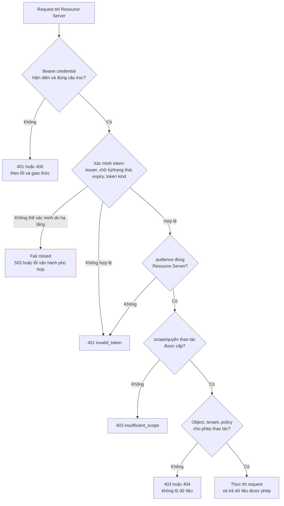

# Validation failure và response an toàn

## Mục tiêu học tập

Trong module **SECURITY_TOKEN_SECURITY_FUNDAMENTALS**, Resource Server phải xác minh access token trước khi cho phép truy cập API. Không chỉ việc **chấp nhận token hợp lệ** quan trọng: **cách từ chối token không hợp lệ và cách trả lỗi ra ngoài** cũng là một phần của mô hình bảo mật. Một response thiếu kiểm soát có thể tiết lộ khóa, claims, sự tồn tại của dữ liệu nhạy cảm hoặc khiến client xử lý lỗi sai.

Sau bài học, bạn có thể:

- Phân biệt lỗi **authentication/token validation**, lỗi **authorization** và lỗi **hạ tầng xác minh**, thay vì dùng chung một response cho mọi tình huống.
- Chọn mã HTTP và `WWW-Authenticate` hợp lý cho OAuth 2.0 Bearer token theo RFC 6750, nhất là `401`, `403` và `insufficient_scope`.
- Thiết kế response đủ thông tin để client xử lý nhưng không lộ raw token, signature, khóa, claims cá nhân hay quy tắc nội bộ nhạy cảm.
- Xử lý an toàn các trường hợp JWT sai chữ ký, issuer, audience, hạn dùng, token type; opaque token bị thu hồi hoặc introspection không khả dụng.
- Áp dụng nguyên tắc **fail closed**, chống token substitution, tránh *account/resource enumeration* và giảm khả năng bị khai thác qua log/telemetry.
- Xây dựng kịch bản kiểm thử, giám sát và phương án xử lý lỗi có tính đến JWT, opaque token, refresh token và OAuth 2.0/OIDC.

## 1. Vì sao validation failure là một phần của bảo mật?

**Token validation failure** là tình huống bên nhận không thể xác lập đủ bằng chứng để chấp nhận một token theo **hợp đồng giao thức và chính sách**. Ví dụ: token không tồn tại, không xác minh được chữ ký, sai issuer hoặc audience, hết hạn, đã bị thu hồi, hay bị gửi sai mục đích.

Tuy nhiên, một request có thể bị từ chối **sau khi token được xác minh thành công**. Token đúng issuer và audience, đủ hiệu lực, nhưng user không có quyền xóa hóa đơn của tenant khác. Đó thường là **authorization failure**, không phải lỗi chứng minh token.

Một lớp khác là **verification infrastructure failure**: Resource Server không thể gọi endpoint introspection vì timeout, hoặc không truy cập được nguồn khóa bắt buộc. Khi ấy hệ thống **chưa chứng minh token sai**, nhưng **cũng chưa chứng minh được token hợp lệ**. Quyết định bảo mật vẫn là từ chối xử lý tài nguyên được bảo vệ; cách trả lỗi có thể khác với `invalid_token`.

| Loại | Ví dụ | Quyết định tại API | Response thường phù hợp |
| --- | --- | --- | --- |
| **Thiếu thông tin xác thực** | Client không gửi bearer token cho endpoint bắt buộc xác thực. | Không cấp quyền. | `401 Unauthorized`, kèm Bearer challenge; thường không cần khai báo mã lỗi chi tiết. |
| **Token không hợp lệ** | Chữ ký sai, hết hạn, sai issuer/audience, bị thu hồi. | Không cấp quyền. | `401 Unauthorized` với `invalid_token` khi phù hợp. |
| **Yêu cầu xác thực sai cấu trúc** | Mang nhiều phương pháp truyền bearer token trong cùng request hoặc cú pháp bất thường. | Từ chối trước khi xử lý nghiệp vụ. | `400 Bad Request`/`invalid_request` theo RFC 6750 và hợp đồng API; không phản chiếu raw input. |
| **Thiếu scope/permission** | Token hợp lệ nhưng không có `orders:write` cho thao tác cập nhật. | Không cấp quyền thao tác. | `403 Forbidden`, có thể dùng `insufficient_scope`. |
| **Không có quyền trên đối tượng** | User có `orders:read` nhưng đơn hàng thuộc tenant khác. | Không trả dữ liệu trái phép. | `403` hoặc `404` tùy chính sách che giấu sự tồn tại của đối tượng. |
| **Không xác minh được do hệ thống** | AS introspection timeout; bộ khóa tin cậy chưa thể tải. | **Fail closed**: không coi token hợp lệ. | Có thể `503 Service Unavailable`, response trung tính; không nói token bị thu hồi khi chưa biết. |

**Quy tắc:** mã HTTP không phải bản đồ một-một cho mọi tình huống OAuth. Chọn mã dựa trên lớp lỗi, phương thức bearer hay DPoP, quy định của giao thức và hợp đồng API; đừng công bố chi tiết nội bộ chỉ để “dễ debug”.

## 2. Phân biệt ba câu hỏi trong một request

Giả sử client gọi:

```http
GET /orders/order-101 HTTP/1.1
Host: orders.example.com
Authorization: Bearer <access-token>
```

Orders API cần trả lời theo từng lớp:

1. **Đã xác thực được credential chưa?** Token có đúng cấu trúc, do issuer được tin cậy phát hành, chữ ký/trạng thái hợp lệ, còn hạn, đúng access-token profile?
2. **Token có đúng API và hành động không?** `aud` có dành cho `api://orders` và `scope` có chứa `orders:read` theo hợp đồng?
3. **Chủ thể có quyền trên đơn cụ thể không?** `order-101` thuộc tenant nào, có owner/ACL/trạng thái nào, user hoặc service principal có quyền được phép không?



Trong sơ đồ, “token hợp lệ” không chỉ nghĩa là chữ ký khớp. **API chỉ xác lập principal đã xác thực sau khi hoàn thành tất cả kiểm tra token cần thiết**; không đặt principal có đặc quyền vào security context dựa trên payload mới decode.

## 3. Những lỗi JWT validation cần nhận diện

JWT access token dạng JWS thường có `header.payload.signature`. Resource Server có thể đọc Base64url mà không cần private key, nhưng chỉ được tin claims sau khi thư viện kiểm chứng bằng **khóa và thuật toán gắn với issuer đã cấu hình**.

| Lỗi | Ý nghĩa đối với token | Phản hồi công khai khuyến nghị |
| --- | --- | --- |
| Thiếu đoạn JWS, encoding sai, JSON vượt giới hạn hoặc không đúng token profile. | Không thể diễn giải token đúng hợp đồng. | `401 invalid_token` hoặc `400 invalid_request` nếu lỗi là **cấu trúc cách cung cấp credential**; thống nhất cách phân loại. |
| `alg` không nằm trong allowlist, `alg=none` khi bắt buộc ký, sai kiểu khóa. | Không có bằng chứng xác minh chữ ký được chấp nhận. | `401 invalid_token`. |
| Signature/MAC không khớp. | Nội dung token không có tính toàn vẹn/nguồn ký đáng tin. | `401 invalid_token`. |
| `kid` không có trong bộ khóa tin cậy sau quá trình làm mới an toàn. | Không tìm thấy khóa được ủy quyền để xác minh. | `401 invalid_token` nếu thực sự không có khóa phù hợp; phân biệt với lỗi mạng tạm thời. |
| `iss` khác issuer tin cậy. | Token từ nguồn ngoài ranh giới tin cậy. | `401 invalid_token`, không tiết lộ danh sách issuer được tin. |
| `aud` không chứa audience của API. | Token hợp lệ cho bên nhận khác, có nguy cơ token substitution. | `401 invalid_token`/từ chối xác thực, không để token đi tới phân quyền nghiệp vụ. |
| `exp` đã hết hạn hoặc `nbf` ở tương lai ngoài leeway cho phép. | Token không hợp lệ tại thời điểm request. | `401 invalid_token`. |
| ID Token hoặc refresh token được trình thay OAuth access token. | Sai loại credential/mục đích sử dụng. | `401 invalid_token`, từ chối token confusion. |
| Token bị thu hồi hoặc session/client bị vô hiệu theo chính sách kiểm tra trạng thái. | Không còn hiệu lực dù chữ ký có thể vẫn đúng. | `401 invalid_token` nếu đã xác minh được trạng thái không hợp lệ. |
| Token hợp lệ nhưng thiếu scope cần cho endpoint. | **Không phải lỗi chữ ký hay issuer.** | `403 insufficient_scope`. |
| Token hợp lệ, scope đủ nhưng không có quyền trên bản ghi. | **Authorization failure** ở cấp đối tượng. | `403` hoặc `404` theo chính sách. |

**Lưu ý về `kid`:** Nếu AS đang xoay khóa và thư viện chưa có key mới, có thể thử làm mới JWKS **chỉ từ nguồn đã cấu hình tin cậy**, giới hạn tần suất, timeout và cache. Đừng tìm khóa theo URL trong JWT header hoặc chuyển sang `alg` khác cho “qua lỗi”. Khi endpoint JWKS tạm thời không khả dụng và không thể xác minh token, chọn trạng thái fail-closed; **không nên gán nhãn “signature giả” khi thực tế chưa thể kiểm chứng**.

### Kiểm tra claims không chỉ có `exp`

Các kiểm tra quan trọng ở JWT access token:

- `iss`: issuer khớp chính xác với nguồn tin cậy; `kid`/khóa không được nhầm giữa các issuer.
- `aud`: token được cấp cho **chính** Resource Server; so theo phần tử đầy đủ, không dùng substring.
- `exp`, `nbf` và các claim thời gian theo profile: dùng đồng hồ UTC đáng tin và leeway nhỏ, có chính sách.
- `typ` hoặc quy tắc nhận diện loại token: phân biệt JWT access token với OIDC ID Token, client assertion hay loại JWT khác; theo RFC 9068, `typ` của JWT access token có quy tắc riêng.
- `scope`/quyền: tên và cách biểu diễn được AS/RS thống nhất; kiểm tra endpoint sau khi token được xác minh.
- `cnf`/bằng chứng sở hữu khóa nếu dùng sender-constrained token: xác minh ràng buộc đúng profile và request.

Một token **còn hạn và chữ ký đúng** không bảo đảm quyền/phiên hiện tại chưa bị thu hồi. Nếu nghiệp vụ yêu cầu thu hồi quyền nhanh hơn TTL, cần cơ chế trạng thái hay kiểm tra phân quyền động thích hợp.

## 4. RFC 6750: phản hồi Bearer authentication đúng chuẩn

Đối với OAuth 2.0 bearer access token, **RFC 6750** định nghĩa cách gửi Bearer challenge trong header HTTP `WWW-Authenticate`.

### 4.1. Không có token: `401 Unauthorized`

Khi client truy cập endpoint được bảo vệ mà không cung cấp token:

```http
HTTP/1.1 401 Unauthorized
WWW-Authenticate: Bearer realm="orders"
Cache-Control: no-store
Content-Length: 0
```

`realm` là định danh vùng bảo vệ theo hợp đồng của API, **không phải** issuer hoặc URL bắt buộc để lấy token. Đối với request đơn thuần không có thông tin xác thực, RFC 6750 khuyến nghị **không đưa thêm error code** như `invalid_token`: server chưa nhận token nào để kết luận nó không hợp lệ.

### 4.2. Token không hợp lệ: `401` với `invalid_token`

Ví dụ token đã hết hạn, sai chữ ký hoặc audience:

```http
HTTP/1.1 401 Unauthorized
WWW-Authenticate: Bearer realm="orders", error="invalid_token"
Cache-Control: no-store
Content-Length: 0
```

Giữ cùng một thông điệp công khai cho phần lớn lỗi validation nhạy cảm là một cách giảm rò rỉ. **Không cần tiết lộ** `kid` nào bị từ chối, issuer nào được phép, thời điểm thu hồi, toàn bộ token claims hoặc chi tiết về thuật toán chữ ký.

RFC 6750 cho phép `error_description`/`error_uri` ở mức phù hợp. Tuy nhiên, mô tả chi tiết như “token của user-42 đã bị thu hồi tại…” hoặc “expected aud=…” có thể làm lộ chính sách/tài khoản. Thường nên bỏ mô tả chi tiết hoặc dùng thông báo trung tính với URI tài liệu tĩnh đã được kiểm soát.

### 4.3. Thiếu scope: `403 Forbidden` với `insufficient_scope`

Token đã xác minh đúng, nhưng endpoint yêu cầu `orders:write` mà token chỉ có `orders:read`:

```http
HTTP/1.1 403 Forbidden
WWW-Authenticate: Bearer realm="orders", error="insufficient_scope"
Cache-Control: no-store
Content-Length: 0
```

Theo RFC 6750, `insufficient_scope` thường đi kèm HTTP `403`. Server **có thể** đưa thêm tham số `scope` mô tả scope cần thiết:

```http
WWW-Authenticate: Bearer realm="orders", error="insufficient_scope", scope="orders:write"
```

Chỉ công bố `scope` khi việc đó **không tiết lộ quyền đặc biệt hoặc cấu trúc phân quyền nhạy cảm**. Ví dụ, không cần mô tả nội bộ rằng một endpoint ẩn dùng `users:roles:root` nếu mục tiêu là tránh tiết lộ sự tồn tại/chính sách của endpoint.

**Không dùng `invalid_token` để mô tả thiếu scope** nếu token đã được xác minh hợp lệ. Phân biệt giúp client biết mình cần xin **quyền bổ sung theo đúng luồng ủy quyền**, thay vì tự lặp vô hạn yêu cầu với cùng token.

### 4.4. `invalid_request`: request trình bearer token sai

RFC 6750 có lỗi `invalid_request` cho một số tình huống request bearer không đúng cách, ví dụ dùng nhiều phương pháp mang access token cùng lúc, tham số lặp hoặc request không đúng định dạng.

```http
HTTP/1.1 400 Bad Request
WWW-Authenticate: Bearer realm="orders", error="invalid_request"
Cache-Control: no-store
Content-Length: 0
```

**Chú ý phân định:** token JWS có cấu trúc sai khi đã được trình dưới `Authorization: Bearer` thường được xử lý như `invalid_token`; còn lỗi **cách trình credential/request** có thể là `invalid_request`. Thư viện/framework khác nhau có thể chọn mã chi tiết khác nhau ở biên; điều quan trọng là tuân thủ profile, không mở quyền truy cập và không phản chiếu dữ liệu đầu vào nhạy cảm.

### Bảng nhanh cho Bearer API

| Trạng thái | Header/loại lỗi thường gặp | Ý nghĩa client có thể hiểu |
| --- | --- | --- |
| `401` chưa có credential | `WWW-Authenticate: Bearer realm="..."` | Cần cung cấp credential phù hợp. |
| `401` token bị từ chối | `error="invalid_token"` | Token không được chấp nhận; không nên thử lại vô hạn cùng token. |
| `400` bearer request sai | `error="invalid_request"` | Cần sửa cách gửi request/credential. |
| `403` scope thiếu | `error="insufficient_scope"` | Cần ủy quyền cấp scope phù hợp, không tự nâng quyền. |
| `403` hoặc `404` object policy từ chối | Response trung tính theo policy, có thể không công bố scope. | Chủ thể không được phép với đối tượng hoặc endpoint cụ thể. |
| `503` không thể xác minh do hạ tầng | Lỗi dịch vụ tổng quát, có thể kèm `Retry-After` phù hợp. | Hệ thống tạm thời không xử lý được, **không** kết luận token đã bị thu hồi. |

## 5. Response body an toàn: đủ hữu ích, không lộ bí mật

API có thể trả JSON lỗi thay vì body rỗng. Với API dùng Problem Details (RFC 9457), một ví dụ **không chứa thông tin token**:

```http
HTTP/1.1 401 Unauthorized
Content-Type: application/problem+json
WWW-Authenticate: Bearer realm="orders", error="invalid_token"
Cache-Control: no-store

{
  "type": "about:blank",
  "title": "Unauthorized",
  "status": 401,
  "detail": "Access token was not accepted.",
  "request_id": "req-72ab19"
}
```

Trường `request_id` là **extension minh họa**, không phải thuộc tính bắt buộc của RFC 9457. Nó giúp client báo lỗi cho đội vận hành mà không cần chia sẻ token. Hệ thống có thể trả JSON dạng khác theo API contract, miễn không tự mâu thuẫn với HTTP status và `WWW-Authenticate`.

**Nên công bố** mã lỗi cấp cao ổn định, request/correlation ID được tạo bởi server, chỉ dẫn tài liệu công khai và thời điểm retry khi phù hợp.

**Không nên công bố** raw `Authorization` header, JWT đầy đủ, refresh token, client secret, private key, thông tin certificate nhạy cảm, payload JWT được decode, stack trace, SQL/LDAP query, danh sách issuer/key đáng tin, hoặc nguyên nhân nội bộ chính xác giúp kẻ tấn công dò từng bước.

### Mô hình tách hai kênh thông tin

| Kênh | Mục tiêu | Dữ liệu có thể lưu/trả |
| --- | --- | --- |
| **Public API response** | Client biết request bị từ chối và cách khắc phục ở mức phù hợp. | HTTP status, Bearer error chuẩn, message tổng quát, request ID. |
| **Internal security telemetry** | Đội vận hành phân loại và điều tra sự cố. | Failure category, endpoint group, issuer alias, key version nếu hợp lệ cho audit, correlation ID, trạng thái introspection và policy ID. |

Ngay cả telemetry nội bộ cũng phải **tối thiểu hóa và phân quyền**. Không sao chép mọi claims hoặc raw token chỉ vì log chỉ “dùng trong công ty”.

## 6. Token không hợp lệ khác quyền trên đối tượng không đủ

Xét một token có `aud=api://orders` và `scope=orders:read`, đã được xác minh toàn bộ:

```text
GET /orders/order-101 -> user được phân quyền xem
GET /orders/order-202 -> cùng scope nhưng resource thuộc tenant khác
```

API phải kiểm tra quyền ở cấp đối tượng (BOLA/IDOR prevention), nhưng không nhất thiết cho người gọi biết `order-202` **có tồn tại hay không**.

Một lựa chọn:

```http
HTTP/1.1 404 Not Found
Content-Type: application/problem+json
Cache-Control: no-store

{
  "type": "about:blank",
  "title": "Not Found",
  "status": 404,
  "request_id": "req-df9c21"
}
```

Ở đây `404` là **chính sách che giấu sự tồn tại của resource** khi user không có quyền xem; không phải quy tắc bắt buộc cho mọi hệ thống. Nếu API chọn `403`, body vẫn nên tránh tiết lộ owner, email, tenant hoặc trạng thái nhạy cảm của đối tượng.

Để tránh *resource enumeration*, cần nhất quán giữa các endpoint và trạng thái:

- Không phân biệt quá rõ “ID tồn tại nhưng không thuộc tenant bạn” với “ID không tồn tại” nếu người gọi không có quyền biết.
- Không để search/list endpoint rò dữ liệu mà detail endpoint đã bảo vệ.
- Cân nhắc sự khác biệt quá lớn về body, status và thời gian xử lý nếu threat model có nguy cơ dò thông tin.
- Không để thông báo lỗi chứa object title, user email, số tài khoản hoặc mã phiếu của tenant khác.

**Đừng biến 404 thành cách che dấu token không hợp lệ.** Với endpoint bảo vệ Bearer, token sai issuer/chữ ký/audience vẫn là lỗi authentication; API nên xử lý kiểm chứng token trước khi trả thông tin về đối tượng.

## 7. Opaque token, introspection và lỗi hạ tầng

Với **opaque access token**, Resource Server không thể tự giải nghĩa claims trong chuỗi token. Nó thường gọi endpoint introspection đáng tin cậy (RFC 7662) hoặc dùng một cơ chế kiểm tra trạng thái được thỏa thuận với AS.

### 7.1. Introspection thành công nhưng token `active=false`

Ví dụ phản hồi đã được nhận từ AS tin cậy:

```json
{"active": false}
```

Theo hợp đồng introspection, Resource Server coi token không hoạt động và từ chối truy cập, thường trả `401 invalid_token` cho client. **Không cố suy ra** token chưa từng tồn tại, hết hạn hay đã bị thu hồi từ riêng `active=false`; chi tiết này có thể không được AS tiết lộ.

### 7.2. `active=true` nhưng thiếu audience hoặc scope

Một phản hồi:

```json
{
  "active": true,
  "aud": "api://billing",
  "scope": "billing:read"
}
```

Nếu Orders API nhận token này, **phải từ chối vì sai audience**. Trạng thái active không chứng minh token được cấp cho mọi API. Nếu AS không cung cấp đủ thông tin để RS đánh giá audience/resource theo hợp đồng, RS không được mặc định cho qua; cần cấu hình/hợp đồng xác minh phù hợp.

### 7.3. Introspection timeout hoặc AS trả lỗi máy chủ

```text
Orders API -> Introspection endpoint: request
Introspection endpoint -> Orders API: timeout / 503
```

Trường hợp này **khác** `active=false`. API chưa thể xác minh token:

1. Không cho phép truy cập theo kiểu *fail open* chỉ vì AS đang gặp sự cố.
2. Có thể trả **503 Service Unavailable** với body tổng quát và `Retry-After` nếu có cơ sở, thay vì khẳng định token bị thu hồi.
3. Áp dụng timeout, circuit breaker, retry có kiểm soát và bảo vệ endpoint khỏi retry storm.
4. Nếu có cache introspection, chỉ dùng theo **chính sách bảo mật rõ ràng**, có TTL phù hợp với yêu cầu thu hồi và đảm bảo audience/scope/subject được kiểm chứng; không gia hạn vô thời hạn.
5. Phân biệt metric `AUTH_BACKEND_UNAVAILABLE` với `TOKEN_INACTIVE` để không đưa ra quyết định hoặc báo cáo sự cố sai.

**Fail closed** nghĩa là không thực hiện thao tác được bảo vệ khi bằng chứng chưa đủ. Nó **không có nghĩa** mọi lỗi hệ thống đều phải trả cùng `401 invalid_token`. Trả một lỗi vận hành trung tính giúp client và operator phân biệt sự cố có thể retry với credential đã bị từ chối.

### 7.4. Không tin endpoint dựa vào token chưa xác minh

Đừng giải mã chuỗi opaque hoặc lấy `iss` từ payload chưa xác minh rồi gửi token đến URL do attacker chỉ định. Resource Server phải sử dụng **AS và endpoint introspection đã cấu hình tin cậy**; nếu hỗ trợ nhiều issuer thì chọn theo ranh giới/allowlist đáng tin và kiểm tra đúng nguồn. Gửi token đến nhiều AS để “thử xem nơi nào active” có thể làm lộ credential.

## 8. JWT, OIDC và các loại credential không được hoán đổi

Một token được ký hợp lệ có thể vẫn không phù hợp với API:

| Credential được gửi đến Orders API | Vì sao có thể bị từ chối? | Hướng xử lý |
| --- | --- | --- |
| JWT access token đúng issuer nhưng `aud=api://billing`. | Token được cấp cho Resource Server khác. | `401 invalid_token` / sai audience. |
| OIDC ID Token do cùng OP ký, `aud=sales-portal`. | ID Token dành cho OIDC client, không phải OAuth access token của Orders API. | `401 invalid_token` / sai token kind và audience. |
| Refresh token còn hiệu lực với AS. | Refresh token dùng tại token endpoint, không phải bearer access token gọi API. | Từ chối tại Resource Server; client sử dụng đúng token endpoint. |
| Client assertion `private_key_jwt` hợp lệ. | Dùng để AS xác thực client, không phải quyền truy cập Resource Server. | Từ chối tại Resource Server. |
| JWT access token đúng issuer/audience nhưng scope không đủ. | Credential hợp lệ nhưng thiếu quyền hành động. | `403 insufficient_scope`. |
| Token của tenant A muốn truy cập dữ liệu tenant B. | Không có quyền trên resource cụ thể. | `403` hoặc `404` tùy chính sách. |

Đối với JWT access token profile **RFC 9068**, kiểm tra token type (`typ`, chẳng hạn `at+jwt` theo profile) và các claims cần thiết giúp giảm *cross-JWT confusion*. Nhưng chỉ nhìn `typ` từ header chưa verify là không đủ: phải dùng đúng khóa, issuer, audience và profile được định nghĩa.

## 9. Sender-constrained token: lỗi DPoP/mTLS cũng cần response an toàn

Một access token **Bearer** có thể bị kẻ khác dùng lại khi bị sao chép. **mTLS certificate-bound access token** (RFC 8705) và **DPoP** (RFC 9449) giúp giới hạn việc sử dụng token vào bên chứng minh được quyền sở hữu khóa liên kết.

Khi triển khai:

- Với **mTLS**, Resource Server cần kiểm tra chứng chỉ/khóa từ kết nối được xác thực, ràng buộc với token theo profile. Không tin header certificate do client tự đặt nếu gateway chưa bảo đảm nguồn và integrity của nó.
- Với **DPoP**, Resource Server cần kiểm chứng DPoP proof theo request (method, URI, chữ ký, `jti`/thời gian và ràng buộc với access token theo profile). Các lỗi `invalid_dpop_proof` hoặc cơ chế yêu cầu nonce như `use_dpop_nonce` có quy tắc response riêng trong RFC 9449 khi áp dụng.
- Dù token bị ràng buộc khóa, API vẫn phải kiểm tra **issuer, audience, scope và quyền trên resource**.
- Nếu proof không hợp lệ, **không tự hạ cấp** sang chấp nhận Bearer token chỉ vì cùng chữ ký/issuer; đó là lỗi bỏ qua cơ chế bảo vệ.

Response công khai không nên trả toàn bộ proof, public key thô không cần thiết, thumbprint, certificate chain, nonce nội bộ ngoài quy tắc giao thức, hay giải thích quá chi tiết khiến attacker dò cấu hình. Khi dùng DPoP, hãy để bộ xử lý theo **RFC 9449** tạo challenge/nonce đúng thay vì ép tất cả lỗi vào `Bearer invalid_token`.

## 10. Client nên làm gì trước từng loại lỗi?

Phản hồi an toàn cũng giúp client tránh các hành vi rủi ro:

| Lỗi API | Hành vi client phù hợp | Không nên làm |
| --- | --- | --- |
| `401` do không có token. | Khởi tạo flow lấy access token phù hợp, nếu người dùng/client được phép. | Tự đặt một chuỗi token giả để thử. |
| `401 invalid_token` do token hết hạn/bị từ chối. | Có thể xin access token mới bằng flow/refresh hợp lệ **khi chính sách cho phép**, giới hạn retry. | Lặp vô hạn cùng token hoặc gửi token cho API khác để thử. |
| `403 insufficient_scope`. | Yêu cầu cấp quyền bổ sung theo luồng ủy quyền/consent hợp lệ hoặc hiển thị thiếu quyền. | Tự sửa JWT payload, thêm scope ở phía client. |
| `403/404` object policy. | Hiển thị không đủ quyền/không tìm thấy theo hợp đồng sản phẩm. | Dò ID liền kề hoặc lặp bằng client quyền cao để xem hộ. |
| `400 invalid_request`. | Sửa format, header hoặc cách truyền credential. | Thử các cách mã hóa/truyền token đồng thời. |
| `503` xác minh upstream không khả dụng. | Retry có giới hạn, backoff/jitter, tôn trọng `Retry-After` nếu có. | Tự coi request là thành công hoặc chuyển sang endpoint không kiểm tra token. |

**Cẩn trọng refresh loop:** Nếu access token bị từ chối do **audience sai, token type sai hoặc issuer lạ**, lặp refresh token để nhận lại cùng loại token không giải quyết được vấn đề. Client nên xin token **đúng resource/scope** theo hợp đồng, hoặc dừng và báo lỗi có thể điều tra bằng request ID.

## 11. Thiết kế error mapper phía Resource Server

Mẫu thiết kế hữu ích là giữ các **failure code nội bộ** riêng khỏi **public error code**. Không cho một exception message bất kỳ đi thẳng ra response.

### 11.1. Pseudocode Java

```java
ApiError mapSecurityFailure(SecurityFailure failure, String requestId) {
    switch (failure.category()) {
        case MISSING_CREDENTIAL:
            return apiError(
                401, "Bearer realm=\"orders\"", null, requestId);

        case MALFORMED_BEARER_REQUEST:
            return apiError(
                400,
                "Bearer realm=\"orders\", error=\"invalid_request\"",
                "Invalid authentication request", requestId);

        case BAD_SIGNATURE:
        case EXPIRED_ACCESS_TOKEN:
        case UNTRUSTED_ISSUER:
        case WRONG_AUDIENCE:
        case WRONG_TOKEN_TYPE:
        case TOKEN_REVOKED:
            return apiError(
                401,
                "Bearer realm=\"orders\", error=\"invalid_token\"",
                "Access token was not accepted", requestId);

        case INSUFFICIENT_SCOPE:
            return apiError(
                403,
                "Bearer realm=\"orders\", error=\"insufficient_scope\"",
                "Insufficient permission", requestId);

        case OBJECT_POLICY_DENIED:
            return policyHidesExistence()
                ? apiError(404, null, "Not Found", requestId)
                : apiError(403, null, "Forbidden", requestId);

        case AUTH_VERIFIER_UNAVAILABLE:
            return apiError(
                503, null, "Service temporarily unavailable", requestId);

        default:
            return apiError(
                500, null, "Request could not be completed", requestId);
    }
}
```

Đây là **pseudocode**, không phải một thư viện hay bộ status bắt buộc cho mọi API. Việc ánh xạ `MALFORMED_BEARER_REQUEST` khác với JWT content sai cấu trúc phải theo RFC 6750 và hợp đồng parser. Với DPoP, mTLS hay giao thức khác, mapper cần mở rộng cho đúng profile, **không tái sử dụng mù quáng header Bearer**.

### 11.2. Vị trí xử lý trong Java/Spring Security

Trong ứng dụng Spring Security Resource Server, có thể tách:

- **Authentication entry point**: xử lý credential thiếu/sai và gửi Bearer challenge, thường có thể dựa trên `BearerTokenAuthenticationEntryPoint`.
- **Access denied handler**: xử lý thiếu quyền ở lớp authorization, thường có thể dựa trên `BearerTokenAccessDeniedHandler` khi dùng Bearer.
- **JWT decoder / opaque introspector**: xác minh token với issuer, audience/claims cần thiết hoặc introspection endpoint; không bỏ validation để tránh lỗi.
- **Method/endpoint authorization**: kiểm tra scope như `SCOPE_orders:read` theo converter đã cấu hình, sau đó kiểm tra quyền trên resource cụ thể.
- **Global exception handler**: xử lý lỗi nghiệp vụ/dịch vụ nhưng không lộ stack trace hay nuốt mất `WWW-Authenticate` do security layer thiết lập.

Ví dụ method-level check minh họa:

```java
@PreAuthorize("hasAuthority('SCOPE_orders:write')")
public OrderView updateOrder(String orderId, UpdateCommand command) {
    // Kiểm tra quyền tenant/owner/trạng thái trong service bên dưới.
    return orderService.updateOnlyIfAuthorized(orderId, command);
}
```

Annotation ở trên **không thay thế** xác minh issuer/audience và object-level authorization. Tên authority phụ thuộc converter và cấu hình. Không tự giả định cấu hình `issuer-uri` của framework đã tự kiểm tra audience mong muốn nếu chưa xác minh validator được bật và đúng phiên bản.

### 11.3. Logging có cấu trúc nhưng không lưu token

Một sự kiện nội bộ minh họa:

```json
{
  "event": "ACCESS_DENIED",
  "request_id": "req-72ab19",
  "api": "orders",
  "route_template": "GET /orders/{id}",
  "failure_class": "WRONG_AUDIENCE",
  "http_status": 401,
  "issuer_alias": "retail-as",
  "token_reference": "nonreversible-audit-reference",
  "occurred_at": "2027-01-15T10:05:00Z"
}
```

Ví dụ không chứa raw token, `Authorization` header, client secret, JWT payload hoặc email người dùng. `token_reference` chỉ được ghi **nếu có cơ chế tạo tham chiếu an toàn, quyền truy cập phù hợp và nhu cầu đối chiếu hợp lệ**; không tự lấy token làm khóa log. Khi không thể xác định issuer đáng tin, không ghi `iss` chưa xác minh như danh tính nguồn phát hành đã được chứng minh.

Để tránh lộ qua các lớp khác, phải cấu hình redaction tại **application, gateway, proxy, APM/tracing, error monitoring, HTTP client và audit pipeline**. Đặc biệt, đừng log toàn bộ exception chứa bearer token hoặc toàn bộ body của token endpoint.

## 12. Chống DoS và sai lệch tín hiệu từ lỗi validation

Kẻ tấn công có thể gửi hàng nghìn JWT lỗi `kid` hoặc opaque token ngẫu nhiên để buộc API tra JWKS/introspection liên tục. Cơ chế xử lý lỗi cần bảo vệ cả **tính bí mật** lẫn **tính sẵn sàng**:

1. **Giới hạn kích thước token và header**, parse JSON/JOSE an toàn; từ chối đầu vào bất thường trước khi thực hiện tác vụ tốn kém.
2. **Cache JWKS đáng tin cậy** theo policy, làm mới có giới hạn; không download URL bất kỳ từ header hoặc issuer chưa xác minh.
3. **Timeout và circuit breaker** khi gọi AS/introspection; không cho token không xác minh đi qua khi upstream lỗi.
4. **Giới hạn retry** tại API/client và backoff khi lỗi tạm thời; tránh retry storm khiến AS càng quá tải.
5. **Rate limit theo nguồn đáng tin/risk signal**, chú ý tránh lấy `sub`, `client_id` hoặc `iss` chưa xác minh làm danh tính chống lạm dụng.
6. **Phân loại metric**: số `401`/`403`/`503`, `invalid_token`, scope thiếu, lỗi AS/JWKS, latency introspection; không đưa raw token hoặc PII thành label.
7. **Kiểm tra lỗi cache**: không cache toàn cục một quyết định “token hợp lệ” cho mọi API/audience; cache phải gắn với audience, issuer, scope/policy và TTL thích hợp.
8. **Giám sát thay đổi bất thường**: đột biến sai issuer/audience có thể báo hiệu token substitution, cấu hình sai hoặc hoạt động dò token.

Trả thông điệp công khai trung tính không ngăn hoàn toàn *side channel*. Nếu token hợp lệ nhưng quyền đối tượng khác nhau tạo ra body/timing quá khác biệt, cần đánh giá nguy cơ rò rỉ qua sự khác biệt đó theo threat model của API.

## 13. Bảng kiểm thử validation failure và response

Giả sử Orders API cấu hình:

```text
Trusted issuer  = https://identity.example.com
Expected aud    = api://orders
Accepted kind   = OAuth access token
GET /orders/{id} requires scope orders:read
PATCH /orders/{id} requires scope orders:write
```

| Đầu vào hoặc lỗi | Kết quả mong đợi | Không được tiết lộ |
| --- | --- | --- |
| Không gửi bearer token đến endpoint bắt buộc xác thực. | `401`, Bearer challenge; thường không thêm `invalid_token`. | Danh sách user/client được biết đến. |
| Bearer token hết hạn. | `401 invalid_token`. | Raw token và timestamp riêng của phiên/người dùng. |
| JWT bị sửa payload hoặc signature không khớp. | `401 invalid_token`. | Nội dung JWT, khóa hoặc chi tiết kiểm tra signature. |
| JWT tự khai `alg=none` nhưng API yêu cầu RS256. | `401 invalid_token`. | Thông tin cấu hình khóa/thuật toán nội bộ vượt mức cần thiết. |
| Token có `iss` từ issuer lạ. | `401 invalid_token`. | Danh sách issuer được chấp nhận. |
| Token có `aud=api://billing`. | `401 invalid_token`; không gọi business code. | Mapping quyền và policy nội bộ của Billing. |
| ID Token OIDC được gửi thay access token. | `401 invalid_token`. | Thông tin OIDC user session. |
| Opaque introspection trả `active=false`. | `401 invalid_token`. | Token “không tồn tại”, “hết hạn” hay “bị revoke” nếu AS không cung cấp. |
| Introspection timeout, không có trạng thái cache hợp lệ được policy cho phép. | **Fail closed**, response có thể `503` trung tính. | AS hostname nội bộ, stack trace, credential của introspection. |
| Token hợp lệ, thiếu `orders:write` khi PATCH. | `403 insufficient_scope`. | Các role quản trị nhạy cảm nếu không được phép công bố. |
| Token hợp lệ, scope đọc đủ, order thuộc tenant khác. | `403` hoặc `404` theo chính sách. | Sự tồn tại, owner hoặc dữ liệu order không được truy cập. |
| Request mang bearer token theo nhiều phương pháp cùng lúc. | `400 invalid_request` theo RFC 6750. | Token đã truyền trong query/header/body. |
| Proof DPoP không hợp lệ khi API yêu cầu DPoP. | Từ chối theo RFC 9449; không hạ cấp sang Bearer. | Proof hoặc chi tiết khóa nhạy cảm. |
| API bị gọi nhiều lần với `kid` không xác định. | Từ chối an toàn, rate-limit JWKS refresh, giám sát. | URL khóa, token payload và cấu hình issuer ngoài hợp đồng. |
| JWT còn hạn nhưng token đã được đánh dấu revoke theo chính sách RS. | `401 invalid_token` sau khi kiểm tra trạng thái có thẩm quyền. | Lý do nhạy cảm dẫn đến revoke. |

### Bài tập suy luận

**Câu 1.** Vì sao API nên trả `401` khi token sai chữ ký nhưng `403` khi token hợp lệ và thiếu scope?

**Câu 2.** Client không gửi token. Có nên đưa `error="invalid_token"` trong Bearer challenge không? Vì sao?

**Câu 3.** JWT đã được xác minh chữ ký nhưng `aud=api://billing` trong khi request vào Orders. Đây là lỗi validation hay object policy?

**Câu 4.** Introspection trả timeout. Có nên coi token inactive rồi trả `401 invalid_token` và cho hệ thống nội bộ đi qua nếu “đã từng dùng được” không?

**Câu 5.** Một endpoint `GET /orders/{id}` trả `403` khi ID tồn tại ngoài tenant và `404` khi ID không tồn tại. Rủi ro gì?

**Câu 6.** Vì sao không nên trả `expectedKid`, `allowedIssuers` hoặc nội dung JWT decode trong response khi verify lỗi?

**Câu 7.** Với token bị đánh cắp, tại sao `jti` có trong JWT không tự chặn một bearer token được dùng lại?

**Câu 8.** Với token quản trị, tại sao một `403 insufficient_scope` không đồng nghĩa client chỉ cần thêm `admin` vào token request là sẽ được cấp?

**Gợi ý trả lời:**

1. `401` biểu thị credential không được chấp nhận; `403` biểu thị credential hợp lệ nhưng thao tác không được phép, theo mô hình RFC 6750.
2. Thường không. Chưa có token để kết luận token sai; Bearer challenge đơn giản là đủ.
3. Lỗi validation/audience; token không được dùng ở Orders ngay cả khi do đúng AS ký.
4. Không được fail open; có thể dùng `503` trung tính và retry có kiểm soát, chỉ dùng cache khi policy cho phép và còn hiệu lực.
5. Nó có thể làm lộ **sự tồn tại của đối tượng** cho người không được quyền biết.
6. Những thông tin này giúp attacker dò cấu hình/ranh giới tin cậy và có thể chứa dữ liệu nhạy cảm; log nội bộ cũng cần kiểm soát.
7. `jti` là định danh token; nếu không có trạng thái/chính sách chống replay hoặc token binding, API vẫn có thể chấp nhận các request bearer hợp lệ lặp lại.
8. AS chỉ cấp scope mà client/user được cho phép theo grant, consent, policy và resource; Resource Server còn kiểm tra quyền trên đối tượng.

## 14. Checklist triển khai

- [ ] Xác định ranh giới giữa lỗi **credential**, **scope/quyền**, **object policy** và **hạ tầng xác minh**.
- [ ] Từ chối JWT sai chữ ký/issuer/audience/type/expiry bằng pipeline kiểm chứng đáng tin, không chỉ decode payload.
- [ ] Với opaque token, phân biệt `active=false` với introspection không khả dụng; **fail closed** khi chưa xác minh được.
- [ ] Dùng `401` và Bearer challenge cho missing/invalid credential; `403 insufficient_scope` khi thiếu scope theo RFC 6750.
- [ ] Dùng `400 invalid_request` cho cách trình Bearer request không đúng giao thức khi áp dụng, không nhầm với mọi JWT sai nội dung.
- [ ] Không công bố raw token, header `Authorization`, claims, secret, key, stack trace hay thông tin tenant/object trái phép trong lỗi.
- [ ] Cân nhắc `403` hoặc `404` nhất quán để không tiết lộ sự tồn tại của resource.
- [ ] Cấp request/correlation ID do server tạo; tách public error khỏi internal failure category.
- [ ] Bảo đảm JSON error/body, `WWW-Authenticate` và HTTP status khớp nhau; giới hạn cache response nhạy cảm.
- [ ] Xử lý DPoP/mTLS theo profile; không bỏ proof-of-possession để fallback Bearer.
- [ ] Bảo vệ JWKS/introspection bằng cấu hình nguồn tin cậy, timeout, cache TTL, rate limit và retry có kiểm soát.
- [ ] Cấu hình security entry point, access-denied handler, audience validator và method/object-level authorization trong framework đúng phiên bản.
- [ ] Redact token ở mọi tầng log/tracing; giám sát lỗi nhưng không dùng raw token/PII làm metric label.
- [ ] Kiểm thử missing token, malformed header, signature sai, issuer/audience lạ, token khác loại, expired, revoked, missing scope, sai tenant, introspection timeout và PoP proof lỗi.

## Tài liệu nền tảng

- **RFC 6750 — The OAuth 2.0 Authorization Framework: Bearer Token Usage:** `WWW-Authenticate`, `invalid_request`, `invalid_token` và `insufficient_scope`.
- **RFC 6749 — The OAuth 2.0 Authorization Framework:** token endpoint, scope, client authentication và lỗi OAuth.
- **RFC 7519 — JSON Web Token (JWT):** các claim `iss`, `aud`, `exp`, `nbf`, `jti`.
- **RFC 7662 — OAuth 2.0 Token Introspection:** phản hồi `active` và metadata từ AS.
- **RFC 9068 — JWT Profile for OAuth 2.0 Access Tokens:** kiểm chứng JWT access token tại Resource Server.
- **RFC 8725 — JSON Web Token Best Current Practices:** chống algorithm confusion, cross-JWT confusion và lỗi trust.
- **RFC 8705 — OAuth 2.0 Mutual-TLS Client Authentication and Certificate-Bound Access Tokens:** xác minh token ràng buộc chứng chỉ.
- **RFC 9449 — OAuth 2.0 Demonstrating Proof of Possession (DPoP):** proof, token binding và response khi proof/nonce sai.
- **RFC 9457 — Problem Details for HTTP APIs:** định dạng JSON phản hồi lỗi nhất quán, có thể mở rộng với request ID.

**Ghi nhớ:** **Validation failure phải dẫn đến từ chối truy cập**, nhưng response cần **đúng ngữ nghĩa và an toàn**: `401` cho credential thiếu/không hợp lệ, `403` cho token hợp lệ nhưng thiếu scope/quyền, `404` khi cần che giấu đối tượng, và lỗi dịch vụ trung tính khi không thể xác minh vì hạ tầng. Không tiết lộ credential hoặc chi tiết policy nhạy cảm; thay vào đó dùng **Bearer challenge chuẩn, thông điệp công khai tối thiểu, audit nội bộ an toàn và correlation ID** để vừa bảo vệ API vừa hỗ trợ vận hành.
