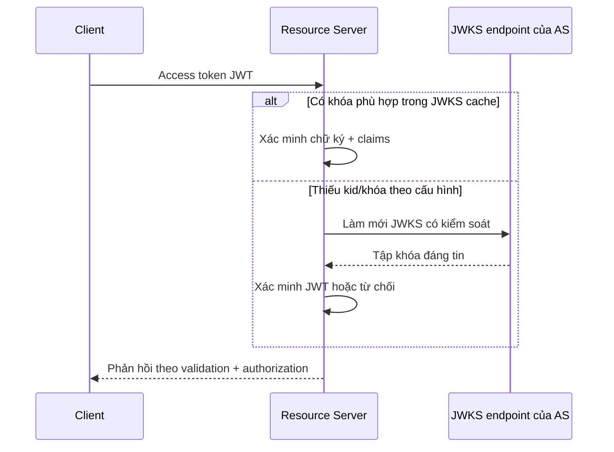
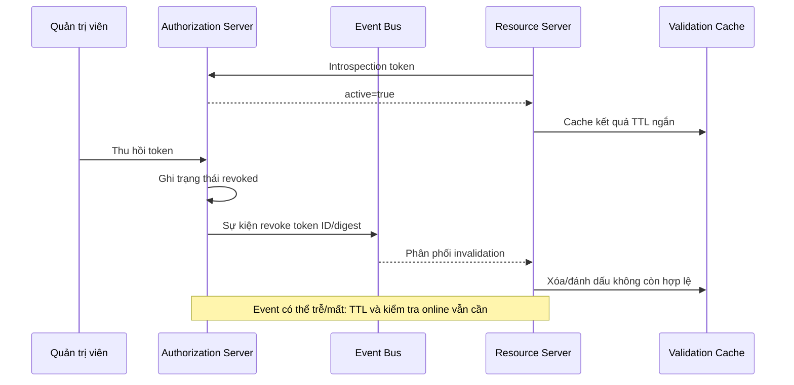

# Cache kết quả validation và rủi ro stale

Trong một hệ thống có hàng nghìn request mỗi giây, **kiểm tra token** có thể được thực hiện lặp đi lặp lại. Resource server (RS) cần xác minh chữ ký JWT, tải hoặc sử dụng tập khóa JWKS; với opaque access token, RS có thể phải gọi authorization server (AS) để **introspection**. Việc cache kết quả giúp giảm độ trễ và tải cho hệ thống, nhưng cũng đặt ra rủi ro: **một kết quả "hợp lệ" được tính ở quá khứ có thể không còn đúng ở thời điểm request hiện tại**.

Ví dụ, opaque token được introspection lúc 10:00 và trả `active=true`. Đến 10:00:10, quản trị viên thu hồi token vì nghi bị lộ. Nếu RS giữ kết quả `active=true` trong cache 5 phút, nó có thể tiếp tục chấp nhận token đó tới khi cache hết hạn, **dù AS đã thu hồi**. Đây là **stale validation**: dữ liệu kiểm tra đã cũ so với trạng thái thực.

Trong chương **Token validation** của module **SECURITY_TOKEN_SECURITY_FUNDAMENTALS**, bài học tập trung vào cách xác định **cái gì được cache**, **giới hạn thời gian cache**, **phản ánh việc hết hạn/thu hồi/đổi quyền**, và **không dùng cache để bỏ qua những điều kiện phải đánh giá trên từng request**. Nội dung liên hệ tới JWT, opaque token, access token, refresh token, claims, scope, audience, OAuth 2.0/OIDC và các cơ chế chống token bị đánh cắp hoặc phát lại.

**Nguyên tắc quan trọng nhất:** cache chỉ là tối ưu hóa hiệu năng. Nó **không được tự mở rộng** thời hạn token, audience, scope, quyền trên tài nguyên, hoặc hiệu lực của một bằng chứng bảo mật đã hết hạn.

## 1. "Cache validation" có thể là bốn loại cache rất khác nhau

Trước khi đặt `TTL=300`, cần biết chính xác thông tin nào được cache:

| Loại cache | Nội dung cache | Nguồn dữ liệu | Rủi ro stale nổi bật |
| --- | --- | --- | --- |
| **JWKS/key cache** | Khóa công khai, metadata chọn khóa của issuer | JWKS endpoint/metadata đã được tin cậy | Khóa mới chưa thấy; khóa bị gỡ/compromise vẫn được tin |
| **JWT verification cache** | Kết quả kiểm chữ ký, parser output, claim đã xác minh một phần | Validator JWT của RS | Kết quả `valid=true` giữ lại sau `exp`/`nbf`, thay đổi profile hoặc revocation policy |
| **Opaque token introspection cache** | Phản hồi `active`, `scope`, `aud`, `client_id`, `exp`... | AS/introspection endpoint | Token đã bị thu hồi hoặc giảm quyền nhưng kết quả `active=true` cũ còn được sử dụng |
| **Authorization decision cache** | Quyết định `allow/deny` cho hành động/tài nguyên | Policy engine, dữ liệu user/resource | User mất role, tenant đổi owner, trạng thái giao dịch đổi mà quyết định cũ vẫn cho phép |

Không nên đặt bốn loại cache này chung một tên như `tokenCache` rồi giả định cùng quy tắc. Một **khóa công khai** có thể được tái sử dụng để kiểm chữ ký cho nhiều token, trong khi một **quyết định cấp quyền** có thể phụ thuộc vào tài nguyên, thời gian và chính sách thay đổi sau vài giây.

### 1.1. Còn access token và refresh token?

- **Access token** được trình tới RS. Cache validation của RS liên quan trực tiếp tới việc chấp nhận request gọi API.
- **Refresh token** thường được trình tới **AS/token endpoint**, không phải RS. Trạng thái refresh token, rotation và phát hiện dùng lại cần kiểm tra phía AS theo chính sách; không lấy kết quả cache access token để quyết định refresh token còn dùng được.
- **OIDC ID token** dành cho client/Relying Party (RP). RP xác minh theo OIDC Core. **Không được dùng ID token làm access token** tại RS chỉ vì token đã qua một cache JWT chung.
- **Opaque token** có thể được kiểm tra online qua introspection, vì vậy độ mới của kết quả phụ thuộc đáng kể vào TTL và cam kết trạng thái từ AS.

## 2. Định nghĩa stale và giới hạn chấp nhận được

**Stale** là trạng thái cache không còn phản ánh điều kiện cần kiểm tra tại thời điểm hiện tại. Cần phân biệt hai dạng:

1. **Stale theo thời gian chắc chắn biết:** token đã tới `exp`, cache còn giữ `valid=true`; quyền bị giới hạn tới 17:00 nhưng cache `allow` qua 17:00. Các mốc này có thể tính toán và **không nên để TTL vượt qua**.
2. **Stale do sự kiện bên ngoài:** token bị thu hồi, client bị vô hiệu, role thay đổi, khóa ký bị gỡ, risk engine nâng mức rủi ro. Nếu RS không được báo ngay, cache có thể chấp nhận quyền cũ trong một **cửa sổ stale**.

Giả sử:

```text
10:00:00  RS introspect token: active=true, scope=orders:read
10:00:10  AS thu hồi token
10:00:20  Client gọi API bằng token đã bị thu hồi
10:05:00  TTL cache mới hết
```

Nếu RS cho phép ở 10:00:20 do kết quả cache 5 phút thì **thu hồi tại AS không có hiệu lực tức thời đối với RS này**. Quyết định hệ thống có cho phép tình trạng đó hay không phải đến từ **chính sách rủi ro**, không phải từ mong muốn giảm vài mili giây latency.

### 2.1. "Revocation tức thời" phải có định nghĩa vận hành

Nếu tổ chức cam kết «token bị thu hồi sẽ bị chặn trong tối đa 5 giây», hệ thống phải chứng minh được **độ trễ cuối–cuối**, bao gồm:

- Thời gian AS cập nhật trạng thái thu hồi.
- Thời gian sự kiện invalidation đến các node RS/cache.
- TTL còn lại tại từng node nếu event chậm hoặc mất.
- Các lớp cache của gateway, library, service, introspection proxy hoặc AS.
- Trường hợp lỗi mạng và hành vi fallback.

**Không thể cam kết thu hồi tức thời** chỉ bằng cách giảm JWT `exp` hoặc đặt một TTL cache nhỏ tùy ý. Với JWT tự xác minh offline, muốn chặn trước `exp` thường cần cơ chế trạng thái bổ sung (denylist, kiểm tra quyền online, phân phối sự kiện...) hoặc chấp nhận một cửa sổ rủi ro đã công bố.

## 3. JWT validation cache: chữ ký có thể ổn định, thời gian thì không

Với JWT access token, RS thường kiểm tra:

1. Định dạng và loại token/profile.
2. Chữ ký với khóa/thuật toán được issuer cho phép.
3. `iss`, `aud`, `exp`, `nbf`, claim bắt buộc và ràng buộc khác.
4. Scope và quyền trên tài nguyên cụ thể.

Trong nhiều hệ thống, **kiểm chữ ký JWT tại RS đã đủ nhanh**; cache kết quả kiểm chứng từng token không phải lúc nào đáng đổi lấy độ phức tạp và rủi ro. Có thể cache **JWKS** thay vì cache toàn bộ một quyết định `allow`.

### 3.1. Tại sao cache "JWT valid=true" dễ sai?

Giả sử JWT có:

```json
{
  "iss": "https://auth.example.test",
  "sub": "user-123",
  "aud": "orders-api",
  "scope": "orders:read",
  "iat": 1893456000,
  "nbf": 1893456000,
  "exp": 1893456060
}
```

Đây chỉ là **payload minh họa**, không phải token đã ký. Nếu một validator xác minh token tại giây thứ 30 rồi cache `valid=true` thêm 5 phút, các request sau giây thứ 60 sẽ bị chấp nhận sai nếu RS **không kiểm tra lại `exp`**.

Tương tự:

- **`nbf`:** một token chưa có hiệu lực lúc 09:59 có thể trở nên hợp lệ lúc 10:00. Cache `invalid` quá lâu sẽ từ chối sai; cache `valid` không được bỏ qua thay đổi mốc hiệu lực.
- **`iss`/`aud`:** xác minh chữ ký cho một token không chứng minh token đó hợp lệ cho **mọi** resource server. Cache dùng chung giữa `orders-api` và `billing-api` mà không tách audience dễ dẫn tới token substitution.
- **Token type:** chữ ký đúng của OIDC ID token không làm nó thành access token cho API. Cache phải giữ ranh giới profile/type.
- **Key/policy:** nếu thuật toán hoặc khóa ký bị loại khỏi tập được tin vì sự cố, cached verification không nên tiếp tục chấp nhận token một cách vô điều kiện.

### 3.2. Có thể cache cái gì?

Nếu cần cache sau khi đã đo đạc hiệu năng, có thể lưu **các claim đã xác minh bằng mật mã kèm metadata của phép xác minh**, nhưng mỗi request vẫn phải đánh giá các điều kiện phụ thuộc thời điểm và ngữ cảnh:

```text
CachedJwtVerification {
  token_digest,
  verified_issuer,
  verified_audience,
  verified_profile,
  verified_signature_key_id,
  verified_claims,
  signature_checked_at,
  token_expires_at,
  validation_policy_version
}
```

Cache hit **không** tự chuyển thành `authorized=true`. RS vẫn phải xác nhận:

- Bản ghi cache được tạo bởi đúng **validator và issuer** theo chính sách hiện hành.
- Audience, token type và trạng thái token phù hợp với RS hiện tại.
- `now < exp` và `now >= nbf` theo giới hạn clock skew của validator.
- Những kiểm tra **không được phép cache** như DPoP proof của request hiện tại và authorization theo tài nguyên.
- Quy định thu hồi hoặc thay đổi tin cậy khóa được áp dụng theo mức rủi ro.

Với JWT offline, nếu không có nguồn revocation bổ sung, cache verification **không làm token dễ thu hồi hơn**. Nó chỉ tiết kiệm chi phí tính toán, trong khi token thường vẫn được chấp nhận đến `exp` theo chính sách hiện hành.

## 4. Cache JWKS: khác cache kết quả "token hợp lệ"

Khi RS kiểm JWT bất đối xứng, nó có thể lấy **JSON Web Key Set (JWKS)** từ issuer đã cấu hình/được khám phá qua metadata đáng tin. JWKS thường được cache để không tải khóa trên mọi request.



### 4.1. Các rủi ro đặc trưng

| Tình huống | Hệ quả nếu cache không được thiết kế đúng | Biện pháp |
| --- | --- | --- |
| AS xoay khóa ký, xuất hiện `kid` mới | RS không có khóa mới nên từ chối token hợp lệ | Làm mới JWKS có giới hạn, overlap khóa cũ/mới |
| Khóa cũ bị gỡ vì compromise | RS còn tin khóa cũ trong cache | Quy trình thu hồi khóa khẩn cấp, invalidation/tái cấu hình, TTL phù hợp |
| Token có `kid` bất kỳ do attacker tự tạo | RS tải JWKS liên tục, gây DoS | Throttle refresh khi `kid` lạ, giới hạn cache miss và request rate |
| Header token chứa `jku` hoặc `x5u` do attacker chỉ định | Validator đi tải khóa từ URL không tin cậy | Không dùng URL trong token để tự mở rộng nguồn khóa được tin |
| JWKS endpoint lỗi mạng | RS có thể không lấy được khóa cho token mới | Chính sách lỗi rõ, không chấp nhận token chưa xác minh |

**`kid` chỉ là gợi ý chọn khóa trong tập đã được tin cậy**, không phải chỉ thị cho phép nhận bất kỳ khóa nào hoặc xác nhận issuer. Khi nhiều issuer được hỗ trợ, mỗi issuer cần **namespace/cache khóa riêng**, ánh xạ issuer → JWKS → thuật toán/profile đã cấu hình.

Để rotation ít gây gián đoạn, AS thường công bố khóa mới **trước khi bắt đầu ký** và giữ khóa cũ đủ lâu cho token chưa hết hạn; RS cần refresh theo TTL hợp lý. Trong sự cố lộ khóa, việc ưu tiên chặn token rủi ro có thể quan trọng hơn tương thích; cần kế hoạch khẩn cấp chứ không dựa vào TTL thông thường.

### 4.2. Không cache "chữ ký đúng" như một lời hứa vĩnh viễn

Một chữ ký được xác minh bằng khóa đã tin tại 10:00 có thể trở thành không được phép **theo chính sách mới** nếu khóa bị thu hồi khẩn cấp lúc 10:01. Có thể issuer cần vô hiệu hóa toàn bộ token ký bởi khóa bị compromise. Nếu cache signature verdict bỏ qua cập nhật trust policy, RS tiếp tục dùng token không còn đáng tin.

Do đó metadata cache nên bao gồm **phiên bản tập khóa/chính sách validation**, và các sự kiện thay đổi trust quan trọng cần có cách invalidation/tái xác minh phù hợp.

## 5. Opaque access token: introspection cache là điểm rủi ro chính

Một opaque access token không tự chứa claim mà RS hiểu được. RS thường gọi **token introspection** theo RFC 7662:

```http
POST /introspect HTTP/1.1
Host: auth.example.test
Content-Type: application/x-www-form-urlencoded
Authorization: Basic <credentials-of-authorized-rs>

token=<opaque-access-token>
```

Đây là minh họa yêu cầu; endpoint thực tế cần dùng HTTPS và phương thức xác thực RS thích hợp, không ghi credential/token thật vào log hoặc tài liệu. AS có thể phản hồi:

```json
{
  "active": true,
  "iss": "https://auth.example.test",
  "sub": "user-123",
  "aud": "orders-api",
  "client_id": "shop-web",
  "scope": "orders:read",
  "exp": 1893456900
}
```

Nếu RS cache phản hồi này, lần gọi sau có thể không hỏi AS. Điều đó tiết kiệm latency nhưng **làm giảm độ mới của trạng thái active, scope, client và quyền gắn với token**.

### 5.1. Thời hạn introspection cache phải được giới hạn

Một chính sách TTL an toàn hơn dạng «cache 5 phút cho mọi token»:

```text
positive_cache_ttl <= min(
    configured_max_introspection_ttl,
    remaining_token_lifetime,
    relevant_policy_or_attribute_freshness_limit,
    time_until_known_policy_boundary
)
```

Các giới hạn phản ánh thông tin **đã biết**. Ví dụ nếu token còn hạn 40 giây, TTL positive không được 60 giây. Nếu quyền chỉ còn hiệu lực tới 17:00 thì TTL cache quyết định có quyền không được kéo dài qua 17:00.

**Với sự kiện thu hồi chưa biết trước**, công thức này không tự bảo đảm chặn tức thời: TTL tối đa là **một phần của khoảng rủi ro chấp nhận được** khi không có invalidation hoặc kiểm tra online bắt buộc.

Nếu introspection không cung cấp `exp`, RS phải dựa vào một **hợp đồng rõ ràng về freshness và token lifetime**, hoặc chọn không cache positive result cho những endpoint cần bảo đảm chặt. Không coi `active=true` là giấy phép cache vô thời hạn.

### 5.2. Đừng coi `active=true` là đủ để cho phép

Đặc biệt khi AS phục vụ nhiều resource server:

- `active=true` chỉ nói token hoạt động **trong ngữ cảnh của phản hồi AS**.
- RS phải biết token được dành cho **audience/resource của chính mình**, qua metadata hoặc cam kết introspection gắn danh tính RS.
- RS phải đối chiếu `scope`, client/principal và chính sách quyền tại request hiện tại.

Một introspection cache **dùng chung** cho `orders-api` và `payments-api` mà không tách identity/context có thể khiến token chỉ dành cho orders bị chấp nhận ở payments. Nếu AS trả trạng thái khác nhau tùy RS gọi, chia sẻ bản cache từ một RS sang RS khác càng nguy hiểm.

### 5.3. Cửa sổ stale: tính thử bằng số

Giả sử:

```text
10:00:00  RS cache active=true, TTL=60s
10:00:15  AS thu hồi token
10:00:45  Client gửi lại token
10:01:00  Cache hết hạn; request sau mới introspect lại
```

Nếu không có invalidation, request lúc 10:00:45 **vẫn có thể được chấp nhận**, tạo cửa sổ stale tối đa gần 60 giây tính từ lúc cache được ghi. Giảm TTL còn 5 giây giúp giảm cửa sổ về mặt lý thuyết, nhưng tăng số lần introspection và tải AS; cần đo latency, QPS và xác định **mức chậm thu hồi được phép**.

Nếu tài khoản admin bị khóa lúc 10:00:15, quyền truy cập hệ thống quản trị có thể cần **kiểm tra quyền online tại mỗi thao tác nhạy cảm**, không chỉ dựa vào introspection cache của token trước đó.

## 6. TTL: tính theo hiệu lực thật, không chỉ theo cấu hình

### 6.1. TTL tối đa theo `exp`

Với token có thời điểm hết hạn `exp`, TTL danh nghĩa của cache tại thời điểm lưu không được vượt quá:

```text
remaining = exp - now
ttl = max(0, min(configuredTtl, remaining))
```

Trong thực tế, phải xử lý đơn vị **giây và mili giây** cẩn thận. Nếu dùng thư viện/cache làm tròn TTL lên, một bản ghi có thể tồn tại sau `exp`. Nên dùng **mốc hết hạn tuyệt đối trong metadata**, không chỉ tin hệ thống cache đã tự xóa, và vẫn kiểm tra `now < exp` khi đọc bản ghi.

Với các điều kiện khác, TTL có thể cần ngắn hơn:

```text
ttl = min(
    configuredMaxTtl,
    exp - now - safetyMargin,
    policyDeadline - now,
    sourceAttributeFreshnessDeadline - now
)
```

Nếu bất kỳ khoảng nào **không dương**, không positive-cache và phải từ chối hoặc đánh giá lại theo policy. `safetyMargin` là lựa chọn vận hành để giảm lỗi clock skew/cache expiry; không tự mở rộng `exp`.

### 6.2. `nbf` và cache kết quả âm

Một token có `nbf=10:00` được kiểm lúc 09:59:50 sẽ bị từ chối vì **chưa có hiệu lực**. Nếu cache `invalid` trong 5 phút mà không ghi lý do, token có thể tiếp tục bị từ chối tới 10:04:50 dù đã tới mốc `nbf`.

Do đó:

- Nếu cache **negative result**, phải biết loại lỗi có thể thay đổi theo thời gian.
- Kết quả `not_yet_valid` không nên giữ qua `nbf`.
- Lỗi chữ ký sai/issuer không tin khác về bản chất với lỗi token chưa tới giờ hoặc introspection tạm thời thất bại.
- Không lưu kết quả lỗi hạ tầng như «AS timeout» thành `token revoked` vĩnh viễn.

Negative cache có thể hữu ích để giảm tải trước request lặp chứa token sai, nhưng nên có TTL ngắn, giới hạn kích thước và chống **cache pollution/DoS** từ vô số token ngẫu nhiên. Một attacker có thể tạo rất nhiều khóa cache mới nếu RS cache mọi invalid token không giới hạn.

### 6.3. Clock skew và TTL

RS sử dụng đồng hồ backend được đồng bộ đáng tin. JWT validator có thể cho phép độ lệch đồng hồ nhỏ khi kiểm `exp`/`nbf` theo profile; phải áp dụng **nhất quán** với TTL và policy.

Ví dụ, nếu hệ thống cho phép leeway 30 giây ở `exp`, phải có quyết định rõ token có thể được chấp nhận đến `exp + 30s` hay vẫn dừng đúng `exp`; không nên vô tình kéo dài thêm 30 giây ở nhiều tầng cache. Với yêu cầu bảo mật chặt, không dùng clock skew như «thời gian ân hạn» chung để giữ token đã bị thu hồi.

## 7. Khóa cache: cùng token chưa chắc cùng ngữ cảnh kiểm tra

Một thiết kế phổ biến nhưng nguy hiểm:

```text
cache[tokenString] = true
```

Thiết kế này vừa có thể lưu **raw bearer token** trong bộ nhớ/log/trace, vừa không phân biệt:

- RS nào đang xác minh và expected audience nào.
- Issuer/profile hoặc token type nào được phép.
- Chính sách validation/authorization hiện hành.
- Client/device binding hoặc context của request.
- Scope và điều kiện tài nguyên đang được yêu cầu.

### 7.1. Mẫu khóa cache tốt hơn

Đối với opaque token hoặc kết quả xác minh metadata, có thể tạo khóa bằng **HMAC-SHA-256 trên token bằng khóa bí mật riêng của hệ thống cache**, kết hợp namespace/configuration:

```text
cacheKey =
  "introspection:v2:"
  + resourceServerId
  + ":"
  + issuerId
  + ":"
  + HMAC_SHA256(cacheKeySecret, rawAccessToken)
```

HMAC ở đây là kỹ thuật giảm việc lộ **giá trị bearer token nguyên vẹn trong cache key và log**, không phải cách xác minh token hoặc bằng chứng nó còn hợp lệ. Khóa HMAC phải được bảo vệ, tách biệt với khóa ký JWT và có kế hoạch rotation. Với bí mật token đủ entropy cao, digest băm cũng có thể được dùng làm định danh cache; HMAC giúp tránh một số rủi ro liên kết/tra cứu ngoài ý muốn.

Điều quan trọng hơn là **value** chỉ chứa metadata tối thiểu đã được AS/validator kiểm tra, ví dụ:

```json
{
  "active": true,
  "issuer": "https://auth.example.test",
  "audiences": ["orders-api"],
  "scope": ["orders:read"],
  "subject": "user-123",
  "expires_at": 1893456900,
  "validated_at": 1893456000,
  "policy_version": 12
}
```

Các trường `scope` dạng mảng trong cache nội bộ chỉ là kết quả parse theo contract; không phải tuyên bố rằng introspection chuẩn trả `scope` dưới dạng mảng. Bản ghi này **không chứa raw token**, mật khẩu, refresh token hoặc claims cá nhân không cần thiết.

### 7.2. Cache validation khác cache authorization

Một token đã được xác minh có `orders:read` không có nghĩa mọi request sau đó đều được đọc tất cả đơn hàng. Nếu cache quyết định authorization, khóa phải phản ánh **subject, client, tenant, action, resource ID/trạng thái, policy version và các context có liên quan** — thường rất khó đáp ứng khi đối tượng đổi nhanh.

Ví dụ:

```text
10:00  Token có orders:read; Order 42 thuộc user A -> allow
10:01  Order 42 chuyển sở hữu hợp lệ sang user B
10:02  user A gọi lại /orders/42
```

Nếu cache `allow` chỉ theo token + URL, user A có thể tiếp tục đọc đơn không còn được phép. **Resource state và quyền hiện hành phải được kiểm tra theo chính sách**, dù token đã được xác minh và cache hit.

## 8. Revocation và quyền thay đổi: invalidation giúp gì?

Cache có thể được vô hiệu trước TTL bằng các sự kiện:

- AS thu hồi access token qua cơ chế trạng thái tương ứng.
- Người dùng bị khóa; phiên hoặc grant bị vô hiệu.
- Client bị disable hoặc giảm allowed scopes.
- Role/permission của user hoặc service principal bị rút.
- Resource policy đổi hoặc tenant bị khóa.
- Khóa ký/JWKS hoặc validation policy thay đổi khẩn cấp.



### 8.1. Những giới hạn của event-driven invalidation

Event invalidation có ích nhưng không phải phép màu:

1. Event có thể **đến trễ**, bị gửi lặp hoặc mất trong lỗi mạng.
2. RS bị mất kết nối có thể không nhận biết việc thu hồi mới.
3. Cache phân tán và cache local của nhiều node có thể cập nhật ở thời điểm khác nhau.
4. Nếu event mang raw token, chính event bus có thể trở thành **nơi rò bearer token**.
5. Việc invalidation theo `jti` chỉ hoạt động nếu token/profile và store của các bên quản lý định danh đó nhất quán.

Các phương án giảm rủi ro gồm dùng **token ID/digest**, sequence/version, ack/retry, kiểm tra reconciliation và TTL cứng ở mọi node. Với thao tác rất nhạy cảm cần thu hồi gần như tức thì, RS có thể phải **hỏi lại nguồn trạng thái có thẩm quyền** tại mỗi request hoặc mỗi giao dịch.

### 8.2. Khi AS hoặc introspection endpoint không sẵn sàng

Không nên tự viết:

```java
// NGUY HIỂM: lỗi AS -> cấp quyền vô điều kiện.
try {
    return introspectionService.validate(token);
} catch (Exception e) {
    return true;
}
```

Nếu hệ thống không có kết quả validation tin cậy, **không được cấp quyền chỉ vì backend đang lỗi**. Với API quan trọng, có thể trả `503 Service Unavailable` khi không thể xác minh token, hoặc kết quả lỗi giao thức phù hợp; khác với kết luận «token đã bị thu hồi» hoặc «user thiếu quyền». Hãy phân biệt lỗi hạ tầng, invalid token và insufficient scope để vận hành đúng.

Một số hệ thống cho phép **stale-while-revalidate** khi AS tạm mất kết nối, nhưng với bearer access token đó là lựa chọn bảo mật cần phê duyệt rõ: phải có **hard upper bound**, không vượt `exp`, không bỏ qua policy/thu hồi đã biết và phải chịu được rủi ro stale. **Không biến stale cache thành fallback mặc định** ở endpoint thay đổi tiền, cấp quyền quản trị hoặc xuất dữ liệu nhạy cảm.

## 9. DPoP, mTLS và replay: phần nào tuyệt đối không cache?

Một access token có thể ràng buộc với khóa của client theo **DPoP** (RFC 9449) hoặc chứng chỉ theo **OAuth mTLS** (RFC 8705). Kiểm token và kiểm bằng chứng bên gửi là hai phần liên quan nhưng **không được nhập làm một quyết định `valid=true` tái sử dụng vô điều kiện**.

### 9.1. DPoP proof gắn với từng request

DPoP proof chứa các yếu tố như method, URI, thời gian và định danh proof (`jti`), và có thể ràng buộc access token bằng `ath`. RS phải xác minh proof đúng request hiện tại, khóa tương ứng token và ngăn **replay proof** theo chính sách thời gian.

Không được:

```text
Lần 1: access token A + DPoP proof P -> valid
Cache[A] = true
Lần 2: access token A + proof P cũ -> allow vì Cache[A] = true
```

Ngay cả khi metadata/chữ ký của access token A đã được cache, **proof của request mới vẫn phải được kiểm tra**, và dấu `jti` dùng cho chống phát lại cần một cơ chế nguyên tử/thống nhất đủ mạnh theo kiến trúc. Tính đúng của proof phụ thuộc `htm`, `htu`, timestamp và các điều kiện profile; không thể cache một proof hợp lệ cho mọi method/URL.

### 9.2. mTLS ràng buộc với kết nối/certificate

Nếu access token gắn với certificate thumbprint, RS hoặc proxy đáng tin phải đối chiếu với certificate của **kết nối đã xác thực** theo hợp đồng. Cache metadata token có thể hữu ích, nhưng không được tái sử dụng kết luận «đã có đúng certificate» cho một kết nối/request khác mà không kiểm tra chứng chỉ tại boundary phù hợp.

### 9.3. Cache không thay thế bảo vệ lưu trữ

Bearer token bị đánh cắp có thể được trình lại tại đúng audience cho tới khi bị từ chối. TTL cache ngắn **không bảo vệ được token trước khi bị lộ**; một token đã bị lộ thậm chí có thể được xác minh nhanh hơn vì cache hit.

Cần kết hợp HTTPS, lưu trữ phù hợp ở client, phòng chống XSS, bảo vệ refresh token, rotation/reuse detection, giới hạn scope/audience, revocation và sender-constrained token nếu cần. Không ghi raw access token, refresh token hoặc ID token vào cache key, log, metrics hay distributed trace.

## 10. Mô hình Java: cache introspection có kiểm tra lại thời hạn

Đây là **pseudocode gần cú pháp Java** để minh họa thiết kế. Các interface `IntrospectionClient`, `TokenCache`, `Clock`, `VerifiedMetadata` là khái niệm, **không phải API sẵn có**. Mục tiêu là thể hiện: phân tách cache key, TTL giới hạn, kiểm audience/type/scope và không coi cache hit là toàn quyền.

```java
final class CachedIntrospectionValidator {
    private static final String ISSUER = "https://auth.example.test";
    private static final String AUDIENCE = "orders-api";
    private static final Duration MAX_CACHE_TTL = Duration.ofSeconds(15);

    private final Clock clock;
    private final IntrospectionClient as;
    private final TokenCache cache;
    private final TokenKeyHmac cacheKeyHmac;

    VerifiedMetadata validate(String rawAccessToken) {
        Instant now = clock.instant();
        // HMAC là định danh cache, KHÔNG phải validation token.
        String key = "introspect:v3:orders-api:" + ISSUER + ":"
                   + cacheKeyHmac.of(rawAccessToken);

        VerifiedMetadata metadata = cache.get(key);
        if (metadata != null) {
            // Cache hit vẫn có thể đã quá hạn hoặc bị invalidation.
            if (!metadata.cacheExpiresAt().isAfter(now)
                    || !metadata.tokenExpiresAt().isAfter(now)
                    || !metadata.policyVersion().equals(
                        currentValidationPolicyVersion())) {
                cache.evict(key);
                metadata = null;
            }
        }

        if (metadata == null) {
            // Gọi AS qua TLS với RS authentication và resource binding.
            IntrospectionResponse response = as.introspect(rawAccessToken);
            if (!response.active()) {
                throw invalidToken("inactive");
            }

            // Không chấp nhận active=true nếu sai resource.
            VerifiedMetadata fresh = verifyIntrospectionContract(
                response, ISSUER, AUDIENCE, "access_token"
            );
            if (fresh.tokenExpiresAt() == null
                    || !fresh.tokenExpiresAt().isAfter(now)) {
                throw invalidToken("missing or expired token deadline");
            }

            Instant cacheDeadline = minInstant(
                now.plus(MAX_CACHE_TTL),
                fresh.tokenExpiresAt(),
                fresh.attributeFreshnessDeadline(),
                fresh.policyBoundaryDeadline()
            );

            metadata = fresh.withCacheExpiresAt(cacheDeadline);
            if (cacheDeadline.isAfter(now)) {
                cache.put(key, metadata, Duration.between(now, cacheDeadline));
            }
        }

        // Không được bỏ qua validation trên request hiện tại.
        if (!metadata.audiences().contains(AUDIENCE)) {
            throw invalidToken("wrong audience");
        }
        if (!metadata.tokenExpiresAt().isAfter(clock.instant())) {
            throw invalidToken("expired");
        }
        return metadata;
    }
}
```

Những giả định phải hiểu đúng:

- `verifyIntrospectionContract` **không phải** một hàm có sẵn. Nó đại diện việc kiểm tra AS đáng tin, `active`, token type, issuer, resource binding, claim schema và các nghĩa của metadata theo hợp đồng AS–RS.
- Nếu AS **không cung cấp `exp`**, ví dụ chủ ý **không positive-cache** thay vì áp đặt ràng buộc `exp`, hoặc có cơ chế thời hạn được AS cam kết rõ. Đoạn code chọn **fail-closed** để nhấn mạnh không cache vô hạn.
- `attributeFreshnessDeadline` và `policyBoundaryDeadline` chỉ được dùng khi có mốc đáng tin; nếu không có, `minInstant` trong triển khai thực phải xử lý trường hợp thiếu một cách tường minh (không tự biến thành thời điểm vô hạn mà bỏ qua policy).
- Trong thực tế, xử lý kiểm scope, tenant, owner, device binding và hành động **nằm ngoài cache metadata**; không coi kết quả trả về từ hàm `validate` là phán quyết `allow`.
- Nếu nhiều request đồng thời miss cache, có thể dùng **single-flight/request coalescing** để giảm tải AS, nhưng không giữ khóa toàn cục cho mọi token và phải có timeout/rate limit.
- **Cache key không dùng raw token**; triển khai HMAC phải dùng khóa bí mật bảo vệ riêng, thuật toán an toàn và namespace phù hợp.

### 10.1. Kiểm quyền ở resource server sau cache hit

```java
Response readOrder(String rawToken, String orderId) {
    VerifiedMetadata token = validator.validate(rawToken);

    // Metadata hợp lệ không tự cấp mọi hành động.
    if (!token.scopes().contains("orders:read")) {
        return forbidden("insufficient_scope");
    }

    Order order = orderRepository.findById(orderId);
    if (order == null) {
        return notFound();
    }
    if (!order.tenantId().equals(token.tenantId())
            || !authorization.canRead(token.subject(), order)) {
        return forbidden("object_access_denied");
    }
    return ok(order);
}
```

Trong hệ thống thật, nếu quyền của user có thể thay đổi nhanh, `authorization.canRead` phải dựa vào dữ liệu/policy hiện hành với độ mới phù hợp, chứ không tự cache `allow` vô thời hạn chỉ vì token đã được introspect.

## 11. Khi nào không nên cache positive validation?

Cache có thể không phù hợp hoặc cần TTL rất nhỏ khi:

- API cho phép **chuyển tiền, phê duyệt đặc quyền, cấp khóa quản trị**, hoặc thay đổi bảo mật tài khoản.
- Chính sách yêu cầu **thu hồi gần tức thì** mà hệ thống không có invalidation tin cậy.
- Token/chính sách có điều kiện dễ thay đổi theo **thời gian thực**: ca trực, risk score, device posture, trạng thái tài khoản.
- Introspection không trả thời hạn, resource binding hoặc metadata có đủ nguồn tin cậy.
- Kết quả cần ràng buộc với **request cụ thể** như DPoP proof, transaction nonce hoặc trạng thái tài nguyên.
- Hệ thống không thể phân tách cache theo issuer, audience, token type và security policy.

Một cách trung hòa là **cache JWKS** (giảm tải truy vấn khóa) nhưng vẫn validate JWT đầy đủ mỗi request; đối với opaque token, sử dụng cache TTL rất ngắn chỉ cho metadata ổn định, còn thao tác nhạy cảm hỏi AS/PDP theo policy.

### 11.1. Không nên "cache mọi lỗi" để tăng hiệu năng

Nếu AS timeout, RS chưa biết token hợp lệ hay không: đó là **lỗi không xác minh được**, không phải bằng chứng token không tồn tại. Nếu cache một lỗi timeout trong 10 phút, nhiều người dùng hợp lệ có thể bị từ chối kéo dài sau khi AS đã hồi phục.

Ngược lại, nếu cache `active=true` cũ trong suốt lúc AS lỗi rồi luôn cho phép, hệ thống có thể bỏ qua revoke. Cần phân loại **positive**, **negative có căn cứ**, và **unknown/transient error** rồi quyết định xử lý riêng.

## 12. Quan sát, đo lường và quy trình vận hành

Để biết cache có thực sự an toàn, không chỉ đo cache hit rate:

| Chỉ số | Câu hỏi vận hành |
| --- | --- |
| `cache_hit_rate` theo validator/RS | Cache giúp giảm bao nhiêu truy vấn hay phép xác minh? |
| `cache_age_at_use` | Khi chấp nhận token, dữ liệu đã cũ bao lâu? |
| `introspection_latency` / `error_rate` | AS có đang trở thành nút cổ chai? |
| `revocation_propagation_lag` | Mất bao lâu để mọi RS từ chối token bị thu hồi? |
| `jwks_refresh_age` / `unknown_kid_rate` | Có sự cố key rotation hoặc token giả gây flood? |
| `validation_reject_reason` | Token bị từ chối do expired, wrong audience, inactive hay invalid signature? |
| `authorization_denied_after_valid_token` | Token hợp lệ nhưng quyền nghiệp vụ không đạt có tăng bất thường? |
| `cache_eviction_by_policy_change` | Thay đổi trust/policy có invalidation đúng các node không? |

Audit nên ghi **thời điểm kiểm tra, issuer/profile đã chuẩn hóa, audience RS, kết quả validation, nguồn cache hay fresh introspection, tuổi cache, policy version và request ID**; không ghi raw token hay thông tin cá nhân không cần thiết. Với ID token hoặc claims nhạy cảm, áp dụng quy tắc bảo vệ dữ liệu phù hợp.

### 12.1. Quy trình phản ứng khi phát hiện token bị lộ

Một kịch bản diễn tập tốt:

1. AS đánh dấu token/grant bị thu hồi theo cơ chế thích hợp.
2. Phân phối sự kiện invalidation hoặc cập nhật chính sách trạng thái.
3. Xác minh mọi RS ngừng chấp nhận token trong **giới hạn thời gian đã cam kết**.
4. Kiểm tra một node **bị ngắt event bus** để chắc chắn TTL/hard stop vẫn chặn token sau ngưỡng rủi ro.
5. Kiểm tra gateway, local cache, distributed cache, introspection proxy có cùng hành vi.
6. Quan sát metrics và audit mà không phải truy xuất raw token.

Nếu không xác nhận được độ trễ thu hồi cuối–cuối, không nên ghi trong tài liệu bảo mật rằng hệ thống có «instant revocation».

## 13. Ma trận kiểm thử dành cho stale validation

| Tình huống | Mô phỏng | Kết quả kỳ vọng |
| --- | --- | --- |
| JWT hết hạn trong thời gian cache | Cache kết quả hợp lệ ở `t0`, request tại `t >= exp` | Từ chối dù cache hit |
| JWT chưa tới `nbf` | Negative cache lúc `t < nbf`, request sau `t >= nbf` | Không bị false-negative quá lâu |
| JWT sai audience | Token `aud=payments-api` ở `orders-api` | Không được tái sử dụng cached verdict từ RS khác |
| ID token bị đưa cho API | ID token cùng issuer/chữ ký nhưng dành cho client | Từ chối do token type/audience |
| JWT bị thu hồi theo denylist | Cache đã `valid` trước khi denylist cập nhật | Denylist/policy mới phải có hiệu lực theo cam kết |
| JWKS rotation | AS công bố `kid` mới rồi bắt đầu ký | RS refresh có kiểm soát và xác minh đúng |
| Khóa ký bị compromise | Key bị gỡ/deny theo sự cố | Cached verification không tiếp tục bypass trust policy |
| Unknown `kid` flood | Hàng nghìn token random `kid` | Không gây tải JWKS không giới hạn |
| Opaque revoked giữa TTL | Introspection `active=true`, AS revoke sau 10 giây | Độ trễ từ chối nằm trong policy; nếu yêu cầu tức thì phải kiểm tra online |
| Opaque token đúng AS, sai audience | Introspection active nhưng `aud` dành API khác | Từ chối |
| Opaque introspection thiếu `exp` | Có `active=true`, không có deadline | Không positive-cache thiếu kiểm soát |
| Scope bị giảm sau phát hành | Cache cũ có scope rộng | Áp dụng policy phản ánh thay đổi theo cam kết |
| Role/owner/tenant đổi | Token vẫn hợp lệ nhưng resource đổi chủ | Authorization kiểm lại; không dùng `allow` cũ |
| Client bị disable | AS/policy cập nhật | Cached metadata không vượt freshness/revocation requirement |
| Introspection AS timeout | Không có kết quả mới | Không fail-open; xử lý lỗi hạ tầng riêng |
| Redis/cache ngừng hoạt động | Cache miss hàng loạt | Không tự cho phép; giới hạn tải AS và phản hồi an toàn |
| DPoP proof `jti` bị dùng lại | Cùng proof với cùng token ở request thứ hai | Từ chối proof replay dù metadata token cache hit |
| DPoP proof gửi sang path khác | `htu` không khớp URI | Từ chối proof |
| mTLS token dùng từ client không có cert phù hợp | Metadata token hợp lệ trong cache | Từ chối sender binding |
| Cache key collision/ngữ cảnh thiếu | Cùng token đi qua hai RS/issuer policy khác nhau | Không chia sẻ verdict sai |
| TTL làm tròn lên | Cache entry còn khi `now >= exp` | Vẫn từ chối theo mốc tuyệt đối |
| Sự kiện invalidation bị mất | Một RS không nhận sự kiện revoke | TTL/hard bound hoặc online check đáp ứng mục tiêu rủi ro |
| Retry sau lỗi tạm thời | AS phục hồi sau timeout | Không giữ `invalid` do timeout quá lâu |
| Nhiều request đồng thời vào cache miss | Hàng trăm request cùng token | Không stampede vô hạn, không bỏ qua validation |

Nên sử dụng `Clock` inject được để kiểm tra chính xác các mốc `exp`/`nbf`, mô phỏng clock skew có giới hạn và chạy test concurrency qua **nhiều instance** nếu cache phân tán. Đừng chỉ test cache hit trong trường hợp token luôn hợp lệ; phần khó nhất là **khi sự thật thay đổi trong lúc cache chưa hết hạn**.

## 14. Checklist thiết kế cache validation trước production

1. **Phân loại cache:** đang cache JWKS, cryptographic verdict, introspection metadata hay authorization decision? Tránh gộp tất cả thành `valid=true`.
2. **Trust boundary:** dữ liệu cache được tạo từ JWT đã xác minh hoặc AS được xác thực; có tách issuer, audience, token type và profile không?
3. **TTL/hard expiry:** cache có bị giới hạn bởi `exp`, `nbf`, policy deadline và độ mới của attribute; có kiểm lại mốc tuyệt đối khi đọc không?
4. **Thu hồi:** chính sách có nêu rõ thời gian stale tối đa, invalidation event, cache local/distributed và cơ chế khi event mất không?
5. **Scope/quyền:** sau cache hit, API có tiếp tục kiểm quyền hiện hành với tenant, owner, trạng thái resource và các chính sách nghiệp vụ không?
6. **Key rotation:** JWKS cache có làm mới đúng lúc, chống refresh flood và có cơ chế vô hiệu khóa khẩn cấp không?
7. **Replay/sender binding:** DPoP proof/nonce/`jti` và mTLS certificate có được kiểm tra theo request/kết nối thay vì tái sử dụng verdict của token không?
8. **Storage:** raw bearer/refresh/ID token có bị lưu trong cache key, log, metric hoặc trace không? Có khóa HMAC riêng nếu tạo fingerprint?
9. **Failure mode:** AS/cache lỗi có bị coi là `allow` không? Có phân biệt invalid token với unavailable và kiểm soát stale fallback?
10. **Negative caching:** có giới hạn TTL, dung lượng và loại lỗi; không kéo dài sai kết quả `not_before`/timeout?
11. **Hiệu năng:** đã đo latency/QPS, tỷ lệ cache hit và tác động khi cache miss đồng loạt trước khi tối ưu chưa?
12. **Kiểm thử:** đã có test revoke trong TTL, wrong audience, expiry boundary, key rotation, proof replay, owner đổi và event bị mất chưa?

## Tổng kết

**Cache kết quả token validation** có thể giảm độ trễ nhưng cũng kéo dài thời gian một thông tin **đã cũ (stale)** tiếp tục được tin. Rủi ro khác nhau giữa **JWKS cache**, **JWT verification cache**, **opaque introspection cache** và **authorization decision cache**. Với JWT, việc kiểm chữ ký không nên làm mất kiểm tra `exp`, `nbf`, audience và token type trên từng request. Với opaque token, cache `active=true` có thể chậm phản ánh thu hồi; TTL, invalidation và yêu cầu online check phải dựa trên mức rủi ro. Dù kết quả validation có được cache, **scope, tenant, quyền tài nguyên và các bằng chứng request-bound như DPoP vẫn phải được kiểm tra đúng ngữ cảnh**. Cache là lựa chọn hiệu năng có giới hạn bảo mật rõ ràng, không phải giấy phép chấp nhận token vô thời hạn.

**Tài liệu tham khảo:** RFC 7519 (JSON Web Token, `exp`/`nbf`); RFC 7517 (JSON Web Key); RFC 8725 (JWT Best Current Practices); RFC 9068 (JWT Profile for OAuth 2.0 Access Tokens); RFC 7662 (OAuth 2.0 Token Introspection); RFC 7009 (OAuth 2.0 Token Revocation); RFC 9449 (DPoP); RFC 8705 (OAuth 2.0 Mutual-TLS Client Authentication and Certificate-Bound Access Tokens); RFC 9700 (OAuth 2.0 Security Best Current Practice); OpenID Connect Core 1.0.
