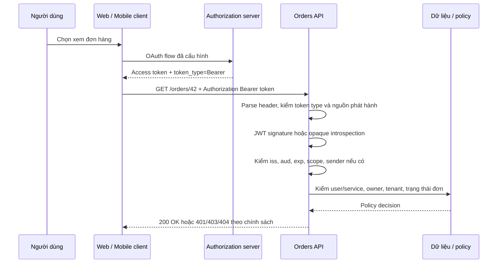
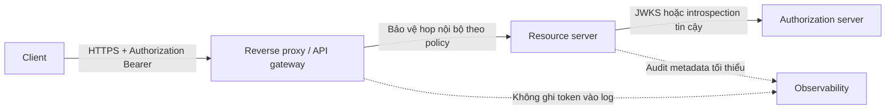

# Authorization header và scheme Bearer

Giả sử ứng dụng bán hàng vừa lấy được một OAuth 2.0 access token rồi gọi Orders API. Cùng một token có thể được đưa vào request đúng cách:

```http
GET /v1/orders/42 HTTP/1.1
Host: api.example.com
Authorization: Bearer <access-token>
Accept: application/json
```

Hoặc bị dùng sai mục đích: đính token vào URL, gửi ID token thay access token, để reverse proxy ghi header ra log, hoặc chấp nhận một JWT có chữ ký hợp lệ nhưng sai audience. Tất cả đều liên quan đến **Bearer security**: cách bên sở hữu token chứng minh quyền sử dụng bằng cách **trình token như một bí mật**, và cách tài nguyên bảo vệ bí mật đó.

Bài thuộc chương **Bearer security** của module **SECURITY_TOKEN_SECURITY_FUNDAMENTALS**. Tập trung vào cú pháp HTTP **`Authorization` header** và **`Bearer` authentication scheme** theo OAuth 2.0, cùng những ranh giới tin cậy trong việc phát hành, kiểm tra JWT/opaque access token, claims, scope, audience, lưu trữ, thu hồi và phòng chống token theft/replay. Đây là bài về **trình và tiếp nhận token tại HTTP API**, không phải bài hướng dẫn tự thiết kế mật mã.

Sau bài học, bạn có thể:

- Viết, đọc và phân tích chính xác header `Authorization: Bearer <token>`; phân biệt tên header, authentication scheme và credential.
- Giải thích vì sao **bên nào giữ bearer token có thể dùng quyền mà token đại diện**, dù không có mật khẩu hoặc chữ ký riêng cho từng request.
- Áp dụng OAuth 2.0 Bearer Token Usage (RFC 6750) cho request và `WWW-Authenticate` response, bao gồm lỗi `invalid_request`, `invalid_token` và `insufficient_scope`.
- Phân biệt **Bearer với JWT/opaque**, **access token với ID/refresh token**, và **Bearer với DPoP/mTLS-bound token**.
- Thiết kế xử lý token qua HTTPS, gateway, log, browser, mobile và service-to-service theo nguyên tắc đặc quyền tối thiểu.
- Kiểm tra access token đúng issuer, audience, thời hạn, scope và policy, đồng thời có chiến lược thu hồi, giảm replay và kiểm thử âm tính.

## 1. Bearer nghĩa là gì?

**Bearer token** là token có đặc tính: **bất kỳ bên nào đang nắm giữ token có thể trình nó để sử dụng quyền truy cập** mà không cần chứng minh sở hữu thêm một khóa mật mã riêng cho từng request. Do đó, access token thuộc loại bearer về bản chất là **bí mật cần bảo vệ**, gần với một credential tạm thời hơn là thông tin hiển thị thông thường.

Ví dụ một báo cáo được bảo vệ bởi access token có quyền `reports.read`:

- Client hợp lệ dùng token để gọi API: có thể thành công khi token và chính sách đều hợp lệ.
- Attacker **sao chép được cùng token**: có thể thử gửi cùng header Bearer trước khi token hết hạn hoặc bị thu hồi.
- API chỉ kiểm tra **chữ ký JWT** hoặc **opaque `active=true`**: chưa đủ để biết **ai đang cầm** token; nếu không có ràng buộc người gửi, token bị đánh cắp vẫn có thể qua bước kiểm tra token.

Điều này không có nghĩa API bỏ qua kiểm tra quyền. Một request được phép thực hiện khi **credential hợp lệ**, **token được cấp cho API này**, **scope cho thao tác**, và **chủ thể được phép truy cập đối tượng cụ thể**. Token bearer là cách trình credential, **không phải một quyền toàn năng**.

### Thuật ngữ không được đánh đồng

| Thuật ngữ | Bản chất | Ví dụ |
| --- | --- | --- |
| `Authorization` | Tên trường header HTTP mang HTTP authentication credentials | `Authorization: Bearer eyJ...` |
| `Bearer` | HTTP authentication scheme và một loại token usage theo OAuth 2.0 | `Bearer <access-token>` |
| **Access token** | Credential cấp cho client để gọi resource server | JWT access token hoặc opaque token |
| **JWT** | Định dạng token có claims; có thể ký/mã hóa theo JOSE | `header.payload.signature` đối với JWS |
| **Opaque token** | Chuỗi mà bên nhận không được suy diễn claims từ nội dung thô | `rNd7...` |
| **ID token (OIDC)** | Token kết quả xác thực dành cho OIDC client | `aud=web-client-id` |
| **Refresh token** | Credential dùng tại authorization server để xin access token mới | Không gửi tới Orders API |
| **Sender-constrained token** | Token ràng buộc với khóa/chứng chỉ người gửi | DPoP hoặc mTLS token binding |

**JWT không đồng nghĩa Bearer**: JWT có thể dùng vào nhiều mục đích; bearer token có thể ở dạng JWT hoặc opaque. **`Bearer` cũng không đồng nghĩa `Basic`**: Basic truyền username/password theo cơ chế khác, không phải một OAuth access token.

## 2. Cấu trúc của HTTP Authorization header

Request HTTP minh họa:

```http
GET /v1/orders HTTP/1.1
Host: api.example.com
Authorization: Bearer mF_9.B5f-4.1JqM
Accept: application/json
```

Cách đọc:

1. **`Authorization`** là **tên HTTP header field**. Header này chứa credential để xác thực request với server. Tên header trong HTTP là **case-insensitive**: `authorization` và `Authorization` là cùng một tên.
2. Dấu **`:`** sau `Authorization` phân cách **tên header** với **giá trị**.
3. **`Bearer`** là **authentication scheme**. Tên scheme cũng được so khớp **không phân biệt chữ hoa/chữ thường**, dù nên xuất ra dưới dạng chuẩn `Bearer` cho dễ đọc và tương thích.
4. Một hoặc nhiều dấu **space** theo cú pháp RFC 6750 phân tách scheme với credential; client nên xuất đúng **một dấu cách**.
5. **`mF_9.B5f-4.1JqM`** là **token được gửi nguyên vẹn**, cần coi là chuỗi bí mật và xử lý theo profile issuer.

Trong HTTP/2 và HTTP/3, tên trường có thể xuất hiện ở dạng chữ thường (`authorization`); sự khác biệt về cách đóng khung giao thức **không thay đổi ngữ nghĩa Bearer**.

### 2.1. Cú pháp `b64token` theo RFC 6750

Mục 2.1 của RFC 6750 mô tả dạng header:

```abnf
credentials = "Bearer" 1*SP b64token
b64token    = 1*( ALPHA / DIGIT /
                   "-" / "." / "_" / "~" / "+" / "/" ) *"="
```

Ở đây, `b64token` là tên **production trong ABNF**, **không phải quy định rằng mọi access token phải là JWT hay ứng dụng luôn phải Base64-decode credential**. JWT compact chứa dấu chấm, opaque token có thể dùng nhiều ký tự hợp lệ khác nhau. Resource server phải **chuyển token nguyên vẹn** cho verifier đúng profile thay vì tự suy luận quyền từ hình dáng chuỗi.

Giá trị token **phân biệt chữ hoa/chữ thường**: tự động lowercase, trim bên trong, URL-decode hoặc biến đổi token có thể làm hỏng credential. Tên scheme thì case-insensitive; **đừng dùng so khớp case-insensitive cho chính token**.

Ví dụ:

| Header | Diễn giải |
| --- | --- |
| `Authorization: Bearer abcDEF123` | Đúng khuôn dạng header; vẫn cần xác minh token thật |
| `authorization: bearer abcDEF123` | Tên header/scheme khác chữ hoa thường nhưng cùng nghĩa |
| `Authorization: Bearer eyJ...` | Có thể là JWT, không suy ra giá trị hợp lệ chỉ từ hình dáng |
| `Authorization: Basic dXNlcjpwYXNz` | Scheme **Basic**, không phải Bearer access token |
| `Authorization: Bearer: abc123` | Sai: dấu hai chấm không phải dấu cách sau scheme |
| `Authorization: Bearer` | Sai: không có credential |
| `Authorization: Bearer "abc123"` | Không phải cú pháp `b64token` của RFC 6750 vì có dấu ngoặc kép |
| `Authorization: Bearer abc, Bearer def` | Không phải cách trình hai token; phải từ chối đầu vào không hợp lệ |
| `Authorization: eyJ...` | Thiếu authentication scheme |

Header đúng cú pháp **không chứng minh** token tồn tại, có chữ ký tốt hay còn quyền. Parsing chỉ là bước đầu của xác minh credential.

### 2.2. Mỗi request có một credential theo chính sách

Không nên ghép nhiều giá trị `Authorization`, gửi nhiều bearer token qua cùng một request rồi tự chọn một token, hoặc vừa gửi Bearer header vừa đưa token khác vào body/query. RFC 6750 quy định client **không được sử dụng nhiều hơn một phương thức truyền access token trong cùng request**. Header trùng lặp có thể được proxy/server phân tích khác nhau, dẫn đến credential confusion.

Đừng vô tình trộn `Authorization` với `Proxy-Authorization`: trường thứ hai liên quan tới xác thực với proxy, **không phải** credential cho API đích.

## 3. Token được phát hành trước, header chỉ là cách sử dụng

`Bearer` không phải một OAuth grant type. Client không thể chỉ thêm `Authorization: Bearer ...` rồi khiến một token tùy ý trở thành hợp lệ.

Một luồng bình thường:

1. Client xin quyền qua authorization server, ví dụ **Authorization Code + PKCE** cho web/mobile hoặc **Client Credentials** cho workload.
2. AS xác thực/đánh giá client, chủ thể, grant, consent và chính sách, sau đó cấp access token với audience/resource và scope phù hợp.
3. Token endpoint trả `access_token`, `token_type` và metadata theo profile.
4. Client giữ token an toàn rồi gửi qua `Authorization` header khi gọi đúng API.
5. API kiểm tra credential và quyền; token hết hạn/không hợp lệ/không đủ scope phải bị từ chối.

Ví dụ token endpoint response **minh họa**:

```http
HTTP/1.1 200 OK
Content-Type: application/json
Cache-Control: no-store
Pragma: no-cache

{
  "access_token": "<new-access-token>",
  "token_type": "Bearer",
  "expires_in": 900,
  "scope": "orders.read"
}
```

`token_type=Bearer` cho client biết **cách trình access token**. Nó không cho biết token là JWT hay opaque. Trường `scope` là quyền **thực tế được cấp** theo quy tắc OAuth; client không nên mặc định scopes đã yêu cầu luôn được phê duyệt.

**Không gửi** `refresh_token` hay `id_token` trong Bearer header của resource API. Refresh token dùng với authorization server; OIDC ID token dùng để OIDC client kiểm tra kết quả đăng nhập. Cùng một issuer và cùng người dùng **không khiến các loại token hoán đổi được**.

## 4. Luồng HTTP: ai kiểm tra Bearer credential?



**Client giữ token không phải là bên quyết định quyền.** Việc một nút tạo đơn bị ẩn ở frontend không bảo vệ API; chính resource server phải xác minh `scope=orders.create` và quyền của chủ thể với tài nguyên.

Một API gateway có thể xác minh token và chuyển **trusted identity context** cho downstream, nhưng phải có cơ chế tin cậy và bảo vệ đường kết nối; không cho client tự gửi header nội bộ như `X-Authenticated-User` để mạo danh. Mọi đường gọi bỏ qua gateway cũng cần được bảo vệ bằng chính sách tương ứng.

## 5. Ví dụ client gửi Authorization: Bearer

### 5.1. Câu lệnh curl

Ví dụ phát triển trong môi trường kiểm thử:

```bash
# ACCESS_TOKEN là credential được lấy hợp lệ, không commit vào repository.
curl --fail-with-body --silent --show-error \
  --header "Authorization: Bearer $ACCESS_TOKEN" \
  --header "Accept: application/json" \
  "https://api.example.com/v1/orders/42"
```

**Lưu ý vận hành:** tùy môi trường, token nằm trong đối số lệnh có thể lộ qua shell history, process listing, debug/CI logs hoặc lệnh được ghi lại. Ví dụ chỉ minh họa **cú pháp HTTP**, không có nghĩa dùng biến shell là cơ chế quản lý bí mật hoàn chỉnh. Với môi trường production, dùng secret manager hoặc HTTP client đã quản lý credential và tránh verbose trace có chứa header.

Không viết `curl https://api.example.com/v1/orders?access_token=...`. Token trên URL thường lọt vào log, history, monitoring, cache, referrer hoặc hệ thống phân tích.

### 5.2. Java HTTP client

Mã Java 11+ minh họa cách **gửi một access token đã có**, không tự tạo JWT và không định nghĩa cách lấy OAuth token:

```java
import java.net.URI;
import java.net.http.HttpClient;
import java.net.http.HttpRequest;
import java.net.http.HttpResponse;
import java.nio.charset.StandardCharsets;

public final class OrdersClient {
    private final HttpClient client = HttpClient.newHttpClient();

    public String getOrder(String accessToken) throws Exception {
        // accessToken đến từ OAuth credential manager đáng tin.
        // Không ghi accessToken vào log hoặc exception message.
        HttpRequest request = HttpRequest.newBuilder()
                .uri(URI.create("https://api.example.com/v1/orders/42"))
                .header("Authorization", "Bearer " + accessToken)
                .header("Accept", "application/json")
                .GET()
                .build();

        HttpResponse<String> response = client.send(
                request,
                HttpResponse.BodyHandlers.ofString(StandardCharsets.UTF_8)
        );
        if (response.statusCode() == 401) {
            throw new IllegalStateException("Credential không hợp lệ hoặc hết hạn");
        }
        if (response.statusCode() == 403) {
            throw new IllegalStateException("Không đủ quyền truy cập đơn hàng");
        }
        if (response.statusCode() != 200) {
            throw new IllegalStateException("API request thất bại");
        }
        return response.body();
    }
}
```

Đây là **code học thuật**, chưa xử lý timeout, retry/backoff, OAuth token renewal, circuit breaker, response DTO hay bảo vệ secret trong runtime. Không tự ý retry vô hạn một request 401 bằng cùng access token; client chỉ nên xin token mới qua **luồng OAuth hợp lệ**, và cần phân biệt thiếu quyền 403 với token hết hạn 401.

### 5.3. Browser fetch và CORS

Nếu kiến trúc cho phép SPA giữ access token và gọi API trực tiếp:

```javascript
// Chỉ minh họa cách gửi credential đã nhận từ OAuth SDK.
// Không log, không đưa access token lên URL.
const response = await fetch("https://api.example.com/v1/orders/42", {
  method: "GET",
  headers: {
    "Authorization": "Bearer " + accessToken,
    "Accept": "application/json"
  }
});

if (!response.ok) {
  throw new Error("Không thể đọc đơn hàng");
}
const order = await response.json();
```

**`Authorization` không phải header đơn giản (CORS-safelisted) cho mọi cross-origin request.** Khi browser gọi cross-origin API với header này, nó thường thực hiện **CORS preflight**. API phải cấu hình origin/method/header phù hợp để browser cho phép request; **CORS không thay thế xác thực hoặc phân quyền**. Script độc hại chạy **cùng origin** vẫn có thể lạm dụng phiên/token nếu có XSS.

Nếu dùng BFF, browser có thể chỉ giữ **session cookie**; BFF mới là bên gửi Bearer access token tới API. Đây là hai cơ chế credential khác nhau, không nên trộn lẫn chỉ vì chúng cùng đại diện một người dùng.

## 6. API phải parse header một cách chặt chẽ

Một request đến API cần được kiểm theo lớp:

1. **Nhận đúng header từ kênh đáng tin:** HTTPS và một `Authorization` header theo chính sách, không nhận credential tùy ý qua query nếu API không hỗ trợ.
2. **Xác nhận authentication scheme:** chấp nhận `Bearer` theo cách so khớp scheme không phân biệt hoa/thường, hoặc scheme khác được API cấu hình riêng. Không lẫn `Basic`, `DPoP` hay cookie.
3. **Tách token nguyên vẹn:** có ít nhất một dấu space phân cách và credential không rỗng, đúng cú pháp/giới hạn độ dài. Không decode Base64URL để quyết định quyền trước khi verify.
4. **Chặn đầu vào bất thường:** header trùng lặp, giá trị chứa ký tự điều khiển, token quá lớn hoặc nhiều nguồn token cùng request nên bị từ chối theo policy.
5. **Chọn access-token verifier phù hợp hợp đồng AS**: JWT/JWS hoặc opaque/introspection, không dựa duy nhất vào số dấu chấm.
6. **Xác minh token và quyền nghiệp vụ** trước khi trả dữ liệu.

Mã giả:

```text
function extractBearerToken(request):
    fields = request.getAllAuthorizationFieldValues()
    if fields.count != 1:
        return invalidRequest

    value = fields[0]
    credential = parseRfc6750BearerCredentials(value)
    if credential missing or invalidSyntax or tooLong:
        return invalidRequest

    if request.alsoSuppliesTokenInBodyOrQuery:
        return invalidRequest

    return credential.rawToken  # Không biến đổi nội dung token

function getOrder(request):
    token = extractBearerToken(request)
    if token invalid:
        return appropriate401Or400Challenge()

    principal = accessTokenVerifier.verify(
        token = token,
        trustedIssuer = CONFIGURED_AS,
        expectedAudience = ORDERS_API_AUDIENCE
    )
    if principal invalid:
        return 401WithBearerInvalidTokenChallenge()

    if !principal.scopes.contains("orders.read"):
        return 403InsufficientScope()
    order = loadOrder(request.orderId)
    if !policy.canRead(principal, order):
        return 403Or404AccordingToPolicy()

    return 200WithAllowedFields(order)
```

Đây là **pseudocode**: hãy dùng framework HTTP/OAuth đã được thử nghiệm, không tự viết parser tự chế bằng `split(" ")` rồi bỏ qua corner cases. Sự khác nhau giữa parser ở proxy, gateway, application server có thể tạo **credential confusion** nếu chúng diễn giải cùng một request khác nhau.

**Không bao giờ** dùng `String.contains("Bearer")` để xác nhận scheme, hoặc dùng tìm kiếm `scope` theo substring. So khớp scheme theo token HTTP hợp lệ; scope phải tách thành **các giá trị hoàn chỉnh** theo hợp đồng của issuer.

## 7. Sau parsing: xác minh JWT hoặc trạng thái opaque token

Một Bearer credential có thể được AS cấp dưới hai dạng rất khác:

| Kiểu access token | Cách API xác minh | Điều không được giả định |
| --- | --- | --- |
| **JWT access token ký (JWS)** | Xác minh chữ ký bằng khóa tin cậy, profile/token type, `iss`, `aud`, `exp`, `nbf`, scope và policy | Decode payload hay kiểm `alg` từ header **chưa** đủ |
| **Opaque access token** | Gọi introspection/nguồn trạng thái đáng tin, xác minh `active`, resource binding, scope, trạng thái và policy | Chuỗi trông ngẫu nhiên hay HTTP 200 từ introspection **chưa** chứng minh quyền |

### 7.1. JWT access token

Payload ví dụ (chưa phải token hợp lệ khi chưa có chữ ký kiểm chứng được):

```json
{
  "iss": "https://login.example.com",
  "sub": "user-42",
  "aud": "https://api.example.com/orders",
  "client_id": "orders-web",
  "scope": "orders.read",
  "iat": 1795000000,
  "nbf": 1795000000,
  "exp": 1795000600,
  "jti": "example-access-token-001"
}
```

Resource server cần xác minh:

- **Chữ ký** bằng khóa của issuer đã cấu hình; thuật toán `alg` thuộc allowlist, `kid` chỉ chọn khóa trong JWKS tin cậy, không tự tải `jku`/`x5u` từ token.
- **Loại token** theo profile, ví dụ `typ=at+jwt` với RFC 9068 khi áp dụng. API không được nhận **ID token** OIDC có `aud=orders-web-client` làm bearer access token.
- **Issuer và audience**: `iss` đáng tin, `aud` chứa identifier của chính Orders API. Token dành cho Billing API phải bị từ chối.
- **Thời gian**: `exp`, `nbf` (NumericDate tính theo giây), clock skew nhỏ có cấu hình; `iat`/TTL tối đa theo policy.
- **Scope và phân quyền**: `orders.read` chỉ cho phép xét thao tác đọc, không tự cho đọc đơn của tenant khác.

Một JWT ký hợp lệ **không tự cho biết nó đã bị thu hồi**. Với JWT tự chứa được API kiểm tra offline, cần TTL hợp lý, denylist/session state hoặc policy lookup nếu cần chặn nhanh.

### 7.2. Opaque access token

API có thể trình token đến **OAuth 2.0 Token Introspection** (RFC 7662), qua kênh HTTPS với xác thực resource server theo chính sách. Response minh họa:

```json
{
  "active": true,
  "client_id": "orders-web",
  "sub": "user-42",
  "scope": "orders.read",
  "aud": "https://api.example.com/orders",
  "exp": 1795000600
}
```

`active=true` phải là boolean từ **AS đáng tin**. RFC 7662 **không đảm bảo mọi response đều chứa `aud`**; nếu thiếu audience, API cần cơ chế **resource binding tin cậy** như introspection được giới hạn theo danh tính RS hoặc metadata được AS cam kết. Không chấp nhận token chỉ vì `active=true`.

Khi `active=false`, resource server từ chối token. HTTP 200 của introspection chỉ nói **cuộc gọi tra cứu thành công**, không có nghĩa token được phép dùng.

**Introspection failure** (timeout, AS không khả dụng, response sai schema) phải dẫn đến **fail closed**: không cấp truy cập chỉ vì AS không trả lời. Có thể trả 503/5xx cho lỗi hạ tầng theo chính sách; không cần giả mạo `401` cho mọi lỗi mạng.

## 8. WWW-Authenticate: server phải trả challenge thế nào?

Khi client không có credential hợp lệ hoặc cần quyền bổ sung, resource server có thể gửi HTTP **`WWW-Authenticate`** để mô tả authentication scheme được hỗ trợ và các thông tin lỗi. Mục 3 của RFC 6750 định nghĩa Bearer challenge và các error codes liên quan.

Ví dụ:

```http
HTTP/1.1 401 Unauthorized
WWW-Authenticate: Bearer realm="orders-api"
Cache-Control: no-store
```

`realm` chỉ phạm vi bảo vệ (protection space) theo hợp đồng; đây **không phải** audience của JWT, cũng không làm token dành cho API khác trở nên hợp lệ.

### 8.1. Ba lỗi trong RFC 6750

| Bearer error | Tình huống | HTTP status điển hình |
| --- | --- | --- |
| `invalid_request` | Request thiếu tham số bắt buộc theo cách truyền credential, sai cú pháp, trùng nguồn credential hoặc nhiều phương thức gửi token | **400 Bad Request** |
| `invalid_token` | Token hết hạn, không hợp lệ, bị thu hồi, sai định dạng/profile, không được chấp nhận | **401 Unauthorized** |
| `insufficient_scope` | Token hợp lệ nhưng không đủ scope cho thao tác | **403 Forbidden** |

Các HTTP status trên là **giá trị được RFC 6750 khuyến nghị** trong các trường hợp tương ứng; cách framework diễn giải và bảo vệ chi tiết lỗi cần tuân theo giao thức và chính sách hệ thống.

#### Không có token

```http
HTTP/1.1 401 Unauthorized
WWW-Authenticate: Bearer realm="orders-api"
```

Khi client không gửi credential, thông thường challenge **không cần** `error`, để tránh trả chi tiết vô ích. RFC 6750 nêu không nên gồm error code khi request không có thông tin xác thực.

#### Token đã hết hạn hoặc không hợp lệ

```http
HTTP/1.1 401 Unauthorized
WWW-Authenticate: Bearer realm="orders-api", error="invalid_token"
Cache-Control: no-store
```

Client có thể thử xin access token mới bằng cơ chế OAuth hợp lệ. Không tự động retry vô hạn với cùng token bị từ chối và không yêu cầu người dùng đưa refresh token tới resource server.

#### Thiếu scope

```http
HTTP/1.1 403 Forbidden
WWW-Authenticate: Bearer realm="orders-api", error="insufficient_scope", scope="orders.create"
Cache-Control: no-store
```

Tham số `scope` trong challenge có thể chỉ ra scope cần cho tài nguyên, **không phải quyền mới đã được cấp**. Client phải xin thêm quyền qua authorization flow được AS cho phép; API không cấp scope chỉ vì client gửi lại request.

#### Credential sai cú pháp

```http
HTTP/1.1 400 Bad Request
WWW-Authenticate: Bearer realm="orders-api", error="invalid_request"
```

Trong thực tế, tài liệu API phải mô tả cách xử lý lỗi cho client. **Không đưa token gốc, signing key, JWT payload nhạy cảm hoặc chi tiết nội bộ** vào `error_description` hay response body. Nên có correlation ID và audit nội bộ an toàn.

### 8.2. Có phải mọi 403 đều là insufficient_scope?

**Không.** Request có scope đọc nhưng cố truy cập đơn hàng của tenant khác là **object-level authorization failure**, có thể trả 403 hoặc 404 theo policy mà không tiết lộ chi tiết tài nguyên. `insufficient_scope` chỉ đúng khi thiếu **scope**; đừng báo sai lỗi chỉ vì policy nghiệp vụ từ chối.

**`401 Unauthorized`** về mặt tên dễ gây nhầm: nó dùng trong HTTP authentication khi credential thiếu/không hợp lệ, không có nghĩa client được quyền rồi “chưa được ủy quyền” theo diễn giải tiếng Việt.

## 9. Ba cách truyền Bearer access token trong RFC 6750

RFC 6750 mô tả ba cách client có thể trình bearer token khi các điều kiện áp dụng được đáp ứng:

| Phương thức | Vị trí token | Đánh giá |
| --- | --- | --- |
| **`Authorization` request header (mục 2.1)** | `Authorization: Bearer <token>` | **Nên ưu tiên** trong API thông thường |
| **Form-encoded body parameter (mục 2.2)** | `access_token` trong body `application/x-www-form-urlencoded` | Chỉ trong điều kiện hạn chế của RFC; **không khuyến nghị** dùng trừ khi có lý do tương thích cụ thể |
| **URI query parameter (mục 2.3)** | `?access_token=...` | **Không khuyến nghị** vì rất dễ rò qua URL, log, history, cache, referrer |

RFC 6750 nêu rằng client **không được dùng nhiều hơn một** phương thức truyền token trong cùng request.

### 9.1. Form-encoded body

Ví dụ chỉ để hiểu cú pháp của RFC, **không phải khuyến nghị**:

```http
POST /legacy-action HTTP/1.1
Host: api.example.com
Content-Type: application/x-www-form-urlencoded

access_token=<bearer-token>&action=read
```

Phương thức này đòi hỏi điều kiện cụ thể: HTTP request body phải là `application/x-www-form-urlencoded`; request có body, theo giới hạn của RFC 6750, không dùng cho request GET; `access_token` là form parameter. Rủi ro là body có thể bị ghi trong tracing, audit hoặc bị framework xử lý nhầm với dữ liệu người dùng. **Không được dùng JSON body parameter** như một thay thế mặc nhiên của cách truyền OAuth Bearer trong RFC.

### 9.2. URI query parameter

```http
GET /v1/orders?access_token=<bearer-token> HTTP/1.1
Host: api.example.com
```

**Không dùng cho ứng dụng mới.** URL có thể xuất hiện trong lịch sử trình duyệt, server/access logs, reverse proxy, APM, analytics, referer và cache. Kể cả HTTPS bảo vệ đoạn truyền trên mạng, nhiều thành phần nội bộ có thể vẫn ghi **đường dẫn + query**. Một số hệ thống cũ buộc hỗ trợ query parameter cần ghi rõ ngoại lệ và rủi ro, nhưng không biến nó thành phương thức mặc định.

## 10. HTTPS/TLS bảo vệ bí mật trong quá trình truyền

Bearer token có thể bị bên nghe lén sử dụng nếu đi qua kênh không được bảo vệ. **RFC 6750 yêu cầu bảo vệ bearer token bằng TLS** và đặc biệt chú trọng tránh token disclosure. Với production:

- Client gửi Bearer credential qua **HTTPS** đến đúng origin của API, xác thực certificate chain/hostname; không tắt kiểm tra TLS để “chạy được”.
- Không đưa bearer token vào request HTTP plaintext, email, chat, console hoặc URL.
- Khi reverse proxy, gateway hoặc load balancer **kết thúc TLS (TLS termination)**, cần bảo vệ tiếp **hop nội bộ** theo threat model: HTTPS/mTLS, mạng được kiểm soát, hoặc một trust channel tương đương; tránh gửi token ở plaintext qua môi trường không tin cậy.
- Chuyển hướng (redirect) giữa origin cần được xét kỹ: **không tự động chuyển credential đến host lạ**. Client HTTP phải có chính sách redirect rõ ràng, đặc biệt khi Authorization header hiện diện.
- Ngăn downgrade protocol, cấu hình cipher suites/chứng chỉ theo tiêu chuẩn bảo mật hiện hành và dùng HSTS cho web origins phù hợp.



**TLS không ngăn mọi rò rỉ.** Nếu trình duyệt có XSS, máy chủ log nguyên header, hệ thống APM thu request payload hoặc bộ phận support sao chép token, credential vẫn có thể bị đánh cắp dù kết nối HTTPS hoàn toàn đúng.

## 11. Proxy, gateway, service mesh và rủi ro làm rơi header

Một kiến trúc phổ biến có nhiều hop: browser → CDN/WAF → gateway → service mesh → backend. Mỗi hop có thể:

- **Nhận và chuyển tiếp** `Authorization` header.
- **Loại bỏ hoặc thay thế** header để ngăn lộ credential tới downstream không cần dùng.
- **Xác minh token tại gateway** rồi truyền danh tính qua một kênh nội bộ đáng tin.
- **Ghi log** request headers, nếu cấu hình không cẩn thận.

Thiết kế cần trả lời: **ai là verifier cuối cùng, ai được nhìn thấy token, ai có quyền mạo danh trusted identity context?**

### 11.1. Không tin header danh tính do client tự đặt

Ví dụ gateway xác minh access token rồi chuyển thông tin:

```text
X-Authenticated-Subject: user-42
X-Trusted-Tenant: tenant-a
```

Đó chỉ là các **header giả định** trong kiến trúc nội bộ. Backend chỉ được tin chúng nếu gateway **xóa mọi giá trị client gửi trước đó**, chỉ gateway mới được ghi và kênh gateway→backend có xác thực/kiểm soát đường đi. Nếu client được gọi thẳng vào backend và tự gửi `X-Authenticated-Subject: admin`, sẽ có lỗi leo thang quyền.

### 11.2. Header bị proxy cắt mất

Khi API trả 401 dù token hợp lệ, hãy kiểm tra một cách **không lộ token** xem request đi qua gateway/CDN có còn `Authorization` không. Phải khắc phục ở cấu hình chuyển tiếp header; **không thay bằng gửi token trên query string** để né lỗi proxy.

### 11.3. Logging và telemetry

Không ghi nguyên `Authorization`, `Cookie`, `Set-Cookie`, refresh token, OTP hoặc access token vào:

- HTTP access logs, reverse proxy logs, gateway tracing.
- APM spans, exception/crash reports, analytics.
- CI/CD logs, debug console, clipboard dùng trong support.
- URL/query string và log của các bên thứ ba.

Thay vào đó, ghi metadata **không làm lộ token**: issuer tin cậy, client ID khi đã xác minh, audience, loại request, scope ở mức phù hợp, kết quả allow/deny, mã lỗi và correlation ID. Nếu cần token identifier để điều tra, áp dụng chính sách bảo vệ `jti`/HMAC token fingerprint, hạn chế khả năng liên kết danh tính.

## 12. Browser: Authorization header, cookies, CORS và CSRF

### 12.1. Authorization header không biến SPA thành confidential client

SPA chạy JavaScript ở trình duyệt là **public OAuth client**. Code JS không thể giữ client secret lâu dài một cách an toàn. Authorization Code + PKCE giúp bảo vệ authorization code, nhưng **không trực tiếp ngăn script độc hại do XSS đọc hoặc sử dụng access token**.

Rủi ro lưu token:

| Vị trí lưu | Ưu điểm | Giới hạn cần hiểu |
| --- | --- | --- |
| **Memory trong SPA** | Ít tồn tại qua reload/khởi động lại | XSS cùng origin có thể đọc hoặc gọi API trong phiên |
| **`localStorage`/`sessionStorage`** | Dễ triển khai và truy cập | JavaScript có thể đọc, nên XSS có thể trích xuất |
| **Backend/BFF giữ access token** | Browser không trực tiếp sở hữu OAuth token | Backend phải bảo vệ phiên, chống CSRF/XSS, giới hạn scope và không dùng token quá quyền |
| **Cookie phiên ứng dụng** | `HttpOnly` hạn chế JS đọc trực tiếp | Browser tự gửi cookie theo policy; cần `Secure`, `SameSite` và chống CSRF phù hợp |

**`HttpOnly` không giải quyết mọi XSS**: script độc hại có thể không đọc cookie nhưng vẫn gửi request trong ngữ cảnh phiên và đọc phản hồi cùng origin nếu không có biện pháp khác.

### 12.2. CORS là chính sách browser, không phải authorization

Một cross-origin `fetch` có `Authorization` thường kích hoạt CORS preflight:

```http
OPTIONS /v1/orders HTTP/1.1
Host: api.example.com
Origin: https://app.example.com
Access-Control-Request-Method: GET
Access-Control-Request-Headers: authorization
```

API phải trả cấu hình `Access-Control-Allow-Origin`, methods và headers phù hợp cho origin được tin. Tuy nhiên **preflight không phải chứng minh access token hợp lệ**: request thực vẫn cần Bearer validation và policy.

Khi dùng request kèm browser credentials (ví dụ cookies), không thể kết hợp `Access-Control-Allow-Origin: *` với `Access-Control-Allow-Credentials: true` để cho trình duyệt chấp nhận response. CORS phải cấu hình origin rõ ràng theo trust model. Cũng không nên tin `Origin` như bằng chứng người gọi có quyền OAuth, vì non-browser clients có thể đặt header Origin tùy ý.

### 12.3. CSRF có áp dụng cho Bearer header không?

Khi một API chỉ chấp nhận access token được JavaScript/chủ động client thêm vào **`Authorization` header**, một trang web bên ngoài không tự có token để thêm header, nên mô hình CSRF truyền thống khác so với **cookie tự động đính kèm**. Nhưng:

- Nếu app dùng **cookie/session tự động gửi**, cần chống CSRF tùy kiến trúc và hành động.
- Nếu token bị lộ qua XSS hoặc cấu hình CORS sai, attacker có thể gửi request hợp lệ.
- Nếu API chấp nhận cả cookie lẫn Bearer ở nhiều endpoint, phải phân tích **từng cách xác thực**; không khẳng định “có Bearer nên không cần CSRF” cho toàn bộ hệ thống.

## 13. Mobile và service-to-service: cùng cú pháp, khác rủi ro

### 13.1. Mobile/native app

Ứng dụng Android/iOS có thể gửi:

```http
GET /v1/profile HTTP/1.1
Host: api.example.com
Authorization: Bearer <mobile-access-token>
```

Native app là public client; nên dùng Authorization Code + PKCE qua trình duyệt hệ thống. Refresh token nếu được cấp cần bảo vệ bằng Keychain/Keystore và chính sách thiết bị. Không nhúng một shared client secret cố định vào ứng dụng rồi coi nó là secret an toàn. Token lộ từ thiết bị bị chiếm quyền vẫn có thể bị replay trong TTL nếu là bearer thông thường.

### 13.2. Service-to-service

Một backend có thể dùng OAuth Client Credentials để lấy access token cho Pricing API:

```http
GET /v1/prices?sku=ABC123 HTTP/1.1
Host: pricing.example.com
Authorization: Bearer <pricing-access-token>
```

Client Credentials đòi AS xác thực **workload**; chỉ thêm `Authorization` header không chứng minh danh tính service. Scope và audience phải được cấp theo **từng dịch vụ và từng nhiệm vụ**. Với workload, `sub` không nhất thiết là người dùng, và không được mặc định có MFA/`auth_time` như luồng đăng nhập người dùng.

### 13.3. Service A gọi service B

Nếu token người dùng có `aud=orders-api`, Orders API **không nên chuyển nguyên token** đó sang Billing API. Billing phải từ chối vì audience sai; Orders có thể xin token mới qua **token exchange/delegation** (RFC 8693) nếu AS hỗ trợ, hoặc dùng danh tính service riêng nếu tác vụ là S2S thuần và policy cho phép. Không tạo token “aud=*” chỉ để làm forwarding dễ hơn.

## 14. Bearer, DPoP và mTLS: có cần chứng minh sở hữu khóa?

Bearer token thuần không yêu cầu client ký riêng từng request hay chứng minh sở hữu private key đã ràng buộc. Đó là lý do replay token bị lộ nguy hiểm.

**Sender-constrained access token** bổ sung ràng buộc để bản sao token **không đủ** nếu attacker thiếu khóa/chứng chỉ.

| Cơ chế | Cách trình credential điển hình | Điều API cần xác minh |
| --- | --- | --- |
| **Bearer thuần** | `Authorization: Bearer <token>` | Token validity, audience, scope, policy |
| **DPoP** (RFC 9449) | `Authorization: DPoP <token>` cùng header `DPoP: <signed-proof-jwt>` | Proof ký bởi khóa tương ứng, method/URI, thời gian, token hash, nonce/replay theo profile |
| **mTLS certificate-bound access token** (RFC 8705) | Thường vẫn dùng `Authorization: Bearer <token>` nhưng trình qua kết nối mTLS | Chứng chỉ TLS của client khớp ràng buộc trong token/AS metadata |

**Không nhầm `DPoP` authentication scheme với `Bearer`.** DPoP dùng **scheme riêng `DPoP`** cho access token có ràng buộc DPoP theo RFC 9449; gửi DPoP-bound token như Bearer thông thường hoặc thiếu proof phải bị xử lý không hợp lệ theo profile.

### 14.1. Ví dụ DPoP request rút gọn

```http
GET /v1/orders/42 HTTP/1.1
Host: api.example.com
Authorization: DPoP <dpop-bound-access-token>
DPoP: <signed-dpop-proof-jwt>
```

Proof JWT phải được tạo theo từng yêu cầu/bối cảnh; không thể copy một proof cũ rồi mặc định dùng với mọi endpoint. Resource server xác minh `htm` (method), `htu` (URI), `iat`, `jti`, `ath` (token hash) và nonce/replay nếu sử dụng theo yêu cầu profile. **Chỉ nhìn claim `cnf` trong token chưa đủ** để xác minh possession.

### 14.2. mTLS không thay issuer/audience/scope

mTLS xác thực phía client ở lớp TLS và có thể ràng buộc access token với certificate. Nhưng một token dành cho Orders API vẫn không thành token cho Billing API chỉ vì cùng chứng chỉ. **Issuer, audience, scope, expiry và quyền trên object vẫn cần kiểm tra**, kể cả khi sender constraint hợp lệ.

## 15. Vòng đời và thu hồi: Bearer header không quyết định hiệu lực

`Authorization: Bearer ...` chỉ gửi một token. **Khi nào token hết hạn hoặc bị thu hồi** là thuộc tính của AS/profile và chính sách resource server.

| Tình huống | Hành vi phải được thiết kế |
| --- | --- |
| **Access token hết hạn** | JWT verifier kiểm `exp` hoặc opaque introspection phản ánh `active=false`; client xin token mới theo grant hợp lệ |
| **Người dùng logout** | Kết thúc phiên và thu hồi refresh/grant theo policy; access token JWT có thể còn hạn nếu API xác minh offline |
| **Refresh token bị lộ** | Bảo vệ lưu trữ, rotation/reuse detection và thu hồi phiên/token family khi thích hợp |
| **Role/tenant thay đổi** | Kiểm tra quyền hiện hành ở API khi cần; TTL/token version/introspection để hạn chế quyền cũ |
| **Opaque token bị thu hồi** | AS có thể trả `active=false`; cache kết quả ở API có thể làm chậm áp dụng |
| **JWT signing key bị lộ** | Xoay/vô hiệu khóa, cập nhật JWKS/trust và phương án chặn các token liên quan |
| **Bearer token bị sao chép** | Hạn chế scope/audience/TTL, phát hiện bất thường và cân nhắc sender constraint |

Một access token có TTL **5–15 phút** chỉ là **ví dụ có thể cân nhắc**, không phải con số bắt buộc. Token cho giao dịch nhạy cảm và dịch vụ ít tin cậy có thể cần chính sách khác. **JWT ký được kiểm tra offline không tự hết hiệu lực chỉ vì logout tại AS**, trừ khi API kiểm tra trạng thái bổ sung hoặc khóa xác minh bị thay đổi/thu hồi theo chính sách.

**Không dùng access token để suy luận một lần đăng nhập/MFA mới.** `iat` là thời điểm phát hành JWT, không đồng nghĩa `auth_time` của OIDC. Refresh access token không tự xác thực lại người dùng hoặc tăng assurance.

## 16. Những lỗi Bearer security thường gặp

| Anti-pattern | Rủi ro | Khắc phục |
| --- | --- | --- |
| Gửi `?access_token=...` trong URL | Lộ qua log/history/referrer/cache | Dùng Authorization header qua HTTPS |
| Gửi refresh token hoặc ID token làm Bearer tại API | Sai token type/audience, lạm dụng credential | Resource server chỉ nhận access token profile phù hợp |
| API chỉ kiểm chữ ký JWT | Token sai issuer/audience/scope hoặc ID token vẫn có thể được chấp nhận | Kiểm token type, `iss`, `aud`, thời gian, scope và policy |
| API chỉ kiểm `active=true` từ opaque introspection | Token dành cho API khác hoặc không đủ quyền vẫn được chấp nhận | Kiểm resource binding/audience và scope |
| Tự nối chuỗi `Bearer` và token vào log | Lộ credential cho nhân viên/hệ thống quan sát | Redact header và không log token |
| Client gửi hai Authorization headers | Proxy/backend hiểu khác nhau, credential confusion | Từ chối header trùng lặp/không hợp lệ |
| Proxy bỏ mất Authorization header | Request hợp lệ bị 401; dev dùng đường vòng kém an toàn | Sửa header forwarding theo cấu hình, không dùng URL token |
| CORS cấu hình sai hoặc XSS | Browser token bị đọc/lạm dụng | Origin policy, CSP/chống XSS, BFF khi phù hợp |
| Token Bearer TTL dài, scope rộng, audience rộng | Attacker giữ token có nhiều quyền lâu | Least privilege, expiry, rotation/revocation |
| DPoP-bound token nhận như Bearer thuần | Bỏ qua possession proof | Validate đúng scheme và DPoP proof |
| Introspection timeout thì `allow` | Fail-open khi AS không khả dụng | Fail closed; lỗi hạ tầng trả 503/5xx hợp lý |
| Client thấy 403 rồi tự đổi scope trên request | Quyền ảo, lỗi authorization | Xin quyền qua AS hợp lệ; API vẫn kiểm tra policy |

## 17. Case study: cùng một access token qua ba môi trường

Giả sử `seller-web` cần đọc đơn thuộc `tenant-a`. AS cấp opaque hoặc JWT access token dành cho Orders API với `orders.read`.

### Trường hợp A: request đúng

```http
GET /v1/orders/101 HTTP/1.1
Host: api.example.com
Authorization: Bearer <orders-read-access-token>
```

API xác minh token và thấy `aud=orders-api`, `scope=orders.read`; đối chiếu `order 101` thuộc tenant/user có quyền. **Kết quả: 200 nếu mọi điều kiện đúng.**

### Trường hợp B: token đúng nhưng sai API

Client gửi chính token đó tới Payroll API. JWT có chữ ký đúng hoặc opaque introspection có thể coi token đang hoạt động, nhưng token **không dành cho Payroll API**. **Kết quả: từ chối theo audience/resource binding.**

### Trường hợp C: token đúng, người dùng đòi đọc đơn tenant khác

Client đổi `/orders/101` thành `/orders/9001` thuộc `tenant-b`. Header Bearer và scope vẫn hợp lệ. **Kết quả: 403 hoặc 404 theo policy**, vì bearer token không cấp quyền trên toàn bộ bản ghi.

### Trường hợp D: token bị lộ ở reverse proxy log

Một APM agent ghi nguyên header. Attacker có token và gọi Orders API qua HTTPS từ máy khác. Nếu là bearer thuần, API có thể không phân biệt được request này với client gốc chỉ dựa vào token. **Cách xử lý:** xóa/rà soát log và quyền truy cập, thu hồi token/phiên khi có thể, kiểm tra ảnh hưởng, giảm TTL/scope và cân nhắc sender-constrained token.

### Trường hợp E: client gửi DPoP-bound token sai scheme

Ứng dụng dùng token đã ràng buộc với khóa DPoP nhưng gửi `Authorization: Bearer ...` không kèm proof hợp lệ. **Kết quả đúng:** resource server từ chối theo profile; không downgrade token về bearer thuần.

## 18. Kiểm thử âm tính: đừng chỉ kiểm request 200

Một API có thể vượt kiểm thử chức năng nhưng vẫn không an toàn nếu thiếu các ca sai đầu vào:

| # | Ca kiểm thử | Kỳ vọng |
| --- | --- | --- |
| 1 | Không gửi `Authorization` | 401 và Bearer challenge phù hợp |
| 2 | Gửi `Authorization: Bearer` không có token | Từ chối, không xử lý request |
| 3 | Gửi `Authorization: Basic ...` cho API chỉ hỗ trợ Bearer | Không coi là bearer token |
| 4 | Gửi scheme `bearer` viết thường và token hợp lệ | Scheme được parse không phân biệt hoa/thường |
| 5 | Token chữ hoa/thường bị thay đổi | Không được normalize/đổi giá trị token |
| 6 | Hai `Authorization` headers hoặc nhiều nguồn access token | Từ chối theo chính sách, không chọn ngẫu nhiên |
| 7 | Token trong query hoặc JSON body không được API hỗ trợ | Không dùng làm credential hợp lệ |
| 8 | JWT có chữ ký sai hoặc `alg=none` | 401, không tin payload |
| 9 | JWT hết hạn, sai issuer, sai audience hoặc sai token type | 401 và/hoặc challenge theo profile |
| 10 | ID token OIDC được gửi làm Bearer access token | Từ chối |
| 11 | Opaque introspection `active=false` | 401; không coi HTTP 200 introspection là hợp lệ |
| 12 | Introspection bị timeout/AS lỗi | Fail closed, không cấp dữ liệu |
| 13 | Token hợp lệ nhưng thiếu `orders.read` | 403, có thể `insufficient_scope` |
| 14 | Đúng scope nhưng order thuộc tenant khác | 403/404, không trả dữ liệu |
| 15 | Token bị thu hồi khi API dùng introspection cache | Hành vi phù hợp giới hạn stale cache đã cam kết |
| 16 | Access token bị chèn vào URL hoặc log | Bộ lọc/redaction ngăn rò rỉ |
| 17 | Redirect sang host khác | Client không rò Authorization credential sang origin lạ |
| 18 | Browser gọi cross-origin với `Authorization` | Preflight và CORS đúng; API vẫn kiểm Bearer |
| 19 | DPoP access token thiếu proof/sai URI/method | Từ chối, không downgrade sang Bearer |
| 20 | mTLS-bound token không có certificate phù hợp | Từ chối theo profile sender constraint |
| 21 | Gateway bị client giả mạo header nội bộ danh tính | Backend từ chối hoặc chỉ tin gateway đã xác thực |
| 22 | Token được gửi đúng header nhưng API hết quyền đọc đối tượng | Chính sách hiện hành từ chối |

**Lưu ý lỗi 401 và 403:** không phải mọi từ chối 403 đều thiếu scope; object-level policy có thể là nguyên nhân. Một `401` do **thiếu token** khác `401` do **invalid_token**, còn `503` do introspection unavailable là lỗi hạ tầng không nên nhầm với quyền của người dùng.

## 19. Checklist trước khi triển khai production

1. **Client gửi đúng cú pháp?** `Authorization: Bearer <access-token>` qua HTTPS, không ghép token vào URL, không gửi nhiều phương thức?
2. **Đúng token?** Token từ AS tin cậy, `token_type` phù hợp, không lẫn ID token/refresh token/session cookie?
3. **Resource server parse đúng?** Xử lý header/scheme case-insensitive, token nguyên vẹn, input limits, duplicate headers và scheme lạ?
4. **JWT/opaque được xác minh đúng?** JWT chữ ký/JWKS/issuer/audience/expiry/type; opaque `active` từ AS tin cậy và resource binding?
5. **Scope/object policy có đầy đủ?** API kiểm scope, user/service, tenant, owner, field và trạng thái nghiệp vụ, không dựa vào frontend?
6. **Phản hồi lỗi rõ?** `WWW-Authenticate: Bearer`, 401/403 và `invalid_token`/`insufficient_scope` đúng ngữ cảnh, không lộ bí mật?
7. **Bảo vệ trên đường đi?** TLS, redirect policy, proxy forwarding, gateway trust, không log Authorization header?
8. **Browser/mobile?** BFF/cookie khi phù hợp, chống XSS/CSRF, CORS an toàn, Keychain/Keystore bảo vệ refresh credential?
9. **S2S?** Workload identity/client credentials, scope/audience riêng từng dịch vụ, không truyền token sai audience?
10. **Token theft/replay?** TTL, least privilege, revocation, monitoring, DPoP hoặc mTLS khi threat model đòi hỏi?
11. **AS unavailable?** Không fail-open khi introspection/JWKS không thể kiểm; cache và thời hạn thu hồi đã định nghĩa?
12. **Kiểm thử?** Đã thử request sai header, sai loại token, hết hạn, thiếu scope, sai tenant, token bị lộ/thu hồi, DPoP/mTLS và sự cố gateway?

**Kết luận:** Header `Authorization` với scheme `Bearer` là **cách truyền credential đến resource server**, không phải bằng chứng token tự động an toàn. Bảo mật chỉ hình thành khi token được **phát hành đúng quyền, truyền qua kênh an toàn, không bị lộ, được xác minh đúng issuer/audience/thời hạn/loại token, rồi được áp dụng scope và object-level authorization**. Bearer token bị sao chép có thể bị dùng lại trong thời hạn hiệu lực; hãy giới hạn hậu quả bằng least privilege, vòng đời ngắn/thu hồi, giám sát và sender-constrained token khi phù hợp.

## Tài liệu tham khảo

- [RFC 6750 — OAuth 2.0 Bearer Token Usage](https://www.rfc-editor.org/rfc/rfc6750): mục 2.1 về Authorization header, mục 2.2 về form body, mục 2.3 về query parameter, mục 3 về Bearer challenge và mục 5 về security considerations.
- [RFC 9110 — HTTP Semantics](https://www.rfc-editor.org/rfc/rfc9110): ý nghĩa `Authorization`, `WWW-Authenticate`, 401/403 và HTTP authentication schemes.
- [RFC 6749 — OAuth 2.0 Authorization Framework](https://www.rfc-editor.org/rfc/rfc6749): cách cấp access token, `token_type`, scope và OAuth roles.
- [RFC 7519 — JSON Web Token (JWT)](https://www.rfc-editor.org/rfc/rfc7519): `iss`, `aud`, `exp` và JWT claims.
- [RFC 8725 — JWT Best Current Practices](https://www.rfc-editor.org/rfc/rfc8725): xác minh issuer/audience/algorithm và chống token confusion.
- [RFC 9068 — JWT Profile for OAuth 2.0 Access Tokens](https://www.rfc-editor.org/rfc/rfc9068): access token JWT, claims và `at+jwt`.
- [RFC 7662 — OAuth 2.0 Token Introspection](https://www.rfc-editor.org/rfc/rfc7662): xác minh opaque access token qua trạng thái.
- [RFC 7009 — OAuth 2.0 Token Revocation](https://www.rfc-editor.org/rfc/rfc7009): thu hồi token.
- [RFC 8707 — Resource Indicators for OAuth 2.0](https://www.rfc-editor.org/rfc/rfc8707): giới hạn token theo API/resource.
- [RFC 8693 — OAuth 2.0 Token Exchange](https://www.rfc-editor.org/rfc/rfc8693): cấp token downstream phù hợp audience.
- [RFC 9449 — OAuth 2.0 Demonstrating Proof of Possession (DPoP)](https://www.rfc-editor.org/rfc/rfc9449): `Authorization: DPoP`, DPoP proof và sender constraint.
- [RFC 8705 — OAuth 2.0 Mutual-TLS Client Authentication and Certificate-Bound Access Tokens](https://www.rfc-editor.org/rfc/rfc8705): token ràng buộc mTLS.
- [RFC 9700 — Best Current Practice for OAuth 2.0 Security](https://www.rfc-editor.org/rfc/rfc9700): biện pháp giảm rủi ro bearer token, refresh token và replay.
- [OWASP Session Management Cheat Sheet](https://cheatsheetseries.owasp.org/cheatsheets/Session_Management_Cheat_Sheet.html): session cookie, bảo vệ bí mật phiên.
