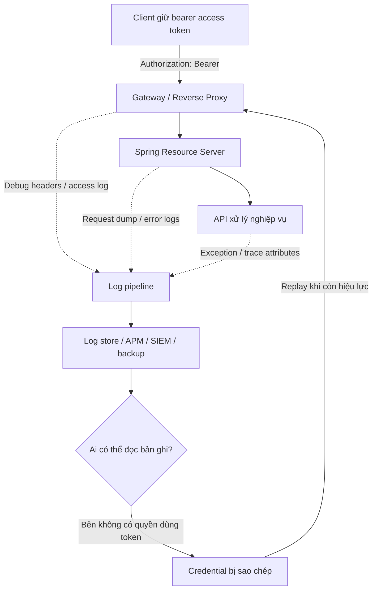

# Không log bearer token

**Bearer token là một credential: ai đang nắm giữ token thường có thể sử dụng nó để gọi API trong phạm vi còn hiệu lực.** Nếu ứng dụng ghi nguyên bearer token vào log, token đã bị sao chép sang một hệ thống khác với nhiều người đọc, bộ lưu trữ, công cụ tìm kiếm, bản sao lưu và thời hạn lưu giữ riêng. Chữ ký JWT đúng không chứng minh người đang xuất trình token là chủ sở hữu ban đầu; vì vậy một bản log chứa token có thể trở thành nguồn **chiếm quyền phiên, gọi API trái phép hoặc replay**.

**Quy tắc không có ngoại lệ mặc định: không ghi nguyên access token, refresh token, ID token, authorization code, session cookie, mật khẩu hay secret tương đương vào application log, access log, error log, trace, APM, crash report hoặc hệ thống phân tích.** Chỉ ghi **metadata an toàn, có mục đích rõ**, và bảo đảm quy tắc này áp dụng ở mọi lớp của đường đi request.

Bài thuộc chương **Bearer security** của module **SECURITY_TOKEN_SECURITY_FUNDAMENTALS**. Nội dung gắn với mô hình tin cậy và vòng đời JWT/opaque token, access/refresh token, OAuth 2.0/OIDC, phát hành và kiểm tra claims, scope, audience, lưu trữ, thu hồi và phòng chống token bị đánh cắp hoặc phát lại. Mục tiêu trực tiếp là thiết kế hệ thống **quan sát được mà không biến log thành kho credential**.

## 1. Mục tiêu học tập

Sau bài này, bạn có thể:

1. Giải thích vì sao bearer token cần được xử lý như **bí mật có thể dùng trực tiếp**, dù token có chữ ký hoặc chuỗi opaque trông ngẫu nhiên.
2. Liệt kê các nơi token có thể bị ghi: HTTP middleware, framework, proxy/gateway, ingress, service mesh, APM/tracing, job, queue và crash reporter.
3. Phân biệt **logging theo danh sách trường được phép** (*allowlist*) với lọc/masking bằng regex; ưu tiên phòng ngừa ngay tại nguồn.
4. Thiết kế log request, token issuance, lỗi xác thực và audit theo **reason code, trace ID, audience, scope ở mức phù hợp** mà không chứa credential.
5. Áp dụng ví dụ Java/Spring Boot, cấu hình reverse proxy và telemetry để không log `Authorization`, `Cookie` hoặc token response.
6. Viết test với giá trị token giả và kiểm tra token không xuất hiện trong log, kể cả đường lỗi.
7. Xử lý sự cố **token đã lọt vào log**: cô lập, xác định phạm vi, thu hồi, xóa theo quy trình và ngăn tái diễn.
8. Hiểu tại sao TTL ngắn, scope hẹp và audience chính xác giúp giới hạn thiệt hại nhưng **không thay thế quy tắc không log token**.

## 2. Vì sao log bearer token là một lỗ hổng bảo mật?

### 2.1. “Bearer” có nghĩa là gì?

Trong mô hình bearer, **việc sở hữu một chuỗi token đủ để xuất trình credential** tại API; resource server xác minh token, thời hạn, audience, scope và policy, nhưng không mặc định xác thực người đang cầm chuỗi đó là client ban đầu.

Ví dụ một HTTP request:

```http
GET /api/orders/123 HTTP/1.1
Host: api.example.test
Authorization: Bearer <ACCESS_TOKEN_GIA_LAP_KHONG_CO_GIA_TRI>
```

Chuỗi minh họa phía trên **không phải token thật**. Trong request production, giá trị sau `Bearer` là credential; nếu một người khác có bản sao, họ có thể thử gọi cùng API trong thời gian token vẫn hợp lệ.

Một bản ghi nguy hiểm:

```text
2026-11-23 10:30:00 INFO inbound GET /api/orders/123
Authorization: Bearer <CHUOI_TOKEN_THAT_BI_LO>
```

Đây là **phản ví dụ cần tránh**, không phải mẫu log được phép. Rủi ro không nằm ở chữ `Bearer` mà ở việc **credential thực tế bị ghi và có thể truy xuất lại**. Không đưa chuỗi token thật vào tài liệu, issue tracker hoặc screenshot để minh họa lỗi.

### 2.2. Chữ ký JWT không bảo vệ token khỏi bị sử dụng lại

Giả sử access token là JWT dạng JWS. Chữ ký số bảo vệ **tính toàn vẹn** của claims và giúp resource server nhận biết bên phát hành tin cậy. Nhưng:

- Payload JWT ký số thường **đọc được** qua Base64URL; chữ ký không mã hóa nội dung.
- Người đọc log có thể **sao chép nguyên JWT** và gửi đến API, không cần có private signing key.
- Người giữ token không cần sửa `sub`, `aud` hoặc `scope` để lạm dụng những quyền token **đã có**.
- Token bị thu hồi chưa chắc được mọi API biết ngay, đặc biệt với JWT self-contained chỉ kiểm tra chữ ký và `exp` cục bộ.

Với **opaque bearer token**, chuỗi không cho biết claims bằng mắt thường, nhưng nó **vẫn là credential**. Không thể cho rằng opaque token an toàn để log chỉ vì không giải mã được payload.

### 2.3. Log là một ranh giới tin cậy khác

Token vốn chỉ nên được gửi qua các thành phần cần xử lý credential (client, authorization server, resource server hoặc gateway được tin cậy). Nếu log chứa token, credential đã vượt sang:

- Nền tảng thu thập log tập trung/SIEM.
- Công cụ support, dashboard vận hành hoặc nhà cung cấp APM.
- Máy chủ lưu log, bucket lưu trữ, archive và bản sao lưu.
- Hệ thống sao chép log sang môi trường khác để phân tích.
- Nhân viên hoặc tài khoản dịch vụ có quyền **đọc log** nhưng không được quyền dùng API bằng danh tính người dùng.

**Quyền xem log không tương đương quyền hành động thay người dùng.** Việc log token đã vô tình nối hai quyền vốn phải tách biệt đó.

## 3. Đường đi từ một request đến một credential bị rò rỉ



Đường nét đứt thể hiện **đường rò rỉ nếu cấu hình/logging sai**. Một hệ thống vẫn có thể dùng log tập trung an toàn, miễn **credential không được đưa vào từ đầu** và metadata được quản lý đúng.

### 3.1. Các điểm dễ vô tình ghi token

| Vị trí | Dấu hiệu nguy hiểm | Cách phòng ngừa |
| --- | --- | --- |
| Middleware/HTTP filter | In toàn bộ request headers | Chỉ log trường allowlist; bỏ `Authorization`, `Cookie` |
| Controller/service | `log.info("request={}", request)` hoặc serialize toàn DTO | Dùng sự kiện có schema và trường được duyệt |
| Token endpoint | Log nguyên token response/body để debug | Chỉ log `result`, `grant_type`, `client_id` phù hợp và mã lỗi |
| Exception handler | Gắn bearer token vào exception message hoặc stack trace | Dùng reason code; exception không mang credential |
| Reverse proxy/ingress | Log query string, full request, headers khi debug | Cấu hình log format tối thiểu, không chứa token và query bí mật |
| Service mesh | Capture header/body trong telemetry | Chặn các header/attribute nhạy cảm ở collector/instrumentation |
| APM/tracing | Gắn `http.request.header.authorization`, token body vào span | Allowlists và lọc thông tin trước khi export |
| Browser/mobile SDK | Gửi Authorization header hoặc URL tới crash reporter | Bật scrubbing và chỉ thu metadata đã duyệt |
| Queue/async worker | Serialize toàn job payload chứa token | Không đặt bearer token vào message nếu không cần; không log message |
| Debug network dump | Ghi HTTP traffic đầy đủ | Chỉ dùng công cụ được phê duyệt; giới hạn, bảo vệ và xóa dump |
| Truy vấn log hỗ trợ | Copy token thật vào ticket/chat/screenshot | Dùng request ID, trace ID và reason code |

Rủi ro còn xảy ra khi **token không nằm trong header**: ví dụ ứng dụng cũ đưa `access_token` vào query string, body của token response, WebSocket URL, event payload hoặc cookie. Vì thế chỉ loại một header khỏi log chưa đủ.

## 4. Cần bảo vệ những bí mật nào?

“Không log bearer token” nên được mở rộng thành quy tắc **không log bất kỳ credential nào có thể cho phép truy cập hoặc cấp thêm token**.

| Dữ liệu | Có thể xuất hiện ở đâu? | Vì sao không ghi nguyên dạng? |
| --- | --- | --- |
| **OAuth access token** | Header `Authorization: Bearer`, token response | Có thể gọi API trong phạm vi `aud`/`scope` |
| **Refresh token** | Token endpoint, kho lưu client | Có thể xin thêm access token; nguy cơ kéo dài |
| **OIDC ID token** | Token response, session của OIDC client | Có claims định danh; có thể bị lạm dụng ở hệ thống kiểm tra sai loại token |
| **Authorization code** | Callback URL, token request | Có thể bị đổi thành token nếu điều kiện ràng buộc bị phá vỡ |
| **Session cookie / session ID** | Header `Cookie`, `Set-Cookie` | Có thể chiếm phiên tùy kiến trúc |
| **API key / Basic credential** | Header `Authorization`, custom headers | Có thể xác thực trực tiếp |
| **DPoP proof và token ràng buộc** | Header `DPoP`, `Authorization` | Có thể lộ dữ liệu mật mã/ngữ cảnh; cần bảo vệ khỏi replay |
| **PKCE code verifier, OTP, recovery code** | Auth request/body và bước đăng nhập | Dùng để vượt qua hoặc hỗ trợ các bước xác thực |
| **Client secret / private key** | Cấu hình, secret store, lỗi khởi động | Bí mật hệ thống có quyền cao |
| **Password, password hash** | Form đăng nhập, database, debug | Bí mật/giá trị nhạy cảm cần bảo vệ |

Một ID token không phải access token để gọi API nghiệp vụ theo OIDC; điều đó **không khiến nó trở thành dữ liệu phù hợp để log**. Log định danh cá nhân và claims nhạy cảm vẫn có nguy cơ xâm phạm riêng tư và bị lạm dụng trong hệ thống triển khai sai.

### 4.1. JWT, opaque, access và refresh: phân biệt đúng

- **JWT** mô tả một định dạng token. JWT có thể được ký (JWS), mã hóa (JWE), hoặc nằm trong các profile có mục đích khác nhau.
- **Opaque** mô tả token không có cấu trúc công khai mà bên nhận có thể trực tiếp đọc; có thể cần introspection.
- **Access token** là credential dùng tại **resource server đúng audience**; JWT hoặc opaque đều có thể là bearer.
- **Refresh token** được client dùng tại **token endpoint**; API nghiệp vụ không được chấp nhận refresh token thay access token.
- **ID token** thuộc OIDC và được phát cho client để mô tả kết quả xác thực; không dùng làm access token ở resource server.

Về mặt logging, **mọi chuỗi token/secret thực tế đều bị loại khỏi log**, bất kể định dạng.

## 5. Thiết kế logging theo allowlist

**Cách an toàn nhất không phải “log hết rồi che token” mà là “chỉ log những trường đã được cho phép”.** Cách này giảm nguy cơ một trường mới, một header mới hoặc một định dạng token mới lọt qua bộ lọc.

### 5.1. Một sự kiện log hữu ích nhưng không chứa credential

Ví dụ sự kiện có cấu trúc:

```json
{
  "event": "api_request_completed",
  "trace_id": "trace-example-6f5c",
  "request_id": "request-example-2e31",
  "service": "orders-api",
  "route_template": "GET /api/orders/{id}",
  "http_status": 403,
  "duration_ms": 28,
  "auth_result": "DENIED",
  "reason_code": "insufficient_scope"
}
```

Đây là **metadata giả định**. Các giá trị trace/request ID phải được tạo và quản lý phù hợp để không trở thành kênh injection hoặc định danh có rủi ro. Nếu log `subject`, `tenant` hoặc tên client, cần đánh giá tính nhạy cảm, mục đích vận hành, kiểm soát quyền đọc và chính sách retention.

So sánh:

| Cần điều tra | Nên log | Không nên log |
| --- | --- | --- |
| Request nào bị lỗi | Request ID, trace ID, service, route template | Nguyên request chứa Authorization/Cookie |
| Vì sao bị 401 | `invalid_signature`, `expired_token`, `invalid_audience` | JWT/opaque token nguyên văn |
| Vì sao bị 403 | `insufficient_scope`, `resource_policy_denied` | Access token, payload JWT đầy đủ |
| Luồng cấp token thất bại | Grant type, event, client ID được phép, reason code | `access_token`, `refresh_token`, authorization code |
| Hiệu năng | Status, latency, endpoint template | Full URL có query parameters nhạy cảm |
| Kết nối các sự kiện | Trace ID, request ID, transaction ID an toàn | Sử dụng nguyên bearer token làm correlation ID |
| Phát hiện token bị thu hồi | Mã kết quả thu hồi và định danh phiên được bảo vệ khi cần | Token đã bị thu hồi hoặc raw `jti` không qua đánh giá |

**Không cần log token để kiểm tra claims.** Resource server có thể xác minh token trong bộ nhớ, trả quyết định và chỉ log **kết quả kiểm tra**, chẳng hạn `INVALID_AUDIENCE` hoặc `TOKEN_EXPIRED`.

### 5.2. Không log `scope` hoặc `sub` một cách vô điều kiện

Claims đã xác minh có thể hữu ích khi điều tra, nhưng không tự động là dữ liệu công khai:

- Một `sub` có thể trực tiếp nhận diện người dùng.
- Một `scope` nhạy cảm có thể tiết lộ quyền quản trị hoặc cấu trúc nghiệp vụ.
- `tenant_id` hoặc ID tài nguyên có thể là dữ liệu khách hàng.
- `jti` hoặc session ID được ghi lặp lại có thể trở thành định danh theo dõi dài hạn.

Nếu cần các trường này, hãy **giới hạn độ chi tiết**, bảo vệ log, thiết kế lưu giữ và theo dõi mục đích xử lý. Với nhu cầu thống kê, thường chỉ cần `reason_code` và service/route/status.

### 5.3. Redaction là lớp phòng vệ thứ hai

Redaction/masking vẫn nên có ở log pipeline để chặn sai sót không mong muốn, ví dụ:

- Chặn header `Authorization`, `Proxy-Authorization`, `Cookie`, `Set-Cookie`, `DPoP` và các header secret riêng của hệ thống.
- Chặn các key nhạy cảm: `access_token`, `refresh_token`, `id_token`, `client_secret`, `password`, `code_verifier`, `authorization_code` khi nằm trong body/query.
- Không export request/response body của token endpoint.
- Chuẩn hóa case của header/key phù hợp vì HTTP header names không phân biệt chữ hoa/thường.

Tuy nhiên **chỉ dựa vào regex là không đủ**: JWT có nhiều biến thể, opaque token không có mẫu ký tự cố định, secret có thể xuất hiện qua nhiều lớp encode, log có thể bị cắt dòng và thư viện có thể thêm field mới. Vì vậy nguồn dữ liệu **không được đưa credential vào log từ đầu**, kể cả khi có bộ lọc.

## 6. Header, URL và body: các bẫy phổ biến

### 6.1. Header `Authorization`

Không in giá trị:

```java
// SAI: in nguyên credential ra log.
log.debug("authorization={}", request.getHeader("Authorization"));
```

Cũng không in toàn bộ header map, vì nó thường bao gồm:

- `Authorization` với Bearer, Basic hoặc scheme khác.
- `Cookie`, `X-API-Key`, header nội bộ mang secret.
- Trường token ràng buộc người gửi như `DPoP`.

Nếu cần biết request có mang credential hay không, có thể ghi **cờ kết quả xử lý** từ security framework (`auth_result=AUTHENTICATED/REJECTED`), thay vì ghi một phần chuỗi header.

### 6.2. Query string và full URL

Không truyền bearer token qua URL khi có thể dùng header như chuẩn Bearer; URL dễ lộ trong:

- Reverse proxy/access logs.
- Browser history và hệ thống phân tích.
- Header `Referer` khi trình duyệt điều hướng.
- Cache, bookmark và screenshot.

Ví dụ **không nên làm**:

```text
GET /api/orders?access_token=<TOKEN_THAT> HTTP/1.1
```

Thực tế OAuth 2.0 Bearer Token Usage (RFC 6750) có mô tả cách truyền qua query, nhưng kèm rủi ro; thiết kế hiện đại nên dùng **`Authorization: Bearer` qua TLS** và không đưa token vào query. Khi log URL, ưu tiên **route template** (`/api/orders/{id}`) thay vì full URL. Dù không có token, query có thể mang email, mã giao dịch hoặc dữ liệu riêng tư.

### 6.3. Body của token endpoint

Phản hồi thành công của token endpoint có thể chứa:

```json
{
  "access_token": "<ACCESS_TOKEN_GIA_LAP>",
  "token_type": "Bearer",
  "expires_in": 900,
  "refresh_token": "<REFRESH_TOKEN_GIA_LAP>",
  "scope": "orders:read"
}
```

Đây là **giá trị minh họa**, không phải credential sử dụng được. Nếu bật interceptor để “log toàn bộ JSON response”, token sẽ bị ghi trong log dù request `Authorization` đã được che.

Tại token endpoint chỉ nên log các trường đã chọn như **grant type đã chuẩn hóa, mã kết quả, thời gian xử lý, client ID khi được phép, trạng thái phát hành**, chứ không log request/response body.

### 6.4. Stack trace và exception message

Một số lỗi HTTP client hoặc OAuth library có thể chứa một phần request/response trong exception message, `toString()`, error context hoặc crash report. Tránh:

```java
// SAI: exception message có thể chứa URL, header hoặc response body.
log.error("OAuth request failed: {}", exception.getMessage());
log.error("OAuth request/response: {}", rawHttpExchange);
```

Thay bằng reason code và correlation ID:

```java
log.warn("oauth_token_request_failed reason={} trace_id={}",
         "UPSTREAM_UNAVAILABLE", traceId);
```

Không cấm mọi stack trace trong mọi môi trường; nhưng phải **đảm bảo exception type, message và context đã được lọc** trước khi cho vào log. Ở một số đường lỗi xác thực, chỉ ghi reason code và số liệu vận hành là đủ.

## 7. Java/Spring Boot: ví dụ logging request an toàn

### 7.1. Anti-pattern: filter ghi mọi header

Đây là một ví dụ **sai**, chỉ để nhận diện trong code review:

```java
// KHÔNG dùng trong production.
Enumeration<String> names = request.getHeaderNames();
while (names.hasMoreElements()) {
    String name = names.nextElement();
    log.info("header {}={}", name, request.getHeader(name));
}
```

Trong môi trường có OAuth Bearer token, filter này có thể sao chép `Authorization` sang mọi log consumer. Đổi từ mức `INFO` sang `DEBUG` không giải quyết gốc vấn đề: DEBUG có thể được bật khi xử lý sự cố, đúng lúc có dữ liệu thật.

### 7.2. Ví dụ filter chỉ ghi metadata an toàn

Ví dụ `OncePerRequestFilter` sau **không đọc request body, không đọc Authorization/Cookie, không ghi full URL**. Nó chỉ ghi phương thức, mã phản hồi, latency và request ID do server tạo.

```java
@Component
public class SafeRequestLoggingFilter extends OncePerRequestFilter {
    private static final Logger log =
        LoggerFactory.getLogger(SafeRequestLoggingFilter.class);

    @Override
    protected void doFilterInternal(
        HttpServletRequest request,
        HttpServletResponse response,
        FilterChain chain
    ) throws ServletException, IOException {
        String requestId = UUID.randomUUID().toString();
        long started = System.nanoTime();

        try {
            MDC.put("request_id", requestId);
            chain.doFilter(request, response);
        } finally {
            long elapsedMs =
                TimeUnit.NANOSECONDS.toMillis(System.nanoTime() - started);

            log.info(
                "api_request method={} http_status={} duration_ms={} request_id={}",
                request.getMethod(),
                response.getStatus(),
                elapsedMs,
                requestId
            );
            MDC.remove("request_id");
        }
    }
}
```

**Lưu ý khi áp dụng:**

- Các `import` và cấu hình đăng ký filter theo phiên bản Spring/Servlet phải được bổ sung; ví dụ nhằm minh họa **allowlist dữ liệu log**, không phải module chạy độc lập.
- Không lấy `requestId` trực tiếp từ một header chưa được kiểm tra rồi ghi nguyên giá trị; nếu sử dụng trace ID ở proxy, cần xác thực giới hạn ký tự/độ dài và trust boundary.
- Tùy vị trí filter và cách xử lý exception, `response.getStatus()` có thể chưa phản ánh mã lỗi cuối do container render; dùng observation instrumentation phù hợp nếu cần status chính xác.
- Với request bất đồng bộ, MDC và thời gian xử lý cần được xử lý theo lifecycle thực tế, tránh mất context hoặc ghi trùng.
- Logger toàn ứng dụng, Spring Security, gateway và APM **vẫn cần cấu hình an toàn riêng**; một filter đúng không bảo đảm những lớp khác không log token.
- Chỉ cho phép field bổ sung sau đánh giá bảo mật; không thêm `request.toString()`, `headers` hay `body` cho tiện debug.

### 7.3. Cách log lỗi xác thực ở resource server

Resource server có thể dùng các nhóm reason code, ví dụ:

```text
AUTH_MISSING
TOKEN_EXPIRED
INVALID_SIGNATURE
INVALID_ISSUER
INVALID_AUDIENCE
TOKEN_TYPE_MISMATCH
INSUFFICIENT_SCOPE
RESOURCE_POLICY_DENIED
INTROSPECTION_UNAVAILABLE
```

Log sự kiện đã được **chuẩn hóa**, không log token gây lỗi. Ví dụ:

```java
log.warn("access_denied reason={} service={} trace_id={}",
         "INVALID_AUDIENCE", "orders-api", traceId);
```

Đừng nối `exception.getMessage()` nếu chưa kiểm chứng nó **không chứa** credential; đừng in `jwt.getTokenValue()`, `authentication.getCredentials()` hoặc nguyên `Authentication`/`SecurityContext`.

### 7.4. Ghi log phát hành token an toàn

Ngay tại authorization server, token issuer có thể cần audit, ví dụ:

```java
// AS đã hoàn tất kiểm tra authentication/authorization/grant.
TokenResponse response = tokenIssuer.issueApprovedGrant(approvedGrant);

log.info("oauth_grant_issued grant_type={} client={} result={}",
         approvedGrant.grantType(),
         approvedGrant.safeClientReference(),
         "ISSUED");

return response;
```

Không viết `log.info("issued={}", response)`, vì `TokenResponse.toString()` hoặc serializer có thể lộ `access_token` và `refresh_token`. Ngay cả khi DTO hiện tại không in token, việc thêm trường sau này có thể khiến log bị lộ. Nên dùng **schema sự kiện riêng**, không dựa vào toàn bộ DTO.

## 8. API gateway, ingress và reverse proxy

Log format của proxy thường không chứa `Authorization` theo mặc định, nhưng cấu hình debug hoặc custom format có thể thêm header. Ngoài ra, full request line thường bao gồm query string, nơi ứng dụng cũ có thể vô tình truyền token.

### 8.1. Ví dụ NGINX tối thiểu

Log format minh họa, cố ý **không** ghi URL, query, headers, cookies:

```nginx
http {
    log_format safe_api
        'ts=$msec method=$request_method status=$status '
        'request_time=$request_time';

    server {
        listen 443 ssl;
        # Cấu hình TLS, certificate và upstream được lược bỏ.
        access_log /var/log/nginx/safe_api_access.log safe_api;
    }
}
```

Đây là **đoạn cấu hình minh họa**, không phải một virtual host sẵn sàng triển khai. Khi vận hành thật có thể thêm một request ID đáng tin và tên route đã chuẩn hóa nếu proxy có nguồn metadata phù hợp.

**Tránh** thêm các biến sau vào access log khi chưa có quy trình lọc và đánh giá:

- `$http_authorization`, `$http_cookie`, `$upstream_http_set_cookie`.
- `$request` hoặc `$request_uri` khi URL/query có khả năng chứa credential.
- `$args`, `$query_string`, `$http_referer`, `$http_dpop`.
- Request/response body được log bởi các module debug bổ sung.

`$uri` cũng có thể chứa path parameter định danh cá nhân; không coi nó mặc nhiên an toàn. Hãy thiết kế **log policy có kiểm thử** cho cả NGINX, API gateway, ingress controller, load balancer và service mesh.

### 8.2. Không dựa vào một mình proxy để “đã lọc xong”

Ngay cả khi ingress đã bỏ header Authorization khỏi log, downstream có thể:

- Log mọi header trong Spring filter.
- In raw exception/HTTP client request.
- Capture request body ở APM.
- Đưa token vào queue hoặc callback URL.

Mỗi ranh giới cần quy tắc **không đưa credential vào log** riêng và kiểm thử xuyên tuyến. Không tin một header `X-Already-Redacted: true` do client có thể tự gửi là bằng chứng dữ liệu bên dưới đã an toàn.

## 9. Observability: traces, metrics, APM và crash reporting

### 9.1. Distributed tracing cũng là một dạng logging

OpenTelemetry và các SDK tracing có thể gắn attributes/events vào span rồi gửi sang collector hoặc backend tracing. Tùy cấu hình instrumentation, các trường như request headers, URL, HTTP body hoặc exception details có thể bị capture.

**Không export**:

```text
http.request.header.authorization
http.request.header.cookie
http.response.header.set_cookie
http.request.header.dpop
oauth.access_token
oauth.refresh_token
token_response.body
raw_request
raw_response
```

Những tên ở trên minh họa các trường **nhạy cảm hoặc field custom có thể bị thêm**; không có nghĩa mọi bộ instrumentation đều tự thu thập chúng. Điều quan trọng là kiểm tra **cấu hình thực tế** của agent, SDK, exporter, collector và backend.

Gợi ý schema telemetry an toàn:

```json
{
  "span_name": "GET /api/orders/{id}",
  "service.name": "orders-api",
  "http.request.method": "GET",
  "http.response.status_code": 401,
  "auth.result": "REJECTED",
  "auth.reason_code": "INVALID_AUDIENCE"
}
```

Không thêm token vào baggage, span name, metric label hoặc trace ID. **Metric labels có độ phân biệt quá cao** như toàn JWT hay session ID còn gây tăng cardinality, chi phí và rủi ro lưu giữ.

### 9.2. Lọc theo nhiều lớp

Một chiến lược tốt:

1. **Nguồn phát sự kiện**: chỉ tạo log/attribute từ allowlist, không gửi token vào SDK.
2. **Instrumentation**: vô hiệu capture header/body nhạy cảm hoặc dùng hook redaction trước khi export.
3. **Collector**: chặn thêm trường nhạy cảm theo policy, có đánh giá coverage.
4. **Backend**: quyền xem theo vai trò, mã hóa, retention hợp lý, kiểm toán truy cập.
5. **E2E test**: kiểm tra dữ liệu thực sự đã export, vì chỉ kiểm tra console log là chưa đủ.

Redaction ở collector **không thể xóa những bản sao đã rời khỏi máy trước đó** hoặc đã nằm trong queue/span exporter. Do đó vẫn ưu tiên **không thu thập secret tại nguồn**.

### 9.3. Browser và mobile telemetry

Client có thể gửi request metadata, lỗi JavaScript hoặc network breadcrumbs đến dịch vụ crash/analytics. Các SDK này cần được cấu hình không thu:

- `Authorization`, cookie/session, refresh token.
- Token response body, redirect URL/query chứa authorization code hoặc token.
- Nội dung form mật khẩu, OTP, mã khôi phục.
- Full URL/headers của HTTP client khi debug.

Ứng dụng web cần bảo vệ XSS; mobile dùng kho bí mật phù hợp. Dù token được cất an toàn, **telemetry có thể trở thành đường rò rỉ riêng** nếu vô tình chụp credential.

## 10. Có nên log một phần token, fingerprint hoặc `jti`?

Nhu cầu thường gặp: “Không log nguyên token, vậy log vài ký tự đầu/cuối để tìm lỗi được không?” Câu trả lời mặc định là **không cần**.

### 10.1. Vì sao cắt token chưa chắc an toàn?

- Prefix/suffix có thể tiết lộ cấu trúc, định danh hoặc trở thành thông tin hỗ trợ tương quan khi kết hợp dữ liệu khác.
- JWT payload/header có các đoạn có nghĩa; việc cắt theo ký tự có thể lộ claims một cách khó đoán.
- Một số token hoặc API key **không có entropy cao trên mọi đoạn**, khiến masked value dễ đoán hơn mong đợi.
- Một đoạn token lưu trong log vẫn là dữ liệu có nguồn gốc credential cần đánh giá chính sách và thời hạn.

Không dùng **nguyên chuỗi token**, toàn payload JWT, hoặc những ký tự đầu/cuối token làm request ID.

### 10.2. Nếu thật sự cần tương quan token giữa các lần gọi

Ưu tiên giải pháp có ít rủi ro:

1. **Request ID hoặc trace ID** để nối các sự kiện của một lần gọi.
2. **Server-side session/grant reference** đã thiết kế để audit, không sử dụng như credential.
3. **Event ID** do AS/RS tạo khi phát hành/thu hồi, mapping nội bộ được bảo vệ.
4. Nếu cần fingerprint một token cho điều tra, chỉ triển khai sau đánh giá bảo mật: dùng **HMAC với khóa dành riêng cho logging/correlation**, output rút gọn vừa đủ và retention giới hạn. Không log token đầu vào, không dùng fingerprint làm credential hay bí mật thay thế.

Ví dụ một **ý tưởng thiết kế** cho dịch vụ tương quan token nội bộ:

```text
fingerprint = truncate(HMAC-SHA256(loggingCorrelationKey, rawToken))

Log chỉ fingerprint đã được phê duyệt; rawToken nằm trong
vùng xử lý tin cậy và không được đưa vào log, trace hoặc exception.
```

Đây không phải yêu cầu phải triển khai HMAC cho mọi request. Nếu không có nhu cầu điều tra đủ mạnh, **đừng tạo thêm token-derived identifier**. Khóa HMAC phải được cất trong secret manager, tách khỏi khóa ký JWT, có kế hoạch xoay khóa và không được log.

### 10.3. `jti` không mặc nhiên là log identifier an toàn

`jti` là JWT ID khi profile sử dụng. Nó **không phải chuỗi bearer token**, nhưng vẫn có thể là định danh bền vững liên kết hoạt động người dùng. Chỉ log nếu thực sự cần, đánh giá tính riêng tư, giới hạn truy cập/retention và tránh dùng như dữ liệu có thể đoán hoặc tham số điều khiển chính sách thiếu kiểm chứng.

Đừng giả định log `jti` là đã có cơ chế chống replay: chống replay cần có state/nonce, sender constraint hoặc chính sách kiểm tra phù hợp.

## 11. Chiến lược khi token bị lộ trong log

Giả sử một release vừa thêm debug filter ghi toàn bộ HTTP headers và log đã được chuyển sang SIEM. Điều cần làm không chỉ là bỏ dòng log trong code.

### 11.1. Kế hoạch ứng phó

1. **Ngừng nguồn rò rỉ**: tắt capture nhạy cảm có kiểm soát, sửa filter/config, chặn log sink tiếp nhận trường token; không tắt toàn bộ audit bắt buộc một cách mù quáng.
2. **Khoanh vùng**: xác định thời điểm bắt đầu/kết thúc, môi trường, endpoint, tập người dùng/client và nơi log đã được chuyển tới.
3. **Bảo vệ bằng chứng**: hạn chế quyền đọc, ghi nhận người đã truy cập, lưu bằng chứng tối thiểu theo quy trình sự cố; không copy nguyên token vào ticket, chat hoặc email.
4. **Đánh giá hiệu lực token**: còn hạn không, scope/audience nào, là access/refresh/ID/session credential hay secret khác, có thể bị replay tới đâu.
5. **Vô hiệu hóa credential bị ảnh hưởng**: thu hồi refresh token/phiên và access token theo cơ chế của hệ thống; với JWT self-contained có thể cần denylist, session version hoặc kiểm tra trạng thái để chặn trước `exp`.
6. **Xử lý bản sao log**: cách ly, xóa/giảm lưu giữ ở index, archive, queue, cache, object store và backup theo quy trình bảo mật/pháp lý; lưu ý xóa trên một dashboard **không đồng nghĩa** các bản sao đã biến mất.
7. **Điều tra lạm dụng**: xem các request sử dụng token trong thời gian rò rỉ, hành vi bất thường, phạm vi dữ liệu/giao dịch, có sai audience/scope hoặc quyền tài nguyên hay không.
8. **Khắc phục và hồi quy**: bổ sung test log-leak, cấu hình safe logging và quyền truy cập, review các middleware tương tự, giám sát tái phát.
9. **Thông báo/escalation** theo quy trình ứng phó sự cố và yêu cầu quản lý dữ liệu hiện hành.

**Không chỉ chờ token hết hạn** nếu token còn có thể dùng, đặc biệt khi refresh token hoặc session credential đã lộ. Với token tồn tại đủ lâu, rủi ro có thể tiếp diễn ngay sau khi sửa logging.

### 11.2. Các câu hỏi điều tra

| Câu hỏi | Vì sao quan trọng? |
| --- | --- |
| Log đã chứa **raw token** hay chỉ metadata? | Xác định có thực sự lộ credential có thể dùng |
| Access token JWT hay opaque? | Chọn cách kiểm tra hiệu lực/thu hồi |
| Có refresh token, session cookie, authorization code không? | Khả năng tạo thêm token hoặc chiếm phiên |
| Log đã đi qua những sink và bản sao nào? | Xác định phạm vi lan truyền và quyền đọc |
| Ai đã truy cập hoặc export log? | Đánh giá xác suất và thời điểm lạm dụng |
| Token còn hạn không? Có cơ chế thu hồi sớm không? | Quyết định hành động khẩn cấp |
| Token được cấp cho audience và scope nào? | Xác định bề mặt hệ thống có thể bị ảnh hưởng |
| Có dấu hiệu sử dụng bất thường không? | Xác định tác động thực tế |
| Có thể xóa/anonymize bản sao theo quy trình không? | Giảm lưu giữ rủi ro trong tương lai |

Không cần phân tích hoặc decode token production bằng website bên ngoài. Dùng công cụ nội bộ đã phê duyệt, hạn chế truyền dữ liệu và tránh tạo thêm log trong quá trình điều tra.

## 12. Các cơ chế khác giúp giảm hậu quả, nhưng không thay thế việc không log

### 12.1. Thời hạn ngắn và thu hồi

Access token sống ngắn giúp giảm khoảng thời gian có thể bị dùng nếu bị lộ. Nhưng:

- Token **vẫn có thể bị replay ngay** trong cửa sổ còn hiệu lực.
- JWT đã ký có thể tiếp tục được chấp nhận tới `exp` nếu resource server không kiểm tra thu hồi.
- Thu hồi refresh token **không mặc nhiên làm mọi access token cũ mất hiệu lực**.

Vì vậy cần chính sách TTL, token refresh rotation, denylist/introspection/kiểm tra phiên khi phù hợp. Không dùng TTL ngắn làm lý do cho phép log token.

### 12.2. Audience và scope hẹp

Nếu token có `aud=orders-api` và `scope=orders:read`, những API xác minh đúng audience/scope sẽ không cho nó gọi billing hoặc thực hiện quyền hoàn tiền. Điều đó **giới hạn hậu quả** khi token bị lộ.

Tuy nhiên API orders vẫn có thể bị tấn công trong phạm vi scope đã cấp. Cần tiếp tục kiểm tra chủ sở hữu đơn hàng, tenant, trạng thái tài nguyên và default deny.

### 12.3. Sender-constrained token

mTLS-bound access token hoặc DPoP có thể giảm khả năng chỉ sao chép chuỗi access token rồi dùng từ một thiết bị khác. Chúng **không làm token/proof thành dữ liệu phù hợp để log**:

- Log có thể lộ thông tin giao thức, định danh hoặc proof có khả năng bị dùng lại nếu cơ chế chống replay không đúng.
- Nếu attacker đồng thời kiểm soát private key/thiết bị, ràng buộc người gửi có thể bị vượt qua.
- Không phải mọi API/loại client đều triển khai sender constraint.

Đối với bearer token thuần, việc nắm giữ chuỗi vẫn đủ để thử sử dụng. Chặn lộ ở nguồn là hàng rào thiết yếu.

## 13. Kiểm thử không log token

**Không nên chỉ kiểm thử endpoint trả 401/403.** Một request có thể bị từ chối đúng nhưng token đã được ghi vào log trước đó. Cần test riêng bảo đảm **credential không thoát sang observability**.

### 13.1. Ma trận kiểm thử

| Tình huống | Dữ liệu thử nghiệm | Kết quả log mong muốn |
| --- | --- | --- |
| Bearer token hợp lệ | Token giả ký bằng khóa test | Không chứa nguyên token |
| Bearer token sai chữ ký | JWT giả có giá trị sentinel | Chỉ reason code, không có token |
| Bearer token hết hạn | Token test quá `exp` | Không chứa token hoặc full JWT payload |
| Sai audience/scope | Token test có `aud`/`scope` không phù hợp | Chỉ `INVALID_AUDIENCE`/`INSUFFICIENT_SCOPE` |
| Opaque token bị từ chối | Opaque sentinel | Không ghi chuỗi opaque |
| Refresh token ở token endpoint | Token giả trong JSON body | Không ghi response/request chứa token |
| Authorization code | Code thử nghiệm trong callback/query | Không log code hoặc full URL/query |
| Session cookie | Cookie giả | Không in `Cookie`/`Set-Cookie` |
| DPoP | Proof mẫu | Không log proof hoặc headers nhạy cảm |
| Exception do HTTP client | Request/response chứa sentinel | Không có secret trong exception log |
| Debug logging được bật | Level DEBUG/TRACE trong môi trường test | Vẫn không có credential |
| Proxy/ingress access log | URL query thử chứa secret sentinel | Không có sentinel tại log sink |
| APM và trace export | Request với bearer header | Không có Authorization/body chứa token |
| Crash reporting | Lỗi trên luồng login/refresh | Không có access/refresh token |
| Queue hoặc async job | Message có trường secret thử nghiệm | Không log raw message/secret |

**Chú ý:** kiểm thử phải tìm giá trị sentinel ở **các sink đã dùng thật**, không chỉ output console. Cần tính cả trường hợp token bị URL-encode, JSON-escape, tách dòng hoặc vô tình serialize vào object; tìm chuỗi thô chỉ là một lớp kiểm tra.

### 13.2. Test log trong Java/Spring (minh họa)

Ví dụ dưới dùng Logback `ListAppender` để tìm một sentinel. Tùy cách cấu hình logger, ứng dụng có thể cần attach appender tới logger cụ thể hoặc root và khởi tạo Spring Security test context đúng cách:

```java
@Test
void bearerTokenMustNeverAppearInApplicationLogs() throws Exception {
    String sentinel = "FAKE_BEARER_SECRET_SENTINEL_42_FOR_TEST_ONLY";

    ch.qos.logback.classic.Logger root =
        (ch.qos.logback.classic.Logger)
            LoggerFactory.getLogger(Logger.ROOT_LOGGER_NAME);

    ListAppender<ILoggingEvent> appender = new ListAppender<>();
    appender.start();
    root.addAppender(appender);

    try {
        mockMvc.perform(get("/api/orders/123")
                .header(HttpHeaders.AUTHORIZATION, "Bearer " + sentinel))
            .andReturn(); // Status không phải điều đang được đo ở test này.

        String emitted = appender.list.stream()
            .map(ILoggingEvent::getFormattedMessage)
            .collect(Collectors.joining("\n"));

        assertThat(emitted).doesNotContain(sentinel);
        assertThat(emitted).doesNotContain("Bearer " + sentinel);
    } finally {
        root.detachAppender(appender);
        appender.stop();
    }
}
```

Test này cần các import JUnit/AssertJ/Logback/Spring Test tương ứng và **chỉ kiểm tra các log event chụp được**. Không đảm bảo các đường dùng `System.out`, exporter APM, logback appender không kế thừa, proxy ngoài ứng dụng hoặc span attributes đã sạch. Bổ sung integration test thực sự đọc output của các sink ở môi trường staging.

### 13.3. Test nhiều nguồn log

Một quy trình E2E có thể:

1. Sinh token thử nghiệm có sentinel **không dùng trên production**.
2. Gửi request success, 401, 403, 500 và một số lỗi timeout qua đúng ingress/gateway/API.
3. Dùng request ID để truy vấn các sink trong khoảng thời gian thử nghiệm: reverse proxy, app log, collector, APM, SIEM, crash report.
4. Kiểm tra sentinel không xuất hiện ở header/body/url/exception/span/baggage/metric labels.
5. Lặp lại khi bật chế độ debug đã được phép trong staging.
6. Kiểm tra log vẫn hữu ích: có `trace_id`, service, route template, status, latency, reason code.
7. Đưa kiểm thử vào CI/integration pipeline hoặc vận hành theo cadence phù hợp để tránh cấu hình mới tái tạo lỗi.

Nếu phát hiện một sink đã nhận token thử nghiệm, xem đó là **lỗi cấu hình bảo mật**, không “sửa” test bằng cách xóa kiểm tra sink đó.

## 14. Quyền truy cập log, mã hóa và retention

Ngay cả khi chỉ ghi metadata, log vẫn có thể chứa định danh chủ thể, hành vi sử dụng và thông tin lỗi bảo mật. Cần:

- **Quyền tối thiểu** với người và service account được đọc/export log.
- **Tách môi trường** production/staging; không copy production logs tùy tiện sang môi trường dev.
- **Mã hóa khi truyền và lưu**, kiểm soát khóa theo hệ thống lưu trữ.
- **Thời hạn lưu giữ được phê duyệt** theo mục đích vận hành, an ninh và nghĩa vụ pháp lý; không giữ vô hạn chỉ vì có dung lượng.
- **Audit hoạt động truy cập và export log**, đặc biệt với log xác thực/phân quyền.
- **Cơ chế xóa và xử lý sự cố có thể kiểm chứng** với index, archive, backup và các bên cung cấp dịch vụ.

Các lớp bảo vệ log là **defense in depth**, không phải lý do được ghi token. Khi một người có quyền xem log bị xâm nhập, credential **không xuất hiện** trong log vẫn là cách giảm thiệt hại hiệu quả hơn.

## 15. Quy trình code review cho tuyến Bearer

Trong review một endpoint mới hoặc lần nâng cấp framework, kiểm tra:

1. **Nguồn nhận token:** header `Authorization`, cookie, token response/body; có đoạn nào log toàn request/response không?
2. **Middleware:** filter, interceptor, exception handler, HTTP client, controller advice có dùng `toString()`/serialize object nhạy cảm không?
3. **Gateway và proxy:** access/error log, debug, WAF, trace headers, query capture có chứa credential không?
4. **Observability:** auto-instrumentation/agent/collector có đang lấy `Authorization` hoặc raw body không?
5. **API nội bộ:** worker/queue/webhook có sao chép token vào payload hoặc callback URL không?
6. **Cấu hình dev/staging/production:** bật DEBUG/TRACE có lộ token không?
7. **Thời hạn, quyền và backup của log:** ai đọc được, bản sao đi đâu, có đường xóa hợp lệ không?
8. **Kiểm thử:** ít nhất có test với token sentinel và các đường lỗi, bao gồm exporter/proxy liên quan.

**Đặc biệt chú ý thư viện nâng cấp**: thêm một dependency logging HTTP hoặc bật chức năng request/response body capture có thể đổi đáng kể bề mặt rò rỉ mà code ứng dụng không thay đổi.

## 16. Tình huống thực tế

### Tình huống A — Gỡ lỗi 401 bằng cách in `Authorization`

Một developer thấy nhiều request trả 401, nên thêm:

```java
log.warn("Token failed: {}", request.getHeader("Authorization"));
```

Lỗi: mọi token sai hoặc hết hạn bị sao chép vào log. Thậm chí token còn hợp lệ nhưng bị gửi sai audience cũng có thể xuất hiện. Nếu log được chuyển sang dashboard dùng chung, người xem dashboard có thể lấy chuỗi token còn hạn.

**Cách đúng:** ghi `auth_result=REJECTED` và `reason_code=INVALID_AUDIENCE/TOKEN_EXPIRED/...` từ tầng xác minh, kèm trace ID và tên service. Nếu cần làm việc với token, sử dụng token test trên môi trường được kiểm soát.

### Tình huống B — API không log header nhưng lộ trong response body

Authorization server chặn log `Authorization`, nhưng một middleware khác ghi mọi HTTP response khi status 200. Token endpoint trả `access_token` và `refresh_token` trong JSON body, vì vậy middleware vẫn ghi nguyên cả hai token.

**Cách đúng:** không capture request/response body của token endpoint; dùng event schema riêng cho token issuance. Đồng thời kiểm tra log ở HTTP client, proxy và exporter vì body có thể được thu ở nhiều nơi.

### Tình huống C — Token trong URL được ghi ở ingress

Một client cũ gọi:

```text
/callback?access_token=<TOKEN_GIA_LAP>
```

Ingress không log header, nhưng access log lại ghi full request URI kèm query string. Đây là lỗ hổng dù Spring service không ghi gì.

**Cách đúng:** bỏ mô hình truyền token trong URL; dùng flow hiện đại phù hợp, kiểm soát callback và log URL theo route template. Khi token thật đã lọt log, phải xử lý sự cố và thu hồi theo phạm vi ảnh hưởng.

### Tình huống D — Opaque token bị xem là “không đọc được nên an toàn”

Một API có opaque bearer token và log toàn giá trị trong debug. Nhà vận hành tin rằng vì không đọc được claims nên log không có dữ liệu nhạy cảm.

**Sai:** opaque token là **credential dùng trực tiếp**, nên bản sao có thể gọi API. Cần xử lý như JWT: loại khỏi log, giới hạn thời hạn, ràng buộc audience/scope và có thu hồi phù hợp.

### Tình huống E — Token dùng làm nhãn metric

Một nhóm muốn đo “tần suất từng token” nên đặt nguyên access token làm metric label. Dữ liệu được export tới monitoring, lưu trong nhiều series và xuất hiện trong dashboard.

**Cách đúng:** đo theo service, route template, status, reason code hoặc nhóm client đã được phê duyệt. Nếu cần correlation token thật sự, dùng một cơ chế nội bộ được đánh giá an ninh thay vì đặt credential vào metric.

## 17. Bài thực hành

### Bài A — Phân loại dữ liệu log

Cho các trường:

```text
trace_id
http_status
Authorization
access_token
request_method
route_template
refresh_token
reason_code
Cookie
duration_ms
tenant_id
jti
```

Hãy chia thành ba nhóm: **được log theo mặc định nếu dữ liệu đã chuẩn hóa**, **không được log raw**, và **chỉ log sau đánh giá mục đích/quyền riêng tư**.

**Định hướng:** Authorization, access/refresh token và cookie thuộc nhóm cấm raw; trace ID, method, status, route template và reason code thường phù hợp khi được tạo từ nguồn tin cậy; tenant ID và `jti` cần đánh giá bối cảnh/retention.

### Bài B — Viết lại một filter gây rò rỉ

Code cũ:

```java
log.info("request={} headers={}", request.getRequestURI(),
         Collections.list(request.getHeaderNames()));
log.debug("Authorization: {}", request.getHeader("Authorization"));
```

Hãy viết lại chỉ ghi method, status, duration, request ID. Lưu ý `getHeaderNames()` chỉ in **tên header** chứ không phải giá trị ở dòng đầu, nhưng việc liệt kê toàn bộ và in full URL vẫn không có lợi ích bảo mật rõ; **dòng thứ hai trực tiếp lộ token**.

**Tiêu chí đạt:** không truy cập raw Authorization để log; không in body/full URL; có `try/finally` hoặc cơ chế observation phù hợp, không làm mất chức năng xác thực.

### Bài C — Kiểm thử đường lỗi

Thiết kế một bộ test gồm:

- 401 vì token hết hạn.
- 401 vì sai audience.
- 403 vì thiếu scope.
- 500 do downstream timeout.
- Token response chứa access và refresh token.
- APM exporter bật capture request headers.

Mỗi test dùng sentinel riêng và phải chứng minh token **không nằm ở bất kỳ sink liên quan** nào. Đồng thời xác minh request ID và reason code vẫn có mặt để phục vụ điều tra.

### Bài D — Lập kế hoạch xử lý sự cố

Giả sử một debug interceptor đã ghi bearer tokens trong log production suốt 45 phút. Log được gửi qua collector tới SIEM và archive. Hãy viết một kế hoạch ngắn:

1. Dừng nguồn lộ mà không phá audit bắt buộc.
2. Xác định những loại token có mặt, audience/scope/lifetime và nơi lưu.
3. Thu hồi refresh/session và access token còn hạn theo công cụ thực tế.
4. Cô lập, kiểm tra quyền truy cập, xử lý bản sao và backup.
5. Điều tra khả năng token bị replay.
6. Bổ sung kiểm thử E2E và quy tắc review để ngăn tái diễn.

**Tiêu chí đạt:** không chỉ “xóa dòng log trong code”; không cho rằng JWT hết hạn ngay khi xóa bản ghi; không phát tán token trong ticket điều tra.

## 18. Checklist trước khi release

- [ ] Không log nguyên **access token, refresh token, ID token, authorization code, session cookie, password, OTP, client secret hoặc private key** ở mọi môi trường.
- [ ] Application log và audit dùng **allowlist field schema**: request/trace ID, route template, status, duration, reason code.
- [ ] Không log `Authorization`, `Cookie`, `Set-Cookie`, `DPoP`, `Proxy-Authorization`, API-key headers hoặc request/response body chứa credential.
- [ ] Không ghi full URL/query nếu có thể chứa token, mã xác thực hoặc dữ liệu cá nhân; ưu tiên route template.
- [ ] Token endpoint và endpoint refresh **không** dùng generic request/response dump.
- [ ] Exception handler không tự nối nguyên exception message/request context nếu chưa được bảo đảm sạch credential.
- [ ] Debug/TRACE mode không làm xuất hiện header hoặc body nhạy cảm.
- [ ] Gateway, ingress, reverse proxy, service mesh và backend đều có logging policy riêng.
- [ ] APM, tracing, metrics, crash reporter và collector không capture/export token hoặc token-derived secret trái chính sách.
- [ ] Không dùng raw token, prefix/suffix token hoặc payload JWT làm correlation ID, metric label, MDC field hoặc trace attribute.
- [ ] Nếu có correlation nội bộ, thiết kế không tiết lộ token và có đánh giá bảo mật/retention riêng.
- [ ] Logs có phân quyền, mã hóa, thời hạn lưu và audit hoạt động export/truy cập.
- [ ] Token được truyền qua TLS, hạn chế lưu ở client, audience và scope được cấp theo quyền tối thiểu.
- [ ] Có cơ chế thu hồi access/refresh token và kịch bản ứng phó credential lọt log.
- [ ] Có test với sentinel token cho đường thành công, từ chối và lỗi; kiểm tra cả log ứng dụng, proxy và telemetry.
- [ ] Các bước review thư viện/logging configuration được thực hiện khi thêm SDK hoặc nâng cấp môi trường.

## 19. Câu hỏi tự kiểm tra

**1. JWT access token đã có chữ ký số thì log nguyên token có an toàn không?** Không. Chữ ký xác thực nguồn và tính toàn vẹn, không ngăn người đọc log sao chép token và gọi API.

**2. Opaque token không chứa claims đọc được có log được không?** Không. Opaque bearer token vẫn là credential.

**3. Tắt log `Authorization` ở Spring có đủ không?** Không. Cần kiểm tra cả gateway, ingress, token response, exception, APM, trace, queue và các log sink khác.

**4. Tại sao không log toàn request rồi dùng regex che JWT?** Vì regex có thể bỏ sót opaque token, định dạng mới, query được encode hoặc trường khác. **Allowlist tại nguồn** an toàn hơn; redaction chỉ là lớp bổ sung.

**5. Có thể log scope và subject không?** Có thể trong trường hợp được đánh giá rõ mục đích, rủi ro riêng tư và quyền đọc. Không log mặc định toàn bộ claims hoặc token.

**6. Token đã hết hạn thì log nó có còn nguy hiểm không?** Vẫn là dữ liệu credential nhạy cảm, có thể chứa claims cá nhân, tạo tiền lệ logging xấu, hoặc không thực sự hết hạn ở thời điểm ghi. Không log token bất kể trạng thái.

**7. Log 6 ký tự cuối access token có được không?** Không nên mặc định. Ưu tiên request/trace ID; nếu bắt buộc tương quan token, cần giải pháp nội bộ được phê duyệt, không dựa vào việc cắt chuỗi.

**8. Trả 401 khi token sai chữ ký có đủ chứng minh không rò rỉ token không?** Không. Token có thể đã bị ghi bởi filter trước khi resource server từ chối. Cần test dữ liệu ở log sink.

**9. Nếu bearer token bị lộ vào SIEM, có cần xử lý dù token chỉ sống 5 phút?** Có. Token có thể đã được dùng trong cửa sổ còn hạn; cần khoanh vùng, thu hồi khi phù hợp và kiểm tra truy cập.

**10. DPoP hoặc mTLS-bound token có thể log được không?** Không. Cơ chế ràng buộc người gửi giảm một số nguy cơ replay nhưng không biến credentials/proofs thành dữ liệu log mặc định.

**11. Refresh token bị lọt log nguy hiểm như thế nào?** Nó có thể hỗ trợ xin thêm access token tùy chính sách và trạng thái. Cần thu hồi/rotation/giám sát reuse; chỉ xóa log không đủ.

**12. Vì sao nên log `reason_code=INVALID_AUDIENCE` thay vì nguyên token?** Vì đủ cho chẩn đoán nguyên nhân mà không xuất bản credential có thể dùng lại sang hệ thống log.

## 20. Tiêu chuẩn và tài liệu liên quan

- **RFC 6750 — OAuth 2.0 Bearer Token Usage:** định nghĩa sử dụng bearer access token và các rủi ro truyền, lưu hoặc để lộ.
- **RFC 6749 — OAuth 2.0 Authorization Framework:** access token, refresh token và token endpoint.
- **RFC 7662 — OAuth 2.0 Token Introspection:** kiểm tra trạng thái và metadata opaque token.
- **RFC 7009 — OAuth 2.0 Token Revocation:** yêu cầu thu hồi token.
- **RFC 9068 — JWT Profile for OAuth 2.0 Access Tokens:** claims và xác minh JWT access token.
- **RFC 9700 — Best Current Practice for OAuth 2.0 Security:** hướng dẫn bảo mật OAuth hiện đại về vòng đời/token và rủi ro.
- **RFC 9449 — OAuth 2.0 Demonstrating Proof of Possession (DPoP):** ràng buộc token với khóa của bên gửi để giảm khả năng chỉ sao chép bearer credential.
- **RFC 8705 — OAuth 2.0 Mutual-TLS Client Authentication and Certificate-Bound Access Tokens:** xác thực client và ràng buộc access token qua mTLS.
- **OWASP Logging Cheat Sheet:** các nguyên tắc chọn sự kiện/field và tránh log secrets, session IDs, access tokens.
- **OpenID Connect Core 1.0:** mục đích và xác minh ID token, phân biệt với access token.

**Kết luận:** bearer token là **quyền truy cập có thể được sao chép**; log không phải nơi lưu credential. Hãy **không thu thập token ngay từ nguồn**, dùng log theo allowlist để quan sát kết quả xác thực/phân quyền, bảo vệ các sink và kiểm thử xuyên tuyến. Nếu token đã lọt vào log, coi đó là **sự cố lộ credential** cần khoanh vùng, thu hồi và xử lý bản sao — không phải chỉ là một vấn đề định dạng log.
