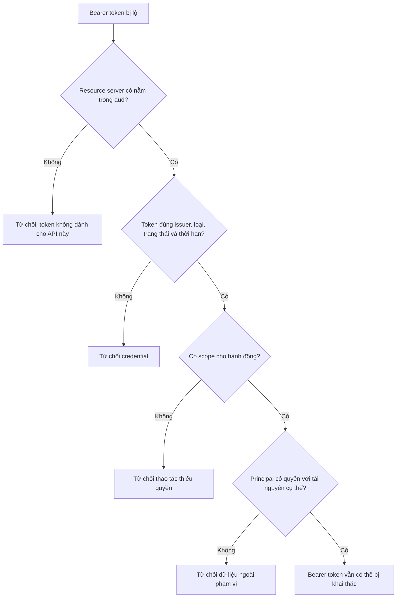
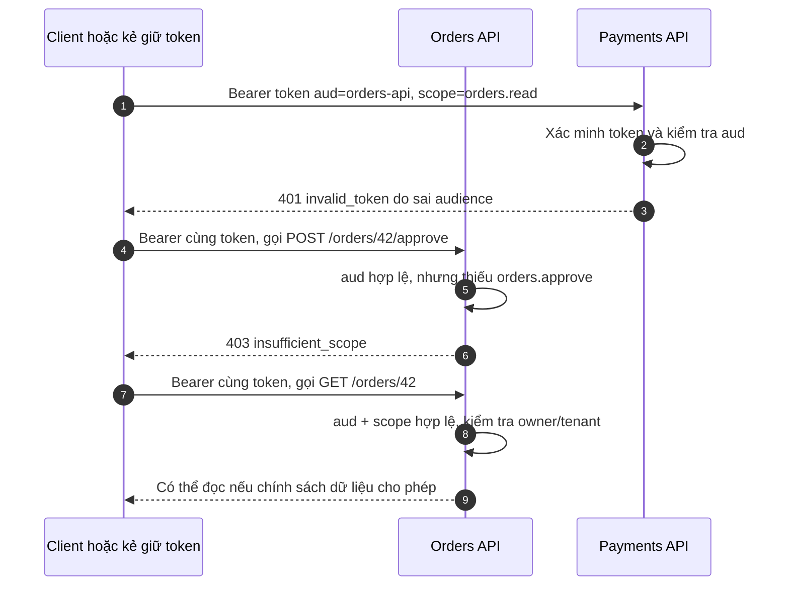

# Audience và scope giảm tác động khi lộ

Một access token dạng Bearer bị ghi nhầm vào log của ứng dụng. Kẻ tấn công đọc được log và thử gửi token tới nhiều API. Nếu token chỉ có `aud = orders-api` và `scope = orders.read`, API thanh toán phải từ chối token vì **sai audience**; API đơn hàng không được cho phép thao tác phê duyệt vì **thiếu scope**. Tuy nhiên, kẻ tấn công **vẫn có thể đọc những đơn hàng mà token thực sự được cấp quyền đọc**, miễn là token còn hiệu lực và không có ràng buộc người gửi. Đây là giới hạn quan trọng: **audience và scope làm giảm phạm vi thiệt hại, không tự ngăn được việc phát lại Bearer token đã lộ**.

Bài thuộc chương **Bearer security** của module `SECURITY_TOKEN_SECURITY_FUNDAMENTALS`. Bài giải thích mô hình tin cậy khi token bị đánh cắp, cách thiết kế audience và scope theo nguyên tắc đặc quyền tối thiểu trong OAuth 2.0/OIDC, kiểm tra JWT và opaque token ở resource server, kết hợp phân quyền cấp tài nguyên, thu hồi, lưu trữ an toàn, DPoP/mTLS và ứng phó sự cố.

## 1. Hiểu đúng nguy cơ của Bearer token bị lộ

**Bearer token** là credential mà bên nắm giữ có thể trình để truy cập tài nguyên theo quyền được cấp. Với Bearer thuần túy, resource server (RS) không đòi hỏi bằng chứng mật mã bổ sung rằng bên gửi chính là client ban đầu được cấp token.

Những nơi có thể làm lộ token gồm:

- Header `Authorization` bị ghi lại tại reverse proxy, gateway, tracing, APM hoặc hệ thống báo lỗi.
- Token bị đưa vào URL query, browser history, `Referer`, analytics hay ảnh chụp màn hình.
- JavaScript độc hại qua XSS đọc token được lưu ở vị trí có thể truy cập.
- Ứng dụng, tiện ích, thiết bị hoặc máy chủ của client bị xâm nhập.
- Token bị chuyển nhầm tới API, bên thứ ba, webhook hoặc dịch vụ không đáng tin.

Nếu kẻ tấn công nắm **nguyên chuỗi Bearer token** thì token khó đoán, dài hoặc có chữ ký JWT hợp lệ vẫn có thể bị dùng lại. **Entropy lớn giúp chống đoán token chưa biết; chữ ký giúp chống sửa token; cả hai không tự chứng minh người đang trình token là chủ thể hợp pháp.**

### Những yếu tố quyết định phạm vi thiệt hại

Có thể hình dung phạm vi khai thác bằng tập các điều kiện phải cùng thỏa:

```text
Request có thể được thực hiện khi đồng thời:
  token còn hiệu lực và được resource server chấp nhận
  AND resource server thuộc audience được phép
  AND token chứa scope cần cho hành động
  AND principal vượt chính sách quyền của tài nguyên/tenant
  AND các ràng buộc người gửi và điều kiện khác (nếu có) đều đạt
```

Audience và scope là **hai lớp thu hẹp** trong chuỗi này. Chúng không phải toàn bộ chuỗi. Trong ứng dụng dùng opaque access token, AS có thể kiểm tra token qua introspection; trong ứng dụng dùng JWT access token, RS có thể xác minh chữ ký/claims tại chỗ. Dù theo cách nào, một Bearer token còn hiệu lực vẫn có thể bị phát lại trong phạm vi của nó.

## 2. Audience hạn chế token được chấp nhận ở đâu

**Audience** (thường là claim `aud` trong JWT) xác định những bên nhận mà token dự định được sử dụng. Với access token, audience thường ràng buộc token với một hoặc nhiều **resource server/API**, không tự động là ID người dùng hay client ID của ứng dụng.

Ví dụ hệ thống có:

| Thành phần | Định danh minh họa | Vai trò |
|---|---|---|
| Authorization Server (AS) | `https://id.example.test` | Phát hành và quản lý token |
| OAuth client | `shop-web` | Ứng dụng dùng token |
| Orders API | `orders-api` | Đọc và quản lý đơn hàng |
| Payments API | `payments-api` | Xử lý thanh toán |
| Reports API | `reports-api` | Xuất báo cáo |

Một access token dành riêng cho Orders API có payload JWT minh họa:

```json
{
  "iss": "https://id.example.test",
  "sub": "user-123",
  "aud": "orders-api",
  "client_id": "shop-web",
  "scope": "orders.read",
  "iat": 1795410000,
  "exp": 1795410900
}
```

Các mốc thời gian chỉ minh họa thời lượng 900 giây; đoạn JSON **không phải JWT hoàn chỉnh đã ký**.

- `orders-api` có thể tiếp tục kiểm tra token nếu issuer, chữ ký/trạng thái, loại token và thời gian đều phù hợp.
- `payments-api` phải **từ chối** token này vì `aud` không chứa audience của mình.
- `reports-api` cũng phải **từ chối** vì không phải bên nhận được chỉ định.

**Điều kiện bắt buộc:** mỗi API phải tự kiểm tra audience của mình. Chỉ ghi `aud` vào token mà không kiểm tra tại resource server **không tạo ra ranh giới bảo mật**.

### Audience không phải kiểm tra hostname tùy tiện

Audience có thể là định danh logic `orders-api` hoặc URI resource như `https://api.example.test/orders` theo hợp đồng. Không tự coi các giá trị sau tương đương:

```text
orders-api
orders-api-v2
https://api.example.test/orders
https://api.example.test/orders/
```

Với JWT, `aud` có thể là chuỗi hoặc mảng chuỗi. Kiểm tra phải so sánh **giá trị nguyên vẹn**, phân biệt chữ hoa/thường, không dùng prefix, substring hoặc wildcard không được quy định.

### Vì sao nhiều audience có thể làm tăng thiệt hại?

Một token có:

```json
{
  "aud": ["orders-api", "payments-api"],
  "scope": "orders.read payments.charge"
}
```

có thể được chấp nhận tại **cả hai API** nếu mỗi API chấp nhận token đa audience đó và các kiểm tra còn lại đều đạt. Nếu token bị lộ, kẻ tấn công có thêm nơi để thử khai thác.

Nhiều audience **không mặc định vi phạm JWT**. Nhưng nếu kiến trúc không có nhu cầu dùng chung credential giữa nhiều RS, phát **token audience hẹp theo từng API** thường giúp giảm vùng ảnh hưởng. API có thể chọn một trong hai chính sách rõ ràng:

1. Chấp nhận nếu tập `aud` chứa đúng định danh của API.
2. Chỉ chấp nhận token có duy nhất audience của API, khi AS và RS thống nhất chính sách này.

Không được tự chọn chính sách khắt khe hơn rồi âm thầm phá vỡ luồng hợp lệ của AS, cũng không được mặc định cho phép token đa audience chỉ vì token đã được ký.

## 3. Scope hạn chế token được dùng làm gì

**Scope** là phạm vi quyền mà AS cấp cho một access token theo mô hình OAuth 2.0. Tên scope cụ thể do hệ thống định nghĩa; chẳng hạn:

| Scope | Quyền cấp ở mức API | Điều **không** được suy diễn |
|---|---|---|
| `orders.read` | Cho phép xét truy cập thao tác đọc đơn hàng. | Không tự cho đọc đơn hàng của mọi người dùng/tenant. |
| `orders.write` | Cho phép xét thao tác tạo/sửa đơn hàng. | Không tự cho duyệt hoặc xóa đơn. |
| `orders.approve` | Cho phép xét thao tác phê duyệt. | Không tự vượt hạn mức hoặc quy tắc phân công người duyệt. |
| `payments.read` | Cho phép xét truy vấn dữ liệu thanh toán. | Không tự cho thực hiện thanh toán. |
| `payments.charge` | Cho phép xét thao tác tạo thanh toán. | Không tự vượt kiểm tra fraud, hạn mức hoặc sở hữu dữ liệu. |

Các tên trong bảng là **ví dụ về hợp đồng quyền của hệ thống**, không phải bộ scope bắt buộc của OAuth 2.0.

Nếu kẻ tấn công chỉ lấy được token có `orders.read`, thao tác `POST /orders/42/approve` vẫn phải bị từ chối khi endpoint yêu cầu `orders.approve`. Nhưng **việc đọc dữ liệu** trong phạm vi token được cấp vẫn là một tác động có thể rất nghiêm trọng; scope đọc không có nghĩa rủi ro thấp.

### Scope được yêu cầu không đồng nghĩa scope đã cấp

Client có thể yêu cầu:

```http
GET /authorize?...&scope=openid%20orders.read%20orders.approve HTTP/1.1
Host: id.example.test
```

AS có thể chỉ cấp `orders.read` vì chính sách client/user/grant. Client và RS phải dựa vào **phạm vi đã cấp thực tế**, không dựa vào chuỗi scope client từng yêu cầu.

Ví dụ token response minh họa:

```json
{
  "access_token": "ACCESS_TOKEN_PLACEHOLDER",
  "token_type": "Bearer",
  "expires_in": 900,
  "scope": "orders.read"
}
```

Trong OIDC, scope `openid` phục vụ yêu cầu đăng nhập theo giao thức, **không** tự cấp quyền cho business API. ID token dành cho client xác minh danh tính; **không** dùng ID token làm access token cho API chỉ vì nó có `sub`, role hoặc claims khác.

### Không tự suy diễn quyền từ tên scope

Với token chứa `orders.read-all`, không được dùng tìm chuỗi con để kết luận có `orders.read`:

```java
// Không an toàn: sẽ trả true với "orders.read-all".
boolean wrong = scopeString.contains("orders.read");

// Đúng khi được parse thành tập scope từ token đã xác minh.
boolean allowed = grantedScopes.contains("orders.read");
```

Theo biểu diễn phổ biến của OAuth 2.0/JWT access token profile RFC 9068, các scope là giá trị phân biệt chữ hoa/thường, được ngăn cách bằng dấu cách. Một số AS dùng claim khác như `scp` với schema riêng; resource server phải hiểu theo profile đã thống nhất.

## 4. Khi bị lộ: so sánh phạm vi thiệt hại theo từng token

Giả sử ba API áp dụng đúng kiểm tra audience và scope, trong khi kẻ tấn công đã có chuỗi Bearer token còn hạn. Những ví dụ sau **chỉ mô tả phạm vi có thể vượt kiểm tra audience/scope**; kiểm tra quyền trên đối tượng và trạng thái vẫn tiếp tục.

| Token bị lộ | Audience | Scope | Việc kẻ tấn công có thể thử | Điều bị chặn nhờ audience/scope |
|---|---|---|---|---|
| T1 | `orders-api` | `orders.read` | Đọc các đơn hàng token được quyền đọc. | Thanh toán ở `payments-api`; phê duyệt đơn khi thiếu scope. |
| T2 | `orders-api` | `orders.read orders.write` | Đọc hoặc sửa dữ liệu trong phạm vi quyền. | Thanh toán ở Payments API; thao tác `orders.approve` nếu cần scope riêng. |
| T3 | `payments-api` | `payments.read` | Đọc thông tin thanh toán được phép. | Gọi Orders API; tạo thanh toán nếu thiếu `payments.charge`. |
| T4 | `["orders-api","payments-api"]` | `orders.read payments.charge` | Thử hành động ở cả Orders và Payments khi API chấp nhận multi-audience. | Các thao tác không được scope hoặc chính sách cấp. |
| T5 | `orders-api` | `orders.approve` | Thử duyệt đơn hàng; có thể bị chặn bởi role/hạn mức. | Thao tác `payments.charge` ở Payments API. |

Từ bảng này có ba nhận xét:

- **Audience hẹp giới hạn nơi chấp nhận credential.** Token chỉ dành cho Orders API không được tự sử dụng tại Payments API.
- **Scope hẹp giới hạn loại thao tác.** Token chỉ đọc không tự cho phép ghi, phê duyệt hoặc xóa.
- **Authorization trên đối tượng giới hạn tập dữ liệu cụ thể.** Token có `orders.read` không được vượt tenant/owner/ACL nếu API thiết kế đúng.

Không nên diễn giải rằng `orders.read` luôn ít nguy hiểm hơn `orders.write`: đọc được thông tin cá nhân, dữ liệu thanh toán hoặc báo cáo nội bộ có thể gây hậu quả lớn dù dữ liệu không bị sửa.

## 5. Kết hợp hai lớp để giảm “blast radius”

*Blast radius* là phạm vi hệ thống, hành động và dữ liệu có thể bị ảnh hưởng sau một sự cố. Với token bị lộ, có thể mô tả giản lược:

```text
Phạm vi khai thác tiềm năng =
  Những resource server chấp nhận token
  ∩ những hành động được scope cho phép xét
  ∩ những bản ghi/tenant đáp ứng chính sách quyền
  ∩ khoảng thời gian token còn có hiệu lực
  ∩ những ràng buộc trình token mà kẻ tấn công vượt qua được
```

Đây là cách tư duy về **các điều kiện đồng thời**, không phải công thức tính một số đo xác suất rủi ro.



Với Bearer thuần túy, kẻ tấn công có thể vượt các điều kiện cuối nếu token còn hợp lệ và quyền được cấp rộng. Muốn chống **tái sử dụng credential bởi bên khác**, cần thêm các biện pháp như sender-constrained access token (DPoP/mTLS), giám sát/phát hiện bất thường, hạn sống ngắn và khả năng thu hồi.

**Tách hai loại sự cố:**

1. **Token leakage:** lộ một hoặc nhiều chuỗi credential; thường cần thu hồi token/grant và đánh giá quyền hiện có.
2. **Signing key compromise:** lộ khóa riêng ký JWT của AS; có thể dẫn đến tạo token giả mới, quy mô nghiêm trọng hơn, cần xử lý khóa và issuer.

Không quay vòng khóa ký toàn hệ thống như phản ứng mặc định cho **một access token bị lộ** nếu khóa ký không bị ảnh hưởng; biện pháp phải phù hợp nguồn gốc sự cố.

## 6. Phát hành token: chọn resource và scope đúng nhu cầu

Giảm phạm vi thiệt hại phải bắt đầu **tại authorization server và client**, không đợi đến lúc resource server từ chối.

### Nguyên tắc phát hành

1. **Chọn resource đích có chủ đích.** Client xin token cho API mà nó thực sự cần, thay vì một token “dùng cho toàn bộ hệ thống”.
2. **Giới hạn scope theo luồng chức năng.** Màn hình xem đơn hàng chỉ cần `orders.read`, không mặc định xin `orders.approve`.
3. **AS kiểm soát quyền được cấp.** AS không cấp scope chỉ vì client yêu cầu; phải xem client, grant, consent/chính sách và các hạn chế khác.
4. **Không mặc định gộp audience.** Khi client cần hai API độc lập, cân nhắc token riêng theo audience và scope thay vì một token đa audience.
5. **Thời gian sống phù hợp rủi ro.** Token có quyền nhạy cảm nên có phạm vi và thời hạn hạn chế; cân nhắc yêu cầu xác thực lại hoặc cấp quyền nâng cao khi cần.
6. **Service identity không đồng nhất user identity.** Token của `client_credentials` đại diện cho client/service theo hợp đồng, không tự mang quyền của người dùng cuối.

OAuth 2.0 **Resource Indicators** (RFC 8707) định nghĩa tham số `resource` giúp client chỉ rõ tài nguyên dự kiến nhận access token:

```http
POST /oauth2/token HTTP/1.1
Host: id.example.test
Content-Type: application/x-www-form-urlencoded

grant_type=client_credentials&resource=https%3A%2F%2Fapi.example.test%2Forders&scope=orders.read
```

Ví dụ này chỉ mô tả các tham số chính, **chưa chứa phần xác thực client** mà AS phải yêu cầu theo cơ chế phù hợp (ví dụ client secret, private_key_jwt hoặc mTLS). RFC 8707 phải được AS hỗ trợ thì `resource` mới có ý nghĩa theo giao thức. Resource identifier thực tế phải khớp hợp đồng của AS/RS; không giả định nó tự động bằng một chuỗi `aud` tùy ý.

Nếu Orders API gọi Payments API thay mặt client/user, nó không được đơn giản chuyển tiếp token `aud=orders-api` cho Payments. Phải sử dụng grant, token exchange (RFC 8693 khi AS hỗ trợ) hoặc cơ chế cấp token service-to-service được ủy quyền để nhận token **phù hợp cho `payments-api`**.

### Downscoping có điều kiện

Có thể thiết kế client xin một token **quyền hẹp hơn** cho một công việc ngắn hạn thay vì dùng token đặc quyền rộng. Tuy nhiên, OAuth 2.0 **không mặc định cho phép mọi client tự giảm/đổi scope hoặc audience bằng cách sửa token**. Việc cấp token quyền hẹp hơn phải được AS hỗ trợ và kiểm tra bằng quy trình hợp lệ; resource server vẫn phải xác minh token mới.

## 7. Resource server phải kiểm tra aud và scope như thế nào?

Một token bị đánh cắp vẫn có thể có **chữ ký đúng và chưa hết hạn**. Vì vậy RS không được bỏ bất kỳ bước xác minh nào.

### JWT access token

Với access token JWT, RS nên kiểm tra:

- **Issuer:** `iss` thuộc danh sách issuer cho phép. Không tự tin issuer bất kỳ do token khai.
- **Khóa và chữ ký:** JWKS gắn với issuer tin cậy; thuật toán ký từ allowlist, không tin tùy ý `alg`, `kid`, `jku` do token gửi để thay nguồn khóa.
- **Loại token:** JWT đúng access-token profile; không nhận ID token OIDC chỉ vì cùng issuer ký. RFC 9068 mô tả `typ` như `at+jwt` cho profile JWT access token.
- **Thời hạn:** `exp`, `nbf` nếu có và các quy tắc thời gian của profile; clock skew nhỏ và được kiểm soát.
- **Audience:** `aud` có giá trị chính xác được phép tại RS, có chính sách cụ thể với token đa audience.
- **Scope:** lấy từ claim đúng profile đã xác minh, tách thành các giá trị và so khớp chính xác.
- **Quyền nghiệp vụ:** kiểm tra tenant/owner, role, trạng thái, hạn mức và quan hệ ủy quyền.



Sơ đồ minh họa **giới hạn và điểm yếu** của Bearer token: hai thao tác đầu bị chặn nhờ audience/scope, nhưng thao tác cuối vẫn có thể thành công nếu token có đủ quyền.

### Opaque access token

Với opaque token, RS thường dùng **OAuth 2.0 Token Introspection** (RFC 7662) tại AS tin cậy, không tự giải mã JWT claims:

```json
{
  "active": true,
  "sub": "user-123",
  "client_id": "shop-web",
  "aud": "orders-api",
  "scope": "orders.read",
  "exp": 1795410900
}
```

Các trường ngoài `active` có thể là tùy chọn theo chuẩn/hợp đồng. RS phải chắc chắn introspection response đến từ AS được tin cậy qua kênh bảo vệ, đã xác thực caller, rồi áp dụng **cùng chính sách audience, scope và quyền dữ liệu**. `active=true` không đủ để cho phép request. Nếu thiếu căn cứ audience/scope bắt buộc, không tự suy diễn quyền.

Một API chỉ kiểm tra `active` và bỏ `aud` có thể trở thành nơi chấp nhận **token của tài nguyên khác**, kể cả khi AS trả `active=true`.

## 8. Spring Security: audience và scope cùng được thực thi

Ví dụ Java/Spring Security 6.x cho `orders-api`. Đoạn dưới minh họa **RS dùng JWT access token**, không phải cấu hình hoàn chỉnh cho mọi hệ thống:

```java
@Configuration
@EnableMethodSecurity
public class OrdersApiSecurity {

    @Bean
    JwtDecoder jwtDecoder() {
        String issuer = "https://id.example.test";
        String audience = "orders-api";

        NimbusJwtDecoder decoder =
                NimbusJwtDecoder.withIssuerLocation(issuer).build();

        OAuth2TokenValidator<Jwt> standard =
                JwtValidators.createDefaultWithIssuer(issuer);

        OAuth2TokenValidator<Jwt> audienceValidator = jwt -> {
            boolean matches = jwt.getAudience() != null
                    && jwt.getAudience().contains(audience);

            return matches
                ? OAuth2TokenValidatorResult.success()
                : OAuth2TokenValidatorResult.failure(
                    new OAuth2Error(
                        "invalid_token", "Audience mismatch", null));
        };

        decoder.setJwtValidator(
            new DelegatingOAuth2TokenValidator<>(
                standard, audienceValidator));

        return decoder;
    }

    @Bean
    SecurityFilterChain securityFilterChain(HttpSecurity http)
            throws Exception {
        http.authorizeHttpRequests(auth -> auth
            .requestMatchers(HttpMethod.GET, "/api/orders/**")
                .hasAuthority("SCOPE_orders.read")
            .requestMatchers(HttpMethod.POST, "/api/orders/*/approve")
                .hasAuthority("SCOPE_orders.approve")
            .anyRequest().denyAll()
        );

        http.oauth2ResourceServer(oauth2 ->
            oauth2.jwt(Customizer.withDefaults()));

        return http.build();
    }
}
```

Mẫu trên bỏ `import` và các thành phần phụ thuộc, giả định thư viện, JWT decoder và SecurityFilterChain được cấu hình đúng cho Spring Security 6.x. **Giá trị issuer/audience đều là ví dụ.** Một RS sản xuất cần kiểm tra access-token type/profile, thuật toán ký được chấp nhận, JWKS, claims, lỗi Bearer, CORS/CSRF theo kiến trúc, và bảo đảm không có filter chain khác vô tình mở đường truy cập. Việc kiểm `iss` không tự làm `aud` đúng; vì vậy có validator audience riêng.

Spring Security thường ánh xạ `scope` hoặc `scp` thành các `GrantedAuthority` như `SCOPE_orders.read`. Đây là **quy ước mapping của framework**, không phải chuỗi được OAuth 2.0 bắt buộc thêm vào token. Với claims hoặc provider khác, cần converter được cấu hình và kiểm chứng.

### Kiểm tra quyền trên đối tượng không thể bỏ

```java
@Service
public class OrderQueryService {
    private final OrderRepository repository;

    public OrderQueryService(OrderRepository repository) {
        this.repository = repository;
    }

    @PreAuthorize("hasAuthority('SCOPE_orders.read')")
    public OrderView getOrder(
            UUID orderId,
            JwtAuthenticationToken authentication) {

        String subject = authentication.getToken().getSubject();

        return repository.findVisibleToSubject(orderId, subject)
                .map(OrderView::from)
                .orElseThrow(() ->
                    new ResponseStatusException(HttpStatus.NOT_FOUND));
    }
}
```

Đoạn mã là ví dụ với repository/model giả định. Trong hệ thống **đa issuer hoặc đa tenant**, chỉ dùng `sub` chưa đủ: cần ràng buộc issuer hoặc ánh xạ principal nội bộ và tenant trong policy/truy vấn. Kiểm tra scope không thay được kiểm tra bản ghi, nhất là khi token bị lộ.

**Với opaque token**, Spring Security dùng `OpaqueTokenIntrospector`/cấu hình `opaque-token`; phải bổ sung audience validator trên metadata introspection theo hợp đồng. Không giả định rằng `active=true` và authority scope mặc định đã tự kiểm tra audience đích.

## 9. Hai mã lỗi thường gặp khi test audience và scope

| Trường hợp | Kết quả thường gặp | Nguyên nhân |
|---|---|---|
| Không có access token cho endpoint bảo vệ | `401 Unauthorized` | Thiếu credential phù hợp. |
| Token sai issuer, chữ ký, loại, audience hoặc đã hết hạn | `401 Unauthorized` | Token không hợp lệ với resource server này. |
| Opaque token introspection `active=false` | `401 Unauthorized` | AS không công nhận token. |
| Token hợp lệ, đúng audience, nhưng thiếu scope | `403 Forbidden` | Credential được chấp nhận nhưng không đủ phạm vi thao tác. |
| Token hợp lệ, đủ scope nhưng không có quyền trên bản ghi | `403` hoặc `404` | Chính sách dữ liệu từ chối, có thể che giấu tồn tại tài nguyên. |

Với OAuth 2.0 Bearer Token Usage (RFC 6750), API có thể trả:

```http
HTTP/1.1 401 Unauthorized
WWW-Authenticate: Bearer realm="payments-api", error="invalid_token"
```

Khi token hợp lệ nhưng thiếu scope:

```http
HTTP/1.1 403 Forbidden
WWW-Authenticate: Bearer realm="orders-api", error="insufficient_scope", scope="orders.approve"
```

Không ghi token gốc vào HTTP body hoặc log để giải thích lỗi. Với request thiếu token hoàn toàn, challenge thường chỉ cần `WWW-Authenticate: Bearer` mà không cần gán `invalid_token`.

## 10. Scope hẹp không thay thế phân quyền cấp bản ghi

Một token có `orders.read` vẫn có thể làm lộ dữ liệu quy mô lớn nếu API cho phép `GET /orders` trả về toàn bộ dữ liệu không giới hạn tenant. Giới hạn ở mức scope cần được kết hợp:

- **Tenant isolation:** chỉ truy cập tài nguyên của tenant được phép, với tenant ID từ nguồn đã kiểm chứng.
- **Owner/relationship check:** chủ thể được xem bản ghi của mình, nhóm hoặc phạm vi được ủy quyền; chống BOLA/IDOR.
- **Điều kiện nghiệp vụ:** ví dụ chỉ đọc một số trường nhạy cảm sau khi kiểm tra vai trò/hợp đồng riêng.
- **Query-level enforcement:** lọc dữ liệu ở repository/policy, không chỉ ẩn nút trong giao diện người dùng.
- **Phân biệt user và service account:** token `client_credentials` có thể đại diện client dịch vụ, không phải người dùng cuối; không áp dụng user ownership một cách mơ hồ.
- **Kiểm tra quyền hiện hành:** quyền có thể thay đổi sau khi token phát hành, cần chiến lược cập nhật cho hành động nhạy cảm.

Nếu kẻ tấn công lấy token có scope đọc và API bỏ kiểm tra tenant, **mọi dữ liệu có thể truy xuất nhờ ID** đều có nguy cơ bị lộ. Audience chỉ giữ token ở đúng API; scope đọc chỉ giới hạn loại hành động; **quyền trên bản ghi giới hạn dữ liệu thực sự**.

## 11. Thời hạn, thu hồi và refresh token

Audience và scope có thể giảm thiệt hại, nhưng **thời gian token còn được chấp nhận** quyết định cửa sổ khai thác.

### Access token JWT

JWT access token tự chứa có thể được RS xác minh tại chỗ bằng JWKS. Nếu token bị lộ nhưng chưa hết hạn, RS **không tự biết token đã bị đánh cắp**. AS có thể thu hồi grant hoặc refresh token, nhưng JWT access token đã phát hành có thể vẫn qua validation đến `exp` trừ khi có denylist, introspection hoặc cơ chế thu hồi bổ sung.

### Opaque access token

AS có thể đổi trạng thái server-side để phản hồi `active=false` tại lần introspection tiếp theo. Tuy nhiên, **cache introspection** ở RS có thể kéo dài thời gian token bị thu hồi vẫn được chấp nhận. TTL cache cần phù hợp thời gian token còn hiệu lực và độ trễ thu hồi tối đa cho phép.

### Refresh token

Refresh token dùng để xin access token mới tại **token endpoint của AS**, không được gửi đến resource API. Nếu refresh token bị lộ, kẻ tấn công có thể cố xin access token mới lâu hơn cửa sổ của một access token đơn lẻ. AS nên bảo vệ refresh token theo loại client, hỗ trợ rotation hoặc ràng buộc người gửi khi phù hợp, phát hiện reuse và xử lý family/grant theo chính sách.

Bảng so sánh:

| Credential bị lộ | Hành động ưu tiên | Rủi ro còn lại |
|---|---|---|
| JWT access token có thời hạn ngắn | Chặn/thu hồi theo cơ chế hỗ trợ, kiểm tra quyền và audit đến khi hết hạn. | Có thể vẫn dùng được đến `exp` nếu RS không có kênh thu hồi. |
| Opaque access token | AS vô hiệu trạng thái và phối hợp làm mới cache RS. | Cache `active=true` có thể trì hoãn hiệu lực thu hồi. |
| Refresh token | Thu hồi token/grant/family theo chính sách; yêu cầu client xác thực lại khi thích hợp. | Các access token đã phát hành trước đó có thể còn hiệu lực. |
| Signing key của AS | Quy trình ứng phó lộ khóa ký, xoay vòng và loại bỏ khóa bị ảnh hưởng. | Kẻ tấn công có thể tạo token giả nếu khóa bị chiếm. |

**Kết luận quan trọng:** hạn sống ngắn giảm khoảng thời gian bị khai thác; audience/scope giảm nơi và hành động có thể khai thác; thu hồi và quản lý trạng thái giảm khả năng tiếp tục sử dụng. Chúng là các lớp bổ sung, không thay thế nhau.

## 12. Khi cần ngăn phát lại: sender-constrained access token

Audience và scope hạn chế phạm vi **token có thể dùng**, nhưng không mặc định ràng buộc token với **người đang cầm nó**. Khi yêu cầu bảo vệ cao hơn, có thể sử dụng *sender-constrained access token*:

| Cơ chế | Bằng chứng bổ sung tại resource server | Tác động nếu chỉ lộ chuỗi access token |
|---|---|---|
| **Bearer thuần túy** | Không có proof-of-possession riêng. | Chuỗi token có thể bị phát lại khi còn hợp lệ. |
| **DPoP (RFC 9449)** | Proof JWT ký bằng khóa client, gắn với HTTP method, URI, access token và cơ chế chống replay. | Chỉ có chuỗi access token thường không đủ nếu không có khóa/proof hợp lệ. |
| **mTLS-bound token (RFC 8705)** | Chứng chỉ client TLS khớp thumbprint được gắn với token. | Token bị lộ nhưng thiếu private key/chứng chỉ thích hợp khó được dùng lại từ nơi khác. |

### DPoP có cần kiểm tra nhiều thứ hơn không?

Có. Khi RS triển khai DPoP, ngoài token validation/audience/scope còn phải xác minh DPoP proof đúng cách: chữ ký, khóa công khai, `htm`, `htu`, `iat`, `jti` chống replay, `ath` ràng buộc access token, nonce khi chính sách yêu cầu và đối chiếu khóa của proof với confirmation claim như `cnf.jkt` từ token/metadata đã xác minh. Không thể chỉ nhìn thấy header `DPoP` là cho qua.

Với mTLS, RS kiểm tra chứng chỉ trên kết nối thực hoặc bằng chứng tin cậy được gateway TLS truyền nội bộ, đối chiếu với thông tin ràng buộc token. **Không tin header chứng chỉ do người gọi trên Internet tự tạo**.

Các cơ chế ràng buộc người gửi vẫn có giới hạn: nếu cả token **và khóa tương ứng** cùng bị đánh cắp, hoặc môi trường client bị kiểm soát, kẻ tấn công vẫn có thể thực hiện request. Sender constraint không thay scope, audience hoặc authorization trên dữ liệu.

## 13. Giảm nguy cơ lộ ngay từ nơi lưu và đường truyền

Các quyết định kiến trúc ảnh hưởng trực tiếp đến xác suất token bị lộ:

| Bề mặt | Nguy cơ | Cách giảm thiểu |
|---|---|---|
| **Browser JavaScript** | XSS đọc token trong storage có thể truy cập bằng JavaScript. | Cân nhắc Backend-for-Frontend (BFF), cookie phiên `HttpOnly`, `Secure`, `SameSite` và chống CSRF phù hợp; chống XSS. |
| **Native application** | Token bị lấy từ bộ nhớ, thiết bị hoặc file không bảo vệ. | Kho credential của hệ điều hành, hạn chế debug/log, khóa thiết bị và quản lý phiên. |
| **API gateway, reverse proxy** | Access log/tracing ghi header Bearer. | Redact `Authorization`, cookie, query chứa bí mật; phân quyền và retention log. |
| **Network transport** | Token bị nghe lén trong kênh không bảo vệ. | HTTPS/TLS, xác minh server và không gửi token tới endpoint không tin cậy. |
| **URL và redirect** | Token xuất hiện trong history/referrer/bên thứ ba. | Tránh query parameter chứa access token; không phát token qua redirect không an toàn. |
| **Dịch vụ nội bộ** | Credential chuyển tiếp sai audience; service tin dữ liệu `X-User` tùy ý. | Token đúng resource, mạng nội bộ có xác thực, bảo vệ từng trust boundary. |
| **Log và hỗ trợ khách hàng** | Nhân viên có quyền đọc log/ticket lấy được token. | Redaction, giới hạn quyền, kiểm tra secrets, quy trình xử lý lộ token. |

**Không mặc định `HttpOnly` cookie giải quyết mọi vấn đề.** Cookie có thể giảm rủi ro JavaScript trực tiếp đọc credential nhưng vẫn cần chống CSRF, XSS và bảo vệ phiên. Phương án đúng phụ thuộc kiến trúc browser, server và client.

## 14. Ma trận kiểm thử khả năng giới hạn thiệt hại

Giả sử RS tin issuer `https://id.example.test`, Orders API có `aud=orders-api`, Payments API có `aud=payments-api`; endpoint GET đơn yêu cầu `orders.read`, approve yêu cầu `orders.approve` và charge yêu cầu `payments.charge`.

| ID | Kịch bản | Kỳ vọng |
|---|---|---|
| B01 | Token `aud=orders-api`, `scope=orders.read` được gửi đến Payments API. | Từ chối ở token validation, thường HTTP `401`. |
| B02 | Token đó gọi `POST /orders/{id}/approve`. | Token hợp lệ nhưng thiếu `orders.approve`: `403`. |
| B03 | Token đó gọi `GET /orders/{id}` thuộc principal được phép xem. | Có thể được cho phép: **chứng minh hạn chế của Bearer**. |
| B04 | Token đó gọi GET đơn thuộc tenant khác. | `403`/`404` theo chính sách owner/tenant. |
| B05 | Token `aud=["orders-api","payments-api"]` và scope của cả hai API. | Theo chính sách multi-audience, có thể được chấp nhận ở nhiều API; cần đánh giá blast radius. |
| B06 | Token `aud=orders-api` nhưng chữ ký JWT sai. | Từ chối, không tin `aud`/`scope` chưa xác minh. |
| B07 | Token sai issuer nhưng `aud` và `scope` giống token thật. | Từ chối theo trust anchor. |
| B08 | Token đúng audience nhưng đã hết hạn. | Từ chối, dù scope đủ. |
| B09 | Token đúng audience, scope `orders.read-all`, endpoint yêu cầu `orders.read`. | Từ chối nếu không có mapping rõ; không so khớp chuỗi con. |
| B10 | Opaque introspection `active=true` nhưng `aud=payments-api` tại Orders API. | Từ chối vì sai audience. |
| B11 | Opaque introspection `active=false`. | Từ chối dù trước đây token hợp lệ. |
| B12 | JWT access token bị thu hồi tại AS nhưng RS chỉ xác minh chữ ký/`exp`. | Test cho thấy giới hạn thu hồi; cần cơ chế trạng thái bổ sung nếu yêu cầu ngay. |
| B13 | Cache introspection còn `active=true` sau thu hồi. | Xác định độ trễ thu hồi theo TTL/invalidation; không tuyên bố thu hồi tức thì. |
| B14 | Refresh token bị gửi nhầm tới Orders API. | Từ chối vì sai loại và bên nhận. |
| B15 | Client credentials token đúng scope nhưng route chỉ dành cho user. | Từ chối nếu policy đòi user principal. |
| B16 | DPoP-bound access token bị gửi thiếu proof/khóa không khớp. | Từ chối. |
| B17 | Token Bearer bị sao chép sang thiết bị khác, cùng RS và quyền. | Có thể được chấp nhận nếu không có sender constraint/chính sách phát hiện thêm. |
| B18 | Endpoint mới không khai báo scope/role. | Từ chối theo *default deny*, không tự mở. |
| B19 | Scope hợp lệ, owner hợp lệ nhưng trạng thái đơn không cho phép duyệt. | Từ chối theo chính sách nghiệp vụ. |
| B20 | Token có aud/scope quá rộng hơn nhu cầu. | Kiểm thử AS giảm quyền/phát token giới hạn theo hợp đồng. |

**Phân biệt unit test và integration test:** dùng Spring Security Test với principal/JWT giả có thể kiểm tra route/authority, nhưng **không chứng minh JWT signature và issuer/audience thực sự được kiểm tra**. Cần integration tests bằng khóa thử nghiệm và issuer/JWKS giả lập tin cậy, cùng mock introspection được bảo vệ cho opaque token. Không dùng secret hoặc khóa ký sản xuất trong test.

## 15. Quy trình xử lý khi phát hiện một Bearer token bị lộ

Khi xác định credential đã bị lộ, người vận hành nên có kế hoạch phản ứng dựa trên **loại token, nơi chấp nhận và scope**.

1. **Cô lập nguồn lộ:** ngăn tiếp tục ghi token vào log/tracing, vô hiệu kênh công khai chứa token, hạn chế quyền đọc log. Tránh sao chép nguyên token sang ticket/chat để điều tra.
2. **Xác định phạm vi:** xác định issuer, client, loại token, audience, scope, thời gian cấp/hết hạn và resource server liên quan bằng metadata từ nguồn tin cậy; không tin payload JWT chưa xác minh.
3. **Ngăn dùng tiếp:** thu hồi token/grant/session khi AS hỗ trợ, thu hồi/rotation refresh token theo chính sách, áp dụng denylist hoặc cache invalidation ở RS nếu cần. Với JWT tự chứa, đánh giá **cửa sổ đến `exp`** nếu không có kênh thu hồi.
4. **Điều tra hành động đã thực hiện:** đối chiếu audit theo principal, action, resource, tenant và thời gian; xem các request `PERMIT` đáng ngờ. Việc token xác minh hợp lệ **không chứng minh chính người dùng thực hiện**.
5. **Đánh giá dữ liệu và nghiệp vụ bị ảnh hưởng:** riêng token `orders.read` có thể dẫn đến xuất dữ liệu; token `payments.charge` cần xem cả các giao dịch. Không chỉ đếm mã `401`/`403` bị chặn.
6. **Sửa nguyên nhân gốc và khôi phục:** cải thiện redaction, bảo vệ client, thu hẹp audience/scope, xem xét sender constraint, giám sát và chính sách retention; thông báo theo quy trình bảo mật/pháp lý nếu áp dụng.

Nếu **chỉ token bị lộ** thì ưu tiên thu hồi token và xử lý dữ liệu liên quan. Nếu phát hiện **khóa riêng ký JWT bị lộ**, phải mở quy trình xử lý sự cố khóa ký riêng, có thể dẫn đến vô hiệu hàng loạt token và xoay vòng khóa.

### Nên ghi audit gì mà không làm lộ thêm token?

Có thể ghi `trace_id`, issuer đã xác minh, principal tham chiếu, audience/scope cần thiết để giải thích quyết định, endpoint, action, policy version, `PERMIT`/`DENY` và mã nguyên nhân như `AUDIENCE_MISMATCH`, `MISSING_SCOPE`, `TOKEN_REVOKED`. **Không ghi raw access token, refresh token, ID token, header `Authorization` hay JWT payload đầy đủ.** Nếu cần tương quan theo token, dùng tham chiếu/định danh dẫn xuất được thiết kế an toàn và quản lý khóa.

## 16. Bài tập tình huống

Một trang quản trị đơn hàng dùng token `T-A`, còn dashboard thanh toán dùng token `T-B`:

```json
{
  "T-A": {
    "aud": "orders-api",
    "scope": "orders.read"
  },
  "T-B": {
    "aud": "payments-api",
    "scope": "payments.read payments.charge"
  }
}
```

Đây là **metadata minh họa**, không phải hai token thật. Giả sử cả hai token đều hợp lệ, còn hạn và được cấp cho principal theo chính sách phù hợp.

**Câu 1.** `T-A` bị lộ. Kẻ tấn công có gọi được `POST /payments/charge` không? Vì sao?

> Không, nếu Payments API kiểm tra audience đúng. `T-A` không được cấp cho `payments-api` và cũng không có `payments.charge`.

**Câu 2.** Kẻ tấn công dùng `T-A` để đọc đơn hàng thuộc phạm vi principal đang có quyền. Audience và scope có chặn được không?

> Không. `T-A` có audience và scope phù hợp cho thao tác đọc tại Orders API. Bearer token đã lộ vẫn có thể bị phát lại; cần thêm cơ chế bảo vệ/trạng thái/ràng buộc người gửi hoặc thu hồi.

**Câu 3.** Thay `T-A` bằng token có `aud=["orders-api","payments-api"]` và `scope="orders.read payments.charge"`. Blast radius thay đổi thế nào?

> Nếu hai API chấp nhận token đa audience và các điều kiện còn lại đạt, một credential bị lộ có thể bị dùng tại **nhiều API và nhiều loại thao tác hơn**. Vì vậy nên phát hành token hẹp theo resource và quyền khi thiết kế cho phép.

**Câu 4.** User có scope `orders.read`, nhưng API cho `GET /orders?tenant=any` trả về tất cả đơn hàng. Lỗi nằm ở đâu?

> Ở **authorization cấp dữ liệu**: API thiếu kiểm soát tenant/owner/quan hệ. Scope đọc không giới hạn tài nguyên cụ thể nếu API không thực thi policy tương ứng.

**Câu 5.** Access token JWT `T-A` bị thu hồi ở AS nhưng RS chỉ dùng JWKS để xác minh JWT đến `exp`. Token lập tức hết hiệu lực chưa?

> Chưa chắc. RS chỉ kiểm chữ ký/thời hạn có thể vẫn chấp nhận JWT đến khi hết hạn. Muốn thu hồi nhanh phải có cơ chế trạng thái bổ sung tại RS/AS và tính đến cache.

### Tự kiểm tra

1. Audience và scope giảm thiệt hại theo hai chiều khác nhau như thế nào?
2. Vì sao token `aud=orders-api` không được dùng ở `payments-api` dù chữ ký do cùng AS phát hành?
3. Tại sao scope `orders.read` vẫn có thể dẫn tới rò rỉ dữ liệu nghiêm trọng khi token bị lộ?
4. Vì sao token đa audience có thể làm tăng blast radius?
5. Tại sao không được suy rằng JWT có chữ ký đúng thì người trình token chính là chủ tài khoản?
6. Khi nào cần dùng DPoP/mTLS và chúng **không** thay những kiểm tra nào?
7. Việc thu hồi opaque token chịu ảnh hưởng của introspection cache thế nào?
8. Nên kiểm tra những gì tại API sau khi token vượt qua bước audience và scope?

## 17. Ghi nhớ

- **Audience thu hẹp nơi token được chấp nhận; scope thu hẹp hành động mà token được cấp quyền thực hiện.** Hai điều kiện phải cùng được resource server kiểm tra.
- **Audience và scope không tự chống replay Bearer token đã lộ.** Bên giữ token có thể thực hiện các hành động nằm trong phạm vi đã được cấp nếu token vẫn hợp lệ.
- **Hạn chế audience và scope từ lúc phát hành:** client chỉ xin resource và quyền cần thiết, AS chỉ cấp phạm vi được phép, RS kiểm tra chính xác.
- **Không nhầm access token với ID token hoặc refresh token.** ID token dành cho OIDC client; refresh token dành cho token endpoint của AS.
- **Không bỏ authorization cấp dữ liệu.** Owner, tenant, role, trạng thái, hạn mức và quan hệ quyền là những lớp giảm thiệt hại quan trọng.
- **Thời hạn ngắn, revocation và caching** quyết định cửa sổ khai thác. JWT tự chứa có thể cần cơ chế thu hồi bổ sung; opaque token có thể bị chậm bởi cache.
- **Bảo vệ khi truyền/lưu, không lộ token qua log** và cân nhắc sender-constrained tokens (DPoP/mTLS) khi cần hạn chế việc phát lại.

### Tài liệu chuẩn tham khảo

- [RFC 6749 — The OAuth 2.0 Authorization Framework](https://www.rfc-editor.org/rfc/rfc6749): scope, access token, refresh token và quyền cấp cho client.
- [RFC 6750 — The OAuth 2.0 Authorization Framework: Bearer Token Usage](https://www.rfc-editor.org/rfc/rfc6750): tính chất Bearer token, rủi ro lộ credential và lỗi HTTP.
- [RFC 7519 — JSON Web Token (JWT)](https://www.rfc-editor.org/rfc/rfc7519): `aud`, `exp` và các claims.
- [RFC 9068 — JWT Profile for OAuth 2.0 Access Tokens](https://www.rfc-editor.org/rfc/rfc9068): `aud`, `scope`, token type và validation.
- [RFC 8707 — Resource Indicators for OAuth 2.0](https://www.rfc-editor.org/rfc/rfc8707): chỉ định resource đích khi xin token.
- [RFC 8693 — OAuth 2.0 Token Exchange](https://www.rfc-editor.org/rfc/rfc8693): trao đổi token cho audience/context khác khi AS hỗ trợ.
- [RFC 7662 — OAuth 2.0 Token Introspection](https://www.rfc-editor.org/rfc/rfc7662) và [RFC 7009 — OAuth 2.0 Token Revocation](https://www.rfc-editor.org/rfc/rfc7009): kiểm tra trạng thái và thu hồi token.
- [RFC 9700 — Best Current Practice for OAuth 2.0 Security](https://www.rfc-editor.org/rfc/rfc9700): giới hạn quyền, bảo vệ và phòng chống lạm dụng token.
- [RFC 9449 — OAuth 2.0 Demonstrating Proof of Possession (DPoP)](https://www.rfc-editor.org/rfc/rfc9449) và [RFC 8705 — OAuth 2.0 Mutual-TLS Client Authentication and Certificate-Bound Access Tokens](https://www.rfc-editor.org/rfc/rfc8705): ràng buộc access token với bên gửi.
- [OpenID Connect Core 1.0](https://openid.net/specs/openid-connect-core-1_0.html): ID token và phân biệt xác thực với truy cập API.
- [Spring Security — OAuth 2.0 Resource Server JWT](https://docs.spring.io/spring-security/reference/servlet/oauth2/resource-server/jwt.html) và [Opaque Token](https://docs.spring.io/spring-security/reference/servlet/oauth2/resource-server/opaque-token.html): validation và kiểm tra scope tại Java API.
