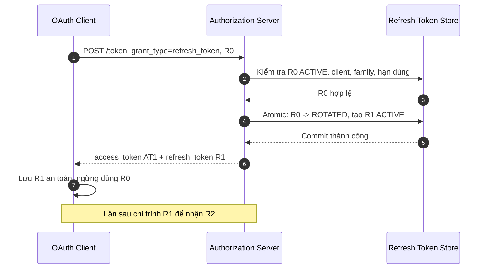
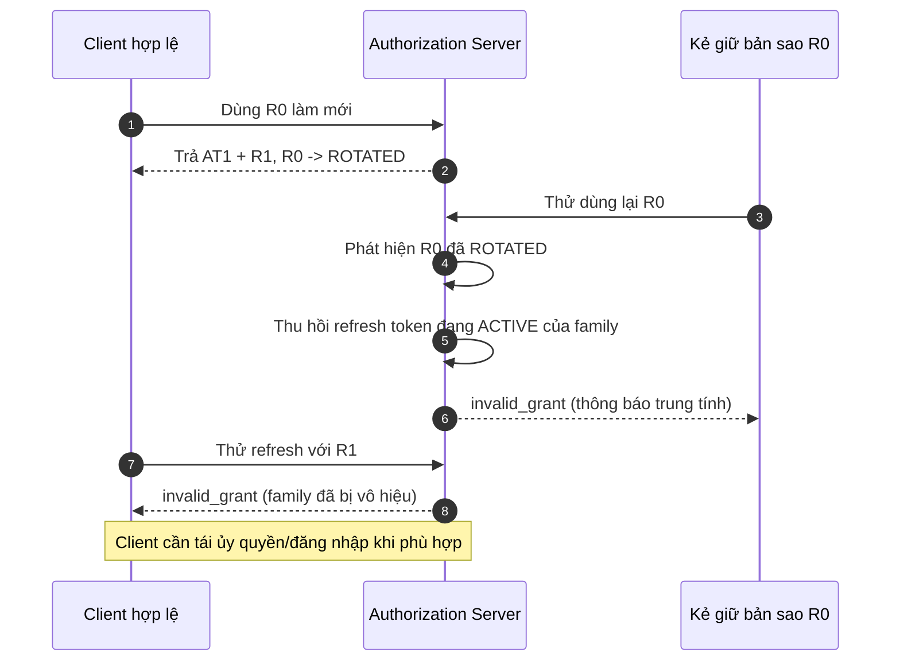

# Refresh token rotation

## Mục tiêu học tập

Trong module **SECURITY_TOKEN_SECURITY_FUNDAMENTALS**, access token cho phép client gọi Resource Server trong một khoảng thời gian giới hạn, còn **refresh token** cho phép client xin access token mới tại Authorization Server (AS) mà không nhất thiết yêu cầu người dùng đăng nhập lại ở mỗi lần hết hạn. Vì refresh token có thể duy trì quyền truy cập trong thời gian dài hơn, một refresh token bị đánh cắp là rủi ro nghiêm trọng. **Refresh token rotation** là cơ chế thay refresh token sau mỗi lần sử dụng hợp lệ để giới hạn việc dùng lại token cũ và hỗ trợ phát hiện hành vi đánh cắp/phát lại.

Sau bài học, bạn có thể:

- Phân biệt vòng đời access token và refresh token, hiểu vì sao **rotation khác việc gia hạn `exp`**.
- Mô tả luồng **R0 → R1 → R2**, khái niệm *token family*, trạng thái `ACTIVE`, `ROTATED`, `REVOKED` và phát hiện reuse.
- Giải thích vì sao khi một refresh token cũ bị dùng lại, AS thường phải vô hiệu **refresh token đang hoạt động trong cùng family** theo chính sách chống replay.
- Thiết kế xử lý **đồng thời, retry, mất response và giao dịch nguyên tử** để giảm race condition và lỗi cấp hai token hoạt động.
- Áp dụng ràng buộc refresh token với client/phiên, scope và resource đã ủy quyền; phân biệt confidential client, public client và sender-constrained token.
- Bảo vệ nơi lưu refresh token, ghi audit không lộ credential, triển khai thu hồi, kiểm thử và phản ứng khi nghi ngờ token bị đánh cắp.

## 1. Refresh token dùng để làm gì?

Trong OAuth 2.0:

- **Access token** được Resource Server (API) sử dụng để xác minh quyền gọi API. Nó có thể là JWT hoặc opaque token và thường có hạn dùng ngắn.
- **Refresh token** là credential được **Authorization Server** phát hành (khi chính sách cho phép) cho **client** để yêu cầu access token mới. Refresh token **không được gửi đến Resource Server như access token**.
- **Client** có thể là ứng dụng web có backend, ứng dụng mobile, desktop hoặc workload. Cách chứng minh danh tính client và bảo vệ credential phụ thuộc loại client.
- **AS** quyết định grant, client binding, phạm vi ủy quyền, hiệu lực và trạng thái của refresh token; **RS** không có nhiệm vụ xử lý refresh-token grant.

Ví dụ, access token sống 15 phút để gọi Orders API. Nếu user vẫn còn phiên được ủy quyền, client có thể dùng refresh token ở **token endpoint** để xin access token mới thay vì đưa username/password cho AS lần nữa.

```text
Authorization Server          Client             Orders API
        |                       |                    |
        |--- AT0 + R0 ---------->|                    |
        |                       |--- AT0 ----------->|
        |<-- R0 -----------------|                    |
        |--- AT1 + R1 ---------->|                    |
        |                       |--- AT1 ----------->|
```

Trong sơ đồ, **AS trả token cho client**, rồi client trình access token tới RS. Chỉ refresh token được gửi trở lại AS tại token endpoint.

### Khác nhau về mục đích và điểm kiểm tra

| Tiêu chí | Access token | Refresh token |
| --- | --- | --- |
| Bên nhận | Resource Server được định danh qua `aud`/hợp đồng. | Token endpoint của AS phát hành. |
| Mục đích | Gọi API theo scope và quyền dữ liệu. | Xin access token mới trong phạm vi ủy quyền còn hiệu lực. |
| Định dạng | JWT, opaque hoặc định dạng khác theo AS. | Thường là chuỗi opaque ngẫu nhiên; cũng có thể có cấu trúc nội bộ. |
| Tuổi thọ | Thường ngắn theo rủi ro API. | Có thể dài hơn, nhưng bị giới hạn bởi thời gian tối đa, thời gian không hoạt động và chính sách phiên. |
| Trạng thái | JWT có thể được xác minh cục bộ hoặc opaque dùng introspection. | AS phải quản lý điều kiện sử dụng, client binding, rotation/revocation khi triển khai. |
| Chống đánh cắp | Scope/audience/TTL, mTLS/DPoP khi thích hợp. | Rotation hoặc ràng buộc với bên gửi, lưu trữ an toàn, kiểm soát phiên/family và thu hồi. |

**Không phải luồng OAuth nào cũng cấp refresh token.** Với `grant_type=client_credentials`, RFC 6749 quy định AS **SHOULD NOT** đưa refresh token vào response. Không giả định cứ có access token là có refresh token hoặc mọi client đều được xin offline access.

## 2. Rotation: mỗi lần dùng thành công thay refresh token bằng token mới

Với **refresh token rotation**, AS coi một refresh token chỉ được dùng cho **một lần làm mới hợp lệ**. Khi nhận `R0`:

1. AS xác định token còn active, đúng client, đúng phiên/grant và chưa hết hiệu lực.
2. AS cấp access token mới `AT1` và **refresh token mới `R1`**.
3. AS đánh dấu `R0` không còn được dùng để refresh.
4. Client **thay thế `R0` bằng `R1`** trong kho lưu trữ an toàn.
5. Lần refresh kế tiếp dùng `R1` để nhận `R2`, không dùng lại `R0`.



**Rotation không phải “gia hạn R0”** bằng cách đổi thời gian hết hạn trên cùng chuỗi. Mục tiêu chính là mỗi lần refresh sẽ có một **credential mới không đoán được**, credential cũ được đánh dấu không còn hợp lệ và hệ thống giữ đủ quan hệ để phát hiện việc dùng lại.

### Trạng thái minh họa

```text
Family F-17

R0: ROTATED  --replaced_by--> R1
R1: ROTATED  --replaced_by--> R2
R2: ACTIVE

Chỉ R2 có thể được dùng để refresh lần kế tiếp.
R0 hoặc R1 xuất hiện trở lại => nghi ngờ reuse/replay.
```

`ROTATED` không đồng nghĩa `EXPIRED`: R0 có thể còn nằm trong cửa sổ thời gian đã cấp, nhưng **bị từ chối vì đã tiêu thụ**. Ngược lại, `EXPIRED` nói về hết thời gian hiệu lực, còn `REVOKED` phản ánh một quyết định vô hiệu hóa theo chính sách.

## 3. Token family và dấu hiệu bị đánh cắp

Một **token family** là chuỗi refresh token liên quan tới **một grant/phiên ủy quyền** qua các lần rotation. Khi phát hành R1 thay R0, AS lưu quan hệ đó hoặc một trạng thái tương đương. Điều này giúp AS phân biệt:

- Token **active** có thể được dùng để tiếp tục phiên.
- Token **đã rotated** không còn được dùng để refresh.
- Token **đã revoked/expired** không có quyền làm mới.
- Toàn bộ **family** có thể được đánh dấu không còn hiệu lực khi phát hiện reuse hoặc khi user rút lại quyền.

### Minh họa: kẻ tấn công giữ bản sao R0



Đây là **reuse detection**: AS không nhất thiết biết yêu cầu thứ hai đến từ attacker hay do một client hợp lệ gặp lỗi, nhưng việc **token đã tiêu thụ xuất hiện lại** là tín hiệu rủi ro. Theo mô hình rotation phát hiện replay được mô tả trong OAuth 2.0 Security Best Current Practice (RFC 9700), AS duy trì quan hệ các token và có thể vô hiệu refresh token còn active thuộc family khi phát hiện reuse.

**Tại sao thu hồi R1, dù R1 chưa từng bị lộ?** Vì AS không thể tin chắc bên nào đang giữ chuỗi refresh mới nhất. Nếu attacker dùng R0 trước client thật, attacker có thể đã nhận R1; khi client thật trình lại R0, cùng một dấu hiệu reuse xuất hiện. Để tránh tiếp tục cấp quyền cho bên không xác định, chính sách phòng ngừa mạnh sẽ **đóng cả family**, buộc client tái xác thực/ủy quyền.

### Rotation phát hiện được gì và không phát hiện được gì?

| Tình huống | Có phát hiện tự động nhờ rotation không? |
| --- | --- |
| Bản sao token cũ R0 bị dùng **sau khi** R0 đã rotated. | Có thể phát hiện reuse nếu AS giữ trạng thái/quan hệ token cũ. |
| Attacker dùng R0 trước client thật, rồi client thật dùng R0. | AS có thể phát hiện khi client thật trình token đã tiêu thụ, nhưng không biết chắc ai là attacker. |
| Attacker lấy R1 mới nhất và client không refresh thêm. | **Chưa chắc phát hiện**; có thể không có lần reuse để quan sát. |
| Attacker có cả refresh token lẫn vật liệu khóa của sender-constrained token. | Rotation/token binding có thể không đủ; cần xử lý xâm nhập khóa và phiên. |
| Access token `AT1` bị sao chép rồi dùng lại ở đúng RS. | **Không trực tiếp**; rotation bảo vệ refresh-token flow, không phải cơ chế chống replay access token. |
| AS xóa ngay mọi dấu vết R0 sau rotation. | Khó phát hiện reuse R0; cần chiến lược lưu tham chiếu/trạng thái đủ lâu. |

**Không nên nhầm `jti` với chống replay tự động.** Nếu refresh token là JWT có `jti`, AS vẫn cần trạng thái một-lần-dùng hoặc cơ chế tương đương. Chữ ký JWT đúng chỉ chứng minh nội dung được tạo bằng khóa được tin, **không chứng minh token chưa được tiêu thụ**.

## 4. Refresh flow thực tế và phản hồi của token endpoint

Một confidential client đã xác thực với AS gửi refresh token bằng OAuth token endpoint:

```http
POST /oauth2/token HTTP/1.1
Host: identity.example.com
Authorization: Basic <encoded-registered-client-credentials>
Content-Type: application/x-www-form-urlencoded

grant_type=refresh_token&refresh_token=<R0>
```

Client authentication ở đây chỉ là **ví dụ cho confidential client**. Với public client (mobile, native, SPA), không được giả định client có thể giữ shared `client_secret` an toàn; AS cần áp dụng client binding, PKCE ở authorization flow và biện pháp bảo vệ refresh token theo profile/phân loại client.

Nếu yêu cầu thành công và chính sách bật rotation:

```http
HTTP/1.1 200 OK
Content-Type: application/json
Cache-Control: no-store
Pragma: no-cache

{
  "access_token": "<new-access-token>",
  "token_type": "Bearer",
  "expires_in": 900,
  "refresh_token": "<R1>",
  "scope": "orders:read"
}
```

**Điểm bắt buộc của client:** Sau khi nhận phản hồi thành công, lưu `R1` bằng cơ chế an toàn và **không dùng lại `R0`**. Phản hồi JSON chỉ minh họa; các token trong ngoặc nhọn là placeholder, không phải credential thật.

Với refresh token không hợp lệ, đã hết hạn, đã revoked, không thuộc client hoặc bị reuse, token endpoint thường trả lỗi OAuth `invalid_grant` (HTTP 400 theo RFC 6749):

```http
HTTP/1.1 400 Bad Request
Content-Type: application/json
Cache-Control: no-store
Pragma: no-cache

{
  "error": "invalid_grant"
}
```

Trả thông báo trung tính giúp tránh biến endpoint thành **oracle** cho attacker phân biệt token nào đã tồn tại, chủ thể nào có phiên hoặc token nào bị đánh cắp. Hệ thống nội bộ vẫn cần phân loại chi tiết như `REUSED_ROTATED_TOKEN`, `CLIENT_BINDING_MISMATCH` hoặc `EXPIRED_REFRESH_TOKEN` trong telemetry được bảo vệ.

**Lưu ý:** lỗi xác thực **client** có thể là `invalid_client` (với HTTP status và `WWW-Authenticate` phù hợp phương thức xác thực); không nên gộp mọi lỗi grant vào `invalid_client`. Nếu AS không thể truy cập kho trạng thái vì sự cố hạ tầng, phải **fail closed**, không giả mạo kết luận token bị reuse.

### Refresh không tự mở rộng scope

Giả sử grant ban đầu chỉ được cấp `orders:read`. Việc client gửi:

```text
grant_type=refresh_token
refresh_token=R0
scope=orders:read orders:admin
```

không cho phép client tự tăng quyền lên `orders:admin`. Theo RFC 6749, scope được yêu cầu lúc refresh **không được gồm scope chưa được cấp ban đầu**; nếu scope không được nêu, AS dùng phạm vi ban đầu, có thể tiếp tục áp dụng chính sách hạn chế. AS phải xét cả trạng thái consent, chủ thể, client và resource. **Rotation thay credential**, không tạo nguồn quyền mới.

## 5. Trạng thái cần lưu ở Authorization Server

Một thiết kế minh họa cho kho dữ liệu refresh token:

| Trường | Ví dụ | Mục đích |
| --- | --- | --- |
| `family_id` | `fam-7d12` | Liên kết các thế hệ thuộc một grant/phiên. |
| `token_ref` | `hmac:v3:...` | Tham chiếu tra cứu an toàn, không phải raw refresh token. |
| `generation` | `3` | Thế hệ trong family, hỗ trợ audit và phân biệt thứ tự. |
| `status` | `ACTIVE`, `ROTATED`, `REVOKED` | Trạng thái một-lần-dùng hiện tại. |
| `replaced_by_ref` | `hmac:v3:...` | Liên kết token kế nhiệm để phát hiện token cũ dùng lại. |
| `issuer` | `https://identity.example.com` | AS cấp token, gắn trust boundary. |
| `client_id` | `sales-portal` | Ràng buộc với client được phát hành. |
| `subject_ref` | `user-42` | Tham chiếu user/ủy quyền khi có; không giả định luôn có user. |
| `authorized_scopes` | `orders:read` | Giới hạn tối đa của grant/token family theo policy. |
| `authorized_resources` | `api://orders` | Tài nguyên được AS cho phép, không tự nâng audience khi refresh. |
| `issued_at` / `expires_at` | UTC timestamp | Mốc thời gian của token thế hệ cụ thể. |
| `family_absolute_expiry` | UTC timestamp | Giới hạn tồn tại tối đa của family/grant. |
| `last_used_at` | UTC timestamp | Cơ sở giới hạn thời gian không hoạt động, nếu có. |
| `sender_key_binding_ref` | Tham chiếu khóa/cert an toàn | Ràng buộc sender-constraining khi profile hỗ trợ. |
| `revoked_at` / `reason_code` | Timestamp/mã sự kiện | Hỗ trợ phản ứng sự cố và audit. |

Đây là **một schema triển khai gợi ý, không phải schema RFC bắt buộc**. Tùy AS, có thể dùng bản ghi token riêng kèm bảng family, trạng thái phiên/consent, hoặc token identifier đã ký và trạng thái family. Điểm bắt buộc về mặt logic là AS phải biết **refresh token nào còn được sử dụng** và **token cũ có thuộc family cần vô hiệu hóa hay không**.

### Bảo vệ token trong kho dữ liệu

Không lưu refresh token dưới dạng plaintext nếu kiến trúc không thật sự đòi hỏi. Với token opaque ngẫu nhiên có entropy cao, có thể lưu **hash/HMAC tham chiếu** và chỉ giữ chuỗi gốc tạm thời để trả cho client. Với các ràng buộc hoặc kiểm toán nhạy cảm, dùng HMAC có khóa riêng, xoay khóa an toàn và kiểm soát quyền truy cập database.

```text
client presents R0
    |
    v
token_ref = HMAC_SHA256(audit_or_lookup_key, context || R0)
    |
    v
lookup refresh_token_record by token_ref
```

Biểu thức này chỉ là **khái niệm**; khi triển khai cần mã hóa từng thành phần có độ dài/ranh giới rõ ràng để tránh nhập nhằng, quản lý khóa riêng và so sánh an toàn. **Không dùng cùng khóa HMAC này làm khóa ký access token**, không log `R0` hoặc hash dễ liên kết công khai, không dùng giá trị có entropy yếu làm token.

AS có thể cần một cơ chế khác để quản lý các refresh token có cấu trúc, nhưng **dù token có chữ ký hợp lệ vẫn phải kiểm tra trạng thái rotation**. Không để một JWT refresh token còn `exp` hợp lệ được dùng nhiều lần chỉ vì thư viện verify chữ ký thành công.

## 6. Tính nguyên tử: chỉ một lần refresh được thành công

Vấn đề quan trọng nhất trong triển khai phân tán là **hai request dùng cùng R0 đến gần như đồng thời**. Nếu cả hai cùng đọc `R0.status = ACTIVE` rồi tự cấp `R1a` và `R1b` trước khi cập nhật trạng thái, AS có thể tạo **hai nhánh cùng active** — phá nguyên tắc một-lần-dùng và làm suy yếu replay detection.

### Trình tự thiếu an toàn

```text
Request A: đọc R0 -> ACTIVE
Request B: đọc R0 -> ACTIVE
Request A: tạo R1a
Request B: tạo R1b
Request A: đánh dấu R0 ROTATED
Request B: đánh dấu R0 ROTATED
Kết quả: có thể R1a và R1b đều được chấp nhận
```

### Trình tự có giao dịch

Một cách làm là **khóa row/family** hoặc dùng **compare-and-swap có kiểm tra trạng thái**:

```text
BEGIN TRANSACTION
  Xác định R0 và family F từ token_ref đã bảo vệ
  Lock F/R0 (hoặc UPDATE ... WHERE status = 'ACTIVE')
  Kiểm tra R0 ACTIVE, F ACTIVE, client binding và hạn dùng
  Tạo R1 có entropy cao
  Đánh dấu R0 ROTATED, lưu liên kết R0 -> R1
  Ghi R1 ACTIVE và cập nhật active_token_ref của F
  Ghi outbox/audit metadata nếu có
COMMIT
Chỉ sau commit thành công mới trả AT1 + R1 cho client
```

Đối với các implementation dùng optimistic concurrency, AS phải kiểm tra số row thực sự được cập nhật, không giả định câu lệnh update đã thành công. Cần ràng buộc **một active refresh token tại một thời điểm trong family** bằng constraint, khóa hoặc logic tương đương.

### Pseudocode Java minh họa

```java
// Pseudocode: tên class/hàm không thuộc một framework cụ thể.
RefreshResult rotate(String rawRefreshToken, AuthenticatedClient client) {
    String ref = secureTokenReference(rawRefreshToken);

    // Transaction và row/family lock phải thực sự được DB đảm bảo.
    RefreshDecision decision = transaction.execute(() -> {
        RefreshRecord record = repository.findByReferenceForUpdate(ref)
            .orElseThrow(InvalidGrantException::new);
        TokenFamily family = repository.lockFamily(record.familyId());

        requireBoundToClient(record, family, client);
        requireGrantActive(family);
        requireNotExpired(record, family, clock.now());

        if (record.status() == ROTATED) {
            repository.revokeActiveTokensInFamily(family.id());
            audit.outboxReuseDetected(family.safeReference(), client.id());
            // Trả kết quả nghiệp vụ để transaction COMMIT việc revoke.
            return RefreshDecision.rejectedInvalidGrant();
        }
        requireStatus(record, ACTIVE);

        // Mint credentials with approved scopes/audience, never widen grant.
        MintedCredentials next = issuer.mintNewPair(
            family.subject(), family.clientId(),
            family.effectiveScopes(), family.effectiveResources()
        );

        repository.markRotated(record.id(), next.safeRefreshReference());
        repository.insertActiveRefresh(
            family.id(), next.safeRefreshReference(), record.generation() + 1,
            next.refreshExpiry()
        );
        repository.updateActiveTokenReference(family.id(), next.safeRefreshReference());
        audit.outboxTokenRotated(family.safeReference(), record.generation() + 1);

        return RefreshDecision.issued(next);
    });

    // Chỉ sau khi transaction COMMIT mới tạo HTTP response hoặc lỗi công khai.
    if (decision.isRejected()) {
        throw new InvalidGrantException();
    }
    return decision.toRefreshResult();
}
```

**Cảnh báo về transaction:** Nếu code **ném exception trong transaction ngay sau khi revoke**, framework có thể rollback cả việc thu hồi. Ví dụ trên vì vậy trả về `RefreshDecision.rejectedInvalidGrant()` để transaction commit trước, rồi mới sinh lỗi HTTP `invalid_grant` bên ngoài. Đây chỉ là pseudocode: cần bảo đảm phương thức transaction thật **commit khi trả kết quả nghiệp vụ**, xử lý lỗi commit và chỉ xuất credential sau commit. Việc tạo token, lưu trạng thái và xuất response cũng cần xử lý lỗi/rollback tương ứng.

Quy tắc tổng quát: **thu hồi do reuse phải được lưu bền vững**, không phụ thuộc vào một exception khiến mọi thay đổi bị hủy. Khi dùng nhiều instance AS, khóa và dữ liệu trạng thái phải chung một nguồn nhất quán; đồng bộ chỉ bằng mutex trong bộ nhớ một process không giải quyết được race xuyên node.

## 7. Hai kiểu race: refresh song song và response bị mất

Rotation tạo một bài toán vận hành đặc thù: các tình huống **không độc hại** cũng có thể khiến R0 xuất hiện lại.

### 7.1. Nhiều request refresh cùng lúc

Một SPA có nhiều tab hoặc một mobile app có nhiều request đồng thời:

```text
Tab A: AT0 hết hạn -> gửi R0
Tab B: AT0 hết hạn -> gửi R0

AS: A thành công -> R1
AS: B dùng R0 đã ROTATED -> reuse signal
```

Với chính sách reuse detection nghiêm ngặt, yêu cầu B **có thể dẫn tới thu hồi R1 của family**, khiến user phải đăng nhập lại. Đây là đánh đổi bảo mật và trải nghiệm người dùng cần được nhận diện, không phải lý do để bỏ hẳn reuse detection.

**Giảm race từ phía client:**

- Dùng cơ chế **single-flight**: chỉ một request refresh đang chạy cho một session/client instance.
- Các request API khác chờ cùng một kết quả refresh thay vì tự gửi R0.
- Nếu có nhiều tab hoặc nhiều process, cần cơ chế phối hợp phù hợp với nền tảng; single-flight trong một tab không đủ cho mọi thiết bị.
- Khi refresh thành công, cập nhật token mới theo thứ tự và có đồng bộ; tránh ghi đè R1 bằng dữ liệu R0 cũ từ callback chậm.
- Nếu nhận `invalid_grant` hoặc tín hiệu phiên bị vô hiệu, dừng retry với R0 và kích hoạt flow tái đăng nhập/ủy quyền phù hợp.

### 7.2. AS trả token mới nhưng client không nhận được

```text
AS: R0 -> ROTATED, R1 ACTIVE, commit
AS: gửi AT1/R1
Mạng: response bị mất
Client: chỉ còn R0, thử lại với R0
AS: thấy reuse R0
```

Trong rotation nghiêm ngặt, AS **không thể biết chắc** lần thử lại là retry hợp lệ hay attacker dùng token cũ. Một lựa chọn an toàn là phát hiện reuse, revoke family và buộc client tái ủy quyền. Vì thế client và UX phải dự liệu tình huống mất phiên.

Một số hệ thống triển khai **retry idempotency**, grace window rất ngắn hoặc xử lý lặp request có kiểm soát để giảm false positive. Nhưng cần hiểu các đánh đổi:

| Chiến lược | Lợi ích | Rủi ro/điều kiện |
| --- | --- | --- |
| **Strict single-use** | Dễ suy luận: R0 không thể dùng sau khi rotated; reuse có thể làm revoke family. | Refresh song song hoặc mất response có thể buộc user đăng nhập lại. |
| **Client single-flight + strict server** | Giảm refresh song song mà không nới policy token. | Không giải quyết hoàn toàn response bị mất hay nhiều thiết bị dùng chung credential sai thiết kế. |
| **Idempotency có ràng buộc chặt** | Có thể xử lý retry cùng một logical request. | AS phải xác thực nhận diện retry, ràng buộc client/session và bảo vệ dữ liệu response mới; không biến thành cho dùng R0 vô hạn. |
| **Grace/overlap window** | Giảm lỗi vì request đến sát nhau. | Làm yếu phát hiện replay trong cửa sổ đó; phải được threat-model và kiểm thử kỹ. |

**Không có “thời gian grace” bắt buộc cho mọi nhà cung cấp**. Nếu chọn grace, giới hạn thời gian, số lần sử dụng và ngữ cảnh theo chính sách; đừng ghi một công thức “chấp nhận R0 trong 30 giây” như chuẩn bảo mật chung. Với hệ thống yêu cầu replay detection mạnh, **ưu tiên strict rotation và xử lý retry ở client**.

## 8. Ràng buộc refresh token với client, grant và tài nguyên

Rotation chỉ là một lớp. AS còn phải bảo đảm **refresh token chỉ được dùng trong ngữ cảnh được cấp**:

1. **Client binding:** refresh token gắn với `client_id` và phải được trình bởi client phù hợp. Confidential client còn phải xác thực client bằng cơ chế được AS cho phép.
2. **User/grant binding:** nếu là delegated access, refresh token gắn với grant/consent/session của chủ thể; user bị vô hiệu hoặc thu hồi consent phải được xét khi refresh.
3. **Scope/resource binding:** refresh không tạo quyền mới. AS chỉ cấp scope và audience trong giới hạn grant gốc và policy hiện tại.
4. **Thời gian:** kiểm tra lifetime, inactivity expiry và giới hạn family/session. Rotation **không được làm vô hiệu ý nghĩa của absolute expiry** nếu chính sách đặt giới hạn tối đa.
5. **Sender binding nếu có:** khi refresh token được ràng buộc với khóa/chứng chỉ của client, AS phải xác minh possession đúng cách ở refresh request.
6. **Revocation:** logout, đổi mật khẩu, nghi ngờ bị đánh cắp hoặc thu hồi consent có thể làm AS revoke family/session theo chính sách.

Ví dụ `R0` gắn với `sales-portal`, `aud=api://orders` và grant `orders:read`. Khi refresh:

```text
Client hiện tại:        sales-portal
Grant gốc:             orders:read
Audience/resource gốc: api://orders
Request:               xin orders:read + orders:admin tại api://billing

Kết quả: Không được tự nâng scope/resource;
AS phải từ chối hoặc giới hạn theo grant và chính sách phù hợp.
```

**Client Credentials grant không có user cuối mặc định.** Một access token được cấp cho service principal không biến refresh token của service thành token đại diện một user. Khi cần thay mặt user, phải dùng mô hình delegation/ủy quyền thích hợp.

## 9. Public client, confidential client và sender-constrained token

Theo OAuth 2.0 Security Best Current Practice (RFC 9700), với **refresh token của public client**, AS cần sử dụng **refresh token rotation hoặc sender-constrained refresh token** để phát hiện/giảm replay theo yêu cầu profile. Hai cách không loại trừ nhau và hệ thống có thể phối hợp theo threat model.

| Client | Rủi ro nổi bật | Kiểm soát phù hợp |
| --- | --- | --- |
| **Backend confidential client** | Lộ DB/secret, log, triển khai token store yếu hoặc truy cập nội bộ trái phép. | Client authentication mạnh, lưu trữ server-side, rotation/revocation, phân quyền trên token store. |
| **Mobile/native public client** | Thiết bị mất, malware hoặc trích xuất token khỏi bộ nhớ/kho lưu. | Platform secure storage, authorization code với PKCE, rotation hoặc sender-constraining theo hỗ trợ AS. |
| **Browser SPA public client** | XSS, extension độc hại, lưu token trong JavaScript-accessible storage. | Tránh lưu refresh token trong localStorage khi có lựa chọn tốt hơn; cân nhắc BFF, cookie bảo vệ, rotation/TTL và XSS/CSRF defenses. |
| **Browser với BFF (Backend for Frontend)** | Browser giữ session cookie, còn token nằm server-side; rủi ro CSRF/session hijacking. | Cookie `HttpOnly`, `Secure`, `SameSite` theo ngữ cảnh, CSRF protection, session binding, rotation tại BFF. |

**PKCE là cơ chế bảo vệ authorization code flow**, không thay thế bảo vệ refresh token sau khi token đã được cấp. Tương tự, dùng HTTPS là bắt buộc trong triển khai an toàn nhưng không giải quyết được mọi trường hợp token bị lộ qua log, XSS hoặc thiết bị.

### Sender-constrained refresh token

- **mTLS** (RFC 8705): AS có thể ràng buộc token với chứng chỉ/khóa và kiểm tra khi client trình token theo profile hỗ trợ.
- **DPoP** (RFC 9449): ràng buộc token với khóa của client và kiểm tra proof trên request theo profile. Phải hỗ trợ đúng tại token endpoint nếu áp dụng cho refresh.
- **Rotation**: thay token và theo dõi token cũ bị dùng lại.

Sender-constraining giúp ngăn kẻ chỉ **sao chép chuỗi token** sử dụng nó nếu không có khóa; nó không bảo vệ khi cả khóa lẫn token đã bị đánh cắp. Một hệ thống dùng DPoP/mTLS vẫn phải kiểm tra issuer, client binding, hạn dùng, scope/resource và chính sách grant.

## 10. Từ refresh token rotation đến revocation và logout

### 10.1. Thu hồi một token khác thu hồi cả family

Phân biệt:

- **Rotate R0 → R1:** R0 không dùng để refresh nữa, R1 có thể active.
- **Revoke R1:** vô hiệu token active; tùy chính sách có thể revoke toàn family.
- **Revoke family:** tất cả các refresh token trong family không còn được dùng để phát hành token mới, kể cả token hiện tại.
- **Revoke grant/session:** có thể ảnh hưởng nhiều family hoặc quyền ủy quyền tương ứng, theo dữ liệu AS.
- **Revoke access token:** là chuyện riêng; JWT access token cũ có thể còn được RS chấp nhận đến `exp` nếu thiếu denylist/trạng thái kiểm tra bổ sung.

OAuth 2.0 **Token Revocation** (RFC 7009) định nghĩa endpoint để client yêu cầu AS thu hồi token. Tác động cụ thể tới token liên quan và thời điểm RS nhận ra thay đổi phụ thuộc loại token, chính sách AS và cơ chế kiểm tra của RS.

### 10.2. Logout và quyền đã thay đổi

Khi user logout, đổi mật khẩu hoặc quản trị viên gỡ quyền, AS nên có chính sách phù hợp để không tiếp tục phát hành token mới từ refresh token cũ. Nhưng **xóa refresh token ở client không có nghĩa AS đã revoke**; client cần gọi cơ chế revocation/logout phù hợp và AS cần cập nhật state.

Nếu access token hiện tại là JWT tự chứa, ngay cả khi refresh family đã bị revoke, Resource Server **không tự biết** JWT cũ phải bị từ chối ngay. Để đạt mức thu hồi gần thời gian thực có thể dùng TTL ngắn, introspection/trạng thái phiên hoặc denylist/policy động tương ứng.

**Không đẩy refresh token xuống Resource Server để kiểm tra đăng xuất.** RS tiếp nhận access token và kiểm tra token theo hợp đồng; AS quản lý việc refresh, family và revocation.

## 11. Ghi audit và giám sát reuse an toàn

Một hệ thống rotation tốt cần audit để phân biệt lỗi vận hành với hành vi nghi ngờ đánh cắp, nhưng không được biến log thành kho credential.

Ví dụ event nội bộ:

```json
{
  "schema_version": 1,
  "event_type": "REFRESH_REUSE_DETECTED",
  "event_id": "evt-dc97b1",
  "occurred_at": "2027-01-15T11:00:00Z",
  "issuer": "https://identity.example.com",
  "client_id": "sales-portal",
  "family_ref": "fam-ref-291e",
  "used_generation": 0,
  "current_generation": 1,
  "outcome": "FAMILY_REVOKED",
  "correlation_id": "req-8b391d"
}
```

Đây là **schema minh họa do hệ thống tự định nghĩa**, không phải event bắt buộc theo RFC. Không ghi `refresh_token`, `access_token`, `Authorization` header, password, client secret, raw DPoP proof, full session cookie hay private key.

| Tín hiệu | Có thể chỉ ra điều gì? | Hành động phù hợp |
| --- | --- | --- |
| Nhiều `invalid_grant` từ cùng client/nhóm thiết bị. | Token hết hạn, client dùng token cũ, sai cấu hình hoặc hành vi tấn công. | Phân tích nguyên nhân từ metadata an toàn, không tự quy kết xâm nhập. |
| `REFRESH_REUSE_DETECTED`. | Một token đã tiêu thụ bị trình lại, có thể replay hoặc retry/race. | Revoke theo policy, gắn correlation ID, cảnh báo theo mức rủi ro, UX tái đăng nhập. |
| Nhiều lần refresh thất bại vì client binding. | Token bị mang sang client khác hoặc client authentication lỗi. | Chặn, audit, kiểm tra cấu hình hoặc dấu hiệu chiếm đoạt. |
| Refresh tần suất bất thường hoặc từ nhiều vị trí trong thời gian ngắn. | Client retry storm hoặc credential bị sử dụng trái phép. | Rate limit, điều tra dựa trên ngữ cảnh đã xác minh; tránh coi IP đơn lẻ là bằng chứng. |
| Token family đã revoke vẫn được trình thường xuyên. | Client không xóa state, malware hoặc replay. | Không phát hành token, áp dụng giám sát, không lộ family status cho attacker. |

**Ghi nhớ:** `client_id` tự khai trong request chưa được xác thực không phải danh tính đã chứng minh. Khi log request lỗi xác thực client, phân biệt `claimed_client_id` với `authenticated_client_id` nếu cần. Audit phải có retention và quyền đọc phù hợp.

## 12. Những lỗi triển khai phổ biến

| Anti-pattern | Hậu quả | Cách khắc phục |
| --- | --- | --- |
| Cấp lại cùng R0 sau mỗi refresh. | Không có rotation một-lần-dùng; token bị lộ có thể tiếp tục làm mới. | Phát hành credential mới mỗi lần refresh và vô hiệu token đã tiêu thụ. |
| Đánh dấu R0 rotated nhưng xóa ngay mọi dấu vết. | Không thể xác định reuse R0 và family liên quan. | Giữ tombstone/tham chiếu đủ cho policy replay detection. |
| Cho phép đồng thời hai request R0 tạo R1a/R1b. | Sinh hai token active, khó phát hiện compromise. | Giao dịch/lock/CAS và invariant một active token mỗi family. |
| Thu hồi family trong transaction rồi throw exception gây rollback. | Trạng thái thu hồi không được lưu, token bị reuse vẫn có thể dùng. | Commit revoke/reuse state trước khi tạo response lỗi. |
| Client luôn retry R0 khi HTTP timeout. | R0 đã tiêu thụ có thể bị coi là reuse, làm vô hiệu phiên. | Single-flight, retry policy rõ và UX tái ủy quyền; idempotency nếu được thiết kế an toàn. |
| “Grace window” rộng không kiểm soát. | Cửa sổ replay còn mở dù token đã được rotate. | Strict policy hoặc overlap rất hạn chế có threat model. |
| Không ràng buộc refresh token với client/grant. | Credential bị dùng bởi client khác hoặc xin quyền vượt grant. | Client binding, scopes/resources constraints và kiểm tra session/consent. |
| Cho refresh mở rộng sang `admin`. | Leo thang quyền ngoài ủy quyền gốc. | Kiểm tra phạm vi cấp quyền và policy mới tại AS. |
| Đổi refresh token nhưng bỏ giới hạn absolute lifetime. | Phiên có thể tồn tại mãi do hoạt động liên tục. | Áp dụng absolute/inactivity limits theo chính sách. |
| Lưu plaintext refresh token ở log/analytics. | Ai truy cập log có thể dùng credential còn hiệu lực. | Redaction và tham chiếu an toàn, bảo vệ DB/storage. |
| Gửi refresh token đến Resource Server. | Lộ credential có quyền xin token mới; sai giao thức. | Chỉ trình refresh token ở token endpoint AS. |
| Tưởng revoke refresh family sẽ lập tức hủy JWT access token. | AT cũ vẫn có thể dùng tại RS đến hết hạn. | TTL ngắn và trạng thái/denylist/introspection khi cần. |
| Dùng `client_secret` cố định trong SPA làm “client authentication”. | Secret không thực sự bí mật ở public client. | Dùng public-client flow và cơ chế bảo vệ theo phân loại client. |

## 13. Kịch bản kiểm thử bắt buộc

Giả sử AS phát hành access token sống 15 phút, refresh token family có chính sách rotation một-lần-dùng và phát hiện reuse; các giá trị thời gian/định danh là ví dụ.

| Tình huống | Kết quả mong đợi |
| --- | --- |
| Refresh với R0 ACTIVE, đúng client, grant còn hiệu lực. | Cấp AT1 + R1 mới, R0 → ROTATED, R1 → ACTIVE, commit atomically. |
| Refresh tiếp với R1 ACTIVE. | Cấp AT2 + R2, R1 → ROTATED; R2 là token active duy nhất. |
| Dùng lại R0 sau khi đã có R1. | Phát hiện reuse, từ chối `invalid_grant`, revoke token active của family theo policy. |
| Attacker dùng R0 trước, client thật trình R0 sau. | Phát hiện reuse ở lần trình sau; revoke family để không tin sai bên đang giữ token hiện tại. |
| Hai request R0 đến đồng thời ở hai AS node. | Không được tạo hai nhánh active; một lần refresh có thể thành công, lần còn lại bị xử lý theo reuse policy. |
| DB rollback khi chuẩn bị rotation. | Không trả token mới chưa được commit và không để state nửa chừng. |
| Transaction phát hiện reuse rồi trả lỗi. | Family vẫn **được commit trạng thái revoke**, không rollback do exception. |
| AS commit R0→R1 nhưng HTTP response mất. | Client không thể tiếp tục dùng R0 như chưa rotate; hành vi retry theo chính sách, có thể phải tái đăng nhập. |
| Refresh token đã hết hạn hoặc family quá absolute TTL. | Từ chối `invalid_grant`, không reset lifetime vô hạn. |
| Refresh token thuộc client A được trình bởi client B. | Từ chối theo client binding, không cấp access token. |
| Refresh xin scope ngoài quyền đã cấp, ví dụ `orders:admin`. | Không tăng quyền; từ chối hoặc xử lý theo quy tắc `invalid_scope`/grant policy phù hợp. |
| User đã thu hồi consent hoặc bị khóa. | Không phát hành token mới, cập nhật trạng thái grant/family theo policy. |
| Reuse xảy ra sau khi access token AT1 đã cấp. | Chặn refresh tiếp; AT1 có thể vẫn hợp lệ tới `exp` nếu RS không có cơ chế thu hồi bổ sung. |
| Refresh token và DPoP proof không cùng key binding. | Từ chối theo profile DPoP, không chuyển sang xử lý như bearer token tự do. |
| Refresh token raw xuất hiện trong exception/log/trace. | Test thất bại; cấu hình redaction cần được sửa trước khi triển khai. |

### Bài tập suy luận

**Câu 1.** Nếu client refresh bằng R0 và nhận R1, vì sao không nên tiếp tục lưu R0 để “phòng khi R1 lỗi”?

**Câu 2.** Trong mô hình family R0 → R1 → R2, điều gì xảy ra khi AS nhận lại R0?

**Câu 3.** Vì sao chỉ kiểm tra `exp` và chữ ký của JWT refresh token là không đủ để thực thi rotation?

**Câu 4.** Hai tab cùng refresh R0 gây lỗi gì, và single-flight giúp thế nào?

**Câu 5.** AS đã commit R1 nhưng client mất response. Tại sao retry R0 có thể bị coi là replay?

**Câu 6.** Nếu AS đã revoke refresh family, access token JWT đang còn hạn có nhất thiết bị RS từ chối ngay không?

**Câu 7.** Rotation có ngăn attacker đang sở hữu **token active mới nhất** nếu client không bao giờ refresh lại không?

**Câu 8.** Tại sao sender-constraining bằng mTLS/DPoP không thay thế kiểm tra grant/client/scope khi refresh?

**Câu 9.** Nếu pseudocode thu hồi family rồi ném exception khiến transaction rollback, sự cố bảo mật nào có thể xảy ra?

**Gợi ý trả lời:**

1. R0 đã bị tiêu thụ; dùng lại tạo tín hiệu reuse và có thể revoke family. Nên thay thế bằng R1 an toàn.
2. R0 không active; AS phát hiện token cũ được trình lại, từ chối và có thể revoke R2 để giới hạn rủi ro.
3. Token còn thời hạn và chữ ký đúng vẫn có thể đã ROTATED; cần state một-lần-dùng.
4. Hai request có thể cùng gửi R0; một request thành công khiến request kia bị coi là reuse. Single-flight giảm số refresh đồng thời.
5. Server đã thay R0 bằng R1 nên request lại dùng credential đã tiêu thụ; AS không biết chắc đây là retry hợp lệ hay attacker.
6. Không; JWT tự chứa vẫn có thể được RS chấp nhận đến hết `exp` nếu không có kiểm tra trạng thái bổ sung.
7. Không chắc; nếu chưa có reuse, rotation không đủ để nhận diện token đang bị chiếm đoạt.
8. Bằng chứng khóa chứng minh bên gửi phù hợp nhưng không tự chứng minh token còn active, client/grant đúng hoặc được quyền xin scope mới.
9. Family có thể vẫn ACTIVE sau lỗi, cho phép tiếp tục dùng token đáng lẽ phải bị vô hiệu.

## 14. Checklist triển khai

- [ ] Xác định grant/client/subject/resource nào được nhận refresh token; không mặc định mọi OAuth flow có refresh token.
- [ ] Thực thi **một-lần-dùng**: R0 → ROTATED khi phát hành R1; chỉ có một refresh token active trong family.
- [ ] Duy trì quan hệ token generations/tombstone đủ để phát hiện token đã consumed bị trình lại.
- [ ] Khi reuse được xác định, xử lý revoke active family theo chính sách; **bảo đảm transaction commit việc thu hồi**.
- [ ] Dùng giao dịch/row lock/CAS xuyên nhiều AS node để tránh hai nhánh active khi refresh đồng thời.
- [ ] Client dùng single-flight và thay refresh token an toàn; xử lý mất response, retry và `invalid_grant` rõ ràng.
- [ ] Không nới grace/retry idempotency mà không đánh giá rủi ro token replay và giới hạn cửa sổ.
- [ ] Ràng buộc refresh token với client, grant, user/consent khi có; không cho scope hoặc audience tăng ngoài ủy quyền.
- [ ] Đặt absolute lifetime, inactivity timeout, TTL và chính sách logout/revocation rõ ràng.
- [ ] Với public client, sử dụng rotation hoặc sender-constrained refresh token theo RFC 9700 và profile triển khai; cân nhắc phối hợp bảo vệ.
- [ ] Lưu refresh token trong secure storage phù hợp nền tảng; không ghi raw token, secret, proof hoặc full `Authorization` header trong logs.
- [ ] Ghi event rotation/reuse/revocation qua reference an toàn; giám sát bất thường mà không tự quy kết attacker từ một retry đơn lẻ.
- [ ] Phân biệt thu hồi refresh family với hiệu lực của access token đã phát hành tại Resource Server.
- [ ] Kiểm thử happy path, concurrent refresh, replay từ token cũ, rollback/commit, network response loss, client binding, expiry, scope escalation và log redaction.

## Tài liệu nền tảng

- **RFC 6749 — The OAuth 2.0 Authorization Framework:** refresh token grant, token response, client binding và giới hạn scope tại token endpoint.
- **RFC 9700 — Best Current Practice for OAuth 2.0 Security:** các khuyến nghị bảo vệ refresh token, replay detection, rotation/sender-constraining và phạm vi ủy quyền.
- **RFC 7009 — OAuth 2.0 Token Revocation:** cơ chế thu hồi token tại AS và các tác động liên quan.
- **RFC 7662 — OAuth 2.0 Token Introspection:** kiểm tra trạng thái access token opaque tại Resource Server.
- **RFC 8705 — OAuth 2.0 Mutual-TLS Client Authentication and Certificate-Bound Access Tokens:** cơ chế mTLS và token binding theo profile.
- **RFC 9449 — OAuth 2.0 Demonstrating Proof of Possession (DPoP):** chứng minh sở hữu khóa và token binding khi được hỗ trợ.
- **RFC 7519 — JSON Web Token (JWT):** claims, thời hạn, và lý do chữ ký hợp lệ không thay thế trạng thái rotation.

**Ghi nhớ:** **Refresh token rotation = phát hành refresh token mới và làm token cũ không thể tiếp tục làm mới**. Để thực sự giảm replay, AS cần giữ **token family và trạng thái**, xử lý refresh **nguyên tử**, phát hiện token đã tiêu thụ bị trình lại, và có chính sách **thu hồi family** phù hợp. Rotation không thay thế lưu trữ an toàn, client binding, giới hạn scope/TTL, sender-constraining hoặc kiểm tra thu hồi access token tại Resource Server.
