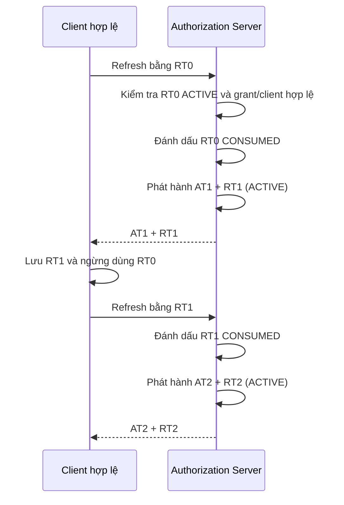
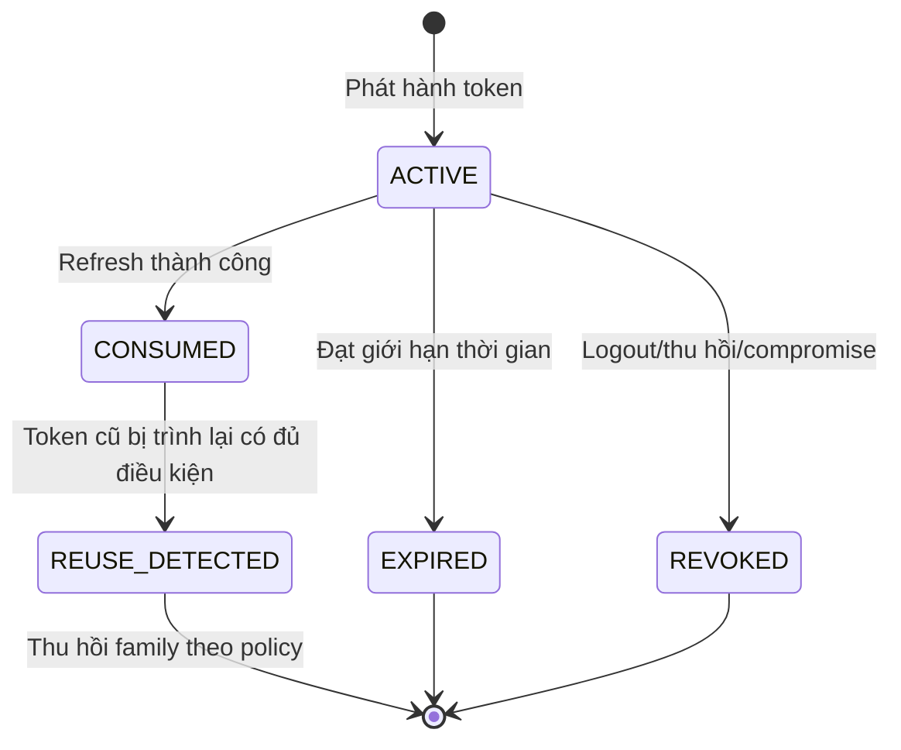

# Refresh token reuse detection

## 1. Bài toán: một refresh token bị dùng lần thứ hai

Giả sử ứng dụng quản lý đơn hàng đã đăng nhập cho người dùng và được authorization server cấp hai credential:

- **Access token (AT0):** dùng để gọi Orders API, thời hạn ngắn và có audience/scope phù hợp.
- **Refresh token (RT0):** dùng **chỉ tại token endpoint** để xin access token mới khi AT0 hết hạn hoặc sắp hết hạn.

Người dùng sử dụng ứng dụng bình thường. Sau đó, một kẻ tấn công lấy được **chuỗi RT0** từ bộ nhớ, bản sao lưu không an toàn hoặc log. Cả client hợp lệ lẫn kẻ tấn công đều có thể thử đổi RT0 lấy token mới nếu cơ chế bảo vệ không ngăn được.

Một thiết kế nguy hiểm là refresh token **tái sử dụng vô hạn**:

```text
Client hợp lệ gửi RT0  -> AS trả AT1, RT0 vẫn dùng được
Kẻ tấn công gửi RT0    -> AS trả AT2, RT0 vẫn dùng được
Client hợp lệ gửi RT0  -> AS trả AT3, RT0 vẫn dùng được
...
```

Kẻ tấn công có thể liên tục xin access token mới ngay cả khi access token chỉ sống vài phút. **Đặt access token TTL ngắn không giải quyết triệt để tình huống refresh token bị đánh cắp.**

**Refresh token reuse detection** là khả năng authorization server nhận biết một refresh token **đã được sử dụng và thay thế**, nhưng sau đó vẫn bị trình lại. Đây là một dấu hiệu nghi ngờ **credential đã bị sao chép**, đặc biệt khi kết hợp với **refresh token rotation** (xoay vòng refresh token).

> **Ý chính:** Với rotation kiểu sử dụng một lần, mỗi lần refresh thành công sẽ **vô hiệu hóa refresh token cũ** và phát hành refresh token mới. Nếu refresh token cũ xuất hiện lần nữa, AS phải xử lý như một sự kiện có khả năng bị lộ, không chỉ âm thầm đổi thêm token.

Bài thuộc chương **Refresh token** của module `SECURITY_TOKEN_SECURITY_FUNDAMENTALS`. Chủ đề kết nối vòng đời token với OAuth 2.0/OIDC, JWT/opaque token, access/refresh token, kiểm tra claims, scope, audience, lưu trữ, thu hồi và phòng chống token bị đánh cắp hoặc phát lại.

## 2. Mục tiêu và phạm vi

Sau bài học, bạn cần phân biệt được:

1. **Rotation**: cấp refresh token mới và làm token cũ không còn được sử dụng.
2. **Reuse detection**: nhận ra token **đã dùng trước đó** được trình lại.
3. **Token-family revocation**: vô hiệu hóa chuỗi refresh token liên quan sau khi phát hiện tái sử dụng đáng ngờ.
4. **Sender-constraining**: ràng buộc refresh token với client/khóa nhằm giảm khả năng sử dụng token nếu chỉ bị sao chép chuỗi.
5. **Client-side concurrency control**: ngăn các luồng refresh hợp lệ tự va chạm, tạo tín hiệu giống tấn công.
6. **Access-token validation**: resource server tiếp tục kiểm tra access token; refresh token không được gửi tới API nghiệp vụ.

Bài tập trung vào **reuse ở token endpoint**, không phải phát lại một DPoP proof tại resource server hay dùng lại access token bearer. Đây là các vấn đề có liên hệ nhưng **khác cơ chế phát hiện và dữ liệu trạng thái**.

## 3. Nền tảng: access token và refresh token khác nhau

| Tiêu chí | Access token | Refresh token |
| --- | --- | --- |
| Mục đích | Truy cập protected resource | Xin access token mới tại authorization server |
| Bên nhận | Resource server với audience phù hợp | Authorization server/token endpoint |
| Tần suất sử dụng | Có thể được dùng cho nhiều HTTP requests trong thời hạn, tùy loại token | Thường dùng lúc cần làm mới; với rotation được kỳ vọng **một lần thành công cho mỗi giá trị** |
| Thời hạn | Thường ngắn | Có thể dài hơn nhưng phải có giới hạn và chính sách |
| Quyền | Phạm vi được cấp cho resource đích | Ràng buộc với grant, client, scopes/resources; không tự tăng quyền |
| Rủi ro khi lộ | Có thể gọi API tới khi token bị từ chối | Có thể xin **nhiều** access tokens nếu không bảo vệ đúng |
| Revocation | Có thể cần introspection, denylist hoặc TTL ngắn | AS quản lý trực tiếp trạng thái refresh/grant |

Refresh token có thể là **opaque handle** được sinh bằng CSPRNG hoặc một định dạng riêng do AS quản lý. Không giả định refresh token luôn là JWT hoặc luôn có claims client có thể đọc.

Một phản hồi refresh theo OAuth 2.0 có thể như sau:

```http
HTTP/1.1 200 OK
Content-Type: application/json
Cache-Control: no-store
Pragma: no-cache

{
  "access_token": "<new_access_token>",
  "token_type": "Bearer",
  "expires_in": 600,
  "refresh_token": "<new_refresh_token>",
  "scope": "orders:read"
}
```

Giá trị `refresh_token` trong phản hồi là token **mới** khi AS áp dụng rotation. Client phải lưu token mới an toàn và **ngừng dùng giá trị cũ**. Với OAuth 2.0, chi tiết có cấp refresh token mới trên mỗi lần refresh hay không phụ thuộc AS/profile; bài này nghiên cứu kiến trúc **có rotation**.

**Không bao giờ** gửi refresh token trong `Authorization: Bearer` tới Orders API. Resource server cần từ chối token sai loại ngay cả khi chuỗi có cấu trúc trông giống access token.

## 4. Rotation tạo ra tín hiệu phát hiện reuse như thế nào?

### 4.1. Chuỗi phát hành hợp lệ

Giả sử AS khởi đầu với RT0:



Sau mỗi lần refresh thành công, **chỉ token mới nhất trong chuỗi tuyến tính được chấp nhận** theo chính sách rotation đơn giản.

```text
RT0 [CONSUMED] --> RT1 [CONSUMED] --> RT2 [ACTIVE]
        \                  \
         \                  \-- không được refresh lại RT1
          \-- không được refresh lại RT0
```

Vì token đã dùng được **ghi lại trạng thái** thay vì xóa mất mọi dấu vết, AS có thể nhận diện việc trình lại RT0 hoặc RT1.

### 4.2. Một refresh token bị phát lại

Tình huống: client hợp lệ đã dùng RT0, nhận RT1. Kẻ tấn công vẫn giữ bản sao RT0.

```mermaid
sequenceDiagram
    participant C as Client hợp lệ
    participant X as Kẻ tấn công
    participant AS as Authorization Server
    C->>AS: Dùng RT0
    AS->>AS: RT0 CONSUMED; RT1 ACTIVE
    AS-->>C: AT1 + RT1
    X->>AS: Thử dùng RT0 bị đánh cắp
    AS->>AS: Nhận diện RT0 đã CONSUMED
    AS->>AS: Đánh dấu token family có nguy cơ compromise
    AS->>AS: Thu hồi RT1 và các hậu duệ còn ACTIVE
    AS-->>X: invalid_grant
    C->>AS: Lần sau thử dùng RT1
    AS-->>C: invalid_grant; cần ủy quyền/đăng nhập lại
```

AS biết **cùng một refresh token đã được trình quá một lần**. Nhưng AS thường **không thể khẳng định lần nào đến từ kẻ tấn công** nếu chỉ dựa vào giá trị token. Vì vậy, phản ứng an toàn phổ biến là **thu hồi cả token đang active trong cùng family/grant bị ảnh hưởng**, khiến cả hai bên phải trải qua luồng ủy quyền hợp lệ mới.

### 4.3. Nếu kẻ tấn công dùng trước thì sao?

Trình tự có thể đảo ngược:

1. Kẻ tấn công dùng RT0 trước, AS cấp AT1 + RT1 cho kẻ đó.
2. Client hợp lệ vẫn giữ RT0 và cố refresh.
3. AS phát hiện RT0 đã `CONSUMED` và thu hồi family, bao gồm RT1.
4. Lần refresh tiếp theo của kẻ tấn công bằng RT1 bị từ chối.

**Reuse detection không bảo đảm ngăn mọi lần sử dụng trái phép đầu tiên.** Nếu kẻ tấn công thắng cuộc đua, nó có thể nhận **access token mới** trước khi bị phát hiện. Một access token đã cấp có thể còn hiệu lực đến `exp` nếu resource server không có cơ chế chặn sớm. Vì thế, cần kết hợp TTL ngắn, theo dõi, thu hồi và đánh giá rủi ro.

## 5. Token family là gì?

**Token family** là nhóm refresh tokens có quan hệ kế thừa do một grant/phiên/thiết bị theo mô hình AS quản lý. Khi mỗi lần refresh tạo một token mới, family giúp hệ thống biết token nào đã được thay thế và token nào còn active.

Ví dụ:

```text
family F-17 (client=orders-mobile, subject=user-123)
  RT0 --> RT1 --> RT2 --> RT3
   |      |      |      |
   USED   USED   USED   ACTIVE
```

Mỗi family có thể liên kết với:

- `family_id`: định danh nội bộ của family.
- `grant_id` / `session_id`: grant hoặc phiên ủy quyền tương ứng.
- `client_id`: client được gắn với refresh token.
- `subject`: user hoặc workload theo ngữ nghĩa của grant.
- `scopes`, `resources`: ranh giới quyền đã được cấp.
- `created_at`, `absolute_expires_at`, `idle_expires_at`: thời gian và điều kiện hiệu lực.
- `status`: `ACTIVE`, `REVOKED`, `COMPROMISED` hoặc trạng thái tương đương.
- `current_token_id`: token kế thừa duy nhất đang được dùng trong mô hình tuyến tính.

Mỗi bản ghi refresh token có thể chứa:

| Trường | Ý nghĩa |
| --- | --- |
| `token_id` | ID nội bộ không phải giá trị token bí mật |
| `family_id` | Family mà token thuộc về |
| `parent_token_id` | Token tiền nhiệm nếu có |
| `token_digest` | Giá trị băm/HMAC dùng tra cứu thay vì token thô |
| `state` | `ACTIVE`, `CONSUMED`, `REVOKED`... |
| `issued_at` | Lúc phát hành |
| `consumed_at` | Lúc refresh thành công |
| `expires_at` | Giới hạn hiệu lực token |
| `client_binding` | Ràng buộc client/khóa/chứng chỉ theo profile |

**Token family là mô hình triển khai**, không phải trường bắt buộc trong mọi phản hồi OAuth. AS có thể dùng ID chuỗi, phiên bản, sự kiện hoặc cơ chế lưu trữ khác; điều quan trọng là **phát hiện được token đã sử dụng bị trình lại và vô hiệu hóa chuỗi liên quan**.

### 5.1. Mỗi thiết bị một family hay một user một family?

Trong thiết kế nhiều phiên/thiết bị, thường có lý do để quản lý **family riêng cho từng grant/thiết bị/client instance**:

- Điện thoại A có family F-A.
- Laptop B có family F-B.
- Trình duyệt C có family F-C.

Khi phát hiện RT cũ của điện thoại A bị tái sử dụng, AS có thể thu hồi **F-A** mà không mặc định đăng xuất mọi phiên người dùng, **nếu chính sách không yêu cầu thu hồi toàn tài khoản**.

Khi có dấu hiệu account takeover trên diện rộng, sự kiện thay đổi mật khẩu/khóa tài khoản hoặc policy nghiêm ngặt có thể yêu cầu **thu hồi nhiều family**. Phạm vi phản ứng là quyết định an ninh có chủ đích, không phải mặc định của chuỗi token.

## 6. Máy trạng thái và quy tắc không thể bỏ qua

### 6.1. Trạng thái token

Một state machine đơn giản:



Trong sơ đồ, `REUSE_DETECTED` đại diện sự kiện và trạng thái xử lý logic; không nhất thiết phải là một giá trị được lưu trong database.

### 6.2. Trạng thái family

```text
FAMILY ACTIVE
    |
    +-- refresh hợp lệ -> ACTIVE, current_token chuyển RTn -> RTn+1
    |
    +-- reuse token đã CONSUMED -> COMPROMISED, chặn current_token
    |
    +-- logout/admin revoke -> REVOKED
    |
    +-- hết absolute/idle lifetime -> EXPIRED
```

**Các bất biến cần có:**

1. Một refresh token **không được tạo thành hai refresh tokens kế nhiệm hợp lệ** qua các request race trong mô hình rotation tuyến tính.
2. Trạng thái cũ và token mới phải được **ghi nguyên tử**. Không có lúc RT0 đã consumed mà RT1 chưa được lưu hợp lệ do transaction bị lỗi một nửa.
3. Một khi family bị đánh dấu `COMPROMISED` hoặc `REVOKED`, các request refresh sau đó **không được kích hoạt lại family**.
4. API phát token mới **không được mở rộng scopes/resources** vượt giới hạn grant và chính sách hiện hành.
5. Phát hiện reuse phải dựa trên **trạng thái phía AS đáng tin cậy**, không phải biến `used=true` do client tự gửi.
6. Không để token family bị kéo dài vô hạn ngoài tuổi thọ tuyệt đối mà policy cho phép chỉ nhờ các lần rotation liên tiếp.

## 7. Thuật toán tại token endpoint

### 7.1. Refresh request

Ví dụ client gửi refresh token qua token endpoint:

```http
POST /token HTTP/1.1
Host: auth.example.com
Content-Type: application/x-www-form-urlencoded

grant_type=refresh_token&refresh_token=<form_encoded_RT0>
```

Các giá trị placeholder cần được form-encode đúng. **Confidential client** còn phải xác thực với AS theo đăng ký và grant; **public client** không được giả định có client secret an toàn. Việc ràng buộc refresh token với client/grant hoặc khóa cần được kiểm tra theo profile.

AS nên thực hiện:

1. Xác minh request, client authentication khi cần, kênh TLS và các giới hạn đầu vào.
2. Tra cứu refresh token theo định danh/bản băm an toàn.
3. Xác định family/grant và **kiểm tra ràng buộc client**; nếu refresh token sender-constrained, xác minh đúng bằng chứng khóa trước khi quyết định theo trạng thái.
4. Kiểm tra family chưa revoked/compromised/expired, grant còn hiệu lực, user/client chưa bị chặn theo policy.
5. Nếu refresh token đang **ACTIVE và là token hiện hành của family**, thực hiện rotation **nguyên tử**.
6. Nếu token **đã CONSUMED nhưng xuất hiện lại** trong bối cảnh có thể tin là reuse, ghi sự kiện và thu hồi family theo chính sách.
7. Nếu token không tồn tại, hết hạn hoặc bị thu hồi vì nguyên nhân khác, từ chối; không suy đoán chắc chắn đó là token bị đánh cắp.
8. Trả response/lỗi OAuth phù hợp, không tiết lộ bí mật và không phát hành token mới sau khi xác định compromise.

### 7.2. Pseudo-code có giao dịch nguyên tử

```text
function refreshToken(request):
    clientContext = validateOAuthClientAndTokenRequest(request)
    presentedRT = parseRefreshTokenSecret(request)

    # Digest dùng để tra cứu; không log presentedRT.
    digest = keyedDigest(presentedRT)
    record = tokenStore.findByDigest(digest)

    if record is null:
        return invalidGrant()

    # Phải có kiểm soát ràng buộc client/PoP đáng tin;
    # tránh cho bên ngoài dùng token cũ tùy ý để gây revoke.
    if not validClientGrantOrSenderBinding(record, clientContext, request):
        return invalidGrant()

    beginTransaction()
    family = familyStore.lockForUpdate(record.familyId)
    token = tokenStore.lockForUpdate(record.id)

    # Revalidate trong transaction, tránh trạng thái bị thay giữa chừng.
    if family.status != ACTIVE:
        rollbackOrEndTransaction()
        return invalidGrant()

    if token.state == CONSUMED:
        family.status = COMPROMISED
        familyStore.save(family)
        tokenStore.revokeActiveTokensInFamily(family.id)
        audit.recordReuseDetected(family.id, token.id, clientContext)
        commitTransaction()
        return invalidGrant()

    if token.state != ACTIVE:
        rollbackOrEndTransaction()
        return invalidGrant()

    if family.currentTokenId != token.id:
        # Không cho nhánh song song vượt state hiện hành.
        handleUnexpectedChainStateConservatively()
        rollbackOrEndTransaction()
        return invalidGrant()

    if grantExpiredOrRevoked(family) or not currentPolicyAllowsRefresh(family):
        family.status = REVOKED
        familyStore.save(family)
        commitTransaction()
        return invalidGrant()

    nextRT = generateHighEntropySecret()
    nextDigest = keyedDigest(nextRT)
    nextRecord = createRefreshTokenRecord(
        familyId = family.id,
        parentId = token.id,
        digest = nextDigest,
        state = ACTIVE,
        expiry = chooseBoundedExpiry(family)
    )

    token.state = CONSUMED
    token.consumedAt = now()
    family.currentTokenId = nextRecord.id
    updateAtomically(token, nextRecord, family)

    accessToken = issueLeastPrivilegeAccessToken(
        client = clientContext,
        grant = family.grant,
        audience = approvedResource(family),
        scopes = evaluateCurrentGrantedScopes(family)
    )

    commitTransaction()
    return oauthResponse(accessToken, nextRT)
```

Đây là **pseudocode giải thích nguyên tắc**, không đủ đưa trực tiếp vào production. Việc tạo access token/ký số có thể được tổ chức trước hoặc sau commit để bảo đảm **không trả một token mà transaction chưa ghi thành công**. Cần thiết kế xử lý lỗi sau commit, retry, đồng bộ trạng thái, dọn orphan và audit sao cho không vi phạm bất biến.

Quan trọng: nếu vừa **đánh dấu family COMPROMISED** vừa trả lỗi, phải **commit transaction** trước khi phản hồi. Nếu ném exception khiến framework tự rollback toàn bộ, việc thu hồi family có thể bị hủy và reuse detection trở nên vô nghĩa.

### 7.3. Tại sao phải khóa family hoặc dùng compare-and-swap?

Giả sử hai request đồng thời trình RT0:

```text
Request A: kiểm tra RT0 = ACTIVE
Request B: kiểm tra RT0 = ACTIVE
Request A: tạo RT1
Request B: tạo RT2
```

Nếu không khóa hoặc ràng buộc nguyên tử, cả hai request có thể cùng thành công, khiến AS tạo **hai nhánh hợp lệ** và mất khả năng theo dõi token hiện hành.

Biện pháp thường gặp:

- Dùng transaction + **row lock** (chẳng hạn `SELECT ... FOR UPDATE`) trên family hoặc token, và kiểm tra lại state sau khi có lock.
- Dùng **optimistic concurrency / compare-and-swap** trên version và xử lý thất bại cập nhật.
- Có unique constraint phù hợp, chẳng hạn một active token cho mỗi family trong mô hình tuyến tính.
- Với database phân tán, yêu cầu **tính nhất quán đủ mạnh** cho thao tác consume/rotate; không dựa vào read replica trễ để quyết định RT0 còn active.
- Các node AS phải cùng nhìn thấy kết quả rotation và sự kiện compromise trước khi tiếp tục cho phép refresh.

Khóa mutex chỉ trong bộ nhớ **một instance** thường không đủ nếu AS có nhiều node, nhiều zone hoặc nhiều vùng dữ liệu.

## 8. Thiết kế lưu trữ: bí mật token khác định danh nội bộ

### 8.1. Token có entropy cao

Refresh token bearer nên được tạo bằng **CSPRNG** với độ ngẫu nhiên phù hợp, không dùng timestamp, số tăng dần hoặc Base64 của email/user ID.

Ví dụ Java tạo một handle ngẫu nhiên 256 bit:

```java
import java.security.SecureRandom;
import java.util.Base64;

public final class RefreshSecretFactory {
    private static final SecureRandom RANDOM = new SecureRandom();

    private RefreshSecretFactory() {
    }

    public static String newRefreshSecret() {
        byte[] secret = new byte[32];
        RANDOM.nextBytes(secret);

        return Base64.getUrlEncoder()
                .withoutPadding()
                .encodeToString(secret);
    }
}
```

Đây **chỉ là hàm tạo bí mật**, không phải hệ thống refresh-token issuance. Còn cần lưu grant, TTL, binding, rotation, revocation, kiểm soát truy cập và khả năng phát hiện reuse.

### 8.2. Không lưu token thô tùy tiện

Thay vì lưu raw refresh token trong database/log, AS có thể lưu **digest** dùng tra cứu, ví dụ HMAC-SHA-256 dưới khóa máy chủ được bảo vệ hoặc thiết kế băm phù hợp. Dạng token có entropy cao giúp tra cứu bằng digest thực tế và giảm tác hại nếu bảng dữ liệu bị lộ, nhưng phải kiểm soát cả khóa HMAC, backup và quyền đọc.

```text
Client giữ:             RT0 (bí mật)
Authorization server:   token_digest(RT0), token_id, family_id, state
Nhật ký vận hành:       family_id/token_id nội bộ đã hạn chế, không có RT0
```

Không lưu plain token trong access log, tracing headers, crash report, analytics, browser URL hoặc thông báo lỗi. Giá trị refresh token phải được **giữ nguyên từng ký tự**; không trim, lowercase, URL-decode sai ngữ cảnh hoặc chuẩn hóa Unicode tùy tiện.

AS phải còn giữ **metadata đủ để nhận diện token đã CONSUMED**, ít nhất cho khoảng thời gian token/family còn có thể phát sinh reuse có ý nghĩa. Nếu chỉ xóa hoàn toàn record RT0 sau khi cấp RT1, AS có thể không phân biệt **token cũ của family hiện hành** với một chuỗi ngẫu nhiên không tồn tại.

### 8.3. Một mẫu schema khái niệm

```sql
-- Minh họa logical schema; không phải migration production.
CREATE TABLE refresh_token_family (
    family_id            VARCHAR(80) PRIMARY KEY,
    grant_id             VARCHAR(80) NOT NULL,
    client_id            VARCHAR(160) NOT NULL,
    subject_ref          VARCHAR(200),
    status               VARCHAR(32) NOT NULL,
    current_token_id     VARCHAR(80),
    created_at           TIMESTAMP NOT NULL,
    absolute_expires_at  TIMESTAMP NOT NULL,
    idle_expires_at      TIMESTAMP
);

CREATE TABLE refresh_token_record (
    token_id         VARCHAR(80) PRIMARY KEY,
    family_id        VARCHAR(80) NOT NULL,
    parent_token_id  VARCHAR(80),
    token_digest     VARCHAR(128) UNIQUE NOT NULL,
    status           VARCHAR(32) NOT NULL,
    issued_at        TIMESTAMP NOT NULL,
    consumed_at      TIMESTAMP,
    expires_at       TIMESTAMP NOT NULL
);
```

Một triển khai thật cần thiết kế **foreign keys, indexes, unique active state, transaction, độ chính xác thời gian, bảo vệ khóa HMAC, sharding/replication, TTL cleanup, phân quyền SQL và audit**. Trường `subject_ref` phải chứa định danh/ngữ cảnh phù hợp, không tự gán email làm khóa toàn cục.

**Không dùng SQL schema làm lý do tin client:** mọi liên kết family/client/grant phải do AS quản lý khi phát hành hoặc khi xác minh đầu vào.

## 9. Reuse detection và phản ứng thu hồi family

### 9.1. Vì sao không chỉ trả `invalid_grant` rồi thôi?

Nếu kẻ tấn công giữ bản sao RT0 đã consumed, còn client hợp lệ giữ RT1 active:

- AS phát hiện RT0 bị trình lại.
- Nếu chỉ trả `invalid_grant` cho RT0 nhưng **giữ nguyên RT1 active**, kẻ tấn công có thể đã lấy được RT1 bằng một cách khác hoặc có thể là bên thắng lượt refresh đầu tiên.
- AS không biết chắc ai đang giữ token mới trong nhánh.

Vì vậy, phản ứng thường được khuyến nghị khi có dấu hiệu reuse đáng tin là **vô hiệu hóa refresh token active trong family bị ảnh hưởng và yêu cầu ủy quyền hợp lệ mới**.

### 9.2. Phạm vi thu hồi

Các lựa chọn phụ thuộc mức rủi ro:

| Phạm vi | Khi nào cân nhắc | Tác động |
| --- | --- | --- |
| **Current refresh-token family** | Reuse trong một grant/thiết bị cụ thể | Phiên/thiết bị tương ứng phải đăng nhập lại |
| **Toàn bộ grant** | Một grant có nhiều nhánh hoặc liên kết không an toàn | Tất cả refresh tokens thuộc grant bị ngắt |
| **Nhiều phiên của user** | Nghi ngờ account takeover hoặc policy ứng cứu | Đăng xuất rộng hơn, trải nghiệm bị ảnh hưởng |
| **Client registration/credential** | Lộ secret/private key của ứng dụng | Có thể dừng nhiều client instances; cần quy trình xoay khóa |

Không tự động nói “bất kỳ một lỗi `invalid_grant` đều phải khóa toàn tài khoản”. Token có thể chỉ hết hạn, bị thu hồi do logout, bị gõ sai hoặc request bị lỗi; **reuse detection cần ngữ cảnh và bằng chứng về token đã dùng**.

### 9.3. Access tokens đã cấp thì sao?

Thu hồi family **ngăn tạo access tokens mới** qua nhánh refresh ấy. Nó **không mặc nhiên vô hiệu hóa mọi access token JWT đã cấp** nếu resource server chỉ kiểm tra chữ ký và `exp`.

Muốn hạn chế ngay access tokens đã phát hành, cần có giải pháp bổ sung phù hợp:

- Access token thời hạn ngắn.
- Introspection có phản ánh trạng thái grant/session và được cache đúng mức.
- Denylist theo token ID, session ID hoặc token version nếu thiết kế hỗ trợ.
- Risk policy tại resource server, ví dụ yêu cầu tái xác thực ở thao tác nhạy cảm.
- Sender-constrained access token bằng DPoP/mTLS để giảm khả năng dùng token bị sao chép một mình.

Không hứa “phát hiện refresh reuse là logout ngay mọi API” nếu kiến trúc resource server **không có khả năng nhận tín hiệu thu hồi kịp thời**.

## 10. Phản hồi lỗi chuẩn tại token endpoint

Theo OAuth 2.0, việc trình refresh token không hợp lệ, hết hạn, bị thu hồi, cấp cho client khác hoặc không khớp grant thường được phản hồi bằng lỗi **`invalid_grant`** ở token endpoint.

```http
HTTP/1.1 400 Bad Request
Content-Type: application/json
Cache-Control: no-store
Pragma: no-cache

{
  "error": "invalid_grant"
}
```

Client **không nên biết chi tiết nội bộ** về việc có tồn tại một family, nó đã bị compromise hay trạng thái phiên của người dùng khác. AS có thể lưu nguyên nhân chi tiết trong audit nội bộ.

Phân biệt các lỗi:

| Trường hợp | Phản hồi giao thức thường phù hợp | Hành vi client |
| --- | --- | --- |
| Refresh token đã hết hạn hoặc bị revoke | `invalid_grant` | Ngừng dùng token; đi qua luồng ủy quyền khi cần |
| Refresh token đã CONSUMED bị trình lại | `invalid_grant` + xử lý reuse phía AS | Không thử lặp token cũ |
| Refresh token không thuộc client/grant | `invalid_grant` | Không thử “đoán” client/credential khác |
| Client authentication thất bại | `invalid_client` theo quy tắc OAuth | Sửa thông tin client; không lộ client secret |
| Request sai định dạng | `invalid_request` | Sửa request/cách encode |
| AS tạm thời lỗi database | Lỗi dịch vụ phù hợp; fail closed | Không suy ra token chắc chắn đã bị dùng lại |

Phản hồi lỗi thực tế phải tuân quy tắc OAuth cụ thể của AS, bao gồm header khi client authentication dùng HTTP scheme. Không tùy tiện trả `401 invalid_token` như ở resource server; token endpoint có hệ thống lỗi riêng.

### 10.1. Tránh vòng lặp refresh vô hạn

Khi nhận `invalid_grant`, client không được tiếp tục:

```text
RT0 -> invalid_grant -> thử RT0 -> invalid_grant -> thử RT0...
```

Hành vi hợp lý là:

1. Ngừng sử dụng refresh token bị từ chối.
2. Xóa hoặc đánh dấu phiên/token local không còn dùng được theo chiến lược an toàn.
3. Không âm thầm xin token mới bằng grant không được phép.
4. Điều hướng người dùng qua luồng ủy quyền/đăng nhập lại khi phù hợp.
5. Giữ trạng thái ứng dụng và thông báo lỗi ở mức không tiết lộ chi tiết an ninh nhạy cảm.

Một AS có thể yêu cầu hành động bảo mật bổ sung, như xác thực tăng cường hoặc kiểm tra thiết bị, theo chính sách.

## 11. Race condition: reuse do client hợp lệ gây ra

Một vấn đề thực tế: không phải lần sử dụng RT0 thứ hai nào cũng có kẻ tấn công. Nó có thể do **hai request hợp lệ đồng thời**.

Ví dụ:

- Hai tab trình duyệt cùng phát hiện access token sắp hết hạn.
- Ứng dụng mobile cùng lúc refresh từ foreground task và background job.
- Hai pod của backend cùng dùng một refresh token được lưu chung.
- HTTP retry khi request đầu đã thành công nhưng response bị mất trên đường về.
- Một worker xử lý queue gửi lại request vì không nhận ACK.

```mermaid
sequenceDiagram
    participant A as Tab A
    participant B as Tab B
    participant AS as Authorization Server
    A->>AS: Refresh RT0
    B->>AS: Refresh RT0 gần như đồng thời
    AS->>AS: A thắng, RT0 CONSUMED; RT1 ACTIVE
    AS-->>A: AT1 + RT1
    AS->>AS: B trình RT0 đã CONSUMED
    AS->>AS: Reuse detection / family policy
    AS-->>B: invalid_grant
    Note over A,B: Tab A có thể bị mất hiệu lực RT1 nếu AS thu hồi family
```

Nếu AS cố gắng **bỏ qua reuse trong một khoảng grace window quá rộng**, kẻ tấn công cũng có thể khai thác cửa sổ ấy. Cần xử lý race **chủ yếu từ phía client** và thiết kế máy trạng thái đủ chặt.

### 11.1. Single-flight refresh ở client

**Single-flight** nghĩa là tại một thời điểm, một phiên/grant chỉ có **một refresh đang diễn ra**. Các request khác chờ kết quả.

Pseudo-code:

```text
shared inFlightRefresh = null

function getValidAccessToken():
    if accessTokenIsStillUsable():
        return cachedAccessToken

    if inFlightRefresh != null:
        return await inFlightRefresh

    inFlightRefresh = refreshOnceUsingCurrentRefreshToken()

    try:
        result = await inFlightRefresh
        atomicallyPersist(result.accessToken, result.refreshToken)
        return result.accessToken
    finally:
        inFlightRefresh = null
```

Đây là mô hình trong **một process**. Với nhiều tab, worker, process hoặc pod, phải có cơ chế phối hợp phù hợp, ví dụ lock/cơ chế single writer do hệ thống kiểm soát. Một biến promise toàn cục trong một tab **không khóa được tab khác**.

### 11.2. Lưu token mới trước khi cho phép refresh tiếp

Sau response thành công:

- Thay thế RT0 bằng RT1 **nguyên tử** trong bộ nhớ/secure storage.
- Không để background thread đọc RT0 cũ và tiếp tục refresh.
- Nếu nhiều node cùng dùng một family, cập nhật qua storage có khả năng điều phối/version phù hợp.
- Nếu client crash sau khi AS đã rotate nhưng trước khi lưu RT1, phiên có thể phải **đăng nhập lại**; đừng cố đoán hoặc khôi phục token bằng cách retry RT0 vô hạn.

### 11.3. Idempotency và grace window

Một số AS lựa chọn giải pháp chống false positive như:

- Idempotency key hoặc deduplication request có **ràng buộc chặt với client/grant**, xác minh một request logic là cùng thao tác.
- Khoảng grace rất hẹp với chính sách được định nghĩa, telemetry và quản lý cạnh tranh.
- Cơ chế khôi phục phiên được thiết kế riêng thay vì cho phép refresh token cũ tùy tiện.

**Đánh đổi quan trọng:** nếu AS chấp nhận lại RT0 sau khi RT1 đã phát hành hoặc phát lại RT1 cho bất kỳ ai nắm RT0, nó có thể làm **yếu rotation/reuse detection** và tạo đường lấy refresh token mới. Không coi “grace window 30 giây” là mặc định an toàn. Cần threat model, ràng buộc client/sender, idempotency thực sự và kiểm thử hành vi khi token bị sao chép.

Đối với hệ thống ưu tiên an ninh cao, **fail closed và yêu cầu ủy quyền lại** có thể phù hợp hơn việc chấp nhận lại token đã consumed.

## 12. Transaction, consistency và phát hiện reuse trên nhiều node

### 12.1. Invariant quan trọng nhất

Trong một family tuyến tính, tại bất kỳ thời điểm cho phép refresh **không thể có hai token active hợp lệ cùng sinh ra từ một RT0**. Để bảo vệ invariant này, AS phải coi bước **consume old + create new + move current pointer** là thao tác nguyên tử.

```text
Giao dịch refresh RT0 -> RT1

BEGIN
  LOCK family F
  ASSERT F.status = ACTIVE
  ASSERT RT0 = F.current_token AND RT0.state = ACTIVE
  UPDATE RT0.state = CONSUMED
  INSERT RT1(state=ACTIVE, parent=RT0, family=F)
  UPDATE F.current_token = RT1
COMMIT
```

Đây là **minh họa giao dịch**, không phải câu lệnh SQL áp dụng trực tiếp trong mọi DB. Cần ràng buộc unique/index và mức isolation theo kiến trúc thực tế.

### 12.2. Nếu hai request xảy ra đồng thời

Yêu cầu kiểm thử:

1. Hai request cùng gửi RT0 đồng thời tới **hai node AS khác nhau**.
2. Một request có thể thành công (cấp RT1).
3. Request còn lại không được cấp RT2 thành công từ RT0.
4. Nếu chính sách coi đó là reuse, family phải được vô hiệu hóa **thật sự trong database**.
5. Cả hai node sau đó phải từ chối việc dùng RT1 nếu family đã compromised.

Nếu có replication trễ hoặc active-active multi-region, cần cơ chế **single-writer/consistency phù hợp** để tránh từng vùng đều nghĩ mình là node đầu tiên sử dụng RT0. Dùng eventual consistency thuần túy cho state quyết định rotation có thể không đáp ứng yêu cầu chống replay.

### 12.3. Đừng chỉ lưu token cuối

Nếu database chỉ có một trường:

```text
current_refresh_token = RT1
```

và quên hoàn toàn lịch sử RT0, khi RT0 xuất hiện lại AS có thể chỉ thấy `unknown token`. Để phân biệt **reuse của token đã consumed** với token chưa từng phát hành, AS cần lưu metadata đủ lâu hoặc dùng cấu trúc có tính xác thực tương đương cho phép tra family và trạng thái.

Dữ liệu lịch sử cũng phải được bảo vệ, dọn theo retention an toàn và không lưu raw credential. Không giữ vô hạn mọi token cũ nếu không có cơ sở về bảo mật và quản trị dữ liệu.

## 13. Rotation hay sender-constraining: quan hệ với RFC 9700

**OAuth 2.0 Security Best Current Practice (RFC 9700)** yêu cầu **public clients** có refresh token phải sử dụng cơ chế phát hiện replay như **sender-constrained refresh token** hoặc **refresh token rotation**.

Hai hướng thiết kế:

| Cơ chế | Ý tưởng | Ưu điểm | Giới hạn |
| --- | --- | --- | --- |
| **Rotation + reuse detection** | Mỗi lần refresh phát RT mới, token cũ không dùng lại; replay để lại dấu vết | Có thể phát hiện token từng bị sao chép và phản ứng bằng family revocation | Dễ xung đột khi client refresh song song; attacker có thể dùng trước |
| **Sender-constrained refresh token** | AS chỉ chấp nhận refresh khi client chứng minh sở hữu khóa/cert đã bind | Chuỗi token bị đánh cắp **một mình** khó bị dùng | Nếu lộ cả khóa hoặc client bị điều khiển vẫn có rủi ro; yêu cầu hạ tầng hỗ trợ |

**Không mặc định mọi refresh token luôn phải vừa rotation vừa DPoP/mTLS**; chuẩn đưa ra lựa chọn phù hợp theo client/profile. Tuy nhiên, một kiến trúc có thể kết hợp cả hai nếu threat model và khả năng triển khai cho phép.

### 13.1. DPoP và mTLS

- **DPoP (RFC 9449):** client chứng minh nắm private key qua JWT proof ký số; token được ràng buộc với khóa theo profile. Khi dùng để bảo vệ refresh token, AS cần kiểm tra binding tương ứng ở token endpoint.
- **mTLS (RFC 8705):** chứng chỉ client và bằng chứng sở hữu private key TLS có thể được dùng để sender-constrain token theo profile.
- **PKCE (RFC 7636):** bảo vệ authorization code exchange, **không tự biến refresh token thành sender-constrained** và không tự phát hiện reuse của refresh token.
- **Client secret:** xác thực confidential client ở AS có vai trò quan trọng, nhưng một public client không thể coi secret đóng gói trong binary/mobile app là bí mật an toàn.

Với sender-constrained refresh token, một request thiếu proof/khóa hợp lệ **không nhất thiết nên được ghi nhận là reuse đáng tin để thu hồi family**, vì kẻ tấn công chỉ biết chuỗi token có thể cố tình gửi request sai proof gây từ chối dịch vụ. Cần xác thực/binding hợp lệ trước khi quyết định compromise theo quy tắc chính sách.

### 13.2. Token đã bị lộ cùng private key

Nếu attacker chiếm cả refresh token và private key/cert tương ứng, sender-constraining suy giảm tác dụng. Các biện pháp khác vẫn cần:

- Bảo vệ kho khóa và private key.
- Thu hồi phiên/grant khi mất thiết bị hoặc sự cố.
- Phân tích hành vi bất thường.
- Thời hạn tuyệt đối, idle timeout và least privilege.
- Giới hạn cấp scopes/resources cho access token mới.

Một key không xuất được (*non-exportable*) có thể giảm kiểu sao chép key, nhưng mã độc chạy trên client có thể vẫn **ra lệnh sử dụng khóa**, tùy nền tảng và quyền truy cập.

## 14. Thời hạn refresh token và bảo vệ grant

Rotation **không có nghĩa refresh token family được sống mãi**. AS cần các giới hạn:

1. **Absolute lifetime**: thời điểm chấm dứt family/grant dù refresh liên tục.
2. **Idle lifetime**: khoảng tối đa không sử dụng trước khi mất hiệu lực, nếu chính sách áp dụng.
3. **Session/consent lifetime**: quyền ủy quyền của người dùng hoặc ngữ cảnh phiên không còn phù hợp.
4. **Client/subject state**: user bị khóa, client bị đình chỉ, grant bị thu hồi.
5. **Scope/resource binding**: refresh không được tăng quyền/đổi audience ngoài những gì grant và chính sách cho phép.

Ví dụ:

```text
Family F được cấp lúc T0
  absolute expiry = T0 + 30 ngày
  idle expiry     = lần sử dụng hợp lệ gần nhất + 7 ngày
  access token    = sống 10 phút

RT0 -> RT1 -> RT2 ... không được vượt absolute expiry
```

Các mốc ở đây là **ví dụ thiết kế**, không phải TTL cố định do OAuth bắt buộc. AS phải có khả năng thu hồi sớm khi rủi ro yêu cầu.

### 14.1. Refresh không phải một grant mới tăng quyền

Giả sử grant gốc chỉ có:

```text
audience = Orders API
scopes = orders:read
```

Client không được dùng refresh token để yêu cầu:

```text
audience = Orders API + Payments API
scopes = orders:read payments:refund
```

nếu việc mở rộng chưa được cấp theo một luồng ủy quyền hợp lệ. AS phải kiểm tra **client, grant, requested scopes/resources, policy hiện hành**, không tự động copy toàn bộ request vào access token mới.

### 14.2. Thu hồi theo RFC 7009

OAuth 2.0 Token Revocation (RFC 7009) cho phép client yêu cầu AS thu hồi token phù hợp. Logout, khóa tài khoản hoặc quản trị viên thu hồi grant cũng có thể dẫn đến vô hiệu refresh tokens.

**Refresh-token reuse detection** là một **đầu vào** của hệ thống thu hồi, không thay thế API thu hồi và vòng đời session. Khi phát hiện family bị compromise, AS có thể thu hồi các refresh tokens thuộc family và thực thi các biện pháp khác theo chính sách.

## 15. Client phải lưu và luân chuyển refresh token thế nào?

### 15.1. Web app và browser

Nếu kiến trúc cho phép, một **backend-for-frontend (BFF)** có thể giữ OAuth refresh token phía backend thay vì đưa trực tiếp vào JavaScript, còn trình duyệt giữ **session cookie** được cấu hình an toàn.

Nếu client browser-based trực tiếp giữ refresh token:

- Cần đánh giá nghiêm túc rủi ro **XSS, extension và script bên thứ ba**.
- Lưu ở nơi an toàn nhất mà nền tảng thực tế hỗ trợ; không cho rằng `localStorage` tự bảo vệ credential khỏi XSS.
- Đồng bộ refresh giữa nhiều tab/worker bằng giải pháp có thiết kế kiểm soát cạnh tranh.
- Không dùng refresh token trong URL, log hoặc thông báo lỗi.
- Tuân thủ chính sách AS cho public client về rotation/sender-constraining.

**Cookie `HttpOnly` giúp hạn chế JavaScript đọc cookie**, nhưng cookie/session cần `Secure`, `SameSite`, bảo vệ CSRF và policy logout riêng.

### 15.2. Native/mobile client

- Dùng kho bảo mật của hệ điều hành khi phù hợp (Keychain/Keystore hoặc tương đương).
- Không sao chép refresh token qua backup/cơ chế sync không kiểm soát.
- Phối hợp background refresh và foreground refresh để tránh hai request trình cùng RT0.
- Khi rotation thành công, cập nhật token mới một cách bền vững trước khi tiếp tục tác vụ.
- Khi AS từ chối do `invalid_grant`, ngừng retry RT cũ và làm lại ủy quyền khi cần.

Một thiết bị bị compromise có thể thao tác bằng chính khóa hoặc token hiện có; bảo vệ lưu trữ giúp giảm rủi ro nhưng không bảo đảm an toàn tuyệt đối.

### 15.3. Backend phân tán

Nhiều backend pods dùng chung một family cần:

- **Một đầu mối refresh hoặc shared single-flight** theo family.
- Kho token có **phiên bản/lock** và secret storage bảo vệ.
- Cơ chế ghi RT mới có kiểm tra cạnh tranh.
- Không cache RT cũ vô thời hạn trong từng pod.
- Cảnh báo và xử lý nhất quán khi AS trả `invalid_grant`.

Một design tốt thường tránh cho hàng chục workers **đồng thời sử dụng một refresh token** để xin access token. Có thể tách grants/families theo workload nếu chính sách và nhu cầu cho phép.

## 16. Phát hiện và cảnh báo vận hành

### 16.1. Ghi sự kiện an ninh, không ghi credential

Khi reuse xảy ra, audit có thể ghi:

```json
{
  "event": "refresh_token_reuse_detected",
  "family_id": "F-17",
  "token_record_id": "RT-record-0",
  "client_id": "orders-mobile",
  "grant_id": "grant-42",
  "action": "family_revoked",
  "timestamp": "2026-11-23T02:00:00Z",
  "request_id": "req-7c2e"
}
```

Đây là dữ liệu minh họa. **Không ghi raw RT0/RT1, access token, client secret hoặc DPoP proof nguyên vẹn**. Dữ liệu định danh người dùng, địa chỉ IP, thiết bị và vị trí có thể nhạy cảm; phải kiểm soát truy cập và retention theo nhu cầu điều tra hợp lệ.

### 16.2. Sự kiện nào nên cảnh báo?

- Nhiều lần trình lại token `CONSUMED` trong cùng family.
- Số family bị đánh dấu compromised tăng sau một bản phát hành client mới.
- Hai refresh gần như đồng thời từ các node/region khác nhau.
- Bất thường theo client version, user/device, loại grant hoặc hệ thống lưu trữ.
- Tăng `invalid_grant` sau rollout một cơ chế retry hoặc thay đổi cache.
- Refresh từ ngữ cảnh không phù hợp với binding/risk policy, nếu có tín hiệu đáng tin.
- Tỷ lệ **token family revoked vs successful refresh** tăng mạnh.

Quan trọng: sự kiện reuse có thể là **kẻ tấn công** hoặc **bug concurrency**. Không nên tự động kết luận vi phạm tài khoản chỉ từ một sự kiện mà không xem xét ngữ cảnh. Tuy nhiên, **phản ứng kỹ thuật phải bảo vệ family theo chính sách**, không bỏ qua chỉ vì chưa quy kết được thủ phạm.

### 16.3. Rate limiting và chống DoS

Token endpoint cần giới hạn tốc độ, kích thước request, số lỗi liên tiếp và các biện pháp bảo vệ abuse phù hợp.

Nếu đối phương có thể gửi một token cũ bị lộ để khiến family bị revoke, reuse-detection trở thành một **đường gây gián đoạn phiên**. Cần kiểm tra **client/grant/sender binding trước khi thực hiện hành động thu hồi có ảnh hưởng**, cân nhắc rate limits và threat model; không được dựa vào địa chỉ IP như bằng chứng danh tính duy nhất.

Không công bố qua thông báo lỗi family nào tồn tại hoặc token cũ nào thuộc người dùng khác.

## 17. Phân biệt lỗi có thể phục hồi và sự kiện compromise

Không phải mọi thất bại refresh đều giống nhau:

| Sự kiện | Có chứng minh reuse không? | Xử lý |
| --- | --- | --- |
| RT0 **ACTIVE**, client/grant hợp lệ, refresh lần đầu | Không | Rotate RT0 → RT1 |
| RT0 **CONSUMED**, tiếp tục được trình hợp lệ | **Có tín hiệu reuse** | Ghi sự kiện, vô hiệu family theo chính sách |
| Refresh token đã hết hạn trước lần dùng đầu | Không nhất thiết | `invalid_grant` |
| Refresh token giả/không tồn tại | Không | `invalid_grant`; rate limit |
| Client không xác thực hoặc binding không hợp lệ | Không chứng minh token bị sao chép thành công | Từ chối; đánh giá abuse, tránh thu hồi tùy tiện |
| Family đã bị revoked sau logout | Không nhất thiết là sự cố mới | `invalid_grant`, có thể ghi event riêng |
| Hai tab cùng dùng RT0, lần 2 bị từ chối | Tín hiệu kỹ thuật giống reuse | Chính sách family + khắc phục single-flight client |
| Response RT1 thất lạc sau commit, client retry RT0 | Tín hiệu kỹ thuật giống reuse | Client nên reauthorize/khôi phục theo thiết kế, không retry vô hạn |
| Grant bị thu hồi do role/consent thay đổi | Không cần có reuse | Vô hiệu theo policy thu hồi |
| Request token endpoint gặp lỗi kết nối **trước khi server xử lý** | Không biết đã rotate hay chưa | Không tự giả định trạng thái; cần chính sách retry an toàn |

Một refresh token có thể bị thu hồi mà **không có reuse**. Ngược lại, reuse có thể bị phát hiện **dù token còn nằm trong thời gian hiệu lực tuyệt đối**. Cần phân biệt trạng thái `EXPIRED`, `REVOKED`, `CONSUMED` và `COMPROMISED` để vận hành rõ ràng.

## 18. Bộ kiểm thử chức năng và an ninh

Giả định AS cấp RT0, dùng rotation một lần; mỗi family có đúng một token current. Client `orders-mobile` và grant ban đầu chỉ cho phép `orders:read` ở Orders API.

| Ca kiểm thử | Kết quả mong đợi | Thuộc tính kiểm chứng |
| --- | --- | --- |
| RT0 active, refresh đúng client/grant | Cấp AT1 + RT1, RT0 consumed | Luồng rotation bình thường |
| RT1 active, refresh tiếp | Cấp AT2 + RT2, RT1 consumed | Duy trì chuỗi đúng |
| Gửi RT0 lần hai sau khi nhận RT1 | `invalid_grant`, family bị xử lý compromised | Reuse detection |
| Sau reuse RT0, thử dùng RT1 | Từ chối | Thu hồi current descendant |
| Attacker dùng RT0 trước rồi client hợp lệ dùng RT0 | Lần 2 phát hiện, family vô hiệu | Không dựa vào việc nhận diện thủ phạm |
| Hai request RT0 đồng thời tới một AS node | Không bao giờ cùng cấp hai token active hợp lệ | Atomicity/lock |
| Hai request RT0 đồng thời tới **hai AS nodes** | Vẫn giữ invariant và phản ứng reuse | Distributed consistency |
| Hai request RT0 ở hai vùng dữ liệu có replica trễ | Không tạo hai nhánh hợp lệ | Single-writer/consistency |
| Crash sau khi AS ghi RT0 consumed nhưng trước khi ghi RT1 | Không để trạng thái ghi dở | Transaction toàn vẹn |
| Crash sau commit trước khi client nhận RT1 | Không vô tình chấp nhận lại RT0 | Xử lý response loss |
| RT0 hết hạn nhưng chưa dùng | `invalid_grant`, không kết luận reuse | Phân biệt expiry |
| Token ngẫu nhiên không tồn tại | `invalid_grant`, không lộ family info | Chống enumeration |
| Confidential client auth sai | Từ chối theo `invalid_client` profile | Xác thực client |
| Sender-constrained RT thiếu proof hợp lệ | Từ chối, không chấp nhận chỉ có chuỗi token | Binding |
| Token của client A được client B dùng | Từ chối; hành động revoke theo threat model | Client binding |
| Family đã logout/revoked, RT còn giữ ở client | Từ chối | Thu hồi phiên |
| Family quá absolute lifetime dù refresh đều | Từ chối | Không kéo dài vô hạn |
| Refresh xin thêm `payments:refund` ngoài grant gốc | Không cấp quyền tăng thêm | Least privilege |
| Client tiếp tục retry RT0 sau `invalid_grant` | Không cấp token; client phải ngừng retry | Chống loop |
| Token cũ bị replay sau khi metadata consumed bị xóa quá sớm | Test phát hiện lỗi kiến trúc retention | Lưu trạng thái đủ |
| Sự kiện reuse dẫn đến revoke transaction rollback nhầm | Test phát hiện lỗi commit | Durability của phản ứng |
| Access token đã cấp trước reuse còn hạn | Hành vi theo contract revoke/TTL của RS, không mặc định vô hiệu ngay | Phân biệt AT và RT |
| Các sessions khác của user | Theo policy thu hồi đã thiết kế, không sai phạm vi | Family isolation |
| Log token endpoint | Không có raw RT/AT/secret | Không rò credential |

### 18.1. Kiểm thử tải và phục hồi

Một test nên chạy hàng trăm refresh requests **có kiểm soát trong môi trường staging** trên các family test khác nhau, sau đó tập trung vào một family để tạo race có chủ đích. Kiểm tra:

- Không có hơn một thành công tiêu thụ cùng một refresh token.
- Sau khi phát hiện reuse, current token không được dùng lại trên bất kỳ node nào.
- Audit event được ghi và không rollback cùng đường trả lỗi.
- Không có deadlock kéo dài hoặc race làm mất record state.
- Thời gian phản ánh revocation theo mục tiêu của hệ thống.
- Client vẫn vận hành đúng khi access token hết hạn mà **không phát nhiều refresh đồng thời**.

Chỉ dùng **test secrets**, không đưa production refresh token vào CI, console hoặc hệ thống issue.

## 19. Case study: SPA hai tab tự làm mất phiên

Giả sử một single-page application mở ở hai tab, cả hai cùng dùng RT0 lưu trong storage. Access token hết hạn gần cùng lúc.

**Diễn biến lỗi:**

1. Tab A gọi token endpoint với RT0.
2. AS rotate thành RT1 và trả token mới.
3. Tab B vẫn giữ snapshot RT0, cũng gọi refresh.
4. AS thấy RT0 đã `CONSUMED`, phát hiện reuse và thu hồi family.
5. Tab A đã lưu RT1 nhưng lần refresh sau vẫn gặp `invalid_grant`.

Đây có thể là **lỗi điều phối client**, không nhất thiết có attacker. Tuy nhiên, từ phía AS, hai lần sử dụng RT0 không cung cấp bằng chứng chắc chắn để phân biệt race hợp lệ với bản sao bị đánh cắp.

**Cách cải thiện:**

- Dùng cơ chế single-flight/điều phối refresh **giữa các tab**, không chỉ promise trong một tab.
- Trước khi refresh, lấy token hiện hành từ kho trạng thái được điều phối, không dùng snapshot cũ.
- Sau refresh, cập nhật RT mới **một lần và nguyên tử** rồi thông báo cho các tab.
- Các tab khác đợi một kết quả refresh thay vì gửi lại RT0.
- Khi nhận `invalid_grant`, dừng retry và xử lý tái ủy quyền an toàn.

Một số ứng dụng dùng BFF để token OAuth nằm phía server, giúp giảm độ phức tạp và bề mặt lộ ở trình duyệt. Nhưng BFF vẫn phải xử lý concurrency giữa nhiều backend workers và bảo vệ session cookie, CSRF và trạng thái phiên.

## 20. Case study: attacker giành quyền refresh trước

Giả sử hacker sao chép RT0. Ứng dụng mobile hợp lệ đang offline, còn kẻ tấn công gọi token endpoint trước.

**Diễn biến:**

1. RT0 active bị dùng bởi attacker, AS cấp AT1 + RT1.
2. Attacker có thể gọi API bằng AT1 nếu đây là bearer token và đủ quyền.
3. Người dùng mở ứng dụng, trình RT0 cũ.
4. AS phát hiện reuse RT0 và revoke family.
5. AT1 đã cấp có thể còn hiệu lực đến hết hạn nếu RS không có tín hiệu revoke sớm.

**Các lớp kiểm soát phù hợp:**

- Ràng buộc refresh token với khóa/thiết bị khi AS và client hỗ trợ.
- Access token có audience, scopes và TTL tối thiểu.
- Reuse detection và family revocation **ngay khi có bằng chứng**.
- Thu hồi access token/trạng thái phiên và phân quyền hiện hành tại API khi chính sách yêu cầu ngắt sớm.
- Giám sát abnormal refresh và quy trình phục hồi tài khoản.
- Không kéo dài token family vô hạn chỉ vì attacker liên tục refresh.

**Không coi rotation là biện pháp ngăn việc đánh cắp ban đầu.** Nó là cơ chế **phát hiện và giới hạn hậu quả** của token bị sao chép khi có nhiều bên cùng trình.

## 21. Checklist thiết kế reuse detection

1. **Có cần refresh token không?** Chỉ cấp khi client/grant thật sự cần truy cập lâu dài.
2. **Bảo vệ public client:** Dùng rotation hoặc sender-constraining theo OAuth Security BCP nếu cấp refresh token.
3. **Ràng buộc:** RT có gắn với client, grant, scopes/resources và sender key khi profile yêu cầu không?
4. **Entropy:** Token secret có đủ ngẫu nhiên và không thể đoán không?
5. **Lưu trữ:** Server không log/không lưu plain token không cần thiết; có digest tra cứu an toàn và metadata trạng thái không?
6. **State:** AS phân biệt ACTIVE, CONSUMED, REVOKED, EXPIRED và COMPROMISED rõ ràng không?
7. **Token family:** Có theo dõi lineage/current token và phạm vi thu hồi phù hợp grant/thiết bị không?
8. **Atomicity:** Có khóa/version/transaction ngăn hai request dùng cùng RT cùng thành công không?
9. **Distributed consistency:** Nhiều AS nodes/regions nhìn thấy rotation/reuse cùng chính sách không?
10. **Response:** Reuse được commit thành sự kiện compromise và revoke **trước** khi trả `invalid_grant` không?
11. **Client concurrency:** Browser tabs, mobile jobs, backend workers có single-flight refresh và ghi RT mới nguyên tử không?
12. **Retry:** AS/client có xử lý response loss, `invalid_grant` và idempotency mà không tạo lỗ hổng chấp nhận RT cũ không?
13. **Lifetime:** Có idle/absolute expiration và chính sách grant/consent/user/client state không?
14. **Least privilege:** Refresh không mở rộng scope/audience ngoài grant đã cấp và chính sách hiện hành không?
15. **Access token:** Khi family bị compromised, có biết AT đã cấp còn hiệu lực bao lâu và có cách chặn sớm khi cần không?
16. **Security monitoring:** Có audit, alert, rate limit, phân biệt lỗi expiry với reuse và bảo vệ dữ liệu log không?
17. **Testing:** Có kiểm thử attacker dùng trước, client dùng trước, double-tab, request race đa node và lỗi transaction không?

**Kết luận:** **Refresh token rotation** biến refresh token thành credential **dùng một lần thành công** trong một chuỗi. **Reuse detection** tận dụng lịch sử đó: khi token đã consumed bị trình lại, AS có tín hiệu token có thể đã bị sao chép. Phản ứng thường là **thu hồi refresh-token family** vì không biết bên nào đang nắm token kế tiếp. Để cơ chế này thực sự an toàn, AS phải có **state đáng tin, transaction nguyên tử, kiểm soát race trên nhiều node, ràng buộc client/grant, logging không lộ bí mật, chính sách TTL và thu hồi**. Client cũng phải điều phối refresh, lưu token mới an toàn và không retry token cũ. Reuse detection bổ sung — chứ không thay thế — việc bảo vệ access token, audience, scope, phân quyền và sender-constraining.

## Tài liệu chuẩn để tìm hiểu thêm

- **RFC 9700 — Best Current Practice for OAuth 2.0 Security:** refresh-token protection, rotation, replay detection và sender-constraining cho public clients.
- **RFC 6749 — The OAuth 2.0 Authorization Framework:** refresh_token grant, token response, `invalid_grant`, client authentication, scopes.
- **RFC 7009 — OAuth 2.0 Token Revocation:** thu hồi token/grant theo giao thức OAuth.
- **RFC 7662 — OAuth 2.0 Token Introspection:** trạng thái và metadata token đối với resource server.
- **RFC 9449 — OAuth 2.0 Demonstrating Proof of Possession (DPoP):** sender-constraining bằng chứng sở hữu khóa.
- **RFC 8705 — OAuth 2.0 Mutual-TLS Client Authentication and Certificate-Bound Access Tokens:** xác thực client và ràng buộc token với chứng chỉ.
- **RFC 7636 — Proof Key for Code Exchange (PKCE):** bảo vệ authorization code, không thay refresh replay detection.
- **RFC 8252 — OAuth 2.0 for Native Apps:** bối cảnh triển khai OAuth trong ứng dụng native.
- **OpenID Connect Core:** `offline_access` và các quy tắc ủy quyền truy cập offline trong OIDC.
