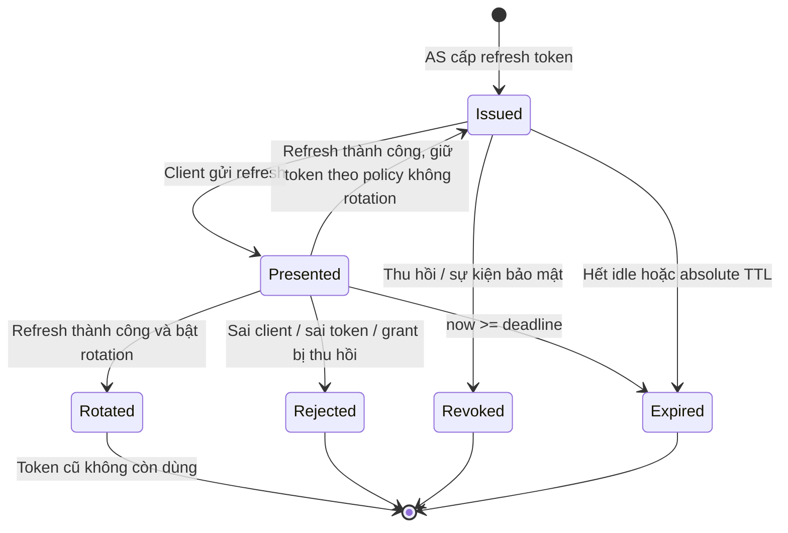

# Refresh token expiry: thời hạn hiệu lực của refresh token

Access token của một ứng dụng có thể chỉ sống 5–15 phút, nhưng người dùng vẫn mong muốn tiếp tục sử dụng ứng dụng trong nhiều ngày mà không phải đăng nhập lại sau mỗi lần access token hết hạn. **Refresh token** giải quyết nhu cầu này: client gửi refresh token đến **authorization server (AS)** để xin access token mới trong phạm vi ủy quyền cho phép. Vì refresh token thường tồn tại lâu hơn access token, việc giới hạn **khi nào refresh token hết hạn** là một quyết định bảo mật quan trọng.

Giả sử refresh token bị đánh cắp vào ngày đầu tiên người dùng đăng nhập. Nếu token không có giới hạn thời gian, không bị thu hồi và không được ràng buộc với client, kẻ tấn công có thể tiếp tục xin access token mới rất lâu. Ngược lại, nếu thời hạn refresh token quá ngắn hoặc chính sách hết hạn thiếu nhất quán, người dùng có thể liên tục bị yêu cầu đăng nhập lại, ngay cả khi họ đang sử dụng ứng dụng bình thường.

Bài học thuộc chương **Refresh token** của module **SECURITY_TOKEN_SECURITY_FUNDAMENTALS**. Trọng tâm là cách thiết kế và kiểm tra **refresh token expiry**, phân biệt với vòng đời của access token, JWT và opaque token; xử lý absolute expiry, inactivity expiry, refresh token rotation, thu hồi, giới hạn scope/audience, OAuth 2.0/OpenID Connect (OIDC) và phòng chống token bị đánh cắp hoặc phát lại.

**Nguyên tắc cốt lõi:** refresh token không phải quyền truy cập vĩnh viễn. AS phải kiểm tra chính sách hiệu lực của refresh token **tại mỗi lần refresh**, kể cả khi token chưa bị dùng lại, có chữ ký hợp lệ hoặc client vẫn đang giữ một phiên ứng dụng.

## 1. Refresh token expiry là gì?

**Refresh token expiry** là thời điểm hoặc điều kiện sau đó AS **không còn chấp nhận** refresh token để đổi lấy access token mới. Các điều kiện có thể gồm:

- **Hết hạn tuyệt đối (absolute expiry):** đã vượt qua mốc thời gian cuối cùng được phép refresh.
- **Hết hạn do không hoạt động (inactivity/idle expiry):** không có lần sử dụng refresh token hợp lệ nào trong khoảng thời gian quy định.
- **Hết hiệu lực grant hoặc chính sách:** người dùng thu hồi consent, phiên/thiết bị bị thu hồi, client bị vô hiệu, quyền không còn hoặc tổ chức yêu cầu xác thực lại.
- **Token đã bị thay thế:** trong cơ chế **refresh token rotation**, refresh token cũ không còn được dùng sau lần đổi thành công.
- **Bằng chứng client không phù hợp:** token được cấp cho một client nhưng bị trình bởi client khác hoặc không có sender proof được yêu cầu.

Điểm quan trọng: **expiry, revocation và rotation là các cơ chế khác nhau**. Một token có thể bị thu hồi hoặc bị dùng rồi ngay cả khi chưa tới mốc `expires_at`.

### 1.1. Phân biệt access token và refresh token

| Khía cạnh | Access token | Refresh token |
| --- | --- | --- |
| Vai trò | Chứng minh quyền truy cập resource server (RS) theo audience/scope | Là credential để client xin token mới từ AS |
| Bên nhận | Resource server/API đúng audience | Authorization server, thông thường tại token endpoint |
| Thời hạn | Thường tương đối ngắn | Có thể dài hơn, do AS quyết định và giới hạn |
| Dùng lặp | Bearer access token thường dùng cho nhiều API request tới lúc hết hạn | Tùy thiết kế; với rotation, mỗi refresh token chỉ đổi thành công một lần |
| Định dạng | JWT hoặc opaque | Thường opaque; cũng có thể là cấu trúc khác theo AS |
| Thu hồi | JWT offline có thể cần cơ chế bổ sung; opaque có thể introspect | AS thường có trạng thái/grant để từ chối các lần refresh tiếp theo |
| Rủi ro bị lộ | Truy cập API bằng quyền có trong token | Có thể xin thêm access token liên tục trong cửa sổ refresh còn hiệu lực |

**Không gửi refresh token tới resource server**, không nhét refresh token vào header `Authorization: Bearer` khi gọi API nghiệp vụ. Refresh token có mục đích và bên nhận riêng. Việc một JWT có chữ ký hợp lệ hoặc chứa `sub`/`scope` không làm nó trở thành loại token khác.

### 1.2. OAuth 2.0 có bắt buộc phát refresh token không?

**Không.** Theo OAuth 2.0, việc AS phát refresh token tùy grant, loại client và chính sách. AS cũng có quyền xác định vòng đời và điều kiện chấp nhận refresh token. Không có một TTL phổ quát của OAuth 2.0 như «mọi refresh token sống 30 ngày».

Đặc biệt, **`expires_in` trong token response thường mô tả thời gian sống của access token**, không nên tự hiểu là thời hạn refresh token. Nếu AS công bố thời hạn refresh token qua trường bổ sung, tên trường, đơn vị và ngữ nghĩa phải được định nghĩa trong **hợp đồng cụ thể** với AS.

## 2. Ba mô hình thời hạn cần phân biệt

### 2.1. Absolute expiry: hạn cuối cố định

Khi một authorization grant hoặc token family được tạo lúc `T0` với tuổi thọ tối đa `30 ngày`:

```text
absolute_expires_at = family_created_at + max_absolute_lifetime
```

Ví dụ:

```text
T0:                     2026-11-23 08:00 UTC
Absolute lifetime:      30 ngày
Absolute expires_at:    2026-12-23 08:00 UTC
```

Mặc dù client có thể refresh nhiều lần, **mốc 23/12 không tự dời đi** nếu chính sách lựa chọn absolute lifetime cố định. Đến `now >= absolute_expires_at`, mọi lần refresh thuộc family/grant đó phải bị từ chối hoặc yêu cầu một luồng ủy quyền/xác thực mới theo chính sách.

Ưu điểm: giới hạn **thời gian tối đa** một grant/chuỗi refresh token tồn tại mà không có bước tái xác thực hoặc tái ủy quyền. Nhược điểm: người dùng có thể phải đăng nhập lại dù hoạt động thường xuyên.

### 2.2. Inactivity/idle expiry: hết hạn nếu quá lâu không refresh

AS ghi nhận lần **refresh thành công** cuối cùng, ví dụ `last_successful_refresh_at`. Với giới hạn không hoạt động `7 ngày`:

```text
idle_expires_at = last_successful_refresh_at + idle_timeout
```

Nếu người dùng không làm mới token trong bảy ngày, AS từ chối lần refresh tiếp theo. Nếu có lần refresh thành công trước deadline, **mốc idle có thể được dời về sau** theo chính sách.

Để tránh hoạt động giả mạo kéo dài grant, chỉ tính **sự kiện hợp lệ** được AS chấp nhận; không dời `last_successful_refresh_at` khi:

- Refresh token sai, hết hạn hoặc đã thu hồi.
- Request có client authentication/sender proof không hợp lệ.
- Bên gọi trình token cũ đã bị rotate.
- AS từ chối do grant hoặc policy không đạt.

Các hệ thống có thể định nghĩa «hoạt động» theo cách khác (ví dụ theo user session), nhưng phải viết rõ **sự kiện nào gia hạn idle timer** và bảo đảm sự kiện đó đủ tin cậy. Chỉ việc client mở ứng dụng, gửi heartbeat hoặc gọi API bằng access token **không mặc nhiên** gia hạn idle expiry của refresh token.

### 2.3. Sliding expiry: gia hạn khi có hoạt động hợp lệ

**Sliding expiration** là cách deadline có thể dịch về sau sau mỗi lần hoạt động được phép. Với refresh token, nó thường áp dụng cho **idle expiry**, không nhất thiết cho mốc absolute expiry.

Hai mô hình:

| Mô hình | Công thức khái quát | Đặc điểm |
| --- | --- | --- |
| **Sliding không có absolute cap** | `expires_at = last_use + idle_timeout` | Một client hoạt động liên tục có thể kéo dài phiên refresh rất lâu; rủi ro cao nếu token bị chiếm |
| **Sliding có absolute cap** | `effective_expiry = min(absolute_deadline, last_use + idle_timeout)` | Vừa cắt phiên không hoạt động, vừa có hạn cuối bắt buộc |

**Khuyến nghị thiết kế:** cân nhắc **idle timeout + absolute cap** cho các luồng có refresh token dài hạn. Đừng dùng sliding vô hạn chỉ vì nó tiện cho trải nghiệm người dùng; đánh giá loại client, rủi ro và yêu cầu phiên của hệ thống.

### 2.4. Thời điểm hết hạn có tính bao gồm không?

Một quy tắc rõ ràng là:

```text
token_active =
    now < absolute_expires_at
    AND now < idle_expires_at
    AND grant_not_revoked
    AND token_not_consumed_or_revoked
    AND client_and_sender_binding_valid
```

Tại **`now == expires_at`**, token **đã hết hạn**. Dùng khoảng thời gian `[issued_at, expires_at)` giúp kiểm thử ranh giới chính xác. Đồng hồ phải là đồng hồ đáng tin phía AS; không lấy `now` do client tự gửi.

## 3. Vòng đời một refresh token có thời hạn



Với rotation, AS **phát token con mới** sau lần refresh thành công. Token cũ chuyển sang trạng thái đã dùng, nhưng **family có thể tiếp tục tồn tại** đến khi đạt idle deadline, absolute deadline hoặc bị thu hồi.

Không nên nhầm:

- **Một token cụ thể hết hiệu lực do rotation:** token `R1` không còn dùng được sau khi phát `R2`.
- **Một token family hết hạn:** toàn bộ chuỗi `R0 → R1 → R2` không thể gia hạn nữa sau mốc absolute/idle expiry.
- **Grant bị thu hồi:** bất kể timestamp còn xa, AS dừng cấp token mới theo grant đó.

## 4. Ví dụ có cả absolute và idle expiry

Giả sử AS định nghĩa:

```yaml
# Cấu hình minh họa, không phải cấu hình chuẩn OAuth.
refresh_token_policy:
  max_absolute_lifetime: 30d
  inactivity_timeout: 7d
  rotation_enabled: true
  invalidate_family_on_confirmed_reuse: true
  expire_at_boundary: "now >= deadline"
```

Chuỗi sự kiện:

| Sự kiện | Mốc UTC | Absolute deadline | Idle deadline sau sự kiện |
| --- | --- | --- | --- |
| Đăng nhập, phát `R0` | 23/11/2026 08:00 | 23/12/2026 08:00 | 30/11/2026 08:00 |
| Dùng `R0` hợp lệ, nhận `R1` | 25/11/2026 08:00 | **Không đổi** | 02/12/2026 08:00 |
| Dùng `R1` hợp lệ, nhận `R2` | 01/12/2026 08:00 | **Không đổi** | 08/12/2026 08:00 |
| Không dùng `R2` cho đến 09/12 | 09/12/2026 08:00 | Chưa tới 23/12 | **Đã hết idle** |

Kết luận: tại ngày 09/12, AS phải từ chối dùng `R2` dù absolute deadline chưa tới. Nếu client refresh `R2` hợp lệ vào 07/12, idle deadline có thể được dời tiếp, nhưng vẫn không được vượt mốc 23/12 theo **chính sách absolute cap** trên.

Ví dụ khác: người dùng hoạt động hằng ngày đến ngày 23/12, nhưng lần refresh lúc đúng 08:00 UTC ngày 23/12 vẫn bị từ chối vì **absolute expiry đã đạt**. Khi này client cần bắt đầu lại luồng ủy quyền/xác thực phù hợp thay vì vòng lặp gọi token endpoint.

## 5. Rotation ảnh hưởng thế nào tới expiry?

**Refresh token rotation** là cơ chế AS phát refresh token mới khi một refresh token hợp lệ được sử dụng, đồng thời vô hiệu hóa token vừa sử dụng. Cơ chế này giúp phát hiện trường hợp **refresh token cũ bị trình lại**.

```mermaid
sequenceDiagram
    participant C as Client hợp lệ
    participant AS as Authorization Server
    participant DB as Refresh Grant Store
    actor A as Kẻ có token cũ

    C->>AS: POST /token dùng R1
    AS->>DB: Kiểm R1, client, expiry, family rồi rotate nguyên tử
    DB-->>AS: R1 consumed; R2 active
    AS-->>C: Access token mới + refresh token R2
    A->>AS: POST /token dùng lại R1
    AS->>DB: Phát hiện R1 đã consumed
    DB-->>AS: Reuse trong family
    AS-->>A: Từ chối (invalid_grant)
    Note over AS,DB: Chính sách có thể revoke active family và yêu cầu đăng nhập lại
```

### 5.1. Không được gia hạn vô hạn absolute deadline chỉ vì rotate

Một lỗi thiết kế:

```text
Đăng nhập lúc T0 -> refresh R0 hết hạn T0 + 30 ngày
Ngày 29 dùng R0 -> phát R1 hết hạn ngày 29 + 30 ngày
Ngày 58 dùng R1 -> phát R2 hết hạn ngày 58 + 30 ngày
...
```

Nếu ý định ban đầu là **grant có hạn tối đa 30 ngày**, cách cấp token con như trên đã làm mất absolute cap. Cần phân biệt:

```text
family.absolute_expires_at = fixed_at_initial_grant
R_next.effective_expires_at =
    min(family.absolute_expires_at,
        family.last_successful_refresh_at + idle_timeout)
```

Ngay cả nếu refresh token con có định dạng tự mang timestamp, AS vẫn phải bảo đảm **không token con nào vượt qua deadline của family** khi chính sách quy định family lifetime cố định.

Một sản phẩm khác có thể chủ ý cho phép renewable grant vô hạn với các điều kiện mạnh, nhưng đó là **chính sách khác**, phải được nêu rõ và đánh giá rủi ro; không vô tình đạt được bằng cách reset `expires_at` của mỗi token.

### 5.2. Reuse detection có liên quan gì tới expiry?

Nếu `R1` đã dùng để nhận `R2`, kẻ tấn công có `R1` vẫn có thể gửi nó. AS phát hiện token **đã tiêu thụ**, không phải chỉ «hết hạn».

Phải phân biệt ba kết quả:

| Trạng thái trình lên | Ý nghĩa | Xử lý |
| --- | --- | --- |
| **Active nhưng đã tới deadline** | Hết hạn theo thời gian | Từ chối refresh, yêu cầu grant mới khi cần |
| **Consumed vì đã rotate** | Có trình lại refresh token cũ | Từ chối; xem xét revoke family theo chính sách reuse |
| **Revoked do sự kiện bảo mật** | Grant/token bị quản trị hoặc phát hiện tấn công vô hiệu | Từ chối; không cấp access token mới |

Một token **đã hết hạn nhưng chưa từng được dùng** không tự chứng minh đã có tấn công replay. Ngược lại, token **đã consumed** xuất hiện trở lại cần được xử lý cẩn thận, có thể do đánh cắp hoặc client retry/concurrency; hệ thống phải có chính sách xử lý hợp lệ, không cho phép token cũ cấp thêm quyền.

### 5.3. Hai request refresh đồng thời

Nếu client phát hai refresh request song song với cùng `R1`:

1. Request A đến AS instance 1.
2. Request B đến AS instance 2 trước khi A hoàn tất.
3. Nếu cả hai đều thấy `R1 active` và cùng cấp token con, rotation **không còn đúng tính một lần**.

Giải pháp phía AS là **transaction/conditional update nguyên tử** hoặc primitive nhất quán tương đương trong store, khiến **tối đa một request** có thể tiêu thụ `R1`. Client cũng nên **single-flight refresh**: chỉ một tác vụ làm mới token cho mỗi phiên tại một thời điểm.

Nếu request thành công nhưng response chứa `R2` bị mất, client có thể retry bằng `R1` và bị phát hiện reuse. Chính sách xử lý cần cân bằng an toàn với khả năng hồi phục. Một số hệ thống cân nhắc khoảng grace hạn chế hoặc cơ chế request idempotency được bảo vệ, nhưng **không cho phép cùng token cũ tạo ra nhiều token con độc lập**; grace không được trở thành lỗ hổng replay. Trong nhiều hệ thống rủi ro cao, yêu cầu đăng nhập lại an toàn hơn tự động chấp nhận token cũ.

## 6. Expiry không giống revocation, logout hay session timeout

| Cơ chế | Kích hoạt | Điều gì mất hiệu lực? | Có cần đợi `expires_at` không? |
| --- | --- | --- | --- |
| **Absolute expiry** | Đến mốc deadline cố định | Token/family theo chính sách | Không; chính mốc deadline quyết định |
| **Idle expiry** | Không refresh hợp lệ trong thời hạn | Token/family theo chính sách | Không; deadline do hoạt động cuối tạo ra |
| **Refresh token rotation** | Một token được đổi thành công | Token cũ vừa dùng | Không |
| **Revocation** | Người dùng, AS, admin hoặc sự kiện bảo mật thu hồi | Token hoặc cả grant/family theo chính sách | Không |
| **Client disable** | Client bị vô hiệu | Quyền refresh theo client/grant | Không |
| **OIDC session logout** | Đăng xuất phiên tại OP/RP | Session liên quan, tùy triển khai và chính sách | Không tự bảo đảm refresh token bị thu hồi |
| **Access token expiry** | Access token đạt `exp` | Khả năng gọi RS bằng token đó | Không tự làm refresh token hết hạn |

Khi người dùng đổi mật khẩu, khóa tài khoản, rút consent hoặc báo mất thiết bị, AS có thể cần thu hồi refresh token ngay theo chính sách. **Chỉ chờ idle/absolute expiry có thể để lại cửa sổ rủi ro dài**.

Ngược lại, thu hồi refresh token **không tự làm mọi JWT access token đã phát hành bị RS từ chối ngay**, nếu RS xác minh offline và không có denylist/introspection/kiểm tra trạng thái. Thiết kế logout và thu hồi cần xét **cả access token lẫn refresh token**.

### 6.1. OAuth token revocation và introspection

**RFC 7009** định nghĩa token revocation endpoint. Khi được hỗ trợ, client có thể yêu cầu AS thu hồi refresh token hoặc access token theo quy tắc và chính sách. AS quyết định phạm vi ảnh hưởng, ví dụ các token khác thuộc cùng grant.

**RFC 7662** quy định token introspection: RS có thể hỏi AS về trạng thái access token, nhất là opaque token. Kết quả `active=false` thường được dùng để từ chối token. **Refresh token vẫn chỉ được dùng tại AS**, không trở thành bearer credential gọi API vì endpoint introspection tồn tại.

Nếu AS hoặc RS cache trạng thái, cần có TTL/invalidation phù hợp để yêu cầu thu hồi được phản ánh trong khoảng thời gian bảo đảm đã thống nhất.

## 7. Thiết kế token và trạng thái expiry phía AS

### 7.1. Opaque refresh token thường đơn giản hơn

Một lựa chọn phổ biến là phát **opaque refresh token ngẫu nhiên, khó đoán**, ví dụ 32 byte từ CSPRNG, mã hóa Base64URL để truyền. AS lưu **digest** của token và metadata; không cần công bố nội dung grant cho client.

```java
import java.security.SecureRandom;
import java.util.Base64;

public final class RefreshSecrets {
    private static final SecureRandom RNG = new SecureRandom();

    public static String newRefreshToken() {
        byte[] random = new byte[32]; // 256 bit entropy
        RNG.nextBytes(random);
        return Base64.getUrlEncoder()
                .withoutPadding()
                .encodeToString(random);
    }
}
```

Trong kho trạng thái, có thể dùng SHA-256 digest đối với **token thật sự ngẫu nhiên có entropy cao**, hoặc HMAC với khóa phía server theo kiến trúc bảo vệ. Không áp dụng suy luận «SHA-256 là đủ» cho OTP ngắn/dễ đoán. **Không ghi raw refresh token vào log, cache key, trace hoặc database nếu không thật sự cần thiết**.

### 7.2. Refresh token dạng JWT có an toàn hơn không?

**Không mặc định.** Một JWT có chữ ký và `exp` có thể chứng minh token chưa bị sửa, nhưng **không tự chứng minh** grant chưa bị thu hồi, token chưa bị rotate hoặc client hiện vẫn được phép refresh. Nếu muốn rotation, reuse detection, thu hồi theo thiết bị và idle expiry, AS thường vẫn phải giữ **trạng thái phía server**, kể cả khi refresh token là JWT.

Không nhầm **JWT access token** (ví dụ profile RFC 9068) với refresh token có cấu trúc JWT do AS thiết kế riêng. Resource server phải từ chối refresh token, bất kể có `iss` hoặc chữ ký hợp lệ.

### 7.3. Metadata tối thiểu cần lưu

Một thiết kế tham khảo:

```text
RefreshGrantFamily {
  family_id,
  subject_id_or_service_principal,
  client_id,
  granted_scope,
  allowed_resources,
  created_at,
  absolute_expires_at,
  last_successful_refresh_at,
  idle_timeout,
  revoked_at,
  revocation_reason,
  active_generation
}

RefreshTokenRecord {
  token_digest,
  family_id,
  generation,
  issued_at,
  consumed_at,
  revoked_at,
  sender_binding_reference
}
```

Các thông tin này không bắt buộc phải đúng tên trường như trên; đây là **mô hình trạng thái** để dễ kiểm soát token family, absolute expiry và idle expiry. Ngoài ra cần trạng thái consent, client, device/session, audit và ràng buộc khóa/chứng chỉ nếu dùng sender-constrained token.

Metadata `granted_scope` và `allowed_resources` **giới hạn** access token được phát trong những lần refresh sau. Refresh token còn hạn **không được dùng để nâng scope/audience tùy ý**.

## 8. Giao thức refresh: request, response và lỗi hết hạn

Client dùng grant type `refresh_token` tại token endpoint:

```http
POST /oauth2/token HTTP/1.1
Host: auth.example.test
Content-Type: application/x-www-form-urlencoded

grant_type=refresh_token&refresh_token=<secret>&scope=orders%3Aread
```

Request trên là ví dụ rút gọn. Trong thực tế cần dùng **HTTPS**, xác thực confidential client khi áp dụng, hoặc sender binding theo profile; không dùng placeholder như credential thực và không gửi token vào URL.

AS kiểm tra:

1. Token tồn tại và thuộc AS, không bị sửa/giả mạo.
2. **Client binding**: token được cấp cho client đang thực hiện request; client authentication hoặc bằng chứng tương ứng hợp lệ.
3. **Grant/family** còn hoạt động; chưa bị revocation hoặc reuse policy vô hiệu.
4. `now < absolute_expires_at` và `now < idle_expires_at`; nếu đang dùng rotation, token trình lên đúng **generation đang hoạt động**.
5. Scope yêu cầu **không vượt phạm vi grant ban đầu**; resource/audience được phép.
6. Áp dụng chính sách rủi ro, trạng thái chủ thể, thiết bị hoặc yêu cầu xác thực lại.
7. Nếu chấp nhận, cấp access token và, khi rotation bật, cấp refresh token mới; cập nhật trạng thái **nguyên tử**.

Phản hồi thành công tham khảo:

```json
{
  "access_token": "<new-access-token>",
  "token_type": "Bearer",
  "expires_in": 600,
  "scope": "orders:read",
  "refresh_token": "<rotated-refresh-token>"
}
```

**`expires_in: 600` ở đây là thời hạn access token: 600 giây**, không phải refresh token. Nếu AS trả thêm trường như `refresh_token_expires_in`, đó phải là thuộc tính được **profile/nhà cung cấp định nghĩa**; không suy diễn mọi OAuth server đều trả hoặc dùng chung cách tính.

Nếu refresh token hết hạn, bị thu hồi, không thuộc client hoặc không hợp lệ, token endpoint thường trả lỗi OAuth **`invalid_grant`** trong các trường hợp tương ứng, chẳng hạn:

```http
HTTP/1.1 400 Bad Request
Content-Type: application/json
Cache-Control: no-store
Pragma: no-cache

{"error":"invalid_grant"}
```

Không cần tiết lộ quá chi tiết ra bên gọi rằng token thuộc user nào hoặc vì sao đã bị vô hiệu; phía AS có thể ghi audit lý do cụ thể. Nếu lỗi là xác thực confidential client sai, cần dùng cơ chế/error phù hợp như **`invalid_client`**, không gộp mọi lỗi bảo mật thành `invalid_grant`.

### 8.1. Client nên làm gì khi refresh token expired?

- **Không retry vô hạn** cùng refresh token; điều đó không kéo dài expiry và có thể kích hoạt reuse detection/rate limit.
- Nếu AS trả `invalid_grant`, client nên coi refresh credential hiện tại **không còn khả dụng**, xóa/tránh dùng lại giá trị đã lưu theo chính sách và bắt đầu luồng authorization/login mới khi cần.
- Nếu là lỗi mạng hoặc `5xx`, không tự kết luận token đã hết hạn. Xử lý retry có giới hạn, kiểm soát race/lost response, cân nhắc rotation đã có thể thành công ở AS dù client chưa nhận response.
- Với nhiều tab hoặc worker trong cùng ứng dụng, dùng **single-flight refresh** và cập nhật token mới một cách nhất quán.
- Bảo đảm màn hình đăng nhập lại không tạo vòng lặp redirect hoặc tự lặp token refresh.

## 9. Lưu trữ expiry và rotation an toàn trong database

Ví dụ schema PostgreSQL minh họa:

```sql
CREATE TABLE refresh_families (
    family_id            UUID PRIMARY KEY,
    client_id            VARCHAR(128) NOT NULL,
    subject_id           VARCHAR(128) NOT NULL,
    created_at           TIMESTAMPTZ NOT NULL,
    absolute_expires_at  TIMESTAMPTZ NOT NULL,
    last_refresh_at      TIMESTAMPTZ NOT NULL,
    idle_timeout_secs    BIGINT NOT NULL,
    active_generation    BIGINT NOT NULL,
    revoked_at           TIMESTAMPTZ NULL
);

CREATE TABLE refresh_tokens (
    token_digest         BYTEA PRIMARY KEY,
    family_id            UUID NOT NULL REFERENCES refresh_families(family_id),
    generation           BIGINT NOT NULL,
    issued_at            TIMESTAMPTZ NOT NULL,
    consumed_at          TIMESTAMPTZ NULL,
    revoked_at           TIMESTAMPTZ NULL,
    UNIQUE (family_id, generation)
);
```

Schema được giản lược để tập trung vào **expiry và rotation**: hệ thống thực cần quản lý grant/scope, resource, sender binding, consent, audit và lifecycle/retention. Không nên lưu raw refresh token. Lưu timestamp dưới dạng **UTC instant** với kiểu dữ liệu timezone-aware; thời hạn tuyệt đối và idle phải được tính bởi AS hoặc database tin cậy, không phụ thuộc đồng hồ client.

### 9.1. Quy trình transaction nguyên tử

Một cách đơn giản khi dùng cùng database:

```sql
BEGIN;

-- Lấy family và khóa row, bảo đảm các refresh cùng family được xử lý tuần tự.
SELECT *
FROM refresh_families
WHERE family_id = :family_id
FOR UPDATE;

-- Đọc token theo digest và đối chiếu generation/consumed/revoked.
-- Kiểm tra client binding, grant, now < absolute_expires_at,
-- now < last_refresh_at + idle_timeout_secs,
-- và không có dấu hiệu reuse.

UPDATE refresh_tokens
SET consumed_at = CURRENT_TIMESTAMP
WHERE token_digest = :current_digest
  AND family_id = :family_id
  AND generation = :active_generation
  AND consumed_at IS NULL
  AND revoked_at IS NULL
RETURNING token_digest;

-- CHỈ khi đúng 1 hàng: INSERT token con có digest mới.
-- UPDATE family active_generation và last_refresh_at.
-- Nếu một bước lỗi: ROLLBACK.

COMMIT;
```

**Đây là SQL/pseudocode từng bước, không phải script production chạy trực tiếp.** Trước lệnh `UPDATE` cần đánh giá điều kiện ở transaction trên dữ liệu đã khóa, và mọi bước phải được phối hợp bằng code thực tế. Nếu `UPDATE` trả **0 hàng**, không được tiếp tục cấp token.

Nếu triển khai thông qua các database/service khác nhau, một transaction SQL đơn lẻ không bao phủ tất cả bước; phải có thiết kế trạng thái/atomicity riêng, chẳng hạn một kho trạng thái nhất quán hoặc state machine bảo đảm **không có hai nhánh active**.

### 9.2. Quy tắc khó nhưng cần thiết

Ở thời điểm xử lý, AS phải dùng **thời gian hiện tại** để so với cả:

```text
absoluteDeadline = family.absolute_expires_at
idleDeadline = family.last_refresh_at + family.idle_timeout

accept_only_if now < min(absoluteDeadline, idleDeadline)
```

Lúc cập nhật, `last_refresh_at` chỉ thay đổi **sau một lần refresh thành công**. Không kéo dài deadline nếu kiểm tra không đạt. Nếu request A và B đến cùng lúc, việc khóa family/atomic compare-and-swap phải tránh cả hai cùng nhận token mới.

### 9.3. Hết hạn token nhưng bản ghi vẫn còn trong database?

Hoàn toàn có thể. Một bản ghi hết hạn **không bắt buộc bị xóa ngay**. AS phải từ chối theo timestamp trước, còn cleanup là công việc riêng:

- Dọn dữ liệu cũ theo chính sách retention.
- Giữ metadata tối thiểu phục vụ phát hiện reuse và kiểm toán trong thời gian hợp lý.
- Không để bản ghi hết hạn vẫn được chấp nhận chỉ vì job cleanup chưa chạy.
- Không xóa quá sớm dấu vết family đã rotate nếu việc xóa làm mất khả năng nhận diện replay hoặc điều tra sự cố.

Nếu dùng Redis TTL, bản ghi tự biến mất sau TTL không thay thế việc kiểm tra **absolute/idle deadline và trạng thái family**; các instance/region phải có tính nhất quán đủ mạnh cho rotation.

## 10. Ví dụ Java kiểm tra expiry và rotation

Đoạn sau là **pseudocode gần Java**, minh họa cách tách việc kiểm tra expiry, revocation, client binding và atomic update. Các interface `RefreshStore`, `RefreshFamily`, `RefreshRecord` và `TokenIssuer` không phải API có sẵn của framework.

```java
RefreshResponse refresh(
    String rawRefreshToken,
    AuthenticatedClient caller
) {
    // Không lưu hoặc log rawRefreshToken.
    byte[] digest = refreshDigester.digest(rawRefreshToken);
    Instant now = clock.instant();

    return refreshStore.inTransaction(() -> {
        // family row được lock theo protocol của store.
        RefreshRecord old = refreshStore.findAndLockByDigest(digest);
        if (old == null) {
            throw invalidGrant();
        }

        RefreshFamily family = refreshStore.lockFamily(old.familyId());
        if (family.revokedAt() != null) {
            throw invalidGrant();
        }
        if (!family.clientId().equals(caller.id())
                || !senderBinding.matches(old, caller)) {
            throw invalidGrant();
        }

        Instant absoluteDeadline = family.absoluteExpiresAt();
        Instant idleDeadline = family.lastSuccessfulRefreshAt()
                .plus(family.inactivityTimeout());

        // "now == deadline" nghĩa là đã hết hạn.
        if (!now.isBefore(absoluteDeadline)
                || !now.isBefore(idleDeadline)) {
            throw invalidGrant();
        }

        if (old.consumedAt() != null
                || old.revokedAt() != null
                || old.generation() != family.activeGeneration()) {
            // Có thể cần đánh giá reuse và revoke family theo chính sách.
            refreshStore.recordSuspectedReuse(family.id(), old.id());
            throw invalidGrant();
        }

        // Check grant, client, scope, audience, account status, risk policy.
        AuthorizationGrant grant = grantPolicy.checkCurrentGrant(
                family, caller
        );

        // Phải đảm bảo thao tác consume chỉ thắng một lần.
        boolean consumed = refreshStore.markConsumedIfActive(
                old.id(), now, family.activeGeneration()
        );
        if (!consumed) {
            throw invalidGrant();
        }

        String nextSecret = secureRandomTokens.newOpaqueToken();
        refreshStore.insertNewToken(
                family.id(),
                family.activeGeneration() + 1,
                refreshDigester.digest(nextSecret),
                now
        );
        refreshStore.advanceGenerationAndLastRefresh(
                family.id(), family.activeGeneration() + 1, now
        );

        // Token mới không kéo dài absolute deadline của family.
        AccessToken access = tokenIssuer.issueAccessToken(
                grant.allowedScope(), grant.audience(), now
        );
        return new RefreshResponse(access, nextSecret);
    });
}
```

**Điều kiện tích hợp quan trọng:**

1. Nếu phát token hoặc ký token thành công nhưng **transaction rollback**, access token chưa được giao ra cho client và hệ thống phải tránh lộ/tiếp tục sử dụng output đó. Cần thiết kế ranh giới commit và phản hồi an toàn.
2. Cách **recordSuspectedReuse** trong transaction bị rollback có thể làm mất audit nếu chỉ ghi trong transaction đó; triển khai thực tế phải lưu event theo cơ chế không bị mất, đồng thời tránh cho attacker vô hiệu hóa tùy ý nhiều family.
3. Giới hạn thời gian được tính theo **database/server clock nhất quán**. Nếu xử lý kéo dài, có thể cần đọc lại thời gian ngay trước commit và áp dụng quy tắc deadline rõ ràng.
4. Không cấp scope/audience mới rộng hơn grant; `grantPolicy.checkCurrentGrant` phải xét quyền hiện hành, client và resource.
5. **Từ chối token sau expiry** là quyết định bảo mật; thông báo lỗi public không cần phân biệt chi tiết token hết hạn, sai hoặc thuộc người khác.

Ví dụ hướng dẫn cho một AS có rotation, không có mục đích thay thế framework OAuth đã được kiểm thử.

## 11. Chính sách expiry phụ thuộc vào loại client

Không có một thời hạn phù hợp cho mọi ứng dụng. Các yếu tố nên cân nhắc gồm: khả năng bảo vệ credential, rủi ro nghiệp vụ, thiết bị lưu token, offline use, phạm vi scope và khả năng phát hiện token bị lộ.

| Loại client | Ngữ cảnh | Chính sách cần xem xét |
| --- | --- | --- |
| **Confidential backend/web BFF** | Giữ credential phía server có kiểm soát, dùng cookie session an toàn tới browser | Absolute/idle TTL theo mức rủi ro; ràng buộc client, mã hóa dữ liệu lưu, rotation/revocation |
| **SPA/public browser client** | Không giữ an toàn `client_secret` trong JavaScript; XSS có thể làm lộ token | Chỉ phát refresh token nếu chính sách AS cho phép và có bảo vệ phù hợp (rotation hoặc sender constraint theo OAuth BCP); TTL hạn chế và phòng chống XSS |
| **Native mobile client** | Có secure storage của OS nhưng có thể bị malware/rooted device | Rotation/sender binding nếu hỗ trợ, lưu trong Keychain/Keystore, hạn theo thiết bị và khả năng thu hồi từng thiết bị |
| **CLI/desktop client** | Có thể sử dụng không thường xuyên và cần đăng nhập thiết bị | Idle TTL hợp lý, storage của OS, khả năng logout/revoke token trên máy cũ |
| **Machine-to-machine** | Thường dùng `client_credentials` và không có người dùng đăng nhập | Không mặc định cần refresh token; nhiều AS chỉ cấp access token khi client xác thực lại |
| **Ứng dụng tài chính/quản trị** | Quyền nhạy cảm, rủi ro nếu credential bị chiếm | TTL ngắn hơn, absolute cap rõ, step-up theo giao dịch, thu hồi nhanh, thiết bị và assurance được kiểm tra |

Đây là nguyên tắc lựa chọn **không phải các con số TTL tiêu chuẩn**. Một hệ thống có thể chọn idle 7 ngày/absolute 30 ngày, nơi khác chọn khác, miễn phù hợp threat model và chính sách được kiểm thử.

### 11.1. OAuth security BCP và public client

Khuyến nghị bảo mật OAuth hiện đại (RFC 9700) chú trọng chống sử dụng refresh token bị đánh cắp. Đối với **public clients**, AS cần sử dụng **refresh token rotation** hoặc **sender-constrained refresh token** để phát hiện/hạn chế phát lại theo yêu cầu của profile/chính sách áp dụng.

Hết hạn refresh token do không hoạt động cũng là một biện pháp quan trọng giúp giới hạn credential không còn sử dụng. Tuy nhiên, **expiry không tự chứng minh token thuộc đúng client** và **rotation không tự chống được kẻ tấn công dùng token đánh cắp trước client**. Cần kết hợp ràng buộc client/thiết bị, phạm vi grant, phát hiện rủi ro và thu hồi.

### 11.2. Lưu refresh token ở đâu?

- **Server-side/BFF:** dùng kho bí mật phía server có phân quyền, mã hóa và quy trình rotation; trình duyệt nên giữ session cookie có `HttpOnly`, `Secure` và `SameSite` phù hợp thay vì expose refresh token qua JavaScript.
- **Mobile:** ưu tiên cơ chế bảo vệ của hệ điều hành như Keychain/Keystore; không lưu raw token vào log, clipboard hoặc file cấu hình không bảo vệ.
- **SPA:** tránh tưởng tượng rằng `localStorage` là kho bí mật an toàn trước XSS. Nếu buộc giữ token trong browser, cần threat model, hardening, hạn chế scope và cơ chế bảo vệ theo khả năng của AS.
- **Mọi client:** bảo vệ token khi truyền (HTTPS), tránh đưa refresh token vào query string, URL lịch sử, analytics hoặc các công cụ crash reporting.

Không có storage nào loại bỏ được mọi rủi ro. **Expiry** là lớp hạn chế hậu quả khi token bị lộ, không thay cho phòng ngừa rò rỉ.

## 12. OIDC, `offline_access` và SSO session khác refresh expiry

Trong OIDC, client có thể yêu cầu scope `offline_access` để xin quyền sử dụng token trong lúc người dùng không hiện diện, tùy điều kiện consent, grant và chính sách OP/AS. **`offline_access` không bảo đảm chắc chắn AS sẽ cấp refresh token**, cũng không đặt ra một TTL mặc định.

Phải tách:

| Thời hạn | Đơn vị được quản lý bởi | Ý nghĩa |
| --- | --- | --- |
| **AS/OP login session** | Identity provider | Người dùng còn phiên SSO để thực hiện authorization flow hay không |
| **RP/application session** | Ứng dụng client | Cookie/phiên của ứng dụng còn chấp nhận request hay không |
| **Access token lifetime** | AS; RS xác minh | Access token hiện tại có còn dùng được tại API hay không |
| **Refresh token lifetime** | AS | Client còn được đổi refresh token lấy token mới hay không |
| **Authentication freshness** (`auth_time`) | OP theo OIDC | Người dùng đã thực sự xác thực từ bao lâu; phục vụ `max_age`/step-up |

Một refresh token có thể còn hạn khi phiên SSO đã hết, tùy AS policy. Một phiên SSO có thể còn hạn khi refresh token đã hết hoặc bị thu hồi. Một access token mới được phát từ refresh token **không nhất thiết chứng minh người dùng vừa xác thực lại**: `iat` của access token mới và `auth_time` của sự kiện đăng nhập là hai mốc khác nhau.

Đối với thao tác nhạy cảm, AS/RP có thể yêu cầu step-up authentication, `max_age` hoặc ACR phù hợp, **không coi một lần refresh thành công là tương đương MFA mới**.

## 13. Sai lầm phổ biến khi thiết kế refresh expiry

| Anti-pattern | Rủi ro | Biện pháp |
| --- | --- | --- |
| Refresh token không có TTL và không có idle policy | Token lộ có thể bị dùng kéo dài | Có thời hạn rõ, thu hồi và ràng buộc client |
| Cứ rotate là đặt lại absolute `expires_at=now+30d` | Grant tồn tại mãi dù thiết kế muốn hạn tối đa | Lưu deadline trên family/grant và giữ cố định |
| Chỉ kiểm `exp` của JWT refresh token | Không biết token đã rotate/revoked hoặc grant đổi | Kiểm tra trạng thái AS, family, client và policy |
| Chỉ kiểm access token `exp` để quyết định refresh token | Nhầm hai vòng đời | AS kiểm expiry riêng của refresh credential |
| Hiểu `expires_in` của token response là refresh TTL | Client dự đoán sai hạn, logout/refresh bất thường | Phân biệt access TTL và metadata refresh do AS quy định |
| Gia hạn idle deadline khi request refresh thất bại | Attacker có thể nuôi sống credential bằng request giả | Chỉ dời idle sau refresh được chấp nhận |
| Hai refresh cùng token cùng được chấp nhận | Token family phân nhánh, mất replay detection | Atomic consume/rotation, locking hoặc CAS nhất quán |
| Retry tự động bằng token cũ sau khi rotate | Kích hoạt reuse, revoke family, trải nghiệm lỗi | Single-flight client, phân loại timeout và xử lý lost response |
| Coi expired token là bằng chứng attacker đã replay | False positive và tự động khóa phiên không cần thiết | Tách expired, consumed, revoked và audit |
| Cho phép reuse grace quá rộng | Token đã bị đánh cắp vẫn có thể sinh thêm quyền | Giới hạn chặt hoặc không grace; thiết kế recovery riêng |
| Không bind token với client | Token của client A dùng ở client B | Kiểm tra client authentication/ID và sender binding |
| Refresh token được chuyển cho RS | Lộ credential dài hạn cho nhiều service | Chỉ gửi refresh token đến AS token endpoint |
| Coi access token JWT tự hết hạn nghĩa là refresh cũng hết | Client vẫn có thể xin thêm token | Chính sách riêng cho refresh grant |
| Logout RP nhưng refresh grant vẫn còn và bị lộ | Session có thể được khôi phục trái ý | Xác định rõ revocation khi logout và khả năng thu hồi trên AS |
| Client lưu raw refresh token trong log | Bên đọc log có credential dài hạn | Redaction, digest/HMAC lưu trạng thái, phân quyền logs |
| AS cache `grant_active=true` quá lâu | Token bị revoke hoặc hết deadline vẫn được dùng | Kiểm tra thời điểm/thu hồi mới, TTL và invalidation phù hợp |

## 14. Kiểm thử ranh giới thời gian và race condition

Đối với expiry, hãy dùng đồng hồ giả lập/inject được và xác định rõ điểm biên `now == expires_at`. Với rotation, phải thử nhiều request đồng thời qua nhiều node AS; unit test tuần tự không chứng minh tính nguyên tử.

| Trường hợp | Dữ liệu/điều kiện | Kết quả mong đợi |
| --- | --- | --- |
| Trước absolute deadline | `now=deadline-1s`, idle còn hạn | Có thể refresh nếu các điều kiện khác đạt |
| Đúng absolute deadline | `now=deadline` | Từ chối |
| Sau absolute deadline | `now=deadline+1s` | Từ chối |
| Idle deadline đến trước absolute | `now>=last_refresh+idle_timeout` | Từ chối dù absolute còn xa |
| Refresh trước idle deadline | Token active, client hợp lệ | Thành công; dời idle theo policy |
| Token đã rotate | Trình `R1` sau khi nhận `R2` | Từ chối token cũ; xử lý reuse theo policy |
| Hai refresh đồng thời | Cùng `R1` qua hai AS instance | Tối đa một request được rotate thành công |
| Rotation sát absolute deadline | `R1` dùng ngay trước deadline | Token mới không vượt absolute cap |
| Refresh đúng lúc idle boundary | `now=idle_expires_at` | Từ chối, không gia hạn trễ |
| Client khác dùng token | `client_id`/client authentication không khớp | Từ chối |
| Sender-bound token sai thiết bị/khóa | Chứng chỉ hoặc proof không phù hợp | Từ chối |
| Grant bị revoke | Token còn hạn thời gian | Từ chối |
| Scope refresh vượt grant | Xin `orders:refund` từ grant chỉ có `orders:read` | Không cấp quyền mới |
| Resource khác | Xin token cho API không nằm trong grant/policy | Từ chối hoặc giới hạn theo contract |
| User bị khóa | Refresh còn hạn nhưng policy user inactive | Từ chối theo chính sách |
| Mất response sau commit | Client chưa nhận `R2`, thử lại `R1` | Không tạo nhánh thứ hai; recovery theo policy |
| Token expired nhưng cleanup chưa chạy | Bản ghi vẫn tồn tại | Từ chối dựa timestamp |
| Đồng hồ AS lệch | Hai node có thời gian khác nhau | Chính sách clock/transaction nhất quán, không cấp token sau deadline |
| OIDC SSO còn nhưng refresh đã hết | User có cookie OP hợp lệ | Refresh thất bại; có thể làm authorization flow mới |
| Access token đã hết nhưng refresh còn | Access `exp` quá hạn, refresh hợp lệ | AS có thể cấp access token mới |
| `expires_in` trả về 600 | Access TTL là 600 giây | Không suy ra refresh token TTL bằng 600 giây |
| Refresh token bị lộ và dùng trước client | Attacker có token active | Chính sách có các lớp bảo vệ; one-time rotation không bảo đảm ngăn lần sử dụng đầu |
| Logout/đổi mật khẩu | Revocation được yêu cầu theo policy | Family/token liên quan bị vô hiệu trong thời gian cam kết |

Ngoài unit test, cần có integration test AS–database cho **atomic refresh**, test restart/rolling deployment, failover database, event revocation và client nhiều tab; kiểm tra không log raw token. Đối với các vùng địa lý khác nhau, deadline nên dùng **UTC instant**, không dựa múi giờ local hoặc thời điểm DST.

## 15. Checklist triển khai trước production

1. **Định nghĩa rõ thời hạn:** AS có absolute TTL, idle timeout, cả hai hoặc một chính sách khác? Viết rõ điều kiện `now >= deadline`.
2. **Grant/family:** deadline tuyệt đối được lưu và giữ đúng khi rotation; token con không làm vượt absolute cap ngoài ý định?
3. **Idle activity:** chỉ hành động refresh được chấp nhận mới dời idle deadline? Có xử lý client không hoạt động lâu ngày?
4. **Validation:** token, client binding, trạng thái grant, expiry, sender proof, scope và audience đều được kiểm ở **AS**?
5. **Rotation/replay:** có atomic consume, reuse detection và chính sách revoke family khi token cũ bị trình lại? Có chống phân nhánh khi hai request đồng thời?
6. **Client reliability:** có single-flight refresh, lưu token con an toàn, xử lý timeout/lost response và `invalid_grant` mà không retry vô hạn?
7. **Định dạng:** phân biệt refresh token opaque/JWT với access token/ID token; RS không bao giờ chấp nhận refresh credential?
8. **OAuth/OIDC:** `expires_in` được hiểu đúng là access TTL; `offline_access` không được mặc định bảo đảm refresh; authentication freshness không bị nhầm với token issuance?
9. **Thu hồi:** logout, password reset, client disable, revoke consent và thiết bị mất có chính sách vô hiệu token/family phù hợp?
10. **Lưu trữ:** token ngẫu nhiên đủ mạnh, digest an toàn, không lộ raw token vào log/cache/URL; client dùng kho lưu trữ phù hợp?
11. **Clock/data:** dùng UTC instant và đồng hồ đáng tin, kiểm thử boundary, không phụ thuộc job cleanup để xác định token hết hạn?
12. **Threat model:** tuổi thọ được chọn theo độ nhạy API, loại client, rủi ro bị đánh cắp; có sender constraint, monitoring và cơ chế phản ứng sự cố khi cần?
13. **Quan sát:** có metric refresh success, expired, invalid_grant, suspected reuse, family revoke, rotation conflict và độ trễ revocation, nhưng không ghi bí mật?
14. **Kiểm thử:** đã thử tuyệt đối/idle, concurrency, rotation sát deadline, refresh sai client, grant bị thu hồi và access token còn hạn sau refresh revoke?

## Tổng kết

**Refresh token expiry** quyết định **khi nào client không còn được sử dụng refresh token để xin access token mới**. Một hệ thống thường cần phân biệt **absolute expiry** (hạn cuối của grant/token family), **idle expiry** (không có hoạt động refresh hợp lệ quá lâu), **rotation** (vô hiệu token đã dùng) và **revocation** (vô hiệu theo sự kiện/chính sách). Khi kết hợp absolute cap và idle timeout, mốc hiệu lực là giới hạn sớm hơn; các token con được rotate không được vô tình kéo dài family vượt hạn cuối.

Việc refresh thành công **không chứng minh người dùng vừa đăng nhập lại**, refresh token còn hạn **không cho phép mở rộng scope hoặc audience**, và refresh token **không được dùng gọi resource server**. Để tránh token bị đánh cắp hoặc phát lại, AS cần kiểm tra client/grant mỗi lần refresh, bảo vệ lưu trữ, áp dụng rotation nguyên tử hoặc sender constraint khi thích hợp, theo dõi reuse và có khả năng thu hồi. TTL là một giới hạn quan trọng, nhưng chỉ là **một lớp** trong mô hình tin cậy và vòng đời token an toàn.

**Tài liệu tham khảo:** RFC 6749 (OAuth 2.0 Authorization Framework, Refreshing an Access Token); RFC 9700 (Best Current Practice for OAuth 2.0 Security); RFC 7009 (OAuth 2.0 Token Revocation); RFC 7662 (OAuth 2.0 Token Introspection); RFC 7636 (Proof Key for Code Exchange); RFC 8705 (OAuth 2.0 Mutual-TLS Client Authentication and Certificate-Bound Access Tokens); RFC 9449 (DPoP); RFC 9068 (JWT Profile for OAuth 2.0 Access Tokens); OpenID Connect Core 1.0 (offline access và authentication context).
