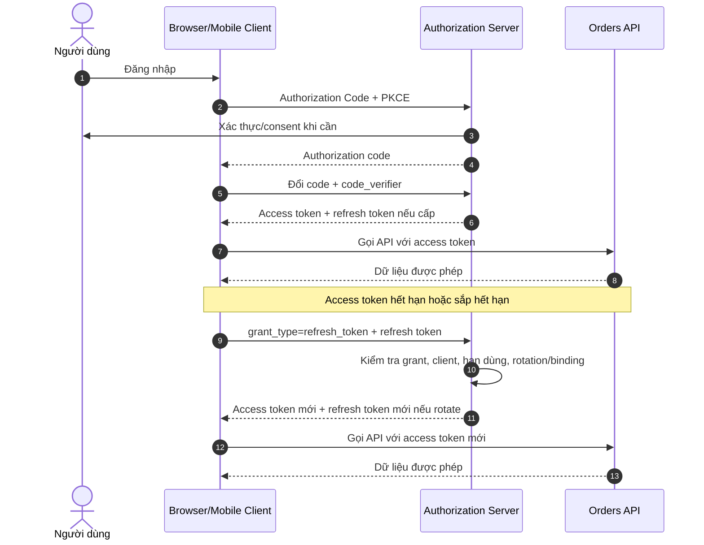
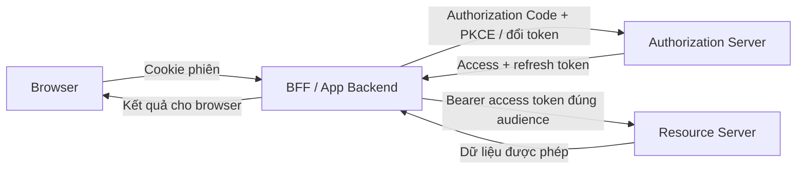
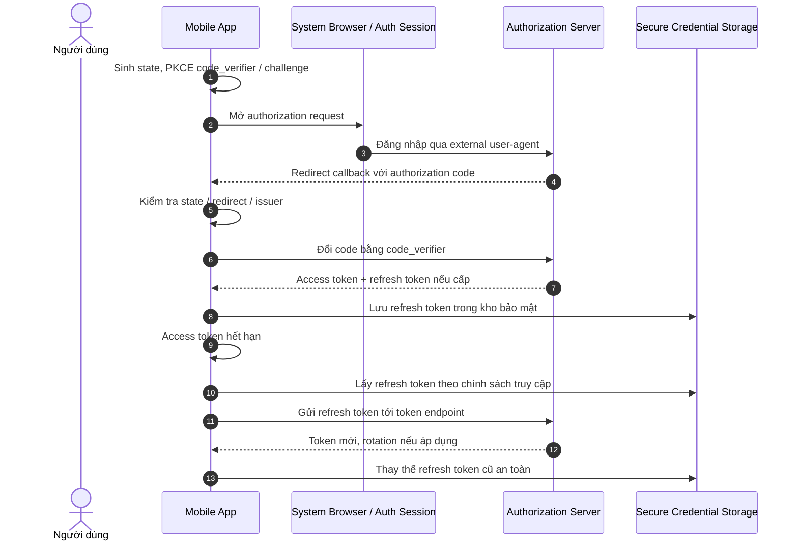
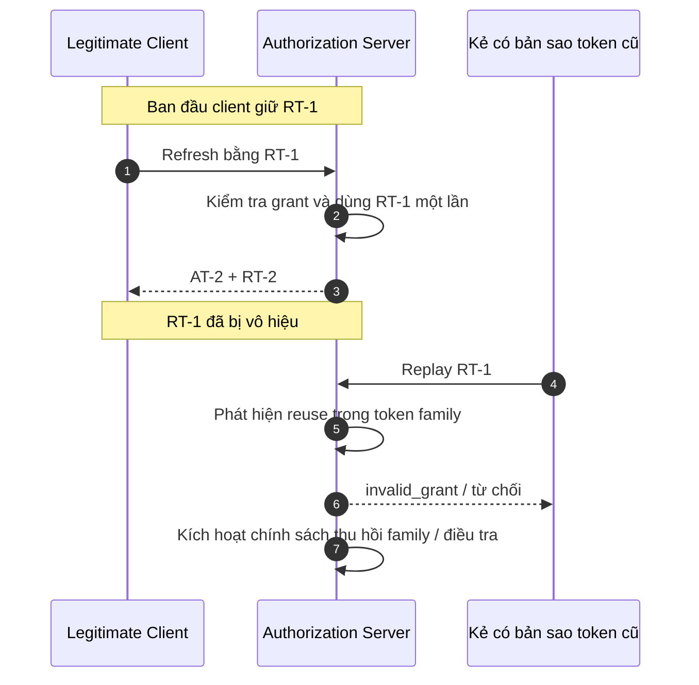
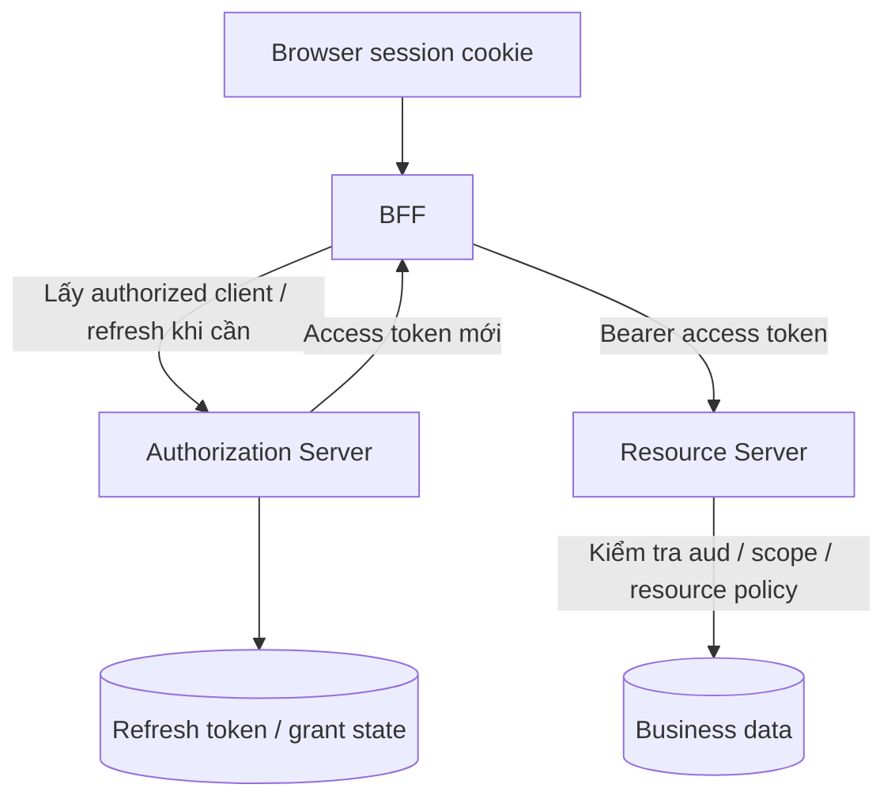

# Refresh token trong browser và mobile

Một người dùng đăng nhập vào ứng dụng quản lý đơn hàng lúc 09:00. **Access token** hết hạn sau 10 phút, nhưng người dùng vẫn có thể tiếp tục làm việc nhờ ứng dụng xin token mới. Đằng sau trải nghiệm này thường là **refresh token**: một credential có thể tồn tại lâu hơn access token và được gửi tới **authorization server**, không phải tới API nghiệp vụ.

Điều gì xảy ra nếu refresh token bị lộ qua XSS trong browser, bản sao lưu thiết bị mobile hoặc log? Kẻ tấn công có thể tìm cách cấp **nhiều access token mới**, nên hậu quả có thể kéo dài hơn việc lộ một access token ngắn hạn. Bảo vệ refresh token vì vậy cần xét **loại client, cách lưu, thời hạn, rotation, khả năng thu hồi và dấu hiệu phát lại**.

Bài thuộc chương **Refresh token** của module `SECURITY_TOKEN_SECURITY_FUNDAMENTALS`. Nội dung tập trung vào ứng dụng **browser và mobile** trong OAuth 2.0/OpenID Connect (OIDC), phân biệt JWT/opaque, access/refresh/ID token, xử lý claims–scope–audience, an toàn lưu trữ và các mẫu triển khai thực tế.

## 1. Refresh token là gì và không phải là gì?

**Refresh token** là credential do authorization server (AS) cấp cho client để xin access token mới khi cần, trong giới hạn authorization grant và chính sách của AS. AS **có thể không cấp refresh token** cho một luồng hoặc một loại client; không có quy định rằng lần đăng nhập nào cũng phải nhận được refresh token.

| Loại token | Bên nhận đúng | Công dụng | Thời hạn/đặc tính thường gặp |
|---|---|---|---|
| **Access token** | Resource server (API), đúng audience | Gọi API với scope/quyền được cấp | Thường ngắn hạn, có thể là JWT hoặc opaque |
| **Refresh token** | Authorization server, token endpoint | Xin access token mới, có thể kèm refresh token kế tiếp | Thường sống lâu hơn, có thể là opaque/reference token |
| **ID token** (OIDC) | Client/relying party | Xác nhận kết quả authentication và thông tin danh tính | Thường là JWT; **không** dùng gọi API |
| **Session cookie của BFF** | Backend ứng dụng quản lý phiên | Liên kết browser với phiên phía server | Không đồng nhất với refresh token, dù backend có thể giữ refresh token trong phiên |

Ví dụ resource server `orders-api` có audience `orders-api` và yêu cầu scope `orders.read`. Client **không gửi refresh token** vào `Authorization: Bearer` để gọi `orders-api`. Nó phải dùng refresh token tại **token endpoint của AS**, nhận **access token mới dành cho API**, rồi gọi API bằng access token.

Một refresh token có thể được biểu diễn bằng chuỗi opaque hoặc một định dạng được bảo vệ khác theo AS. **Định dạng không quyết định mục đích**: refresh token trông giống JWT vẫn không được dùng làm ID token hoặc access token. Đặc biệt, client không được giải mã một token rồi tự thay `exp`/`scope` để coi đó là token mới.

## 2. Vì sao browser và mobile khó bảo vệ refresh token?

Trong mô hình OAuth 2.0, cần phân biệt **confidential client** và **public client**:

- **Confidential client:** có khả năng bảo vệ credential của chính client, ví dụ backend chạy trên server dưới quyền vận hành tổ chức.
- **Public client:** không thể giữ client secret theo cách đáng tin trước người kiểm soát thiết bị/chương trình của client. Ứng dụng SPA chạy JavaScript trong browser và mobile native app thường thuộc nhóm này.

Một client secret được nhúng trong gói APK/IPA hoặc mã JavaScript **không biến ứng dụng thành confidential client**. Nó có thể bị trích xuất. **PKCE** giúp bảo vệ authorization code trong Authorization Code flow, nhưng **không biến public client thành confidential client** và không tự chống việc refresh token đã bị đánh cắp.

| Bối cảnh | Những rủi ro nổi bật | Điểm bảo vệ chủ yếu |
|---|---|---|
| **Browser SPA thuần JavaScript** | XSS, dependency/supply-chain, tiện ích độc hại, storage có thể đọc bằng JS, nhiều tab cạnh tranh refresh | Tránh lưu lâu dài khi có thể, rotation/sender constraint, CSP, chống XSS, quản lý đồng thời |
| **Browser với BFF** | Session hijacking, CSRF, lỗi backend, log hoặc kho lưu refresh token phía server | Cookie phiên an toàn, CSRF defense, token chỉ ở backend, session management |
| **Mobile native** | Thiết bị bị xâm nhập/root/jailbreak, backup/restore, trích xuất storage, deep-link hijacking, race khi refresh nền | Authorization Code + PKCE qua system browser, Keychain/Keystore, liên kết phiên, rotation và thu hồi |
| **Mọi client** | Token endpoint bị lạm dụng, cấp token quá rộng, refresh token bị replay | Scope/audience tối thiểu, TTL, client/grant binding, rotation hoặc sender constraint |

Không có một cách lưu duy nhất tốt nhất cho **mọi** ứng dụng. Phải xét ai kiểm soát môi trường thực thi, có backend tin cậy hay không, cần offline đến mức nào và mức độ nhạy cảm của API.

## 3. Vòng đời access token và refresh token



Đây là luồng tổng quát: với **BFF**, những thao tác token endpoint và cất giữ refresh token diễn ra tại **backend**, không phải browser JavaScript. Với **public SPA/native client**, token endpoint có thể được gọi từ môi trường client khi AS và chính sách cho phép.

Những tính chất quan trọng:

1. **Access token hết hạn không có nghĩa refresh token cũng hết hạn.** Mỗi token có vòng đời riêng.
2. **Refresh token còn hạn không bảo đảm được cấp access token mới.** Grant, tài khoản, client, phiên hoặc chính sách có thể đã bị thu hồi.
3. **Refresh token không phải phiên đăng nhập bất biến.** Việc xác thực lại có thể cần thiết theo mức độ rủi ro, thời gian, chính sách AS hoặc yêu cầu assurance.
4. **Refresh không tự mở rộng quyền.** Token mới phải bị giới hạn bởi grant và chính sách AS; client không được dùng refresh để lấy scope vượt phạm vi đã được cấp.
5. **Access token mới vẫn phải được API xác minh riêng** về issuer, audience, thời hạn, loại token, scope và quyền trên tài nguyên.

## 4. Browser: ưu tiên mô hình BFF khi phù hợp

**Backend-for-Frontend (BFF)** là mô hình có backend ứng dụng đứng giữa browser và API. Browser giữ **cookie phiên ứng dụng**, còn backend lưu access token và refresh token trong môi trường server.



**Ưu điểm nổi bật:** JavaScript trong browser không cần trực tiếp đọc access token hoặc refresh token. Một XSS không thể đơn giản lấy refresh token từ `localStorage` nếu token chưa bao giờ được đưa tới đó.

**Giới hạn cần nhớ:** XSS vẫn có thể gửi yêu cầu qua phiên đang mở hoặc thao túng giao diện. Nếu cookie phiên bị đánh cắp, phiên cũng có thể bị chiếm. BFF làm giảm bề mặt lộ **OAuth token**, không biến browser thành môi trường không có rủi ro.

### Các quyết định bảo vệ ở BFF

- **Cookie:** `HttpOnly`, `Secure`, `SameSite` phù hợp, `Path` và `Domain` được giới hạn, sử dụng prefix `__Host-` khi điều kiện cấu hình cho phép.
- **Session fixation:** xoay session identifier khi đăng nhập/thay đổi đặc quyền; token phiên phải khó đoán.
- **CSRF:** bảo vệ thao tác thay đổi trạng thái, kiểm tra token CSRF và/hoặc `Origin`/`Referer` theo kiến trúc; không mặc định `SameSite` đủ trong mọi kịch bản.
- **CORS:** không mở `Access-Control-Allow-Credentials` cho origin tùy ý; cookie được trình tự động nên cần xét ranh giới same-site/cross-site.
- **Token server-side:** bảo vệ refresh token bằng storage có kiểm soát truy cập, mã hóa phù hợp, tránh log, sao lưu an toàn và thời hạn lưu trữ.
- **Phân quyền:** BFF chỉ đại diện client đúng grant, còn API vẫn kiểm tra access token, audience, scope và quyền bản ghi.

Ví dụ cấu hình **cookie phiên** do backend tạo (không phải đưa refresh token trực tiếp vào cookie):

```java
// Đoạn minh họa dùng Spring Web, không phải cấu hình phiên đầy đủ.
ResponseCookie cookie = ResponseCookie.from(
        "__Host-session", opaqueSessionId)
    .httpOnly(true)
    .secure(true)
    .sameSite("Lax")
    .path("/")
    .build();

response.addHeader(HttpHeaders.SET_COOKIE, cookie.toString());
```

Chuỗi `opaqueSessionId` phải do backend sinh bằng bộ sinh số ngẫu nhiên an toàn, gắn với một phiên có thời hạn và được bảo vệ trước chiếm đoạt. Cấu hình trên chỉ minh họa thuộc tính cookie; **còn cần session store, kiểm tra CSRF, logout, chống session fixation và chính sách vô hiệu phiên**. Với prefix `__Host-`, cookie phải dùng `Secure`, `Path=/` và không đặt `Domain`.

### Không phải cookie nào cũng phù hợp cho refresh token

Một giải pháp tùy biến có thể để refresh token trong cookie `HttpOnly`, nhưng **không đồng nghĩa mô hình đó an toàn theo mặc định**. Refresh endpoint dùng cookie phải xử lý CSRF, phạm vi domain/path, chính sách SameSite, Origin, các giới hạn browser và cách ràng buộc token với client/grant. Khi refresh cookie được gửi cross-site, cơ chế cookie bên thứ ba có thể bị hạn chế bởi browser. Mô hình BFF giữ **refresh token tại server và browser chỉ có session cookie** thường giúp tách ranh giới tin cậy rõ hơn.

## 5. SPA thuần JavaScript: cân nhắc cấp refresh token hay không

SPA là **public client**. Nếu không có BFF, JavaScript trong browser có thể phải trực tiếp giữ access token và, khi AS cho phép, refresh token.

Một số lựa chọn:

| Phương án | Lợi điểm | Giới hạn |
|---|---|---|
| **Access token trong bộ nhớ, không cấp refresh token** | Không có refresh token dài hạn trong browser; giảm credential tồn tại sau reload. | Cần xin token mới hoặc tương tác lại; không đảm bảo silent authentication vì chính sách cookie/cross-site. |
| **Access token và refresh token chỉ trong bộ nhớ** | Hạn chế persistence trên disk. | XSS trong runtime vẫn có thể lấy/dùng credential; reload/tab mới làm mất trạng thái. |
| **Refresh token lưu browser persistent storage** | Dễ duy trì phiên qua reload. | `localStorage`/`sessionStorage`/IndexedDB có thể bị JavaScript trong origin truy cập khi XSS; hậu quả lộ dài hạn. |
| **BFF hoặc token-mediating backend** | Giảm token trong browser theo mô hình triển khai cụ thể. | Cần backend, phiên, CSRF/CORS và hạ tầng bổ sung. |

**Khuyến nghị theo rủi ro:** nếu ứng dụng có dữ liệu nhạy cảm và có thể triển khai backend, hãy cân nhắc BFF để không đặt refresh token dài hạn vào JavaScript. Khi SPA buộc phải dùng refresh token, phải có biện pháp **rotation hoặc sender constraint** theo thực hành bảo mật OAuth cho public client, thời hạn/thu hồi và chống XSS.

**Không coi mã hóa refresh token bằng một khóa JavaScript lưu trong cùng origin là giải pháp chắc chắn.** XSS có thể đọc khóa, token sau khi giải mã hoặc kích hoạt chính luồng refresh. Service worker có thể thay đổi bề mặt truy cập nhưng không tự biến browser thành kho bí mật tương đương server; cần phân tích threat model và lifecycle cụ thể.

### Authorization Code + PKCE cho browser

SPA nên dùng Authorization Code flow với PKCE theo tiêu chuẩn/thực hành OAuth hiện đại, không dùng implicit flow để phát access token trong fragment URL.

```text
SPA:
  - Sinh code_verifier ngẫu nhiên bằng CSPRNG.
  - Tính code_challenge (S256).
  - Khởi tạo authorization request với code_challenge,
    state và nonce khi OIDC yêu cầu.
  - Kiểm tra state/issuer và thông tin callback thích hợp.
  - Đổi authorization code + code_verifier tại token endpoint.
  - Nhận token theo chính sách AS, chỉ lưu ở vị trí đã đánh giá rủi ro.
```

**PKCE bảo vệ authorization code**, không có nghĩa mọi lần refresh gửi lại `code_verifier`. Refresh token grant là một quy trình riêng và phải có bảo vệ refresh token tương ứng.

Không phụ thuộc vào **silent login qua iframe** như một giải pháp chắc chắn: cơ chế cookie bên thứ ba và chính sách browser có thể khiến xác thực âm thầm không hoạt động. Nếu refresh hết hiệu lực, ứng dụng cần hỗ trợ reauthentication qua luồng hợp lệ.

## 6. Mobile native: sử dụng external user-agent và PKCE

Ứng dụng mobile cũng thường là **public client**. Theo OAuth 2.0 for Native Apps (RFC 8252), luồng đăng nhập nên được mở bằng **external user-agent** (ví dụ system browser/secure browser tab) thay vì một embedded webview tự kiểm soát màn hình đăng nhập. Điều này giúp tách quyền truy cập vào mật khẩu, cookie và phiên đăng nhập khỏi ứng dụng.



Các kiểu redirect URI có đặc điểm riêng:

- **Claimed HTTPS redirect URI** (Universal Links/App Links): thường giúp hệ điều hành xác minh domain liên kết ứng dụng; cần cấu hình chính xác và bảo vệ liên kết.
- **Private-use URI scheme:** có thể bị ứng dụng khác cố đăng ký cùng scheme; cần PKCE, state và kiểm tra redirect nghiêm ngặt.
- **Loopback URI:** phù hợp với một số native app trên desktop; không mặc định là lựa chọn tốt nhất cho mobile.

Luôn kiểm tra `state` để chống nhầm lẫn/CSRF ở luồng authorization, chọn redirect URI đã đăng ký đúng nguyên tắc, sử dụng PKCE S256 và xác minh OIDC ID token khi ứng dụng dùng OIDC. **Không hardcode client secret** trong app mobile để giả làm confidential client.

## 7. Lưu refresh token trên iOS và Android

### iOS: Keychain

Ứng dụng iOS nên dùng **Keychain Services** để lưu credential. Có thể chọn accessibility class tùy yêu cầu: ví dụ chỉ đọc khi thiết bị đã được mở khóa, ràng buộc token với thiết bị và hạn chế xuất qua backup khi chính sách cần.

Khung mã Swift minh họa lưu token vào Keychain:

```swift
import Foundation
import Security

func storeRefreshToken(_ token: String) -> OSStatus {
    guard let data = token.data(using: .utf8) else {
        return errSecParam
    }

    let query: [String: Any] = [
        kSecClass as String: kSecClassGenericPassword,
        kSecAttrService as String: "com.example.orders.refresh",
        kSecAttrAccount as String: "current-user",
        kSecValueData as String: data,
        kSecAttrAccessible as String:
            kSecAttrAccessibleAfterFirstUnlockThisDeviceOnly
    ]

    // Tránh tồn tại hai mục trùng khóa khi ghi lại.
    let deleteQuery: [String: Any] = [
        kSecClass as String: kSecClassGenericPassword,
        kSecAttrService as String: "com.example.orders.refresh",
        kSecAttrAccount as String: "current-user"
    ]
    SecItemDelete(deleteQuery as CFDictionary)
    return SecItemAdd(query as CFDictionary, nil)
}
```

Đây là **ví dụ tối thiểu về Keychain**, không phải triển khai rotation nguyên tử: đoạn xóa rồi thêm có khoảng trống nếu app crash và có thể làm mất token. Trong sản phẩm, nên dùng thao tác cập nhật phù hợp, có xử lý lỗi, đa tài khoản, quyền truy cập background và chính sách backup. `AfterFirstUnlockThisDeviceOnly` là một lựa chọn có đánh đổi: thuận tiện cho tác vụ nền sau lần mở khóa đầu, nhưng **không** yêu cầu thiết bị đang mở khóa ở mọi lần đọc. Với môi trường rủi ro cao, có thể chọn lớp hạn chế chặt hơn như `WhenUnlockedThisDeviceOnly` tùy UX/background và mô hình đe dọa.

### Android: Android Keystore và lưu trữ mã hóa

Trên Android, nên dùng **Android Keystore** để quản lý khóa mật mã (ưu tiên phần cứng bảo vệ khi có và phù hợp), kết hợp lưu ciphertext của refresh token trong storage riêng của ứng dụng. Không tự cho rằng mọi Keystore key đều được bảo vệ phần cứng hoặc chống được mọi thiết bị đã bị root.

```text
Tạo hoặc lấy khóa AES được quản lý bởi Android Keystore
  -> Mã hóa refresh token bằng AES-GCM với nonce/IV mới mỗi lần
  -> Lưu ciphertext + IV + metadata cần thiết trong app-private storage
  -> Giải mã chỉ khi cần gọi token endpoint
  -> Xử lý key invalidation và lỗi decrypt bằng reauthentication
```

Đây là **mẫu kiến trúc**, không phải hướng dẫn tự viết giao thức mã hóa hoặc cất khóa thủ công. Dùng API/thư viện hiện hành được hỗ trợ, kiểm tra phiên bản Android và cơ chế backup. Không dựa vào SharedPreferences **dạng plain text** để lưu refresh token.

### Cả hai nền tảng

- Không để refresh token trong log, analytics, crash reporter, clipboard, file tạm hay thông báo.
- Xét kỹ **backup/restore và chuyển thiết bị**: token hoặc khóa có thể không chuyển cùng nhau; nếu không giải mã được phải yêu cầu đăng nhập lại, không tạo bypass.
- Khi logout hoặc thu hồi tài khoản, xóa credential local **và** yêu cầu AS thu hồi theo chính sách khi có thể.
- Tách credential theo tài khoản, môi trường và authorization server; không dùng nhầm token staging/production hoặc user A/user B.
- Biometric/device authentication có thể bảo vệ thao tác đọc khóa/token trong một số trường hợp, nhưng **không thay thế OAuth grant, scope, audience hay token validation**.

## 8. Refresh token rotation và replay detection

**Refresh token rotation** là cơ chế AS phát refresh token **mới** khi refresh thành công và vô hiệu refresh token **cũ**, nhằm hạn chế giá trị của bản sao token cũ và phát hiện việc tái sử dụng.



Khi phát hiện reuse của một refresh token đã được thay thế, AS **không mặc định biết** bên nào là client hợp pháp: có thể client cũ bị lộ, kẻ tấn công có token hoặc một retry/race của ứng dụng. Chính sách có thể thu hồi toàn bộ token family và buộc đăng nhập lại để ngăn tiếp tục lạm dụng.

### Token family và một lần sử dụng

Ví dụ trạng thái phía AS:

| Token | Family | Trạng thái | Diễn giải |
|---|---|---|---|
| `RT-1` | `grant-41` | `spent` | Đã đổi lấy RT-2. |
| `RT-2` | `grant-41` | `active` | Refresh token hiện hành. |
| `RT-3` | `grant-41` | Chưa tạo | Chỉ phát hành khi RT-2 được dùng hợp lệ. |

Bản ghi phía AS có thể chứa **digest của token**, không nhất thiết lưu nguyên token. Ví dụ với reference token ngẫu nhiên entropy cao, lookup bằng HMAC/digest bảo vệ kho lưu trước việc rò rỉ credential gốc. AS cần liên kết token với client, grant, subject và chính sách; bảo vệ token endpoint, rate limit và ghi audit.

### Phát hành và thay thế phải nguyên tử

Mẫu xử lý khái niệm:

```text
refresh(request):
  xác minh client và ràng buộc refresh token theo loại client
  tìm family/grant theo digest của refresh token
  khóa trạng thái liên quan trong transaction hoặc dùng CAS tương đương
  nếu token đã spent/revoked/expired:
      đánh giá sự kiện reuse và từ chối theo chính sách
  nếu hợp lệ:
      cấp access token trong phạm vi grant hiện hành
      sinh refresh token mới an toàn
      đánh dấu token cũ spent
      lưu digest token mới, liên kết family/client và thời hạn
      commit trạng thái
      trả token mới qua TLS
```

Đoạn trên là **pseudocode**; triển khai thật phải xử lý sự kiện crash giữa cập nhật trạng thái và response, nhiều node AS, retry, replay detection, khóa đồng thời, key rotation, audit và tính nhất quán transaction. Tránh chỉ `SELECT` rồi `UPDATE` không có khóa hoặc compare-and-swap: hai yêu cầu có thể cùng dùng RT-1 trước khi trạng thái thay đổi.

**Rotation phải không mở rộng grant**: token mới không được tự có scope/audience/độ bảo đảm cao hơn chính sách cho phép. Thời hạn tuyệt đối và inactivity timeout cần được xác định để refresh không vô tình giữ một phiên sống vô hạn.

## 9. Race condition trong nhiều tab browser và nhiều tác vụ mobile

Đây là nguyên nhân thường gặp của lỗi “thỉnh thoảng bị logout dù token vẫn hợp lệ”:

1. Browser có hai tab, hoặc mobile chạy hai request mạng đồng thời.
2. Cả hai phát hiện access token sắp hết hạn và cùng lấy **RT-1**.
3. Request A refresh thành công, nhận RT-2; AS đánh dấu RT-1 đã dùng.
4. Request B gửi RT-1 chậm hơn và bị xem là **reuse**.
5. Tùy chính sách, AS có thể thu hồi cả token family; người dùng phải đăng nhập lại.

### Giải pháp ở client: single-flight refresh

- Chỉ để **một refresh request** hoạt động cho một phiên/tài khoản.
- Các request API khác **chờ cùng một kết quả refresh**, thay vì gửi nhiều refresh token grant đồng thời.
- Sau refresh thành công, cập nhật refresh token mới trước khi cho request khác tiếp tục.
- Với BFF, đồng bộ theo session ở **backend**, kể cả nhiều node xử lý (distributed lock/CAS hoặc cơ chế session store phù hợp).
- Với mobile, dùng một token manager trong ứng dụng, khóa/serial executor cho mỗi tài khoản, cả tác vụ nền và foreground đều dùng cùng một nguồn token.
- Với SPA nhiều tab, đồng bộ giữa các tab nếu refresh token dùng chung; API như Web Locks có thể hữu ích khi được browser hỗ trợ, nhưng cơ chế fallback và an toàn vẫn phải được thiết kế. BFF thường đơn giản hóa quản lý này.

Pseudocode client đơn giản cho **single-flight trong cùng một runtime**:

```javascript
let refreshInFlight = null;

async function refreshOnce() {
  if (refreshInFlight === null) {
    refreshInFlight = performAuthorizedRefresh()
      .finally(() => { refreshInFlight = null; });
  }
  return refreshInFlight;
}
```

Hàm `performAuthorizedRefresh` là thành phần **do ứng dụng triển khai an toàn**, không có trong JavaScript chuẩn. Đoạn mã chỉ minh họa đồng bộ trong **một runtime**; không tự giải quyết nhiều tab, nhiều worker, nhiều node backend hoặc crash trước khi lưu token mới. Không được coi đây là giải pháp bảo mật đầy đủ.

### Có nên cho phép token cũ được dùng lại trong “grace period”?

Một số AS cân nhắc xử lý retry gần như đồng thời để tránh false positive. Nhưng **cho phép refresh token đã bị thay thế tiếp tục cấp token mới** có thể làm giảm giá trị bảo vệ của rotation. Nếu có cơ chế overlap/idempotency, cần thiết kế chặt với client binding, thời gian rất ngắn, kết quả tái sử dụng có kiểm soát và giám sát; không tự tạo “grace period” không giới hạn. Phương án an toàn đơn giản là **client single-flight** và chấp nhận yêu cầu đăng nhập lại trong những lỗi không thể phân biệt replay.

## 10. Token endpoint khi refresh: request và response

Ví dụ **public client** gửi refresh token tại token endpoint của AS (placeholder, có thể có cơ chế ràng buộc người gửi khác tùy hồ sơ):

```http
POST /oauth2/token HTTP/1.1
Host: id.example.test
Content-Type: application/x-www-form-urlencoded

grant_type=refresh_token&refresh_token=RT_1_PLACEHOLDER&client_id=mobile-orders
```

Ví dụ **confidential BFF** sẽ xác thực client qua cơ chế AS hỗ trợ (client secret, private key JWT, mTLS...), nhưng không nhúng secret vào JavaScript/browser hoặc gói mobile. Theo RFC 6749, client phải tuân thủ yêu cầu định danh/xác thực phù hợp tại token endpoint. Token refresh grant **không dùng `code_verifier`** của authorization code exchange.

Phản hồi sau refresh rotation minh họa:

```json
{
  "access_token": "AT_2_PLACEHOLDER",
  "token_type": "Bearer",
  "expires_in": 600,
  "refresh_token": "RT_2_PLACEHOLDER",
  "scope": "orders.read"
}
```

Khi AS phát `refresh_token` mới, client phải **thay thế RT-1 bằng RT-2** một cách an toàn. Đừng tiếp tục dùng token cũ. Trong mô hình không có rotation nhưng có sender constraint hợp lệ, AS có thể không cấp refresh token mới ở mọi lần refresh, tùy hợp đồng.

Nếu refresh thất bại do token bị thu hồi/hết hạn/không hợp lệ, token endpoint có thể trả `invalid_grant`:

```http
HTTP/1.1 400 Bad Request
Content-Type: application/json

{"error":"invalid_grant"}
```

Client nên chấm dứt vòng lặp refresh, xóa hoặc vô hiệu credential local theo chính sách và yêu cầu authorization mới khi cần. **Không tự retry vô hạn** khi lỗi `invalid_grant`; tránh gửi lại token đã được AS coi là spent làm kích hoạt reuse detection.

### Đổi access token khác quyền có được không?

Khi dùng refresh grant, scope được yêu cầu nếu có **không được bao gồm quyền vượt phạm vi grant ban đầu**; AS có thể cấp phạm vi **bằng hoặc hẹp hơn** theo chính sách. Token mới cũng phải phù hợp audience/resource theo hợp đồng. Không được sửa field `scope` trong JSON phản hồi để “nâng” quyền vì resource server sẽ xác minh access token/metadata của AS.

## 11. Token bị lấy cắp: access token và refresh token khác nhau

| Credential bị lộ | Kẻ tấn công có thể thử | Điều kiện/giới hạn |
|---|---|---|
| **Access token dạng Bearer** | Gọi resource API trực tiếp. | Bị giới hạn bởi issuer, audience, scope, quyền tài nguyên, thời hạn, revocation và sender constraint nếu có. |
| **Refresh token** | Gửi tới token endpoint để xin access token mới. | Bị giới hạn bởi client/grant binding, xác thực client, expiry, rotation/reuse detection và sender constraint. |
| **ID token** | Có thể làm lộ dữ liệu danh tính; có nguy cơ nhầm loại nếu hệ thống cấu hình sai. | Không được sử dụng hợp lệ làm access token của RS. |
| **Cookie phiên BFF** | Chiếm phiên hoặc gửi hành động trong phiên nếu không được bảo vệ. | Session validation, cookie policy, CSRF, ràng buộc phiên và authorization. |

**Rotation không chứng minh token chưa bị lộ**: nếu kẻ tấn công dùng RT-1 trước client hợp pháp, họ có thể nhận RT-2. Lần client hợp pháp dùng RT-1 tiếp theo mới là một tín hiệu reuse; vì thế AS cần chính sách khóa family/grant và điều tra. Sender-constrained refresh token có thể giảm khả năng kẻ chỉ lấy được chuỗi token tự dùng nó, nhưng không cứu được môi trường mà cả token và khóa bị chiếm.

Trong một số thiết kế, **refresh token không được phát hành cho browser** là lựa chọn giảm rủi ro tốt hơn việc phát hành credential dài hạn rồi tìm cách che giấu bằng mã JavaScript. Quyết định phụ thuộc tính liên tục phiên và khả năng triển khai BFF.

## 12. Sender constraint và public client

Theo **OAuth 2.0 Security Best Current Practice (RFC 9700)**, refresh token cấp cho **public client** cần được bảo vệ bằng **refresh token rotation hoặc cơ chế ràng buộc người gửi** để phát hiện/ngăn việc dùng lại token bị lộ theo mô hình phù hợp. Với confidential client, AS xác thực client và có thể bổ sung những ràng buộc thích hợp.

Các lựa chọn ràng buộc người gửi:

- **DPoP (RFC 9449):** client giữ khóa riêng và trình proof liên kết token với khóa công khai. Khi dùng refresh token ràng buộc DPoP, AS phải kiểm tra proof đúng theo cấu hình và ràng buộc khóa, không chỉ kiểm tra chuỗi refresh token.
- **Mutual TLS (RFC 8705):** client chứng minh quyền sở hữu khóa/chứng chỉ bằng TLS client authentication, phù hợp những môi trường có hạ tầng chứng chỉ và khả năng quản lý thích hợp.
- **Các cơ chế ràng buộc khác:** chỉ dùng khi được AS/client/RS hỗ trợ theo token profile và tiêu chuẩn bảo mật tương ứng.

**PKCE không thay thế sender constraint cho refresh token.** PKCE chủ yếu bảo vệ authorization code khỏi bị chặn và đổi bởi bên không giữ `code_verifier`. Nếu refresh token đã bị đánh cắp sau đăng nhập, việc từng dùng PKCE không đủ để chặn replay token refresh.

**Giới hạn của sender constraint:** nếu attacker chiếm được cả refresh token và khóa tương ứng, hoặc điều khiển runtime client để gửi proof hợp lệ, vẫn có nguy cơ lạm dụng. Cần chống XSS, bảo vệ khóa trên mobile, giới hạn scope/audience, thời hạn và giám sát.

## 13. Cân bằng thời hạn, inactivity timeout và offline access

Một refresh token sống “mãi mãi” làm tăng cửa sổ khai thác nếu bị lộ. AS nên xác định:

- **Absolute lifetime**: thời điểm tối đa grant/refresh token family có thể duy trì mà không yêu cầu xác thực/ủy quyền mới.
- **Idle timeout / inactivity expiration**: nếu client không refresh một thời gian, refresh token hoặc grant hết hiệu lực.
- **Rotation policy**: mỗi lần dùng token cũ có bị vô hiệu và phát token mới hay không.
- **Revocation policy**: khi logout, đổi mật khẩu, xóa tài khoản, nghi ngờ bị chiếm đoạt hay thay đổi quyền thì token/grant bị xử lý thế nào.
- **Scope/resource restriction**: refresh token chỉ được cấp access token trong phạm vi và cho resource đã cho phép.
- **Authentication assurance**: tác vụ nhạy cảm có thể yêu cầu xác thực lại dù refresh token vẫn hoạt động.

OIDC có scope **`offline_access`** gắn với yêu cầu refresh token cho truy cập khi người dùng không hiện diện theo quy tắc OIDC, nhưng **không bảo đảm** AS sẽ cấp refresh token chỉ vì client yêu cầu chuỗi này; còn phải thỏa consent, loại client và chính sách của OP/AS.

“Giữ đăng nhập” không nên đồng nghĩa “có quyền vĩnh viễn”. Mobile có thể cần background sync; browser BFF có thể giữ phiên thuận tiện; trong cả hai trường hợp chính sách cần giới hạn thời hạn, quyền và tín hiệu rủi ro.

## 14. Logout, thu hồi và token family

Khi người dùng chọn đăng xuất:

1. **Client** ngừng gửi access token, xóa thông tin phiên/tokens từ vùng lưu phù hợp.
2. Nếu có refresh token, **AS** nên được yêu cầu thu hồi token/grant qua giao diện phù hợp, ví dụ RFC 7009 nếu triển khai hỗ trợ.
3. **BFF** phải vô hiệu session cookie phía server; xóa cookie browser **không thay thế** việc vô hiệu phiên server.
4. **Mobile** phải xóa token ở Keychain/Keystore-backed storage, không chỉ xóa biến trong bộ nhớ.
5. **RS** có thể vẫn chấp nhận một access token JWT đã cấp tới khi hết hạn nếu không có cơ chế denylist/introspection phù hợp.

Các đối tượng có vòng đời riêng:

| Thành phần | Khi logout/thu hồi | Giới hạn thường gặp |
|---|---|---|
| Refresh token hiện tại | Thu hồi qua AS/grant. | Có thể có nhiều token family/thiết bị/phiên cần quản lý. |
| Refresh token family | Có thể bị vô hiệu khi reuse hoặc sự cố. | Phải xác định đúng phạm vi để không khóa nhầm mọi phiên không liên quan. |
| Access token opaque | AS có thể trả `active=false`. | RS cache kết quả có thể làm chậm hiệu lực. |
| Access token JWT tự chứa | Có thể cần denylist/trạng thái bổ sung. | Chỉ kiểm chữ ký/`exp` chưa biết token bị thu hồi. |
| Phiên BFF | Vô hiệu phiên server và cookie. | Cookie xóa trên thiết bị này không tự giải quyết phiên ở thiết bị khác. |

Sự kiện **revocation** không luôn bảo đảm mọi access token và mọi refresh token trong hệ thống lập tức vô hiệu. Cách lan truyền hiệu lực phụ thuộc AS, grant, token format, cache và chính sách. Không nên hứa “logout là mọi token hết hiệu lực ngay” khi kiến trúc không hỗ trợ điều đó.

## 15. Thiết kế Java/Spring: nơi xử lý refresh an toàn

Với Spring Security, có thể tách ba vai trò:

- **OAuth client backend (BFF):** giữ authorized client state và gọi AS để làm mới token.
- **Authorization server:** kiểm tra refresh token, rotation, token family, client binding, grant/revocation.
- **Resource server:** nhận và kiểm tra **access token**, không nhận refresh token tại endpoint tài nguyên.

Một mẫu phân chia trách nhiệm:



Với Java/Spring, `OAuth2AuthorizedClientManager` là một trong những thành phần có thể quản lý authorized client và hỗ trợ refresh token grant theo cấu hình provider. Ví dụ cấu hình **mang tính định hướng**:

```java
@Bean
OAuth2AuthorizedClientManager authorizedClientManager(
        ClientRegistrationRepository registrations,
        OAuth2AuthorizedClientRepository authorizedClients) {

    OAuth2AuthorizedClientProvider provider =
        OAuth2AuthorizedClientProviderBuilder.builder()
            .authorizationCode()
            .refreshToken()
            .build();

    DefaultOAuth2AuthorizedClientManager manager =
        new DefaultOAuth2AuthorizedClientManager(
            registrations, authorizedClients);

    manager.setAuthorizedClientProvider(provider);
    return manager;
}
```

Đây là mẫu Spring Security servlet OAuth2 Client, lược `import` và cấu hình client registration, authorization request, phiên và persistence. **Nó chưa tự giải quyết** lưu refresh token an toàn trên mọi backend, đồng bộ rotation giữa nhiều node, revoke logout, CSRF hoặc xử lý `invalid_grant`. Ở backend nhiều instance, phải thiết kế kho `OAuth2AuthorizedClient` dùng chung và đồng bộ cập nhật phù hợp, không đơn giản dùng manager riêng mỗi node rồi giả định không có race.

**Lưu ý:** Resource server vẫn cần validator issuer/audience/scope và chính sách đối tượng; đưa `OAuth2AuthorizedClientManager` vào BFF không khiến Orders API tự cho phép mọi request.

## 16. Lỗi phổ biến và cách phòng tránh

| Sai lầm | Rủi ro | Cách sửa |
|---|---|---|
| Lưu refresh token plain text trong browser `localStorage`, không đánh giá XSS. | Mã độc cùng origin có thể đọc credential dài hạn. | Cân nhắc BFF, giảm persistence, chống XSS, rotation/sender constraint. |
| Nhúng client secret vào JS/APK/IPA. | Secret có thể bị trích xuất và dùng lại. | Nhận diện public client; dùng PKCE, chính sách AS và sender constraint. |
| SPA xin mọi scope “để khỏi đăng nhập lại”. | Token bị lộ có vùng quyền quá rộng. | Scope/resource tối thiểu; cấp quyền tăng theo nhu cầu qua luồng hợp lệ. |
| Mobile dùng embedded webview để lấy mật khẩu. | Ứng dụng có thể can thiệp trang/credential của AS. | External user-agent theo RFC 8252, code + PKCE. |
| Lưu refresh token ở plaintext preferences/file. | Token bị trích xuất qua backup, thiết bị hoặc log. | Keychain/Keystore-backed encryption, giới hạn backup. |
| Dùng refresh token gọi resource API. | Token sai mục đích, nguy cơ lộ thêm. | Chỉ gửi refresh token đến token endpoint AS. |
| Dùng lại refresh token sau rotation. | `invalid_grant`, có thể bị xem là replay và revoke family. | Thay token atomically, single-flight refresh, xử lý retry. |
| Nhiều tab/mobile task cùng refresh một token. | Race/false-positive reuse detection. | Điều phối đồng thời theo session/account và trên backend đa node. |
| Refresh token không hết hạn/không revocation. | Cửa sổ khai thác kéo dài. | Absolute/idle lifetime, revocation, giám sát grant. |
| Lỗi `invalid_grant` thì refresh liên tục. | Vòng lặp lỗi, kích hoạt reuse protection, quá tải AS. | Dừng và bắt đầu lại authorization flow khi cần. |
| Lưu token/headers vào log hoặc error report. | Credential bị lộ cho người đọc log/ticket. | Redaction, giới hạn quyền đọc log và retention. |
| Cho access token mới với scope vượt grant ban đầu. | Leo thang quyền từ refresh token. | AS giới hạn scope/resource, RS tiếp tục kiểm tra quyền. |
| Tin rằng có PKCE thì refresh token không thể bị replay. | Hiểu sai mô hình bảo vệ. | Rotation hoặc sender constraint và an toàn storage. |

## 17. Ma trận kiểm thử browser và mobile

Giả sử AS phát access token sống ngắn và refresh token có rotation, public client dùng Authorization Code + PKCE; resource server yêu cầu audience và scope tương ứng.

| ID | Kịch bản | Kết quả mong đợi |
|---|---|---|
| R01 | BFF đăng nhập, browser chỉ nhận session cookie; token ở backend. | Không có refresh token trong JavaScript/HTML/browser storage. |
| R02 | Cookie BFF thiếu thuộc tính bảo mật yêu cầu. | Test cấu hình cookie thất bại; không triển khai thiếu `Secure`/`HttpOnly` theo chính sách. |
| R03 | Request thay đổi trạng thái từ site lạ dùng session cookie. | CSRF/Origin policy chặn yêu cầu không hợp lệ. |
| R04 | SPA nhận refresh token theo chính sách AS. | Rotation hoặc sender constraint được thực thi; TTL/consent phù hợp. |
| R05 | SPA không có refresh token, access token hết hạn. | Dùng authorization flow hợp lệ; không tự tạo token mới. |
| R06 | Mobile login qua embedded webview thay system browser. | Kiểm tra kiến trúc phát hiện sai mẫu, chuyển sang external user-agent. |
| R07 | Authorization callback sai `state` hoặc thiếu PKCE proof. | Từ chối code exchange/callback. |
| R08 | Mobile mất token sau restore hoặc Keychain/Keystore invalidation. | Reauthentication an toàn; không dùng credential giả. |
| R09 | Refresh hợp lệ với RT-1. | AS trả access token mới, RT-2 nếu rotation, RT-1 bị vô hiệu. |
| R10 | RT-1 bị gửi lại sau khi đã dùng. | `invalid_grant`/reuse policy; không phát token mới tùy tiện. |
| R11 | Hai tab cùng refresh RT-1. | Có single-flight/cơ chế đồng bộ; không phát sinh hai luồng rotation độc lập. |
| R12 | Nhiều node BFF cùng phục vụ một session. | Đồng bộ/transaction bảo vệ cập nhật refresh token. |
| R13 | Mobile background và foreground cùng cần token mới. | Cùng dùng token manager, không làm lộ/lặp refresh token. |
| R14 | Refresh grant xin scope chưa từng được cấp. | AS từ chối hoặc giới hạn trong phạm vi grant. |
| R15 | Refresh token hết hạn/đã revoke. | AS trả lỗi phù hợp, client dừng retry và xử lý re-login. |
| R16 | Refresh token gửi tới Orders API. | API từ chối; không xử lý như access token. |
| R17 | Access token mới có `aud=payments-api` nhưng gửi tới Orders API. | RS từ chối dù refresh thành công. |
| R18 | User logout, refresh token bị revoke nhưng access JWT còn hạn. | Test ghi nhận giới hạn nếu không có denylist/introspection tại RS. |
| R19 | DPoP-bound refresh token bị gửi thiếu proof/khác khóa. | AS từ chối refresh. |
| R20 | Refresh token bị lộ trong log hoặc crash report. | Secret scanning/redaction test phát hiện; quy trình ứng phó sự cố. |
| R21 | Token endpoint tạm mất kết nối. | Retry có giới hạn khi lỗi tạm thời, không tiếp tục khi `invalid_grant`. |
| R22 | Token mới được cấp nhưng client crash trước khi lưu RT-2. | Đánh giá khả năng phục hồi/re-login mà không làm yếu reuse detection. |
| R23 | Client secret bị tìm thấy trong gói mobile. | Kiểm tra thiết kế phát hiện sai phân loại client. |
| R24 | Refresh token family bị thu hồi sau reuse. | Không cấp thêm token từ family theo chính sách, có audit/reauth phù hợp. |

**Không nên chỉ kiểm thử UI còn đăng nhập.** Cần kiểm tra request thực tới AS, trạng thái rotation, logic bảo vệ BFF/Keychain/Keystore, đường dữ liệu không làm lộ refresh token và API chỉ chấp nhận access token đúng audience/scope.

### Phân biệt unit test với integration test

Unit test có thể giả lập token manager để kiểm tra single-flight và thay thế token local. Nhưng **không chứng minh** AS thực sự phát hiện reuse, không chứng minh Keychain/Keystore bảo vệ storage, cũng không chứng minh gateway đã che header token. Cần integration tests với **authorization server thử nghiệm**, phiên, response token thật của môi trường test, kiểm tra token store và kiểm tra log/tracing được sinh ra.

## 18. Ứng phó khi refresh token bị đánh cắp

Nếu phát hiện refresh token ở log, thiết bị mất hoặc tín hiệu reuse bất thường:

1. **Ngừng nguồn rò rỉ:** redact header/body token, khóa quyền xem log/ticket, xử lý bản sao đã lan truyền theo quy trình.
2. **Xác định grant và thiết bị/phiên bị ảnh hưởng:** issuer, client ID, subject tham chiếu đã xác minh, token family, thời gian cấp/refresh, scopes/resources; tránh lưu nguyên token trong báo cáo.
3. **Thu hồi refresh token/grant/family** theo API/chính sách của AS; nếu có replay, quyết định buộc đăng nhập lại và cảnh báo.
4. **Xử lý access token đã phát hành:** kiểm tra khả năng thu hồi, TTL, denylist/introspection cache và audience/scope; không giả định thu hồi refresh token vô hiệu ngay access JWT.
5. **Điều tra hành động đã thực hiện:** truy vết các access token được cấp từ grant và các request `PERMIT` đến resource server, kiểm tra dữ liệu nhạy cảm có thể đã được đọc/sửa.
6. **Phục hồi an toàn:** xóa token local, cấp phiên mới qua authorization flow đúng, giảm lifetime/đặc quyền, tăng kiểm soát storage, DPoP/mTLS nếu phù hợp.
7. **Theo dõi và rút kinh nghiệm:** cảnh báo reuse, bất thường token endpoint, lỗi refresh lặp, trạng thái kho lưu, CSRF/XSS và chất lượng redaction.

**Audit nên ghi** `event_id`, `trace_id`, issuer, client, subject tham chiếu, token family reference đã dẫn xuất an toàn, loại sự kiện (`REFRESH_SUCCESS`, `REUSE_DETECTED`, `GRANT_REVOKED`), thời gian và policy version khi cần. **Không ghi nguyên refresh token, access token, ID token, client secret, cookie phiên hoặc header Authorization**.

## 19. Tình huống tổng hợp và câu hỏi tự đánh giá

### Tình huống A: SPA nhiều tab

Hai tab cùng giữ RT-1. Tab A lấy được RT-2, tab B gửi lại RT-1. Vì sao tài khoản có thể bị buộc đăng nhập lại?

> Rotation khiến RT-1 đã spent. Bị gửi lại có thể bị đánh giá là replay; tùy chính sách AS, toàn bộ family có thể bị thu hồi. Cần phối hợp refresh để chỉ một request dùng token cũ.

### Tình huống B: Mobile bị sao lưu nhầm

Ứng dụng lưu refresh token plaintext trong file có thể đưa vào backup và được khôi phục trên máy khác. Cách khắc phục?

> Dùng kho lưu bí mật phù hợp hệ điều hành, quản lý backup/thiết bị, giới hạn lifetime, rotation/sender constraint và thu hồi grant nếu nghi ngờ token đã rò rỉ.

### Tình huống C: BFF dùng cookie phiên

Browser có cookie phiên `HttpOnly` và refresh token chỉ nằm trong backend. Một script độc hại vẫn gửi được yêu cầu từ browser đã đăng nhập. BFF có bảo đảm an toàn tuyệt đối?

> Không. BFF giảm khả năng JavaScript đọc refresh token, nhưng XSS vẫn có thể lạm dụng phiên, CSRF vẫn cần xử lý trong bối cảnh cookie và API cần authorization trên tài nguyên.

### Tình huống D: Gửi nhầm refresh token tới API

Mobile gửi refresh token dưới dạng Bearer tới `orders-api`, API thấy chuỗi có chữ ký JWT hợp lệ. Có được coi là access token?

> Không. Loại token và bên nhận phải được kiểm tra; refresh token chỉ dành cho AS/token endpoint. Nếu API chấp nhận nó, đó là token-substitution vulnerability.

### Tình huống E: Lộ refresh token nhưng đã có PKCE

Mobile dùng Authorization Code + PKCE và lưu refresh token kém an toàn. Kẻ tấn công đã sao chép refresh token. PKCE có chặn replay không?

> Không. PKCE bảo vệ authorization code flow, không tự ràng buộc refresh token sau khi phát hành. Cần rotation hoặc sender constraint, storage an toàn và cơ chế thu hồi.

### Tự kiểm tra

1. Khi nào AS **không cần** cấp refresh token cho một browser app?
2. Vì sao một SPA có `client_secret` hardcode vẫn là public client?
3. Khác biệt giữa phiên BFF và refresh token là gì, và cookie `HttpOnly` chưa bảo vệ khỏi điều gì?
4. Vì sao mobile nên dùng external user-agent và PKCE?
5. Keychain/Keystore giảm rủi ro loại nào và không bảo đảm điều gì?
6. Refresh token rotation hoạt động ra sao, và vì sao race nhiều tab có thể kích hoạt reuse detection?
7. Có thể dùng `code_verifier` như bằng chứng hợp lệ cho mọi refresh token request không?
8. Vì sao `invalid_grant` không nên được retry vô hạn?
9. Thu hồi refresh token có tự vô hiệu mọi access token JWT đã cấp không?
10. Audience/scope trên access token mới được kiểm tra tại đâu?
11. Khi nào cần sender-constrained refresh token và giới hạn của nó?
12. Điều gì cần có trong audit để điều tra nhưng không làm lộ credential?

## 20. Ghi nhớ

- **Refresh token giúp client xin access token mới tại AS; không được gửi tới resource API.** ID token OIDC, access token và refresh token là các credential có mục đích khác nhau.
- **Browser BFF** có thể giữ refresh token tại backend, browser chỉ giữ session cookie an toàn; vẫn phải chống XSS, CSRF và chiếm phiên.
- **SPA thuần JavaScript** là public client, không thể bảo vệ client secret như backend; khi cấp refresh token cần thiết kế rotation hoặc sender constraint và tránh lưu lâu dài thiếu kiểm soát.
- **Mobile native** nên dùng Authorization Code + PKCE với external user-agent, lưu credential bằng Keychain/Keystore-backed storage và quản lý backup/thiết bị.
- **Rotation, reuse detection và token family** giúp phát hiện việc refresh token cũ bị dùng lại. Đồng bộ request giúp tránh race nhưng không được làm yếu quy tắc chống replay.
- **PKCE không tự chống reuse refresh token**; DPoP/mTLS có thể giúp ràng buộc token với bên gửi theo hệ thống hỗ trợ.
- **Giới hạn thời hạn, scope, audience và thu hồi** giúp giảm thiệt hại; mỗi access token mới vẫn phải được resource server kiểm tra như bình thường.
- **Không log hoặc sao chép token bí mật** vào analytics, error reports, URL hay ticket; khi phát hiện lộ refresh token cần thu hồi grant/family và điều tra các access token đã cấp.

### Tài liệu chuẩn tham khảo

- [RFC 6749 — The OAuth 2.0 Authorization Framework](https://www.rfc-editor.org/rfc/rfc6749): refresh token grant, phạm vi cấp quyền và token endpoint.
- [RFC 7636 — Proof Key for Code Exchange (PKCE)](https://www.rfc-editor.org/rfc/rfc7636): bảo vệ authorization code.
- [RFC 8252 — OAuth 2.0 for Native Apps](https://www.rfc-editor.org/rfc/rfc8252): external user-agent, redirect và PKCE cho native clients.
- [RFC 9700 — Best Current Practice for OAuth 2.0 Security](https://www.rfc-editor.org/rfc/rfc9700): bảo vệ refresh token public clients, rotation, sender constraint và token leakage.
- [RFC 7009 — OAuth 2.0 Token Revocation](https://www.rfc-editor.org/rfc/rfc7009): thu hồi access/refresh token.
- [RFC 9449 — OAuth 2.0 Demonstrating Proof of Possession (DPoP)](https://www.rfc-editor.org/rfc/rfc9449) và [RFC 8705 — OAuth 2.0 Mutual-TLS Client Authentication](https://www.rfc-editor.org/rfc/rfc8705): cơ chế sender-constrained token.
- [RFC 7662 — OAuth 2.0 Token Introspection](https://www.rfc-editor.org/rfc/rfc7662): tra trạng thái opaque/access token.
- [OpenID Connect Core 1.0](https://openid.net/specs/openid-connect-core-1_0.html): ID token, `offline_access` và ngữ nghĩa OIDC.
- [OWASP OAuth2 Cheat Sheet](https://cheatsheetseries.owasp.org/cheatsheets/OAuth2_Cheat_Sheet.html): bảo vệ token, redirect, PKCE và kiểm soát client.
- [Apple Keychain Services](https://developer.apple.com/documentation/security/keychain_services) và [Android Keystore system](https://developer.android.com/privacy-and-security/keystore): lưu credential trên mobile.
- [Spring Security — OAuth 2.0 Client Core](https://docs.spring.io/spring-security/reference/servlet/oauth2/client/core.html): `OAuth2AuthorizedClientManager` và refresh-token support trong backend Java.
