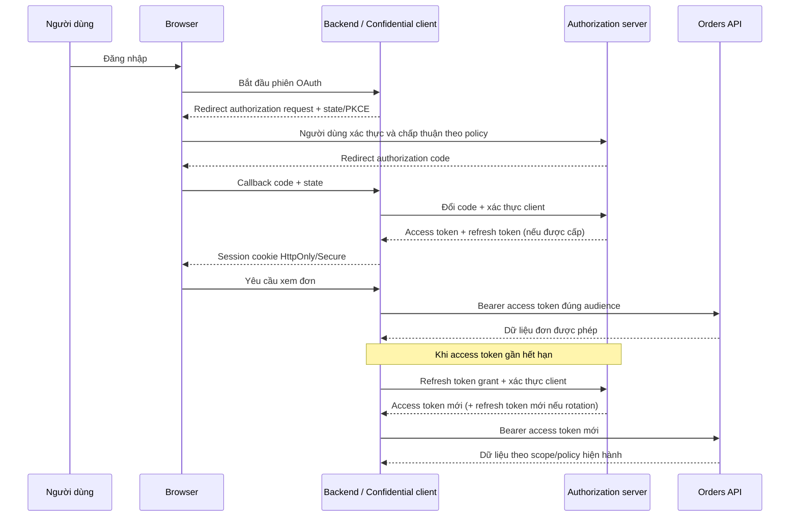
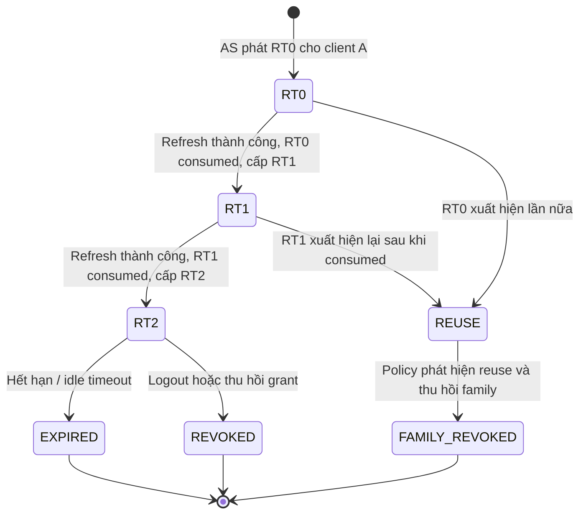
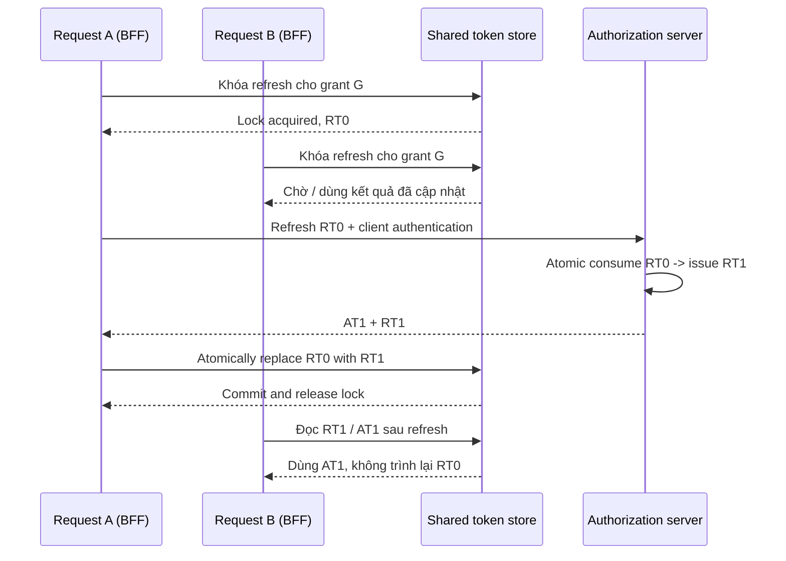

# Refresh token cho confidential client

Một ứng dụng web có backend sử dụng OpenID Connect trên OAuth 2.0 Authorization Code flow để xác thực người dùng và xin quyền đọc đơn hàng. Access token dành cho Orders API có thể chỉ sống 10 phút, trong khi phiên ứng dụng được phép hoạt động lâu hơn. Để không buộc người dùng đăng nhập lại sau mỗi lần access token hết hạn, authorization server **có thể** cấp thêm **refresh token** cho backend. Backend trình refresh token tại **token endpoint** và xác thực chính mình bằng cơ chế client authentication đã đăng ký để xin access token mới.

Điểm quan trọng là **refresh token không phải access token**, và **confidential client không phải một “loại token”**. Confidential client là một loại OAuth client có khả năng giữ bí mật credential và xác thực danh tính với authorization server trong môi trường vận hành được bảo vệ. Refresh token là credential dài hạn tương đối, được authorization server cấp theo chính sách, gắn với grant, client và giới hạn quyền đã được phê duyệt.

Bài thuộc chương **Refresh token** trong module **SECURITY_TOKEN_SECURITY_FUNDAMENTALS**. Nội dung tập trung vào vòng đời phát hành, lưu trữ, kiểm tra, rotation, phát hiện sử dụng lại, giới hạn scope/audience, thu hồi và phòng chống token bị đánh cắp. Các ví dụ đặt trong ngữ cảnh JWT/opaque **access token**, OAuth 2.0 và OIDC; không mặc định refresh token phải là JWT hay có thể được resource server giải mã.

Sau bài này, bạn có thể:

- Nhận diện đúng **confidential client** so với public client như SPA và native mobile app.
- Giải thích vì sao refresh token được dùng ở **authorization server**, còn access token được dùng ở **resource server**.
- Thực hiện refresh token grant với **client authentication** và kiểm tra ràng buộc token với client.
- Thiết kế lưu trữ an toàn phía backend, rotation, atomic update, phát hiện reuse và thu hồi token family.
- Phân biệt refresh trong Authorization Code flow với Client Credentials flow vốn thường **không cần refresh token**.
- Giải quyết vấn đề scope/audience bị thu hẹp, token hết hạn, request song song, retry và sự cố mất phản hồi.
- Lập checklist kiểm thử và audit mà không làm lộ refresh token hay client credential.

## 1. Confidential client là gì?

Trong OAuth 2.0, **client** là ứng dụng yêu cầu quyền truy cập tài nguyên. Theo RFC 6749, **confidential client** là client có khả năng duy trì tính bí mật cho credential của mình hoặc có khả năng xác thực client an toàn bằng phương thức khác. Nó thường hoạt động trên **backend/server** mà người dùng cuối không truy cập mã nguồn và secret của quá trình vận hành.

| Loại client | Ví dụ | Khả năng giữ bí mật | Hệ quả với refresh token |
| --- | --- | --- | --- |
| **Confidential client** | Server-rendered web app, BFF, backend web service | Có thể giữ client secret/private key trong server hoặc secret manager | Có thể nhận refresh token theo grant/policy; khi dùng phải xác thực client theo quy tắc |
| **Public client** | SPA chạy trong browser, mobile/native app trên thiết bị người dùng | Không thể bảo đảm bí mật client secret được nhúng trong ứng dụng | Nếu AS cấp refresh token, cần các biện pháp dành cho public client như rotation hoặc sender constraint theo security BCP |
| **Workload/service client** | Batch job, service-to-service trên backend | Thường có thể xác thực bằng workload credential, mTLS hoặc private key | Với `client_credentials`, thường xin access token mới bằng client authentication thay vì refresh token |

**Không phải cứ có backend là tự động an toàn.** Confidential client chỉ bảo vệ được credential nếu triển khai thực sự hạn chế quyền truy cập vào server, logs, runtime, secret manager, backup, môi trường CI/CD và các hệ thống quan sát. Một ứng dụng lộ client secret trong HTML/JavaScript, mobile binary hoặc public Git repository không trở thành confidential chỉ vì lúc đăng ký đã chọn loại đó.

### 1.1. Hai loại credential khác nhau

Confidential client có thể giữ **hai loại bí mật** với mục đích khác nhau:

1. **Client credential**: chứng minh **danh tính của ứng dụng** với authorization server, ví dụ client secret, private key dùng cho client assertion hoặc chứng chỉ mTLS.
2. **Refresh token**: chứng minh quyền tiếp tục sử dụng **grant đã được cấp**, ràng buộc với client và thường với người dùng/phiên. Nó không phải mật khẩu của client.

AS cần kiểm tra **cả hai** trong refresh flow dành cho confidential client: client được xác thực thành công **và** refresh token hợp lệ, được cấp cho **chính client đó**, chưa bị thu hồi và không vượt policy.

## 2. Access token và refresh token phục vụ hai bên nhận khác nhau

| Thuộc tính | Access token | Refresh token |
| --- | --- | --- |
| Bên nhận chính | Resource server/API đúng audience | Authorization server/token endpoint |
| Mục đích | Truy cập API theo scope, audience, điều kiện nghiệp vụ | Xin access token mới trong giới hạn grant |
| Định dạng | JWT/JWS, JWE hoặc opaque tùy AS | Thường opaque; có thể định dạng khác theo AS |
| Tuổi thọ | Thường tương đối ngắn | Có thể dài hơn; chịu absolute/idle expiry và policy |
| Cách kiểm tra | API xác minh JWT hoặc introspection/trust lookup cho opaque | AS xác minh trạng thái, ràng buộc client/grant, quyền và chính sách |
| Nơi lưu trong ví dụ BFF | Backend giữ và gửi tới API | Chỉ backend giữ, trình tới token endpoint |
| Được dùng làm Bearer cho API? | Có nếu đúng profile/scheme và audience | **Không** |
| Có tự cấp thêm quyền? | Không vượt scopes/policy đã cấp | **Không** được dùng để leo thang ngoài grant |

Đừng lấy refresh token gửi trong `Authorization: Bearer` tới Orders API. Resource server chỉ cần access token phù hợp, còn refresh token nên được giữ xa bề mặt tấn công và chỉ gửi qua kết nối bảo mật tới token endpoint.

Một số hệ thống dùng **JWT refresh token** nhưng điều đó không tự bảo đảm one-time use, revocation, client binding hoặc kiểm soát grant. Những thuộc tính này phải được AS thực thi bằng policy và state khi cần. Không suy ra việc refresh token hợp lệ chỉ từ payload tự giải mã.

## 3. Khi nào confidential client được cấp refresh token?

Việc cấp refresh token là **quyết định của authorization server**, không phải quyền mặc định của mọi confidential client. AS cân nhắc grant type, yêu cầu offline/long-lived access, chính sách người dùng, client registration, authentication assurance, rủi ro thiết bị và consent.

Một tình huống điển hình:

1. Người dùng đăng nhập qua OP/AS trong **Authorization Code flow**.
2. Backend confidential client đổi authorization code ở token endpoint và xác thực chính mình.
3. AS có thể cấp **access token** và **refresh token** nếu client/grant/chính sách đủ điều kiện.
4. Backend giữ refresh token; frontend dùng session cookie ứng dụng.
5. Khi cần gọi API mà access token đã/hầu hết hết hạn, backend dùng refresh token để xin token mới.



**Không có nghĩa** mỗi lần refresh sẽ xác thực lại người dùng. Refresh token grant cho phép tiếp tục sử dụng quyền của grant trong giới hạn policy; `iat` mới của access token không đồng nghĩa `auth_time` OIDC hay MFA vừa được thực hiện.

### 3.1. `offline_access` trong OIDC

OIDC có scope `offline_access` để yêu cầu khả năng truy cập khi người dùng không hiện diện. Nhưng việc request `offline_access` **không bảo đảm** refresh token được cấp: AS vẫn áp dụng consent, grant, client type và chính sách riêng. Một số hệ thống có cơ chế cấp refresh token khác và không bắt buộc mọi luồng OAuth phải có `offline_access`.

Không coi `offline_access` là quyền đọc/ghi API. Scope này liên quan đến khả năng xin token khi người dùng vắng mặt, còn quyền API cần scopes riêng và audience phù hợp.

## 4. Đặc biệt: Client Credentials thường không cần refresh token

Đây là khác biệt đáng nhớ nhất khi học refresh token cho confidential client.

**Confidential client có thể dùng nhiều OAuth grant types.** Một backend ứng dụng đại diện người dùng có thể dùng **Authorization Code** và nhận refresh token; một service dùng **Client Credentials** thường có thể xác thực lại trực tiếp với AS để lấy access token mới.

RFC 6749 mục 4.4.3 quy định response của Client Credentials **SHOULD NOT** bao gồm refresh token. Lý do thực tế: client đã có credential của chính mình, nên có thể yêu cầu một access token mới mà không cần thêm bí mật lâu dài cho việc gia hạn.

| Tình huống | Grant | Refresh token có phù hợp? |
| --- | --- | --- |
| Web backend đại diện người dùng đã đăng nhập | Authorization Code | Có thể phù hợp nếu AS cấp và chính sách cho phép |
| Job backend đọc dữ liệu bằng danh tính service | Client Credentials | Thường **không**; xin token mới bằng client authentication |
| Mobile app có user login | Authorization Code + PKCE (public client) | Có thể được cấp nhưng biện pháp bảo vệ khác confidential client |
| Máy chủ thực hiện token exchange/delegation | RFC 8693 và profile liên quan | Phụ thuộc policy và token type được AS cấp, không mặc định có refresh token |

**Ví dụ sai:** service định kỳ có `client_id=reporting-job` và private key an toàn nhưng tự xây “refresh token vô hạn” vì nghĩ bất kỳ confidential client nào đều phải có refresh token. **Ví dụ đúng hơn:** service sử dụng client authentication để xin access token mới khi cần và cache token theo audience/scope/expiry.

## 5. Refresh token grant theo OAuth 2.0

RFC 6749 mục 6 định nghĩa request tới **token endpoint**:

```http
POST /oauth2/token HTTP/1.1
Host: login.example.com
Authorization: Basic <base64-encoded-client-credentials>
Content-Type: application/x-www-form-urlencoded
Accept: application/json

grant_type=refresh_token&refresh_token=<opaque-refresh-token>
```

Đây là HTTP minh họa; placeholder **không phải** credential thật. Cách `client_secret_basic` là một ví dụ client authentication; hệ thống cũng có thể dùng `private_key_jwt`, mTLS hoặc phương thức phù hợp đã đăng ký.

Các tham số chính:

| Thành phần | Ý nghĩa | Ghi chú |
| --- | --- | --- |
| `POST /oauth2/token` | Endpoint mà AS xử lý refresh | Bắt buộc dùng HTTPS trong vận hành |
| `grant_type=refresh_token` | Cho biết muốn sử dụng refresh token grant | Giá trị chuẩn OAuth |
| `refresh_token=...` | Credential do AS cấp trước đó | Không đặt trong URL/query string |
| Client authentication | Chứng minh confidential client đang gọi token endpoint | AS phải xác minh client đã được cấp token đó |
| `scope` (tùy chọn) | Xin phạm vi được giới hạn so với grant gốc | Không được yêu cầu phạm vi ngoài grant đã cấp |

Ví dụ xin **downscope**:

```http
POST /oauth2/token HTTP/1.1
Host: login.example.com
Authorization: Basic <base64-encoded-client-credentials>
Content-Type: application/x-www-form-urlencoded

grant_type=refresh_token&refresh_token=<refresh-token>&scope=orders.read
```

RFC 6749 mục 6 cho phép client gửi scope trong refresh request, nhưng **không được vượt phạm vi đã được resource owner cấp ban đầu**. Nếu bỏ `scope`, theo ngữ nghĩa chuẩn phạm vi được hiểu là phạm vi đã được cấp ban đầu; AS vẫn phải tuân thủ chính sách/thu hồi hiện hành. Việc hỗ trợ downscoping cụ thể còn tùy AS/profile.

### 5.1. Những kiểm tra bắt buộc tại token endpoint

Khi refresh token được trình bởi confidential client, AS phải:

1. Xác thực confidential client (hoặc client có credential được cấp) bằng phương thức đã đăng ký.
2. Kiểm tra refresh token có tồn tại/hợp lệ, chưa hết hạn, chưa bị thu hồi và không bị tiêu thụ sai quy trình.
3. Xác minh refresh token **đã được phát hành cho đúng client đang xác thực**.
4. Kiểm tra grant, user/session và quyền tiếp tục hoạt động theo chính sách.
5. Giới hạn scope/audience/resource của access token mới trong quyền đã được cấp và policy hiện hành.
6. Nếu dùng rotation, đánh dấu token cũ không còn được dùng và phát token mới theo cơ chế nguyên tử.

Một token bị đánh cắp từ client A **không được** đổi lấy access token bởi client B chỉ vì client B cũng có credential hợp lệ. Việc xác thực “một client bất kỳ” không đủ; bắt buộc **match client identity với token binding**.

### 5.2. Ví dụ token response

```http
HTTP/1.1 200 OK
Content-Type: application/json
Cache-Control: no-store
Pragma: no-cache

{
  "access_token": "<new-orders-access-token>",
  "token_type": "Bearer",
  "expires_in": 900,
  "scope": "orders.read",
  "refresh_token": "<new-refresh-token-if-rotated>"
}
```

`refresh_token` mới là **tùy chọn** trong response tùy chính sách rotation của AS; nếu không phát refresh token mới, client tiếp tục dùng token hiện có theo hợp đồng. **Nếu AS phát refresh token mới thì client phải loại bỏ token cũ và thay bằng token mới**, không giữ cả hai “để dự phòng”.

`expires_in` thường mô tả thời gian sống của **access token**, **không** phải thời hạn còn lại của refresh token. Refresh token có thể chịu absolute expiry, idle timeout, hạn phiên hoặc chính sách riêng của AS.

## 6. Các cơ chế client authentication phù hợp

Confidential client phải có phương thức chứng minh danh tính với AS. Lựa chọn tùy hạ tầng, mức rủi ro và khả năng quản lý khóa.

| Cơ chế | Credential | Ưu điểm | Cần lưu ý |
| --- | --- | --- | --- |
| `client_secret_basic` | Client ID + client secret qua HTTP Basic trên TLS | Tương thích rộng, dễ tích hợp | Quản lý shared secret, xoay định kỳ, không ghi header log |
| `client_secret_post` | Client ID/secret trong form body token request | Có nơi hỗ trợ | Dễ lộ qua body logging; thường không ưu tiên nếu Basic khả dụng |
| `private_key_jwt` / JWT client assertion | Client ký assertion bằng private key | AS giữ public key; tránh chia sẻ secret đối xứng | Giữ private key an toàn, kiểm `aud`, `iss`, `sub`, `exp`, `jti`/replay theo profile |
| **mTLS client authentication** | Client certificate / private key | Xác thực ở lớp TLS, có thể hỗ trợ token sender constraint | Quản lý chứng chỉ, proxy TLS, rotation, xác minh đúng client |
| **Workload/federated identity** | Credential từ nền tảng vận hành theo trust contract | Giảm credential tĩnh lưu lâu dài | Phải triển khai federation/protocol được AS hỗ trợ và giới hạn trust |

Không có một cơ chế duy nhất bắt buộc cho mọi AS. Với service có secret manager/HSM và vòng đời khóa được quản lý tốt, `private_key_jwt` hoặc mTLS có thể giảm nhu cầu chia sẻ password dạng client secret. Nhưng nếu triển khai sai verification và rotation, các cơ chế này vẫn có thể bị lạm dụng.

### 6.1. Basic client authentication KHÔNG phải Bearer authentication

`Authorization: Basic ...` ở ví dụ refresh request dùng để **xác thực confidential client với token endpoint**. Nó **không phải** access token gửi tới resource server. Sau khi nhận access token mới, backend gửi **`Authorization: Bearer <access-token>`** tới Orders API.

Hai header thuộc hai giao dịch HTTP khác nhau:

```text
Backend -> Authorization server /token
    Authorization: Basic <client-credentials>
    Body: grant_type=refresh_token&refresh_token=<refresh-secret>

Backend -> Orders API /orders
    Authorization: Bearer <access-token>
```

Nếu dùng mTLS hoặc client assertion, token endpoint sẽ xác thực client bằng phương thức tương ứng, không nhất thiết phải có header `Authorization: Basic`.

### 6.2. Client authentication chưa tự làm refresh token an toàn trước mọi rủi ro

Việc AS đòi client authentication khiến người chỉ lấy được **refresh token** nhưng không có client credential gặp khó khăn hơn khi đổi token. Tuy nhiên:

- Nếu attacker chiếm **backend process** và lấy cả refresh token lẫn client secret/private key, họ vẫn có thể refresh.
- Nếu client secret dùng chung giữa nhiều môi trường hoặc log ra tracing, ranh giới bảo vệ suy yếu.
- Refresh token bị lộ dù chưa dùng được vẫn là **sự cố cần xử lý**; không nên coi nó vô hại.
- Client authentication không tự ràng buộc **access token đã cấp** với từng request tới API. Nếu access token là bearer thuần và bị lộ, attacker vẫn có thể sử dụng bản sao cho tới khi token hết hạn/thu hồi.

Do đó cần **client authentication + token binding + bảo vệ lưu trữ + giới hạn grant + revocation + theo dõi bất thường**.

## 7. Ràng buộc refresh token với client, grant, người dùng và phạm vi

Một refresh token an toàn không chỉ là chuỗi bí mật. AS cần biết nó thuộc về **ai** và **cho phép điều gì**.

Schema trạng thái minh họa:

```sql
CREATE TABLE oauth_refresh_tokens (
    id BIGINT GENERATED ALWAYS AS IDENTITY PRIMARY KEY,
    token_digest BYTEA NOT NULL UNIQUE,
    client_id VARCHAR(200) NOT NULL,
    grant_id VARCHAR(200) NOT NULL,
    subject_id VARCHAR(200),
    family_id VARCHAR(200) NOT NULL,
    generation INTEGER NOT NULL,
    bound_scopes TEXT NOT NULL,
    bound_resources TEXT,
    issued_at TIMESTAMP WITH TIME ZONE NOT NULL,
    expires_at TIMESTAMP WITH TIME ZONE NOT NULL,
    idle_expires_at TIMESTAMP WITH TIME ZONE,
    consumed_at TIMESTAMP WITH TIME ZONE,
    revoked_at TIMESTAMP WITH TIME ZONE,
    successor_id BIGINT
);
```

Đây là **mô hình giản lược** để giải thích token rotation; triển khai thật cần foreign keys, indexes, trường phiên/consent, quy tắc lưu scope/resource phù hợp (ví dụ bảng quan hệ thay chuỗi), retention policy và khóa giao dịch. Không nhất thiết mỗi AS dùng schema này.

Các ràng buộc:

- **`client_id`**: refresh token chỉ được redeem bởi client đã được cấp token; client khác bị từ chối.
- **`grant_id`**: token thuộc một authorization grant cụ thể, có thể bị thu hồi độc lập với grant khác.
- **`subject_id`**: khi grant đại diện người dùng, gắn danh tính user/phiên theo mô hình issuer; không gán tùy ý từ request.
- **`bound_scopes`**: token mới không được tự có scopes vượt grant/chính sách.
- **`bound_resources`**: token không được tạo access token dành cho API ngoài những resource được phép theo chính sách.
- **`family_id`/`generation`**: phục vụ rotation và phát hiện token cũ bị dùng lại.
- **`expires_at`/`idle_expires_at`**: giới hạn thời gian, không tồn tại vô hạn chỉ vì refresh nhiều lần.

### 7.1. Dùng bí mật ngẫu nhiên khó đoán

Opaque refresh token có thể là chuỗi ngẫu nhiên được sinh bằng **CSPRNG**, ví dụ 32 byte ngẫu nhiên tương đương 256 bit entropy nếu nguồn ngẫu nhiên đạt chất lượng mật mã. Không dùng timestamp, email, client ID, bộ đếm hay `Math.random()` để làm refresh token.

Phía AS nên cân nhắc chỉ lưu **digest/HMAC fingerprint** của token đủ entropy thay vì plaintext. Điều này khác lưu client credential và khác **password hashing** của người dùng: password cần hàm băm password chuyên dụng như Argon2id, trong khi một bí mật ngẫu nhiên có entropy cao có thể so khớp qua SHA-256/HMAC tùy threat model.

Phía confidential client thường **phải lưu bản thân refresh token một cách bí mật nhưng có thể lấy lại để gửi AS**; nó không thể chỉ giữ digest không đảo ngược rồi hy vọng redeem được.

## 8. Lưu refresh token an toàn trong confidential client

Đây là khu vực có thể quyết định toàn bộ độ an toàn của flow.

| Vị trí/thiết kế | Đánh giá | Lý do |
| --- | --- | --- |
| Server-side credential store, mã hóa at rest và phân quyền chặt | **Ưu tiên** | Giữ refresh token ngoài trình duyệt, có audit/rotation |
| Secret manager hoặc kho bí mật theo phiên/grant nếu hỗ trợ | **Phù hợp** | Giới hạn truy cập theo service identity và quản lý key lifecycle |
| DB mã hóa trường token bằng key do KMS/HSM bảo vệ | **Phù hợp khi kiểm soát tốt** | Cần tách quyền DB và quyền giải mã, ghi audit |
| RAM cache của backend | Dùng được với giới hạn | Rủi ro mất state khi restart, dump memory và race khi nhiều instance |
| HTML, JavaScript, `localStorage` hoặc cookie có thể đọc bằng JS | **Không phù hợp cho mô hình BFF confidential client** | Lộ token cho browser/XSS và làm yếu ranh giới confidential |
| Source code, config công khai, log, URL/query, analytics | **Tuyệt đối tránh** | Token bị sao chép và replay |

Quy tắc triển khai:

1. **Không trả refresh token cho browser** khi backend đang đóng vai confidential client và quản lý grant phía server.
2. Dùng **session cookie** (`Secure`, `HttpOnly`, `SameSite` phù hợp) để browser gọi BFF; backend ánh xạ phiên sang token record riêng.
3. Mã hóa token khi lưu, tách quyền đọc bản ghi và giải mã; khóa mã hóa nằm ở KMS/secret manager hoặc hệ thống quản lý khóa tương đương.
4. Không lưu token trong source repository, app logs, APM, exception, support ticket, trace HTTP hay URL.
5. **Giới hạn truy cập** theo user/service, tenant, môi trường và mục đích; phân tách token production với staging/test.
6. Có chính sách **backup, retention, xóa và incident response**: backup chứa token mã hóa cũng là tài sản nhạy cảm, không nên duy trì vô hạn.
7. Sử dụng TLS cho mọi trao đổi với AS; xác minh hostname/chứng chỉ, không tắt certificate validation để khắc phục lỗi.

### 8.1. Refresh token trong cookie có trở thành confidential client không?

Không. Nếu backend đẩy **refresh token** cho browser giữ, mô hình bảo vệ phụ thuộc browser/cookie và cách token được trình, không còn tương đương server-side-only BFF. `HttpOnly` làm JS không đọc cookie trực tiếp nhưng browser vẫn có thể tự gửi nó, và ứng dụng cần phân tích **CSRF, XSS, cookie theft, same-site và session fixation**.

Khi đã chọn BFF confidential client, thiết kế đơn giản hơn là **browser chỉ giữ session cookie**, còn refresh/access token ở backend. Không chuyển refresh token ra browser chỉ để “giảm một lớp database”.

## 9. Rotation: vì sao thay refresh token sau mỗi lần sử dụng?

**Refresh token rotation** là cơ chế AS cấp **refresh token mới** sau lần redeem thành công và vô hiệu **refresh token cũ**. Client lưu token mới thay token cũ. Nếu một token cũ lại xuất hiện về sau, đây có thể là dấu hiệu **reuse** do token bị đánh cắp hoặc do race/retry cần điều tra.



Lợi ích:

- Giảm khả năng một bản sao token cũ tiếp tục đổi access token sau khi nó đã được client hợp lệ sử dụng.
- Phát hiện tín hiệu nghi ngờ **token theft/replay** khi token đã consumed được trình lại.
- Giúp quản lý vòng đời từng grant/phiên thông qua **token family**.

**Nhưng rotation không tự ngăn mọi tấn công.** Nếu attacker sử dụng refresh token **trước** client hợp lệ, attacker có thể nhận token mới; đến khi client gửi token cũ, AS nhận ra reuse và cần thu hồi family. Rotation giúp **phát hiện và ngăn tiếp diễn theo policy**, không chứng minh người dùng hợp lệ luôn “thắng” cuộc đua.

### 9.1. Confidential client có bắt buộc rotation không?

Không được khẳng định rằng **mọi confidential client đều bắt buộc xoay refresh token sau mỗi request**. OAuth Security BCP (RFC 9700) quy định yêu cầu riêng đối với **public clients**: refresh token cho public client phải sender-constrained hoặc dùng rotation để phát hiện replay. Với confidential client đã được xác thực, AS có thể chọn rotation, token binding và các kiểm soát khác theo rủi ro/chính sách. **Rotation vẫn là lựa chọn có giá trị**, nhất là với grant dài hạn, nhưng không tự thay thế client authentication.

### 9.2. Gia hạn không đồng nghĩa kéo dài vô hạn

Nếu AS thay refresh token sau mỗi lần sử dụng, cần xác định:

- **Absolute lifetime**: mốc cuối cùng của cả grant/token family, không được tự tăng vô hạn nếu chính sách không cho.
- **Idle timeout**: thời gian không sử dụng liên tiếp vượt giới hạn thì hết hiệu lực.
- **Session/consent lifetime**: user logout, consent rút lại, khóa account hoặc policy thay đổi có thể khiến grant bị vô hiệu.
- **Rotation policy**: refresh token mới có thể có `expires_at` riêng nhưng vẫn không vượt absolute expiration của grant nếu chính sách giới hạn.

Một request refresh mỗi vài phút **không chứng minh người dùng vẫn đang tương tác**; đừng dùng refresh như tín hiệu đủ mới của đăng nhập/MFA.

## 10. Rotation phải nguyên tử và chống request song song

Giả sử BFF chạy 10 instance. Access token sắp hết hạn; hai request của cùng người dùng đến hai instance và cả hai đồng thời dùng **RT0**. Nếu không điều phối, request thứ nhất có thể đổi thành **RT1**, request thứ hai dùng RT0 đã consumed, dẫn đến:

- AS coi request thứ hai là **reuse**, thu hồi toàn bộ family và buộc người dùng đăng nhập lại dù không có attacker.
- Client ghi token mới sai thứ tự, lưu lại RT0 hoặc làm mất RT1.
- Hai request lấy access token khác nhau hoặc một request thất bại với `invalid_grant`.

Giải pháp cần có **điều phối phía client** và **atomic rotation phía AS**:

1. Client khóa/điều phối refresh **theo phiên hoặc grant** (single-flight), ví dụ distributed lock hoặc compare-and-swap trên token version khi có nhiều instance.
2. AS xử lý một refresh token với giao dịch nguyên tử/row lock để chỉ **một lần redeem** thành công.
3. Client cập nhật **token mới thay token cũ** bằng transaction/conditional write có phiên bản, không ghi đè token mới bằng bản cũ.
4. Không retry mù request refresh khi timeout. Response có thể đã được AS commit rồi mất trên mạng; retry cùng token có thể bị coi là reuse.
5. Thiết kế failure recovery rõ ràng, có thể yêu cầu người dùng đăng nhập lại khi không thể biết token mới hoặc không thể phục hồi an toàn.



### 10.1. Mã giả cho confidential client

```text
function accessTokenFor(grantId, resource, requiredScope):
    tokenState = credentialStore.read(grantId)

    if tokenState.accessTokenIsUsableFor(resource, requiredScope):
        return tokenState.accessToken

    with distributedSingleFlightLock(grantId):
        current = credentialStore.read(grantId) // đọc lại sau khi khóa
        if current.accessTokenIsUsableFor(resource, requiredScope):
            return current.accessToken

        response = authServer.refresh(
            endpoint = configuredTokenEndpoint,
            confidentialClientAuth = configuredSecureClientAuth,
            refreshToken = current.refreshToken,
            scope = downscopeOnlyWhenSupportedAndNeeded
        )

        validateResponseTokenTypeAndPolicy(response)
        nextRefreshToken =
            response.refreshTokenIfPresentElse(current.refreshToken)

        credentialStore.compareAndSwap(
            grantId,
            expectedGeneration = current.generation,
            newAccessToken = response.accessToken,
            newRefreshToken = nextRefreshToken,
            newGeneration = current.generation + 1
        )
        return response.accessToken
```

Đây là **pseudocode mô tả ý tưởng**, không phải giải pháp xử lý mọi sự cố phân tán. Đặc biệt, nếu AS đã đổi RT0 thành RT1 nhưng client chết trước khi lưu RT1, **client có thể không khôi phục được grant**. AS và client cần có recovery policy rõ ràng; không bật “grace period” chấp nhận token cũ vô hạn chỉ để né lỗi.

### 10.2. Tại authorization server, cập nhật nguyên tử

```text
BEGIN TRANSACTION
  row = SELECT refresh_token WHERE digest = hash(rawToken) FOR UPDATE

  REQUIRE row exists
  REQUIRE row.client_id == authenticatedClient.id
  REQUIRE row.revoked_at IS NULL AND row.consumed_at IS NULL
  REQUIRE row.expires_at > databaseNow()
  REQUIRE row.grant still active, scope/resource permitted

  newRawToken = secureRandomRefreshToken()
  newDigest = secureDigest(newRawToken)

  UPDATE row SET consumed_at = databaseNow()
  INSERT successor token (
      digest = newDigest,
      client_id = row.client_id,
      grant_id = row.grant_id,
      family_id = row.family_id,
      generation = row.generation + 1,
      bounds = narrowedOrSameApprovedGrant
  )
  ISSUE new access token under current grant policy
COMMIT

RETURN access_token + new_refresh_token
```

Trong code thực tế, bước tạo access token, ghi trạng thái grant và phát token phải được sắp xếp để **không trả credential chưa được commit** và không để hai request đều thành công. Nếu hệ thống tách token service/DB, cần cơ chế transaction/idempotency phù hợp. Không lưu token thô trong log hoặc bảng audit.

## 11. Reuse detection: xử lý khi refresh token cũ xuất hiện lại

Khi một token đã bị consumed được trình lại, AS không thể mặc định biết đó là **attacker** hay một request hợp lệ bị lặp do mạng. Nhưng vì không phân biệt được an toàn, chính sách bảo thủ thường:

1. Từ chối refresh request dùng token cũ.
2. Đánh dấu hoặc **thu hồi token family/grant** bị nghi ngờ để vô hiệu cả hậu duệ còn sống theo threat model.
3. Ghi security event **không chứa refresh token thô**: client ID, grant/family, thời điểm, nguồn, phiên bản, kết quả.
4. Thông báo/buộc đăng nhập lại khi cần, đánh giá access token đã cấp còn hạn và có cơ chế revoke phù hợp.
5. Điều tra concurrency hoặc lỗi lưu token của client trước khi kết luận chắc chắn về xâm nhập.

### 11.1. Có nên cho “grace window” khi retry?

Một số AS dùng khoảng thời gian ngắn để giảm false-positive khi request refresh bị lặp do mạng. Nhưng **grace** đồng thời mở cửa sổ mà token cũ có thể được trình lại, cần đánh giá rủi ro replay rất kỹ.

Nếu dùng, phải có hợp đồng chặt: thời hạn rất ngắn, ràng buộc client, idempotency, không tạo nhiều nhánh refresh family, kiểm soát concurrency và audit. **Không được coi retry bằng token đã consumed là an toàn chỉ vì client đã xác thực.**

Đối với confidential client trong backend, ưu tiên **single-flight refresh, lưu state nguyên tử và recovery rõ ràng** hơn là mở rộng tùy ý khoảng chấp nhận token cũ.

### 11.2. Error `invalid_grant` không đủ để kết luận đã bị đánh cắp

`invalid_grant` có thể xảy ra khi refresh token hết hạn, bị thu hồi, sai client, đã dùng hoặc không được chấp nhận theo policy. Đối với client, cách xử lý thường là **dừng retry bằng token cũ**, đánh dấu grant cần authorization flow mới hoặc áp dụng recovery được AS thiết kế. Không gửi lại vô hạn cùng token; vừa tăng tải AS vừa có thể kích hoạt reuse policy.

## 12. Giới hạn scope, audience và quyền trong lần refresh

Một refresh token không phải “vé xin quyền mới tùy ý”. Việc tạo access token mới vẫn phải tuân theo:

- **Grant gốc**: scopes/resource được user/AS cấp, các điều kiện consent và chính sách.
- **Client binding**: refresh token chỉ dành cho client đã được xác thực đúng.
- **Current policy**: user bị khóa, role bị gỡ, membership/tenant thay đổi, consent bị rút lại.
- **Audience/resource restriction**: không biến token dành cho Orders API thành quyền Billing API chỉ vì client yêu cầu `resource=billing-api`.
- **Token lifetime và profile**: access token mới có `iss`/`aud`/`exp` đúng, không tự mở rộng TTL/permissions.

Ví dụ:

| Grant/refresh request | AS có thể xử lý | Điều client không được giả định |
| --- | --- | --- |
| Grant có `orders.read orders.create`, refresh xin `orders.read` | Cấp scope hẹp hơn nếu AS hỗ trợ/policy cho phép | Không mặc định vẫn có `orders.create` |
| Grant chỉ có `orders.read`, refresh xin `orders.refund` | Từ chối/giới hạn theo policy | Không tự thêm quyền ngoài grant |
| Refresh của client A do client B xác thực và trình | Từ chối | Client B không “mượn” được grant A |
| User đã bị gỡ khỏi tenant A | Thu hồi/thu hẹp theo current policy | JWT mới không nên giữ quyền lỗi thời trái policy |
| Refresh token bị thu hồi | `invalid_grant` hoặc lỗi phù hợp | Không thể tiếp tục chỉ nhờ access token cũ còn trong cache |

**Access token** có thể là JWT hoặc opaque; resource server vẫn kiểm issuer, audience, time, scope và owner/tenant policy. Việc AS chấp nhận refresh token **không làm API có quyền bỏ qua object-level authorization**.

### 12.1. Refresh token và OIDC `auth_time`

OIDC ID token có thể chứa `auth_time`, `amr` và `acr` theo profile. Refresh access token hoặc nhận ID token mới **không tự chứng minh người dùng vừa đăng nhập lại/MFA**. Nếu thao tác đòi mức xác thực cao hoặc đủ mới, client/backend phải áp dụng step-up/re-authentication theo policy, không dựa duy nhất vào thời điểm cấp token mới `iat`.

## 13. Revocation, logout và vòng đời phiên

Vòng đời refresh token không chỉ kết thúc lúc expiry. Những sự kiện có thể khiến AS cần vô hiệu grant/token:

| Sự kiện | Hành vi nên được thiết kế |
| --- | --- |
| Người dùng logout khỏi một thiết bị | Kết thúc session và thu hồi token/grant của thiết bị đó khi policy yêu cầu |
| Người dùng “logout everywhere” | Thu hồi nhiều phiên/grant liên quan và xử lý access token còn hạn |
| Mật khẩu được reset, tài khoản nghi bị chiếm | Thu hồi grant/refresh token theo chính sách bảo mật, yêu cầu xác thực lại |
| Người dùng rút consent | Không cấp tiếp quyền đã rút; vô hiệu refresh/grant phù hợp |
| Client secret/private key bị lộ | Xoay credential, vô hiệu các grant/token bị ảnh hưởng và điều tra |
| Refresh token reuse detected | Từ chối token cũ, cân nhắc thu hồi token family và session |
| Grant idle/absolute timeout | Không phát access token mới dù client còn giữ refresh token |
| User mất quyền ở tenant | Kiểm tra chính sách ở AS và API, thu hẹp/thu hồi quyền liên quan |

OAuth 2.0 Token Revocation (RFC 7009) định nghĩa endpoint để client yêu cầu AS thu hồi token theo quy tắc áp dụng. Khi thu hồi refresh token, AS có thể làm mất hiệu lực grant và token liên quan theo chính sách, nhưng **không nên hứa rằng mọi JWT access token tự chứa đã cấp đều vô hiệu tức thì** nếu resource server chỉ kiểm chữ ký offline đến `exp`.

**Refresh token rotation và revocation là hai vấn đề khác nhau.** Rotation tiêu thụ token cũ khi đổi thành token mới; revocation có thể diễn ra bất kỳ lúc nào do logout, sự cố, policy hoặc kết thúc grant.

### 13.1. Lưu ý về session cookie

Trong BFF, browser thường giữ session cookie còn server giữ OAuth tokens. **Kết thúc cookie phiên** và **thu hồi OAuth grant** cần phối hợp nhưng không tự động là cùng một hành động. Nếu chỉ xóa cookie ở browser còn refresh token vẫn sống ở backend, khả năng tiếp tục lấy access token có thể còn tồn tại tùy thiết kế. Hãy đặt quy trình logout rõ ràng, kể cả trong trường hợp user hủy phiên từ thiết bị khác.

## 14. Xử lý lỗi token endpoint và retry có kỷ luật

| Phản hồi / vấn đề | Ý nghĩa thường gặp | Cách xử lý client |
| --- | --- | --- |
| `200 OK` + access token, không có refresh token mới | AS cấp access token mới, không thực hiện rotation trong response này | Giữ refresh token hiện có theo hợp đồng, cập nhật access token và expiry |
| `200 OK` + access/refresh token mới | AS đã phát refresh token mới | **Thay** token cũ bằng token mới một cách nguyên tử |
| `invalid_client` hoặc HTTP 401 với client authentication failure | Credential client không hợp lệ hoặc bị từ chối | Không fallback sang phương thức kém an toàn, kiểm tra cấu hình/rotation credential |
| `invalid_grant` | Refresh token/grant không được chấp nhận | Ngừng retry token cũ; chuyển sang re-authorization/recovery |
| `invalid_scope` | Request scope không hợp lệ/không được phép | Sửa yêu cầu theo grant/policy, không tự cấp thêm scope |
| Timeout/network disconnect | Không biết AS có xử lý request hay chưa | Không retry mù với refresh token đã có thể bị consumed; áp dụng single-flight/recovery |
| AS trả 5xx | Hạ tầng AS lỗi | Backoff/circuit breaker, giữ state nhất quán, không cho API dùng credential không được xác minh |
| Phản hồi thiếu `access_token` hoặc `token_type` bất thường | Response sai contract | Từ chối kết quả, cảnh báo và không ghi đè state hợp lệ |

### 14.1. Không coi `401` của resource server là lý do refresh vô hạn

API có thể trả 401 vì access token hết hạn, **sai audience**, sai issuer hoặc không đúng profile. Nếu client thử refresh token liên tục mà vẫn xin access token sai audience, việc retry không sửa được vấn đề. Cần:

1. Xác định token request và resource/audience đúng hợp đồng.
2. Refresh **tối đa theo chiến lược có giới hạn** khi nguyên nhân tương thích với hết hạn.
3. Nếu vẫn 401/`invalid_token`, dừng, log metadata an toàn và yêu cầu điều tra/re-authorization theo chính sách.
4. Nếu 403 do **insufficient_scope**, không âm thầm refresh để “thử vận may”; xin quyền bổ sung qua luồng có consent/policy nếu được hỗ trợ.

## 15. Mã giả tích hợp tại backend

Một **confidential BFF** phải giữ refresh token và client credential ở server, không nhận các giá trị do browser tự đưa để “làm mới quyền” cho user khác.

```text
function handleBrowserRequest(sessionCookie, requestedOrder):
    session = validateOwnServerSideSession(sessionCookie)
    if session invalid:
        return redirectToLogin()

    grantId = session.boundGrantId
    credential = trustedCredentialStore.loadForSession(grantId, session.userId)
    if credential missing or grant revoked:
        endSession(session)
        return redirectToLogin()

    accessToken = accessTokenFor(
        grantId,
        resource = "https://api.example.com/orders",
        requiredScope = "orders.read"
    )

    return ordersApi.getOrder(
        Authorization = "Bearer " + accessToken,
        orderId = requestedOrder
    )
```

**Các lớp bảo vệ nằm ngoài đoạn mã giả:**

- Session cookie cần chống session fixation, CSRF, XSS và có expiry/rotation theo chính sách.
- `grantId` phải được lấy từ **server-side session** đã xác minh; không tin `grantId` do browser tự gửi để truy cập refresh token của user khác.
- Token store cần bảo vệ khỏi đọc token chéo tenant/user, tránh biến khóa lưu trữ token thành IDOR.
- Client authentication credential phải đến từ secret manager/KMS hoặc cấu hình bảo mật, không từ request của người dùng.
- Mọi request tới AS/API dùng TLS; token không nằm trong URL/log.
- Nếu refresh thất bại, **không cho phép tiếp tục gọi API bằng một token được biết là không hợp lệ**.

## 16. Trường hợp đa máy chủ và thảm họa khôi phục

Trong production, backend có thể chạy nhiều instance và restart thường xuyên. Thiết kế refresh token phải tính đến:

### 16.1. Distributed credential store

Nếu mỗi node giữ riêng refresh token trong RAM, rotation có thể xảy ra ở node A mà node B không biết và tiếp tục dùng token cũ. Dùng **kho token chung được bảo vệ**, cơ chế đồng bộ phiên bản, single-flight refresh và kiểm tra access token expiry trên từng request.

### 16.2. Trạng thái commit ở AS nhưng mất response

AS đã consume RT0 và phát RT1, nhưng kết nối tới client đứt trước khi client nhận RT1. Client không biết RT1. Với rotation nghiêm ngặt, RT0 không còn redeem được. Đây không chỉ là lỗi retry mà là vấn đề **delivery semantics**. Cần thiết kế trước recovery:

- Bắt đầu lại authorization flow với người dùng khi không thể khôi phục grant an toàn.
- Nếu AS hỗ trợ idempotency/recovery riêng, phải dùng contract được bảo vệ, không tạo token family phân nhánh.
- Không bật cửa sổ grace rộng hay lưu token cũ vô hạn để “chống mất phiên”.

### 16.3. Secret/key rotation

Client secret hoặc khóa dùng client assertion có thể cần đổi trong khi grant vẫn hoạt động. AS/client phải thống nhất giai đoạn chuyển tiếp, quyền sử dụng key cũ, đăng ký keys mới và revocation khi sự cố. **Không thay client_id** của grant cũ rồi mặc định refresh token dùng được với client mới; token phải được ràng buộc với client ban đầu theo quy tắc AS.

### 16.4. Metrics và cảnh báo

Theo dõi **số lần refresh thành công**, `invalid_grant`, client authentication failure, reuse events, tỷ lệ timeout, token family revocation, và số lần nhiều instance đua refresh. Không thu thập token thô hoặc client secret trong metrics. Tỷ lệ refresh lỗi tăng đột ngột có thể do rotation/concurrency bug, AS outage hoặc sự cố credential.

## 17. Threat model: nếu attacker chiếm được gì?

| Attacker lấy được | Nguy cơ | Cơ chế giảm thiểu |
| --- | --- | --- |
| **Chỉ access bearer token** | Gọi API đúng audience/scope trong TTL nếu không có sender constraint | TTL ngắn, scope/audience hẹp, object authorization, DPoP/mTLS khi phù hợp |
| **Chỉ refresh token của confidential client** | Có thể thử redeem nhưng bị chặn khi thiếu client authentication hợp lệ | Bind refresh token với client, yêu cầu client authentication, lưu an toàn |
| **Chỉ client secret/private key** | Có thể mạo danh client; với Client Credentials có thể xin token mới | KMS/HSM/secret rotation, scope/grant policy, workload isolation |
| **Cả refresh token và client credential** | Có thể xin access token mới, chiếm quyền grant | Revoke grant/family, xoay credential, phát hiện reuse, điều tra nguồn lộ |
| **Quyền đọc DB token plaintext** | Có thể sao chép nhiều refresh token | Mã hóa at rest, kiểm soát quyền, tránh lưu plaintext tại AS nếu không cần |
| **Một RT cũ đã consumed** | Thử replay để đổi token | Rotation và reuse detection, family revocation theo policy |
| **Quyền code execution trên BFF** | Có thể dùng phiên/token trong process và đọc secret | Runtime hardening, least privilege, giới hạn egress, log/audit, khóa phiên sau sự cố |
| **Session cookie của browser** | Có thể dùng BFF như người dùng dù không có refresh token | Bảo vệ session, CSRF/XSS, session expiry và anomaly detection |

**Client authentication không phải phép màu.** Nó giảm nguy cơ từ **refresh token bị đánh cắp đơn lẻ**, nhưng không ngăn được kẻ xấu kiểm soát cả server và bí mật xác thực. Cần defense in depth, kiểm tra quyền trên API và thu hồi khi phát hiện lộ.

## 18. Những lỗi thiết kế phổ biến

| Anti-pattern | Hậu quả | Cách sửa |
| --- | --- | --- |
| Đưa refresh token vào browser dù dùng BFF confidential client | Mở rộng bề mặt lộ token, XSS/CSRF phức tạp | Giữ token server-side, browser chỉ giữ session |
| Gửi refresh token tới resource API như Bearer | Sai mục đích, có thể rò credential dài hạn | Chỉ redeem tại AS token endpoint |
| Chỉ xác thực client, không kiểm token thuộc client đó | Client B có thể mượn grant A | Bind RT với client ID và kiểm match tại AS |
| Lưu refresh token plaintext trong DB/log | Lộ token hàng loạt | Mã hóa ở client store; AS lưu digest/HMAC khi khả thi; redact log |
| Dùng `client_credentials` nhưng vẫn cố xin refresh token | Thêm bí mật dài hạn không cần thiết | Xin access token mới bằng client auth |
| Tưởng `offline_access` luôn được RT | Tích hợp hỏng khi AS từ chối | Xử lý response và consent/policy |
| Refresh token mới được cấp nhưng vẫn dùng token cũ | Reuse detection và mất grant | Thay token nguyên tử, không giữ token cũ dự phòng |
| Hai backend instance refresh cùng token | Race, false-positive reuse, revoke family | Single-flight/distributed coordination và state version |
| Timeout thì retry vô hạn RT cũ | Dễ reuse một token AS đã consumed | Recovery policy/idempotency được AS hỗ trợ; retry giới hạn |
| Cho refresh token sống mãi khi cứ được dùng | Gia tăng rủi ro chiếm quyền dài hạn | Absolute/idle expiry và session/consent policy |
| Refresh cấp thêm scope/audience tùy ý | Leo thang quyền | Bound grant, scopes, resources, current policy |
| Dùng access JWT còn hạn và mặc định logout đã chặn ngay | Token cũ còn dùng được offline | TTL, introspection/session version/denylist nếu yêu cầu |
| Coi `iat` mới là người dùng vừa MFA | Bỏ qua step-up và reauthentication | Kiểm `auth_time`/`acr` và policy thích hợp |
| Refresh thất bại vẫn trả dữ liệu nội bộ | Fail-open | Từ chối request hoặc chuyển về login/recovery |

## 19. Case study: BFF với hai instance và token rotation

Một công ty có web app `inventory-portal` chạy trên hai backend instance, sử dụng Authorization Code với confidential client `inventory-bff`. Người dùng đã cấp `inventory.read inventory.adjust` cho Inventory API. AS cấp:

```text
access_token = AT0 (aud=inventory-api; scope=inventory.read inventory.adjust; TTL=10m)
refresh_token = RT0 (bound to client inventory-bff + grant G17)
```

Khi AT0 sắp hết hạn:

1. **Instance A** nhận request xem tồn kho và lấy lock refresh cho `G17`.
2. **Instance B** nhận request tương tự và chờ lock.
3. A xác thực client `inventory-bff` với AS, gửi RT0 tới token endpoint.
4. AS kiểm RT0 thuộc `G17` và client đúng, grant còn hoạt động, atomic consume RT0, phát AT1/RT1.
5. A ghi AT1/RT1 và tăng version trong credential store; B đọc kết quả mới rồi dùng AT1.
6. API Inventory nhận AT1, xác minh audience và scope, tiếp tục kiểm tra quyền kho cụ thể theo tenant.

### 19.1. Kịch bản token cũ bị dùng lại

Một request bí ẩn gửi RT0 sau khi A/B đã chuyển sang RT1. AS biết RT0 đã consumed; đây có thể là attacker hoặc request lỗi. AS từ chối và áp dụng reuse policy cho family `G17`. Nếu policy thu hồi family, backend phải **không retry RT1** sau khi đã biết family revoked; thay vào đó yêu cầu re-authorization và điều tra sự cố.

### 19.2. Kịch bản user mất quyền adjust

Người dùng bị gỡ `inventory.adjust`. AS không nên cấp lại quyền trái policy chỉ vì RT1 vẫn còn. Nếu phát AT2 chỉ có `inventory.read`, frontend có thể ẩn nút điều chỉnh nhưng **Inventory API vẫn phải từ chối** `POST /adjust` vì thiếu scope hoặc user không còn quyền. Một access token JWT cũ AT1 có thể vẫn chứa `inventory.adjust` đến `exp`, nên API cần policy lookup/TTL/revocation theo mục tiêu bảo mật.

### 19.3. Kịch bản Client Credentials

Một job `stock-sync` chạy server-side chỉ dùng danh tính service để nhập tồn kho. Nó có client authentication riêng, dùng `grant_type=client_credentials` và xin access token mới khi AT hết hạn. **Không cần xây thêm refresh token family cho job** nếu AS không cấp và nghiệp vụ không yêu cầu.

## 20. Ma trận kiểm thử

| # | Tình huống | Kỳ vọng |
| --- | --- | --- |
| 1 | Confidential client trình RT hợp lệ và xác thực đúng | AS cấp access token nếu grant/policy còn hiệu lực |
| 2 | RT hợp lệ nhưng client authentication thất bại | Từ chối; không cấp access token |
| 3 | Client B đã xác thực dùng RT cấp cho client A | Từ chối client binding |
| 4 | RT hết hạn, revoked hoặc grant không còn | `invalid_grant`/lỗi phù hợp; không cấp token |
| 5 | Refresh request xin scope ngoài grant | Từ chối hoặc giới hạn theo chính sách/profile |
| 6 | Refresh request xin audience/resource ngoài grant | Từ chối theo resource restriction |
| 7 | AS trả refresh token mới sau rotation | Client lưu RT mới thay RT cũ nguyên tử |
| 8 | RT đã consumed được dùng lại | Từ chối, kích hoạt reuse policy/audit |
| 9 | Hai instance refresh đồng thời cùng grant | Single-flight; không tạo false-positive reuse |
| 10 | AS commit rotation nhưng response bị mất | Client có recovery rõ, không retry vô hạn RT cũ |
| 11 | AS trả 200 thiếu access token/token type không hợp lệ | Client từ chối response và giữ state nhất quán |
| 12 | AS lỗi mạng hoặc 5xx | Không fail-open, dùng backoff/recovery theo policy |
| 13 | AS trả access token scope bị giảm | Backend/API không coi scope cũ vẫn có |
| 14 | Browser cố gửi token/grant ID của user khác cho BFF | Không lấy được refresh token hoặc phiên khác |
| 15 | Refresh token xuất hiện trong URL/log/trace | Redaction/monitoring phát hiện và chặn |
| 16 | User logout hoặc rút consent | AS/client thu hồi grant phù hợp |
| 17 | Reset mật khẩu hoặc khóa account | Refresh bị thu hồi theo policy bảo mật |
| 18 | Access JWT cũ còn hạn sau thu hồi refresh | Hành vi đúng với TTL/denylist/session lookup được cam kết |
| 19 | `client_credentials` response không có RT | Client vẫn xin AT mới bằng client authentication |
| 20 | Client secret/private key rotation | Grant xử lý đúng chính sách, không lộ secret |
| 21 | Client yêu cầu `offline_access` nhưng AS không cấp RT | Client xử lý gracefully, không crash hoặc tự tạo token |
| 22 | Refresh không có MFA mới nhưng thao tác yêu cầu step-up | Yêu cầu re-authentication/assurance thay vì tin `iat` mới |

**Đừng chỉ kiểm “refresh trả 200”.** Cần integration tests với token endpoint, test trạng thái rotation/reuse, race giữa nhiều instance, fault injection mất response và negative tests về client binding và scope/audience.

## 21. Checklist triển khai confidential-client refresh token

1. **Mục đích grant:** Có thật sự cần refresh token cho Authorization Code user session không? Nếu là Client Credentials, đã cân nhắc xin AT mới thay vì RT?
2. **Client classification:** Client được đăng ký confidential và credential thực sự chỉ có trên backend, không bị đưa vào browser/mobile?
3. **Client authentication:** Token endpoint xác thực client bằng phương thức đã đăng ký; client credential có lưu, xoay và giới hạn truy cập an toàn?
4. **Token binding:** RT gắn đúng `client_id`, grant/subject, scope/resource và policy; AS kiểm match sau khi client đã xác thực?
5. **Lưu trữ:** Backend mã hóa RT khi lưu, phân quyền chặt, không log và không gửi cho frontend?
6. **Thời hạn:** Có absolute/idle expiry, session/consent lifetime và chính sách khi user inactive?
7. **Rotation:** Nếu dùng, có atomic consume+issue, token family, reuse detection, bản ghi audit và thu hồi?
8. **Concurrency:** Có single-flight/distributed lock, compare-and-swap và recovery nếu response bị mất?
9. **Scope/audience:** AT mới không tăng quyền ngoài grant; API vẫn kiểm `iss`, `aud`, `exp`, scope và owner/tenant?
10. **Logout/revocation:** Khi logout, rút consent, reset mật khẩu, mất client credential hoặc reuse, token/grant/phiên được xử lý ra sao?
11. **Phát lại:** Đã đánh giá nguy cơ mất RT, mất client credential, mất cả hai; cân nhắc sender constraint và phát hiện bất thường phù hợp?
12. **Giám sát:** Có metrics lỗi `invalid_client`, `invalid_grant`, reuse/rotation, timeout mà không lộ secret?
13. **Kiểm thử:** Có test âm tính cho sai client, sai grant, scope vượt quyền, token cũ, request đồng thời, AS outage, key rotation và tài khoản bị khóa?

**Điểm cần nhớ:** Refresh token cho confidential client chỉ an toàn khi **authorization server xác thực đúng client, xác minh refresh token thuộc grant/client đó, giới hạn scope/audience và quản lý toàn bộ vòng đời**. Backend phải bảo vệ token như một credential nhạy cảm; rotation và reuse detection giúp hạn chế/nhận biết replay nhưng cần transaction, phối hợp nhiều instance và recovery phù hợp. Refresh token **không thay thế client authentication**, không biến token thành access token và không cho phép mở rộng quyền vượt grant ban đầu.

## Tài liệu tham khảo

- [RFC 6749 — The OAuth 2.0 Authorization Framework](https://www.rfc-editor.org/rfc/rfc6749): phân loại public/confidential client, mục 4.4 Client Credentials, mục 5 token response và mục 6 Refreshing an Access Token.
- [RFC 9700 — Best Current Practice for OAuth 2.0 Security](https://www.rfc-editor.org/rfc/rfc9700): bảo vệ refresh token, client binding, rotation và replay detection.
- [RFC 7009 — OAuth 2.0 Token Revocation](https://www.rfc-editor.org/rfc/rfc7009): thu hồi OAuth tokens/grants.
- [RFC 6750 — OAuth 2.0 Bearer Token Usage](https://www.rfc-editor.org/rfc/rfc6750): access token tại resource server và rủi ro bearer token.
- [RFC 7636 — Proof Key for Code Exchange (PKCE)](https://www.rfc-editor.org/rfc/rfc7636): ràng buộc authorization code với client.
- [RFC 8705 — OAuth 2.0 Mutual-TLS Client Authentication and Certificate-Bound Access Tokens](https://www.rfc-editor.org/rfc/rfc8705): mTLS client authentication và ràng buộc token.
- [RFC 7523 — JSON Web Token (JWT) Profile for OAuth 2.0 Client Authentication and Authorization Grants](https://www.rfc-editor.org/rfc/rfc7523): JWT client assertions.
- [RFC 8693 — OAuth 2.0 Token Exchange](https://www.rfc-editor.org/rfc/rfc8693): trao đổi token theo actor/resource và delegation.
- [RFC 8707 — Resource Indicators for OAuth 2.0](https://www.rfc-editor.org/rfc/rfc8707): phạm vi resource của token.
- [RFC 9068 — JWT Profile for OAuth 2.0 Access Tokens](https://www.rfc-editor.org/rfc/rfc9068): JWT access token và claims.
- [RFC 7662 — OAuth 2.0 Token Introspection](https://www.rfc-editor.org/rfc/rfc7662): kiểm tra trạng thái opaque token.
- [RFC 9449 — OAuth 2.0 Demonstrating Proof of Possession (DPoP)](https://www.rfc-editor.org/rfc/rfc9449): sender-constrained tokens.
- [OpenID Connect Core 1.0](https://openid.net/specs/openid-connect-core-1_0.html): `offline_access`, ID token, `auth_time` và client authentication trong OIDC.
- [OWASP OAuth 2.0 Cheat Sheet](https://cheatsheetseries.owasp.org/cheatsheets/OAuth2_Cheat_Sheet.html): lưu trữ bí mật, token handling, CSRF và giảm rủi ro OAuth.
