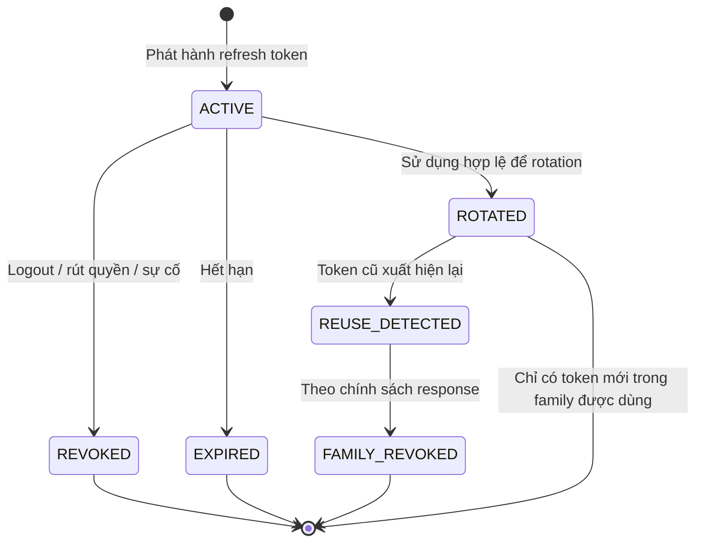
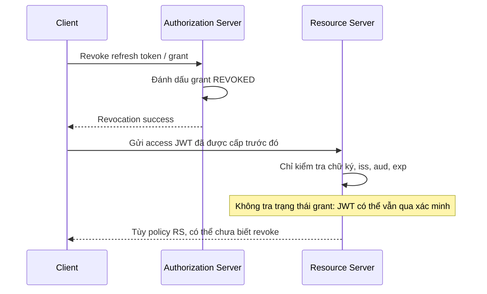

# Thu hồi token làm mới

**Refresh token** (token làm mới) cho phép client yêu cầu **access token mới** từ authorization server (AS) trong phạm vi grant đã được cấp mà không phải thực hiện lại toàn bộ luồng xác thực người dùng ở mỗi lần access token hết hạn. Chính vì có thể kéo dài khả năng truy cập, refresh token là **credential nhạy cảm**: nếu bị đánh cắp, kẻ tấn công có thể cố gắng tạo nhiều access token mới ngay cả sau khi access token cũ đã hết hạn.

**Thu hồi refresh token** (*refresh token revocation*) là hành động khiến authorization server **không còn chấp nhận refresh token đó để phát hành token tiếp theo**, ngay cả khi giá trị token chưa tới thời điểm hết hạn. Tùy mô hình, thao tác còn phải vô hiệu hóa **grant, phiên đăng nhập, toàn bộ refresh token family** và/hoặc các access token có liên quan. Phần quan trọng nhất là **làm mất hiệu lực tại phía AS và bảo đảm token endpoint từ chối lần sử dụng kế tiếp**; việc xóa một chuỗi token khỏi trình duyệt chỉ là thao tác ở phía client.

Bài thuộc chương **Refresh token** của module **SECURITY_TOKEN_SECURITY_FUNDAMENTALS**. Trong phạm vi mô hình tin cậy và vòng đời token bảo mật, bài kết nối việc thu hồi với JWT, opaque token, access token, refresh token, OAuth 2.0/OIDC, phát hành, kiểm tra claims, scope, audience, lưu trữ và phòng chống đánh cắp hoặc phát lại token.

## 1. Mục tiêu học tập

Sau bài học, bạn có thể:

1. Giải thích refresh token, quyền sử dụng và lý do phải thu hồi ở phía authorization server.
2. Phân biệt **xóa token tại client**, **thu hồi một refresh token**, **thu hồi token family**, **thu hồi grant** và **kết thúc phiên người dùng**.
3. Mô tả OAuth 2.0 Token Revocation Endpoint theo RFC 7009, bao gồm tính idempotent ở mức giao diện và giới hạn thông tin phản hồi.
4. Phân biệt hậu quả của thu hồi refresh token với hiệu lực của **access token JWT tự chứa** và **opaque access token** đã phát hành.
5. Thiết kế **refresh token rotation**, phát hiện reuse và phản ứng trước tình huống token cũ bị phát lại.
6. Lưu trạng thái và dấu vết token an toàn bằng hash/HMAC của giá trị token thay vì ghi token nguyên văn vào log.
7. Xử lý **đồng thời, retry, timeout, logout, thay đổi mật khẩu, rút quyền client** và lỗi database theo hướng fail closed.
8. Tạo kịch bản kiểm thử Java/Spring, ma trận âm tính và quy trình ứng phó token bị lộ.

## 2. Ôn lại vai trò của refresh token

OAuth 2.0 phân biệt mục đích của nhiều loại credential:

| Loại | Nơi được sử dụng | Mục đích | Tác động khi bị đánh cắp |
| --- | --- | --- | --- |
| **Access token** | Resource server/API đúng audience | Truy cập tài nguyên theo scope và policy | Có thể gọi API khi token còn được chấp nhận |
| **Refresh token** | **Token endpoint của AS** | Xin access token mới trong giới hạn grant | Có thể duy trì khả năng truy cập bằng cách làm mới |
| **OIDC ID token** | OIDC client/relying party | Trình bày kết quả xác thực danh tính | Có thể lộ claims, bị dùng sai nếu hệ thống mắc token confusion |
| **Authorization code** | Token endpoint, trong luồng code exchange | Đổi lấy token theo ràng buộc client/PKCE | Có nguy cơ bị đổi trái phép nếu ràng buộc bị phá vỡ |

Refresh token **không phải** credential để gửi cho API nghiệp vụ:

```http
POST /oauth2/token HTTP/1.1
Host: auth.example.test
Content-Type: application/x-www-form-urlencoded

grant_type=refresh_token&refresh_token=<REFRESH_TOKEN_MINH_HOA>
```

Trong thực tế token endpoint cũng phải kiểm tra **client identity/binding** theo loại client và cơ chế xác thực đã đăng ký; request trên chỉ minh họa phần thân. Không gửi refresh token tới `GET /api/orders` hay bất kỳ resource server nào thay access token.

Một access token có thể là **JWT tự chứa** (thường resource server xác minh chữ ký và claims cục bộ) hoặc **opaque/reference token** (thường được xác minh qua tra cứu/introspection). Refresh token cũng có thể có nhiều định dạng, nhưng **client phải coi nó là bí mật không cần giải mã**. Dù refresh token trông như JWT, AS vẫn cần cơ chế tin cậy để xác định token **có bị thu hồi hay không**.

### 2.1. Vì sao refresh token có rủi ro đặc biệt?

Access token có thể chỉ sống ngắn, ví dụ 10 phút. Refresh token có thể có vòng đời dài hơn để duy trì phiên sử dụng ứng dụng. Nếu attacker có refresh token còn hiệu lực, họ có thể xin access token mới ngay sau khi access token hiện tại hết hạn, **trừ khi** AS phát hiện/thu hồi hoặc cơ chế ràng buộc người gửi ngăn được.

Vì vậy, cần xem refresh token như một **quyền tạo credential tiếp theo**, không như một cache tiện lợi của access token.

### 2.2. “Đăng xuất” và “thu hồi refresh token” không đồng nghĩa

Một ứng dụng có thể xóa refresh token khỏi bộ nhớ hoặc storage khi user bấm Logout. Điều đó **không** vô hiệu hóa những bản sao mà attacker đã lấy từ trước. Chỉ AS hoặc cơ chế trạng thái được AS tin cậy mới có thể ngăn các bản sao đó sử dụng token endpoint.

Tùy luồng OIDC và kiến trúc SSO, kết thúc phiên đăng nhập tại identity provider, logout một client và thu hồi refresh token còn có **phạm vi tác động khác nhau**. Phải xác định yêu cầu nghiệp vụ thay vì dùng chung một cờ `logout=true` cho mọi trường hợp.

## 3. Xác định chính xác đối tượng cần thu hồi

Không phải hệ thống nào cũng định nghĩa “revoke token” ở cùng một mức. Một lệnh thu hồi cần có **phạm vi** rõ ràng:

| Phạm vi | Điều bị vô hiệu hóa | Ví dụ sử dụng |
| --- | --- | --- |
| **Một refresh token cụ thể** | Giá trị token đó không còn đổi được token | Đóng một credential bị nghi lộ |
| **Refresh token family** | Toàn bộ chuỗi token sinh ra từ cùng quá trình rotation | Phát hiện refresh token cũ bị replay |
| **Một authorization grant** | Quyền client được cấp trong một lần ủy quyền/phiên cụ thể | User rút quyền của một ứng dụng |
| **Một phiên trên thiết bị** | Credential gắn với session/device đó | “Đăng xuất thiết bị này” |
| **Tất cả phiên của user với một client** | Nhiều grant/token family của cùng client | “Đăng xuất mọi thiết bị của ứng dụng” |
| **Tất cả grant của user** | Nhiều client/thiết bị theo chính sách khẩn cấp | Khóa tài khoản hoặc xử lý sự cố nghiêm trọng |
| **Credential của một client/service** | Grant liên quan client bị thu hồi hoặc disabled | Client secret bị lộ, client bị chặn |

**Thu hồi một refresh token đã được rotation không nhất thiết đủ để vô hiệu hóa refresh token mới nhất trong cùng family** nếu hệ thống chỉ đánh dấu một record. Khi mục đích là kết thúc phiên, cần truy ngược tới **family/grant/session** còn hoạt động rồi thu hồi đúng phạm vi.

Ngược lại, một user bấm đăng xuất trên điện thoại không nhất thiết muốn đăng xuất thêm trên laptop. Hệ thống cần cho người dùng và người quản trị biết rõ mức độ thu hồi.

### 3.1. Grant và family: hai khái niệm liên quan nhưng không đồng nhất

**Grant** là quyền được AS cấp theo OAuth cho một client/chủ thể/resource/scope; **token family** là chuỗi những refresh token liên tiếp xuất phát từ một grant hoặc một phiên theo chính sách rotation.

```text
Authorization grant G-42
  Client: mobile-app
  Subject: user-42
  Resource: orders-api
  Approved scope: orders:read
  Session/device: device-A

Refresh token family F-42:
  RT1 --rotate--> RT2 --rotate--> RT3 (current active)
```

Nếu RT1 đã sử dụng để sinh RT2, RT1 phải **không được sử dụng để tạo thêm token mới**. Khi RT1 xuất hiện lần nữa, nó có thể là dấu hiệu token cũ bị sao chép; chính sách reuse detection có thể thu hồi **cả F-42**, không chỉ RT1. Nếu G-42 bị thu hồi thì toàn bộ family gắn với grant đó không còn hợp lệ.

## 4. Khi nào cần thu hồi refresh token?

### 4.1. Những sự kiện phổ biến

1. **Người dùng đăng xuất:** revoke grant hoặc family của phiên/thiết bị đang đăng xuất.
2. **“Đăng xuất mọi thiết bị”:** revoke các grant/family trong phạm vi người dùng và ứng dụng; có thể mở rộng theo chính sách tài khoản.
3. **Refresh token bị báo mất/có dấu hiệu đánh cắp:** revoke token/family, thường cần điều tra những token liên quan.
4. **Phát hiện reuse sau rotation:** coi là tín hiệu tấn công tiềm tàng; thu hồi family theo chính sách.
5. **Đổi mật khẩu/reset credential:** quyết định có thu hồi các phiên trước đó, nhất là khi nghi tài khoản bị xâm nhập.
6. **Tài khoản bị khóa, xóa hoặc mất tư cách truy cập:** không tiếp tục cấp token mới cho chủ thể không còn hợp lệ.
7. **User rút consent hoặc quyền client:** revoke grant liên quan thay vì chỉ xóa token ở UI.
8. **Client bị disable hoặc secret/key bị lộ:** ngăn các refresh grant liên quan tiếp tục được sử dụng.
9. **Rủi ro tăng cao:** thiết bị bị đánh cắp, hoạt động bất thường, chính sách step-up không đạt.
10. **Phiên hết hạn tuyệt đối hoặc không hoạt động quá lâu:** AS tự làm token/phiên không còn sử dụng được.

### 4.2. Không phải mọi thay đổi quyền đều đòi khóa tất cả phiên

Nếu user mất quyền `payments:refund`, AS phải bảo đảm những access token **mới** không còn được cấp quyền đó. Với quyền có thể gây hậu quả tức thời, RS còn cần chiến lược **kiểm tra quyền hiện tại hoặc thu hồi access token còn hạn**. Phạm vi thu hồi refresh token nên phù hợp mức rủi ro, không mặc định xóa tất cả thiết bị khi policy chỉ yêu cầu rút một scope.

### 4.3. Thời hạn không thay thế thu hồi

Một refresh token có thể có:

- **Hạn tuyệt đối**: sau một mốc thời gian, grant/refresh token không còn gia hạn được.
- **Hạn không hoạt động**: refresh token bị vô hiệu nếu không dùng trong một khoảng thời gian được quy định.
- **Hạn chính sách**: người dùng/client bị khóa, consent hết hiệu lực, hoặc phải xác thực lại.

Đạt thời hạn thì token bị từ chối; nhưng **thu hồi chủ động** xử lý tình huống cần vô hiệu hóa **trước hạn**. Không nên chỉ giảm TTL mà bỏ thiết kế thu hồi.

## 5. RFC 7009 — OAuth 2.0 Token Revocation

**RFC 7009** định nghĩa cách client yêu cầu AS thu hồi một token qua **revocation endpoint**. AS xử lý token tại backend, cập nhật trạng thái cấp phát và trả response phù hợp. Endpoint này cần được truy cập qua TLS và client phải tuân thủ yêu cầu xác thực/ràng buộc của AS.

### 5.1. Ví dụ yêu cầu thu hồi

```http
POST /oauth2/revoke HTTP/1.1
Host: auth.example.test
Content-Type: application/x-www-form-urlencoded
Authorization: Basic <CLIENT_AUTH_MINH_HOA>

token=<REFRESH_TOKEN_MINH_HOA>&token_type_hint=refresh_token
```

Các giá trị trong dấu ngoặc nhọn là **placeholder không sử dụng được**, không phải credential. Ví dụ dùng `Basic` chỉ để minh họa **một** phương thức client authentication của confidential client; triển khai thực tế có thể dùng `private_key_jwt`, mTLS hoặc cơ chế khác theo đăng ký client. Public client không có client secret phải được ràng buộc/xử lý theo chính sách và đặc tả, không tự giả tạo một secret.

Thành phần:

| Trường | Ý nghĩa |
| --- | --- |
| `token` | Giá trị token client muốn thu hồi; là tham số bắt buộc |
| `token_type_hint` | Gợi ý tra cứu, ví dụ `refresh_token`; **không** tự chứng minh loại token và không phải trường bắt buộc |
| Client credentials/binding | Đảm bảo request thuộc đúng client và quyền revocation tương ứng |
| HTTPS/TLS | Giảm nguy cơ token bị lộ khi gửi đến AS |

Không gọi revocation endpoint bằng GET có token trong URL. Không gửi token qua query string hoặc log request body của endpoint này.

### 5.2. Phản hồi khi thu hồi thành công

Một response điển hình:

```http
HTTP/1.1 200 OK
Cache-Control: no-store
```

Điểm quan trọng: theo RFC 7009, AS trả **HTTP 200** cho yêu cầu thu hồi được xử lý thành công **ngay cả khi token cung cấp không hợp lệ**, nhằm không tiết lộ một token có tồn tại/hợp lệ hay không.

Như vậy:

- **HTTP 200 không chứng minh token từng tồn tại hoặc đã còn hiệu lực trước đó.**
- Revocation endpoint nên thể hiện hành vi **idempotent** từ góc nhìn client: gửi lại token đã bị thu hồi không tạo một grant mới hay tiết lộ trạng thái nội bộ.
- Request không được xác thực đúng hoặc sai định dạng vẫn có thể nhận **mã lỗi theo OAuth**. Không xem “mọi request luôn phải 200” là đúng.
- `token_type_hint` chỉ là gợi ý; AS phải tự xác định token và phạm vi được phép thu hồi.

### 5.3. AS cần xác minh quyền thu hồi

AS không được để một client biết token của client khác rồi tự ý thu hồi grant của bên đó nếu không có quyền. Cần kiểm tra:

1. Client identity hoặc client binding theo loại client.
2. Token có được AS quản lý và thuộc client/grant mà request được phép tác động không.
3. Phạm vi revoke được định nghĩa (token, family, grant hay phiên).
4. Việc cập nhật trạng thái được **commit bền vững** trước khi trả kết quả thành công khi token hợp lệ cần thu hồi.
5. Response không rò rỉ token hoặc thông tin giúp đoán giá trị token.

Đối với token không biết hoặc không thuộc phạm vi được phép, AS vẫn phải xử lý theo đặc tả/giao thức mà không tạo ra **oracle phân biệt token của người khác**.

### 5.4. Thu hồi refresh token có kéo theo access token không?

RFC 7009 nêu hướng xử lý liên quan các token thuộc cùng authorization grant. Khi thu hồi refresh token và AS có khả năng thu hồi access token, AS **nên** vô hiệu hóa những access token có liên quan theo khuyến nghị của đặc tả; tuy nhiên **khả năng nhìn thấy hiệu lực thu hồi tại resource server phụ thuộc kiến trúc**.

Hãy tách ba việc:

1. **Ngừng cấp mới:** token endpoint từ chối refresh token bị thu hồi.
2. **Đánh dấu access token liên quan bị thu hồi ở phía AS:** lưu trạng thái, danh sách token hoặc phiên liên quan.
3. **Bảo đảm RS thực thi thu hồi:** resource server có thể introspection, kiểm tra denylist/phiên hoặc áp dụng một cơ chế khác thay vì chỉ dựa trên chữ ký JWT và `exp`.

**Không giả định rằng revocation endpoint trả 200 sẽ khiến mọi JWT access token đã phát lập tức vô hiệu ở tất cả API.** Nếu RS không tra trạng thái thu hồi, token JWT còn hạn vẫn có thể được chấp nhận.

## 6. Token endpoint sau khi refresh token bị thu hồi

Một client sau khi nhận revocation success nhưng vẫn cố sử dụng refresh token cũ:

```http
POST /oauth2/token HTTP/1.1
Host: auth.example.test
Content-Type: application/x-www-form-urlencoded

grant_type=refresh_token&refresh_token=<TOKEN_DA_BI_THU_HOI>
```

Token endpoint phải kiểm tra trạng thái và **không cấp access token mới**. Một phản hồi OAuth thông thường cho refresh token không còn hiệu lực là:

```http
HTTP/1.1 400 Bad Request
Content-Type: application/json
Cache-Control: no-store

{"error":"invalid_grant"}
```

`invalid_grant` có thể đại diện cho refresh token không hợp lệ, hết hạn, đã bị thu hồi hoặc không thuộc đúng grant/client; không cần tiết lộ lý do nội bộ cho client.

Lưu ý phân biệt:

- **`invalid_grant`:** token/grant làm mới không còn hợp lệ.
- **`invalid_client`:** client authentication thất bại khi áp dụng.
- **Lỗi máy chủ/nguồn trạng thái:** không được “cho qua tạm” và phát token; phản hồi theo hợp đồng lỗi kỹ thuật phù hợp.

Từ góc nhìn UX, client nên **xóa credential cục bộ không còn sử dụng được và khởi động lại luồng ủy quyền/đăng nhập** khi nhận `invalid_grant`, thay vì lặp refresh vô hạn.

## 7. Mô hình trạng thái để thu hồi có hiệu lực

AS cần có nguồn sự thật server-side cho token/grant còn hợp lệ:



Đây là sơ đồ khái niệm; trong triển khai, record token cũ `ROTATED` có thể được **giữ làm dấu vết** cho tới khi family hết hiệu lực để phát hiện reuse. Không xóa record đã tiêu thụ ngay nếu chính sách cần phát hiện token bị sao chép.

### 7.1. Trạng thái grant và trạng thái token là hai lớp

Một mô hình nhất quán:

```text
GRANT:
  ACTIVE | REVOKED | EXPIRED | SUSPENDED

REFRESH_TOKEN_RECORD:
  ACTIVE | ROTATED | REVOKED | EXPIRED

TOKEN_FAMILY:
  ACTIVE | REVOKED
```

Chỉ cho phép refresh khi **tất cả điều kiện cần** đúng:

```text
canRefresh =
    grant.status == ACTIVE
    AND family.status == ACTIVE
    AND refreshRecord.status == ACTIVE
    AND refreshRecord.expiresAt > now
    AND grant.absoluteExpiresAt > now
    AND clientBindingValid
    AND senderConstraintValidIfRequired
    AND subjectAndCurrentPolicyAllowRefresh
    AND requestedScopesWithinApprovedGrant
```

Nếu source trạng thái không đọc được, kết quả là **không cấp token mới**. Không dùng cache trạng thái “ACTIVE” vô hạn hoặc suy ra hợp lệ từ chữ ký refresh JWT trong khi không tra được trạng thái thu hồi.

### 7.2. Thiết kế bảng dữ liệu minh họa

```text
oauth_grant
  id
  subject_id
  client_id
  session_id
  resource_ids / approved_scopes
  status
  created_at
  absolute_expires_at
  revoked_at
  revoked_reason
  version

refresh_token_family
  id
  grant_id
  current_token_record_id
  status
  created_at
  expires_at
  revoked_at
  version

refresh_token_record
  id
  family_id
  token_digest (UNIQUE)
  parent_record_id (nullable)
  status
  issued_at
  expires_at
  rotated_at
  revoked_at
  client_binding_reference
  sender_key_thumbprint (nullable)
```

Các tên cột chỉ là ví dụ. Không nên lưu **raw refresh token** có thể dùng ngay trong database chỉ để tra cứu. Nên lưu **giá trị dẫn xuất phục vụ lookup** (hash/HMAC) và các metadata cần thiết, theo chính sách bảo vệ dữ liệu/retention.

Nếu sử dụng token tự mô tả như JWT làm refresh token, claim `exp` hay chữ ký **không đủ chứng minh nó chưa bị thu hồi**. Cần đối chiếu `jti`/grant/family hoặc định danh tương ứng với trạng thái server đáng tin; không dùng một bộ xác minh “offline” đơn thuần tại token endpoint để cấp tiếp.

## 8. Lưu trữ refresh token an toàn

### 8.1. Sinh token ngẫu nhiên, không đoán được

Với refresh token opaque, AS nên dùng **bộ sinh số ngẫu nhiên mật mã** và đủ entropy theo mô hình rủi ro. Không dùng:

- Chuỗi tăng dần hoặc mã người dùng làm token.
- `UUID`/timestamp tự ghép theo công thức dễ đoán mà không đánh giá entropy.
- JWT mang mật khẩu, mã khôi phục, private key hoặc secret trong payload.
- Access token được tái sử dụng nguyên chuỗi như refresh token.

Client chỉ nhận giá trị token qua **kênh TLS** và lưu trong cơ chế phù hợp loại ứng dụng.

### 8.2. Chỉ lưu digest của token nếu không cần phục hồi nguyên token

Một cách triển khai:

```text
rawRefreshToken = cryptographicallySecureRandomBytes()
refreshTokenToClient = BASE64URL(rawRefreshToken)
lookupDigest = HMAC-SHA256(serverLookupKey, refreshTokenToClient)

database stores:
  lookupDigest
  family_id, grant_id, client_id
  status, expires_at, rotated_at

database and logs do NOT store rawRefreshToken
```

**HMAC** với khóa riêng giúp lookup ổn định và giảm nguy cơ một người có database snapshot dò lại giá trị token, với điều kiện khóa được bảo vệ. Với token **thực sự ngẫu nhiên, entropy cao**, một hash mật mã phù hợp cũng có thể là lựa chọn; không áp dụng máy móc chiến lược password hashing cho mọi token mà không xét entropy và nhu cầu lookup.

Không log input trước khi tính digest. Không cho `toString()` của DTO hoặc exception ghi token ra log. Đầu ra digest/HMAC vẫn có thể là định danh theo dõi, nên chỉ log nếu có nhu cầu được phê duyệt.

### 8.3. Lưu refresh token tại client

| Loại client | Nguyên tắc bảo vệ |
| --- | --- |
| Backend/confidential client | Giữ token trong kho secret/session phía server, hạn chế quyền đọc |
| BFF cho ứng dụng web | Refresh token ở server; browser chỉ giữ session cookie an toàn với `Secure`, `HttpOnly`, `SameSite` theo kiến trúc |
| SPA/public browser client | Cân nhắc rủi ro XSS và token theft; áp dụng chính sách provider, rotation hoặc sender constraint khi thích hợp |
| Mobile native app | Dùng secure storage do hệ điều hành hỗ trợ, tránh ghi vào backup/log/crash report |
| CLI/desktop | Dùng keychain/credential store phù hợp, khóa quyền truy cập và có chức năng logout/revoke |

**Cookie HttpOnly không làm ứng dụng miễn nhiễm CSRF** và không bảo vệ hoàn toàn trước XSS có thể thực hiện request thay người dùng. Cần thiết kế CSRF/SameSite/CORS, cookie scope và bảo vệ client phù hợp.

## 9. Refresh token rotation

**Rotation** là kỹ thuật AS phát refresh token **mới** khi client sử dụng hợp lệ refresh token hiện tại; refresh token **cũ được đánh dấu đã sử dụng và không còn dùng để refresh tiếp**.

```mermaid
sequenceDiagram
    participant C as Client
    participant AS as Authorization Server
    participant DB as Refresh token store
    C->>AS: POST /token với RT-1
    AS->>DB: Lock family, kiểm tra RT-1 ACTIVE và grant ACTIVE
    DB-->>AS: Cho phép rotation
    AS->>DB: Đánh dấu RT-1 ROTATED, lưu RT-2 ACTIVE
    DB-->>AS: Commit thành công
    AS-->>C: Access token mới + RT-2
    C->>AS: POST /token với RT-2
    AS->>DB: RT-2 ACTIVE; rotate sang RT-3
    AS-->>C: Access token mới + RT-3
    Note over C,AS: RT-1 và RT-2 không còn là refresh token hiện hành
```

Một family có chuỗi:

```text
RT-1 (ROTATED) -> RT-2 (ROTATED) -> RT-3 (ACTIVE)
```

Nếu kẻ tấn công lấy RT-1 từ storage hoặc log và dùng lại, đó là sự kiện đáng nghi: **RT-1 đã bị tiêu thụ**. Dù AS không biết chắc ai là attacker, AS có thể phát hiện sự bất thường và **revoke toàn family** để cả RT-3 không tiếp tục tạo token mới.

### 9.1. Rotation và reuse detection khác nhau

| Cơ chế | Công việc | Nếu không có |
| --- | --- | --- |
| **Rotation** | Token cũ không dùng lại được sau refresh thành công | Một refresh token có thể được dùng nhiều lần cho tới khi hết hạn |
| **Reuse detection** | Nhận biết một token đã rotation bị dùng lại | AS có thể chỉ trả lỗi cho RT cũ mà không biết family đã bị sao chép |
| **Family revocation** | Vô hiệu token mới nhất và mọi nhánh còn hiệu lực | Attacker đã có RT mới có thể tiếp tục sử dụng |
| **Sender constraint** | Yêu cầu bên dùng token chứng minh sở hữu khóa/credential đã ràng buộc | Sao chép chuỗi token có thể đủ để refresh nếu là bearer |

Theo OAuth 2.0 Security Best Current Practice (RFC 9700), public client sử dụng refresh token cần được bảo vệ bằng **sender-constraining hoặc refresh token rotation** để phát hiện/chặn replay theo mô hình được hỗ trợ. Các cơ chế có đánh đổi riêng và **không thay thế** thu hồi grant khi logout hoặc incident.

### 9.2. Khi phát hiện reuse, thu hồi phạm vi nào?

Một chính sách chặt chẽ thường:

1. Tra token digest trong dữ liệu server.
2. Nhận biết record ở trạng thái `ROTATED`/đã tiêu thụ.
3. Xác định family/grant liên quan và bảo đảm client binding phù hợp.
4. **Thu hồi family hiện hành** (hoặc grant theo chính sách) trong một giao dịch an toàn.
5. Không cấp access/refresh token từ request nghi vấn.
6. Ghi security event không chứa raw token, thông báo/yêu cầu reauthentication khi thích hợp.
7. Xem xét trạng thái các access token đã phát từ family và phương án chặn sớm ở RS.

**Không nên coi mọi request token không hợp lệ là “reuse detected”**. Token ngẫu nhiên không tồn tại, token sai client, token hết hạn và token đã bị thu hồi do logout cần được phân loại để tránh tạo sự cố giả hoặc cho phép attacker dùng một token không biết để kích hoạt thu hồi phiên người khác.

### 9.3. Retry mạng và lỗi false positive

Giả sử client gửi RT-1, AS đã commit rotation thành RT-2 nhưng response mất trên mạng. Client không biết RT-2 và gửi lại RT-1. Một cơ chế reuse detection đơn giản sẽ xem đây là replay và thu hồi family.

Đây là **đánh đổi giữa bảo mật và khả dụng**. Một số hệ thống thiết kế **cửa sổ retry/idempotency có ràng buộc chặt với client và bằng chứng người gửi** để giảm false positive; những ngoại lệ đó cần được phân tích nguy cơ, kiểm thử race và không được biến token cũ thành token dùng lại tự do. Với hệ thống không có idempotent retry an toàn, cách đơn giản hơn là từ chối refresh và yêu cầu đăng nhập lại.

Không mặc định cho RT-1 và RT-2 cùng hợp lệ trong một “grace period” dài, vì điều đó có thể làm vô hiệu mục tiêu rotation.

## 10. Concurrency: không được phát hai nhánh token

Một lỗi thường gặp ở AS phân tán:

```text
Request A đọc RT-1.status = ACTIVE
Request B đọc RT-1.status = ACTIVE
Request A tạo RT-2 và đánh dấu RT-1 ROTATED
Request B tạo RT-3 và cũng đánh dấu RT-1 ROTATED
Kết quả: hai nhánh refresh token có thể còn hiệu lực.
```

Chỉ dùng câu lệnh `if (token.isActive())` ở application memory **không đủ** khi nhiều node cùng xử lý. Cần cập nhật trạng thái **atomic** bằng transaction, row lock, optimistic concurrency/CAS hoặc thiết kế tương đương.

### 10.1. Điều kiện bất biến quan trọng

Trong mô hình **một active refresh token trên một family**:

```text
For each active token family:
  numberOfActiveRefreshTokens <= 1

And:
  an ACTIVE token can be consumed for rotation at most once
  a REVOKED grant can never issue another access/refresh token
  a ROTATED token cannot create another child grant
```

Những điều kiện này cần được thực thi tại database/store hoặc một thành phần đồng bộ **được mọi node AS chia sẻ**, không chỉ kiểm thử qua API ở một instance.

### 10.2. Ví dụ chuyển trạng thái atomically

```sql
-- Minh họa một bước bảo vệ; SQL thực tế tùy database.
UPDATE refresh_token_record
SET status = 'ROTATED', rotated_at = CURRENT_TIMESTAMP
WHERE id = :record_id
  AND status = 'ACTIVE';

-- Chỉ khi affected_rows == 1 mới được tiếp tục.
-- Các thao tác khóa family, tạo RT mới và commit phải được
-- phối hợp cùng một transaction/consistency boundary.
```

Nếu `affected_rows = 0`, **không được** tự phát token mới. Phải đọc lại trạng thái có kiểm soát và xác định đây là request trùng, token đã thu hồi, hết hạn hay reuse nghi vấn.

### 10.3. Logout đua với refresh

Hai yêu cầu xảy ra gần như đồng thời:

1. Client A gọi `/token` để đổi refresh token.
2. Client/user gọi `/revoke` hoặc Logout.

Yêu cầu: sau khi revocation được commit, **không còn token mới nào có thể được phát từ grant đã bị thu hồi**. Thiết kế nên lock/compare-and-set trên **grant/family**, không chỉ token record, rồi xác định thứ tự tuyến tính (*linearization point*) của refresh và revoke.

Nếu refresh hoàn tất **trước** revoke, response có thể đang trên mạng; AS và RS phải có chính sách đối với access token vừa được cấp. Nếu revoke hoàn tất **trước**, refresh phải bị từ chối. Không xem HTTP request arrival time là bằng chứng duy nhất cho thứ tự thực thi.

## 11. Java/Spring: ví dụ service thu hồi refresh token

Đoạn code dưới minh họa **gating ở phía AS**, không phải framework OAuth server chạy độc lập. Các interface như `RefreshTokenStore`, `GrantStore`, `AuthenticatedClient` và `TokenDigest` là thành phần giả định cần được hiện thực, test transaction và kiểm soát client binding.

### 11.1. Một revocation service idempotent, không log token

```java
@Service
public class RefreshRevocationService {
    private final RefreshTokenStore refreshTokens;
    private final GrantStore grants;
    private final TokenDigest digests;
    private final SecurityAudit audit;

    // Constructor injection được lược bỏ.

    @Transactional
    public void revokeRefreshToken(
        String rawRefreshToken,
        AuthenticatedClient caller
    ) {
        // Không log rawRefreshToken, request body hoặc token digest.
        String digest = digests.hmac(rawRefreshToken);

        // Store phải đảm bảo tra cứu và khóa nhất quán.
        Optional<RefreshTokenRecord> found =
            refreshTokens.findByDigestForUpdate(digest);

        if (found.isEmpty()) {
            return; // Không tạo oracle tiết lộ token có tồn tại.
        }

        RefreshTokenRecord record = found.get();
        if (!record.belongsToClient(caller.clientId())) {
            return; // Không tiết lộ trạng thái token của client khác.
        }

        Grant grant = grants.findByIdForUpdate(record.grantId())
            .orElseThrow(IllegalStateException::new);

        if (!grant.belongsToClient(caller.clientId())) {
            return;
        }

        if (grant.isActive()) {
            grant.revoke("CLIENT_REQUEST");
            grants.save(grant);
            refreshTokens.revokeFamily(record.familyId());
            audit.record("REFRESH_GRANT_REVOKED",
                         grant.safeAuditReference(), caller.clientId());
        }
    }
}
```

**Ý định của code:** làm cho **grant/family không còn được token endpoint sử dụng**, thay vì chỉ xóa chuỗi token. Trong ví dụ, phạm vi revoke là **grant/family**, không chỉ một record. Một triển khai khác có thể chọn phạm vi hẹp hơn nếu hợp đồng cho phép; cần nêu rõ.

**Điểm bắt buộc khi hiện thực:**

- `caller` phải được xác thực/ràng buộc theo loại client và chính sách. Không tin `client_id` do body tự khai nếu nó chưa được AS kiểm tra theo quy tắc của public/confidential client.
- `hmac` sử dụng khóa lookup chuyên dụng từ secret manager; không dùng secret bị ghi vào log.
- Lock và update phải nhất quán trên nhiều node AS; `revokeFamily` và `grant.revoke` cần nằm trong một consistency boundary.
- Endpoint chỉ trả success khi update bền vững đã commit. Nếu datastore lỗi, không giả vờ đã hoàn tất.
- Revoke một token cũ vẫn cần có khả năng xác định **family còn hoạt động** theo chính sách, không để một record đã rotation trở thành đường vòng.
- Security audit chỉ ghi **safe reference** và reason code, không ghi raw refresh token, access token hoặc thông tin định danh quá mức.

### 11.2. Revocation endpoint: không tự viết giao thức ngoài chuẩn

Khi dùng Spring Authorization Server hoặc thư viện OAuth server tương đương, nên **cấu hình revocation endpoint theo framework** và bổ sung transaction/policy cần thiết. Không cần xây lại phần parse request, client authentication và response handling vốn đã được hỗ trợ.

Mã giả ở controller, để minh họa ranh giới:

```text
POST /oauth2/revoke
    validate form request and client binding
    if malformed/unauthorized:
        return OAuth protocol error

    revoke on trusted server-side store
    if store update fails:
        return appropriate server error (not false success)

    return HTTP 200 without exposing token state
```

Không thêm response `{"was_valid": true, "user": "..." }` để debug; điều này biến revocation endpoint thành nơi tra cứu token của người khác.

## 12. Java/Spring: phát hiện reuse trong refresh flow

Trong một ứng dụng có rotation, token endpoint phải phân biệt **token hiện hành** với **token đã tiêu thụ**. Mã sau chỉ diễn tả quyết định trong service; không phải API OAuth Server hoàn chỉnh.

```java
@Transactional
public RefreshOutcome rotate(
    String rawRefreshToken,
    AuthenticatedClient caller
) {
    String digest = digests.hmac(rawRefreshToken);
    Optional<RefreshTokenRecord> found =
        tokens.findByDigestForUpdate(digest);

    if (found.isEmpty()) {
        return RefreshOutcome.invalidGrant();
    }

    RefreshTokenRecord old = found.get();
    if (!old.belongsToClient(caller.clientId())) {
        return RefreshOutcome.invalidGrant();
    }

    Grant grant = grants.findByIdForUpdate(old.grantId())
        .orElseThrow(IllegalStateException::new);
    TokenFamily family = families.findByIdForUpdate(old.familyId())
        .orElseThrow(IllegalStateException::new);

    if (!grant.isActive() || !family.isActive()) {
        return RefreshOutcome.invalidGrant();
    }

    // Chỉ xét reuse sau khi xác nhận record thuộc đúng client/grant.
    if (old.isRotated()) {
        family.revoke("REFRESH_REUSE_DETECTED");
        families.save(family);
        audit.record("REFRESH_REUSE_DETECTED",
                     grant.safeAuditReference(), caller.clientId());
        return RefreshOutcome.invalidGrant();
        // Trả result, KHÔNG throw tại đây nếu throw làm rollback revoke.
    }

    if (!old.isActive()
            || old.isExpired()
            || !senderBinding.matches(old, caller)
            || !grantPolicy.allowsRefreshNow(grant, caller)) {
        return RefreshOutcome.invalidGrant();
    }

    String nextRaw = secureTokenGenerator.generate();
    RefreshTokenRecord next = RefreshTokenRecord.active(
        family.id(), grant.id(), old.id(),
        digests.hmac(nextRaw), grant.refreshTokenExpiry()
    );

    old.markRotated();
    tokens.save(old);
    tokens.save(next);
    family.setCurrentTokenRecordId(next.id());
    families.save(family);

    return RefreshOutcome.success(nextRaw, grant.approvedScopes());
}
```

**Lưu ý thiết kế quan trọng:**

- Code dựa trên sự tồn tại của **lock family/grant** hoặc cập nhật atomic tương đương, và giả định chỉ có một `ACTIVE` token trên family.
- Việc **thu hồi family do reuse phải được commit**; nếu ném exception khiến transaction rollback thì kết quả “revoke” chỉ tồn tại trong bộ nhớ. Đoạn ví dụ trả `RefreshOutcome.invalidGrant()` để transaction có thể commit thay đổi.
- Không chỉ dựa vào `old.status=ROTATED` nếu record không còn thuộc đúng client/grant hoặc đã có lý do thu hồi khác; chính sách reuse phải tránh false alarm và abuse.
- Token response chứa `nextRaw` chỉ được gửi **sau commit**. Trường hợp tạo/ký access token thất bại sau commit cần chính sách retry/idempotency hoặc yêu cầu đăng nhập lại, không tự quay về chấp nhận RT cũ.
- `grantPolicy` phải kiểm tra các ràng buộc về client, subject, scope, audience, phiên và tình trạng thu hồi hiện tại.
- `senderBinding` cần kiểm tra bằng chứng thực tế nếu token sender-constrained (ví dụ mTLS/DPoP theo profile), không chỉ kiểm tra một chuỗi do client tự khai.

Trong production, ưu tiên framework OAuth được kiểm thử thay vì tự dựng token endpoint, và giữ các quy tắc trạng thái/rotation trong thành phần có transaction đã được thiết kế đúng.

## 13. Kết hợp thu hồi với JWT access token và opaque access token

Một hiểu lầm phổ biến: “đã thu hồi refresh token thì access token cũ tự hết hiệu lực”. Điều này **không luôn đúng**.

### 13.1. JWT access token tự chứa

JWT access token thường có `iss`, `aud`, `exp`, `scope` và chữ ký. RS có thể kiểm tra token **cục bộ** bằng khóa công khai:



Để chặn sớm access JWT, có thể thêm một hoặc nhiều cơ chế:

- TTL access token ngắn để giới hạn cửa sổ còn hiệu lực.
- Denylist theo `jti` hoặc tham chiếu phiên/grant trong token.
- Tra cứu session version hoặc trạng thái grant tại nguồn tin cậy.
- Kiểm tra policy hiện tại ở endpoint nhạy cảm.
- Introspection/ngữ cảnh revocation event với cache/invalidation được kiểm soát.

**Không** coi một chữ ký đúng là bằng chứng refresh grant đang còn hiệu lực. Ngược lại, cũng không tự suy rằng mọi JWT đều phải tra AS ở mỗi request; mức kiểm soát phụ thuộc chính sách thu hồi và khả năng chấp nhận độ trễ.

### 13.2. Opaque/reference access token

Với opaque access token, RS thường gửi token đến introspection endpoint đáng tin và nhận metadata như `active`, `scope`, `aud`, `exp`. Nếu AS đã vô hiệu hóa access token liên quan, introspection có thể phản ánh `active=false`.

Tuy nhiên:

- Cache introspection có TTL, nên việc revoke không nhất thiết được nhìn thấy **ngay lập tức**.
- `active=true` không thay thế kiểm tra audience, scope, client/subject context và quyền trên tài nguyên.
- AS phải thiết kế liên kết giữa grant, refresh token family và access token để biết token nào cần chặn.
- RS phải **fail closed** khi không thể xác minh những điều kiện bắt buộc; không mở quyền do introspection timeout.

### 13.3. Token audience và scope vẫn độc lập

Ví dụ một access token được phát cho `orders-api` với scope `orders:read`. Khi user logout, AS thu hồi refresh token của phiên. Nếu Orders API chưa biết trạng thái thu hồi, access token cũ có thể vẫn dùng trong thời hạn. Nhưng **Payments API phải từ chối token này vì audience sai**, bất kể refresh token còn hiệu lực hay không.

Thu hồi token **không thay thế** các kiểm tra `iss`, `aud`, `exp`, token type, scope, subject và policy trên tài nguyên. Những lớp kiểm soát giải quyết các rủi ro khác nhau.

## 14. Logout, rút consent và OIDC session

### 14.1. Logout một thiết bị

Một flow logout an toàn cho thiết bị hiện tại có thể:

1. Client gửi yêu cầu logout qua kênh được bảo vệ và xác thực phiên hiện tại.
2. Backend xác định đúng grant/session/family của thiết bị (không tin tùy ý ID user từ body).
3. AS/authorization backend revoke family/grant tương ứng.
4. Client xóa local credential và session cookie theo thiết kế.
5. RS xử lý những access token còn hạn theo chính sách revocation hiện có.

Nếu client chỉ xóa refresh token cục bộ mà không gọi AS, các bản sao bị đánh cắp **không tự mất hiệu lực**.

### 14.2. Logout mọi thiết bị

Yêu cầu này có phạm vi rộng: tìm và thu hồi mọi family/grant thuộc người dùng theo hợp đồng sản phẩm. Cần có cơ chế nhất quán để tránh một phiên bị bỏ sót vì nhiều node/partition, đồng thời xác thực yêu cầu đủ mạnh để attacker không thể dễ dàng “đăng xuất toàn bộ tài khoản” của người khác.

Với ứng dụng nhiều client, “mọi thiết bị của ứng dụng A” và “mọi phiên trên toàn hệ thống SSO” **không nhất thiết là cùng một thao tác**.

### 14.3. OIDC logout khác token revocation

OIDC có những cơ chế quản lý/logout phiên của identity provider và client (tùy profile, như RP-Initiated Logout hoặc Back-Channel Logout). **Thu hồi refresh token** ngăn refresh grant tạo token mới; **logout phiên IdP/RP** là xử lý trạng thái đăng nhập ở các bên liên quan.

Một ứng dụng có thể cần thực hiện **cả hai** tùy mục tiêu. Không kết luận rằng gọi RFC 7009 revocation endpoint tự động đóng mọi session cookie, mọi ID token và toàn bộ phiên SSO.

### 14.4. Khi đổi mật khẩu

Đổi mật khẩu có thể là hành động hợp lệ của chủ tài khoản hoặc dấu hiệu khôi phục sau xâm nhập. Một chính sách có thể:

- Giữ phiên hiện tại nhưng yêu cầu step-up.
- Thu hồi các phiên khác trừ phiên vừa đổi mật khẩu.
- Thu hồi toàn bộ refresh grant và yêu cầu đăng nhập lại.
- Với trường hợp khôi phục sau tấn công, thu hồi/đánh giá các access token đã phát.

Quyết định phải được **thiết kế và truyền đạt rõ**; không mặc định đổi mật khẩu tự động làm hết hạn mọi access JWT nếu RS không có cơ chế kiểm tra trạng thái.

## 15. Sender-constrained refresh token và chống replay

Refresh token **bearer** có thể bị dùng bởi bất kỳ ai giữ được giá trị, trong giới hạn grant. Ngoài rotation, hệ thống có thể áp dụng **sender-constraining**:

- **mTLS**: gắn credential/token với chứng chỉ client theo profile.
- **DPoP**: client chứng minh sở hữu một khóa bằng proof ký số gắn request với khóa đã ràng buộc, theo các yêu cầu token endpoint/AS.

Đây là lớp **giảm rủi ro replay chỉ từ việc sao chép chuỗi token**, không phải lá chắn tuyệt đối: khóa client có thể bị lộ, thiết bị có thể bị kiểm soát, proof phải được xác minh chống replay đúng cách.

| Mối đe dọa | Rotation | Sender constraint | Revocation |
| --- | --- | --- | --- |
| RT cũ bị dùng lại sau rotation | Có thể phát hiện | Có thể chặn bên không giữ khóa | Chặn tiếp diễn theo phạm vi |
| RT hiện hành bị đánh cắp | Có thể phát hiện khi có tranh chấp/reuse về sau | Giảm khả năng dùng từ thiết bị khác | Chặn token/family sau khi phát hiện |
| Client tự đăng xuất | Không thay logout | Không thay logout | **Cần** revoke grant/family theo chính sách |
| User mất quyền nghiệp vụ | Token mới vẫn cần xét policy | Không quyết định quyền | Revoke grant hoặc kiểm tra quyền động |
| JWT access token đã được cấp | Không tự vô hiệu | Chỉ áp dụng nếu access token cũng được ràng buộc | Cần cơ chế RS nhìn thấy revocation |

Không dùng `jti`, IP address, User-Agent hoặc fingerprint thiết bị làm bằng chứng người gửi một cách tùy tiện. IP/UA có thể đổi hoặc giả mạo; `jti` chỉ là định danh, **không tự chống replay**.

## 16. Phát hiện và xử lý refresh token bị đánh cắp

### 16.1. Dấu hiệu cảnh báo

- Một refresh token đã rotation được trình lại.
- Refresh diễn ra từ bối cảnh client/thiết bị không phù hợp với sender binding.
- Nhiều lần `invalid_grant` bất thường sau một lần refresh thành công.
- Refresh token xuất hiện trong log, crash report, URL, support ticket hoặc kho dữ liệu không được phép.
- Tần suất cấp access token cao bất thường, scope/resource được yêu cầu trái mẫu hành vi.
- User thông báo mất thiết bị hoặc đăng nhập trái phép.

Không suy ra attacker chắc chắn tồn tại chỉ từ IP thay đổi hoặc một retry mạng. Cần kết hợp tín hiệu và thiết kế response hạn chế tác động không mong muốn.

### 16.2. Quy trình ứng phó

1. **Chặn nguồn lộ**: ngừng ghi token nguyên văn vào log, sửa client storage hoặc endpoint rò rỉ.
2. **Cô lập credential**: xác định grant/family/session bằng dữ liệu server được bảo vệ, không sao chép raw token vào ticket.
3. **Thu hồi phù hợp**: revoke refresh token family hoặc các grant bị ảnh hưởng; nếu nghiêm trọng, logout toàn bộ phiên theo quy trình.
4. **Xử lý access token đã phát**: xác định cơ chế chặn sớm tại RS hoặc khoảng thời gian nguy cơ còn tồn tại.
5. **Đánh giá hoạt động API**: truy vấn audit metadata theo grant/session/request ID, kiểm tra hành động bất thường.
6. **Bảo vệ người dùng**: yêu cầu reauthentication/step-up, thông báo và khôi phục phiên theo chính sách.
7. **Xử lý dữ liệu lộ**: cô lập và xóa bản sao trong log/backup theo quy trình bảo mật/pháp lý.
8. **Khắc phục và hồi quy**: bổ sung kiểm thử rotation/reuse/concurrency, kiểm tra độ trễ thu hồi, giám sát tái phát.

**Lưu ý:** việc thu hồi một token không có nghĩa mọi bản sao đã bị xóa. An toàn đạt được khi **AS từ chối credential cũ** và **RS có thể chặn access token liên quan** theo mức bảo đảm yêu cầu.

## 17. Quan sát và audit không làm lộ refresh token

Một sự kiện audit nên mô tả **điều đã xảy ra**, không chứa credential:

```json
{
  "event": "refresh_token_family_revoked",
  "grant_ref": "safe-grant-reference",
  "family_ref": "safe-family-reference",
  "client_id": "mobile-app",
  "reason_code": "REFRESH_REUSE_DETECTED",
  "result": "SUCCESS",
  "request_id": "request-example-42"
}
```

Đây là **metadata giả định**. `grant_ref`, `family_ref` và `client_id` cũng cần được bảo vệ, giới hạn quyền đọc và retention; không dùng raw refresh token hoặc token digest làm ID public.

**Không log**:

- `refresh_token` trong request `/token` hoặc `/revoke`.
- `access_token` và `refresh_token` trong response.
- Raw `Authorization`, `Cookie`, `DPoP` hoặc client secret.
- `exception.toString()`/request dump nếu có thể mang body token.
- Token nguyên văn để correlation, metric label, trace baggage hoặc SIEM search.

Các reason code có thể hữu ích:

```text
REFRESH_GRANTED
REFRESH_ROTATED
REFRESH_EXPIRED
REFRESH_REVOKED
GRANT_REVOKED
REFRESH_REUSE_DETECTED
CLIENT_BINDING_MISMATCH
SENDER_BINDING_FAILED
REFRESH_POLICY_DENIED
REFRESH_STORE_UNAVAILABLE
```

Không nên tiết lộ phân biệt quá chi tiết giữa các trạng thái cho client bên ngoài nếu điều đó cho phép suy đoán token của người khác. Có thể log nguyên nhân nội bộ an toàn nhưng trả `invalid_grant` chung theo hợp đồng.

## 18. Những lỗi triển khai thường gặp

| Lỗi | Hậu quả | Cách sửa |
| --- | --- | --- |
| Client chỉ xóa token khỏi localStorage khi logout | Bản sao bị đánh cắp vẫn refresh được | Revoke ở AS và xóa cục bộ |
| Chỉ đặt `status=REVOKED` cho một RT cũ đã rotation | RT mới trong family vẫn active | Xác định và revoke family/grant đúng phạm vi |
| AS chỉ kiểm tra chữ ký của refresh JWT | Token bị thu hồi vẫn được chấp nhận | Tra trạng thái grant/family trên server |
| Revocation endpoint tiết lộ “token tồn tại” | Tạo oracle tra cứu token | Response idempotent theo RFC 7009 |
| Cho client A revoke token client B | Tấn công từ chối dịch vụ/vi phạm tenant | Kiểm tra client binding và quyền |
| Không giới hạn scope khi refresh | Client dùng refresh để tự nâng quyền | Chỉ cấp scope trong grant được AS phê duyệt và policy hiện tại |
| Không lưu record `ROTATED` để xét reuse | Không nhận diện token cũ bị phát lại | Giữ dấu vết hash/family theo retention phù hợp |
| Hai refresh đồng thời cùng qua trạng thái ACTIVE | Tạo nhánh token hoạt động song song | Lock/CAS/transaction nhất quán |
| Ném exception trong transaction sau khi đánh dấu revoke | Rollback làm thu hồi không có hiệu lực | Commit quyết định revoke trước khi trả lỗi cho client |
| Retry cũ được phép vô hạn “vì mạng chậm” | Vô hiệu hóa rotation | Idempotency chặt hoặc yêu cầu đăng nhập lại |
| Revoke RT rồi giả định access JWT tự hết hạn | API vẫn nhận token còn `exp` | Denylist/session/introspection/TTL theo yêu cầu |
| Log raw refresh token hoặc response `/token` | Credential bị sao chép sang log pipeline | Logging allowlist/redaction tại nguồn |
| Store lỗi thì cho refresh “tạm” | Cấp token không kiểm tra được revoke | Fail closed |
| Đổi mật khẩu mà không quyết định phạm vi session | Kỳ vọng bảo mật không được đáp ứng | Thiết kế logout/revoke policy và test |

## 19. Kiểm thử thu hồi refresh token

### 19.1. Ma trận kiểm thử chức năng và bảo mật

| Ca kiểm thử | Bối cảnh | Kết quả bắt buộc |
| --- | --- | --- |
| Refresh thành công | RT active, đúng client, grant active | Cấp access token; rotation theo policy |
| Thu hồi RT hiện hành | Client hợp lệ gọi revocation | Lần refresh sau bị từ chối |
| Thu hồi hai lần | Cùng token, cùng client hợp lệ | Không tạo grant mới; response không lộ trạng thái |
| Thu hồi token ngẫu nhiên không tồn tại | Client đã đáp ứng điều kiện endpoint | Không tiết lộ token có tồn tại; theo response chuẩn |
| Client khác cố revoke | RT thuộc client A, caller client B | Không phá grant A; không lộ token |
| RT bị thu hồi dùng lại | Token endpoint nhận RT cũ | `invalid_grant`, không token mới |
| RT hết hạn | Sau absolute/idle expiry | Không access/refresh token mới |
| RT đã rotation dùng lại | RT-1 sau khi RT-2 active | Reuse detection theo policy; không cấp token |
| Reuse kéo theo family revoke | RT-1 xuất hiện lại | RT-2/RT-3 không thể refresh tiếp |
| Refresh và logout đồng thời | Hai request trên cùng grant/family | Kết quả nhất quán theo commit order |
| Hai refresh đồng thời | Cùng active RT | Không phát hai nhánh hợp lệ trái policy |
| Retry sau mất response | RT cũ đã consumed | Từ chối hoặc xử lý idempotency đã được thiết kế an toàn |
| Client binding sai | RT thuộc client khác | Không cấp token, không leak trạng thái |
| Sender proof sai | RT bị ràng buộc với khóa khác | Không cấp token |
| Store không truy cập được | Không xác định grant/RT status | Không cấp token |
| User bị khóa trước refresh | Policy tại AS từ chối | Không cấp token |
| User rút consent | Grant bị thu hồi | Không cấp token trong scope cũ |
| Refresh xin scope rộng hơn | Grant chỉ có `orders:read` | Không tự mở rộng scope |
| JWT access token cũ sau revoke | JWT còn `exp` | Hành vi khớp chính sách thu hồi của RS |
| Opaque access token cũ sau revoke | Introspection/cache | Trạng thái phản ánh revocation trong độ trễ đã quy định |
| Log/audit khi revoke hoặc refresh | Token thử nghiệm có sentinel | Không lộ raw token ở bất kỳ sink liên quan |

### 19.2. Ví dụ test Java ở service (minh họa)

```java
@Test
void revokedRefreshTokenMustNotIssueNewAccessToken() {
    String raw = "FAKE_RT_SENTINEL_FOR_TEST";
    AuthenticatedClient client = testClient("mobile-app");
    testStore.activeGrantAndRefreshToken(raw, client);

    revocationService.revokeRefreshToken(raw, client);

    RefreshOutcome result = refreshService.rotate(raw, client);

    assertThat(result.isSuccess()).isFalse();
    verifyNoInteractions(accessTokenIssuer);
}

@Test
void reuseOfRotatedTokenMustRevokeFamily() {
    String rt1 = "FAKE_RT_1_TEST_ONLY";
    AuthenticatedClient client = testClient("mobile-app");
    testStore.activeGrantAndRefreshToken(rt1, client);

    RefreshOutcome first = refreshService.rotate(rt1, client);
    assertThat(first.isSuccess()).isTrue();
    String rt2 = first.newRefreshToken();

    RefreshOutcome replay = refreshService.rotate(rt1, client);
    assertThat(replay.isSuccess()).isFalse();

    RefreshOutcome afterRevoke = refreshService.rotate(rt2, client);
    assertThat(afterRevoke.isSuccess()).isFalse();
}
```

Các class/method là **fixtures/abstractions minh họa**, không phải đoạn test chạy ngay nếu chưa có dependencies và store thực. Test unit nên kết hợp test tích hợp database dùng lock/transaction và endpoint OAuth đã cấu hình.

### 19.3. Test chuẩn RFC 7009

Với test client/secret **không dùng ở production**:

1. Gọi `POST /oauth2/revoke` bằng refresh token test active, `token_type_hint=refresh_token`.
2. Quan sát phản hồi chuẩn thành công, **không có token metadata nhạy cảm**.
3. Gọi lại với cùng token: không thể suy ra trạng thái trước đó qua response.
4. Gọi refresh grant bằng token vừa thu hồi: nhận `invalid_grant`, không access token mới.
5. Thử token ngẫu nhiên, token thuộc client khác, request thiếu xác thực client khi bắt buộc.
6. Thử khi database tạm mất kết nối: endpoint không báo success giả, token endpoint không phát khi không kiểm tra được trạng thái.
7. Kiểm tra access token đã cấp trước revoke: với JWT/opaque, kết quả phải đúng **chính sách thu hồi đã cam kết**.

Để đánh giá **thời gian thu hồi có hiệu lực**, đo từ lúc revocation commit đến lúc các resource server từ chối access token liên quan theo yêu cầu; không chỉ dựa vào status code trả về từ AS.

### 19.4. Test đồng thời nhiều node

Mô phỏng hai request refresh dùng cùng RT tại **hai instance AS** khác nhau. Kiểm thử:

- Chỉ một tiến trình được phép tiêu thụ RT ACTIVE.
- Không có hai active token record trên cùng family nếu thiết kế yêu cầu một.
- Nếu một request bị coi là reuse, family revocation phải được commit và áp dụng với mọi node.
- Revoke và refresh đồng thời không cho phép mint token sau khi grant đã chuyển REVOKED.
- Retry sau lỗi network không tự bypass trạng thái.
- Failover database không tạo lại trạng thái ACTIVE từ bản sao cũ ngoài chính sách nhất quán.

Một test chạy thành công trên một instance đơn lẻ **chưa chứng minh** hệ thống phân tán không có race condition.

## 20. Bài tập tình huống

### Bài A — Logout thiết bị hiện tại

Một user dùng ứng dụng trên điện thoại và laptop. Hai thiết bị có hai refresh token family khác nhau. Người dùng bấm **Đăng xuất** trên điện thoại.

Hãy xác định:

1. Family/grant nào cần thu hồi để laptop không bị đăng xuất ngoài ý muốn?
2. Client xóa credential local có đủ không?
3. Access token JWT còn hạn trên điện thoại được xử lý thế nào?
4. Cần ghi audit metadata gì mà không lộ refresh token?

**Tiêu chí đạt:** phân biệt logout một thiết bị với logout mọi phiên; có hành động server-side và mô tả độ trễ thu hồi access token.

### Bài B — Refresh token bị replay

Một family có chuỗi:

```text
RT-A --rotate--> RT-B --rotate--> RT-C (ACTIVE)
```

Hệ thống nhận một request dùng **RT-A**. Hãy mô tả cách kiểm tra record, client binding, reuse detection và thu hồi family. Có nên tiếp tục cho phép RT-C tạo RT-D không?

**Tiêu chí đạt:** không cấp token từ RT-A; nếu chính sách reuse báo nghi bị xâm nhập thì RT-C cũng không được refresh tiếp. Không làm ảnh hưởng family của client/người dùng khác.

### Bài C — Hai refresh request đồng thời

Một client gửi hai request sử dụng RT-X tại cùng thời điểm, đến hai node AS. Cả hai node đọc trạng thái ACTIVE trước khi cập nhật.

Hãy đề xuất **row lock, compare-and-set hoặc transaction** để ngăn hai nhánh token. Viết một test chạy đồng thời và kiểm tra số active record trên family bằng truy vấn kho dữ liệu test.

**Tiêu chí đạt:** không chỉ dùng biến `synchronized` trên một node; có consistency boundary chung.

### Bài D — Thu hồi RT nhưng API vẫn cho phép

User báo mất điện thoại. AS thu hồi refresh grant. Kẻ xấu vẫn dùng access JWT có `exp` còn 8 phút để gọi `orders-api` và nhận 200.

Hãy giải thích vì sao đây **có thể là hệ quả của thiết kế RS chỉ xác minh JWT cục bộ**, không phải nhất thiết là revocation endpoint bị lỗi. Đề xuất chiến lược chặn sớm và cách đo độ trễ thu hồi.

**Tiêu chí đạt:** phân biệt cấp access token mới với chấp nhận access token đã phát; không khẳng định thu hồi refresh tự vô hiệu JWT cũ.

### Bài E — Revocation endpoint tiết lộ trạng thái

Một API trả:

```json
{
  "token_valid_before_revocation": true,
  "subject": "user-42",
  "client_id": "mobile-app"
}
```

Hãy nhận diện rủi ro **token status oracle**. Thiết kế lại response theo RFC 7009, kiểm tra quyền client và chỉ ghi audit metadata an toàn tại AS.

**Tiêu chí đạt:** không tiết lộ token có tồn tại/hợp lệ qua response chuẩn và không cho client khác thu hồi token tùy ý.

### Bài F — Mất phản hồi sau rotation

AS commit RT-1 → RT-2, nhưng client không nhận được response và retry RT-1. Hãy thảo luận hai lựa chọn:

1. Từ chối token đã tiêu thụ, có thể revoke family và yêu cầu đăng nhập lại.
2. Thiết kế một cơ chế **idempotency/retry ràng buộc chặt** nếu sản phẩm thực sự cần, nêu nguy cơ bị attacker lợi dụng.

**Tiêu chí đạt:** không đề xuất một grace period chung cho mọi bearer token cũ không có ràng buộc, vì nó làm suy yếu rotation/reuse detection.

## 21. Checklist trước khi triển khai production

- [ ] Refresh token chỉ được chấp nhận ở **token endpoint của AS**, không ở resource server nghiệp vụ.
- [ ] AS có nguồn trạng thái server-side đáng tin cho grant, family, token và client binding.
- [ ] Revocation endpoint theo **RFC 7009**, dùng TLS và kiểm tra quyền client; không tiết lộ token có tồn tại.
- [ ] Thu hồi được định nghĩa rõ phạm vi: một token, family, grant, một thiết bị hay toàn bộ phiên.
- [ ] Client logout thực hiện revocation server-side khi cần, đồng thời xóa credential ở client.
- [ ] Refresh token được sinh bằng CSPRNG, đủ entropy; không dùng giá trị dễ đoán.
- [ ] Kho lưu không ghi raw refresh token nếu không có lý do bắt buộc; dùng digest/HMAC và bảo vệ khóa lookup.
- [ ] Token endpoint kiểm tra trạng thái ACTIVE, expiry, client, sender constraint khi áp dụng và chính sách subject/grant trước khi phát token mới.
- [ ] Public client có refresh token áp dụng cơ chế bảo vệ replay thích hợp (rotation hoặc sender-constraining theo tiêu chuẩn/chính sách).
- [ ] Rotation bảo đảm token cũ không dùng lại được, có dấu vết phát hiện reuse và xử lý family phù hợp.
- [ ] Cập nhật refresh/rotation/revocation **atomic** trên nhiều AS node, xử lý race và retry có chính sách.
- [ ] Nếu phát hiện reuse và chọn revoke family, thay đổi được **commit** trước khi trả lỗi; không bị rollback bởi exception.
- [ ] Token response chỉ được gửi khi trạng thái phát hành đã được commit; lỗi commit không tạo credential thành công.
- [ ] Không cấp thêm scope hoặc audience trái grant cũ; account/client/consent policy được kiểm tra tại mỗi refresh theo yêu cầu.
- [ ] Phân biệt kết quả revoke refresh token với hiệu lực của **access JWT hoặc opaque token** đã phát; RS có phương án chặn sớm nếu yêu cầu.
- [ ] Logout, đổi mật khẩu, khóa tài khoản và rút consent có policy rõ về phạm vi revoke và phiên SSO/OIDC.
- [ ] Không log raw access/refresh/ID token, authorization code, Authorization/Cookie headers hoặc token endpoint body.
- [ ] Đã kiểm thử `invalid_grant`, reuse, client mismatch, expiry, sender binding, datastore outage và concurrency đa node.
- [ ] Có giám sát/audit bằng reason code và safe references, không biến revocation endpoint thành token oracle.
- [ ] Có quy trình incident response, revocation propagation và đo **độ trễ thu hồi**.

## 22. Câu hỏi tự kiểm tra

**1. Thu hồi refresh token khác gì xóa refresh token ở client?** Thu hồi làm AS từ chối credential trong tương lai; xóa ở client chỉ loại bản sao tại thiết bị đó.

**2. Refresh token có được gửi tới resource server như access token không?** Không. Nó dùng tại token endpoint của AS để xin token mới.

**3. Một refresh token đã bị revoke nhưng chưa tới ngày hết hạn có dùng được không?** Không. Trạng thái thu hồi được AS kiểm tra độc lập với expiry.

**4. Vì sao revocation endpoint có thể trả HTTP 200 cho một token không tồn tại?** Để không biến endpoint thành nơi tiết lộ token có hợp lệ/tồn tại hay không, theo RFC 7009.

**5. Thu hồi refresh token có tự làm mọi access JWT đã cấp hết hiệu lực ngay không?** Không. RS cần một cơ chế biết trạng thái thu hồi hoặc phải chờ token hết hạn theo chính sách.

**6. Refresh token rotation là gì?** AS cấp RT mới sau mỗi lần refresh hợp lệ, đồng thời vô hiệu hóa RT cũ để RT cũ không thể tạo thêm token.

**7. Reuse detection phát hiện điều gì?** Một refresh token **đã tiêu thụ** được trình lại, có thể cho thấy bản sao bị lộ hoặc retry không an toàn.

**8. Vì sao có thể revoke cả family khi RT cũ bị dùng lại?** Bởi attacker có thể đã giữ một token trong chuỗi; vô hiệu hóa family ngăn tiếp tục mint token từ token mới nhất.

**9. Hash/HMAC của token được lưu để làm gì?** Để tra cứu và kiểm tra trạng thái mà không phải lưu raw credential có thể dùng ngay.

**10. Có được coi JWT refresh token hợp lệ nếu chữ ký và `exp` đúng mà không kiểm tra trạng thái server?** Không, nếu cần bảo đảm revocation/rotation. Chữ ký không biết grant đã bị thu hồi.

**11. Khi client credentials sai, nên trả `invalid_grant` hay `invalid_client`?** Client authentication thất bại thường thuộc `invalid_client`; refresh token/grant không hợp lệ thường thuộc `invalid_grant`.

**12. Có nên trả JSON mô tả token từng thuộc user nào từ revocation endpoint không?** Không. Việc này làm lộ token metadata và có thể hỗ trợ dò token; response phải theo chuẩn, audit nội bộ có bảo vệ.

**13. Nếu client refresh hai lần đồng thời cùng một token, chỉ dùng `synchronized` tại một node có đủ không?** Không. Cần consistency boundary/transaction chung giữa các node AS.

**14. Phát hiện reuse có chắc chắn chứng minh kẻ tấn công đã lấy token không?** Không hoàn toàn. Retry sau response bị mất có thể gây false positive; chính sách response phải cân nhắc bảo mật và khả dụng.

**15. OIDC logout có đồng nghĩa RFC 7009 revocation không?** Không. Logout phiên IdP/RP và vô hiệu hóa refresh grant là các mục tiêu khác nhau, có thể cần phối hợp.

**16. Vì sao phải kiểm tra scope và audience khi phát access token mới bằng refresh token?** Vì refresh không cho phép client tự nâng quyền hoặc chuyển token sang resource server ngoài phạm vi đã được AS chấp thuận.

## 23. Tài liệu tiêu chuẩn để học sâu hơn

- **RFC 6749 — The OAuth 2.0 Authorization Framework:** Refresh Token Grant, client binding và điều kiện cấp token.
- **RFC 7009 — OAuth 2.0 Token Revocation:** revocation endpoint, tham số `token`/`token_type_hint`, cách xử lý phản hồi.
- **RFC 7662 — OAuth 2.0 Token Introspection:** kiểm tra trạng thái và metadata access token.
- **RFC 9700 — Best Current Practice for OAuth 2.0 Security:** bảo vệ refresh token, rotation/sender-constraining, replay và vòng đời grant.
- **RFC 9449 — OAuth 2.0 Demonstrating Proof of Possession (DPoP):** cách dùng bằng chứng sở hữu khóa cho token sender-constrained.
- **RFC 8705 — OAuth 2.0 Mutual-TLS Client Authentication and Certificate-Bound Access Tokens:** client authentication và chứng chỉ ràng buộc token.
- **RFC 6750 — OAuth 2.0 Bearer Token Usage:** rủi ro bearer access token và nguyên tắc bảo vệ.
- **RFC 9068 — JWT Profile for OAuth 2.0 Access Tokens:** các claims access token JWT và xác minh tại resource server.
- **OpenID Connect Core 1.0 và các đặc tả OIDC Logout liên quan:** phân biệt refresh grant và trạng thái phiên danh tính.

**Nguyên tắc kết thúc bài:** thu hồi refresh token phải làm **authorization server ngừng cấp token mới từ grant/credential đã bị thu hồi**, không chỉ xóa bản sao token trên thiết bị. Khi dùng rotation, cần **chuyển trạng thái atomically và phát hiện reuse**; khi dùng JWT access token tự chứa, cần **thiết kế riêng cách resource server nhìn thấy revocation nếu muốn chặn trước `exp`**. Thu hồi chỉ an toàn khi có phạm vi rõ ràng, không lộ raw token, chống race và được kiểm thử từ AS đến API.
