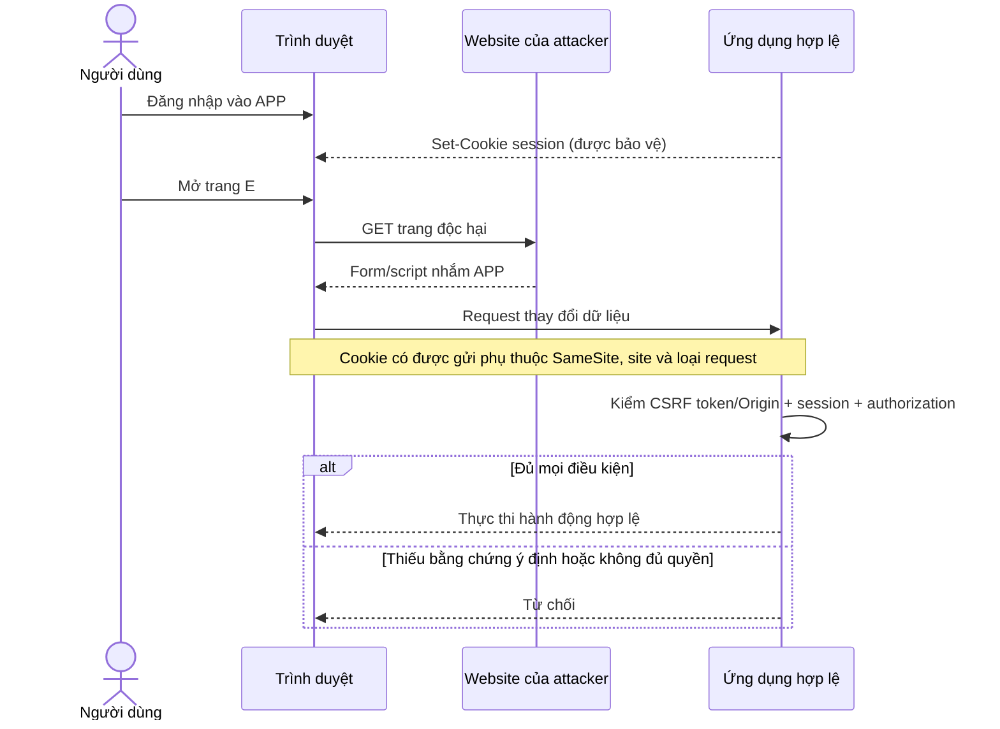
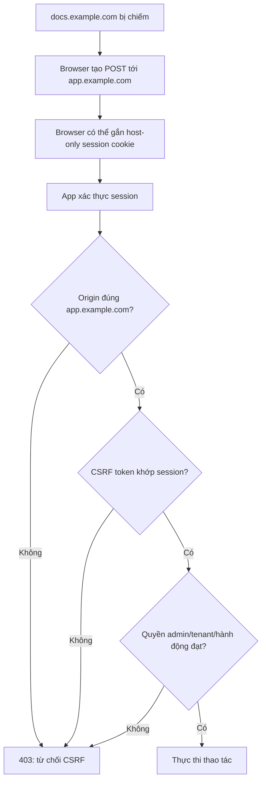

# SameSite và CSRF: bảo vệ token lưu trong cookie

Khi một ứng dụng web dùng cookie để lưu phiên đăng nhập hoặc refresh token, trình duyệt có thể **tự động gửi cookie** tới server mỗi khi phát sinh request phù hợp. Đặc tính tiện lợi này cũng tạo ra một ranh giới bảo mật quan trọng: website của kẻ tấn công có thể tìm cách khiến trình duyệt người dùng **gửi request đã mang credential tới ứng dụng thật**. Nếu backend không kiểm tra nguồn gốc và ý định của request, một thao tác như đổi email, thêm người thụ hưởng hoặc thu hồi API key có thể được thực hiện ngoài ý muốn. Đây là vấn đề **Cross-Site Request Forgery (CSRF)**.

Thuộc tính cookie **`SameSite`** giúp giới hạn trường hợp trình duyệt gửi cookie khi request xuất phát từ một *site* khác. Tuy nhiên, **SameSite không phải cơ chế chống CSRF đầy đủ**. Muốn thiết kế an toàn cần hiểu sự khác biệt giữa *site* và *origin*, hành vi `Strict`/`Lax`/`None`, cơ chế CSRF token, kiểm tra `Origin`/`Referer`, Fetch Metadata, OAuth 2.0/OIDC callback và cách lưu access token/refresh token.

Trong chương **Token storage** của module **SECURITY_TOKEN_SECURITY_FUNDAMENTALS**, bài học liên kết cơ chế trình duyệt với mô hình tin cậy và vòng đời token: JWT, opaque token, access token, refresh token, issuer, audience, scope, phát hành, xác minh, thu hồi và phòng chống token bị đánh cắp hoặc phát lại.

**Nguyên tắc xuyên suốt:** trình duyệt **tự gửi cookie** không đồng nghĩa người dùng **đã chủ động cho phép thao tác**. Xác thực phiên, CSRF protection và phân quyền trên tài nguyên là các lớp độc lập.

## 1. CSRF hình thành như thế nào?

Giả sử người dùng đang đăng nhập vào `https://bank.example.com` bằng session cookie:

```http
Set-Cookie: __Host-session=<opaque-session-id>; Path=/; Secure; HttpOnly; SameSite=Lax
```

Người dùng sau đó mở `https://attacker.example.net`. Trang độc hại tạo một form trỏ tới ngân hàng:

```html
<form action="https://bank.example.com/account/email" method="POST">
  <input type="hidden" name="email" value="attacker@example.net">
</form>
<script>
  document.forms[0].submit();
</script>
```

Form này cho thấy **ý tưởng tấn công**, không có nghĩa nó sẽ thành công: với cookie `SameSite=Lax` được đặt tường minh, trình duyệt hiện đại nhìn chung **không gửi cookie trên cross-site POST** như ví dụ. Tuy vậy, nếu cookie được cấu hình `SameSite=None` hoặc request đến từ nguồn **same-site nhưng cross-origin**, cookie có thể đi kèm. Backend thiếu CSRF protection có thể tiếp nhận request trong phiên của nạn nhân.

Một cuộc tấn công CSRF thành công thường cần các điều kiện:

1. Nạn nhân có **credential được trình duyệt tự gắn** vào request, chẳng hạn session cookie hoặc refresh cookie.
2. Attacker có thể kích hoạt một request tới endpoint có **tác dụng thay đổi trạng thái**.
3. Server nhận request mà **không kiểm tra bằng chứng ý định** gắn với phiên/nguồn hợp lệ.
4. Các kiểm soát khác như SameSite, CSRF token, Origin/Fetch Metadata và chính sách authorization không ngăn request.

Attacker không nhất thiết đọc được response do **Same-Origin Policy (SOP)**. CSRF thường nhằm khiến browser **thực hiện hành động**, không phải đánh cắp nội dung phản hồi. Khả năng đọc response và khả năng **gửi request** là hai câu hỏi bảo mật khác nhau.



## 2. Phân biệt **same-origin** và **same-site**

Đây là khác biệt quan trọng nhất khi dùng `SameSite`.

**Origin** của URL là bộ **scheme + host + port**. Ví dụ `https://app.example.com:443` khác origin với `https://api.example.com:443` vì hostname khác; cũng khác origin với `https://app.example.com:8443` vì port khác.

**Site** theo cách trình duyệt hiện đại áp dụng *schemeful same-site* thường dựa trên **scheme + registrable domain (eTLD+1 theo Public Suffix List)**. Hai subdomain có thể là **same-site** dù **cross-origin**. Tên miền đăng ký cần được tính theo Public Suffix List, không thể luôn lấy «hai nhãn cuối» của hostname.

| Request từ trang | Đích request | Quan hệ origin | Quan hệ site (giả định HTTPS) |
| --- | --- | --- | --- |
| `https://app.example.com` | `https://app.example.com/api` | Same-origin | Same-site |
| `https://blog.example.com` | `https://app.example.com/api` | Cross-origin | **Same-site** |
| `https://app.example.com:8443` | `https://app.example.com/api` | Cross-origin | Same-site |
| `https://evil.example.net` | `https://app.example.com/api` | Cross-origin | **Cross-site** |
| `http://app.example.com` | `https://app.example.com/api` | Cross-origin | **Cross-site** theo schemeful same-site |

**Hệ quả:** nếu attacker kiểm soát `https://blog.example.com`, request từ đó tới `https://app.example.com` vẫn có thể được xem là **same-site**. Cookie `SameSite=Strict` hoặc `Lax` **không tự chặn** request same-site này. Nhưng SOP vẫn xem chúng là **khác origin**, vì vậy một CSRF token chỉ xuất hiện trong response same-origin (không bị lộ qua CORS) có thể cung cấp lớp bảo vệ bổ sung.

Đây là lý do không nên coi mọi subdomain thuộc `example.com` đều đáng tin như nhau. Một subdomain dùng cho nội dung người dùng, blog, môi trường staging hoặc đối tác có thể trở thành điểm xuất phát CSRF same-site nếu bị chiếm.

### 2.1. Cookie được gửi dựa trên cả host/path và SameSite

`SameSite` không hoạt động riêng lẻ. Để được gửi, cookie còn phải thỏa:

- **Domain/host matching:** cookie host-only chỉ được gửi tới host đã đặt cookie; cookie dùng `Domain=example.com` có thể được gửi tới nhiều subdomain phù hợp.
- **`Path`:** giới hạn đường dẫn nhận cookie, nhưng **không phải ranh giới bảo mật tin cậy** giữa các ứng dụng trên cùng host.
- **`Secure`:** cookie chỉ được gửi qua kết nối an toàn theo quy tắc trình duyệt.
- **Expiry:** `Max-Age`/`Expires` quyết định vòng đời cookie trong browser, khác với hiệu lực server-side của session/refresh token.
- **`SameSite`:** giới hạn việc đính kèm cookie dựa trên quan hệ site và ngữ cảnh điều hướng/request.

**Cookie có còn trong browser không** và **session/refresh token có còn được server chấp nhận không** là hai điều kiện khác nhau. Xóa cookie không tự thu hồi credential đã bị đánh cắp; server phải có vòng đời và cơ chế thu hồi phù hợp.

## 3. Ba chế độ `SameSite`

### 3.1. `SameSite=Strict`

`Strict` chỉ cho phép cookie trong các request **same-site** theo quy tắc của trình duyệt. Cookie thường không được gửi khi người dùng đến ứng dụng từ một liên kết/điều hướng **cross-site**.

Phù hợp khi trải nghiệm không phụ thuộc cookie trên các luồng đến từ website khác, ví dụ một số session đặc biệt nhạy cảm.

**Giới hạn:** `Strict` **không chặn** request từ sibling subdomain **same-site**; cũng không ngăn request độc hại được kích hoạt từ **XSS trên chính ứng dụng**. Ngoài ra, `Strict` có thể khiến callback đăng nhập OIDC hoặc liên kết từ email bị mất ngữ cảnh session trong bước điều hướng đầu tiên.

### 3.2. `SameSite=Lax`

`Lax` thường cho phép cookie với:

- Request **same-site**; và
- Một số **top-level navigation cross-site dùng phương thức an toàn**, điển hình là người dùng bấm link `GET` dẫn tới ứng dụng.

`Lax` **thường không đính kèm cookie** trên cross-site form `POST`, `fetch` dưới dạng subresource, ảnh hoặc iframe theo ngữ cảnh thông thường. Chính sách này tạo điểm cân bằng: nhiều liên kết từ email/website ngoài vẫn mở được ứng dụng với session.

**Cảnh báo quan trọng:** không dựa vào trình duyệt «mặc định Lax» như một hợp đồng cố định. Một số browser có biến thể **Lax-by-default** với ngoại lệ POST vừa đặt cookie trong thời gian ngắn (thường được mô tả là khoảng hai phút) khi **không ghi rõ `SameSite`**. Ngoại lệ này không phải lý do để bỏ biện pháp CSRF. Hãy đặt `SameSite=Lax` **tường minh** và bảo vệ endpoint có tác dụng thay đổi trạng thái.

### 3.3. `SameSite=None; Secure`

`None` cho phép cookie được xem xét gửi trong **ngữ cảnh cross-site**, với điều kiện cookie còn thỏa host/path/các chính sách của trình duyệt. Browser hiện đại yêu cầu `SameSite=None` đi kèm **`Secure`**.

```http
Set-Cookie: __Host-session=<opaque-id>; Path=/; Secure; HttpOnly; SameSite=None
```

Thiết lập này có thể cần trong một số iframe, tích hợp khác site hoặc callback qua form POST; nhưng **nó làm giảm rào cản chống CSRF do SameSite cung cấp**. Phải bổ sung CSRF token, kiểm tra nguồn gốc và những biện pháp độc lập khác.

**Không bảo đảm cookie cross-site luôn được gửi:** trình duyệt có thể chặn third-party cookies, áp dụng partitioning hoặc chính sách quyền riêng tư bổ sung. Không thiết kế flow bắt buộc phụ thuộc third-party cookies mà không kiểm thử trình duyệt đích.

### 3.4. Bảng so sánh

Giả sử cookie phù hợp domain/path, là cookie đã tồn tại và không có ngoại lệ lịch sử/browser đặc thù:

| Tình huống request | `Strict` | `Lax` | `None; Secure` |
| --- | --- | --- | --- |
| Same-site, same-origin `POST` | Có thể gửi | Có thể gửi | Có thể gửi |
| Same-site, **cross-origin** `POST` từ subdomain | **Có thể gửi** | **Có thể gửi** | Có thể gửi |
| Cross-site top-level link `GET` | Thường **không** | **Có thể gửi** | Có thể gửi |
| Cross-site top-level form `POST` | Không | Thường **không** | Có thể gửi |
| Cross-site `fetch`/subresource/iframe | Không | Thường **không** | Có thể gửi |

«Có thể gửi» nghĩa là **SameSite không tự chặn**; cookie còn chịu các quy tắc domain, Secure, third-party cookie policy, `credentials` của Fetch và cấu hình browser. Bảng là mô hình vận hành để thiết kế, không thay thế kiểm thử trên trình duyệt thực tế.

## 4. Các thuộc tính cookie cần đặt cùng `SameSite`

Ví dụ cookie session dành cho BFF/web backend:

```http
HTTP/1.1 200 OK
Set-Cookie: __Host-session=<opaque-session-id>; Path=/; Secure; HttpOnly; SameSite=Lax; Max-Age=1800
Cache-Control: no-store
```

| Thuộc tính | Chức năng | Không thay thế được |
| --- | --- | --- |
| `Secure` | Chỉ gửi qua HTTPS theo quy tắc browser | CSRF protection hoặc mã hóa dữ liệu server-side |
| `HttpOnly` | Ngăn JavaScript truy cập giá trị cookie qua `document.cookie` | XSS prevention; script bị XSS vẫn có thể gọi API cùng origin |
| `SameSite` | Giới hạn đính kèm cookie trong request cross-site | CSRF token và kiểm tra origin trên mọi tình huống |
| `Path=/` | Quy định đường dẫn cookie áp dụng | Cơ chế phân quyền giữa các ứng dụng cùng host |
| Không đặt `Domain` | Tạo **host-only cookie**, giới hạn host nhận cookie | Chống request CSRF từ subdomain same-site |
| `Max-Age`/`Expires` | Tuổi cookie ở trình duyệt | Expiry, revoke hoặc rotate credential phía server |
| Prefix `__Host-` | Yêu cầu `Secure`, `Path=/` và **không có `Domain`** trên browser hỗ trợ | Chống mọi hành vi CSRF hay XSS |

**Ưu tiên cookie host-only** cho session. Việc đặt `Domain=.example.com` rộng có thể khiến nhiều subdomain nhận session cookie và tăng rủi ro rò rỉ/cookie injection. Prefix `__Host-` làm chặt ràng buộc host, nhưng **không ngăn subdomain điều khiển browser gửi request tới host hợp lệ**.

### 4.1. Dùng cookie nào cho refresh token?

Một kiến trúc có browser và backend thường áp dụng:

- Browser chỉ giữ cookie phiên opaque `HttpOnly; Secure; SameSite=...`.
- **Backend-for-Frontend (BFF)** hoặc server-side session store giữ access/refresh token phía server, không lộ refresh token cho JavaScript.
- BFF dùng access token gọi resource server theo đúng `aud`/`scope`, và gửi refresh token đến **AS token endpoint**, không gửi refresh token đến API nghiệp vụ.

Nếu ứng dụng quyết định lưu **refresh token trực tiếp trong HttpOnly cookie**, phải bảo vệ endpoint đọc/refresh cookie như một **credential tự động gắn vào request**; cookie không tự miễn CSRF. Nếu không có server-side binding và cơ chế revoke/rotation phù hợp, token bị lộ vẫn có thể bị dùng lại.

### 4.2. LocalStorage, memory và cookie không cùng threat model

| Cách giữ credential | Tính chất | Rủi ro chính |
| --- | --- | --- |
| `HttpOnly` cookie | Browser tự đính kèm theo domain/path/SameSite | CSRF nếu endpoint không bảo vệ; XSS có thể kích hoạt request cùng origin |
| JavaScript memory | Script thêm access token vào header `Authorization` | XSS có thể đánh cắp/sử dụng; mất token khi reload |
| `localStorage`/`sessionStorage` | JS đọc được, token không tự gắn vào request | XSS có thể đọc token; persistence khác nhau |
| BFF server-side token store | Browser chỉ giữ session cookie; server quản lý OAuth credentials | Bảo vệ session cookie, CSRF, store/token lifecycle, trust boundary backend |

Một bearer token chỉ được frontend tự thêm vào header `Authorization: Bearer ...` **không tự động được browser gắn** vào request do trang khác khởi tạo, nên không có cùng cơ chế CSRF cổ điển như session cookie. Nhưng nếu ứng dụng có thêm session cookie, hoặc CORS cho phép nguồn không đáng tin, bề mặt tấn công vẫn cần được xét. **XSS, token theft và replay không biến mất** chỉ vì không dùng cookie.

## 5. Vì sao SameSite không đủ để ngăn CSRF?

### 5.1. Cross-site top-level GET vẫn có cookie với Lax

Nếu backend thực hiện thay đổi qua GET:

```http
GET /account/delete?confirm=true HTTP/1.1
Host: app.example.com
```

Attacker có thể khiến người dùng bấm link tới URL này. Với `SameSite=Lax`, cookie có thể được gửi vì đó là **top-level navigation GET**. Endpoint đổi trạng thái bằng GET vì vậy là lỗi thiết kế nghiêm trọng.

**GET, HEAD, OPTIONS và TRACE phải giữ ngữ nghĩa safe theo quy tắc HTTP áp dụng:** không thiết kế thao tác thay đổi trạng thái nghiệp vụ dựa vào GET/link/ảnh. Điều này giảm rủi ro, nhưng **không thay thế CSRF protection trên POST/PUT/PATCH/DELETE**.

### 5.2. Sibling subdomain là same-site nhưng cross-origin

`https://usercontent.example.com` và `https://app.example.com` có thể là same-site. Dù cookie session của app là host-only và có `SameSite=Strict`, browser vẫn có thể gắn cookie **khi request được gửi tới app** từ subdomain cùng site.

Attacker không nhất thiết phải đọc cookie; chỉ cần kích hoạt một request mang cookie tới endpoint nhạy cảm. **CSRF token không đọc được cross-origin** và Origin validation exact-match sẽ bổ sung lớp phòng vệ. Nên xem subdomain nội dung không đáng tin là một nguồn tấn công trong threat model.

### 5.3. XSS trên chính origin

Nếu attacker chạy được JavaScript tại `https://app.example.com` (qua XSS), script đó có thể gọi API same-origin với cookie của người dùng. `HttpOnly` giúp hạn chế **đọc giá trị cookie** nhưng không ngăn request same-origin được tự động xác thực. CSRF token cũng có thể bị script cùng origin đọc hoặc sử dụng tùy thiết kế.

Do đó, **chống XSS và chống CSRF là hai việc bổ sung**. Cần phòng XSS bằng escaping, sanitize khi cần, CSP và thiết kế frontend an toàn; đừng dùng SameSite hoặc HttpOnly làm bằng chứng đã loại bỏ XSS.

### 5.4. CORS không phải CSRF protection

**Cross-Origin Resource Sharing (CORS)** chủ yếu điều khiển khả năng JavaScript **đọc response** và một số loại request cross-origin cần preflight. Nó **không chặn mọi request được browser gửi**, chẳng hạn cross-origin HTML form POST với content type thông thường.

Ngay cả khi response bị SOP/CORS chặn đọc, server có thể đã thực thi thay đổi trạng thái trước đó. Ngược lại, cấu hình CORS phản chiếu tùy tiện origin kèm `Access-Control-Allow-Credentials: true` làm tăng khả năng lộ dữ liệu cho origin không đáng tin.

Đối với cookie-based API cross-origin thật sự được phép, phải có:

1. Allowlist origin **chính xác**, không phản chiếu origin bất kỳ hoặc tin wildcard theo suy diễn.
2. Cấu hình credentials và các header/method được phép phù hợp.
3. CSRF protection ở endpoint thay đổi trạng thái.
4. Chính sách SameSite/third-party cookies phù hợp và đã kiểm thử.

**Không dựa riêng vào việc endpoint chỉ nhận JSON hoặc có CORS preflight** nếu chưa kiểm thử toàn bộ content type, parser, redirect và các «simple request» mà trình duyệt có thể phát.

## 6. Defense in depth: CSRF token, Origin và Fetch Metadata

### 6.1. Synchronizer token pattern

Đây là mẫu bảo vệ phổ biến cho **ứng dụng có session phía server**:

1. Server tạo một CSRF token ngẫu nhiên mạnh (CSPRNG) gắn với **session hiện tại**.
2. Token được đưa vào trang/form hoặc response **chỉ origin hợp lệ đọc được**.
3. Với request thay đổi trạng thái, frontend gửi token qua một field `_csrf` hoặc header `X-CSRF-Token`.
4. Server so sánh với giá trị **gắn session** bằng phép so sánh an toàn, chỉ thực thi sau khi kiểm tra đạt.
5. Token có vòng đời/rotation phù hợp khi login/logout hoặc tái tạo session; nếu token thiếu/sai thì từ chối.

```text
Session cookie (HttpOnly)    -> Browser tự gửi cho APP
CSRF token (session-bound)   -> Form hoặc script cùng origin phải xuất trình

Backend yêu cầu: session hợp lệ AND CSRF token đúng
              AND Origin/Fetch Metadata policy đạt
              AND quyền nghiệp vụ đạt
```

Kẻ tấn công từ origin khác có thể tạo form, nhưng **thông thường không thể đọc response chứa CSRF token** nhờ SOP nếu server không cấu hình CORS sai, và không thể đoán token ngẫu nhiên đủ mạnh.

**Không đặt CSRF token vào URL**: URL dễ xuất hiện trong history, analytics, log và `Referer`. Không tạo token dự đoán được từ user ID, timestamp hay thông tin public. Response chứa CSRF token/session riêng không nên bị cache công khai.

### 6.2. Double-submit cookie và biến thể có chữ ký

Một lựa chọn khác là **double-submit cookie**: browser giữ một CSRF cookie và client đưa cùng giá trị vào header/form; server đối chiếu hai nguồn.

**Naive double-submit** chỉ so khớp «cookie == header» có rủi ro **cookie injection** nếu attacker có thể đặt cookie cho domain dùng chung, đặc biệt khi subdomain bị chiếm. Một biện pháp được khuyến nghị là **signed double-submit**: tạo token có MAC/HMAC bằng khóa server và **gắn với session** (không chỉ ký một giá trị ngẫu nhiên độc lập rồi cho dùng mọi phiên).

Ví dụ cấu trúc logic:

```text
random_nonce = CSPRNG(128+ bits)
mac = HMAC(server_csrf_key, session_binding || random_nonce)
csrf_token = encode(random_nonce, mac)

Accept only if:
  session hợp lệ,
  token có MAC chính xác,
  MAC gắn đúng session,
  cookie/header hoặc trường gửi theo contract phù hợp,
  chính sách Origin và method đạt.
```

Đây là **pseudocode**, không phải định dạng CSRF token tiêu chuẩn. Phải mã hóa các trường không nhập nhằng khi tính MAC; không dùng `session_id` raw trong token trả client nếu không cần, mà dùng binding đã được thiết kế phù hợp. Nếu frontend cần đọc CSRF cookie, cookie **CSRF** có thể không đặt HttpOnly theo lựa chọn framework; **session/refresh credential** vẫn cần HttpOnly khi dùng cookie. Đừng nhầm hai loại cookie.

### 6.3. Kiểm tra `Origin` và `Referer`

Với thao tác nhạy cảm, backend có thể kiểm tra `Origin` của request khớp **chính xác** origin ứng dụng được phép:

```text
Allowed origin: https://app.example.com

Origin: https://app.example.com          -> có thể chấp nhận
Origin: https://blog.example.com         -> từ chối nếu không allowlist
Origin: https://app.example.com.evil.net -> từ chối
Origin: null                             -> xử lý theo policy, không tự tin
```

Nếu `Origin` không có, một số hệ thống dùng `Referer` (parse URL và so khớp scheme/host/port) làm phương án bổ sung, hoặc **fail closed** trên endpoint nhạy cảm. Không so sánh bằng `startsWith` hoặc substring. Với ứng dụng đứng sau reverse proxy, **expected origin** phải dựa trên cấu hình đáng tin và proxy headers chỉ được tin từ proxy cho phép.

**Origin/Referer là lớp phòng thủ bổ sung**, không phải thay thế CSRF token cho mọi kiến trúc. Một số client/browser hoặc chính sách privacy có thể thiếu header, cần chiến lược xử lý đã được kiểm thử thay vì tự động cho qua.

### 6.4. Fetch Metadata (`Sec-Fetch-*`)

Các trình duyệt hỗ trợ **Fetch Metadata request headers** như:

- `Sec-Fetch-Site: same-origin` — request xuất phát cùng origin.
- `Sec-Fetch-Site: same-site` — cùng site nhưng có thể **khác origin**.
- `Sec-Fetch-Site: cross-site` — xuất phát khác site.
- `Sec-Fetch-Site: none` — một số điều hướng không có site khởi tạo, ví dụ người dùng gõ URL trực tiếp.

Backend có thể từ chối request `cross-site` làm thay đổi trạng thái, có chính sách riêng cho `same-site` nhưng cross-origin, và cho phép những luồng điều hướng hợp lệ. **Không coi `same-site` tương đương `same-origin`** nếu có subdomain không đáng tin.

Các header này giúp thêm lớp phòng thủ nhưng không phải mọi client đều gửi. Client ngoài trình duyệt còn có thể tự đặt header; vì vậy không dùng Fetch Metadata để xác thực danh tính client. Cần kết hợp với session, CSRF token, Origin và authorization.

## 7. Ví dụ Java: chặn POST khi thiếu CSRF token

Đoạn dưới là **pseudocode gần Java** ở backend session-based. Mục tiêu là thể hiện trình tự kiểm tra; các interface `SessionStore`, `Request`, `Response` không phải API của framework cụ thể. Trong ứng dụng thực, nên dùng **CSRF middleware của framework** đã được kiểm thử và cấu hình đúng.

```java
Response updateRecoveryEmail(Request req) {
    // Session ID chỉ đến từ cookie hợp lệ và session store đáng tin.
    Session session = sessionStore.requireActive(
        req.cookie("__Host-session")
    );

    if (!req.method().equals("POST")) {
        return methodNotAllowed();
    }

    // Expected origin từ cấu hình backend, không phải từ request Host tùy ý.
    String expectedOrigin = "https://app.example.com";
    String origin = req.header("Origin");
    if (!originPolicy.acceptStrictOriginOrTrustedFallback(
            origin, req.header("Referer"), expectedOrigin)) {
        return forbidden("untrusted_origin");
    }

    // Giá trị này do frontend gửi, không tự động nằm trong cookie session.
    String suppliedToken = req.header("X-CSRF-Token");
    byte[] expected = session.csrfSecret();
    byte[] supplied = csrfCodec.decodeValidOrReject(suppliedToken);
    if (!MessageDigest.isEqual(expected, supplied)) {
        return forbidden("csrf_failed");
    }

    Account account = accounts.findById(session.accountId());
    if (!authorization.canUpdateRecoveryEmail(
            session.principal(), account)) {
        return forbidden("not_authorized");
    }
    return accountService.updateRecoveryEmail(
        account, req.validatedBody().recoveryEmail()
    );
}
```

**Lưu ý triển khai:**

- `session.csrfSecret()` phải được sinh bằng CSPRNG và gắn đúng phiên; token không được là chuỗi client tự chọn.
- Hàm `decodeValidOrReject` phải kiểm tra dạng mã hóa, kích thước và giá trị bất thường trước so sánh; không cho phép chuỗi null/rỗng đi qua.
- Mọi request thay đổi trạng thái cần middleware chung, không chỉ riêng endpoint email. Phân biệt cơ chế **CSRF** với kiểm tra **role/owner/tenant**.
- Nếu session auth đang nằm trong cookie, chính **cookie đó** vẫn cần `Secure`, `HttpOnly`, `SameSite` và lifetime hợp lý.
- Khi user đăng nhập lại hoặc đổi session ID, cần đảm bảo token CSRF gắn với **session mới** và không bị sử dụng chéo phiên.

Frontend cùng origin có thể gửi:

```javascript
// csrfToken được backend cung cấp qua response cùng origin,
// không lấy từ URL và không hardcode trong JavaScript public.
async function updateRecoveryEmail(email, csrfToken) {
  const response = await fetch("/account/recovery-email", {
    method: "POST",
    credentials: "same-origin",
    headers: {
      "Content-Type": "application/json",
      "X-CSRF-Token": csrfToken
    },
    body: JSON.stringify({ email })
  });
  if (!response.ok) {
    throw new Error("Request rejected");
  }
}
```

Nếu dùng **Spring Security**, nên bật cấu hình CSRF mặc định phù hợp với ứng dụng dùng cookie session và chọn `CsrfTokenRepository` theo cách frontend nhận token. Ví dụ `CookieCsrfTokenRepository` cho mô hình JavaScript đọc cookie CSRF **không phải** thay thế tự động cho `Origin`/same-site threat model; cách ánh xạ header và cách xử lý token (bao gồm bảo vệ BREACH trong các phiên bản framework) cần kiểm tra theo phiên bản Spring Security sử dụng. **Không tắt CSRF toàn cục chỉ vì API trả JSON.**

## 8. SameSite và OAuth 2.0/OIDC: có thể ảnh hưởng callback đăng nhập

Ứng dụng web thường chuyển người dùng sang **authorization server/identity provider** rồi nhận callback về **redirect URI** của client. Đây là nơi `SameSite` cần được hiểu cùng **OAuth login CSRF**.

### 8.1. Authorization code flow với top-level redirect GET

Ví dụ:

```mermaid
sequenceDiagram
    actor U as Người dùng
    participant RP as Client/Relying Party
    participant OP as OpenID Provider / AS
    participant B as Browser

    U->>RP: Bắt đầu đăng nhập
    RP-->>B: Set-Cookie login-session; SameSite=Lax
    RP-->>B: Redirect sang OP với state, nonce, PKCE
    B->>OP: Authorization request
    OP->>U: Xác thực và consent nếu cần
    OP-->>B: Redirect GET về RP/callback?code=...&state=...
    B->>RP: Top-level GET callback, có thể kèm cookie Lax
    RP->>RP: Xác minh state + session binding
    RP->>OP: Đổi code với code_verifier
    OP-->>RP: ID token/access token theo flow
    RP->>RP: Xác minh ID token, issuer, audience, nonce
```

Với **`SameSite=Lax`**, cookie correlation/session có thể được gửi trên **top-level cross-site GET redirect** từ OP về RP. Với **`SameSite=Strict`**, cookie đó thường không được gửi trong request callback ban đầu, khiến RP không tìm thấy trạng thái login đã khởi tạo.

**Không bỏ kiểm tra `state` chỉ để callback hoạt động.** Cần cân nhắc cookie tạm cho flow, storage server-side được ràng buộc đúng và chiến lược SameSite phù hợp với redirect thực tế.

### 8.2. Nếu OIDC dùng `response_mode=form_post`?

Khi OP trả response bằng **form POST** từ site OP sang callback RP, cookie `SameSite=Lax` thường **không được gửi** vì đây là cross-site top-level POST.

Các lựa chọn thiết kế gồm:

- Sử dụng callback bằng top-level GET nếu flow/profile cho phép và phù hợp threat model.
- Thiết kế cơ chế state correlation phía server **không chỉ dựa vào cookie bị loại bởi SameSite**, đồng thời vẫn chống login CSRF, code injection và session swapping.
- Trong trường hợp thực sự cần cookie trên cross-site POST, cấu hình một cookie flow chuyên dụng `SameSite=None; Secure` theo phạm vi nhỏ nhất, kết hợp `state`, ràng buộc phiên và bảo vệ CSRF/nguồn gốc phù hợp.

**Không chuyển toàn bộ cookie session thành `SameSite=None` chỉ để sửa nhanh một callback lỗi.** Cần xem xét third-party cookie restrictions, flow thực tế, top-level navigation và cơ chế correlation của thư viện OIDC.

### 8.3. Phân biệt `state`, `nonce` và PKCE

| Cơ chế | Bảo vệ điều gì? | Không thay thế |
| --- | --- | --- |
| **OAuth `state`** | Liên kết authorization response với request/phiên browser đã khởi tạo; ngăn login CSRF, response injection khi được dùng đúng | CSRF token cho mọi POST nghiệp vụ |
| **OIDC `nonce`** | Ràng buộc ID token với yêu cầu đăng nhập theo quy tắc OIDC tương ứng | Kiểm tra `state` hoặc quyền tài nguyên |
| **PKCE** | Ràng buộc authorization code với client đã khởi tạo code challenge/verifier, chống code interception/injection theo threat model | Toàn bộ CSRF bảo vệ của web session |
| **SameSite trên cookie RP** | Giới hạn trường hợp browser gửi cookie correlation/session | `state`, `nonce`, PKCE và xác minh issuer/audience |

`state` phải khó đoán, có expiry, **được kiểm tra khi callback đến**, gắn đúng user agent/session và lý tưởng là chỉ dùng một lần. Nếu nhận một callback có `state` không khớp, RP phải từ chối trước khi liên kết tài khoản hoặc cấp session mới. Không thể suy ra «callback an toàn» chỉ vì OP có issuer đáng tin hoặc authorization code được trả về redirect URI hợp lệ.

Sau khi đổi code, client/RP phải xác minh ID token theo OIDC (issuer, audience chứa `client_id`, thời hạn, `nonce` khi áp dụng), và sử dụng access token **dành cho đúng resource server** với scope được cấp. **ID token không thay access token** và `state` cũng không thay việc xác minh token.

## 9. Refresh token lưu trong cookie: rủi ro CSRF tại điểm refresh

Giả sử backend đặt refresh token trực tiếp trong cookie:

```http
Set-Cookie: __Host-refresh=<opaque-refresh-token>; Path=/; Secure; HttpOnly; SameSite=Lax
```

Frontend gọi:

```http
POST /auth/refresh HTTP/1.1
Host: app.example.com
Cookie: __Host-refresh=<opaque-refresh-token>
X-CSRF-Token: <session-bound-csrf-token>
```

AS hoặc backend ở đúng trust boundary có thể đổi refresh token lấy access token mới. Nếu browser tự gắn refresh cookie vào request, endpoint `/auth/refresh` phải được xem xét về **CSRF**, tương tự các endpoint đăng xuất, đổi thông tin tài khoản, cấp quyền hoặc liên kết danh tính.

Một request CSRF tới refresh endpoint có thể không cho attacker đọc được access token mới, nhưng vẫn có thể gây **side effect** như refresh token rotation, gia hạn phiên, làm rối token family hoặc tạo tình trạng mất đồng bộ phiên. Các endpoint khác thậm chí có thể gây quyền truy cập không mong muốn nếu backend dùng cookie để xác thực.

**Các nguyên tắc an toàn:**

1. Bảo vệ `/auth/refresh` bằng `POST` và biện pháp CSRF phù hợp; không cho refresh qua `GET`.
2. Giữ refresh token **HttpOnly; Secure**, scope cookie hẹp và thời hạn phù hợp; cân nhắc BFF giữ refresh token hoàn toàn phía server.
3. AS phải kiểm tra refresh token còn hiệu lực, client binding, grant, absolute/idle expiry và chính sách rotation/reuse detection.
4. Không cho refresh token dùng trực tiếp tại resource server; access token mới vẫn phải được kiểm tra `iss`, `aud`, `scope` và `exp` khi gọi API.
5. Đừng tin `SameSite` là biện pháp duy nhất, đặc biệt khi có subdomain same-site chưa đáng tin hoặc cần `None`.
6. Khi logout hoặc revoke, xóa cookie đúng host/path/attribute **và** xử lý thu hồi credential phía server theo chính sách.

Nếu dùng BFF, browser gửi **session cookie** tới BFF; BFF giữ refresh token trong server-side store rồi tự trao đổi với AS. Điều này giảm bề mặt lộ refresh token cho browser nhưng **vẫn có CSRF đối với request browser → BFF** dùng session cookie.

### 9.1. Cookie expiry khác token expiry

Ví dụ cookie `Max-Age=7 ngày` không chứng minh refresh token còn hiệu lực đủ bảy ngày; AS có thể thu hồi trước vì:

- Refresh token đã rotate hoặc bị sử dụng lại.
- Refresh token family đạt absolute/idle expiry.
- Client bị vô hiệu, người dùng đổi mật khẩu, mất thiết bị hoặc rút consent.
- Chính sách rủi ro hoặc quyền truy cập thay đổi.

Ngược lại, cookie bị xóa ở browser chỉ chặn browser đó tự gửi token; nếu attacker đã có bản sao refresh token, vẫn cần **revocation/sender binding/rotation** để giới hạn việc sử dụng lại.

## 10. API dùng cookie khác API dùng Bearer header ra sao?

Hãy so sánh hai request:

```http
GET /api/orders HTTP/1.1
Host: app.example.com
Cookie: __Host-session=<opaque-session-id>
```

```http
GET /api/orders HTTP/1.1
Host: api.example.com
Authorization: Bearer <access-token>
```

Với **cookie session**, browser tự gửi cookie khi đủ điều kiện; các request không do người dùng chủ động khởi tạo cũng có thể mang credential. **CSRF** là một mối đe dọa trọng yếu đối với endpoint thay đổi trạng thái.

Với **Bearer header do JavaScript/ứng dụng tự thêm**, trang của attacker thường không thể khiến browser tự mang giá trị token mà nó không biết. Vì vậy CSRF cổ điển đối với credential tự động gắn có thể giảm, nhưng:

- XSS có thể đánh cắp hoặc sử dụng access token mà script truy cập được.
- CORS sai có thể làm lộ response/API cho origin không tin cậy.
- API vẫn phải xác minh chữ ký hoặc introspection, issuer, audience, scope, thời hạn và quyền tài nguyên.
- Token bị đánh cắp có thể bị phát lại tới đúng audience; dùng TTL, thu hồi và sender-constrained token khi phù hợp.
- Nếu ứng dụng đồng thời dùng cookie cho BFF/session hoặc một số API, **các endpoint cookie-auth vẫn cần CSRF protection**.

Không có quy tắc «cookie luôn kém an toàn hơn localStorage» hay ngược lại. Hai lựa chọn có **bề mặt tấn công khác nhau**; thiết kế nên dựa trên threat model và trách nhiệm bảo vệ credential của từng thành phần.

## 11. Tình huống thực tế: ứng dụng quản trị nhiều subdomain

Kiến trúc ví dụ:

```text
https://app.example.com          -> Ứng dụng quản trị, session cookie host-only
https://docs.example.com         -> Website tài liệu, content từ đối tác
https://auth.example.com         -> AS/OP phục vụ OAuth/OIDC
https://api.example.com          -> Resource server
```

Tất cả cùng scheme HTTPS và registrable domain `example.com`, nên nhiều request giữa chúng được xem là **same-site**, mặc dù **cross-origin**.

Giả sử `docs.example.com` bị chiếm. Một script trên docs tạo form POST tới `app.example.com/admin/invite`. Cookie session của app dùng `SameSite=Strict` **vẫn có thể được gửi** vì nguồn request là same-site. Nếu endpoint chỉ kiểm tra «đã đăng nhập» và không có CSRF token/Origin validation, attacker có thể cố mời tài khoản do mình kiểm soát.

Kiến trúc phòng thủ:



**Kết luận tình huống:** host-only cookie, `SameSite=Strict` và HTTPS là những lựa chọn tốt, nhưng **không có nghĩa các subdomain cùng site đáng tin như chính origin ứng dụng**. Cần chống CSRF ngay cả trong thiết kế «chỉ nội bộ một tên miền tổ chức».

## 12. Những lỗi thường gặp và cách khắc phục

| Sai lầm | Hậu quả | Cách thiết kế đúng |
| --- | --- | --- |
| Có `SameSite=Lax` nên bỏ hết CSRF token | Cross-site GET đổi trạng thái và same-site subdomain attack vẫn có thể xảy ra | Giữ method safe, dùng CSRF token/Origin/Fetch Metadata |
| `SameSite=Strict` được coi là chống mọi nguồn khác | Sibling subdomain có thể được tính là same-site | Phân biệt site/origin; bảo vệ endpoint có side effect |
| Không ghi `SameSite` rồi tin browser default | Hành vi khác nhau giữa browser, có thể có ngoại lệ Lax+POST mới đặt cookie | Cấu hình SameSite tường minh và defense in depth |
| `SameSite=None` không có `Secure` | Browser hiện đại thường từ chối cookie | Dùng `None; Secure` và HTTPS; kiểm thử third-party cookie restrictions |
| Đặt `Domain=.example.com` cho mọi cookie | Cookie lan sang nhiều subdomain, tăng rò rỉ và cookie injection | Host-only cookie, `__Host-` khi phù hợp |
| Cho GET xóa tài khoản, logout hoặc rotate token | Link cross-site có thể tạo side effect | Chuyển sang POST/DELETE và áp dụng CSRF protection |
| API dùng cookie nhưng tắt CSRF vì «JSON only» | Form/simple requests hoặc parser khác vẫn có thể tác động | Áp dụng CSRF middleware và kiểm content type nghiêm ngặt |
| Chỉ cấu hình CORS, không có CSRF token | Browser có thể gửi request dù response không được JS đọc | CORS và CSRF xử lý mục tiêu khác nhau |
| CORS cho origin bất kỳ cùng credentials | Website không tin có thể đọc response khi được browser cho phép | Allowlist origin chính xác, cấu hình credentials tối thiểu |
| So sánh `Origin` bằng prefix/substring | `app.example.com.evil.net` có thể qua kiểm tra | Parse và exact match scheme+host+port |
| Chấp nhận mọi `Sec-Fetch-Site: same-site` | Subdomain không đáng tin có thể vượt kiểm soát | Chính sách phân biệt same-origin và same-site |
| Naive double-submit không gắn session | Cookie injection dẫn tới token giả dễ được chấp nhận | Synchronizer token hoặc signed double-submit session-bound |
| Đưa CSRF token vào URL | Token lộ qua log/history/referrer | Header/body trong HTTPS, response no-store |
| Dùng `state` OAuth nhưng không gắn session | Login CSRF/callback mix-up | Random state có expiry, binding và kiểm tra một lần |
| Bỏ `state` vì callback thiếu cookie Strict | Authorization response có thể bị gắn sai phiên | Thiết kế cookie/correlation phù hợp, không bỏ state |
| Cookie session HttpOnly nên nghĩ đã chống XSS | Script cùng origin vẫn có thể gọi API | Chống XSS riêng, CSP/escaping, kiểm quyền |
| Refresh token cookie được coi là «không có CSRF» | Attacker có thể kích hoạt refresh/rotation hoặc endpoint phụ thuộc cookie | CSRF protection tại browser → BFF/AS boundary |
| Browser xóa cookie nghĩa là token đã revoke | Bản sao token bị lộ có thể còn sử dụng | Server-side revocation, rotation, TTL và sender binding |

## 13. Kiểm thử SameSite và CSRF

Nên chạy test với **browser thực** (nhiều browser và chế độ quyền riêng tư nếu hỗ trợ), test backend và test qua reverse proxy. Mock request server-side không mô phỏng đầy đủ hành vi browser tự đính kèm cookie.

| Trường hợp | Điều kiện kiểm thử | Kết quả mong đợi |
| --- | --- | --- |
| Cookie `Strict` khi bấm link từ site ngoài | Cross-site top-level GET | Cookie thường không được gửi |
| Cookie `Lax` khi bấm link từ site ngoài | Cross-site top-level GET | Cookie có thể gửi, nên GET phải an toàn |
| Cookie `Lax` với cross-site form POST | Cookie đặt tường minh, request từ site ngoài | Cookie thường không được gửi |
| Cookie không khai báo SameSite | Browser có Lax-by-default/ngoại lệ mới đặt | Không dùng kết quả này làm bảo đảm bảo mật |
| Cookie `None` không `Secure` | Được Set-Cookie qua HTTPS | Browser hiện đại từ chối hoặc không áp dụng cookie |
| Cookie `None; Secure` với cross-site POST | Browser cho phép third-party cookie | Request có thể mang cookie; backend vẫn chặn nếu thiếu CSRF |
| Same-site subdomain POST | `docs.example.com` → `app.example.com` | Cookie Strict/Lax có thể gửi; CSRF/Origin từ chối |
| Header `Origin` giả giống | `https://app.example.com.evil.net` | Từ chối exact match |
| Header `Origin: null` | Endpoint nhạy cảm | Từ chối hoặc xử lý theo chính sách chặt chẽ đã thiết kế |
| Không có `Origin` | Browser/client đặc thù | Fallback `Referer` tin cậy hoặc fail-closed theo policy |
| CSRF token sai session | Token từ session A gửi với cookie session B | Từ chối |
| Thiếu `X-CSRF-Token` | Cookie session hợp lệ, POST đổi dữ liệu | Từ chối |
| Token CSRF đúng nhưng user thiếu quyền | Request cùng origin, đủ CSRF | Từ chối ở authorization |
| GET có side effect | Gửi link GET từ site ngoài | Thiết kế phải sửa, không coi Lax đủ bảo vệ |
| OAuth callback GET | Redirect từ OP, cookie RP `Lax` | Correlation/state kiểm tra đúng |
| OAuth callback `form_post` | Cross-site POST, cookie RP `Lax` | Phát hiện correlation bị thiếu; xử lý theo thiết kế, không bỏ `state` |
| Callback `state` sai | Attacker gắn code/state không khớp | Từ chối |
| CORS phản chiếu origin lạ | Request `Origin=attacker` | Không phản hồi allow-credentials cho origin đó |
| Endpoint refresh cookie | POST `/auth/refresh` từ origin khác | Từ chối nếu không có bằng chứng CSRF hợp lệ |
| CSRF với token trong Authorization header | Attacker không biết bearer token | Không mặc định gắn bearer; API vẫn xác minh token/authorization |
| Session cookie bị xóa, credential server vẫn tồn tại | Logout browser rồi thử dùng bản sao token | Server xử lý revoke theo chính sách |
| XSS tại app origin | Script có quyền same-origin | Không dựa vào SameSite/HttpOnly làm phòng thủ duy nhất |

**Test nên mô phỏng** các hành động thực sự có side effect: đổi email, logout, cấp khóa API, refresh rotation, đổi vai trò và phê duyệt giao dịch. Kiểm tra logs/trace không chứa raw session ID, CSRF secret, access token hoặc refresh token.

## 14. Checklist thiết kế token storage trong ứng dụng web

1. **Phân loại credential:** browser đang giữ session cookie, refresh token cookie hay access token? Bên nhận là RP/BFF, AS hay resource server?
2. **Chọn SameSite có lý do:** `Strict`/`Lax`/`None` phù hợp luồng, đặc biệt OAuth redirect, iframe và cross-site integration? Đã đặt giá trị tường minh?
3. **Cookie hardening:** `Secure`, `HttpOnly` cho credential, host-only, `__Host-` khi phù hợp, lifetime rõ và không mở rộng `Domain` không cần thiết?
4. **Method safety:** các GET không làm đổi trạng thái và logout/refresh/chỉnh sửa dữ liệu không dùng GET để thay đổi?
5. **CSRF token:** mọi endpoint dựa vào cookie và có side effect được bảo vệ bởi synchronizer token hoặc signed double-submit gắn session?
6. **Origin checks:** backend so khớp origin chính xác, xử lý `Origin`/`Referer` thiếu theo policy và cấu hình proxy header an toàn?
7. **Fetch Metadata:** đã có rule cho cross-site/same-site/same-origin phù hợp với các subdomain được tin? Không coi same-site là toàn quyền?
8. **CORS:** danh sách origin được phép cụ thể, credentials chỉ khi cần, không nhầm CORS với CSRF protection?
9. **OAuth/OIDC:** callback có `state`, nonce/PKCE theo flow, session correlation và cookie SameSite đúng? Không bỏ state để chữa lỗi redirect?
10. **BFF/refresh:** refresh token được giữ an toàn, endpoint refresh dùng CSRF protection; AS thực hiện rotation/revocation/expiry và không để browser gửi refresh token tới API?
11. **Token validation:** RS kiểm tra issuer, signature/introspection, audience, scope, type, expiry và quyền tài nguyên **độc lập với cookie CSRF**?
12. **XSS/threat model:** có phòng XSS, quản lý subdomain không tin cậy, clickjacking nếu liên quan, và giới hạn token theft/replay?
13. **Logout/session:** khi hết cookie/phiên có chính sách revoke token server-side phù hợp; không đồng nhất browser cookie expiry với token expiry?
14. **Kiểm thử:** đã chạy cross-site GET/POST, same-site sibling, OAuth GET/form_post callback, browser chặn third-party cookies, CORS misconfiguration, CSRF token sai và refresh concurrency?

## Tổng kết

**`SameSite` kiểm soát việc trình duyệt đính kèm cookie theo quan hệ *site* và loại request; CSRF protection kiểm soát liệu một request mang credential có thực sự được khởi tạo trong ngữ cảnh đáng tin.** Vì *same-site* có thể là *cross-origin*, cả `Strict` lẫn `Lax` đều không bảo vệ hoàn toàn trước subdomain cùng site bị chiếm. `Lax` còn cho phép một số top-level GET cross-site; `None; Secure` có thể cần cho tích hợp đặc thù nhưng đòi hỏi phòng vệ CSRF mạnh hơn.

Thiết kế an toàn nên kết hợp **Secure/HttpOnly/host-only cookie**, **CSRF token gắn session**, **Origin/Referer và Fetch Metadata validation**, **HTTP methods đúng ngữ nghĩa**, chính sách **CORS chặt**, chống **XSS** và bảo vệ riêng cho **OAuth/OIDC callback**. Nếu access token/refresh token được giữ tại BFF hoặc AS, cần tiếp tục xác minh đúng **issuer, audience, scope, expiry, rotation và revocation**. Không một thuộc tính cookie đơn lẻ nào thay thế được toàn bộ vòng đời và ranh giới tin cậy của token.

**Tài liệu tham khảo:** RFC 6265 (HTTP State Management Mechanism) và các cập nhật thiết kế SameSite trong bản thảo `6265bis`; MDN Web Docs (Set-Cookie / SameSite); OWASP Cross-Site Request Forgery Prevention Cheat Sheet; OWASP Session Management Cheat Sheet; OWASP HTML5 Security Cheat Sheet; RFC 6749 (OAuth 2.0); RFC 7636 (PKCE); RFC 9700 (OAuth 2.0 Security Best Current Practice); RFC 6750 (Bearer Token Usage); RFC 7009 (Token Revocation); RFC 9449 (DPoP); OpenID Connect Core 1.0.
