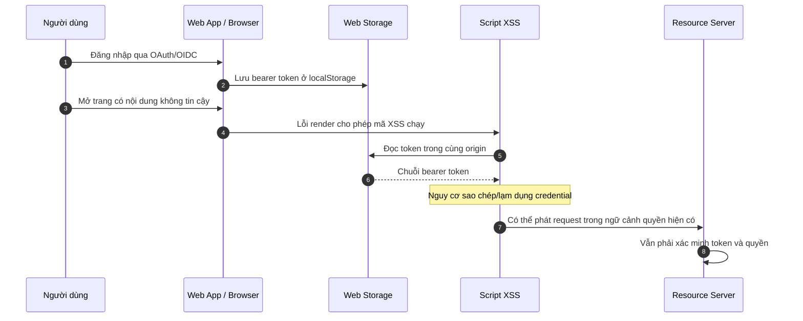
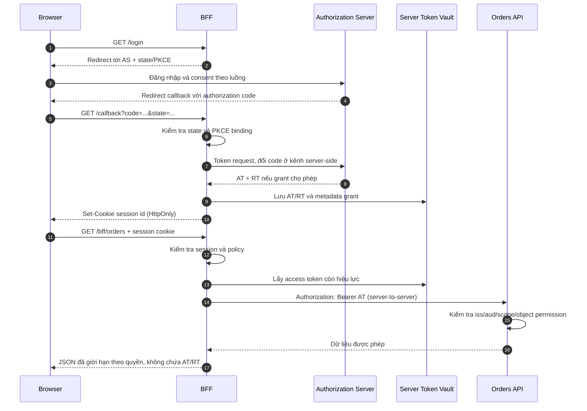

# Web storage và nguy cơ XSS

## Mục tiêu học tập

Trong module **SECURITY_TOKEN_SECURITY_FUNDAMENTALS**, chúng ta xem xét mô hình tin cậy và vòng đời token trong OAuth 2.0/OIDC: JWT, opaque token, access token, refresh token, các claims như `iss`, `aud`, `scope`, thời hạn, thu hồi và khả năng bị đánh cắp hoặc phát lại. Chủ đề **Token storage** đặt ra một câu hỏi thực tiễn: **sau khi client nhận token, phải giữ credential ở đâu để giảm rủi ro bị mã JavaScript không đáng tin truy cập?**

Bài này tập trung vào **Web Storage** (`localStorage`, `sessionStorage`), mối đe dọa **Cross-Site Scripting (XSS)** và các lựa chọn kiến trúc để bảo vệ token trong ứng dụng web.

Sau bài học, bạn có thể:

- Phân biệt phạm vi tồn tại và khả năng truy cập của `localStorage`, `sessionStorage`, IndexedDB, bộ nhớ JavaScript và cookie.
- Giải thích vì sao **XSS chạy trong origin của ứng dụng** có thể đọc access/refresh token trong Web Storage, dù token được ký bằng JWT hay là opaque.
- Phân biệt **đánh cắp chuỗi token** với **lạm dụng phiên đang đăng nhập**; hiểu giới hạn bảo vệ của `HttpOnly`, `SameSite` và cơ chế sender-constraining.
- So sánh ứng dụng browser-only lưu token trong memory với **Backend for Frontend (BFF)** giữ access/refresh token phía server.
- Mô tả vai trò của CSP, Trusted Types, output encoding, HTML sanitization, CSRF protection, OAuth Authorization Code + PKCE và token rotation.
- Xây dựng checklist, kịch bản kiểm thử và quy trình ứng phó nếu nghi ngờ token trong trình duyệt bị lộ.

## 1. Vấn đề cốt lõi: bearer token là credential

**Bearer token** hoạt động theo nguyên tắc bên nào trình được token hợp lệ thì có thể yêu cầu quyền mà token đại diện, trừ khi hệ thống áp dụng ràng buộc bổ sung. Với access token, Resource Server xác minh nguồn phát hành, audience, thời hạn, scope và quyền trên tài nguyên trước khi cấp quyền. Với refresh token, Authorization Server kiểm tra client/grant/trạng thái để cấp access token mới.

Giả sử một ứng dụng quản lý đơn hàng lưu token như sau:

```javascript
// Ví dụ để nhận diện rủi ro, KHÔNG phải mẫu triển khai khuyến nghị.
localStorage.setItem("access_token", accessToken);
localStorage.setItem("refresh_token", refreshToken);
```

Mọi đoạn JavaScript thực thi **với quyền của origin đó** và có quyền truy cập cùng vùng Web Storage đều có thể sử dụng API tương tự để đọc hai chuỗi trên. Nếu ứng dụng mắc lỗi XSS, mã do attacker điều khiển có thể chạy trong origin, dẫn đến việc chiếm credential hoặc thực hiện request dưới ngữ cảnh phiên hiện tại.

**JWT được ký không bảo vệ khỏi việc bị sao chép.** Chữ ký giúp Resource Server phát hiện claims bị chỉnh sửa, không ngăn người khác sử dụng lại **nguyên chuỗi** JWT còn hiệu lực. Opaque token cũng có rủi ro tương tự: không đọc được claims không đồng nghĩa credential không thể bị sử dụng.

### Ba câu hỏi phải tách riêng

| Câu hỏi | Ví dụ | Cơ chế giải quyết chính |
| --- | --- | --- |
| Token có **hợp lệ** không? | Chữ ký JWT đúng, `iss` và `aud` khớp, chưa hết hạn? | JWT verification hoặc opaque introspection, kiểm tra claims/trạng thái. |
| Token được **cấp quyền gì**? | `orders:read` hay `orders:admin`; có quyền trên order cụ thể? | Scope, tenant/owner/ACL, RBAC/ABAC/ReBAC, policy phía API. |
| Token có được **giữ an toàn** tại client không? | Script XSS có đọc được refresh token từ localStorage không? | Kiến trúc lưu trữ, hạn chế JavaScript tiếp xúc credential, phòng chống XSS/CSRF. |

**Kiểm chứng token tốt không thay thế bảo vệ token ở nơi lưu.** Một token được ký đúng nhưng rò rỉ từ trình duyệt vẫn có thể gây thiệt hại trong phạm vi quyền và thời gian hiệu lực của nó.

## 2. Web Storage hoạt động như thế nào?

**Web Storage API** cung cấp cơ chế key–value trong trình duyệt. Hai đối tượng thường dùng là `window.localStorage` và `window.sessionStorage`. Cả hai đều được ứng dụng thao tác bằng JavaScript; do đó cùng chịu ảnh hưởng bởi XSS có khả năng chạy trong ngữ cảnh trang.

| Đặc điểm | `localStorage` | `sessionStorage` |
| --- | --- | --- |
| Cách truy cập | `window.localStorage.getItem(...)` | `window.sessionStorage.getItem(...)` |
| Phạm vi chính | Theo origin theo mô hình lưu trữ/trình duyệt. | Theo origin **và ngữ cảnh tab/page session**. |
| Sau reload trang | Thường còn. | Thường còn trong cùng page session. |
| Sau đóng tab/browser | Thường tiếp tục tồn tại cho tới khi bị xóa, chính sách trình duyệt hoặc người dùng can thiệp. | Thường bị xóa khi page session kết thúc; có ngoại lệ chi tiết do hành vi khôi phục tab/trình duyệt. |
| Chia sẻ giữa nhiều tab cùng origin | Thường có thể đọc cùng vùng dữ liệu. | Thường tách theo tab; một số tình huống tab mở từ tab khác có thể bắt đầu bằng bản sao dữ liệu. |
| JavaScript cùng origin đọc được? | **Có.** | **Có**, trong ngữ cảnh trang có quyền. |
| Cookie `HttpOnly`? | **Không áp dụng.** | **Không áp dụng.** |
| Rủi ro khi có XSS | Đọc/sửa dữ liệu còn lưu, kể cả token cũ còn hiệu lực. | Đọc/sửa token của phiên/tab đang bị XSS. |

Các chi tiết lưu trữ có thể thay đổi theo private browsing, partitioning, chính sách chống theo dõi và trình duyệt. Nhưng **đối với threat model XSS chạy trong chính ứng dụng, điểm quyết định vẫn là: Web Storage là API có thể gọi từ JavaScript**.

### 2.1. Vì sao “cùng origin” không ngăn được XSS?

**Same-Origin Policy** giúp ngăn một trang tại `https://evil.example` tự do đọc `localStorage` của `https://app.example.com`. Đây là một ranh giới hữu ích giữa các origin.

Nhưng XSS là tình huống mã độc **được thực thi bên trong origin của ứng dụng** — ví dụ do dữ liệu không tin cậy được render như HTML/script. Khi đó đoạn mã có thể có quyền đọc Web Storage giống mã ứng dụng hợp lệ. **Same-Origin Policy không phân biệt “script do developer viết” với “script do XSS chèn vào” một cách tự động.**

Ví dụ các thao tác sau không yêu cầu private key của JWT:

```javascript
// Đoạn minh họa quyền đọc Web Storage của mã chạy trong cùng origin.
const tokenA = window.localStorage.getItem("access_token");
const tokenB = window.sessionStorage.getItem("access_token");

// Không log, gửi hay xử lý các token này trong ứng dụng production.
```

Nếu trong đó có bearer credential, chỉ cần **truy cập được chuỗi token** đã là vấn đề. Không cần giải mã JWT, làm giả chữ ký hoặc biết password người dùng để dùng lại một bearer access token còn hiệu lực ở API đúng audience.

### 2.2. IndexedDB, Cache Storage và dữ liệu “được mã hóa”

IndexedDB có thể lưu dữ liệu có cấu trúc, đối tượng lớn và dữ liệu dùng lâu dài. Nó **không phải kho bí mật tách khỏi JavaScript cùng origin**. Mã XSS trong ứng dụng có thể sử dụng những API IndexedDB được phép tương tự mã ứng dụng.

Đưa token vào một cache, một đối tượng IndexedDB hoặc đổi tên key từ `access_token` sang chuỗi khó đoán **không loại bỏ** nguy cơ. Dữ liệu lưu trữ của Service Worker và Cache Storage cũng không tự tạo ranh giới bảo mật tuyệt đối chống mã độc cùng origin.

Trường hợp token được mã hóa trước khi lưu:

```text
encrypted_token = Encrypt(token, key)

localStorage:
  encrypted_token = ...
  encryption_key  = ...
```

Nếu **khóa giải mã cũng có thể lấy từ cùng môi trường JavaScript**, XSS có thể truy cập khóa hoặc sử dụng khả năng giải mã mà ứng dụng đang có. Với Web Crypto và **non-extractable CryptoKey**, attacker có thể không xuất được bytes khóa, nhưng mã đang chạy có thể **gọi thao tác mã hóa/giải mã hoặc tạo request** nếu ứng dụng cho phép. Vì vậy, mã hóa localStorage bằng khóa nằm cùng origin **không phải giải pháp chống XSS hoàn chỉnh**.

## 3. XSS có thể chiếm token theo đường nào?

**Cross-Site Scripting (XSS)** xảy ra khi ứng dụng để nội dung không đáng tin được trình duyệt diễn giải như mã/script trong ngữ cảnh ứng dụng. Các dạng thường gặp:

- **Stored XSS:** nội dung do user cung cấp được lưu trong database, sau đó hiển thị cho nhiều người và thực thi như script, chẳng hạn mô tả sản phẩm hoặc bình luận.
- **Reflected XSS:** dữ liệu từ request được phản chiếu vào HTML/JavaScript mà không xử lý đúng ngữ cảnh.
- **DOM-based XSS:** JavaScript phía client đưa dữ liệu không tin cậy vào một *dangerous sink* như `innerHTML` theo cách có thể tạo nội dung thực thi.
- **Supply-chain/third-party script compromise:** mã thư viện/analytics/CDN được cấp quyền chạy trong trang có thể truy cập các API giống script chính của ứng dụng; đây là nguồn mã độc cùng ngữ cảnh dù không nhất thiết là lỗi chèn script truyền thống.

### 3.1. Chuỗi sự kiện điển hình



Sơ đồ chỉ mô tả **cơ chế rủi ro**, không mô tả endpoint nhận dữ liệu bị đánh cắp hay mã khai thác thực tế.

**Hai hậu quả cần phân biệt:**

1. **Token exfiltration:** attacker lấy được **chuỗi** access/refresh token và có thể thử dùng nó bên ngoài ứng dụng khi điều kiện bearer/khóa và policy cho phép.
2. **Session riding / hành động trong origin:** dù không lấy được token, script XSS có thể thực hiện các request mà ứng dụng/phiên hiện tại được phép; nếu response có thể đọc bằng JavaScript, dữ liệu người dùng có thể tiếp tục bị lạm dụng.

Bảo vệ token khỏi bị đọc bởi JavaScript giúp **giảm nguy cơ đánh cắp token thô**, nhưng chưa thể tự loại bỏ toàn bộ tác hại của XSS đang thực thi trong trình duyệt.

### 3.2. Mẫu DOM dễ gây lỗi

```javascript
// KHÔNG AN TOÀN nếu textFromUser không đáng tin:
const container = document.querySelector("#order-note");
container.innerHTML = textFromUser;
```

Khi nội dung là **văn bản thuần**, nên đưa vào text node:

```javascript
const container = document.querySelector("#order-note");
container.textContent = textFromUser;
```

Nếu sản phẩm thực sự cần hiển thị HTML do user soạn, cần một **HTML sanitizer đáng tin cậy, cập nhật**, giới hạn allowlist tag/attribute và xử lý đúng ngữ cảnh. Không thể thay thế các biện pháp đó bằng cách xóa chuỗi `<script>` đơn giản; XSS có nhiều cú pháp/ngữ cảnh và đường thực thi khác nhau.

**Output encoding phải đúng ngữ cảnh**: HTML text, HTML attribute, URL, JavaScript string và CSS có quy tắc riêng. Hãy ưu tiên cơ chế escape mặc định của framework/template và tránh nối chuỗi raw HTML.

## 4. JWT, opaque, access và refresh token trong Web Storage

Mức rủi ro lưu trữ trước hết phụ thuộc **khả năng token được sử dụng như credential**, không phải payload có đọc được hay không.

| Token | Nếu JS/XSS lấy được chuỗi thì sao? | Ghi chú |
| --- | --- | --- |
| **JWT access token (JWS)** | Có thể bị dùng lại trong thời hạn hiệu lực, theo audience/scope/permission của token. | Chữ ký không ngăn sao chép; payload thường đọc được bằng Base64url. |
| **Opaque access token** | Có thể bị dùng như bearer token dù attacker không hiểu nội dung. | AS/RS xác minh qua introspection hoặc hợp đồng tương đương. |
| **Refresh token** | Có thể cho phép xin access token mới tại AS nếu các ràng buộc cho phép. | Rủi ro kéo dài phiên; cần lưu trữ nghiêm ngặt và rotation/sender-constraining. |
| **OIDC ID Token** | Có thể lộ thông tin người dùng/phiên; nguy cơ lạm dụng phụ thuộc bên nhận và profile. | Không phải access token của Resource Server; client phải xác minh theo OIDC. |
| **DPoP-bound access token** | Sao chép token đơn lẻ có thể chưa đủ khi RS yêu cầu proof của khóa. | XSS còn hoạt động có thể gọi request/ký bằng khả năng đang có trong app. |

Đặt refresh token ở `localStorage` thường đặc biệt rủi ro vì nó có thể **duy trì khả năng xin access token mới** nếu attacker dùng được refresh token. **Refresh token rotation** giới hạn mỗi phiên bản token và có thể phát hiện reuse, nhưng **không bảo đảm ngăn lần sử dụng đầu tiên của token mới bị đánh cắp**. Chỉ rotation mà thiếu phòng XSS và bảo vệ nơi lưu là chưa đủ.

Đừng suy rằng một chuỗi token không chứa dấu chấm hoặc không decode thành JSON thì “an toàn để lưu”; opaque bearer token có thể còn nhạy cảm hơn một chuỗi metadata thông thường.

## 5. So sánh các vị trí lưu token trong ứng dụng web

| Phương án | JavaScript trang có đọc token thô không? | Sau reload | Mặt mạnh | Giới hạn/rủi ro |
| --- | --- | --- | --- | --- |
| `localStorage` | **Có.** | Thường còn. | Dễ triển khai, dùng nhiều tab. | XSS cùng origin có thể đọc credential tồn tại lâu; không có `HttpOnly`. |
| `sessionStorage` | **Có.** | Thường còn trong tab. | Hạn chế một phần phạm vi tab và thời gian tồn tại. | XSS trong tab vẫn đọc được; không phải lá chắn XSS. |
| IndexedDB | **Có**, khi code cùng origin được phép. | Thường còn. | Cấu trúc linh hoạt, xử lý dữ liệu lớn. | Không tạo ranh giới bí mật khỏi XSS. |
| **Memory JavaScript** | Mã JS có quyền phù hợp vẫn có thể truy cập/sử dụng trong phiên. | Thường mất khi full reload. | Giảm thời gian tồn tại và rủi ro đọc credential cũ từ persistent storage. | XSS đang chạy vẫn có thể can thiệp; khó duy trì phiên qua reload/tab. |
| **Cookie chứa token**, `HttpOnly` | JS không thể trực tiếp đọc giá trị cookie có `HttpOnly`. | Tùy `Max-Age`/`Expires`. | Giảm nguy cơ JS đọc trực tiếp token. | Cookie tự gửi theo quy tắc browser; cần CSRF protections, server design; XSS vẫn có thể gọi request. |
| **BFF + server-side token store** | **Không cần đưa access/refresh token cho JavaScript trang.** | Session có thể duy trì theo policy. | Ranh giới token ở backend, hỗ trợ refresh/revoke/logging kiểm soát. | Phải bảo vệ session cookie, chống CSRF/XSS, quản trị server token vault. |

**“Lưu trong memory” không đồng nghĩa “XSS vô hiệu”.** Kẻ tấn công có quyền chạy script có thể kích hoạt code đang nắm token, hook các API/fetch hoặc thực hiện request khi user còn đăng nhập. Memory giúp giảm *persistence* của credential, **không cách ly mã độc cùng runtime**.

### 5.1. Web Workers và Service Workers có giúp không?

Một số kiến trúc giữ token trong Web Worker để hạn chế việc truy cập **trực tiếp** từ DOM script. Điều này có thể làm hẹp giao diện tiếp xúc token nếu triển khai cẩn thận, nhưng không phải cơ chế chống XSS tuyệt đối:

- Mã độc trong trang có thể gửi message đến worker hoặc lợi dụng API mà worker công bố để yêu cầu thực hiện thao tác.
- Nếu worker trả token thô về trang hoặc có endpoint message quá rộng, lợi ích cách ly mất đi.
- Worker lifetime, xử lý lỗi và khả năng truy cập từ script khác cần được đánh giá theo mô hình thực thi cụ thể.
- Service Worker có quyền chặn request trong scope phù hợp và có vòng đời đặc biệt; **không tự biến nó thành kho bí mật bất khả xâm phạm**.

Vì vậy, worker có thể là **một lớp giảm phạm vi lộ** trong kiến trúc được threat-model kỹ, nhưng **BFF giữ token tại server** vẫn là lựa chọn đáng cân nhắc cho ứng dụng web có quyền nhạy cảm.

## 6. Mẫu kiến trúc BFF: browser giữ session, server giữ token

**Backend for Frontend (BFF)** là một backend phục vụ trực tiếp ứng dụng web. Thay vì cho JavaScript nhận access/refresh token rồi lưu vào Web Storage, BFF:

1. Thực hiện luồng OAuth/OIDC phù hợp với Authorization Server, ví dụ Authorization Code flow ở confidential client và kiểm tra `state`/OIDC `nonce` khi áp dụng.
2. Lưu **access token, refresh token và thông tin grant** trong kho server-side có bảo vệ.
3. Phát hành một **session cookie** ngẫu nhiên, không chứa access/refresh token thô, cho trình duyệt.
4. Nhận request từ trình duyệt kèm session cookie; xác thực session và kiểm tra CSRF/policy trước khi gọi Resource Server.
5. Gắn access token vào request **server-to-server** tới API đúng audience; xử lý refresh/rotation tại backend khi cần.
6. Chỉ trả dữ liệu mà browser/user được phép nhận; **không gửi access/refresh token trong response cho JavaScript**.



**Ưu điểm quan trọng:** XSS ở frontend không thể đơn giản gọi `localStorage.getItem("refresh_token")` để lấy refresh token server-side, vì browser **không có chuỗi đó**.

**Giới hạn quan trọng:** XSS vẫn có thể gửi request tới BFF bằng session đang hoạt động và đọc response mà trang cùng origin được phép đọc. BFF giảm rủi ro **credential exfiltration**, chứ **không thay thế phòng XSS hoặc phân quyền API**.

### 6.1. Cookie BFF minh họa

```http
HTTP/1.1 200 OK
Set-Cookie: __Host-session=<opaque-random-session-id>; Path=/; Secure; HttpOnly; SameSite=Lax
Cache-Control: no-store
Content-Type: text/html; charset=UTF-8
```

Các thuộc tính cần hiểu:

| Thuộc tính | Tác dụng | Điều cần lưu ý |
| --- | --- | --- |
| `HttpOnly` | Ngăn `document.cookie`/JavaScript trang đọc trực tiếp giá trị cookie. | Trình duyệt vẫn tự gắn cookie vào request phù hợp; XSS có thể dùng session để gọi API. |
| `Secure` | Chỉ gửi cookie qua kênh bảo mật theo quy tắc trình duyệt. | Cần HTTPS toàn tuyến thích hợp. |
| `SameSite=Lax` | Giảm nhiều request cross-site gửi cookie; thường cân bằng UX và bảo vệ. | Không chặn mọi CSRF; các luồng OAuth/redirect và quan hệ same-site cần xem xét. |
| `SameSite=Strict` | Hạn chế gửi cookie trong nhiều trường hợp cross-site hơn. | Có thể ảnh hưởng trải nghiệm điều hướng/đăng nhập; phải kiểm thử luồng thực tế. |
| `Path=/` | Cookie áp dụng cho path gốc và các đường dẫn phù hợp. | `Path` không phải ranh giới bảo mật tách các ứng dụng cùng origin. |
| Tiền tố `__Host-` | Trình duyệt hỗ trợ yêu cầu `Secure`, `Path=/` và **không có `Domain`**. | Giúp giới hạn phạm vi cookie theo host, tránh cấu hình domain rộng ngoài ý muốn. |
| `Max-Age`/`Expires` | Điều khiển thời gian tồn tại cookie. | Không nên dài hơn chính sách phiên; server vẫn phải có expiry/revocation thực sự. |

`SameSite` mô tả quan hệ **site**, không tương đương hoàn toàn với **origin**. Một subdomain bị chiếm có thể là *same-site* với ứng dụng trong những điều kiện nhất định. Vì vậy không thể dựa duy nhất vào `SameSite` để bảo vệ mọi request thay đổi trạng thái.

### 6.2. Pseudocode Java cho BFF

```java
// Pseudocode: các class/hàm chỉ minh họa ranh giới trách nhiệm.
OrderList readOrders(HttpRequest request) {
    // Cookie chỉ chứa session id ngẫu nhiên; token nằm trong vault server-side.
    Session session = sessionStore.requireValid(
        request.cookie("__Host-session")
    );

    requireAllowedUserSession(session);
    ServerSideTokens tokens = tokenVault.forSession(session.id());
    AccessToken access = refreshIfNeededOnServer(tokens);

    // Không trả access token cho trình duyệt.
    return ordersApiClient.getAuthorizedOrders(
        access, session.userReference()
    );
}

void updateOrder(HttpRequest request, UpdateCommand command) {
    Session session = sessionStore.requireValid(
        request.cookie("__Host-session")
    );
    requireValidCsrfDefense(request, session);
    requireAllowedOriginPolicy(request);
    requireBusinessPermission(session, command.orderId());

    AccessToken access = refreshIfNeededOnServer(
        tokenVault.forSession(session.id())
    );
    ordersApiClient.updateAuthorizedOrder(access, command);
}
```

**Đây không phải code production**: triển khai thật cần quản lý session fixation, rotation session ID lúc đăng nhập/đổi đặc quyền, timeout/revocation, bảo vệ token vault, retry có kiểm soát, transaction khi refresh token rotation và kiểm tra lại quyền ở Resource Server.

Một frontend có thể gọi BFF:

```javascript
// Không đọc hay đưa bearer token vào JavaScript.
const response = await fetch("/bff/orders", {
  method: "GET",
  credentials: "same-origin"
});
if (!response.ok) {
  throw new Error("Request failed");
}
const orders = await response.json();
```

Client không cần giữ `Authorization: Bearer <token>`. BFF chỉ trả tài nguyên mà session được phép nhận, không trả token, credential hoặc các claims nhạy cảm không cần thiết.

## 7. Cookie giúp chống đọc token, nhưng phải chống CSRF và XSS

**Cookie `HttpOnly` không phải giải pháp toàn diện cho XSS.** Dù mã XSS không trực tiếp đọc giá trị cookie, trình duyệt có thể tự đính kèm cookie khi mã độc gọi endpoint cùng origin. Nếu endpoint thay đổi dữ liệu, attacker có thể tạo yêu cầu trong phiên người dùng.

Ngoài ra, **CSRF (Cross-Site Request Forgery)** là tình huống một trang ngoài ứng dụng dụ trình duyệt gửi request có cookie tới website đích. Hai vấn đề có liên quan nhưng không giống nhau:

| Cơ chế | Kẻ tấn công cần gì? | Điểm bảo vệ |
| --- | --- | --- |
| **XSS** | Khả năng chạy script trong origin ứng dụng. | Output encoding, xử lý DOM an toàn, CSP/Trusted Types, review dependency, bảo vệ token khỏi JS. |
| **CSRF** | Khả năng kích hoạt browser gửi request cross-site có cookie phù hợp; không cần đọc cookie. | Anti-CSRF token, kiểm tra `Origin`/`Referer` khi phù hợp, `SameSite`, cấm side effect qua GET. |
| **Token exfiltration từ Web Storage** | Có script được chạy cùng origin hoặc nguồn truy cập dữ liệu lưu trữ. | Không lưu bearer credential lâu dài ở JS-accessible storage; BFF/memory và XSS defenses. |

### 7.1. Các nguyên tắc phòng CSRF cho BFF

1. **Không dùng GET cho hành động thay đổi trạng thái.** Một liên kết hoặc ảnh từ website khác có thể kích hoạt request GET trong nhiều ngữ cảnh.
2. Với POST/PUT/PATCH/DELETE nhạy cảm, dùng **CSRF token** hoặc cơ chế CSRF tương đương được framework hỗ trợ, gắn với session và kiểm chứng server-side.
3. Kiểm tra **`Origin`** (hoặc `Referer` khi có cơ sở) ở các endpoint cần bảo vệ; chú ý xử lý trường header bị thiếu và proxy theo chính sách rõ ràng.
4. Dùng `SameSite` phù hợp với luồng OAuth và trải nghiệm; không dựa duy nhất vào SameSite vì các khác biệt same-site/cross-site.
5. Với yêu cầu AJAX credentialed cross-origin, cấu hình **CORS allowlist cụ thể** nếu thật sự cần; không mở rộng credential sharing tùy tiện.
6. Thực hiện kiểm tra quyền trên từng request ở BFF và API; một session hợp lệ không có nghĩa được sửa bất cứ đối tượng nào.

**Anti-CSRF token không chặn XSS đang chạy cùng origin.** Mã XSS có thể đọc/điều khiển các dữ liệu mà app hợp lệ được quyền truy cập, kể cả token CSRF xuất hiện trong DOM; vì vậy **phải phòng cả XSS lẫn CSRF**.

### 7.2. Cookie chứa token trực tiếp có phải BFF không?

**Không.** Lưu access token trực tiếp trong cookie `HttpOnly` khác với việc chỉ lưu **session reference** trong cookie và giữ access/refresh token ở server. Cả hai cùng có thể giảm rủi ro JavaScript đọc giá trị token qua `document.cookie`, nhưng:

- Cookie chứa token được browser gửi tự động đến các endpoint phù hợp theo cấu hình domain/path; cần kiểm tra CSRF, phạm vi cookie, logging và credential forwarding.
- Với BFF, browser chỉ giữ session identifier, còn token có thể được quản lý/rotate/revoke tại backend và chỉ truyền tới API đúng audience.
- Session identifier cũng là **credential nhạy cảm**. Nếu cookie/session bị chiếm qua kênh khác, backend phải có khả năng vô hiệu hóa và giám sát.

Đừng gọi mọi hệ thống dùng `HttpOnly` là “đã an toàn khỏi XSS”; **chiến lược giữ token, ranh giới request và phân quyền** mới quyết định bảo vệ thực tế.

## 8. Nếu bắt buộc dùng browser-only OAuth client

Không phải ứng dụng nào cũng có BFF. Một SPA là **public client** có thể dùng **Authorization Code flow với PKCE** để xin access token trực tiếp theo chính sách của AS.

**PKCE** bảo vệ authorization code khỏi một số dạng đánh cắp/chèn code trong authorization flow; nó **không biến `localStorage` thành nơi lưu token an toàn** và không ngăn XSS sử dụng access token sau khi AS đã phát hành.

### Các nguyên tắc giảm rủi ro

- Ưu tiên **access token hạn ngắn và audience/scope hẹp**, không mặc định xin quyền quản trị hoặc nhiều API trong cùng token.
- Cân nhắc **giữ access token trong memory** và xin token mới qua cơ chế ủy quyền phù hợp khi cần; chấp nhận đánh đổi về reload/tab hoặc chọn BFF nếu UX cần phiên bền vững.
- Hạn chế phát hành **refresh token cho browser** khi kiến trúc không thật sự cần. Nếu AS cho public client dùng refresh token, cần áp dụng yêu cầu bảo vệ của OAuth Security Best Current Practice, chẳng hạn **refresh token rotation hoặc sender-constraining** theo profile.
- Khi refresh token rotation bật, client phải thay token mới sau mỗi lần refresh thành công và **không dùng lại token đã tiêu thụ**; xử lý refresh đồng thời bằng single-flight để giảm reuse ngoài ý muốn.
- Không lưu token vào URL fragment/query, log console, analytics, crash reports, HTML attribute, Redux devtools/state snapshot hay storage đồng bộ giữa tab không được kiểm soát.
- Khi cần đồng bộ trạng thái phiên giữa tab, truyền **tín hiệu trạng thái/phiên** thay vì broadcast raw token qua `BroadcastChannel` hay `postMessage`.
- Nếu dùng `postMessage` cho OAuth popup/iframe hoặc worker, kiểm tra **target origin, event origin, source và schema message**; không phát token đến origin `*` tùy tiện.
- Rà soát luồng OIDC `state`, `nonce` và các điều kiện client cần kiểm chứng theo profile, không dùng ID Token thay access token API.

### Cần thận trọng khi refresh token ở SPA

Giả sử SPA có `R0` trong `localStorage`. XSS có thể lấy `R0`; nếu attacker dùng trước, họ có thể nhận `R1`. Khi client hợp lệ dùng lại `R0`, AS có thể phát hiện **reuse** và thu hồi family, nhưng trước thời điểm đó attacker vẫn có thể đã nhận access token mới. Rotation là cơ chế **giảm thiệt hại và phát hiện**, không phải thay thế việc ngăn XSS hoặc bảo vệ refresh token.

Nếu public client có token ràng buộc bằng **DPoP** và private key không thể trích xuất, việc sao chép token đơn lẻ có thể không đủ để dùng ở nơi khác. Tuy nhiên XSS đang hoạt động có thể gọi API/ký proof thông qua khả năng của ứng dụng, nên **sender-constraining không biến môi trường browser đã bị XSS thành an toàn tuyệt đối**.

## 9. Phòng XSS theo nhiều lớp

Không có một HTTP header, sanitizer hoặc lối lưu trữ nào bảo vệ được toàn bộ tình huống. Kết hợp các lớp sau theo threat model:

| Lớp phòng vệ | Hành động kỹ thuật | Giới hạn |
| --- | --- | --- |
| **Escape theo ngữ cảnh** | Sử dụng render text an toàn, auto-escaping của template; tránh raw HTML. | Phải đúng ngữ cảnh HTML/attribute/URL/JS/CSS. |
| **Sanitization khi cần HTML** | Dùng thư viện HTML sanitizer uy tín, cập nhật, allowlist nghiêm ngặt. | Sai cấu hình hoặc thư viện lỗi vẫn có thể tạo XSS. |
| **Giảm dangerous sinks** | Tránh `innerHTML`, `outerHTML`, `insertAdjacentHTML` và `eval` với dữ liệu không tin cậy. | Một số ứng dụng vẫn cần sink đặc biệt; phải kiểm soát đầu vào. |
| **Content Security Policy (CSP)** | Dùng script nonce/hash, hạn chế script source và hành vi nhúng. | CSP là defense-in-depth, không thay thế output encoding. |
| **Trusted Types** | Buộc đường đưa dữ liệu vào DOM injection sinks qua chính sách kiểm soát ở browser hỗ trợ. | Hỗ trợ trình duyệt và chính sách ứng dụng không đồng nhất; không thay thế sanitizer. |
| **Kiểm soát third-party scripts** | Giảm mã bên thứ ba, pin/kiểm tra dependencies, SRI khi phù hợp. | Script bên thứ ba chạy trong origin vẫn có quyền lớn. |
| **Không đưa token cho JS** | Dùng BFF/server-side token store khi phù hợp. | XSS vẫn có thể thực hiện request qua phiên. |
| **Giới hạn token** | TTL ngắn, audience/scope tối thiểu, refresh rotation, revocation. | Giảm hậu quả nhưng không tự ngăn việc XSS chạy. |
| **Quan sát và ứng phó** | CSP reporting, log redaction, cảnh báo hành vi bất thường. | Cần phân loại để tránh lộ dữ liệu hoặc báo động giả. |

### 9.1. CSP minh họa

Một response có thể dùng header:

```http
Content-Security-Policy: default-src 'self'; script-src 'self' 'nonce-<unique-per-response>'; object-src 'none'; base-uri 'none'; frame-ancestors 'none'
```

`<unique-per-response>` là **placeholder**, phải được server tạo ngẫu nhiên có entropy cao **mới cho mỗi response**, không dùng chuỗi cố định. Cấu hình ví dụ cần điều chỉnh theo nguồn script/style và tương thích ứng dụng; nhiều dự án cần triển khai `Content-Security-Policy-Report-Only` để đánh giá trước khi enforce.

CSP có thể hạn chế nhiều đường thực thi và chuyển dữ liệu, nhưng **không phải bằng chứng rằng token trong `localStorage` đã được bảo vệ**. Một script hợp lệ nhưng bị tấn công ở supply chain, hoặc logic ứng dụng cho phép hành vi nguy hiểm, vẫn có thể lạm dụng quyền cùng origin.

### 9.2. Trusted Types và an toàn DOM

Ở các browser hỗ trợ, CSP directive:

```http
Content-Security-Policy: require-trusted-types-for 'script'
```

có thể giúp hạn chế đưa chuỗi tùy ý vào những DOM sinks liên quan. Ứng dụng cần thiết kế policy được kiểm soát và đưa dữ liệu HTML qua sanitizer đáng tin khi cần.

**Không viết một Trusted Types policy “cho phép mọi chuỗi”** chỉ để sửa lỗi compatibility, vì như vậy sẽ vô hiệu phần lớn giá trị bảo vệ. Vẫn cần encoding/sanitization đúng ngữ cảnh và kiểm soát dependencies.

### 9.3. CORS không phải biện pháp chống XSS cùng origin

CORS kiểm soát một số hành vi **đọc response cross-origin** của trình duyệt. Nó không ngăn JavaScript đang chạy trong **chính origin của ứng dụng** đọc Web Storage của origin đó. Cookie `SameSite` cũng không tách script hợp lệ khỏi script XSS cùng origin. Do đó không dùng cấu hình CORS hoặc SameSite làm lý do hợp thức hóa lưu refresh token lâu dài trong `localStorage`.

## 10. Giới hạn thiệt hại nếu token bị lộ

Giả sử một access token bị sao chép. Thiết kế Authorization Server và Resource Server có thể giới hạn mức thiệt hại:

- **Issuer tin cậy:** `iss` phải khớp AS được phép; API không tin token tự ký bằng khóa attacker.
- **Audience rõ ràng:** `aud=api://orders` chỉ được Orders API chấp nhận, không tự dùng token tại Billing API.
- **Scope tối thiểu:** `orders:read` không đồng nghĩa `orders:write` hay `orders:admin`; AS giới hạn khi phát hành.
- **Object-level authorization:** API luôn kiểm tra tenant/owner/ACL; scope đọc không cho phép xem mọi order.
- **Access token TTL ngắn:** giảm thời gian token bị lộ có thể sử dụng, nhưng không chặn dùng trong cửa sổ còn hạn.
- **Refresh rotation/sender-constraining:** giảm replay refresh token ở token endpoint, cần state và xử lý reuse đúng.
- **mTLS/DPoP:** có thể hạn chế dùng lại access token bị sao chép nếu bên nhận kiểm tra bằng chứng sở hữu khóa; vẫn phải kiểm tra issuer/audience/scope.
- **Revocation và session controls:** revoke refresh token/family để ngăn cấp token mới; cân nhắc trạng thái/denylist/introspection hoặc TTL ngắn cho access token đã phát hành.

### Ví dụ: cùng token lộ, hậu quả khác nhau

| Token bị lộ | Hệ thống bảo vệ | Hậu quả dự kiến |
| --- | --- | --- |
| Access token `aud=api://orders`, `scope=orders:read`, còn 2 phút. | API xác minh claims và object policy. | Nguy cơ đọc **những đơn được cấp quyền** trong cửa sổ hiệu lực, không tự xóa/duyệt hoặc gọi Billing. |
| Access token `scope=orders:admin`, TTL dài, API thiếu tenant checks. | Kiểm soát yếu. | Có thể gây thiệt hại lớn trong phạm vi API, kể cả vượt tenant nếu policy sai. |
| Refresh token active của SPA, không rotation/binding, TTL rất dài. | Lưu ở `localStorage`, AS thiếu bảo vệ. | Có nguy cơ xin access token nhiều lần trong thời gian dài. |
| Refresh token có rotation và family reuse detection. | AS theo dõi token đã tiêu thụ, thu hồi khi phát hiện reuse. | Có thể giới hạn truy cập tiếp diễn khi reuse được phát hiện, nhưng **không bảo đảm phát hiện ngay lần dùng đầu**. |
| DPoP-bound access token bị sao chép nhưng private key không bị lộ. | RS yêu cầu proof hợp lệ từng request. | Sao chép token đơn lẻ có thể không đủ để dùng ngoài thiết bị; XSS còn đang chạy vẫn là rủi ro. |

## 11. Vòng đời, logout và phản ứng khi nghi ngờ XSS

### 11.1. Lúc đăng nhập/cấp token

- Dùng OAuth Authorization Code + PKCE cho public browser client khi phù hợp; đối với BFF, luồng server-side và client authentication theo đăng ký.
- Xác minh `state` và `nonce`/OIDC ID Token theo giao thức; không nhầm ID Token với API access token.
- AS giới hạn `aud`, scope, thời hạn và client/subject binding; không cấp refresh token chỉ vì client xin.
- Quyết định vị trí lưu token **trước khi triển khai UI**, không thêm `localStorage` chỉ để tránh việc phiên mất sau reload.

### 11.2. Trong khi phiên hoạt động

- Không để access/refresh token lọt vào URL, browser history, error stack, analytics event, log network từ proxy hoặc crash reporter.
- Refresh token rotation cần update trạng thái **nguyên tử** tại AS và cập nhật token mới an toàn ở client/BFF; xử lý refresh đồng thời và response bị mất.
- BFF bảo vệ server token vault, session timeout, CSRF và object policy; không trả token trong API response tới trình duyệt.
- Phát hiện các dấu hiệu `invalid_grant`, refresh reuse, sai audience/issuer, `401/403` bất thường, nhưng tránh logging raw token.

### 11.3. Logout và token bị nghi ngờ lộ

**Xóa localStorage không đủ để thu hồi token đã bị sao chép.** Khi user logout hoặc có dấu hiệu XSS/lộ credential:

1. Khắc phục nguồn XSS, vô hiệu hóa nội dung/third-party script liên quan và xác định phạm vi thời gian bị ảnh hưởng.
2. Xóa credential khỏi client **và** thu hồi refresh token/family hoặc phiên tại AS bằng cơ chế phù hợp (ví dụ OAuth Token Revocation RFC 7009).
3. Với BFF, hủy **server-side session**, thu hồi hoặc vô hiệu token liên quan theo policy và xóa cookie phiên (`Max-Age=0` hoặc hết hạn đúng phạm vi).
4. Đánh giá access token còn hiệu lực: JWT tự chứa có thể vẫn được RS chấp nhận đến `exp` nếu thiếu trạng thái bổ sung; xem xét denylist, policy động hoặc cơ chế revocation/introspection.
5. Kiểm tra nhật ký truy cập theo correlation ID, client/user reference, resource và thời điểm **mà không đọc lại raw credential trong log**.
6. Thông báo/tái xác thực người dùng theo mức độ sự cố và quy trình tổ chức; xoay secret/khóa khi có bằng chứng bị lộ, nhưng **không cho rằng chỉ xoay client secret là đã hủy mọi token cũ**.

**Cẩn trọng:** ngay cả khi ứng dụng xóa Web Storage sau logout, attacker đã lấy được một bearer token hợp lệ có thể sử dụng token đó cho đến khi token hết hạn hoặc có biện pháp vô hiệu phù hợp. Phản ứng cần bao gồm **AS và Resource Server**, không chỉ UI.

## 12. Tình huống chọn kiến trúc lưu trữ

Giả sử hệ thống gồm `sales-portal` (web frontend), Orders API và Authorization Server.

| Bối cảnh | Phương án nên cân nhắc | Vì sao |
| --- | --- | --- |
| Portal nội bộ có backend, cần refresh token và thao tác quản trị nhạy cảm. | **BFF + session cookie `HttpOnly` + server-side token vault**. | Giảm đáng kể việc JS tiếp xúc access/refresh token và cho phép quản lý refresh/thu hồi phía server. |
| Trang đọc dữ liệu ít nhạy cảm, SPA thuần, không có backend. | Authorization Code + PKCE, token ngắn hạn trong memory, scopes hẹp; đánh giá UX đăng nhập lại. | Giảm token persistence nhưng vẫn phải phòng XSS khi phiên đang hoạt động. |
| Mobile/native app. | Platform secure storage và OAuth client phù hợp, rotation/sender-constraining khi hỗ trợ. | Web Storage không phải cơ chế lưu trữ của app native; rủi ro khác trình duyệt. |
| SPA cần phiên dài và offline mà không có BFF. | Threat-model đặc biệt cho refresh token public client; rotation/sender-constraining, hạn lưu, cơ chế xử lý race. | Không có giải pháp browser-only loại bỏ hoàn toàn rủi ro XSS và token theft. |
| Có script analytics/third-party chạy trên toàn portal. | Giảm quyền script và phạm vi load, CSP, SRI khi phù hợp; tránh token JS-accessible. | Một script bị xâm phạm có thể thực thi với quyền của trang. |

Đừng chọn phương án chỉ dựa trên tiêu chí “ít dòng code”. Hãy so sánh **quyền của token, hậu quả khi lộ, thời hạn phiên, khả năng vận hành backend, threat model XSS/CSRF và yêu cầu UX**. Với token có quyền cao hoặc refresh token sống dài, thường cần một ranh giới lưu trữ mạnh hơn Web Storage.

### Một số ngộ nhận cần sửa

| Ngộ nhận | Thực tế |
| --- | --- |
| “JWT đã ký rồi nên an toàn lưu localStorage.” | Ký không mã hóa và không ngăn token bị sao chép. |
| “`sessionStorage` chống được XSS vì token chỉ ở một tab.” | XSS trong tab đó vẫn có thể đọc token. |
| “Opaque token không decode được nên ít nguy hiểm.” | Opaque bearer token vẫn có thể được dùng như credential. |
| “Mã hóa token bằng key cùng `localStorage` là đủ.” | XSS có thể lấy key hoặc sử dụng đường giải mã trong app. |
| “`HttpOnly` ngăn toàn bộ hành vi XSS.” | Nó ngăn JS đọc cookie trực tiếp, nhưng XSS vẫn có thể thực hiện request qua session. |
| “`SameSite` thay thế CSRF token.” | Nó giảm một số kịch bản CSRF nhưng không bao phủ mọi trường hợp/same-site attacker. |
| “CORS chặn script XSS đọc localStorage.” | XSS chạy cùng origin không bị CORS ngăn đọc dữ liệu cùng origin. |
| “PKCE bảo vệ token sau khi đã lưu.” | PKCE bảo vệ authorization code flow, không bảo vệ bearer token JS-accessible sau issuance. |
| “DPoP chống mọi XSS.” | DPoP có thể chặn dùng token sao chép mà thiếu khóa, nhưng active XSS còn có thể lạm dụng khả năng ký/gọi request. |
| “Logout bằng `localStorage.clear()` là đã thu hồi.” | Token đã bị sao chép có thể còn hiệu lực; cần AS/session revocation và chính sách RS. |

## 13. Kịch bản kiểm thử bảo mật

Các tình huống dưới đây nên được kiểm thử bằng **token giả hoặc môi trường test**, không đưa bearer token production vào công cụ phân tích bên ngoài hoặc log:

| Bài kiểm tra | Kết quả mong đợi |
| --- | --- |
| Ứng dụng lưu access token ở `localStorage` rồi render dữ liệu không tin cậy bằng `innerHTML`. | Review/test nhận diện rủi ro XSS và JS-readable token; thay sink và kiến trúc lưu token. |
| Chuyển token sang `sessionStorage` nhưng DOM vẫn có XSS. | Vẫn được đánh giá **có nguy cơ lộ token trong tab**, không coi đã khắc phục. |
| JWT access token có chữ ký đúng bị sao chép sang client khác. | RS vẫn kiểm tra `iss`, `aud`, scope, hạn dùng và policy; nếu là bearer, nguy cơ replay tồn tại. |
| Opaque access token bị sao chép. | Không được coi an toàn chỉ vì payload không đọc được; RS kiểm tra introspection và quyền. |
| Dùng BFF: trình duyệt kiểm tra `localStorage`, `sessionStorage` và response API. | Không có raw access/refresh token do BFF phát ra cho JS. |
| BFF session cookie cấu hình. | `HttpOnly`, `Secure`, `SameSite`/`Path` thích hợp; không chứa AT/RT; session server-side có expiry/revocation. |
| JavaScript gọi `document.cookie` trong trang BFF. | Không thể đọc giá trị cookie `HttpOnly`; vẫn kiểm thử XSS lạm dụng session qua request. |
| Website cross-site gửi POST thay đổi dữ liệu tới BFF. | Bị chặn nếu thiếu CSRF proof/Origin policy; không chỉ dựa vào cookie tự gắn. |
| User nhập dữ liệu HTML/JS vào tên đơn hàng. | UI render an toàn theo ngữ cảnh, không thực thi script; sanitizer xử lý khi cho phép rich text. |
| CSP gặp inline script không có nonce/hash hợp lệ. | Script bị chặn theo chính sách đang enforce; report/log không chứa dữ liệu nhạy cảm. |
| Browser không hỗ trợ Trusted Types. | Ứng dụng vẫn an toàn nhờ encoding/sanitization và các lớp còn lại; không phụ thuộc vào một trình duyệt. |
| Refresh token rotation xảy ra khi SPA/BFF refresh đồng thời. | Không sinh nhiều token active trong family; xử lý single-flight, reuse và race theo policy. |
| Logout sau khi token đã bị sao chép. | Có xử lý AS/session revoke; kiểm chứng access token cũ hết hạn hoặc bị chặn theo mức độ thu hồi yêu cầu. |
| Hệ thống ghi request/error/analytics. | Không xuất raw bearer token, cookie session, refresh token, code, secret, DPoP proof hoặc JWT payload nhạy cảm. |
| Access token cho Orders được gửi đến Billing API. | Billing từ chối nếu audience sai, dù token chữ ký hợp lệ; tránh token substitution. |

### Câu hỏi tự kiểm tra

**Câu 1.** Vì sao `sessionStorage` có thời gian tồn tại ngắn hơn `localStorage` nhưng vẫn không chống XSS trong tab?

**Câu 2.** JWT đã ký bằng private key của AS có bị đánh cắp qua Web Storage không? Vì sao chữ ký không giúp chặn sao chép?

**Câu 3.** Điểm khác nhau cốt lõi giữa cookie `HttpOnly` chứa bearer token và BFF dùng cookie chứa session ID là gì?

**Câu 4.** Vì sao BFF không thể đảm bảo ứng dụng an toàn nếu XSS vẫn chạy trong trình duyệt?

**Câu 5.** Tại sao CSP, Trusted Types và output encoding nên được dùng cùng nhau thay vì chỉ chọn một?

**Câu 6.** Việc lưu token ở memory có những lợi ích và giới hạn gì?

**Câu 7.** OAuth Authorization Code + PKCE bảo vệ phần nào của luồng? Nó có ngăn refresh token bị XSS đọc từ localStorage không?

**Câu 8.** Khi refresh token trong `localStorage` bị sao chép, rotation có bảo đảm attacker không thể dùng lần đầu không?

**Câu 9.** Vì sao `SameSite=Lax` và CORS không đủ để loại bỏ mọi nguy cơ CSRF/XSS?

**Câu 10.** Nếu user đã logout và xóa `localStorage`, tại sao access token cũ vẫn có thể được API chấp nhận?

**Gợi ý trả lời:**

1. Cả hai đều là API JavaScript cùng origin; XSS trong tab có thể gọi `sessionStorage.getItem(...)`.
2. Có. Chữ ký chống sửa claims, không ngăn bên khác sao chép và dùng nguyên bearer token.
3. Với BFF, access/refresh token **được giữ tại server**, browser chỉ có session reference; cookie chứa bearer token vẫn đem token theo request từ browser.
4. XSS có thể làm request thông qua session và đọc response mà JS trang được phép xem, dù không lấy được token server-side.
5. Output encoding/sanitization chặn nguồn XSS, CSP/Trusted Types giảm một số đường khai thác; từng lớp có giới hạn và khác nhau theo browser.
6. Memory giảm persistence qua reload và nguy cơ lộ token cũ, nhưng active XSS có thể dùng/hook runtime và user có thể mất phiên khi reload.
7. PKCE bảo vệ luồng code exchange; không biến localStorage thành kho bí mật khỏi XSS.
8. Không. Rotation hỗ trợ phát hiện reuse và có thể revoke family, nhưng lần dùng đầu của token bị đánh cắp vẫn là rủi ro.
9. SameSite/CORS có ranh giới site/origin khác nhau, không chặn script cùng origin; CSRF còn cần kiểm soát request/state.
10. JWT access token tự chứa có thể còn hạn và chưa có trạng thái thu hồi ở RS; xóa phía client không làm bản sao bên ngoài mất hiệu lực.

## 14. Checklist triển khai

- [ ] Xác định loại token nào thực sự cần thiết ở browser; tránh phát refresh token nếu không có nhu cầu/biện pháp bảo vệ phù hợp.
- [ ] Không chọn `localStorage`, `sessionStorage` hoặc IndexedDB làm kho credential chỉ vì chúng dễ lập trình; đánh giá XSS và thời gian tồn tại.
- [ ] Với ứng dụng web nhạy cảm có backend, cân nhắc **BFF** và lưu AT/RT **server-side**, browser chỉ giữ session reference.
- [ ] Nếu dùng cookie, áp dụng `Secure`, `HttpOnly`, `SameSite`, host/path scoping, session expiry và server-side revocation phù hợp.
- [ ] Thiết lập CSRF protection cho request thay đổi trạng thái; không dựa duy nhất vào `SameSite`, CORS hoặc `HttpOnly`.
- [ ] Dùng output encoding đúng ngữ cảnh, `textContent` cho text, sanitizer cho HTML có kiểm soát; tránh dangerous DOM sinks.
- [ ] Triển khai CSP hiệu quả với nonce/hash, hạn chế third-party scripts; cân nhắc Trusted Types ở browser hỗ trợ.
- [ ] Rà soát dependencies/CDN/analytics và giới hạn script có khả năng truy cập runtime của ứng dụng.
- [ ] Khi dùng SPA browser-only, áp dụng Authorization Code + PKCE, token ngắn hạn, scope/audience hẹp, và đánh giá memory-only storage.
- [ ] Nếu public client được cấp refresh token, sử dụng rotation hoặc sender-constraining theo chính sách và RFC 9700; xử lý retry/race.
- [ ] Không coi DPoP/mTLS, Web Worker hay Web Crypto encryption là cơ chế thay thế phòng XSS.
- [ ] Giới hạn `iss`, `aud`, `scope`, `exp`, quyền theo tenant/object; phòng token substitution giữa API.
- [ ] Không để raw token/refresh token xuất hiện trong URL, logs, tracing, analytics, error reporting, DOM hoặc messages giữa tab.
- [ ] Thiết kế logout/incident response gồm client cleanup, AS/session revocation, đánh giá access token còn hạn và audit bảo vệ.
- [ ] Kiểm thử XSS, CSRF, mất token khi reload, lộ storage, refresh rotation, quyền cross-tenant và việc từ chối token sai audience.

## Tài liệu nền tảng

- **RFC 6749 — The OAuth 2.0 Authorization Framework:** access token, refresh token, client và quyền ủy quyền.
- **RFC 6750 — OAuth 2.0 Bearer Token Usage:** tính chất bearer credential, các nguy cơ và cách sử dụng access token.
- **RFC 7636 — Proof Key for Code Exchange (PKCE):** bảo vệ authorization code flow.
- **RFC 9700 — Best Current Practice for OAuth 2.0 Security:** yêu cầu bảo vệ refresh token, replay detection, rotation/sender-constraining và giảm rủi ro OAuth.
- **RFC 7009 — OAuth 2.0 Token Revocation:** thu hồi token khi logout hoặc nghi ngờ credential lộ.
- **RFC 8705 / RFC 9449:** mTLS và DPoP để hạn chế sử dụng lại token bị sao chép.
- **RFC 7519 / RFC 9068:** JWT và profile JWT access token, kiểm tra issuer/audience/scope/expiry.
- **OWASP Cross Site Scripting Prevention Cheat Sheet:** output encoding, DOM XSS, sanitization và phòng XSS nhiều lớp.
- **OWASP HTML5 Security Cheat Sheet:** rủi ro lưu thông tin nhạy cảm trong Web Storage.
- **OWASP CSRF Prevention Cheat Sheet:** các biện pháp phòng CSRF trong ứng dụng dùng cookie/session.
- **IETF Browser-Based Apps (OAuth 2.0 for Browser-Based Applications, hướng dẫn kiến trúc khi áp dụng):** cân nhắc BFF, token-mediating backend và browser-only client; kiểm tra phiên bản tài liệu được tổ chức áp dụng.

**Ghi nhớ:** **Web Storage tiện dụng nhưng có thể đọc bằng JavaScript**, vì vậy XSS cùng origin có thể lấy bearer token được lưu tại đó. `sessionStorage` chỉ giảm một phần phạm vi/thời gian tồn tại, không chặn XSS. **BFF giữ access/refresh token ở server và dùng session cookie `HttpOnly`** giúp giảm rủi ro lộ token thô, nhưng vẫn cần **chống XSS, CSRF, phân quyền và quản lý session**. Hãy bảo vệ từ điểm phát hành tới nơi lưu, lúc gọi API, khi refresh/thu hồi và khi ứng phó sự cố.
