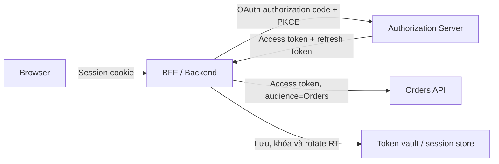
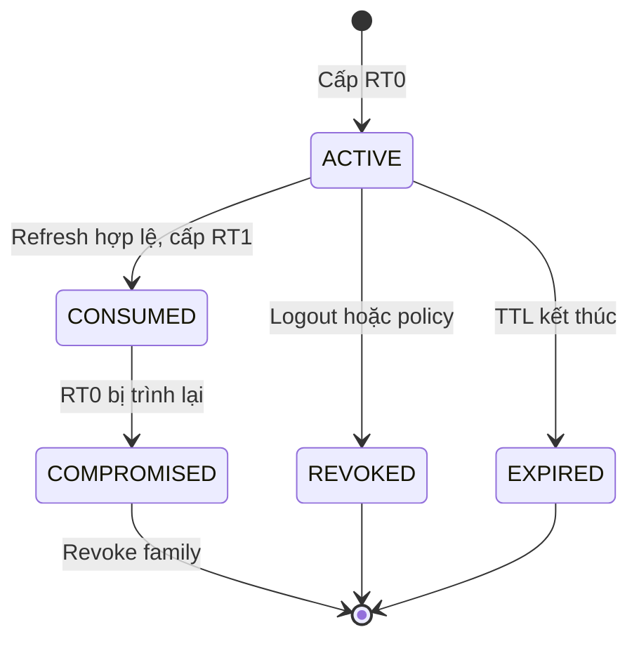

# Refresh token rotation trong browser

## 1. Tình huống: hai tab cùng làm mới phiên

Một ứng dụng web chạy trên trình duyệt sử dụng **OAuth 2.0 Authorization Code + PKCE** để nhận access token (AT) gọi Orders API. Authorization server (AS) cho phép ứng dụng nhận thêm **refresh token (RT)** để duy trì phiên mà không yêu cầu người dùng tương tác lại quá thường xuyên.

Người dùng mở **hai tab** của ứng dụng. Tại thời điểm access token sắp hết hạn:

1. Tab A gửi refresh token `RT0` tới token endpoint.
2. AS chấp nhận `RT0`, phát hành `AT1 + RT1` rồi **vô hiệu hóa RT0** theo cơ chế *refresh token rotation*.
3. Tab B chưa biết Tab A đã refresh, tiếp tục gửi `RT0`.
4. AS phát hiện **refresh token đã dùng xuất hiện lần nữa**. Theo chính sách bảo mật, AS có thể vô hiệu hóa cả **token family**, khiến `RT1` mà Tab A vừa nhận cũng không dùng được nữa.

```mermaid
sequenceDiagram
    participant A as Browser Tab A
    participant B as Browser Tab B
    participant AS as Authorization Server
    A->>AS: Refresh bằng RT0
    AS->>AS: RT0 CONSUMED; RT1 ACTIVE
    AS-->>A: AT1 và RT1
    B->>AS: Refresh bằng RT0 cũ
    AS->>AS: Phát hiện RT0 bị tái sử dụng
    AS->>AS: Có thể revoke toàn bộ family
    AS-->>B: invalid_grant
    Note over A,B: Cả hai tab có thể phải đăng nhập lại
```

Một sự cố tương tự xảy ra khi JavaScript bị lỗi retry, Service Worker và giao diện refresh đồng thời, hoặc người dùng nhấn tải lại trang khi response token mới chưa được lưu bền vững.

**Refresh token rotation trong browser** vì vậy không chỉ là “đổi token cũ lấy token mới”. Thiết kế cần giải quyết đồng thời **lưu trữ bí mật, chống XSS, điều phối nhiều tab, trạng thái token family tại AS, thu hồi và trải nghiệm khi request thất bại**.

> **Luận điểm chính:** Rotation giúp AS phát hiện khả năng token bị sao chép bằng cách chỉ chấp nhận **một lần sử dụng thành công cho mỗi giá trị refresh token**. Nhưng trong trình duyệt, nếu các luồng hợp lệ không phối hợp, chính chúng có thể tạo tín hiệu giống một cuộc tấn công replay.

Bài thuộc chương **Token storage** trong module `SECURITY_TOKEN_SECURITY_FUNDAMENTALS`. Phạm vi liên quan đến access/refresh token, JWT/opaque token, OAuth 2.0/OIDC, scope, audience, thời hạn, lưu trữ, thu hồi và giảm tác hại khi token bị đánh cắp hoặc phát lại.

## 2. Các mục tiêu cần nắm

Sau bài học, bạn nên có khả năng:

- Giải thích vì sao browser-based OAuth client được xem là **public client** và không thể giữ client secret trong JavaScript như một bí mật đáng tin.
- Mô tả vòng đời `RT0 → RT1 → RT2`, token family và **reuse detection**.
- So sánh ba kiến trúc: **BFF giữ token phía server**, **backend hỗ trợ/điều phối token** và **SPA tự quản lý token trong browser**.
- Phân tích ưu/nhược điểm của **memory, Web Worker, sessionStorage, localStorage, IndexedDB và HttpOnly cookie**.
- Tổ chức **single-flight refresh** giữa async tasks, nhiều tabs và các instance backend.
- Xử lý `invalid_grant`, mất response sau khi AS đã rotate và sự kiện thu hồi.
- Thiết kế kiểm thử bảo mật đối với XSS, CSRF, token theft, replay, race condition và quyền hạn đã bị thu hồi.

## 3. Phân biệt hai loại token trước khi chọn chỗ lưu

| Thuộc tính | Access token | Refresh token |
| --- | --- | --- |
| Nơi sử dụng | Resource server/API có audience phù hợp | Authorization server, thường tại token endpoint |
| Mục đích | Truy cập tài nguyên theo scope/quyền được cấp | Xin access token mới trong giới hạn grant |
| Vòng đời | Thường ngắn | Có thể dài hơn, có thể rotation và/hoặc sender-constrained |
| Khi bị lộ | Kẻ lấy được bearer token có thể thử gọi API | Kẻ lấy được bearer RT có thể thử duy trì quyền truy cập bằng cách cấp AT mới |
| Kiểm tra chính | Chữ ký/introspection, issuer, audience, exp, scope, ràng buộc khóa nếu có | Client/grant binding, trạng thái family, TTL, sender binding và rotation/reuse |
| Có gửi đến Orders API? | Có, nếu token dành cho Orders API | **Không** |

**Refresh token không phải access token có tuổi thọ dài.** Resource server phải từ chối refresh token nếu ai đó đưa vào `Authorization: Bearer` cho API nghiệp vụ.

JWT hay opaque mô tả **định dạng** token, không quyết định token được phép lưu ở đâu. Một JWT payload đọc được có thể làm lộ claims dù chữ ký hợp lệ; một opaque token khó đọc vẫn là bí mật quan trọng nếu ai giữ chuỗi đều có thể trình. Các chiến lược lưu trữ phải theo **cách sử dụng và mức nhạy cảm**, không theo việc token có dấu chấm hay nhìn như chuỗi ngẫu nhiên.

### 3.1. Browser là public client

Khi OAuth client chạy hoàn toàn trong JavaScript/HTML tải về máy người dùng, **client secret nhúng trong mã nguồn không thể được xem là bí mật**. Người dùng, extension hoặc mã chạy trong cùng môi trường có thể xem và trích xuất.

Với luồng có người dùng, browser-based app thường dùng **Authorization Code + PKCE**. PKCE bảo vệ việc đổi authorization code trước một số kiểu chặn code; nó **không tự bảo vệ refresh token sau khi token đã được cấp**.

Một ứng dụng có backend bảo mật (BFF) có thể dùng **confidential OAuth client** với client authentication được giữ ở server. Khi đó trình duyệt không trực tiếp là thành phần giữ OAuth refresh token.

## 4. Rotation diễn ra như thế nào?

Giả sử sau khi người dùng hoàn tất luồng OAuth hợp lệ, AS phát:

```text
Access token:  AT0, expires in 600 s
Refresh token: RT0, trạng thái ACTIVE
Token family:  F-901
```

Khi AT0 sắp hết hạn, client gửi:

```http
POST /token HTTP/1.1
Host: auth.example.com
Content-Type: application/x-www-form-urlencoded

grant_type=refresh_token&refresh_token=<form_encoded_RT0>
```

Trong public client, không nên đưa một client secret hard-coded vào JavaScript và coi như đã xác thực confidential client. AS áp dụng ràng buộc client/grant và các điều kiện bảo mật của profile. Mọi giá trị form phải được encode đúng; token có ký tự `+` không được ghép thẳng vào body vì `+` được hiểu là dấu cách trong form encoding.

Nếu request hợp lệ, AS trả:

```http
HTTP/1.1 200 OK
Content-Type: application/json
Cache-Control: no-store
Pragma: no-cache

{
  "access_token": "<AT1>",
  "token_type": "Bearer",
  "expires_in": 600,
  "refresh_token": "<RT1>",
  "scope": "orders:read"
}
```

Và cập nhật trạng thái:

```text
F-901:
  RT0: CONSUMED
  RT1: ACTIVE   <-- token hiện hành duy nhất
```

Lần refresh tiếp theo:

```text
RT1 -> RT2, RT1 chuyển CONSUMED
RT2 -> RT3, RT2 chuyển CONSUMED
...
```

**Client phải thay thế RT cũ bằng RT mới sau mỗi lần refresh thành công.** Không lưu cả `RT0` và `RT1` như hai credential có thể sử dụng luân phiên.

### 4.1. Reuse detection khác refresh thất bại thông thường

Nếu `RT0` đã được dùng và ai đó trình lại `RT0`, AS có bằng chứng **một credential đã bị sử dụng hơn một lần**. Trường hợp này khác với:

- Token được gửi sai encoding.
- Một chuỗi token hoàn toàn không tồn tại.
- Token hết hạn trước khi dùng lần đầu.
- Client authentication thất bại.
- Token family bị thu hồi do logout.
- Token endpoint tạm không truy cập được.

Các lỗi trên có thể cùng dẫn đến `invalid_grant` hoặc lỗi khác theo OAuth, nhưng **không phải mọi `invalid_grant` đều là bằng chứng bị đánh cắp**.

### 4.2. Token family và việc thu hồi thế hệ kế tiếp

Một family mô tả các refresh tokens kế tiếp trong một grant/phiên:

```text
Family F-901
  RT0 (CONSUMED) ---> RT1 (CONSUMED) ---> RT2 (ACTIVE)
       ^
       |
  xuất hiện lại RT0 -> dấu hiệu reuse
```

Khi phát hiện reuse đáng tin, AS có thể **revoke RT2 và cả family** để ngăn bất kỳ bên nào tiếp tục refresh. Lý do: AS thường không thể biết bên dùng RT cũ lần thứ nhất hay thứ hai mới là kẻ tấn công.

**Giới hạn:** Reuse detection không chặn được việc attacker dùng token **lần đầu tiên** nếu attacker đánh cắp RT đang active và thắng cuộc đua. Attacker có thể nhận access token mới trước khi family bị thu hồi. Quyền tối thiểu, access token TTL ngắn, ràng buộc bên gửi và khả năng thu hồi access token vẫn quan trọng.

## 5. Threat model đặc thù trình duyệt

Trước khi chọn storage, cần xác định ai là kẻ tấn công và chúng có thể làm gì:

| Mối đe dọa | Kẻ tấn công có thể làm gì? | Rotation giúp được gì? |
| --- | --- | --- |
| **XSS** trong origin ứng dụng | Đọc storage mà JS truy cập được; chạy request/khai thác API trong ngữ cảnh user | Có thể phát hiện token bị sao chép và dùng lại, **không ngăn XSS dùng token đang active ngay lúc đó** |
| Extension độc hại hoặc thiết bị bị xâm nhập | Quan sát/chỉnh sửa môi trường browser tùy quyền | Giới hạn phát hành thế hệ token; không bảo vệ tuyệt đối |
| Token lộ qua log, telemetry, URL | Kẻ tấn công lấy được chuỗi RT/AT | Reuse có thể tạo dấu hiệu nhưng token vẫn có thể bị dùng trước |
| **Hai tab/worker refresh đồng thời** | Hai request hợp lệ dùng cùng RT | Có thể tạo **false positive** nếu không điều phối |
| HTTP response bị mất | AS đã consume RT0 nhưng browser chưa lưu RT1 | Retry RT0 có thể bị xem là reuse |
| **CSRF** trên endpoint dùng cookie | Browser tự gửi cookie theo yêu cầu giả mạo | Rotation không thay thế CSRF protection |
| Token family không khóa nguyên tử tại AS | Hai requests có thể đều consume RT0 thành công | Rotation/reuse detection có thể bị vô hiệu bởi race |
| Quyền user bị thu hồi sau khi token được cấp | Claim cũ vẫn còn trong AT | Rotation không tự cập nhật quyền hoặc vô hiệu hóa AT cũ |

**Không có một cơ chế storage nào bảo vệ hoàn toàn khi mã độc được phép thực thi tùy ý trong origin của ứng dụng.** Hạn chế XSS, dùng least privilege và tách quyền là nền tảng, không phải bước tùy chọn.

## 6. Ba mô hình kiến trúc cần phân biệt

### 6.1. BFF: OAuth token ở server, browser giữ session cookie

**Backend-for-Frontend (BFF)** đóng vai trò OAuth client phía server. Trình duyệt đăng nhập qua redirect tới AS rồi nhận **cookie phiên của BFF**; BFF giữ access/refresh tokens trong kho bảo mật phía server.



Lợi ích:

- JavaScript phía browser **không trực tiếp nhận chuỗi refresh token OAuth**.
- Có thể quản lý token rotation trên server bằng transaction/locking và kiểm soát truy cập.
- Thu hồi phiên và tách các thiết bị dễ tổ chức hơn ở nhiều ứng dụng.
- Phù hợp khi ứng dụng có backend đáng tin cậy và có khả năng vận hành session/token storage.

Đánh đổi:

- Phải bảo vệ BFF khỏi token leak, SSRF, injection và lạm dụng quyền.
- Session cookie cần `Secure`, `HttpOnly`, `SameSite` theo bối cảnh và bảo vệ **CSRF**.
- XSS vẫn có thể gửi thao tác đến BFF bằng phiên đang mở, dù nó không đọc được refresh token.
- Nhiều BFF instances phải phối hợp refresh đúng cách; chuyển vấn đề cạnh tranh lên server chứ không tự xóa nó.

### 6.2. Backend điều phối/token-mediating backend

Một số kiến trúc cho frontend gọi API trực tiếp bằng access token, nhưng backend giúp thực hiện OAuth flow hoặc giữ/điều phối refresh token. Mục tiêu là giảm lượng credential dài hạn nằm trong JavaScript.

Tuy nhiên, nếu backend **trả access token cho browser**, mã độc XSS vẫn có thể lấy AT hoặc gọi API trong thời gian token có hiệu lực. Nếu backend có endpoint cấp AT mới dựa trên session cookie, endpoint ấy phải được **bảo vệ như một khả năng phát hành quyền** với authentication, CSRF, Origin, rate limiting và chính sách least privilege.

Không đánh đồng token-mediating backend với BFF hoàn toàn: nơi giữ access token, nơi phát request API và phạm vi JS có thể nhận token là **khác nhau**.

### 6.3. SPA tự giữ và rotate refresh token trong browser

Trong mô hình thuần browser, AS cấp RT cho browser-based public client; JavaScript hoặc thành phần thuộc browser origin lưu và sử dụng RT để gọi token endpoint.

Ưu điểm:

- Không cần backend giữ token cho mỗi user.
- Có thể gọi API trực tiếp với access token.
- Kiến trúc frontend đơn giản hơn ở một số môi trường.

Rủi ro:

- JS có quyền truy cập RT hoặc có khả năng **kích hoạt thành phần dùng RT**.
- XSS, extension và lỗi thư viện bên thứ ba làm tăng bề mặt tấn công.
- Nhiều tabs, Web Worker/Service Worker, reload và offline tạo bài toán đồng bộ.
- Token mới có thể mất trong lúc cập nhật storage.
- AS và frontend cần có cách xử lý expiration, reuse, logout và account recovery thống nhất.

Mô hình thuần browser **không bị cấm mặc định**, nhưng phải tuân thủ chính sách AS/standards và cân nhắc rủi ro. Khi có backend phù hợp, BFF thường là lựa chọn đáng cân nhắc mạnh vì giảm khả năng lộ OAuth refresh token qua JavaScript.

### 6.4. Bảng lựa chọn theo nơi giữ credential

| Mô hình | Nơi giữ RT | Browser có thể đọc RT OAuth? | Điều phối refresh | Vấn đề cần đặc biệt chú ý |
| --- | --- | --- | --- | --- |
| **BFF** | Server token store | Không, nếu triển khai đúng | Lock/transaction phía BFF/AS | Session cookie, CSRF, BFF security |
| **Token-mediating backend** | Server | Thường không, nhưng browser có thể nhận AT | Backend | API cấp AT từ session, XSS và CSRF |
| **SPA thuần browser** | Memory/worker/browser storage tùy thiết kế | Thường JS hoặc code trong origin có khả năng dùng RT | Trong tab + liên tab + AS | XSS, storage, race, crash/retry |
| **Browser dùng RT trong HttpOnly cookie qua endpoint ứng dụng** | Cookie gửi tự động tới endpoint liên quan | JS không đọc trực tiếp cookie, nhưng có thể kích hoạt request | Endpoint server phải điều phối | CSRF, cookie scope và kiến trúc không phải thay thế phổ quát cho OAuth token endpoint |

Cột cuối **không phải khuyến nghị lưu raw refresh token OAuth trong cookie cho mọi SPA**. Cookie lưu token trực tiếp yêu cầu contract server phù hợp và kiểm soát các request tự mang cookie. Trong BFF chuẩn, cookie gửi tới browser nên là **session credential**, còn RT OAuth nằm ở backend.

## 7. So sánh các nơi lưu token trong browser

### 7.1. In-memory JavaScript

Giữ RT trong biến/closure hoặc memory store của ứng dụng:

```javascript
// Minh họa cấu trúc, không phải giải pháp bảo mật production.
let currentRefreshToken = null;

function replaceRefreshToken(nextToken) {
  currentRefreshToken = nextToken;
}
```

**Ưu điểm:** không ghi RT vào persistent storage của origin; khi trang đóng hoặc reload thì giá trị trong memory biến mất.

**Giới hạn:** JS độc hại chạy cùng origin có thể tìm cách đọc hoặc kích hoạt các chức năng xử lý token tùy kiến trúc; reload/tab mới mất RT; nhiều tabs không tự chia sẻ giá trị. Muốn có phiên dài qua reload, ứng dụng phải xin token lại theo một luồng hợp lệ hoặc dùng cơ chế lưu khác.

### 7.2. Web Worker

Có thể đặt RT trong bộ nhớ của **Dedicated Web Worker** và không trực tiếp đưa chuỗi RT cho UI script. Worker nhận thông điệp hợp lệ từ trang và thực hiện refresh.

Điều này có thể **giảm khả năng trích xuất token qua một số đường JavaScript của trang**, nhưng không phải hàng rào bảo mật tuyệt đối:

- XSS trong origin có thể **gửi yêu cầu** đến worker qua giao diện message hiện có.
- Nếu worker cung cấp API “hãy refresh và trả token mới”, XSS có thể lợi dụng giao diện đó.
- Worker memory thường không bền qua kết thúc worker, reload hoặc đóng tab.
- Worker không giải quyết tự động **chia sẻ token giữa nhiều tabs**.
- Giới hạn messages, validate command và tránh lộ RT/AT qua `postMessage` không cần thiết.

**Service Worker** có vòng đời riêng và có thể bị dừng, khởi động lại bởi trình duyệt. Không mặc định dùng Service Worker như kho refresh token bền vững chỉ vì nó tách khỏi main thread.

### 7.3. `sessionStorage`

- Lưu theo ngữ cảnh tab/top-level browsing context, nhưng hành vi sao chép/bắt đầu ngữ cảnh mới có chi tiết trình duyệt.
- Có thể tồn tại qua reload trong tab.
- JavaScript cùng origin có thể đọc, nên **XSS vẫn có thể lấy RT**.
- Không tự cung cấp lock liên tab hoặc family coordination.

### 7.4. `localStorage` và `IndexedDB`

Hai cơ chế đều có thể giữ dữ liệu qua reload và nhiều phiên browser tùy môi trường, nhưng:

- JavaScript cùng origin thường có thể truy cập.
- XSS có thể đọc hoặc lạm dụng token.
- Mọi tab có thể đọc **snapshot cũ** rồi cùng refresh.
- Việc storage có transaction không đồng nghĩa toàn bộ luồng **HTTP refresh + cập nhật storage** là transaction nguyên tử.
- Browser data clearing hoặc eviction có thể xóa state, dẫn tới yêu cầu đăng nhập lại.

**Không nên quảng bá “đưa RT vào IndexedDB” như một biện pháp mã hóa/chống XSS mặc định.** Nó là lựa chọn về persistence và giao diện lưu trữ; kiểm soát bảo mật vẫn phụ thuộc kiến trúc.

### 7.5. Cookie `HttpOnly`

Cookie có `HttpOnly` ngăn JS đọc giá trị cookie qua API như `document.cookie`. Nhưng:

- Browser vẫn **gửi cookie tự động** khi request phù hợp thuộc tính cookie, làm phát sinh yêu cầu bảo vệ CSRF.
- JS có thể thực hiện các request với quyền của người dùng trong nhiều tình huống XSS.
- Cookie phải có `Secure` trên HTTPS và chính sách `SameSite` phù hợp, giới hạn `Domain`/`Path`.
- Cookie không tự tạo **rotation/reuse detection**; server vẫn phải quản lý family và refresh.
- Cookie `HttpOnly` thường hợp lý hơn để mang **session ID của BFF**, thay vì để frontend đọc OAuth RT.

Không dùng `HttpOnly` như lời bảo đảm rằng XSS không gây tác hại. Nó hạn chế **đọc cookie**, không ngăn **thực hiện hành động bằng phiên**.

### 7.6. Ma trận storage nhanh

| Lưu ở đâu? | Bền qua reload? | JS cùng origin có thể lấy/dùng? | Điều kiện dùng an toàn |
| --- | --- | --- | --- |
| Memory JS | Thường không | Có thể truy cập hoặc bị lạm dụng bởi code cùng origin | XSS prevention; chấp nhận mất phiên khi reload |
| Dedicated Worker memory | Thường không | Không đọc trực tiếp nếu API worker hạn chế; có thể ra lệnh qua message | Thiết kế worker protocol chặt chẽ |
| `sessionStorage` | Thường có trong tab | Có | XSS prevention; không coi là bí mật an toàn |
| `localStorage` | Thường có | Có | Threat model chấp nhận rủi ro; phối hợp tab |
| `IndexedDB` | Thường có | Có | Threat model, transaction ở storage, điều phối refresh |
| `HttpOnly` session cookie + BFF | Có theo cookie/session lifetime | Không đọc cookie bằng JS; có thể gửi request bằng phiên | CSRF, XSS, session controls, server token vault |

**Không có cột nào tự trả lời được câu hỏi “an toàn tuyệt đối”.** Kiểm soát nội dung trang, thư viện, CSP, cookie, AS và API cũng là một phần của giải pháp.

## 8. Browser rotation phải dựa vào máy trạng thái ở authorization server

### 8.1. Vì sao client không thể tự quyết định token nào active?

AS là bên phát hành và có thẩm quyền đối với token family. Browser chỉ biết token mà nó đã nhận/lưu; nó không có quyền tự sửa trạng thái `CONSUMED` hay tạo refresh token thay thế.

Các trạng thái tối thiểu phía AS:

| State | Ý nghĩa | Có chấp nhận refresh? |
| --- | --- | --- |
| `ACTIVE` | RT hiện hành, chưa tiêu thụ | Có, nếu grant/client/binding hợp lệ |
| `CONSUMED` | RT đã dùng để cấp RT kế tiếp | Không; trình lại có thể là reuse |
| `REVOKED` | RT hoặc family bị vô hiệu chủ động | Không |
| `EXPIRED` | Quá giới hạn hiệu lực | Không |
| `COMPROMISED` (family) | Family có dấu hiệu bị sao chép/reuse | Không phát token mới trong family |



Trong hệ thống thật, `COMPROMISED` có thể là state của family chứ không phải RT; sơ đồ minh họa các chuyển trạng thái liên quan.

### 8.2. Không để hai request cùng thành công từ RT0

Hai tab browser có thể gửi RT0 tới **hai node AS khác nhau**. Nếu mỗi node đọc RT0 active từ cache hoặc replica trễ rồi cùng cấp token mới, rotation đã bị phá vỡ:

```text
AS Node A: RT0 ACTIVE -> cấp RT1
AS Node B: RT0 ACTIVE -> cấp RT2
                  ^ không được phép có hai nhánh hợp lệ
```

AS phải bảo vệ bất biến:

> **Mỗi refresh token chỉ được tiêu thụ thành công một lần, và một family tuyến tính không có hai hậu duệ active hợp lệ được sinh từ cùng token.**

Triển khai có thể dùng transaction + khóa record/family, compare-and-swap theo version, unique constraint, hoặc cơ chế distributed consistency phù hợp. Không dựa vào mutex chỉ ở một process nếu có nhiều AS nodes.

### 8.3. Lưu trạng thái consumed đủ để nhận diện reuse

Nếu AS xóa sạch record RT0 ngay khi cấp RT1, về sau có thể chỉ thấy RT0 là “chuỗi không tồn tại”. Muốn phân biệt token **đã từng được phát hành và sử dụng** với token giả ngẫu nhiên, AS phải duy trì metadata/hình thức có thể xác thực tương đương trong thời gian cần thiết theo chính sách.

Một mô hình logic:

```text
family_id = F-901
client_id = orders-spa
grant_id  = G-77
status    = ACTIVE
current_refresh_record = R1

Refresh record R0:
  digest = HMAC(server_key, RT0)
  status = CONSUMED
  consumed_at = T1

Refresh record R1:
  digest = HMAC(server_key, RT1)
  status = ACTIVE
  parent = R0
```

Đừng lưu raw refresh token trong log để nhận diện reuse. Nên có **token digest hoặc định danh nội bộ được bảo vệ** và hệ thống retention phù hợp. HMAC là ví dụ kỹ thuật, không phải yêu cầu bắt buộc cho mọi AS.

## 9. Single-flight refresh trong **một tab**

Ngay trong một tab, nhiều API calls có thể nhận `401` gần như đồng thời hoặc cùng thấy AT sắp hết hạn. Nếu mỗi HTTP interceptor đều gọi refresh, chúng dùng chung RT0 và có thể tự gây family revocation.

Cần một cơ chế **single-flight**: tại một thời điểm chỉ có một refresh đang xử lý; các caller khác đợi **cùng kết quả**.

```javascript
// Ví dụ khái niệm: chỉ điều phối trong MỘT JS context.
// tokenStore và exchangeRefreshToken phải có triển khai an toàn riêng.
let refreshPromise = null;

async function getAccessToken() {
  const accessToken = tokenStore.currentAccessToken();

  if (accessToken && !tokenStore.isExpiringSoon(accessToken)) {
    return accessToken;
  }

  if (refreshPromise !== null) {
    return refreshPromise;
  }

  refreshPromise = (async () => {
    const oldRefreshToken = tokenStore.currentRefreshToken();
    if (!oldRefreshToken) throw new Error("reauthorization_required");

    const response = await exchangeRefreshToken(oldRefreshToken);

    // Phải cập nhật AT và RT mới nhất cùng nhau theo storage contract.
    await tokenStore.replaceTokensAtomically({
      accessToken: response.access_token,
      refreshToken: response.refresh_token
    });

    return response.access_token;
  })();

  try {
    return await refreshPromise;
  } finally {
    refreshPromise = null;
  }
}
```

**Không dùng nguyên đoạn mã trên như một OAuth client production.** Đoạn minh họa lược bỏ parser, token expiry clock skew, security state, cross-tab concurrency, refresh response validation, errors, timeouts, XSS, các cách lưu token và ràng buộc khóa.

Điểm cần hiểu:

- Biến `refreshPromise` được đặt **trước khi** tác vụ bất đồng bộ trả về.
- Caller đến sau sử dụng lại promise đó, **không gửi RT0 thêm lần nữa**.
- Khi response thành công, RT1 phải được lưu trước khi tác vụ khác khởi tạo refresh mới.
- Khi refresh thất bại, promise cần được kết thúc và chuyển sang chính sách lỗi, **không lặp RT0 vô hạn**.

**Single-flight trong một tab không giải quyết hai tab**, Service Worker hoặc backend khác.

## 10. Đồng bộ refresh giữa nhiều tabs

### 10.1. Các nguồn xung đột

Hai tabs của cùng origin có thể:

- Cùng đọc `RT0` từ `localStorage` hoặc `IndexedDB`.
- Cùng thấy AT0 sắp hết hạn.
- Cùng khởi tạo request refresh.
- Một tab cập nhật RT1 sau khi tab còn lại đã chụp snapshot RT0.
- Tab treo/crash sau khi nhận response nhưng trước khi thông báo cho các tab khác.

**Storage event hoặc BroadcastChannel chỉ thông báo thay đổi; nó không tự bảo đảm mutual exclusion cho toàn bộ yêu cầu refresh.**

### 10.2. Hướng thiết kế: một nơi có quyền làm mới token

Tùy kiến trúc, có thể chọn:

1. **BFF:** các tabs chỉ gửi API requests bằng session cookie. Backend dùng lock theo session/grant khi refresh; browser không xử lý RT.
2. **Một coordinator trong browser:** các tabs sử dụng cơ chế khóa giữa contexts khi trình duyệt hỗ trợ và storage transaction thích hợp.
3. **Một đầu mối điều phối phía server:** browser token-mediating backend quản lý RT, nhiều tabs nhận trạng thái phiên từ backend.
4. **Tách grants/families:** mỗi tab/phiên có grant riêng nếu AS và UX cho phép; không mặc định tất cả tabs dùng chung một RT.

Phương án một thường dễ kiểm soát hơn nếu ứng dụng đã có backend. Với SPA thuần browser, giải pháp phải có **fallback khi API trình duyệt thiếu** và không ngầm chuyển sang “mọi tab đều refresh”.

### 10.3. Ví dụ luồng phối hợp với Web Locks API

```text
Tab A và Tab B đều muốn refresh

A -> xin khóa "oauth-refresh:<session-key>"
B -> đợi cùng khóa

A được khóa:
  - đọc lại token từ shared secure storage SAU khi có khóa
  - nếu AT/RT đã được tab khác cập nhật: không refresh
  - nếu vẫn cần: gửi đúng một refresh request
  - ghi AT mới + RT mới với version/transaction
  - hoàn thành và nhả khóa
  - thông báo "token-state-updated" (không gửi RT thô)

B nhận khóa:
  - đọc lại storage mới
  - thấy RT1/AT1 đã có: không dùng RT0
```

**Web Locks API** (`navigator.locks`) có thể giúp điều phối giữa các contexts phù hợp khi được trình duyệt hỗ trợ. Tuy nhiên, ứng dụng phải đánh giá hỗ trợ thực tế, vòng đời tab/crash, service worker, security origin và cách lưu token. Lock được browser quản lý **không tạo một giao dịch nguyên tử chung với token endpoint của AS**.

Không dùng một cờ `localStorage.refreshing = true` như mutex đáng tin nếu không có cơ chế atomic claim/expiry/recovery đúng. Hai tab có thể cùng đọc `false` trước khi bên nào ghi `true`.

### 10.4. BroadcastChannel chỉ nên thông báo metadata

Ví dụ thông điệp liên tab:

```json
{
  "type": "token-state-updated",
  "sessionVersion": 18,
  "reason": "refresh-success"
}
```

Các tab khác **đọc lại trạng thái từ nguồn đã chọn**. Tránh gửi raw RT, client secret hoặc authorization header trong BroadcastChannel chỉ để tiện đồng bộ; thông điệp trong cùng origin không là kênh bí mật riêng biệt đối với XSS cùng origin.

Không nên tin toàn bộ message như lệnh ủy quyền. Kiểm tra nguồn/ngữ cảnh ở mức có thể, giới hạn loại message và không cho message tự đặt `isAdmin`, `scope` hoặc ép API cấp quyền.

### 10.5. Mỗi tab có RT riêng có tốt hơn không?

Nếu AS cấp **một refresh-token family riêng cho từng tab** trong những session/grant độc lập, hai tabs không đụng cùng RT0. Nhưng cách này có thể làm tăng số phiên, thao tác đăng nhập/consent và bề mặt lưu RT.

Không tự sao chép RT0 thành “RT của tab A/B”: đó vẫn là **cùng một credential** và AS vẫn xem nó là một token family trừ khi có grant mới hợp lệ.

## 11. Tình huống khó: AS đã rotate nhưng response bị mất

Với browser, lỗi mạng có thể xảy ra **sau khi AS đã commit**:

```mermaid
sequenceDiagram
    participant B as Browser
    participant AS as Authorization Server
    B->>AS: Refresh RT0
    AS->>AS: RT0 CONSUMED; RT1 ACTIVE
    AS--xB: Response AT1 + RT1 thất lạc
    Note over B: Browser vẫn chỉ có RT0
    B->>AS: Retry RT0?
    AS->>AS: RT0 đã CONSUMED
    AS-->>B: invalid_grant, có thể revoke family
```

Đây là ranh giới **không thể giải quyết chỉ bằng localStorage transaction**. Browser không có cách chắc chắn biết AS đã commit hay chưa nếu response bị mất.

Các lựa chọn có chủ đích:

- **Fail closed / reauthorize:** không retry RT0 mù quáng; kết thúc khả năng refresh và đưa user qua luồng ủy quyền hợp lệ.
- **Thiết kế idempotency ở AS:** chỉ khi AS hỗ trợ deduplication ràng buộc chặt với client/grant/request và không mở đường lấy RT1 bằng bản sao RT0.
- **Grace period rất hạn chế:** chỉ sau đánh giá threat model; chấp nhận lại RT cũ quá dễ có thể làm vô hiệu giá trị phát hiện reuse.
- **BFF:** backend có thể quản lý transaction/state và quy trình khôi phục tập trung hơn, nhưng cũng không tự biến HTTP response thành transaction với browser.

Không mặc định **retry bằng RT0 cho đến khi thành công**. Một retry có thể làm mất toàn bộ session khi RT0 thực sự đã được tiêu thụ.

### 11.1. Thời điểm lỗi quyết định khả năng retry

| Trường hợp | Browser biết chắc điều gì? | Hành vi |
| --- | --- | --- |
| Request chưa được gửi do lỗi cục bộ trước network | Chưa có yêu cầu tới AS, nếu xác định được thật sự | Có thể bắt đầu lại theo logic kiểm soát |
| Timeout/connection drop trong khi request đang chạy | **Không biết** AS đã consume RT chưa | Không auto-retry RT cũ theo vòng lặp; áp dụng recovery policy |
| AS trả thành công AT1/RT1 | Có response mới | Ghi token mới trước khi request refresh khác |
| AS trả `invalid_grant` | RT không còn được chấp nhận theo contract | Ngừng dùng RT; reauthorize khi thích hợp |
| AS trả lỗi hạ tầng `5xx` | Không được suy ra RT còn active hoặc đã consumed | Kiểm tra contract/idempotency; tránh retry mù quáng |
| Client nhận `401` từ API nghiệp vụ | Access token không được chấp nhận | Chỉ một luồng refresh được phép; không tạo nhiều refresh song song |

Một số thư viện HTTP có cấu hình **tự retry POST**. Không áp dụng retry chung cho OAuth refresh request mà không hiểu khả năng request đã được AS xử lý.

## 12. Browser storage và thứ tự ghi token sau refresh

Trong SPA, việc thay token phải được coi là cập nhật **một trạng thái phiên** gồm ít nhất AT mới, RT mới, expiry metadata và generation/version.

```text
Trạng thái trước:
  accessToken = AT0
  refreshToken = RT0
  generation = 12

AS response:
  accessToken = AT1
  refreshToken = RT1

Trạng thái sau:
  accessToken = AT1
  refreshToken = RT1
  generation = 13
```

**Các nguyên tắc:**

- Không lưu RT1 xong nhưng tab khác tiếp tục gửi RT0 do cache cũ.
- Không để hai writers cùng ghi state theo kiểu **last-writer-wins** mà writer cũ ghi đè RT mới.
- Nếu storage hỗ trợ version/transaction, sử dụng **compare-and-swap** hoặc lock phù hợp trong cùng ranh giới lưu trữ.
- Khi response không trả RT mới nhưng policy AS yêu cầu rotation, **không tự giả định** RT0 tiếp tục hợp lệ; xử lý theo contract của AS.
- Việc thay RT trong client phải bảo đảm **không có request refresh thứ hai chạy song song** khi cập nhật.

### 12.1. Vì sao lưu access token và refresh token là hai bước riêng dễ lỗi?

Nếu chỉ lưu AT1 trước, ứng dụng có thể dùng API bình thường trong vài phút nhưng vẫn giữ RT0, sau đó refresh lại RT0 đã consumed.

Nếu chỉ lưu RT1 trước rồi crash, client có thể cần xin AT mới từ RT1; đây có thể là kịch bản phục hồi được nếu thiết kế cho phép, nhưng vẫn phải tránh race. Vì vậy state update có **generation và quy tắc transaction** giúp hạn chế trạng thái không nhất quán.

Đối với BFF, backend có thể dùng **một transaction/lock theo grant**. Đối với browser storage, không thể bảo đảm nguyên tử xuyên qua **HTTP refresh tại AS**; chấp nhận rằng một số sự cố sẽ yêu cầu đăng nhập lại thay vì cố phục hồi không an toàn.

## 13. Kiến trúc BFF: mẫu triển khai thực tiễn

### 13.1. Luồng đăng nhập và làm mới

```mermaid
sequenceDiagram
    participant B as Browser
    participant F as BFF
    participant AS as Authorization Server
    participant API as Orders API
    B->>F: Bắt đầu đăng nhập
    F-->>B: Redirect tới AS
    B->>AS: Authorization request + PKCE
    AS-->>B: Redirect về BFF với authorization code
    B->>F: Callback + code/state
    F->>AS: Đổi code hợp lệ lấy AT0/RT0
    AS-->>F: AT0 + RT0
    F->>F: Lưu token server-side, tạo session
    F-->>B: HttpOnly Secure session cookie
    B->>F: GET /api/orders + session cookie
    F->>F: Kiểm tra session; AT sắp hết hạn
    F->>AS: Refresh RT0 dưới lock theo session/grant
    AS-->>F: AT1 + RT1
    F->>F: Ghi AT1/RT1, RT0 không dùng lại
    F->>API: GET /orders với AT1
    API-->>F: Dữ liệu nếu hợp lệ
    F-->>B: JSON response
```

**Chi tiết quan trọng:**

- BFF là OAuth client đáng tin; redirect URI, `state`, PKCE và client authentication (nếu dùng) phải được xử lý đúng.
- Không trả raw OAuth RT ra HTML, JavaScript, API response hoặc cookie của trình duyệt.
- Cookie chỉ chứa **session identifier** có entropy phù hợp, không chứa access/refresh token OAuth.
- Đặt cookie `Secure`, `HttpOnly`, `SameSite` phù hợp, giới hạn `Domain`/`Path` và lifetime.
- BFF phải chống CSRF đối với các request có tác dụng phụ; SameSite là một lớp, không phải giải pháp duy nhất cho mọi deployment.
- BFF phải khóa/điều phối khi nhiều requests cùng dùng một server-side RT.
- Access token BFF trình tới API vẫn phải đúng issuer/audience/scope; API phải kiểm tra quyền trên tài nguyên.

### 13.2. Ví dụ cookie phiên

```http
HTTP/1.1 200 OK
Set-Cookie: __Host-session=<opaque_random_session_id>; Path=/; Secure; HttpOnly; SameSite=Lax
Cache-Control: no-store
Content-Type: application/json

{"authenticated": true}
```

`__Host-` là tiền tố cookie có những ràng buộc như `Secure`, `Path=/` và **không có thuộc tính Domain**. Browser hỗ trợ áp dụng các ràng buộc tương ứng. `SameSite=Lax` chỉ là ví dụ, không có nghĩa mọi ứng dụng phải dùng giá trị đó; nếu ứng dụng cần cross-site flows, chọn chính sách phù hợp và bảo vệ CSRF bổ sung.

### 13.3. Browser gọi BFF API

```javascript
// Minh họa gọi API BFF cùng origin; BFF xử lý token OAuth.
async function loadOrders() {
  const response = await fetch("/api/orders", {
    method: "GET",
    credentials: "same-origin",
    headers: { "Accept": "application/json" }
  });

  if (!response.ok) throw new Error("Orders request failed");
  return response.json();
}

// Với POST/PATCH/DELETE, dùng cơ chế CSRF của ứng dụng/BFF.
// Không gửi OAuth refresh token vào request JavaScript này.
```

Ví dụ trên chỉ gọi GET và không truyền CSRF token. Một implementation thực tế cần chuẩn hóa **CSRF token/header cho các thao tác thay đổi dữ liệu**, kiểm tra Origin/Referer khi phù hợp và không mặc định mọi GET đều an toàn nếu backend thực hiện side effect.

### 13.4. Server-side refresh phải khóa theo family

Nếu nhiều requests BFF tới cùng phiên:

```text
Request A thấy AT0 sắp hết hạn
Request B cũng thấy AT0 sắp hết hạn

A lấy lock family F
  -> đọc lại trạng thái RT0
  -> gọi AS, nhận AT1/RT1
  -> ghi token thế hệ 1 vào session store
  -> nhả lock

B lấy lock F
  -> đọc lại trạng thái AT1/RT1
  -> AT1 còn hạn nên KHÔNG refresh RT0
```

Lock cần có phạm vi **cả cụm BFF** nếu nhiều pods dùng chung session, không chỉ một mutex ở Node/JVM process.

## 14. SPA thuần browser: làm được gì và phải chấp nhận rủi ro gì?

Nếu AS cấp RT cho browser-based public client theo policy, SPA có thể dùng:

- Authorization Code + PKCE.
- Access token đúng audience và scope hẹp, thời hạn ngắn.
- Refresh token rotation và reuse detection tại AS **hoặc** sender-constraining theo chính sách và chuẩn.
- Lưu trữ token theo threat model được ghi nhận, không đưa credential vào URL/log.
- Single-flight trong tab **và** điều phối liên tab/worker.
- Xử lý an toàn nếu mất token mới hoặc phát hiện session bị thu hồi.

### 14.1. Không trông chờ “silent login” qua iframe như cách bảo vệ RT

Một số ứng dụng cũ dùng hidden iframe dựa vào cookie phiên của AS để xin token lại không cần tương tác. Các chính sách chặn **third-party cookies**, hạn chế iframe và biện pháp chống tracking của trình duyệt làm kỹ thuật này không ổn định; nó cũng không giải quyết tự động scope, CSRF, XSS hoặc token theft.

Chọn luồng OAuth được AS hỗ trợ và có khả năng hoạt động theo chính sách browser hiện đại. **Không đề xuất lưu RT lâu dài chỉ để tránh mọi bước đăng nhập** mà không cân nhắc bảo mật và trải nghiệm.

### 14.2. CORS cho token endpoint

SPA gọi token endpoint trực tiếp từ browser chỉ khả thi nếu AS hỗ trợ **CORS** phù hợp với origin của client. Nhưng:

- CORS **không phải client authentication**; client_id trong public client không phải bí mật.
- Không cấu hình `Access-Control-Allow-Origin: *` tùy tiện kèm credentials hay coi CORS là hàng rào bảo vệ token.
- AS phải kiểm tra grant, client registration, PKCE, redirect URI, scope/resource, refresh binding và rate limits đúng giao thức.
- Tránh leak token response qua log, dev tools chia sẻ công khai hoặc third-party telemetry.
- Nếu dùng cookie ở token endpoint, cần hiểu chính xác cookie/credential/CORS/CSRF contract; không trộn với ví dụ bearer refresh token theo form một cách tùy tiện.

### 14.3. Token trong URL là anti-pattern

Không đặt access token/refresh token vào query parameter để “đồng bộ tabs”:

```text
Sai:
  https://app.example.com/?refresh_token=<RT0>

Đúng:
  Truyền OAuth authorization code qua redirect theo chuẩn;
  đổi code tại đúng client/BFF;
  giữ RT theo threat model;
  chỉ thông báo phiên đã thay đổi giữa tabs.
```

URL có thể nằm trong browser history, access log, analytics, screenshot và các thành phần trung gian. Percent-encoding/Base64url **không làm token trở thành bí mật**.

## 15. XSS và CSRF: hai ranh giới cần bảo vệ riêng

### 15.1. XSS và exfiltration

Nếu SPA giữ RT trong `localStorage`, mã XSS chạy cùng origin thường có thể đọc giá trị. Nếu RT ở worker hoặc cookie không đọc trực tiếp, XSS vẫn có thể:

- Gửi request với quyền của người dùng trong phiên.
- Gọi giao diện message của worker nếu được expose.
- Kích hoạt API cấp access token từ backend nếu quyền hiện tại cho phép.
- Can thiệp logic client để lạm dụng phiên.

Vì vậy, các biện pháp nền tảng gồm:

- Không chèn HTML không tin cậy bằng đường dẫn có thể chạy script.
- Escape/encode đầu ra đúng ngữ cảnh, sanitize HTML khi thật sự cần.
- Áp dụng **Content Security Policy (CSP)** phù hợp; giảm inline scripts, kiểm soát script origins.
- Kiểm soát dependencies, extension integration và third-party scripts.
- Xem xét Trusted Types nơi môi trường hỗ trợ.
- Không đưa token vào DOM, data attributes, console hoặc analytics.
- Giới hạn scope/audience và AT TTL; khả năng thu hồi khi nghi ngờ compromise.

**CSP không phải phép bảo đảm XSS bằng không.** Nó giảm rủi ro khi được thiết kế đúng, cùng với các biện pháp secure coding khác.

### 15.2. CSRF và cookie session

Với BFF cookie-based authentication, browser tự đính cookie khi yêu cầu thỏa điều kiện. Website độc hại có thể tìm cách kích hoạt request thay đổi dữ liệu.

Các biện pháp:

- `SameSite=Lax` hoặc `Strict` khi bối cảnh cho phép; `None` cần `Secure` và được đánh giá kỹ cho cross-site use.
- CSRF token không thể suy đoán và gắn đúng session/request theo thiết kế.
- Kiểm tra `Origin`/`Referer` khi phù hợp, nhưng không coi đó là lớp duy nhất.
- Không để GET thực hiện thay đổi trạng thái trái với contract.
- Dùng `Content-Type`/custom header và kiểm tra CORS hợp lý theo endpoint, hiểu rằng CORS không tự giải quyết mọi CSRF.
- Bảo vệ route logout, đổi quyền và cấp AT khỏi CSRF nếu tác vụ tạo side effect hoặc tăng khả năng tấn công.

**Rotation không giải quyết CSRF.** Một endpoint refresh dựa trên cookie mà không có ranh giới CSRF phù hợp có thể bị lạm dụng ngay cả khi cookie `HttpOnly`.

## 16. Sender-constrained refresh token trong browser

RFC 9700 (OAuth 2.0 Security BCP) yêu cầu **public clients** được cấp refresh token phải có cơ chế chống replay phù hợp, trong đó **refresh token rotation hoặc sender-constraining** là hai hướng đi được mô tả.

### 16.1. DPoP

**Demonstrating Proof of Possession (DPoP, RFC 9449)** ràng buộc token với public key; client chứng minh có private key bằng một JWT proof ký theo request.

Ở browser:

- Có thể sử dụng **Web Crypto API** để sinh cặp khóa và hạn chế xuất private key (ví dụ `extractable: false` khi phù hợp).
- AS phải ràng buộc token với khóa khi cấp và kiểm tra binding khi refresh theo profile.
- Private key không xuất được qua API thông thường giúp giảm rủi ro **sao chép khóa**, nhưng XSS cùng origin vẫn có thể cố **yêu cầu ký** hoặc gọi chức năng dùng khóa nếu có quyền điều khiển.
- DPoP không tự loại bỏ yêu cầu xử lý expiry, logout, grant/revocation, scope/audience và HTTP replay proof tại nơi áp dụng.
- Một request DPoP proof không phải access token; đối với API, RS phải kiểm tra proof, `htm`, `htu`, `ath`, freshness/nonce và ràng buộc `cnf.jkt` theo profile.

DPoP có thể là lựa chọn bổ sung cho rotation nếu AS và client hỗ trợ. Đừng gọi một khóa WebCrypto bất kỳ là “đã có DPoP” nếu AS/RS không ràng buộc và xác minh đúng.

### 16.2. mTLS và giới hạn môi trường browser

**mTLS certificate-bound token** là một cơ chế sender-constraining khác (RFC 8705), phù hợp hơn cho một số confidential clients và service-to-service. Việc quản lý client certificates trong browser cho SPA thuần có thể không thực tế hoặc không được các thành phần triển khai hỗ trợ đồng nhất.

Không đề xuất mTLS cho browser chỉ vì “an toàn hơn mọi trường hợp”. Quyết định phải dựa vào **khả năng của client, AS, RS, gateway và mô hình đe dọa**.

### 16.3. Nếu mất cả RT và khóa thì sao?

Nếu attacker kiểm soát origin/thiết bị đủ để dùng chính khóa đã ràng buộc hoặc lấy cả token và khóa có thể xuất, sender-constraining có thể không ngăn được lạm dụng. Vẫn cần:

- AS và client phát hiện hành vi bất thường.
- Giới hạn session/refresh lifetime.
- Revoke grant/token family.
- Scope/audience tối thiểu.
- Chính sách thiết bị, risk assessment và step-up khi cần.

## 17. Thời hạn refresh token và ràng buộc grant

AS không nên để một refresh token family sống vô hạn chỉ nhờ rotation. Một chính sách thực tế cần phân biệt:

| Loại giới hạn | Ý nghĩa | Ví dụ minh họa |
| --- | --- | --- |
| **Absolute lifetime** | Hạn cuối của toàn family/grant, dù refresh đều đặn | 30 ngày kể từ authorization |
| **Idle lifetime** | Thu hồi khi không refresh trong thời gian quy định | 7 ngày không hoạt động |
| **Session lifetime** | Giới hạn theo phiên user hoặc consent | Yêu cầu ủy quyền lại sau phiên |
| **Scope/resource binding** | Refresh không được nâng quyền hoặc chuyển audience ngoài grant | `orders:read` chỉ cho Orders API |
| **Client binding** | Refresh chỉ hợp lệ cho client/grant được cấp | `orders-spa` không dùng RT của client khác |
| **Sender binding** | Nếu áp dụng, yêu cầu proof/key đúng | DPoP key binding |

Các TTL trên **chỉ là ví dụ chính sách**, không phải thời hạn bắt buộc của OAuth 2.0. Chọn theo rủi ro, yêu cầu bảo mật, trải nghiệm và khả năng thu hồi.

### 17.1. Refresh không được tăng scope

Grant ban đầu:

```text
resource = https://orders-api.example.com
scopes   = orders:read
```

Client không được dùng RT0 xin:

```text
resource = https://payments-api.example.com
scopes   = payments:refund
```

nếu grant/chính sách không cho phép. AS phải ràng buộc refresh token với scope/resource đã được cấp và policy hiện hành, không đơn giản chấp nhận tham số do JavaScript gửi.

### 17.2. Claims có thể đã cũ

Access token vừa được refresh **không chắc có quyền mới nhất** nếu AS lấy metadata từ nguồn quyền bị cache hoặc chưa cập nhật. API cần đánh giá trạng thái hiện hành của user/tenant và quyền bản ghi khi tính chất endpoint yêu cầu.

Rotation bảo vệ **vòng đời credential**; không thay thế hệ thống phân quyền.

## 18. Logout, phát hiện reuse và thu hồi thực sự

### 18.1. Logout bình thường

Trong BFF:

1. Browser gọi endpoint logout hợp lệ với CSRF protection khi cần.
2. BFF hủy session và token state phía server.
3. BFF/AS thu hồi refresh token/grant theo khả năng và hợp đồng.
4. Browser xóa session cookie theo đúng các thuộc tính cookie đã dùng.
5. API vẫn phải kiểm tra AT còn hạn theo cơ chế token validation; nếu yêu cầu ngắt tức thì, cần cách chặn AT phù hợp.

Trong SPA thuần:

1. Ngừng phát API calls bằng token hiện tại.
2. Gọi revocation endpoint nếu AS hỗ trợ và client có khả năng thực hiện hợp lệ.
3. Xóa token local/worker state và đồng bộ logout giữa tabs.
4. Không hiểu “xóa localStorage” là đã vô hiệu hóa tất cả bản RT bị sao chép ngoài thiết bị.

### 18.2. Khi AS phát hiện reuse

Khi token `CONSUMED` bị trình lại, AS có thể:

- Ghi sự kiện kiểm toán `refresh_token_reuse_detected`.
- Thu hồi family/grant bị ảnh hưởng.
- Yêu cầu người dùng reauthorize/relogin.
- Áp dụng biện pháp bổ sung theo risk policy, ví dụ step-up hoặc thông báo sự cố.
- Theo dõi các access tokens đã được cấp gần thời điểm nghi vấn.

**Access tokens đã cấp không tự mất hiệu lực ở mọi resource server** ngay khi RT family bị thu hồi. Đặc biệt với JWT được RS xác minh cục bộ, chúng có thể tồn tại đến `exp` nếu không có denylist/introspection/session-version. Cần đặt kỳ vọng rõ về thời gian ngắt quyền.

### 18.3. Không biết bên nào là attacker

Nếu kẻ tấn công dùng RT0 **trước** và nhận RT1, client hợp lệ dùng RT0 **sau**, AS có thể thấy lần thứ hai giống chính hành vi reuse của attacker. AS không có căn cứ chỉ từ chuỗi RT để kết luận caller nào là chủ sở hữu hợp pháp.

Vì vậy, family revocation là phản ứng bảo vệ có thể gây **mất phiên hợp lệ**, nhưng thường ít rủi ro hơn để attacker tiếp tục dùng RT mới.

## 19. Xử lý lỗi ở browser mà không tạo vòng lặp

### 19.1. `invalid_grant` tại token endpoint

Ví dụ:

```http
HTTP/1.1 400 Bad Request
Content-Type: application/json
Cache-Control: no-store
Pragma: no-cache

{"error":"invalid_grant"}
```

Phản hồi có thể xuất hiện khi refresh token hết hạn, bị revoke, đã consumed hoặc không hợp lệ cho grant/client. **Client không nên phân loại chắc chắn “bị hack” chỉ từ mã lỗi công khai**.

Hành vi hợp lý:

1. Ngừng dùng RT bị từ chối.
2. Kết thúc hoặc đánh dấu phiên cần ủy quyền lại.
3. Đồng bộ thông tin “session expired/relogin required” giữa tabs mà không phát tán raw token.
4. Không retry cùng RT0 vô hạn.
5. Không tự chuyển từ refresh lỗi sang grant khác có scope rộng hơn.
6. Hiển thị thông điệp gọn, không công bố cơ chế family nội bộ.

### 19.2. `401` từ Orders API khác lỗi refresh

Khi API trả `401 invalid_token` cho access token, client có thể thử **một lần refresh có kiểm soát** nếu thiết kế cho phép. Nhưng:

- Nhiều requests `401` phải cùng chờ **một refresh**, không mỗi request tự refresh.
- Nếu AS trả `invalid_grant`, chuyển sang relogin; không lặp.
- Nếu token bị từ chối do **sai audience**, refresh cùng cấu hình resource sai không tự giải quyết; cần sửa client/AS policy.
- Nếu API trả `403 insufficient_scope`, không mặc định refresh để “xin scope cao hơn”; phải qua luồng ủy quyền thích hợp.

Một interceptor tự retry mọi `401/403` thường gây loop và khó kiểm soát.

### 19.3. Khi backend hoặc AS mất kết nối

Không cho qua một protected action khi không có access token hợp lệ chỉ vì AS hoặc policy service tạm lỗi. Áp dụng **fail closed** cho yêu cầu bảo mật, đồng thời có UX thông báo dịch vụ tạm thời.

Network errors sau khi refresh được gửi là **mơ hồ** về state của RT; tránh tự kết luận RT0 vẫn active. Cần chính sách retry/idempotency rõ hoặc yêu cầu ủy quyền lại.

## 20. Giám sát và audit cho rotation browser

### 20.1. Những sự kiện nên quan sát

- Tổng số refresh success theo `client_id`, loại browser flow và token family.
- Tỷ lệ `invalid_grant`, phân nhóm nguyên nhân nội bộ (expired, revoked, consumed/reuse, client binding mismatch).
- Reuse xảy ra gần nhau từ nhiều sessions/tabs/requests.
- Các đợt tăng đột biến sau khi frontend deploy thay đổi interceptor hoặc state management.
- Mức độ nhiều refresh trên mỗi session trong một khoảng thời gian.
- Thời gian từ sự kiện compromise tới khi family bị revoke và các AS nodes cùng từ chối.
- Số AT đã cấp từ một family sau thời điểm đáng ngờ nếu cần điều tra.
- Sự cố storage synchronization, session loss, retry loops và graceful reauthorization.

### 20.2. Một event an toàn hơn raw token

```json
{
  "event": "refresh_token_reuse_detected",
  "client_id": "orders-spa",
  "family_ref": "F-901",
  "token_record_ref": "R0",
  "result": "family_revoked",
  "request_id": "req-8f3a",
  "detected_at": "2026-11-23T02:00:00Z"
}
```

Đây là ví dụ metadata **đã được phân quyền truy cập và có chính sách retention**. Không ghi `RT0`, `RT1`, AT, authorization code, DPoP proof nguyên vẹn, client secret hoặc session cookie.

IP, user agent, địa chỉ thiết bị và thông tin người dùng có thể hỗ trợ điều tra nhưng **không phải bằng chứng danh tính hoàn hảo** và có thể là dữ liệu cá nhân nhạy cảm.

### 20.3. Đừng xem mọi reuse là bị tấn công

Một đợt tăng reuse sau release có thể do:

- Thư viện HTTP bắt đầu retry POST token endpoint.
- Multi-tab coordination bị hỏng.
- App tạo hai refresh promises cùng lúc.
- Storage ghi RT mới chậm hoặc lỗi.
- Service Worker tiếp tục dùng token snapshot cũ.

Điều này không có nghĩa **bỏ qua tín hiệu reuse**. AS phải xử lý theo chính sách an toàn, còn nhóm phát triển cần sửa nguyên nhân ở client.

## 21. Case study: SPA localStorage và hai tab

Ứng dụng lưu AT/RT cùng `generation` trong localStorage. Browser mở hai tab, cả hai gọi API khi AT0 gần hết hạn.

**Thiết kế sai:**

```javascript
// Anti-pattern: hai tabs đều có thể gọi song song bằng RT0.
if (accessTokenExpired()) {
  const response = await refresh(currentRefreshToken());
  localStorage.setItem("refresh_token", response.refresh_token);
}
```

Rủi ro:

- Mỗi tab có thể đọc RT0 trước khi tab còn lại ghi RT1.
- Storage write không khóa network request.
- Tab B có thể refresh RT0 sau khi AS đã consume.
- Với localStorage, XSS cùng origin có thể đọc token.

**Thiết kế cải thiện nếu vẫn dùng SPA trực tiếp:**

1. Giới hạn token scope/audience và thời hạn.
2. Dùng single-flight trong mỗi tab.
3. Dùng lock/coordinator liên tab thực sự khi trình duyệt hỗ trợ; không fallback im lặng sang multiple refreshes.
4. Sau khi lấy lock, đọc lại generation/RT hiện hành trước khi quyết định refresh.
5. Sau response, lưu AT/RT/version theo transaction storage khả thi.
6. Chỉ broadcast metadata, không broadcast raw token khi không cần thiết.
7. Khi lỗi mơ hồ hoặc `invalid_grant`, ngừng retry RT cũ và reauthorize theo chính sách.
8. Cân nhắc chuyển sang BFF để giảm việc RT tồn tại trong JS-accessible storage.

**Không phải cứ chuyển RT từ localStorage sang IndexedDB là đủ.** XSS vẫn là vấn đề chính, trong khi race condition cần cơ chế phối hợp độc lập.

## 22. Case study: BFF với ba pods cùng một session

Một ứng dụng dùng BFF gồm ba pods, một shared token store và session cookie.

**Sai sót:** mỗi pod giữ AT/RT trong local memory cache. Hai requests của cùng session đến hai pods khi AT sắp hết hạn:

```text
Pod 1: dùng RT0 -> nhận RT1
Pod 2: dùng RT0 -> AS phát hiện reuse, revoke family
Pod 3: vẫn giữ cache RT0 -> tiếp tục fail
```

**Thiết kế cải thiện:**

- Token state nằm ở **nguồn server-side dùng chung** có kiểm soát quyền truy cập.
- Refresh lock gắn với session/family có hiệu lực giữa tất cả pods.
- Pod lấy lock phải **đọc lại state sau khi khóa** để tránh dùng cache cũ.
- Kết quả rotation được ghi bền vững và tăng version.
- Các pods chỉ dùng token mới sau khi state commit.
- Session bị revoke khi AS thông báo family compromised theo policy.
- Khi lock service/database không sẵn sàng, **không** cho mọi pod tự refresh bằng RT0 như fallback.

BFF giảm nguy cơ JS đọc RT nhưng **không xóa bài toán atomicity**; nó chuyển vấn đề sang kiến trúc server có thể kiểm soát tốt hơn.

## 23. Ma trận kiểm thử đầy đủ

Giả định AS áp dụng rotation với **một RT active trong mỗi family**. Một browser-based client `orders-spa` được cấp token scope `orders:read`, audience Orders API. Các kiểm thử dùng **credential giả lập**, không dùng RT production.

| Ca kiểm thử | Kết quả mong đợi | Thuộc tính được kiểm tra |
| --- | --- | --- |
| Refresh RT0 lần đầu hợp lệ | Phát AT1/RT1; RT0 consumed | Rotation bình thường |
| Refresh RT1 sau đó | Phát AT2/RT2; RT1 consumed | Vòng đời thế hệ |
| Trình lại RT0 sau khi RT1 được cấp | `invalid_grant`; family xử lý compromised theo policy | Reuse detection |
| Thử RT1 sau khi family compromised | Từ chối | Family revocation |
| Attacker dùng RT0 trước client | Lần trình lại sau bị phát hiện; không cấp refresh tiếp | Không giả định ai là attacker |
| Hai async calls cùng tab muốn refresh | Chỉ một refresh thực sự gửi | Single-flight |
| Hai tab cùng thấy AT hết hạn | Lock/coordinator chỉ cho một request consume RT | Liên tab |
| Tab khác đọc RT0 snapshot rồi nhận signal RT1 | Đọc lại state, không dùng RT0 | Chống stale snapshot |
| Tab đóng giữa request | Không tự retry RT0 không kiểm soát | Browser lifecycle |
| AS commit rotation nhưng response mất | Không lặp RT cũ vô hạn; recovery theo policy | Ambiguous outcome |
| Client ghi AT1 nhưng không ghi RT1 | Test phát hiện trạng thái không nhất quán | Atomic storage update |
| Hai HTTP interceptors cùng nhận `401` | Một lần refresh; các requests khác đợi | Retry coordination |
| API trả `403 insufficient_scope` | Không refresh để tự tăng quyền | Authorization đúng |
| Token sai `aud` | RS từ chối, không dùng refresh như bypass | Audience validation |
| Refresh token của client khác | AS từ chối | Client/grant binding |
| RT bị lộ nhưng thiếu DPoP proof đúng | Từ chối, không cấp RT mới | Sender-constraining |
| XSS đọc `localStorage` | Nhận diện rủi ro; không coi storage là kín | Browser threat model |
| XSS cố gửi lệnh tới Worker | Worker protocol/policy giới hạn, kiểm thử đường lạm dụng | Worker không là hộp đen tuyệt đối |
| Cookie BFF thiếu `HttpOnly` hoặc `Secure` | Test cấu hình thất bại | Session cookie security |
| Request cross-site có side effect | CSRF check từ chối khi không có bằng chứng | CSRF protection |
| Logout ở tab A khi tab B còn mở | Tab B không tiếp tục refresh bằng state cũ | Logout propagation |
| RT hết absolute lifetime dù rotate đều | AS từ chối | Không kéo dài vô hạn |
| Refresh xin thêm `payments:refund` | Không tự mở rộng scope/resource | Least privilege |
| Grant bị thu hồi khi RT còn hạn | AS từ chối | Policy hiện hành |
| AS node A và B cùng nhận RT0 | Không tạo hai hậu duệ active hợp lệ | Transaction/consistency |
| AS phát hiện reuse nhưng transaction rollback | Test phát hiện lỗi; không được coi là revoke thành công | Commit durable |
| BFF pods cùng refresh một session | Một refresh; pods sau đọc state mới | Cross-pod locking |
| Log/tracing sau refresh | Không có raw RT/AT/session cookie | Secret minimization |
| API nhận RT như access token | Từ chối | Token type isolation |
| Family compromised nhưng AT1 JWT còn hạn | Hành vi theo contract RS/TTL/revocation, không giả định vô hiệu tức thì | Phân biệt AT vs RT |

### 23.1. Test race đa tab cần có kiểm soát

Một bài kiểm thử tự động có thể:

1. Mở hai browser contexts/tabs cùng một session test.
2. Cố tình cho cả hai đọc token generation `N`.
3. Kích hoạt các yêu cầu API cùng thời điểm.
4. Kiểm tra số **token endpoint refresh calls thực sự**: chỉ một request được gửi khi dùng single-flight/coordinator.
5. Kiểm tra mọi tab dùng generation mới sau khi cập nhật.
6. Tiêm lỗi crash/timeout sau khi AS consume RT, xác minh client **không retry RT0 vô hạn**.
7. Kiểm tra AS giữ invariant family và log không chứa RT.
8. Thử thiếu hỗ trợ lock API ở một môi trường browser: ứng dụng phải áp dụng fallback **đã thiết kế an toàn**, không tự phát nhiều refresh song song.

Với BFF, chạy test tương tự qua nhiều pods và các instance token store. Tính đúng không được chỉ kiểm thử trong một process.

## 24. Checklist khi review thiết kế

1. **Có thực sự cần cấp refresh token cho browser client?** Có thể dùng BFF hoặc luồng ủy quyền khác an toàn hơn không?
2. **Client type:** Browser client có được đối xử là public client và dùng Authorization Code + PKCE đúng cách không?
3. **AS replay protection:** Refresh token có rotation hoặc sender-constraining phù hợp RFC 9700 và chính sách AS không?
4. **Token family:** AS có lưu trạng thái consumed, current token, grant và khả năng revoke toàn family không?
5. **Atomicity:** Một RT có thể bị dùng thành công hai lần do race trên nhiều AS nodes/regions không?
6. **Nơi lưu:** RT OAuth ở BFF/server hay JS/browser? Rủi ro XSS, storage persistence, extension và device compromise đã được đánh giá chưa?
7. **Cookies:** Nếu dùng BFF, cookie session có `Secure`, `HttpOnly`, `SameSite` và CSRF protection phù hợp không?
8. **Một tab:** Các async calls có dùng chung một in-flight refresh promise không?
9. **Nhiều tab/worker:** Có một coordinator thật sự và cơ chế đọc lại generation sau lock không?
10. **Cập nhật token:** AT/RT/version có được thay đồng bộ, không ghi đè generation mới bằng snapshot cũ?
11. **Mất response:** Client có tránh retry RT đã có thể bị consumed không?
12. **Lỗi OAuth:** Khi `invalid_grant`, có ngừng dùng RT cũ và đi qua reauthorization thay vì loop?
13. **Giới hạn quyền:** RT chỉ cấp AT trong scopes/resources của grant; AT có audience/TTL tối thiểu không?
14. **Thu hồi:** Logout, mất thiết bị, phát hiện reuse và role change có phản ánh vào session/AT theo mục tiêu thời gian không?
15. **PoP:** Nếu dùng DPoP/mTLS, AS/RS có xác minh ràng buộc khóa thực sự, không coi `client_id` là bằng chứng sở hữu khóa?
16. **XSS/CSRF:** Có kiểm soát script, CSP, output encoding, CSRF token, Origin và không lộ token trong URL/log không?
17. **Quan sát:** Có log mã nguyên nhân, family reference, request ID mà không ghi token/PII thừa?
18. **Kiểm thử:** Đã thử double-tab, reload, crash, response loss, AS race, BFF multi-pod, reuse attacker-first và sender constraint chưa?

## 25. Kết luận

**Refresh token rotation trong browser** là bài toán kết hợp **bảo vệ credential lâu dài** với **điều phối trạng thái bất đồng bộ**. Rotation khiến RT cũ không thể được dùng thành công lần nữa và giúp AS phát hiện replay; family revocation giới hạn khả năng tiếp tục refresh khi một credential có dấu hiệu bị sao chép. Nhưng **hai tab hợp lệ**, worker, retry hoặc response bị mất cũng có thể trình lại RT cũ, nên client và AS đều phải kiểm soát concurrency.

Khi lựa chọn kiến trúc, hãy ưu tiên câu hỏi: **Trình duyệt có thật sự cần trực tiếp giữ refresh token không?** BFF giữ OAuth token ở server có thể giảm bề mặt RT bị XSS đọc và cung cấp nơi đồng bộ refresh dễ kiểm soát hơn, đổi lại cần thiết kế session cookie, CSRF và backend storage cẩn thận. Nếu dùng SPA trực tiếp, phải nhận thức rủi ro XSS, lựa chọn storage phù hợp, phối hợp nhiều tabs/worker, cập nhật token chính xác và xử lý lỗi bằng reauthorization an toàn.

**Rotation không thay thế** PKCE, xác minh issuer/audience, giới hạn scope, access token TTL, bảo vệ XSS/CSRF, sender-constraining hay kiểm tra quyền hiện hành ở API. Một hệ thống an toàn phải phối hợp tất cả các lớp đó theo ranh giới tin cậy của mình.

## Tài liệu chuẩn để tìm hiểu thêm

- **RFC 9700 — Best Current Practice for OAuth 2.0 Security:** refresh-token replay protection, rotation và sender-constraining cho public clients.
- **RFC 6749 — The OAuth 2.0 Authorization Framework:** refresh_token grant, token response, scope, client/grant binding và `invalid_grant`.
- **RFC 7636 — Proof Key for Code Exchange (PKCE):** bảo vệ authorization code exchange cho public clients.
- **RFC 9449 — OAuth 2.0 Demonstrating Proof of Possession (DPoP):** proof JWT và sender-constraining.
- **RFC 8705 — OAuth 2.0 Mutual-TLS Client Authentication and Certificate-Bound Access Tokens:** ràng buộc token bằng chứng chỉ.
- **RFC 7009 — OAuth 2.0 Token Revocation:** yêu cầu thu hồi token tại authorization server.
- **RFC 7662 — OAuth 2.0 Token Introspection:** trạng thái token và khả năng kiểm tra thu hồi ở resource server.
- **RFC 8252 — OAuth 2.0 for Native Apps:** bối cảnh public clients và luồng OAuth trên nền tảng native.
- **OpenID Connect Core:** `offline_access` và các yêu cầu OIDC có liên quan tới quyền truy cập ngoại tuyến.
- **OWASP Cross Site Scripting Prevention Cheat Sheet / CSRF Prevention Cheat Sheet:** biện pháp giảm rủi ro XSS và CSRF ở ứng dụng web.
