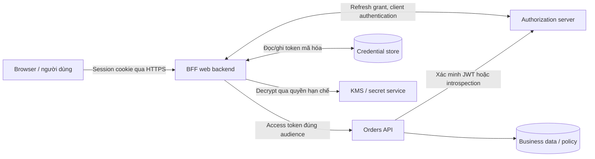
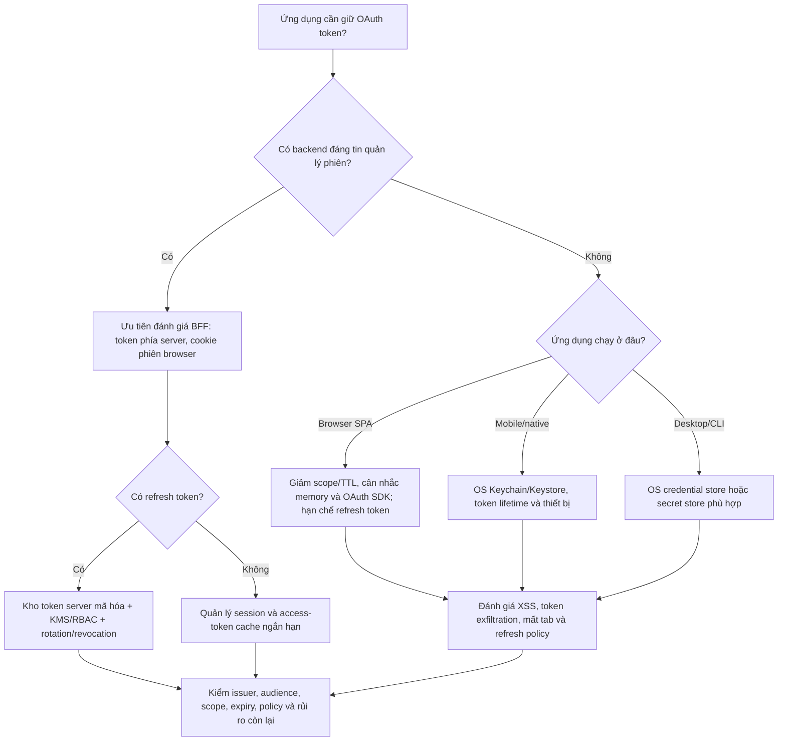
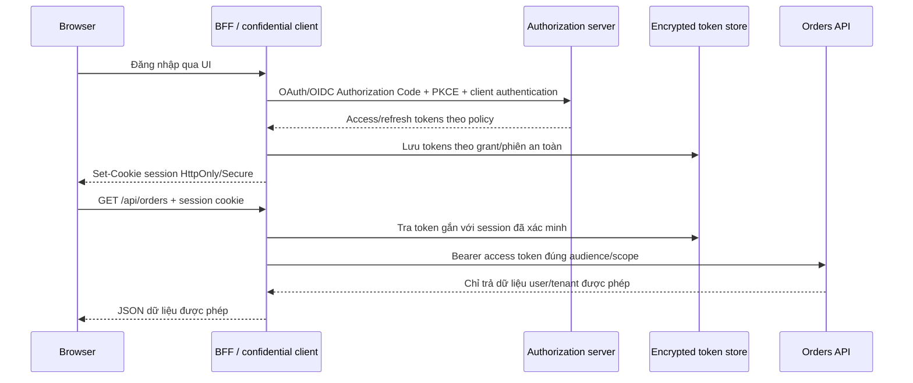
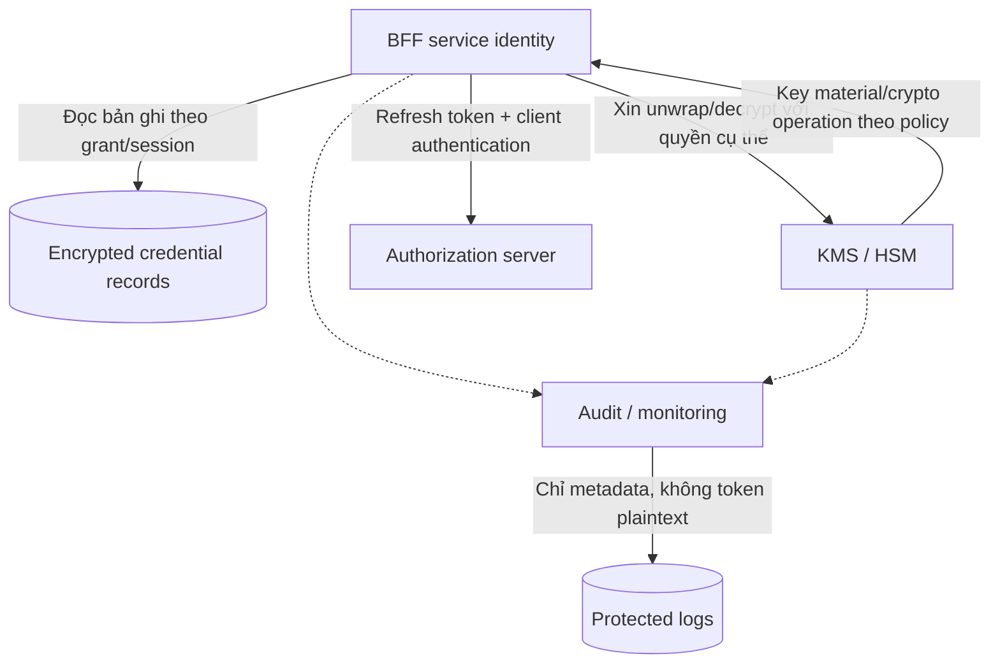
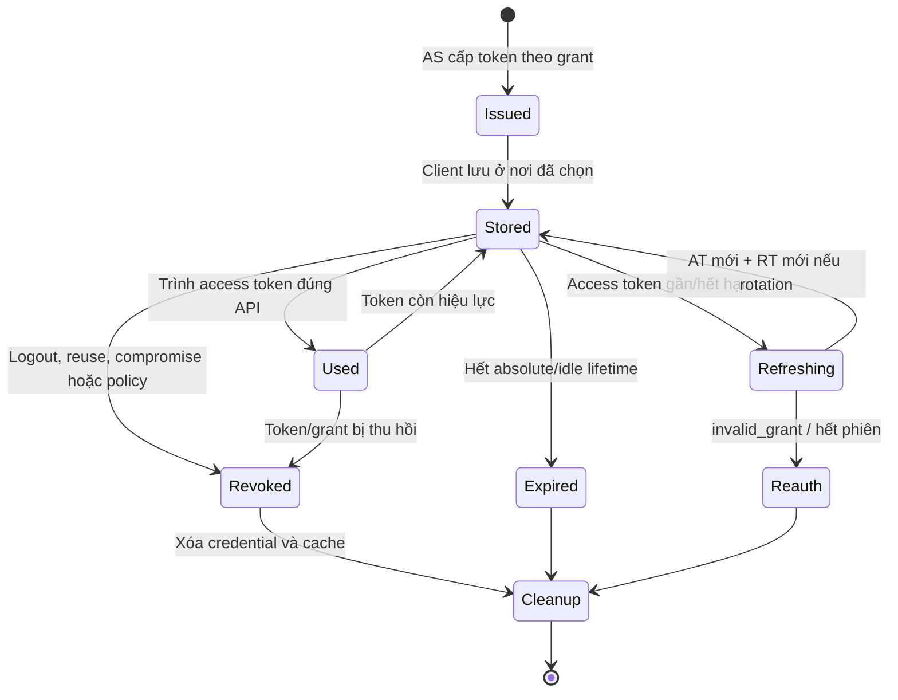

# Chọn storage theo threat model

Một nhóm phát triển muốn giữ OAuth access token trong `localStorage` để ứng dụng không mất phiên khi người dùng tải lại trang. Nhóm khác chọn cookie `HttpOnly` và cho rằng như vậy đã “chống XSS hoàn toàn”. Một ứng dụng di động đặt refresh token trong tệp cấu hình để dễ sao lưu. Một backend lại lưu refresh token trong database nhưng để cả khóa giải mã ở cùng tài khoản dịch vụ. **Không có lựa chọn nào có thể đánh giá đúng chỉ bằng tên nơi lưu**: cần biết token mang quyền gì, ai có thể đọc hoặc sử dụng nó, kênh tấn công nào tồn tại và cần duy trì phiên bao lâu.

Trong chương **Token storage** của module **SECURITY_TOKEN_SECURITY_FUNDAMENTALS**, bài học này hướng dẫn **chọn nơi lưu token dựa trên threat model** — mô hình tài sản, đối thủ, khả năng tấn công, ranh giới tin cậy, hậu quả và biện pháp kiểm soát. Phạm vi bao gồm JWT/opaque access token, refresh token, OIDC ID token, session cookie, các lựa chọn browser, mobile, backend và service-to-service. Việc lưu trữ phải kết hợp với phát hành, xác minh `iss`/`aud`/`scope`/`exp`, thu hồi và bảo vệ khỏi token theft/replay; **storage không thay thế token validation hoặc authorization**.

Sau bài này, bạn có thể:

- Lập threat model cụ thể trước khi chọn memory, Web Storage, cookie, BFF, OS credential store hoặc backend secret store.
- So sánh khả năng **đọc trộm (exfiltration)** và **lạm dụng phiên/token tại chỗ (session riding)** khi gặp XSS, CSRF, thiết bị bị chiếm quyền hoặc server compromise.
- Thiết kế **browser chỉ giữ session cookie** còn access/refresh token ở BFF, và hiểu vì sao vẫn phải chống CSRF/XSS.
- Chọn storage phù hợp cho **native mobile**, **CLI/desktop**, **backend confidential client** và **machine-to-machine**.
- Áp dụng giảm thiểu như TTL ngắn, refresh token rotation, sender-constrained tokens, key management, access control, auditing và revocation.
- Biện luận quyết định bằng risk matrix, nêu rõ giả định và **rủi ro còn lại** thay vì tuyên bố một nơi lưu “an toàn tuyệt đối”.

## 1. Định nghĩa đúng “token storage”

**Token storage** là tập hợp cơ chế giữ credential trong quá trình token được nhận, sử dụng, làm mới và hủy. Nó không chỉ là câu hỏi “ghi token vào bảng nào”, mà còn liên quan:

1. **Storage at rest:** token có được ghi xuống đĩa, database, browser storage, Keychain/Keystore hay vault?
2. **Storage in memory:** token tồn tại trong process/JavaScript heap bao lâu, service nào có quyền truy cập?
3. **In transit:** token đi qua TLS, proxy, gateway, logs, event bus hoặc tracing nào?
4. **Usage boundary:** thành phần nào được phép gửi token tới AS/token endpoint hay resource server?
5. **Lifecycle:** expiry, refresh, rotation, logout, revoke, restore từ backup và dọn dẹp token cũ.

### 1.1. Bốn credential thường bị trộn lẫn

| Credential | Bên nhận đúng | Vai trò | Độ nhạy cảm khi lưu |
| --- | --- | --- | --- |
| **OAuth access token** | Resource server/API đúng audience | Xin thực hiện thao tác theo scope/policy | Bản sao bearer token có thể được dùng lại trước khi hết hạn/thu hồi |
| **OAuth refresh token** | Authorization server/token endpoint | Xin access token mới trong phạm vi grant | Thường nhạy cảm hơn do khả năng duy trì quyền lâu hơn |
| **OIDC ID token** | OIDC client/Relying Party | Xác minh kết quả đăng nhập và ngữ cảnh danh tính | Có claims danh tính/PII; **không dùng làm access token cho API** |
| **Session cookie ứng dụng** | Chính web backend/BFF | Duy trì phiên web độc lập với OAuth token | Cũng là credential nhạy cảm, thường có tính chất bearer |

Không kết luận rằng **JWT cần một kiểu storage, opaque token cần kiểu khác**. Một JWT ký có payload dễ đọc nhưng cùng là bearer secret như opaque token nếu được dùng làm access token. Opaque không tự bảo vệ khỏi bị sao chép; JWT signature không ngăn người khác **sử dụng bản sao còn hiệu lực**.

Đồng thời, **token type quyết định nơi được sử dụng**: refresh token không đưa tới Orders API; access token không đưa vào `id_token` của OIDC client; session cookie của BFF không được tự coi là access token cho downstream.

## 2. Threat model: chọn chỗ lưu sau khi hiểu tài sản và kẻ tấn công

**Threat model** mô tả hệ thống nào cần bảo vệ, đối thủ có khả năng gì, ranh giới tin cậy nào bị vượt qua và hậu quả ra sao. Thay vì bắt đầu bằng “dùng localStorage hay cookie?”, hãy đi qua sáu bước.

### Bước 1 — Liệt kê tài sản

Ví dụ của ứng dụng Orders:

- Access token có `aud=orders-api`, `scope=orders.read`, TTL vài phút.
- Refresh token cho confidential BFF, có thể xin access token mới cho grant người dùng.
- Client secret/private key và encryption key phía backend.
- Session cookie ràng buộc browser với phiên BFF.
- Dữ liệu đơn hàng, thông tin người dùng, tenant membership và audit logs.

**Giá trị tài sản tùy phạm vi quyền.** Một access token chỉ đọc hồ sơ công khai khác với token `payments.refund` có thể dùng để chuyển tiền, dù cả hai đều là chuỗi bearer.

### Bước 2 — Vẽ đường đi của credential và trust boundaries



Ranh giới cần đánh dấu:

- **Browser ↔ BFF:** browser không nhất thiết phải sở hữu OAuth access/refresh token; nó có thể chỉ giữ session cookie.
- **BFF ↔ token store/KMS:** không phải mọi service hoặc user có quyền đọc database đều có quyền giải mã token.
- **BFF ↔ AS:** chỉ client đã đăng ký, đúng authentication method và grant mới được refresh.
- **Client/BFF ↔ API:** access token phải đúng issuer, audience, scope, thời hạn và quyền trên đối tượng.
- **API/gateway ↔ logging/monitoring:** log/trace không được biến thành nơi lưu bản sao token.

Nếu ứng dụng là SPA thuần hoặc mobile, sơ đồ sẽ khác: browser/device có thể giữ access token trực tiếp. Mô hình đe dọa phải ghi nhận thay đổi **ai sở hữu credential**.

### Bước 3 — Nêu năng lực đối thủ, không chỉ tên tấn công

| Đối thủ có thể… | Token/storage có thể bị ảnh hưởng | Điều cần hỏi |
| --- | --- | --- |
| Chạy JavaScript do XSS trong origin ứng dụng | Memory, `localStorage`, `sessionStorage`, IndexedDB; sử dụng cookie phiên thông qua browser | Có thể **đọc token** hay **thực hiện request cùng phiên**? |
| Dụ browser gửi request từ một site khác | Cookie tự động đính kèm nếu thuộc phạm vi được phép | Có CSRF protection và kiểm tra origin/intent? |
| Đọc browser profile, extension độc hại hoặc thiết bị bị chiếm | Browser storage, token trong memory, cookies tùy quyền | Có thể sao chép secret ra thiết bị khác? |
| Đọc filesystem/app backup trên thiết bị | Tệp, DB cục bộ, secret được backup | Có OS encryption và chính sách backup? |
| Đọc log/trace hoặc thông tin trong URL | Access/refresh token vô tình bị ghi lại | Có redaction, hạn chế quyền và retention? |
| Khai thác lỗi backend/SQL injection | Server credential store, session mapping | Quyền DB, encryption key, process identity đã tách chưa? |
| Chiếm workload hoặc service account | Token trong RAM, secret manager, credential cache | Egress và scope của workload có giới hạn? |
| Lấy một bản sao bearer token còn hiệu lực | Mọi vị trí nếu token bị lộ | TTL, audience, scope, revoke và sender constraint ra sao? |

**Cùng tên “XSS” nhưng hậu quả khác nhau**: JavaScript độc hại có thể đọc `localStorage` để mang token ra nơi khác; với cookie `HttpOnly`, script thường không thể đọc giá trị cookie trực tiếp, nhưng **vẫn có thể gửi request trong phiên** nếu ứng dụng và quyền browser cho phép. Nói “HttpOnly chống XSS hoàn toàn” là sai.

### Bước 4 — Ước lượng tác động

Hậu quả của việc lộ token phụ thuộc vào:

- **Scope:** `orders.read`, `orders.write` hay `payments.refund`?
- **Audience:** một API hay nhiều resource servers?
- **Time window:** access token ngắn hạn hay refresh token nhiều ngày?
- **Sender binding:** bearer thuần hay DPoP/mTLS phù hợp?
- **Đối tượng:** một user, một tenant hay client có quyền toàn hệ thống?
- **Cơ chế thu hồi:** có thể revoke/denylist/introspect nhanh không?
- **Dữ liệu:** thông tin công khai, PII, tài sản tài chính hay vận hành nội bộ?

### Bước 5 — Chọn kiểm soát và storage

Một quyết định có thể gồm **nhiều lớp**: access token trong memory backend, refresh token trong DB mã hóa, encryption key qua KMS, browser chỉ có session cookie và API sử dụng audience/scope/object policy. Không cần ép tất cả credential vào một nơi.

### Bước 6 — Ghi rõ rủi ro còn lại

Ví dụ: dùng BFF giảm việc **browser JavaScript lấy trực tiếp OAuth refresh token**; tuy nhiên nếu kẻ tấn công chiếm được phiên browser, có XSS hoặc RCE tại BFF, họ vẫn có thể lạm dụng quyền cho phép. Rủi ro còn lại cần được nêu trong tài liệu kiến trúc và kiểm thử, không ẩn đi sau nhãn “secure”.

## 3. Những tính chất cần so sánh khi chọn storage

Không có một trục “an toàn ↔ không an toàn” đủ mô tả mọi lựa chọn. Cần phân biệt:

| Thuộc tính | Ý nghĩa | Ví dụ |
| --- | --- | --- |
| **Độ bền (persistence)** | Token còn sau reload, restart, reboot? | `localStorage` bền hơn JS memory |
| **Khả năng JS đọc** | Script trong cùng origin có thể lấy chuỗi token không? | `HttpOnly` cookie chặn JS đọc trực tiếp |
| **Tự động gửi** | Browser có tự đính credential vào request không? | Cookies được gửi theo domain/path/site policy |
| **Phạm vi chia sẻ** | Một tab, một origin, một user profile, một backend instance? | `localStorage` chia sẻ theo origin trong browser |
| **Khả năng lấy trộm khi mất thiết bị** | Credential có bị lấy từ disk/backup không? | Mobile OS credential store có cơ chế bảo vệ chuyên biệt |
| **Quyền runtime** | Process hoặc service nào có thể sử dụng secret? | Backend service account có thể đọc token store |
| **Khả năng thu hồi** | Có thể vô hiệu token bị lộ nhanh đến mức nào? | Opaque introspection vs JWT offline TTL |
| **Khả năng điều tra** | Log có đủ nhận diện phiên/token mà không lộ secret không? | Audit theo ID/fingerprint được bảo vệ |

**Lưu bền** giúp trải nghiệm nhưng kéo dài thời gian credential tồn tại trên thiết bị. **Lưu trong memory** giảm dấu vết trên disk nhưng không loại XSS và có thể ảnh hưởng UX khi reload. **Cookie HttpOnly** giảm khả năng đọc trộm token bằng JS nhưng thêm vấn đề CSRF/session management. Cần tối ưu theo threat model thực tế.

## 4. So sánh storage dành cho browser

| Vị trí | Persistence | JavaScript cùng origin có đọc trực tiếp? | Có tự gửi với request? | Mối đe dọa nổi bật |
| --- | --- | --- | --- | --- |
| **JavaScript memory** | Thường mất khi reload/tab đóng | **Có** nếu script có quyền truy cập biến/context tương ứng | Không, app tự thêm `Authorization` | XSS có thể đọc/sử dụng; reload mất phiên |
| **`sessionStorage`** | Thường theo tab/page session | **Có** | Không | XSS, browser profile/restore, tab lifecycle |
| **`localStorage`** | Giữ qua reload và nhiều lần mở app | **Có** | Không | XSS exfiltration, persistence của token bị lộ |
| **IndexedDB** | Lưu bền dữ liệu có cấu trúc theo origin | **Có**, qua APIs và quyền origin | Không | XSS/extension, logic ứng dụng bị lạm dụng |
| **Service Worker / Web Worker memory** | Theo vòng đời worker; có thể bị dừng | Không luôn đọc trực tiếp từ window nếu thiết kế cô lập đúng | Worker/ứng dụng có thể dùng token | XSS có thể lạm dụng messaging/API; worker code bị thay hoặc gửi token |
| **Cookie đọc được bằng JS** | Theo `Max-Age`/`Expires` | **Có** nếu không `HttpOnly` | **Có** theo cookie policy | Cả exfiltration do XSS và CSRF |
| **Cookie `HttpOnly`** | Theo vòng đời cookie | **Không đọc trực tiếp** qua `document.cookie` | **Có** theo cookie policy | CSRF, session riding bằng XSS, cookie theft ngoài JS |
| **BFF: token ở server, browser chỉ giữ cookie phiên `HttpOnly`** | Theo session policy | Không đọc OAuth token trực tiếp | Cookie phiên được browser gửi tới BFF | BFF compromise, CSRF/XSS gửi lệnh hợp lệ, session theft |

**Lưu ý:** “JS cùng origin đọc được” nghĩa là một script độc hại chạy trong ngữ cảnh đủ quyền có thể truy cập storage API; không nhất thiết token là biến global. Worker giúp thay đổi ranh giới truy cập nhưng **không phải lớp ngăn mọi hậu quả của XSS**.

### 4.1. Vì sao `localStorage` bị cảnh báo thường xuyên?

Ví dụ SPA lưu token:

```javascript
// Chỉ minh họa anti-pattern: KHÔNG xem đây là khuyến nghị.
localStorage.setItem("refresh_token", refreshToken);
```

Nếu ứng dụng bị XSS:

```javascript
// MÃ GIẢ nguy cơ: script chạy cùng origin có thể đọc dữ liệu lưu.
const stolen = localStorage.getItem("refresh_token");
// Attacker có thể tìm cách chuyển bí mật ra ngoài.
```

Trong mô hình bearer, **bản sao refresh token** có thể duy trì truy cập lâu hơn access token nếu AS cho phép. Dù AS dùng rotation, việc lộ refresh token vẫn là sự cố; rotation giúp giảm và phát hiện một số tình huống replay, không làm việc lưu token qua XSS trở nên an toàn.

**Nhưng thay `localStorage` bằng memory không “chữa” XSS**: script độc hại có thể gọi API trong cùng phiên, hook các hàm lấy token hoặc sử dụng giao diện ứng dụng; một số kiến trúc memory giảm khả năng lấy bí mật để dùng lâu dài ở nơi khác nhưng không ngăn lạm dụng tại chỗ.

## 5. Cây quyết định theo kiến trúc và nguy cơ



Đây là **hướng dẫn ra quyết định**, không phải chuẩn bắt buộc. Có trường hợp SPA thuần buộc cần OAuth token trên browser; có trường hợp mobile cần truy cập offline; có service chỉ dùng Client Credentials không hề cần refresh token. Quyết định phải xuất phát từ tài sản, hành vi và khả năng attacker, không từ sở thích framework.

## 6. Browser SPA: memory, Web Storage và service worker

### 6.1. Access token trong memory

SPA có thể nhận access token qua Authorization Code + PKCE rồi giữ token trong memory, chỉ thêm header Bearer khi cần gọi API:

```javascript
// Minh họa tối giản: token đến từ OAuth SDK đã xác minh flow.
// Không có localStorage/sessionStorage trong ví dụ này.
let currentAccessToken = null;

export function setAccessToken(token) {
  currentAccessToken = token;
}

export async function getOwnOrders() {
  if (!currentAccessToken) throw new Error("Cần phiên OAuth hợp lệ");
  return fetch("https://api.example.com/orders", {
    headers: {
      Authorization: "Bearer " + currentAccessToken,
      Accept: "application/json"
    }
  });
}
```

Đây là ví dụ về **vị trí lưu và cách gửi token**, không phải một OAuth SDK hoàn chỉnh: cần giải quyết PKCE, `state`, issuer/client, token renewal, CORS, error handling, consent, logout và bảo vệ XSS theo kiến trúc. Biến trong module không hiển thị trực tiếp như `window.token`, nhưng **script cùng origin có quyền thực thi có thể lạm dụng chức năng sử dụng token**. Không xuất token vào logs, URL hoặc analytics.

Ưu điểm: token thường mất khi reload/restart tab, hạn chế persistence. Nhược điểm: phải xử lý lại authentication/refresh phù hợp, nhiều tab không tự đồng bộ; XSS vẫn là nguy cơ đáng kể.

### 6.2. `sessionStorage` và `localStorage` khác nhau ra sao?

- `sessionStorage` gắn với page session/tab theo mô hình browser; không phải “vùng bí mật an toàn trước XSS”. Tab duplication và session restore có những hành vi cần kiểm tra trên trình duyệt mục tiêu.
- `localStorage` tồn tại lâu hơn và các script có quyền trong cùng origin có thể đọc, khiến một refresh token bị trộm có khả năng duy trì tác động lâu.
- **IndexedDB** cho phép nhiều dữ liệu và transaction hơn, **không tự là secure enclave**. XSS có thể truy cập database nếu có đủ quyền origin.

Không dùng “mã hóa token rồi lưu vào `localStorage`” như giải pháp chung nếu **khóa giải mã cũng được giữ trong cùng JavaScript/origin**: attacker kiểm soát JS có thể lấy khóa hoặc yêu cầu ứng dụng giải mã/sử dụng token. Mã hóa có giá trị khi khóa được bảo vệ ở **ranh giới độc lập**, nhưng không biến origin bị XSS thành môi trường đáng tin.

### 6.3. Web Worker/Service Worker có giải quyết hoàn toàn không?

Worker có thể giúp cô lập một số state khỏi window JavaScript khi dùng message protocol có kiểm soát. Tuy nhiên:

- Script độc hại có thể **gửi message hợp lệ** yêu cầu worker gọi API hoặc tạo proof theo quyền có sẵn.
- Worker script và logic message validation có thể bị khai thác; đừng chấp nhận message chỉ vì nó đến từ ứng dụng “cùng origin” mà không kiểm soát lệnh, data flow và action.
- Service Worker có lifecycle, update và persistence khác window; không nên giả định memory của worker luôn tồn tại.
- Việc dùng worker **không thay authorization tại API**, CSP, kiểm soát nguồn script hay refresh token policy.

Một worker là **lớp cô lập bổ sung** trong thiết kế được kiểm thử, không phải nơi lưu bảo mật tuyệt đối.

### 6.4. Public client và refresh token

SPA hoạt động ở browser là **public OAuth client**, không thể bảo vệ client secret như backend confidential client. Khi AS cấp refresh token cho public client, OAuth Security BCP yêu cầu có cơ chế **refresh token rotation hoặc sender-constrained refresh token** để phát hiện/hạn chế replay theo điều kiện áp dụng. AS cũng cần lifetime, inactivity policy, quyền scope/resource và revocation phù hợp.

Điểm này **không làm `localStorage` trở nên an toàn trước XSS**. Khi yêu cầu bảo mật cao, cân nhắc BFF để giữ refresh token ngoài browser; nếu không thể, phải chấp nhận và ghi nhận rủi ro còn lại, kết hợp XSS hardening, permission tối thiểu và giới hạn phiên.

## 7. Cookie `HttpOnly`: bảo vệ đọc trộm nhưng không chặn session riding

Cookie `HttpOnly` được browser quản lý và tự đính kèm cho request phù hợp với host/path, `SameSite`, `Secure` và chính sách cookie. JavaScript thông thường không thể đọc trực tiếp giá trị cookie `HttpOnly` qua `document.cookie`, giúp giảm nguy cơ **trích xuất cookie qua XSS kiểu đọc chuỗi**.

Tuy nhiên, nếu attacker có XSS trong trang ứng dụng, họ có thể **khiến browser gửi request mà cookie được đính kèm**. Nên cần phân biệt hai mục tiêu:

1. **Chống exfiltration**: ngăn script lấy secret ra khỏi browser để dùng ở thiết bị khác.
2. **Chống session riding/action abuse**: ngăn script/người dùng từ nguồn không đáng tin kích hoạt hành động trong một phiên hợp lệ.

`HttpOnly` cải thiện mục tiêu thứ nhất trong nhiều trường hợp, **không giải quyết một mình mục tiêu thứ hai**.

### 7.1. Cookie phiên dành cho BFF

Ví dụ header khi backend thiết lập **một session identifier ngẫu nhiên**, **không phải OAuth refresh token**:

```http
HTTP/1.1 200 OK
Set-Cookie: __Host-session=<opaque-session-id>; Path=/; Secure; HttpOnly; SameSite=Lax
Cache-Control: no-store
```

Đặc điểm:

- `__Host-` prefix yêu cầu cookie được đặt qua nguồn `Secure`, có `Path=/` và **không có thuộc tính `Domain`** trên browser hỗ trợ prefix; giúp hạn chế một số rủi ro cookie injection/phạm vi miền.
- `Secure` giới hạn gửi qua HTTPS trong điều kiện hỗ trợ; vẫn phải áp dụng HTTPS/TLS đúng và kiểm soát subdomain.
- `HttpOnly` cản JS đọc trực tiếp session ID.
- `SameSite=Lax` giúp giảm một số CSRF cross-site, **không thay thế CSRF protection** cho mutation hoặc trường hợp cùng site khác origin.
- `Path=/` làm cookie có thể được gửi trên mọi đường dẫn phù hợp của host; phải thiết kế route và session boundary cho đúng.
- Không khai báo `Domain` để dùng **host-only cookie** thay vì chia cho mọi subdomain không cần thiết.

`SameSite=Strict` có thể giảm thêm một số ngữ cảnh cross-site nhưng ảnh hưởng đăng nhập/điều hướng; `SameSite=None; Secure` thường chỉ phù hợp khi thực sự cần cross-site cookie và phải có kiểm soát CSRF/trust rõ ràng. Chọn theo trải nghiệm và threat model, không copy một cấu hình cho mọi sản phẩm.

### 7.2. Cookie chứa access/refresh token khác cookie phiên

Nếu server đặt **OAuth access token hoặc refresh token trực tiếp trong cookie**, browser vẫn giữ credential OAuth, chỉ là JS không đọc trực tiếp khi `HttpOnly`. Điều này khác BFF lưu token server-side và chỉ cấp **session identifier không mang quyền OAuth độc lập**.

Với BFF, thường **nên giữ refresh/access token ở server**, vì nếu browser chỉ giữ session ID và phiên được thu hồi, backend có thể cắt đường sử dụng token; ranh giới log/tracing và scope kiểm soát cũng rõ hơn. Cookie phiên vẫn là credential cần bảo vệ.

### 7.3. Session fixation và cookie theft

Cookie `HttpOnly` không tự ngăn:

- Session ID bị cố định trước đăng nhập (session fixation).
- Cookie bị lấy bởi extension độc hại, malware, lỗ hổng browser hoặc thiết bị bị chiếm.
- Session hijacking qua TLS/proxy/redirect cấu hình sai.
- XSS gọi API trong cùng phiên mà không cần đọc cookie.

Backend phải **rotate session ID sau authentication**, áp dụng session expiry/idle timeout, revoke khi logout, kiểm tra bảo mật theo rủi ro và bảo vệ cả đường chuyển tiếp cookie.

## 8. BFF: chuyển OAuth token ra khỏi browser

**Backend-for-Frontend (BFF)** là lựa chọn đáng cân nhắc khi ứng dụng web cần bảo vệ access/refresh token khỏi JavaScript của browser và có khả năng vận hành backend tin cậy.



### 8.1. BFF có những lợi ích gì?

- Browser JavaScript **không trực tiếp nhận chuỗi OAuth refresh token**.
- Backend có thể giữ client authentication credential và refresh token trong kho mã hóa.
- Token được cấp riêng cho API/resource, tránh phát access token đến nhiều tab/browser origins.
- Có điểm trung tâm để refresh, rotate, revoke và audit; dễ thực thi policy chống retry race.
- Browser có thể dùng session cookie ngắn hạn, thay vì cần lưu token OAuth để qua reload.

### 8.2. BFF có rủi ro gì?

- BFF trở thành mục tiêu giá trị cao: RCE/SSRF, dependency vulnerability, lỗi quyền DB hoặc secret manager có thể làm lộ nhiều token.
- Browser bị XSS vẫn có thể **sử dụng các endpoint của BFF** với quyền phiên hiện có. Backend phải kiểm policy/CSRF, không biến thành proxy cho URL bất kỳ.
- Nếu backend có API `/proxy?url=...` cho client tự chọn đích, dễ tạo **confused deputy/SSRF và leak Bearer token sang host khác**. Chỉ cho phép upstream đã cấu hình và token đúng audience.
- Nếu session store ánh xạ sai giữa session và grant, có thể tạo lỗi IDOR cho token người dùng/tenant khác.
- Khi token refresh xảy ra song song ở nhiều instance, phải kiểm soát **single-flight, rotation và state consistency**.

**BFF giảm một loại rủi ro, không loại bỏ threat model.** Nó đổi nơi tập trung bí mật từ browser sang server, nên yêu cầu bảo vệ backend và vận hành tương xứng.

### 8.3. Ví dụ Java-style pseudocode

```java
// PSEUDOCODE - tên API và lớp minh họa, không phải framework cụ thể.
HttpResponse getOrders(HttpRequest request) {
    Session session = sessionService.verifyCookie(
        request.cookie("__Host-session")
    );
    if (session == null || session.isRevoked()) {
        return unauthorized();
    }

    // Grant ID lấy từ session đã xác minh, KHÔNG từ request body/query.
    CredentialHandle handle = credentialStore.lookupForSession(
        session.grantId(), session.userId()
    );
    AccessToken token = tokenManager.getUsableAccessToken(
        handle,
        "https://api.example.com/orders",
        Set.of("orders.read")
    );

    // Chỉ gửi token cho Orders API đã cấu hình, không theo URL tùy ý.
    OrdersResponse result = ordersClient.getOwnOrders(token.value());
    return ok(result.allowedFieldsFor(session.userId()));
}
```

Trong triển khai thật, `tokenManager` phải bảo vệ refresh token, phân quyền access-token cache theo grant/client/audience/scope, chặn concurrency, kiểm AS token response và không ghi token vào log. Resource server **vẫn tự xác minh access token và quyền trên dữ liệu**, không tin BFF đơn thuần vì là backend nội bộ.

## 9. CSRF, XSS và CORS: ba cơ chế khác nhau

**Chọn storage sai vì đánh đồng XSS với CSRF** là lỗi phổ biến:

| Khả năng tấn công | Lưu Bearer access token trong JS memory | Cookie phiên `HttpOnly` + BFF |
| --- | --- | --- |
| XSS đọc trực tiếp OAuth token | Có thể, tùy kiến trúc JS và quyền script | Browser không được gửi OAuth token, giảm rủi ro trích xuất trực tiếp |
| XSS gọi API bằng phiên hiện tại | Có thể | Vẫn có thể nếu script được thực thi trong cùng origin |
| CSRF cross-site gửi request tự động mang credential | Khó hơn nếu cần JS tự thêm Bearer token mà attacker không có | Cần kiểm soát vì cookie có thể tự đính kèm |
| XSS thay đổi dữ liệu ứng dụng | Có thể | Có thể |
| CORS chặn script origin khác đọc response | Phụ thuộc chính sách CORS | Phụ thuộc chính sách CORS; không phải lớp authentication |

### 9.1. Chống CSRF cho BFF

Với mutation endpoints, kết hợp các biện pháp tùy kiến trúc:

1. Cookie `SameSite` phù hợp và không mở rộng `Domain` quá mức.
2. **CSRF token** được server ràng buộc với session (synchronizer token hoặc signed double-submit đúng thiết kế).
3. Kiểm `Origin`/`Referer` hoặc Fetch Metadata (`Sec-Fetch-Site`) theo chính sách, với xử lý fallback và browser compatibility rõ ràng.
4. Chặn thay đổi trạng thái qua `GET`; yêu cầu phương thức và `Content-Type` phù hợp cho mutation.
5. CORS allowlist chính xác, không phản chiếu mọi origin khi dùng credentials.
6. Authorization tại backend cho từng hành động và đối tượng.

Ví dụ JavaScript gọi một BFF cùng origin, với CSRF token do **server phát và gắn với session** theo thiết kế:

```javascript
// Ví dụ minh họa BFF session + CSRF: không có OAuth token trong JS.
await fetch("/api/orders/42/cancel", {
  method: "POST",
  credentials: "same-origin",
  headers: {
    "Content-Type": "application/json",
    "X-CSRF-Token": csrfTokenFromTrustedPageBootstrap
  },
  body: JSON.stringify({ reason: "duplicate-order" })
});
```

CSRF token được JavaScript đọc **không chống XSS**: script độc hại trong cùng origin có thể lấy nó hoặc gửi request. Nó bảo vệ tình huống **cross-site request forgery** khi attacker **không có script cùng origin**. Mỗi biện pháp xử lý một kiểu attacker khác nhau.

### 9.2. CORS không bảo vệ một bearer token bị đánh cắp

CORS là **chính sách của browser** quy định script từ origin nào được đọc response của một origin khác. Non-browser HTTP client hoặc attacker đang có bearer token có thể gửi request trực tiếp tới API **không phụ thuộc CORS**. API phải xác minh chữ ký/trạng thái token, audience, scope và quyền dữ liệu dù CORS được cấu hình nghiêm.

### 9.3. Bảo vệ khỏi XSS không phụ thuộc storage

Ưu tiên:

- Escape/encode output theo ngữ cảnh HTML/JS/URL; tránh đưa dữ liệu không tin vào sink nguy hiểm.
- Content Security Policy (CSP) phù hợp, hạn chế inline script và script sources, cân nhắc Trusted Types khi nền tảng hỗ trợ.
- Kiểm soát dependency, script bên thứ ba, DOM APIs và các chỗ render HTML.
- Không đưa token vào DOM, HTML attributes, URL, console, source maps hoặc telemetry.
- Duy trì security tests với payload XSS thực tế, không chỉ xem ứng dụng có CSP header.

## 10. Native mobile: Keychain, Keystore và threat model của thiết bị

Ứng dụng Android/iOS có thể cần lưu credential qua lần khởi động lại hoặc dùng offline. So với browser, hệ điều hành cung cấp các **credential storage APIs** được thiết kế cho bí mật ứng dụng:

| Nền tảng | Nơi lưu phù hợp | Cần cân nhắc |
| --- | --- | --- |
| **iOS/iPadOS** | **Keychain**, chọn accessibility class và access group phù hợp | Trạng thái khóa thiết bị, backup/migration, quyền app group, sinh trắc/biometric gating theo yêu cầu |
| **Android** | Mã hóa dữ liệu credential bằng key quản lý trong **Android Keystore**; ưu tiên hardware-backed khi có | Device integrity, backup, phiên bản OS, key invalidation, mã hóa và quyền ứng dụng |
| **Desktop/native** | OS credential manager/Keychain/Secret Service hoặc giải pháp tương đương | Multi-user OS, disk encryption, backup, privilege và process compromise |

**Keystore thường là nơi quản lý khóa**, không đồng nghĩa một API thống nhất lưu thẳng plaintext refresh token. Ứng dụng Android có thể dùng một khóa AES được Keystore bảo vệ để mã hóa dữ liệu token trong app-private storage, với định dạng/thư viện được hỗ trợ phù hợp. Không tự viết cryptography hoặc hardcode encryption key trong APK.

### 10.1. Phân biệt access token và refresh token

Với native client:

- **Access token:** thường ngắn hạn; nếu có thể, giữ trong memory của ứng dụng, không đưa vào log và không sao chép ra component khác không cần thiết.
- **Refresh token:** nếu AS cấp và ứng dụng cần duy trì phiên, lưu ở OS credential store/credential encryption thích hợp, có chính sách device lock/backup và token rotation.
- **ID token:** chỉ giữ claims cần cho UI/phiên, không sao chép toàn bộ token vào nhiều cache không cần.

Native client là **public OAuth client**; dùng **Authorization Code + PKCE** với system browser và redirect URI phù hợp. Không nhúng shared client secret vào app binary rồi coi đó là bí mật.

### 10.2. Mất thiết bị, root/jailbreak và malware

Keychain/Keystore làm việc trích xuất bí mật từ disk khó hơn theo khả năng của nền tảng, nhưng không phải lá chắn tuyệt đối trước:

- Thiết bị đã bị root/jailbreak hoặc malware có quyền phù hợp.
- Runtime hooking/instrumentation hay code execution trong process app.
- User cho người khác mở khóa thiết bị.
- Backup được cấu hình làm di chuyển credential ngoài dự kiến.
- Credential bị rò qua log hoặc crash reporter dù storage đã mã hóa.

Đối với dữ liệu đặc biệt nhạy cảm, có thể yêu cầu **user presence/biometric gating** để truy cập khóa theo khả năng OS, nhưng sinh trắc cục bộ **không đồng nghĩa OIDC `auth_time` mới hoặc MFA tại authorization server**.

### 10.3. Logout và xóa token trên mobile

Xóa refresh token khỏi Keychain/Keystore-app storage **không tự thu hồi grant tại AS**. Logout cần kết hợp local deletion, revoke qua AS khi khả thi, kết thúc phiên và xử lý access token đang còn hạn theo policy. Nếu refresh token rotation đã xảy ra, phải lưu **giá trị mới thay giá trị cũ một cách nguyên tử**, tránh crash khiến app thử dùng token cũ.

## 11. Backend confidential client: lưu trữ ở DB, vault và KMS

Backend web có thể giữ OAuth tokens cho hàng nghìn phiên/grants. Lựa chọn server storage nên giới hạn **blast radius** khi một tài khoản DB, instance hoặc secret bị lộ.

### 11.1. Tách encrypted token store và encryption key

Thiết kế tham khảo:



Một bản ghi có thể chứa:

```text
session_or_grant_id
issuer_id
client_id
allowed_resource_ids
granted_scopes
encrypted_access_token
encrypted_refresh_token
encrypted_data_key_or_key_version
access_token_expires_at
refresh_token_expires_at_or_policy_reference
rotation_generation
last_used_at
revoked_at
```

Đây là **schema khái niệm**: không nên đưa token thô hoặc encryption keys vào bản ghi “để dễ debug”. Khi dùng envelope encryption, data encryption key (DEK) được bảo vệ dưới key quản lý bởi KMS; quyền sử dụng KMS phải được tách và audit khỏi quyền đọc DB nếu threat model yêu cầu. **Mã hóa at rest chỉ hữu ích khi attacker không đồng thời có đủ quyền giải mã**.

### 11.2. Giới hạn quyền và truy cập cross-tenant

Những điểm cần bảo vệ:

1. Service chỉ được đọc token thuộc phiên/grant mà mình đang phục vụ; không lookup theo `userId` do client tự gửi mà không kiểm tra session binding.
2. Tách production/staging credentials, DB principals và KMS keys.
3. Hạn chế admin/debug export, backup restore và việc truy cập credential hàng loạt.
4. Áp dụng RBAC/ABAC, short-lived workload identity, network segmentation và audit KMS decrypt.
5. Dùng secret manager/vault cho client authentication credentials; không hardcode secret trong repository, image, CI logs hoặc application.properties công khai.
6. Xây dựng phương án rotation keys, re-encryption, grant revocation và incident response khi KMS key hoặc workload identity bị lộ.

### 11.3. AS lưu refresh token khác client lưu refresh token

Phân biệt hai phía:

- **Authorization server phát hành opaque refresh token** có thể lưu **digest/HMAC của chuỗi ngẫu nhiên entropy cao** để kiểm tra mà không cần giữ plaintext.
- **Confidential client phải trình refresh token trong lần redeem kế tiếp**, nên cần lưu token theo cách **có thể khôi phục an toàn** (ví dụ encrypted at rest và decrypt lúc dùng).
- **Mật khẩu người dùng** cần password hashing chuyên dụng như Argon2id/bcrypt, khác bài toán hash một token ngẫu nhiên entropy cao.

Không áp đặt “mọi refresh token ở mọi phía phải hash” vì sẽ làm client không thể sử dụng token nếu chỉ giữ digest không đảo ngược.

## 12. Service-to-service: có cần lưu refresh token?

Một backend service dùng OAuth **Client Credentials** thường có thể xin access token mới bằng chính danh tính workload và client authentication. RFC 6749 nêu rằng refresh token **thường không được cấp** cho Client Credentials flow. Vì vậy, nhiều hệ thống S2S **không nên tạo thêm kho refresh token** nếu không cần.

Thay vào đó:

1. Xác thực workload với AS qua private-key JWT, mTLS, federation/workload identity hoặc credential phù hợp.
2. Xin access token **chỉ cho API/resource đích và scope cần thiết**.
3. Cache access token ngắn hạn theo **issuer, client/workload, audience/resource, scope và thời hạn**.
4. Làm mới gần `exp` theo policy, giới hạn retry khi AS unavailable.
5. Không gửi token của API A sang API B; dùng token riêng/token exchange được AS cho phép.

```text
cacheKey = (issuer, workloadClientId, targetAudience, grantedScopes)
token = cache.get(cacheKey)
if token absent or nearExpiry:
    token = authorizationServer.clientCredentialsGrant(
        targetAudience,
        requestedMinimalScopes,
        workloadAuthentication
    )
    cache.put(cacheKey, token, effectiveLifetime)
return token
```

**Không dùng cache key chỉ theo `client_id`** nếu một service gọi nhiều APIs, vì có thể vô tình gửi access token đúng chữ ký nhưng **sai audience**. Cache phải được bảo vệ trong process/shared cache; token không nên xuất hiện nguyên dạng trong metric tags, logs hoặc tracing.

### 12.1. Environment variables, config files và container secrets

Environment variables có thể thuận tiện để inject credential nhưng vẫn có thể bị lộ qua process inspection, crash dumps, debug endpoints hoặc công cụ vận hành có quyền. Config file có thể bị đóng gói trong image, backup hoặc artifact. Nếu dùng những kênh này, phải đánh giá quyền runtime, secret rotation, logging và lifecycle.

**Ưu tiên workload identity và secret delivery có quyền hạn cụ thể** khi khả thi, thay vì một client secret dùng lâu dài nằm trong container image. Đừng kết luận “đặt vào env là đã mã hóa”; env chỉ là kênh truyền giá trị tới process.

## 13. CLI và desktop: bảo vệ khỏi history, filesystem và đồng bộ đám mây

Ứng dụng CLI/desktop khác browser ở chỗ token có thể xuất hiện trong lệnh, cấu hình hoặc hệ thống file người dùng.

Rủi ro thường gặp:

- Token xuất hiện trong shell history: `mycli --access-token SECRET`.
- Token nằm trong file `~/.mycli/config.json` có quyền đọc quá rộng.
- File đồng bộ lên cloud drive hoặc backup không được bảo vệ.
- Debug mode, crash reports hoặc log HTTP ghi nguyên `Authorization`.
- Shared workstation: nhiều OS users hoặc malware có thể đọc file và process.

Lựa chọn nên xét:

- **OS credential store** cho refresh token/long-lived credentials nếu nền tảng hỗ trợ.
- **Memory** cho access token ngắn hạn.
- File cấu hình chứa **token reference/metadata**, tránh plaintext secret.
- File permission phù hợp, disk encryption, khóa màn hình và chính sách backup.
- Thu hồi/grant reset khi user logout, thay OS account hoặc mất thiết bị.

CLI vẫn phải dùng đúng OAuth flow dành cho public/native client, chẳng hạn Authorization Code + PKCE khi phù hợp hoặc Device Authorization Grant theo tính năng AS; không dùng OAuth password grant chỉ để tránh phải lưu đúng credential.

## 14. Vòng đời: storage phải tương thích expiry, refresh và revocation

Lưu token an toàn mà **không có chiến lược kết thúc quyền** vẫn nguy hiểm. Hãy quản lý:

- **Access token TTL**: ngắn vừa đủ với trải nghiệm/API; JWT offline có thể còn hiệu lực đến `exp` dù logout nếu không có revocation-aware verification.
- **Refresh token absolute/idle lifetime**: giới hạn thời gian tối đa và không hoạt động; không mặc định cứ refresh thì được kéo dài vô hạn.
- **Refresh rotation**: khi AS phát refresh token mới, client thay thế token cũ; AS có state để phát hiện reuse nếu áp dụng.
- **Grant/session revocation**: user logout, đổi mật khẩu, mất quyền, thiết bị thất lạc, client compromise và “logout everywhere” cần quy trình xử lý.
- **Deletion at rest**: xóa khỏi credential store, cache, backups theo retention policy; nhận diện bản sao ở telemetry.
- **Sender constraint**: nếu dùng DPoP/mTLS phải quản lý cả khóa/chứng chỉ, rotation và proof verification.



### 14.1. Refresh token rotation và race condition

Với BFF đa instance, hai request có thể cùng thấy access token gần hết hạn rồi cùng trình **refresh token cũ**. Nếu AS rotation và reuse detection, request thứ hai có thể bị xem là replay và cả grant bị thu hồi.

Thiết kế cần:

1. **Single-flight refresh** theo session/grant hoặc distributed coordination.
2. Token store cập nhật **atomically** access/refresh tokens cùng generation/version.
3. Khi response refresh bị mất sau khi AS đã consume token cũ, không retry vô hạn cùng token; có recovery/re-authorization policy.
4. Không giữ cả RT cũ và RT mới vô hạn “để dự phòng”.

Đây là **vấn đề vòng đời và trạng thái**, không thể giải chỉ bằng đổi từ database sang Redis hay từ cookie sang memory.

## 15. Token theft, replay và sender-constrained tokens

Một bearer token bị lấy cắp có thể được dùng lại tại API **đúng audience và scope** trước khi hết hạn. Lưu trong storage tốt giúp giảm xác suất trộm; không loại bỏ hậu quả nếu attacker đã có token.

Các lớp hạn chế tác động:

| Kiểm soát | Bảo vệ điều gì? | Không thay thế được |
| --- | --- | --- |
| **HTTPS/TLS** | Hạn chế nghe lén trên kênh truyền | XSS, malware, log leak |
| **Không ghi log/URL token** | Giảm nguồn sao chép bí mật | Trộm từ runtime/server |
| **Scope tối thiểu** | Giảm thao tác attacker làm được | Xác minh token và quyền object |
| **Audience hạn chế** | Giảm API có thể chấp nhận token | Bảo vệ token tại API đích |
| **TTL ngắn** | Rút ngắn cửa sổ sử dụng token bị lộ | Thu hồi tức thì khi cần |
| **Refresh rotation/reuse detection** | Hạn chế và phát hiện dùng lại refresh token | Ngăn attacker chiếm cả runtime |
| **Introspection/denylist** | Hỗ trợ chặn token bị thu hồi | Đánh giá owner/tenant |
| **DPoP/mTLS sender constraint** | Ràng buộc sử dụng access token với khóa/chứng chỉ phù hợp | Chống hoàn toàn XSS/RCE hoặc loại bỏ `aud`/`scope` checks |

### 15.1. DPoP và việc lưu private key

Với DPoP (RFC 9449), client ký proof cho request; resource server kiểm tra proof/claim ràng buộc khóa, method, URI, thời gian, access-token hash và chống replay theo profile. Cần bảo vệ **private key DPoP** bằng cơ chế thích hợp (ví dụ key material không dễ xuất trên thiết bị khi nền tảng hỗ trợ).

Nếu attacker chỉ lấy được **chuỗi access token** mà không có khóa, họ khó dùng bản sao off-device hơn. Nhưng nếu XSS chiếm môi trường client và có thể khiến code hợp lệ tạo proof, attacker có thể lạm dụng quyền **ngay trong phiên**. **Sender constraint không chữa XSS**, và API vẫn phải kiểm issuer, audience, scope, thời hạn và quyền đối tượng.

Với mTLS-bound access token, resource server kiểm certificate binding; lưu khóa/chứng chỉ workload trong KMS/HSM hoặc hệ thống bảo vệ khóa phù hợp. Không suy ra mọi `Authorization: Bearer` đều là bearer thuần nếu token được ràng buộc chứng chỉ: cần biết token profile.

## 16. Case study 1: SPA báo cáo nội bộ

**Bối cảnh:** SPA hiển thị biểu đồ bán hàng; access token `aud=reports-api`, `scope=reports.read`, thời hạn ngắn. Người dùng muốn ứng dụng không mất phiên khi refresh trang. Đội đề nghị lưu access/refresh token trong `localStorage`.

**Threat model:**

- Ứng dụng có dependency JS và plugin dashboard, nên XSS/supply-chain script là nguy cơ có thực.
- Token chỉ đọc báo cáo nhưng dữ liệu có thể nhạy cảm giữa các tenant.
- Một bản sao refresh token có thể gia hạn quyền lâu hơn access token.
- Đội có thể vận hành BFF riêng và chấp nhận thêm chi phí backend.

**Lựa chọn có cơ sở:** ưu tiên **BFF** để giữ OAuth token phía server và browser chỉ có session cookie `HttpOnly`. Có thể duy trì phiên qua reload mà không lưu refresh token trong Web Storage. BFF bảo vệ CSRF, session, token store; API kiểm audience/scope và tenant.

**Rủi ro còn lại:** XSS vẫn có thể gọi các API của BFF trong phiên; BFF compromise có thể ảnh hưởng nhiều token. Cần hardening frontend và backend, rate limit, audit và hạn chế quyền.

**Nếu không thể dùng BFF:** memory token + Authorization Code/PKCE, XSS mitigation, TTL ngắn và chính sách refresh token public client theo AS có thể là phương án có thể chấp nhận sau đánh giá. Không được tuyên bố localStorage “an toàn vì access token là JWT ký”.

## 17. Case study 2: Hệ thống hoàn tiền giá trị cao

**Bối cảnh:** Portal tài chính có thao tác `payments.refund`; nếu token bị lộ, attacker có thể khởi tạo giao dịch có hậu quả nghiêm trọng.

**Threat model:**

- Giá trị của scope cao, cần kiểm quyền theo đối tượng/số tiền.
- Browser có nguy cơ XSS, máy nhân viên có thể bị malware.
- Session kéo dài không nên tự duy trì khả năng hoàn tiền mà không có re-authentication.

**Lựa chọn đề xuất:**

1. BFF/confidential client giữ OAuth token trong server-side encrypted store có KMS/RBAC.
2. Session cookie `Secure`/`HttpOnly`/`SameSite` theo luồng; các mutation cần CSRF protection.
3. Access token dành riêng Billing API, scope tối thiểu, TTL ngắn; cân nhắc token đặc thù cho tác vụ nhạy cảm và step-up authentication.
4. API kiểm user, owner/tenant, hạn mức, idempotency, trạng thái đơn và quyền hiện hành; không chỉ kiểm `scope=payments.refund`.
5. Policy thu hồi nhanh, giám sát bất thường, rotation/expiry, sender-constrained token theo threat model.

**Rủi ro còn lại:** Một BFF bị chiếm quyền hoặc admin session đang bị điều khiển vẫn nguy hiểm. Cần phê duyệt nghiệp vụ/transaction authorization nếu rủi ro đòi hỏi, thay vì tin rằng “token ở KMS thì không thể bị lạm dụng”.

## 18. Case study 3: Mobile offline và thiết bị thất lạc

**Bối cảnh:** Ứng dụng bán hàng trên mobile cần truy cập API sau nhiều lần mở app, kể cả khi người dùng không mở lại luồng OAuth ngay.

**Threat model:** mất điện thoại, app data backup, thiết bị root/jailbreak, crash reports, user dùng chung thiết bị và refresh token tồn tại dài hạn.

**Lựa chọn:** access token trong memory; refresh token nếu được AS cấp thì lưu bằng **Keychain (iOS)** hoặc dữ liệu mã hóa với key được bảo vệ bởi **Android Keystore** theo khả năng OS. Dùng Authorization Code + PKCE, rotation/sender constraint cho public client theo security BCP, expiry/idle timeout và revoke khi logout/mất thiết bị.

**Rủi ro còn lại:** attacker kiểm soát process/runtime hoặc thiết bị đã mở khóa vẫn có thể sử dụng phiên. Local biometric gating chỉ là một kiểm soát của thiết bị, không tự tạo sự kiện MFA tại OP.

## 19. Case study 4: Job service-to-service

**Bối cảnh:** `inventory-sync` chạy định kỳ và cần gọi Pricing API với `prices.read`.

**Threat model:** CI/CD log lộ credential, Kubernetes secret quá rộng quyền, process dump, shared cache giữa các API và khả năng attacker gọi Pricing API nếu lấy token.

**Lựa chọn:** dùng **Client Credentials** với workload identity/private key/mTLS phù hợp; AS cấp access token ngắn hạn cho `aud=pricing-api`, `scope=prices.read`. Cache access token trong memory có key theo issuer/client/audience/scope; thường **không cần refresh token**. Secrets ở credential manager, không trong image/`env` được ghi log.

**Rủi ro còn lại:** nếu service account/workload bị chiếm, attacker có thể xin token mới trong quyền đã cấp; cần least privilege, giới hạn egress và phát hiện anomaly.

## 20. Bảng quyết định và mức rủi ro còn lại

Một quyết định nên được ghi lại bằng bảng có **lý do và điều kiện tiên quyết**, không chấm “cookie 10/10 an toàn”.

| Kiến trúc / mục tiêu | Storage ứng viên | Đối thủ ưu tiên | Kiểm soát bắt buộc | Rủi ro còn lại cần chấp nhận |
| --- | --- | --- | --- | --- |
| SPA thuần, UX qua reload | Memory hoặc storage browser theo đánh giá | XSS/third-party JS | PKCE, CSP/XSS defense, TTL, scope và refresh policy | XSS có thể lạm dụng token; memory không bền |
| Web có BFF, cần long-lived session | OAuth tokens phía server; cookie phiên `HttpOnly` | XSS, CSRF, BFF compromise | Session/CSRF controls, KMS/RBAC, token rotation, API authz | XSS session riding; backend tập trung bí mật |
| Native mobile | Access token memory; refresh trong OS credential store | Mất máy, malware, backup | Keychain/Keystore, device policy, revoke, rotation | Runtime compromise, user unlocked device |
| CLI/desktop | OS credential store; access token memory | Filesystem/history/backup | OS permissions, redact logs, login/revoke | Máy user bị chiếm quyền |
| S2S Client Credentials | Access token cache ngắn hạn; workload secret manager | Service account/CI compromise | Workload auth, audience/scope, egress, logging | Chiếm workload vẫn xin token mới được |
| AS quản lý opaque RT | Digest/HMAC và grant state ở server | DB dump, replay | Entropy cao, atomic rotation, client binding | Compromise AS hoặc key/policy |

**Rủi ro không có một con số chung.** Có thể xếp hạng “cao/trung bình/thấp” theo **likelihood × impact** của tổ chức, nhưng phải ghi rõ:

- Giả định về attacker (chỉ XSS? hay đã có RCE backend?).
- Hậu quả nếu mất **access** so với **refresh** token.
- Độ trễ revocation thực tế, không phải kỳ vọng.
- Ai vận hành các kiểm soát: team ứng dụng, identity, hạ tầng, thiết bị, SOC.
- Bằng chứng kiểm thử và kế hoạch xem xét lại khi kiến trúc đổi.

### 20.1. Ví dụ hồ sơ quyết định kiến trúc (ADR)

```yaml
decision: BFF giữ OAuth access/refresh tokens ở server
application: orders-web
assets:
  - refresh token theo user grant
  - access token scope orders.read
threats:
  - XSS có thể đọc browser Web Storage
  - browser extension có thể truy cập dữ liệu frontend
  - backend RCE/DB compromise cần kiểm soát riêng
controls:
  - cookie session host-only HttpOnly Secure SameSite
  - CSRF token và Origin/Fetch Metadata policy cho mutation
  - encrypted token store và KMS authorization
  - refresh rotation, atomic update và revocation
  - API xác minh issuer audience scope và tenant
residual_risks:
  - XSS có thể gửi request qua phiên BFF
  - RCE BFF có thể sử dụng token trong runtime
review_triggers:
  - thêm API có quyền write hoặc payments
  - thay đổi OAuth provider hoặc client classification
  - thay đổi session duration hoặc token lifetime
```

Đây là một **minh họa ADR**, không phải cấu hình triển khai tự động. Các biện pháp ghi trong `controls` phải được triển khai, kiểm thử và có người chịu trách nhiệm thực tế.

## 21. Kiểm thử lựa chọn storage như thế nào?

Kế hoạch kiểm thử phải phản ánh **attacker capabilities** thay vì chỉ test “đăng nhập thành công”.

| # | Thử nghiệm | Kỳ vọng |
| --- | --- | --- |
| 1 | Reload tab SPA dùng access token memory | Token không tồn tại lâu hơn thiết kế; reauthorization/renewal đúng policy |
| 2 | Script có quyền origin thử đọc `localStorage`/IndexedDB | Nhìn thấy rủi ro và không lưu refresh token trái quyết định kiến trúc |
| 3 | Script gọi `document.cookie` khi session cookie `HttpOnly` | Không đọc được giá trị cookie trực tiếp |
| 4 | XSS gửi request qua BFF đang có phiên | Hệ thống không tuyên bố HttpOnly ngăn được; API có policy và giới hạn tác động |
| 5 | Cross-site POST tới BFF mutation endpoint | CSRF/Origin/Fetch Metadata policy từ chối theo kiến trúc |
| 6 | Cookie bị thêm `Domain` ngoài dự kiến | Cookie prefix/config tests bắt sai phạm vi |
| 7 | Request cross-origin với `Authorization` | CORS đúng và API vẫn tự validate token |
| 8 | Access token trong URL/log/trace | Redaction/filtering ngăn lộ token |
| 9 | Service A dùng token `aud=A` gọi API B | API B từ chối dù token có chữ ký đúng |
| 10 | JWT ký đúng nhưng scope thiếu hoặc tenant sai | API từ chối object-level authorization |
| 11 | Opaque introspection `active=false` | API không trả dữ liệu bảo vệ |
| 12 | AS/introspection unavailable | Fail closed hoặc dùng cache còn hạn theo policy, không tự allow |
| 13 | Refresh token cũ bị dùng lại sau rotation | AS từ chối; reuse policy/audit đúng |
| 14 | Hai instance BFF refresh cùng grant | Single-flight và state update nguyên tử |
| 15 | Client lưu RT mới rồi crash/restart | Trạng thái token vẫn nhất quán theo recovery policy |
| 16 | User logout/revoke từ thiết bị khác | Session/refresh grant bị xử lý và access token theo TTL/revoke strategy |
| 17 | Backup DB bị đọc không có KMS permission | Không giải mã được token nếu kiến trúc yêu cầu phân tách |
| 18 | Service khác đọc token của grant/user khác | RBAC/ABAC và session binding từ chối |
| 19 | Mobile backup/restore sang thiết bị khác | Credential không di chuyển trái device policy |
| 20 | Root/jailbreak/runtime instrumentation | Phân tích giới hạn bảo vệ OS storage và response khi rủi ro cao |
| 21 | DPoP-bound token không có proof hoặc sai key | API từ chối, không downgrade sang bearer thuần |
| 22 | Token có `exp` lâu hơn policy, issuer/audience sai | Resource server từ chối |
| 23 | Token/cache tồn tại sau rotation hoặc logout | Cleanup/invalidation thực thi đúng chính sách |
| 24 | KMS key rotation và backup restore | Token còn sử dụng/được thu hồi đúng, không mở quyền decrypt quá mức |

Nên kết hợp **unit test** cho token manager/session policy, **integration test** với AS và API, **failure injection** (timeout, lost refresh response, crash, stale cache) và **security review** đối với browser/device/backend attacker. Một kết quả “không tìm thấy token trong localStorage” **chưa đủ kết luận** kiến trúc chống được token theft/replay.

## 22. Checklist thiết kế token storage theo threat model

Trước production, hãy trả lời:

1. **Tài sản nào đang lưu?** Access token, refresh token, ID token hay session cookie; scope/audience/TTL và quyền tác động là gì?
2. **Đối thủ mạnh đến đâu?** Có thể XSS, gửi CSRF, đọc extension/backup, chiếm thiết bị, đọc log, RCE backend hay dùng service credential?
3. **Ai thực sự cần token thô?** Có thể dùng BFF để browser chỉ giữ session cookie không?
4. **Persistence có cần thiết không?** Nếu có, trade-off giữa UX và khả năng exfiltration/replay đã được ghi nhận?
5. **Cookie được cấu hình đúng chưa?** `Secure`, `HttpOnly`, `SameSite`, host-only, prefix, rotation và session expiry?
6. **Có chống CSRF/XSS độc lập không?** Không coi HttpOnly, SameSite, CORS hay CSP là lời giải cho mọi tình huống?
7. **Mobile/CLI có dùng OS credential store chưa?** Có xét backup, device lock, root/runtime compromise và logout?
8. **Backend store có bảo vệ đủ không?** Encryption at rest, KMS, least-privilege workload identity, tách DB/decrypt rights, audit và backup?
9. **Refresh token được xử lý đúng chưa?** Client/grant binding, rotation hoặc sender constraint theo client type, absolute/idle expiry và reuse detection?
10. **S2S có cần refresh token không?** Nếu dùng Client Credentials, có thể xin access token mới thay vì thêm bí mật dài hạn?
11. **API có tự xác minh không?** Issuer, signature/trạng thái opaque, token type, `aud`, `exp`, scope và quyền theo owner/tenant?
12. **Nếu token bị sao chép thì sao?** TTL, revoke, logging, DPoP/mTLS, alert và response plan có đủ giảm blast radius?
13. **Dữ liệu bí mật có rò ra không?** Không ghi token vào URL, logs, crash reports, metrics, analytics, source code hoặc support ticket?
14. **Quyết định có bằng chứng không?** Có ADR/threat model, owner của từng kiểm soát, negative tests và trigger xem xét lại?

**Kết luận:** Không có “storage an toàn nhất” cho mọi loại token và mọi ứng dụng. **Chọn storage theo threat model** nghĩa là nêu rõ attacker có thể **đọc bí mật, dùng phiên tại chỗ hay chiếm workload** đến mức nào; sau đó lựa chọn nơi lưu và vòng đời phù hợp. Browser memory giảm persistence nhưng không loại XSS; cookie `HttpOnly` giảm trích xuất trực tiếp nhưng không chặn session riding/CSRF; BFF giữ OAuth token ngoài browser nhưng cần bảo vệ server; mobile cần credential store của OS; backend cần encryption, KMS và quyền hạn chặt. Cuối cùng, **issuer/audience/scope validation, authorization trên object, expiry/revocation và phòng chống replay** vẫn là những lớp bảo vệ bắt buộc, bất kể token nằm ở đâu.

## Tài liệu tham khảo

- [RFC 6749 — The OAuth 2.0 Authorization Framework](https://www.rfc-editor.org/rfc/rfc6749): public/confidential clients, access/refresh token, grant và scope.
- [RFC 6750 — OAuth 2.0 Bearer Token Usage](https://www.rfc-editor.org/rfc/rfc6750): truyền bearer access token, TLS và phòng token disclosure.
- [RFC 9700 — Best Current Practice for OAuth 2.0 Security](https://www.rfc-editor.org/rfc/rfc9700): refresh token protection, rotation, sender constraint và các nguy cơ OAuth.
- [RFC 7636 — Proof Key for Code Exchange (PKCE)](https://www.rfc-editor.org/rfc/rfc7636): bảo vệ Authorization Code cho public clients.
- [RFC 9449 — OAuth 2.0 Demonstrating Proof of Possession (DPoP)](https://www.rfc-editor.org/rfc/rfc9449): sender-constrained token và proof verification.
- [RFC 8705 — OAuth 2.0 Mutual-TLS Client Authentication and Certificate-Bound Access Tokens](https://www.rfc-editor.org/rfc/rfc8705): token ràng buộc chứng chỉ.
- [RFC 7009 — OAuth 2.0 Token Revocation](https://www.rfc-editor.org/rfc/rfc7009): thu hồi access/refresh tokens.
- [RFC 7662 — OAuth 2.0 Token Introspection](https://www.rfc-editor.org/rfc/rfc7662): kiểm tra trạng thái opaque token.
- [RFC 7519 — JSON Web Token (JWT)](https://www.rfc-editor.org/rfc/rfc7519): JWT claims và định dạng.
- [RFC 9068 — JWT Profile for OAuth 2.0 Access Tokens](https://www.rfc-editor.org/rfc/rfc9068): token type, audience và các claims của JWT access token.
- [OWASP HTML5 Security Cheat Sheet](https://cheatsheetseries.owasp.org/cheatsheets/HTML5_Security_Cheat_Sheet.html): rủi ro Web Storage và browser APIs.
- [OWASP Session Management Cheat Sheet](https://cheatsheetseries.owasp.org/cheatsheets/Session_Management_Cheat_Sheet.html): session IDs, cookies, logout và fixation.
- [OWASP Cross-Site Request Forgery Prevention Cheat Sheet](https://cheatsheetseries.owasp.org/cheatsheets/Cross-Site_Request_Forgery_Prevention_Cheat_Sheet.html): CSRF token, origin checks và defense in depth.
- [OWASP Cross Site Scripting Prevention Cheat Sheet](https://cheatsheetseries.owasp.org/cheatsheets/Cross_Site_Scripting_Prevention_Cheat_Sheet.html): output encoding và ngăn XSS.
- [OWASP OAuth 2.0 Cheat Sheet](https://cheatsheetseries.owasp.org/cheatsheets/OAuth2_Cheat_Sheet.html): OAuth clients, token handling và practical mitigations.
