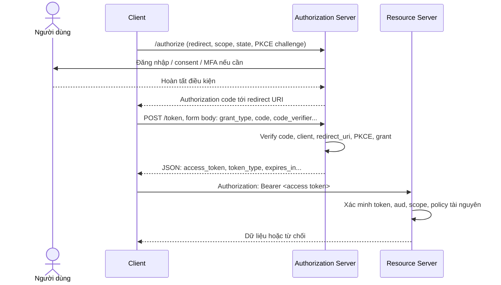
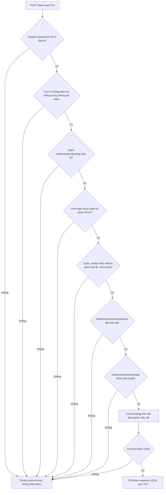

# Form body trong token endpoint

Trong OAuth 2.0, **token endpoint** là nơi client thực hiện một yêu cầu **HTTP POST** để đổi authorization code, dùng refresh token, xác thực bằng Client Credentials hoặc thực hiện một grant được hỗ trợ nhằm nhận access token. Dữ liệu của yêu cầu token tiêu chuẩn được truyền bằng **form body** với media type **`application/x-www-form-urlencoded`**, mã hóa ký tự **UTF-8**. Đây không phải JSON body và cũng không phải nơi gửi credential qua query string.

Ví dụ rút gọn với Authorization Code + PKCE:

```http
POST /oauth2/token HTTP/1.1
Host: auth.example.test
Content-Type: application/x-www-form-urlencoded
Accept: application/json

grant_type=authorization_code&code=CODE_THU_NGHIEM&redirect_uri=https%3A%2F%2Fapp.example.test%2Fcallback&client_id=public-web-app&code_verifier=PKCE_VERIFIER_THU_NGHIEM
```

Chuỗi `CODE_THU_NGHIEM` và `PKCE_VERIFIER_THU_NGHIEM` là **placeholder**, không phải credential có thể sử dụng. Ở luồng thực tế, authorization code phải là giá trị ngẫu nhiên hợp lệ do authorization server cấp; PKCE verifier phải được sinh đúng độ dài, entropy và định dạng của RFC 7636. Với **confidential client**, token endpoint còn yêu cầu xác thực client theo cấu hình của authorization server, không chỉ truyền `client_id`.

**Thông điệp chính:** *form body là một định dạng truyền tham số của yêu cầu, không phải biện pháp bảo mật tự thân*. Endpoint vẫn cần HTTPS/TLS, kiểm tra grant và client, chống code/refresh-token replay, quản lý scope/audience và tuyệt đối tránh log các tham số bí mật. Bài này thuộc chương **Token transport** của module **SECURITY_TOKEN_SECURITY_FUNDAMENTALS**, kết nối với vòng đời JWT/opaque access token, refresh token, OAuth 2.0/OIDC, claims, scope, audience, thu hồi và phòng chống đánh cắp token.

## 1. Mục tiêu học tập

Sau bài này, bạn có thể:

1. Giải thích tại sao OAuth 2.0 token endpoint dùng **POST + `application/x-www-form-urlencoded` + UTF-8** cho những grant tiêu chuẩn.
2. Phân biệt **form body**, **query string**, **HTTP Authorization header**, **JSON response** và **Bearer token được dùng tại resource server**.
3. Tạo form đúng cho **Authorization Code + PKCE**, **Refresh Token**, **Client Credentials** và biết cách xử lý extension grants như Device Authorization và Token Exchange.
4. Percent-encode chính xác khoảng trắng, dấu cộng, dấu hai chấm, dấu gạch chéo và Unicode; tránh double-encoding hoặc decode nhiều lần.
5. Phân biệt client authentication bằng **HTTP Basic**, `private_key_jwt`, mTLS hoặc phương thức theo profile với tham số `client_id` và dữ liệu grant trong body.
6. Hiểu cách authorization server parse, validate và từ chối form sai kiểu, thiếu trường, trùng trường, sai grant hoặc bị replay.
7. Bảo vệ `code`, `code_verifier`, `refresh_token`, `client_secret` và `client_assertion` trong request; bảo vệ access/refresh/ID token trong response.
8. Viết Java HTTP client và ma trận test xác minh encoding, trạng thái lỗi, scope, audience và logging an toàn.

## 2. Token endpoint nằm ở đâu trong OAuth 2.0?

OAuth 2.0 tách **authorization endpoint** khỏi **token endpoint**:

- **Authorization endpoint:** client yêu cầu người dùng xác thực/đồng ý cấp quyền trong những flow tương tác. Kết quả Authorization Code Flow là một **authorization code** được gửi về redirect URI.
- **Token endpoint:** client trao đổi code hoặc sử dụng một grant/credential được phép để **nhận token**; phần thân yêu cầu là form-urlencoded theo giao thức.
- **Resource server:** API nhận **access token** đúng audience, thường qua `Authorization: Bearer ...`, rồi kiểm tra tính hợp lệ, scope và quyền trên tài nguyên.



**Không lẫn ba loại dữ liệu:**

1. `code_challenge` có mặt ở **authorization request** cho PKCE.
2. `code_verifier` nằm trong **form body của token request** khi đổi authorization code.
3. `access_token` được trả về trong **JSON token response**, sau đó client dùng để gọi resource server; token response không phải form-urlencoded.

Sơ đồ là trường hợp phổ biến, không có nghĩa mọi token request đều yêu cầu người dùng đăng nhập tại thời điểm đó. **Client Credentials** xác thực/ủy quyền client; **Refresh Token Grant** dựa trên refresh grant còn hiệu lực và chính sách AS.

## 3. HTTP contract: POST, Content-Type và UTF-8

### 3.1. Hình thức yêu cầu tiêu chuẩn

Theo OAuth 2.0 (RFC 6749), client gửi yêu cầu đến token endpoint bằng **HTTP POST**; tham số trong entity-body được định dạng `application/x-www-form-urlencoded` với **UTF-8**:

```http
POST /oauth2/token HTTP/1.1
Host: auth.example.test
Content-Type: application/x-www-form-urlencoded
Accept: application/json

grant_type=client_credentials&scope=reports%3Aread
```

Đây là request minh họa **phần tham số grant**; trong một flow Client Credentials thật, confidential client còn phải **xác thực với AS** bằng cơ chế được chấp nhận. Không coi request không có client authentication như một yêu cầu được phép tự động.

Các yếu tố quan trọng:

| Thành phần | Vai trò | Cảnh báo |
| --- | --- | --- |
| `POST` | Phương thức dùng để trao đổi grant và phát token | Không dùng GET để trao đổi code/refresh token |
| HTTPS/TLS | Bảo vệ credential và token trong quá trình truyền | Form body **không tự mã hóa** dữ liệu |
| `Content-Type: application/x-www-form-urlencoded` | Xác định cách parse request body | Không thay bằng `application/json` nếu grant/profile không cho phép |
| UTF-8 | Mã hóa ký tự trước khi percent-encode | Không phụ thuộc charset mặc định của hệ điều hành |
| `grant_type` | Chỉ định grant mà client đang sử dụng | Phải khớp grant AS hỗ trợ/cho phép |
| Các form parameters | Chứa code, verifier, refresh token, scope... tùy grant | Không log nguyên body |
| Client authentication | Chứng minh danh tính confidential client nếu bắt buộc | `client_id` đơn thuần không phải bí mật |

Định dạng `application/x-www-form-urlencoded` có lịch sử từ HTML form, nhưng OAuth token request có thể do **Java, mobile, CLI, backend hoặc SDK** tạo. Không cần một form HTML hiển thị cho người dùng.

### 3.2. Form body không phải JSON

**Sai** nếu token endpoint chỉ hỗ trợ OAuth form tiêu chuẩn:

```http
POST /oauth2/token HTTP/1.1
Host: auth.example.test
Content-Type: application/json

{"grant_type":"refresh_token","refresh_token":"FAKE_REFRESH_TOKEN"}
```

**Đúng về định dạng form**:

```http
POST /oauth2/token HTTP/1.1
Host: auth.example.test
Content-Type: application/x-www-form-urlencoded

grant_type=refresh_token&refresh_token=FAKE_REFRESH_TOKEN
```

Form body là chuỗi `name=value`, các cặp phân cách bằng `&`, ký tự đặc biệt cần được encode. Token response, ngược lại, thường là **JSON**. Không suy từ `Accept: application/json` rằng request cũng được phép gửi JSON.

### 3.3. Không chuyển credential vào URL

Ví dụ không an toàn:

```text
GET /oauth2/token?grant_type=refresh_token&refresh_token=TOKEN_THAT
```

Token, authorization code và client secret trong URL dễ lộ qua browser history, access log, reverse proxy, analytics, cache, bản sao HTTP và công cụ quan sát. **Đưa chúng vào form body qua TLS**, đồng thời bảo vệ request-body logging. Đây là hai hàng rào **cùng cần thiết**: chỉ dùng POST không bảo đảm bí mật nếu middleware ghi nguyên body.

### 3.4. Dùng đúng token endpoint của issuer

Endpoint URL phải đến từ **cấu hình tin cậy** hoặc metadata/discovery của issuer đã được kiểm chứng theo profile. Không gửi refresh token, authorization code hoặc client secret đến một URL do input của người dùng, redirect không kiểm soát hoặc giá trị trong JWT chưa xác minh chỉ định.

Đối với client nhạy cảm, nên kiểm tra TLS certificate theo nền tảng, tránh redirect tự động khiến request có credential được gửi sang host khác. Không bỏ xác minh TLS chỉ để môi trường thử nghiệm hoạt động.

## 4. Form-urlencoded encoding: hiểu từng byte

### 4.1. Quy tắc cơ bản

Trong `application/x-www-form-urlencoded`:

- Một cặp tham số là `name=value`.
- Các cặp được nối bằng `&`.
- Dấu cách trong giá trị được biểu diễn bằng `+` (hoặc cách percent-encode tương đương phù hợp).
- Dấu cộng **thật** trong giá trị cần encode thành `%2B`.
- Các byte không an toàn sau UTF-8 được thể hiện bằng `%HH`.
- Dấu `:`, `/`, `?` và `&` trong **giá trị** cần encode để không làm sai cấu trúc form.

Ví dụ:

| Giá trị chưa encode | Khi nằm trong form value | Lý do |
| --- | --- | --- |
| `orders:read orders:write` | `orders%3Aread+orders%3Awrite` | Encode dấu hai chấm và khoảng trắng |
| `https://app.example.test/callback` | `https%3A%2F%2Fapp.example.test%2Fcallback` | Encode ký tự URL trong value |
| `a+b` | `a%2Bb` | Tránh đọc `+` thành dấu cách |
| `a&b` | `a%26b` | Không biến `&` thành dấu phân cách cặp mới |
| `A=B` | `A%3DB` | Giữ dấu `=` là một phần value |
| `50%` | `50%25` | Không biến `%` thành percent escape không hợp lệ |
| `tiếng Việt` | Các byte UTF-8 được percent-encode | Không giả định ANSI hoặc platform charset |

**Dữ liệu đầu vào phải được encode một lần tại ranh giới tạo form**. Nếu client đã encode `%3A` thành văn bản rồi thư viện lại encode lần nữa, AS nhận `%253A`, sau khi decode một lần sẽ còn `%3A` chứ không phải `:`. Double-encoding gây lỗi scope, redirect URI, client ID hoặc các trường khác.

### 4.2. Form decoding khác URI decoding tùy tiện

Giả sử:

```text
scope=orders%3Aread+orders%3Awrite
```

Sau **một lần** form decode bằng UTF-8, giá trị `scope` là:

```text
orders:read orders:write
```

Một parser “decode thêm lần nữa nếu thấy dấu phần trăm” có thể tạo cách diễn giải khác, dẫn đến **request smuggling logic** giữa proxy/framework/authorization server. Nên dùng form parser chuẩn, không ghép các bộ decode thủ công.

### 4.3. Thứ tự cặp tham số không tạo quyền ưu tiên

Hai form sau thường biểu diễn cùng tập tham số:

```text
grant_type=client_credentials&scope=reports%3Aread
scope=reports%3Aread&grant_type=client_credentials
```

Không xử lý an toàn bằng cách “cặp cuối ghi đè cặp đầu” khi có **tham số trùng tên**. RFC 6749 yêu cầu các tham số request không được lặp lại quá một lần; AS nên từ chối form có `grant_type`, `code`, `refresh_token` hoặc `client_id` trùng, thay vì để mỗi tầng chọn giá trị khác nhau.

### 4.4. Tránh form parser quá linh hoạt

Ví dụ nguy hiểm:

```text
grant_type=refresh_token&grant_type=client_credentials
refresh_token=FAKE_RT&client_id=some-other-client
```

Nếu gateway chọn `grant_type` đầu tiên còn AS chọn giá trị cuối, nhiều lớp có thể tin rằng chúng xử lý hai grant khác nhau. Hãy:

1. Giới hạn kích thước request.
2. Từ chối tham số trùng, malformed percent encoding và dữ liệu không hợp lệ.
3. Kiểm tra kiểu, charset và những trường bắt buộc theo grant.
4. Không gán ý nghĩa tự động cho nested fields hoặc array syntax nếu profile không định nghĩa.
5. Chỉ dùng parser được framework OAuth hỗ trợ và có kiểm thử.

## 5. Authorization Code + PKCE: form thực tế

Với Authorization Code Flow, client nhận một authorization code sau khi AS hoàn tất các điều kiện xác thực/ủy quyền bắt buộc. Client gửi `POST` đến token endpoint để đổi code.

### 5.1. Public client dùng PKCE

Request minh họa:

```http
POST /oauth2/token HTTP/1.1
Host: auth.example.test
Content-Type: application/x-www-form-urlencoded
Accept: application/json

grant_type=authorization_code&code=CODE_THU_NGHIEM&redirect_uri=https%3A%2F%2Fapp.example.test%2Fcallback&client_id=public-web-app&code_verifier=PKCE_VERIFIER_THU_NGHIEM
```

| Tham số | Bắt buộc trong ngữ cảnh nào? | AS kiểm tra |
| --- | --- | --- |
| `grant_type=authorization_code` | Authorization Code exchange | Đúng grant được client cho phép |
| `code` | Bắt buộc | Code do AS cấp, chưa hết hạn, chưa dùng, gắn với client |
| `redirect_uri` | Bắt buộc nếu đã có trong authorization request theo RFC 6749; ràng buộc profile có thể yêu cầu chặt hơn | **Giống giá trị đã sử dụng** ở yêu cầu ủy quyền theo hợp đồng |
| `client_id` | Đặc biệt quan trọng với public client không có xác thực client | Code phải gắn đúng client; không là bằng chứng xác thực client |
| `code_verifier` | Khi dùng PKCE; theo profile hiện đại thường yêu cầu | Phải khớp `code_challenge` đã được ràng buộc với code |

**PKCE không phải “gửi lại code challenge”.** Ở authorization request, client gửi `code_challenge` được tạo từ verifier; ở token request, client chứng minh sở hữu **`code_verifier`** ban đầu. Với `S256`, AS kiểm tra:

```text
BASE64URL-ENCODE(SHA256(ASCII(code_verifier))) == saved_code_challenge
```

Verifier phải được sinh ngẫu nhiên với entropy đủ cao và tuân thủ quy tắc độ dài/ký tự của RFC 7636. Không dùng chuỗi placeholder trong production.

### 5.2. Confidential client

Confidential client có thể phải xác thực qua `client_secret_basic`, `private_key_jwt`, mTLS hoặc phương thức đã đăng ký. Khi sử dụng HTTP Basic, credential nằm trong **`Authorization` header**, còn `grant_type`, `code`, `redirect_uri` và `code_verifier` vẫn nằm trong form body.

Ví dụ cấu trúc:

```http
POST /oauth2/token HTTP/1.1
Host: auth.example.test
Authorization: Basic <BASE64_CREDENTIALS_THU_NGHIEM>
Content-Type: application/x-www-form-urlencoded

grant_type=authorization_code&code=CODE_THU_NGHIEM&redirect_uri=https%3A%2F%2Fbackend.example.test%2Fcallback&code_verifier=PKCE_VERIFIER_THU_NGHIEM
```

Giá trị Basic ở đây chỉ là placeholder; **không đưa client secret thật vào ví dụ, source code, URL hoặc log**. Việc client confidential phải xác thực bằng phương thức nào do registration/token endpoint policy quyết định. **PKCE vẫn hữu ích cho confidential client**, không phải chỉ dành cho SPA/mobile.

### 5.3. Lỗi thường gặp ở Authorization Code

- Gửi `code` ở query string `/token?code=...`: dễ lộ và không tuân thủ form request.
- Gửi `code_challenge` thay `code_verifier`: không chứng minh sở hữu verifier.
- Dùng verifier mới thay vì verifier đã tạo cho authorization request: `invalid_grant`.
- `redirect_uri` bị đổi dấu slash, hostname hoặc encoding dẫn tới giá trị khác: không khớp binding.
- Sử dụng authorization code lần thứ hai: AS phải từ chối, có thể áp dụng biện pháp bảo vệ grant theo chính sách.
- Public client gửi một `client_secret` được nhúng trong mã ứng dụng và gọi đó là bí mật: secret trong client công khai không thể coi là bí mật bảo vệ.
- AS phát token khi MFA, consent hoặc grant còn chờ: lỗi ở **cổng phát hành**, không phải lỗi form đơn thuần.

## 6. Refresh Token Grant: form để làm mới token

Khi access token hết hạn, client có refresh token còn hiệu lực có thể gửi:

```http
POST /oauth2/token HTTP/1.1
Host: auth.example.test
Content-Type: application/x-www-form-urlencoded
Authorization: Basic <CLIENT_AUTH_THU_NGHIEM>

grant_type=refresh_token&refresh_token=FAKE_REFRESH_TOKEN
```

Trong ví dụ trên, Basic minh họa confidential client; phương thức client authentication thay đổi theo loại client và đăng ký. Public client không nên bị buộc giả tạo một client secret.

| Tham số | Ý nghĩa |
| --- | --- |
| `grant_type=refresh_token` | Chọn grant làm mới |
| `refresh_token` | Credential do AS cấp, không dùng để gọi API nghiệp vụ |
| `scope` (tùy chọn) | Nếu được gửi, không được bao gồm scope ngoài phạm vi được cấp ban đầu |
| Client authentication/binding | Ràng buộc refresh token với client được phép; có thể bổ sung sender constraint |

Ví dụ client muốn **thu hẹp** scope đã được cấp:

```text
grant_type=refresh_token&refresh_token=FAKE_REFRESH_TOKEN&scope=orders%3Aread
```

Authorization server phải kiểm tra:

1. Refresh token có tồn tại, còn hạn, chưa bị thu hồi và thuộc đúng grant/client không.
2. Có đáp ứng sender constraint nếu token được ràng buộc với mTLS/DPoP hoặc cơ chế khác không.
3. Scope yêu cầu có nằm trong quyền đã cấp và chính sách hiện tại không.
4. Audience/resource còn được phép; không tự dùng refresh token để nâng cấp sang API khác ngoài grant.
5. Refresh token rotation/reuse detection và trạng thái session được xử lý an toàn trên nhiều node.

Nếu refresh token bị thu hồi, đã rotation trái quy tắc hoặc không hợp lệ, token endpoint thường trả `invalid_grant`; **không phát access token mới**. Mất kết nối với store không được khiến AS bỏ qua kiểm tra thu hồi.

### 6.1. Body chứa refresh token là dữ liệu cực nhạy cảm

Do form body có thể chứa refresh token thật, **không bật generic request-body logging trên `/oauth2/token`**. Chỉ log metadata như `grant_type=refresh_token`, `client_id` được phép, kết quả, reason code, latency, request ID; không log `refresh_token`, `client_secret`, `Authorization` hoặc toàn bộ request.

### 6.2. Rotation và retry không an toàn

Nếu AS dùng **refresh token rotation**, một refresh token hiện hành chỉ nên được tiêu thụ theo chính sách một lần; lần refresh thành công có thể cấp token mới. Nếu response bị mất và client retry token cũ, AS phải xử lý theo **cơ chế idempotency/reuse đã thiết kế**, không tự mở quyền bằng việc cho token cũ hoạt động vô hạn.

Form body không làm thay đổi quy tắc bảo mật rotation; nó chỉ là **cách chuyển refresh credential** đến AS.

## 7. Client Credentials Grant: form cho dịch vụ

Client Credentials dùng khi client xin access token **bằng quyền của chính client**, không phải một user đang đăng nhập.

```http
POST /oauth2/token HTTP/1.1
Host: auth.example.test
Authorization: Basic <SERVICE_CLIENT_AUTH_THU_NGHIEM>
Content-Type: application/x-www-form-urlencoded

grant_type=client_credentials&scope=reports%3Aread
```

Với client credentials, AS phải xác thực client theo cơ chế đăng ký, kiểm tra client được phép sử dụng grant và cấp scope/audience phù hợp.

**Không suy ra** token này đang đại diện user A. `client_id` là danh tính client; nếu hệ thống cần hành động thay user, phải có mô hình delegation và các ràng buộc riêng.

### 7.1. `scope` là quyền yêu cầu, chưa phải quyền được cấp

Giả sử client xin:

```text
scope=reports%3Aread+payments%3Arefund
```

AS chỉ cho phép client nhận `reports:read`. Client không được tự coi `payments:refund` là quyền đã có chỉ vì form request chứa chuỗi này. **Granted scope** phải do AS quyết định và phản ánh đúng theo token/token response.

### 7.2. Resource Indicator (RFC 8707)

Nếu AS hỗ trợ RFC 8707, token request có thể chứa tham số **`resource`** để chỉ định resource server dự kiến:

```text
grant_type=client_credentials&scope=reports%3Aread&resource=https%3A%2F%2Fapi.example.test%2Freports
```

Giá trị `resource` là một yêu cầu để **AS xét**, không phải quyền tự tạo audience tùy ý. AS cần kiểm tra client có được cấp token cho resource đó không; resource server phải xác minh `aud`/resource binding từ access token hoặc introspection đáng tin.

## 8. Các extension grants vẫn dùng form body theo profile

Không phải mọi `grant_type` đều là chuỗi đơn giản. OAuth cho phép extension grants sử dụng một **URI định danh grant type**. Khi truyền trong form, ký tự của URI phải được encode như mọi giá trị khác.

### 8.1. Device Authorization Grant (RFC 8628)

Thiết bị trước tiên nhận `device_code` qua **device authorization endpoint**. Sau đó token endpoint được poll bằng form body:

```http
POST /oauth2/token HTTP/1.1
Host: auth.example.test
Content-Type: application/x-www-form-urlencoded

grant_type=urn%3Aietf%3Aparams%3Aoauth%3Agrant-type%3Adevice_code&device_code=DEVICE_CODE_THU_NGHIEM&client_id=device-public-client
```

Khi user chưa phê duyệt hoặc chưa hoàn tất authentication/consent, AS **không cấp access token**, mà trả lỗi theo RFC 8628, chẳng hạn `authorization_pending`; có thể trả `slow_down` nếu cần tăng khoảng poll. Sau khi grant thành công, AS trả token JSON theo quy tắc.

`device_code` không được đem làm Bearer access token tại API. Client phải tuân thủ `interval`/expiry và giới hạn polling theo AS, không gửi dồn để ép grant.

### 8.2. Token Exchange (RFC 8693)

Một hệ thống có thể hỗ trợ OAuth 2.0 Token Exchange. Form request minh họa:

```text
grant_type=urn%3Aietf%3Aparams%3Aoauth%3Agrant-type%3Atoken-exchange
&subject_token=TOKEN_SUBJECT_THU_NGHIEM
&subject_token_type=urn%3Aietf%3Aparams%3Aoauth%3Atoken-type%3Aaccess_token
&audience=downstream-api
&scope=orders%3Aread
```

Các dòng ở trên được tách để dễ đọc; **form thực tế phải nối các cặp trên cùng entity-body**, dùng `&`. Đây là ví dụ khái niệm; AS cần xác thực client, kiểm tra `subject_token`, ràng buộc delegation, audience và scope; một yêu cầu đổi token **không tự cấp quyền** chỉ vì body có `audience=downstream-api`.

Token Exchange có thể hỗ trợ các tham số như `resource`, `requested_token_type` hoặc `actor_token` theo profile. Những credential nằm trong `subject_token`/`actor_token` **không được log** và phải được xác minh như token nhạy cảm.

### 8.3. JWT Bearer Grant và client assertion

Một số profile như JWT Bearer Authorization Grant hoặc JWT-based Client Authentication dùng những tham số form như `assertion` hoặc `client_assertion`. Chúng là credential/bằng chứng có chữ ký, **không tự nhiên an toàn để log chỉ vì có cấu trúc JWT**.

**Không tự trộn tên trường của nhiều extension**. Chỉ gửi tham số được profile và AS hỗ trợ; `grant_type` quyết định tập trường nghiệp vụ cần xử lý.

## 9. Client authentication: header và form body khác nhiệm vụ

Token endpoint có thể cần **hai lớp dữ liệu**:

- **Grant parameters** trong form body: `grant_type`, `code`, `code_verifier`, `refresh_token`, `scope`, `resource`...
- **Client authentication** theo phương thức đăng ký: HTTP Basic, `private_key_jwt`, mTLS hoặc cách khác.

### 9.1. `client_id` không phải client secret

`client_id` thường là định danh client, **không phải bí mật**. Gửi `client_id=mobile-app` trong form không chứng minh request đến từ ứng dụng chính chủ, đặc biệt với public client. PKCE, giới hạn redirect URI, ràng buộc grant và các kiểm soát khác mới là những phần cần thiết.

Confidential client được bảo vệ bởi một phương thức client authentication thích hợp, chẳng hạn secret được giữ tại backend, khóa riêng ký assertion hoặc chứng chỉ mTLS.

### 9.2. `client_secret_basic`

Trong OAuth 2.0, client có secret có thể xác thực qua HTTP Basic (khi AS hỗ trợ và client được đăng ký). Về chi tiết, RFC 6749 `2.3.1 quy định **client ID và client secret được mã hóa theo `application/x-www-form-urlencoded`** trước khi dùng làm username/password trong Basic authentication.

```text
usernamePart = FORM_URLENCODE_UTF8(client_id)
passwordPart = FORM_URLENCODE_UTF8(client_secret)
Authorization = "Basic " + BASE64(usernamePart + ":" + passwordPart)
```

Đây là công thức mô tả, không phải lời mời tự cài đặt auth protocol nếu OAuth client library đã hỗ trợ. Khi secret chứa dấu `:`, `+` hoặc Unicode, dùng thư viện OAuth phù hợp và test liên thông thay vì ghép chuỗi Basic thủ công theo giả định ASCII.

**Header Basic cũng là bí mật.** Không log `Authorization`. Mã hóa Base64 **không phải mã hóa bảo mật**; TLS và secret storage vẫn bắt buộc.

### 9.3. `client_secret_post` có nên dùng?

Một số server hỗ trợ gửi:

```text
grant_type=client_credentials&client_id=service-app&client_secret=SECRET_GIA_LAP
```

RFC 6749 cho phép gửi client credentials trong body trong những điều kiện nhất định nhưng **không khuyến nghị so với HTTP Basic**; nếu có lựa chọn, ưu tiên phương thức xác thực phù hợp mức rủi ro như `private_key_jwt` hoặc mTLS theo thiết kế hiện đại. Không coi `client_secret_post` là mặc định an toàn chỉ vì không ở URL; body thường bị ghi khi bật debug.

Một request không được sử dụng **nhiều phương thức client authentication cùng lúc** để tránh nhầm binding. Client phải dùng một phương thức phù hợp đăng ký, và AS phải từ chối ambiguity.

### 9.4. `private_key_jwt` trong form body

Với phương thức dùng JWT assertion để xác thực client, request form thường có các trường:

```text
client_id=service-app
&client_assertion_type=urn%3Aietf%3Aparams%3Aoauth%3Aclient-assertion-type%3Ajwt-bearer
&client_assertion=SIGNED_ASSERTION_THU_NGHIEM
&grant_type=client_credentials
```

Các dòng chỉ nhằm dễ đọc; request thật phải form-encode đúng. AS kiểm tra chữ ký assertion với khóa đã đăng ký, issuer/subject/audience, expiry và chống replay theo profile; không tin chỉ vì `client_assertion` là chuỗi ba đoạn.

### 9.5. mTLS và sender constraint

Với mTLS, **bằng chứng client authentication có thể nằm trong TLS connection**, trong khi grant parameters vẫn nằm trong form body. Nếu token được sender-constrained theo mTLS hoặc DPoP, AS/RS phải kiểm tra bằng chứng tương ứng; không thể chỉ thay Bearer header bằng một form rồi tự nhận token đã được ràng buộc người gửi.

## 10. Form request và JSON response

Điểm dễ nhầm:

| Hướng truyền | Content type | Ví dụ trường |
| --- | --- | --- |
| **Client → AS token endpoint** | `application/x-www-form-urlencoded`; UTF-8 | `grant_type`, `code`, `refresh_token`, `scope` |
| **AS → Client token response** | `application/json` | `access_token`, `token_type`, `expires_in`, `refresh_token` |
| **Client → Resource Server** | Thường `Authorization: Bearer ...` trong HTTP header | Access token dành cho API |

Ví dụ token response thành công:

```http
HTTP/1.1 200 OK
Content-Type: application/json;charset=UTF-8
Cache-Control: no-store
Pragma: no-cache

{
  "access_token": "FAKE_ACCESS_TOKEN",
  "token_type": "Bearer",
  "expires_in": 600,
  "refresh_token": "FAKE_REFRESH_TOKEN",
  "scope": "orders:read"
}
```

Đây là dữ liệu giả, không phải một cặp token hợp lệ. **Không phải mọi response đều có refresh token**; AS chỉ cấp theo grant và policy. `scope` có thể được trả về để phản ánh tập scope thực sự đã cấp; theo OAuth 2.0, việc phản ánh scope là bắt buộc khi nó khác scope đã yêu cầu.

`Cache-Control: no-store` và `Pragma: no-cache` là các chỉ thị quan trọng đối với response mang token theo RFC 6749; còn client phải bảo vệ token trong storage và không vô tình ghi JSON response vào log/APM.

### 10.1. OIDC có thể bổ sung ID token

Trong OpenID Connect, token response của flow phù hợp có thể chứa thêm `id_token`. ID token được phát cho OIDC client, có `aud` và các claims xác thực cần kiểm tra theo OIDC. **ID token không phải access token để gọi API nghiệp vụ**.

Việc client yêu cầu `openid` thường diễn ra ở authorization request; không tự suy mọi token request đều cần `scope=openid` trong body. Grant, profile và thông số bắt buộc phải được hiểu theo OIDC flow cụ thể.

### 10.2. Scope và audience sau khi cấp token

AS quyết định `scope` đã được phê duyệt và audience/resource dự kiến. Resource server không được tin:

- Một chuỗi `scope` mà client tự gửi trong form.
- Một `resource` hoặc `audience` mà client xin nhưng AS chưa phê duyệt.
- Chỉ `client_id` hoặc issuer mà bỏ kiểm tra audience.

Tại API, chỉ sử dụng **claims access token đã xác minh** hoặc metadata introspection đáng tin. Sau đó còn phải kiểm tra quyền trên tài nguyên cụ thể: owner, tenant, trạng thái và policy.

## 11. Các lỗi token endpoint và cách client xử lý

OAuth token endpoint có cấu trúc lỗi tiêu chuẩn. Ví dụ:

```http
HTTP/1.1 400 Bad Request
Content-Type: application/json
Cache-Control: no-store
Pragma: no-cache

{"error":"invalid_grant"}
```

Các lỗi thường gặp:

| `error` | Ngữ cảnh ví dụ | Nguyên tắc xử lý |
| --- | --- | --- |
| `invalid_request` | Thiếu trường bắt buộc, tham số trùng hoặc request không hợp lệ | Sửa form; AS không cấp token |
| `invalid_client` | Client authentication thất bại | Sửa cấu hình/xác thực client; không bypass |
| `invalid_grant` | Code sai/hết hạn/đã dùng, verifier không khớp, refresh token bị revoke | Không retry vô hạn cùng credential; bắt đầu lại luồng phù hợp |
| `unauthorized_client` | Client không được dùng grant | Rà soát quyền đăng ký client và AS policy |
| `unsupported_grant_type` | Grant type chưa hỗ trợ | Không giả lập grant bằng cách sửa tên form tùy ý |
| `invalid_scope` | Scope xin không hợp lệ/không được phép | Xin scope hợp lệ và tuân thủ grant đã cấp |

Với client authentication qua HTTP Basic, các yêu cầu lỗi và `WWW-Authenticate` cần được xử lý theo OAuth 2.0; có trường hợp `401 Unauthorized` thay vì `400`. Không quy cứng mọi token error đều phải HTTP 400.

**Các lỗi không được trả nguyên `refresh_token`, `code`, `client_assertion` hoặc request body** trong JSON error description. Client cần log reason code/correlation ID, không log toàn raw request/response.

### 11.1. `invalid_grant` khác lỗi tại resource server

Token endpoint từ chối refresh token hoặc authorization code thường trả OAuth error `invalid_grant`. Resource server từ chối access token bị sai chữ ký, issuer, expiry hoặc audience thường trả `401` với Bearer error phù hợp; token hợp lệ nhưng không đủ scope thường là `403`.

Không nhầm hai tầng:

```text
POST /oauth2/token -> invalid_grant: không thể phát access token mới
GET /api/orders   -> invalid_token: access token không hợp lệ
GET /api/orders   -> insufficient_scope: token hợp lệ nhưng thiếu scope
```

## 12. Java: tạo form-urlencoded đúng cách

Một client Java có thể dùng OAuth client SDK được kiểm thử để tránh lỗi encoding, PKCE và client authentication. Nếu cần hiểu cách hoạt động ở tầng HTTP, dùng `java.net.http.HttpClient` và `URLEncoder` như sau.

### 12.1. Hàm encode form bằng UTF-8

```java
import java.net.URLEncoder;
import java.nio.charset.StandardCharsets;
import java.util.LinkedHashMap;
import java.util.Map;
import java.util.stream.Collectors;

public final class OAuthFormEncoder {
    private OAuthFormEncoder() {}

    static String encode(Map<String, String> parameters) {
        return parameters.entrySet().stream()
            .map(e -> formValue(e.getKey()) + "=" + formValue(e.getValue()))
            .collect(Collectors.joining("&"));
    }

    private static String formValue(String value) {
        if (value == null) {
            throw new IllegalArgumentException("Form value cannot be null");
        }
        return URLEncoder.encode(value, StandardCharsets.UTF_8);
    }

    public static void main(String[] args) {
        Map<String, String> form = new LinkedHashMap<>();
        form.put("grant_type", "client_credentials");
        form.put("scope", "reports:read reports:export");

        // Chỉ để học encoding; client còn phải auth với AS.
        System.out.println(encode(form));
        // grant_type=client_credentials&scope=reports%3Aread+reports%3Aexport
    }
}
```

**Chú ý:** ví dụ `main` chỉ in một form **không có credential**, nhằm quan sát percent-encoding. **Không in form chứa code, refresh token hoặc client secret trong production**, kể cả khi console chỉ dùng để debug. Java `URLEncoder` được thiết kế cho form URL encoding, không phải hàm tự xây JWT hoặc URI generic.

### 12.2. Gửi Authorization Code + PKCE bằng Java HttpClient

Ví dụ client công khai (public client) đã có `authorizationCode` và `pkceVerifier` hợp lệ; hai giá trị này phải được cung cấp qua một flow tin cậy:

```java
import java.net.URI;
import java.net.http.HttpClient;
import java.net.http.HttpRequest;
import java.net.http.HttpResponse;
import java.nio.charset.StandardCharsets;
import java.util.LinkedHashMap;
import java.util.Map;

public final class OAuthTokenClient {
    private final HttpClient httpClient = HttpClient.newHttpClient();
    private final URI tokenEndpoint =
        URI.create("https://auth.example.test/oauth2/token");

    public HttpResponse<String> exchangeAuthorizationCode(
        String authorizationCode,
        String pkceVerifier
    ) throws Exception {
        Map<String, String> params = new LinkedHashMap<>();
        params.put("grant_type", "authorization_code");
        params.put("code", authorizationCode);
        params.put("redirect_uri", "https://app.example.test/callback");
        params.put("client_id", "public-web-app");
        params.put("code_verifier", pkceVerifier);

        String form = OAuthFormEncoder.encode(params);

        HttpRequest request = HttpRequest.newBuilder(tokenEndpoint)
            .header("Content-Type", "application/x-www-form-urlencoded")
            .header("Accept", "application/json")
            .POST(HttpRequest.BodyPublishers.ofString(
                form, StandardCharsets.UTF_8
            ))
            .build();

        // Không log request, form, Authorization header hoặc response body.
        return httpClient.send(
            request, HttpResponse.BodyHandlers.ofString(StandardCharsets.UTF_8)
        );
    }
}
```

Đây là **mẫu học thuật**, không phải OAuth client production hoàn chỉnh. Cần bổ sung xử lý lỗi, timeouts, kết quả JSON, secure token storage, TLS policy, ngăn redirect chứa credential, PKCE generation và checks theo profile. Với confidential client phải thêm **client authentication thực** đã được đăng ký; không nhét secret vào source code.

### 12.3. Tránh log body khi bắt lỗi

Ví dụ anti-pattern:

```java
// SAI: cả form request và response có thể chứa credential.
log.error("oauth request={} response={}", form, tokenResponse.body());
```

Thay bằng một sự kiện audit không chứa bí mật:

```java
log.warn("oauth_exchange_failed grant_type={} http_status={} request_id={}",
         "authorization_code", tokenResponse.statusCode(), requestId);
```

Chỉ dùng `requestId` từ nguồn kiểm soát, và không gắn nguyên token/JSON response vào exception message, MDC, tracing span hoặc metric label.

## 13. Spring WebClient: thư viện có thể tự encode form

Với WebFlux hoặc một ứng dụng Java dùng Spring WebClient, có thể dùng `BodyInserters.fromFormData` để framework serialize thành form-urlencoded.

```java
import org.springframework.http.MediaType;
import org.springframework.web.reactive.function.BodyInserters;
import org.springframework.web.reactive.function.client.WebClient;
import reactor.core.publisher.Mono;

public class TokenExchangeClient {
    private final WebClient webClient = WebClient.builder()
        .baseUrl("https://auth.example.test")
        .build();

    public Mono<String> exchangeCode(
        String code,
        String verifier
    ) {
        return webClient.post()
            .uri("/oauth2/token")
            .contentType(MediaType.APPLICATION_FORM_URLENCODED)
            .accept(MediaType.APPLICATION_JSON)
            .body(BodyInserters.fromFormData(
                "grant_type", "authorization_code")
                .with("code", code)
                .with("redirect_uri", "https://app.example.test/callback")
                .with("client_id", "public-web-app")
                .with("code_verifier", verifier))
            .retrieve()
            .bodyToMono(String.class);
    }
}
```

Đây là ví dụ **public client/encoding**, không bao gồm phần sinh code/verifier hay token verification. Đối với confidential client, chọn OAuth client support của Spring Security (hoặc một thư viện chuẩn) để xử lý phương thức client authentication đã đăng ký và lưu token an toàn. Trả `String` body ở đây chỉ nhằm minh họa request/response; production nên parse response vào kiểu dữ liệu được kiểm soát, **không log `String` chứa access/refresh token**.

### 13.1. Không tự dùng form login của Spring thay OAuth token endpoint

`UsernamePasswordAuthenticationFilter` và HTML form login của Spring Security là một cơ chế đăng nhập phiên ứng dụng; nó **không tự biến endpoint thành OAuth 2.0 token endpoint**. Authorization server cần bộ xử lý grant, client authentication, PKCE, consent, phát token và thu hồi theo chuẩn.

Không tự chuyển `username/password` từ form login sang token response kiểu OAuth mà bỏ qua authorization server/gating. Resource Owner Password Credentials Grant trong hệ thống cũ bị OAuth Security BCP (RFC 9700) **khuyến cáo không sử dụng/không được triển khai cho mô hình hiện đại**, vì không phù hợp ranh giới ủy quyền và nhiều hình thức MFA. Ưu tiên Authorization Code + PKCE hoặc grant phù hợp.

## 14. Phía AS: parse form và kiểm tra grant theo lớp

Một token endpoint an toàn không chỉ chuyển body thành `Map` rồi phát token. Quy trình kiểm tra:



Các bước này là **mô hình tổng quát**, không có nghĩa mọi grant có authorization code hay tương tác người dùng. Với `client_credentials`, nhánh kiểm tra code không áp dụng; với refresh, cần kiểm tra refresh token/rotation; với Device Flow, grant phải được user phê duyệt.

### 14.1. Mã giả xử lý form an toàn

```text
handleTokenRequest(httpRequest):
    require HTTPS and POST
    require Content-Type compatible with form-urlencoded
    params = strictFormParser.parseUtf8(httpRequest.body)
    reject malformed encoding, oversized body, duplicate parameters

    client = authenticateOrBindClient(httpRequest, params)
    require grant type allowed for client

    if grant_type == "authorization_code":
        check one-time code, redirect_uri and PKCE verifier
        check authorization and authentication completed
    else if grant_type == "refresh_token":
        check refresh token active, unrevoked, client-bound
        rotate atomically if required
    else if grant_type == "client_credentials":
        require authorized client authentication and grant
    else:
        validate supported extension grant or reject

    granted = authorizeScopeAudienceUnderCurrentPolicy(...)
    commit grant/rotation/usage state
    return JSON token response with no-store cache directives
```

**Không xây token endpoint theo pseudo-code này trong production nếu đã có Authorization Server framework được kiểm thử.** Pseudo-code chỉ giúp thấy rõ vì sao body cần parse và validate đúng giao thức trước khi ký/phát token.

### 14.2. Không tin `grant_type` trước khi kiểm tra client và policy

Form body do client gửi, nên client hoàn toàn có thể thử:

```text
grant_type=client_credentials&scope=admin
```

Sự tồn tại của một chuỗi `admin` hoặc `client_credentials` không cấp quyền. AS phải kiểm tra client có được dùng grant, resource, audience và scope tương ứng hay không; nếu không, từ chối.

### 14.3. Chống replay trong token endpoint

- Authorization code phải ngắn hạn, **dùng một lần**, bị ràng buộc đúng client/redirect URI/PKCE.
- Refresh token cần lưu trạng thái, kiểm tra thu hồi; nếu rotation phải chống hai request đồng thời cùng tiêu thụ một token.
- Device code phải gắn client/flow, hết hạn, polling đúng khoảng và grant hoàn tất.
- Client assertion như `private_key_jwt` phải có thời gian/audience hợp lệ và chống phát lại theo profile.
- Không cho một body có cùng credential được gửi đi gửi lại để mint token trái chính sách.

Form-urlencoded **không** tự chống replay. Việc đó thuộc logic grant, token binding và cơ chế server-side.

## 15. Những bí mật nằm trong form phải được bảo vệ

Một số form fields là credential:

| Tham số | Bí mật/tài sản cần bảo vệ? | Rủi ro nếu bị log |
| --- | --- | --- |
| `code` | Có | Có thể bị đổi lấy token nếu các ràng buộc khác bị vượt qua |
| `code_verifier` | Có trong ngữ cảnh grant PKCE | Giúp attacker vượt rào PKCE nếu đồng thời có code |
| `refresh_token` | **Rất nhạy cảm** | Có thể xin access token mới |
| `client_secret` | **Rất nhạy cảm** | Giả mạo confidential client |
| `client_assertion` | Có | Có thể bị phát lại hoặc lộ thông tin/định danh nếu thiếu bảo vệ |
| `subject_token` / `actor_token` | Có | Có thể là bearer credential của luồng token exchange |
| `grant_type` | Không phải secret, nhưng là metadata | Có thể log sau đánh giá |
| `scope` / `resource` | Thường không phải secret, nhưng có thể tiết lộ cấu trúc quyền | Chỉ log khi có mục đích và chính sách |
| `client_id` | Thường không phải secret, có thể liên quan định danh/tenant | Chỉ log theo chính sách |

**Không log toàn bộ form body**, ngay cả khi code đang bị báo `invalid_grant`. Những token lỗi có thể còn hợp lệ ở một phần hệ thống hoặc thuộc một phiên chưa hết hạn.

### 15.1. Những lớp cần kiểm tra logging

- **Client:** browser/mobile/CLI/backend HTTP interceptor, exception, debug.
- **Authorization server:** filter, controller, OAuth library, token issuer, database audit.
- **Gateway/ingress/reverse proxy:** request/response body capture, query string, headers.
- **APM/distributed tracing:** span attributes, baggage, logs, error captures.
- **Token store và queue:** tránh serialize raw token vào job/message/log.
- **Support/troubleshooting:** không dán raw request, response hoặc secret vào issue tracker/chat.

Chỉ nên ghi request ID, route template `POST /oauth2/token`, grant type, client ID phù hợp, status, latency và **reason code** như `INVALID_GRANT` hoặc `CLIENT_AUTH_FAILED`. Tránh log `Authorization`, `Cookie`, `Set-Cookie` hoặc form-body.

### 15.2. TLS không bảo vệ credential đã đi vào log

TLS bảo vệ khi truyền giữa những điểm kết thúc TLS, nhưng một proxy hoặc server có thể **giải mã trước rồi log** dữ liệu ở tầng ứng dụng. Cần phòng ngừa từ logging source, bảo vệ tập log và kiểm tra retention/export. Cách tốt nhất là **không thu token vào observability từ đầu**.

## 16. Java và OAuth: xử lý refresh và logout

Với một client đã lưu refresh token an toàn, quy trình refresh:

1. Kiểm tra cần refresh, không gọi mọi request liên tiếp nếu access token vẫn hợp lệ.
2. Xác định đúng token endpoint của issuer.
3. Tạo form `grant_type=refresh_token`, `refresh_token=...` qua encoding UTF-8.
4. Xác thực client nếu grant/client cần.
5. Gửi HTTPS POST với timeout, không log body.
6. Phân tích JSON response; nếu rotation trả refresh token mới, **lưu giá trị mới an toàn** theo chính sách.
7. Nếu nhận `invalid_grant`, dừng vòng lặp refresh; xóa credential không còn hợp lệ và khởi động lại flow tương ứng.

### 16.1. Đừng nhầm refresh với revoke

**Làm mới**:

```text
POST /oauth2/token
Content-Type: application/x-www-form-urlencoded

grant_type=refresh_token&refresh_token=FAKE_REFRESH_TOKEN
```

**Thu hồi** theo RFC 7009:

```text
POST /oauth2/revoke
Content-Type: application/x-www-form-urlencoded

token=FAKE_REFRESH_TOKEN&token_type_hint=refresh_token
```

Hai endpoint đều có thể dùng form-urlencoded nhưng có **mục đích khác nhau**. Gửi `grant_type=refresh_token` vào revocation endpoint không tự trở thành lệnh revoke, và gửi `token_type_hint` vào token endpoint không tự tạo access token.

Revocation endpoint cần client authentication/binding và trả response theo RFC 7009, thường **HTTP 200** ngay cả với token không hợp lệ để tránh lộ tình trạng token. Khi refresh token đã revoke, token endpoint phải từ chối lần dùng kế tiếp.

### 16.2. Xóa ở client chưa chắc thu hồi ở AS

Nếu client logout chỉ bằng cách xóa local refresh token, các bản sao token đã bị đánh cắp trước đó vẫn có thể sử dụng. Quy trình cần **server-side revocation** theo phạm vi phiên/grant/family, cùng dọn dẹp local credential và chính sách chặn access token đã phát khi cần.

## 17. Form token endpoint với browser, mobile và backend

### 17.1. Backend/confidential client

- Giữ client secret/private key/refresh token ở phía server hoặc secret manager.
- Dùng OAuth client library hỗ trợ client authentication đã đăng ký.
- Gửi form body qua HTTPS; đặt timeout và tắt HTTP request/response logging nhạy cảm.
- Không cho client bên ngoài chỉ định token endpoint URL tùy ý.

### 17.2. Browser/public client

- Dùng Authorization Code + PKCE theo kiến trúc được AS hỗ trợ.
- Không nhúng client secret vào JavaScript rồi gọi đó là confidential.
- Nếu browser gọi trực tiếp token endpoint, AS phải hỗ trợ chính sách CORS phù hợp; **CORS không thay thế PKCE, grant validation hoặc client binding**.
- Cân nhắc BFF khi sản phẩm cần giữ refresh token ở backend để giảm bề mặt lộ qua JavaScript.
- Giảm nguy cơ XSS, bảo vệ redirect URI/state và token storage; không đưa token vào URL hoặc analytics.

### 17.3. Native mobile/desktop

- Dùng system browser và PKCE khi phù hợp, không thu password trực tiếp qua ứng dụng để đổi token theo mô hình legacy.
- Bảo vệ code verifier, refresh token bằng cơ chế secure storage; không log network request.
- Ràng buộc redirect URI và callback theo platform; xử lý deep link/app link an toàn.
- Khi thiết bị bị mất, cần chính sách thu hồi grant/refresh token ở AS.

### 17.4. Machine-to-machine

- Dùng Client Credentials hoặc grant được AS chấp thuận.
- Xác thực client bằng secret được quản lý an toàn, assertion hoặc mTLS; không nhét secret thật vào repository.
- Cấp access token với audience/scope hẹp, tránh giả định client token đại diện người dùng.

## 18. Những lỗi triển khai và hướng khắc phục

| Sai lầm | Hậu quả | Biện pháp |
| --- | --- | --- |
| Gửi JSON body thay form đến endpoint chuẩn | AS không parse, sai protocol | Dùng form-urlencoded/UTF-8 |
| Gửi `refresh_token` trong query string | Lộ vào URL, log và history | POST form body qua TLS |
| Gửi token request bằng GET | Không phù hợp token endpoint, dễ lộ credential | POST |
| Dùng raw `scope=read write` mà không encode | Body có khoảng trắng chưa encode chuẩn | Dùng thư viện form encoder |
| Dấu `+` trong secret không được encode | Parser đổi `+` thành dấu cách | Dùng percent encoding `%2B` |
| Double-encode `redirect_uri` | Mismatch với authorization request | Encode đúng một lần ở boundary |
| Trùng `grant_type` hoặc `code` | Parser các tầng có thể chọn giá trị khác | Reject duplicate parameters |
| Dùng `client_id` như client authentication | Có thể giả mạo public client ID | Client binding, PKCE và phương thức auth đúng |
| Lưu client secret trong SPA/mobile | Secret có thể bị trích xuất | Public client + PKCE; backend/BFF khi cần |
| Log form request/JSON response | Lộ code/refresh/access token | Logging allowlist, kiểm thử sink |
| Token endpoint trả token trước khi MFA/consent xong | Bỏ qua cổng xác thực/ủy quyền | Grant issuance gating tại AS |
| Dùng code nhiều lần hoặc không kiểm PKCE | Code replay/exchange trái phép | One-time code, verifier, client/redirect binding |
| Refresh token bị thu hồi vẫn được dùng | Tạo access token mới trái chính sách | Tra trạng thái AS, rotation và reuse detection |
| Tin `scope` hoặc `resource` do client gửi | Privilege escalation/cross-audience use | AS cấp theo policy, RS xác minh audience/scope |
| Chấp nhận sai `Content-Type` tùy tiện | Parser confusion và validation bypass | Hợp đồng parser chặt, reject input mơ hồ |
| Chỉ kiểm tra status 200, không parse lỗi JSON | Che giấu `invalid_grant`/`invalid_client` | Xử lý HTTP status + OAuth error theo chuẩn |
| Cho qua khi store grant/introspection lỗi | Token được phát dù không xác minh | Fail closed |

## 19. Ma trận kiểm thử token endpoint

Giả sử AS hỗ trợ Authorization Code + PKCE, Refresh Token và Client Credentials theo chính sách:

| Ca kiểm thử | Input | Kết quả mong đợi |
| --- | --- | --- |
| Code exchange hợp lệ | POST form, code còn hạn, đúng verifier/client | JSON token response theo grant |
| Form khác thứ tự fields | Cùng tham số nhưng thứ tự đổi | Không bị từ chối chỉ do thứ tự |
| Content-Type sai | `application/json` với JSON body | Từ chối theo hợp đồng, không phát token |
| GET thay POST | `GET /oauth2/token` | Không cấp token |
| Thiếu `grant_type` | Form không có grant | `invalid_request` |
| Trùng `grant_type` | Hai field cùng tên | `invalid_request`/từ chối |
| Grant không hỗ trợ | `grant_type=unknown` | `unsupported_grant_type` |
| Client không được dùng grant | `client_credentials` cho client không được phép | `unauthorized_client` |
| Client authentication sai | Secret/assertion/mTLS không hợp lệ | `invalid_client` |
| Public client có client ID giả | Client ID đúng cú pháp nhưng không gắn code | Code exchange bị từ chối |
| Code đã dùng | Dùng cùng code lần hai | `invalid_grant` |
| PKCE verifier sai | Code đúng, verifier không khớp | `invalid_grant` |
| Redirect URI không khớp | Sai value so với binding code | Từ chối |
| Refresh token bị revoke | `grant_type=refresh_token` | `invalid_grant` |
| Refresh token client khác | Form chứa RT thuộc client khác | Không token mới |
| Refresh xin scope rộng hơn | Scope ngoài grant | Không nâng quyền |
| Resource indicator không hợp lệ | Xin API không được cấp | Từ chối hoặc giới hạn theo profile |
| Device Flow pending | `device_code` còn chờ user | `authorization_pending`, không access token |
| Token Exchange subject token sai | `subject_token` giả/không hợp lệ | Không token mới |
| Dấu `+` trong form value | Encode thành `%2B` | AS nhận đúng dấu cộng |
| Unicode UTF-8 | Giá trị form hợp lệ chứa ký tự đa byte | Decode đúng hoặc từ chối theo schema, không mojibake |
| Double encoding | `%253A` thay `%3A` | Không tự decode lặp để “sửa hộ” client |
| Malformed percent escape | `%ZZ` hoặc `%` | Từ chối |
| Body quá lớn | Hàng MB trường không cần thiết | Giới hạn, không gây quá tải |
| Log/capture | Request có sentinel secret | Không thấy raw secret trong app/proxy/APM log |
| Grant store lỗi | Không đọc được trạng thái code/RT | Không phát token |
| Hai request refresh đồng thời | Cùng một RT rotation | Không tạo nhánh token hợp lệ trái chính sách |

### 19.1. Test encoding với JUnit

```java
import static org.assertj.core.api.Assertions.assertThat;
import java.net.URLDecoder;
import java.nio.charset.StandardCharsets;
import java.util.LinkedHashMap;
import java.util.Map;
import org.junit.jupiter.api.Test;

class OAuthFormEncoderTest {
    @Test
    void mustEncodeSpacePlusAndReservedCharacters() {
        Map<String, String> data = new LinkedHashMap<>();
        data.put("scope", "orders:read orders:write");
        data.put("reference", "a+b&c");

        String encoded = OAuthFormEncoder.encode(data);

        assertThat(encoded).contains("scope=orders%3Aread+orders%3Awrite");
        assertThat(encoded).contains("reference=a%2Bb%26c");
        assertThat(URLDecoder.decode(
            "a%2Bb%26c", StandardCharsets.UTF_8
        )).isEqualTo("a+b&c");
    }
}
```

Test trên chỉ đo **form encoding**. Nó không chứng minh PKCE, TLS, client authentication hoặc token response an toàn; các điều kiện đó cần kiểm thử riêng ở tầng tích hợp.

### 19.2. Kiểm thử security integration

Ngoài unit test:

1. Dùng **authorization server thử nghiệm** và code PKCE hợp lệ sinh từ luồng thực.
2. Quan sát token request ở proxy test (đã được kiểm soát): phương thức POST, `Content-Type` đúng, body form không phải JSON.
3. Xác minh token endpoint từ chối verifier/code sai, code dùng lại, client auth sai, duplicate parameter.
4. Kiểm tra AS không cấp scope/audience ngoài policy, và RS từ chối token sai issuer/audience/loại token.
5. Gửi refresh token test đã revoke và thử đồng thời nhiều lần để phát hiện race.
6. Tra cứu app log, gateway log, APM và token endpoint telemetry: sentinel `code`, `refresh_token`, `client_secret` và `access_token` không xuất hiện.
7. Test network retry/timeout: không mint lặp grant hoặc bỏ qua rotation theo policy.

## 20. Bài thực hành tình huống

### Bài A — Sửa một request sai định dạng

Cho request:

```http
POST /oauth2/token?code=CODE_THU_NGHIEM HTTP/1.1
Content-Type: application/json

{"grant_type":"authorization_code","code_verifier":"VERIFIER_THU_NGHIEM"}
```

Hãy sửa thành **POST form-urlencoded** và chuyển code vào body; bổ sung `client_id`, `redirect_uri` và client authentication nếu loại client yêu cầu. Nêu lý do code và verifier đều cần bảo vệ khỏi logging.

**Tiêu chí đạt:** không dùng query, body được form-encode UTF-8, grant/client/PKCE đúng flow.

### Bài B — Encode các ký tự đặc biệt

Giả sử có các giá trị:

```text
scope = orders:read orders:write
reference = a+b&c
redirect_uri = https://app.example.test/callback?next=/orders
```

Hãy tự viết form body, rồi so với kết quả của `URLEncoder.encode(value, UTF_8)`. Chỉ ra vì sao dấu `+` phải thành `%2B` và dấu `&` không thể giữ nguyên trong value.

**Tiêu chí đạt:** mỗi giá trị được encode **một lần**, parser nhận lại đúng chuỗi ban đầu sau khi decode.

### Bài C — Sai grant và token type

Một client gửi:

```text
grant_type=refresh_token
refresh_token=FAKE_REFRESH_TOKEN
scope=payments:refund
```

Grant ban đầu chỉ được `orders:read`. Hãy giải thích vì sao AS không thể cấp `payments:refund`, và vì sao refresh token không thể dùng thay access token để gọi `payments-api`.

**Tiêu chí đạt:** scope không vượt grant, audience đúng resource, token endpoint và RS có nhiệm vụ khác nhau.

### Bài D — Client authentication

Một confidential client gửi secret dưới `client_secret` trong body, bật logging debug và có log như:

```text
POST /token payload=grant_type=client_credentials&client_secret=<SECRET_THAT>
```

Hãy thiết kế lại:

1. Dùng phương thức client authentication được AS hỗ trợ và đăng ký (HTTP Basic, `private_key_jwt` hoặc mTLS).
2. Không log header/body chứa credential.
3. Dùng secret store để quản lý credential.
4. Xác minh client được phép grant/scope và API đích.

**Tiêu chí đạt:** không coi Base64 trong Basic là mã hóa bảo mật; TLS và nguồn secret an toàn vẫn bắt buộc.

### Bài E — Device Flow đang chờ người dùng

Thiết bị có `device_code` và liên tục gửi form `grant_type=...device_code` đến token endpoint. User chưa hoàn tất xác thực.

Hãy mô tả response `authorization_pending`, quy tắc poll interval/`slow_down` và điều kiện để AS chuyển sang trả access token JSON.

**Tiêu chí đạt:** không cấp token quyền truy cập khi authentication/authorization chưa hoàn tất.

### Bài F — Thiết kế bộ test chống rò rỉ

Bạn có token endpoint xử lý code, refresh token và client assertion. Hãy tạo các sentinel không phải credential thật, gửi request thành công/thất bại qua gateway và xác minh:

- Không có sentinel ở application log, proxy log, APM hoặc error trace.
- Log vẫn có request ID, grant type, HTTP status, latency, error reason.
- Không ghi nguyên JSON token response.
- Token sai không được cấp quyền chỉ vì form được parse thành công.

**Tiêu chí đạt:** test chạy qua **các log sink thực tế**, không chỉ kiểm tra một logger của controller.

## 21. Checklist triển khai production

- [ ] Token endpoint sử dụng **HTTPS/TLS** và `POST`.
- [ ] Những grant tiêu chuẩn gửi request parameters dưới dạng **`application/x-www-form-urlencoded` UTF-8**; không tự ý thay bằng JSON/query.
- [ ] Form encoder chuẩn được dùng **một lần** ở boundary; kiểm thử space/`+`/`&`/Unicode/URI.
- [ ] AS từ chối request sai/malformed, duplicate parameters và body quá kích thước.
- [ ] `grant_type` được kiểm tra theo grant client đã được đăng ký và AS hỗ trợ.
- [ ] Client authentication/binding phù hợp: public client không tự xưng có secret; confidential client bảo vệ secret/private key/chứng chỉ.
- [ ] Authorization Code + PKCE kiểm tra code chưa dùng, client, redirect URI và `code_verifier` tương ứng.
- [ ] Refresh Token Grant kiểm tra trạng thái còn hiệu lực, client binding, scope, rotation/reuse/thu hồi theo chính sách.
- [ ] Client Credentials chỉ cấp quyền của client, không giả định có người dùng.
- [ ] Extension grants (Device Flow/Token Exchange) đúng `grant_type` và tham số của profile, không cấp token khi grant chưa được phê duyệt.
- [ ] `scope`, `resource`, `audience` trong form **chỉ là yêu cầu**; AS phải phê duyệt quyền và RS xác minh token đúng audience/scope.
- [ ] Token response dùng **JSON**, chứa `token_type`/`access_token` và các trường được cấp; thiết lập `Cache-Control: no-store` và `Pragma: no-cache` theo OAuth.
- [ ] Không log `code`, `code_verifier`, `refresh_token`, `client_secret`, `client_assertion`, `subject_token` hoặc token response.
- [ ] Gateway, AS, client, APM/tracing và error handlers đều có logging allowlist/redaction.
- [ ] Xử lý đúng `invalid_request`, `invalid_client`, `invalid_grant`, `unauthorized_client`, `unsupported_grant_type` và `invalid_scope`.
- [ ] AS không phát token trước khi authentication/consent/grant bắt buộc hoàn tất, hoặc khi không thể xác minh trạng thái.
- [ ] Đã có test âm tính cho JSON body, GET, query secret, duplicate form, invalid PKCE, revoked refresh, replay, race và logging.
- [ ] Resource server kiểm tra token type, issuer, chữ ký/introspection, audience, thời hạn, scope và quyền tài nguyên; **không nhận refresh/ID token thay access token**.

## 22. Câu hỏi tự kiểm tra

**1. Token endpoint tiêu chuẩn nhận JSON hay form-urlencoded trong request body?** Với các grant OAuth 2.0 phổ biến, request parameters được truyền qua **`application/x-www-form-urlencoded` UTF-8** trong HTTP POST. Token response thường là JSON.

**2. `Accept: application/json` có nghĩa request body phải JSON không?** Không. `Accept` nêu định dạng response mong muốn; `Content-Type` nêu định dạng request body.

**3. Vì sao không gửi refresh token trong query string?** Query dễ bị log/copy/cache/history; refresh token là credential cần bảo vệ.

**4. Khi encode form, dấu cách và dấu cộng xử lý thế nào?** Space thường thành `+`; dấu cộng thật phải encode `%2B`.

**5. Trong PKCE, `code_challenge` hay `code_verifier` nằm ở token request?** `code_verifier`; `code_challenge` đã được gửi trong authorization request.

**6. `client_id` trong form có đủ để xác thực một confidential client không?** Không. Confidential client cần phương thức client authentication được AS chấp nhận; public client phải có ràng buộc grant/PKCE đúng.

**7. Authorization Code Flow và Refresh Token Grant có thể cùng dùng token endpoint không?** Có. `grant_type` và tập tham số quyết định flow, còn AS phải kiểm tra policy và credential tương ứng.

**8. Có thể dùng token response JSON làm input form cho request tiếp theo mà không encode không?** Không. Client phải lấy đúng refresh token đã cấp và tạo form-urlencoded theo grant refresh, bảo vệ credential khi lưu/truyền.

**9. Device Flow đang chờ user thì token endpoint trả gì?** Lỗi như `authorization_pending` theo RFC 8628, không phải access token sử dụng được.

**10. Gửi `scope=admin` có nghĩa AS phải cấp quyền admin không?** Không. Client chỉ yêu cầu; AS quyết định granted scope theo client, grant, user và resource.

**11. Vì sao token endpoint cần reject tham số trùng tên?** Tránh parser ambiguity, mỗi tầng hiểu một giá trị khác nhau và tạo đường vượt validation.

**12. HTTP Basic có nghĩa client secret đã được mã hóa an toàn không?** Không. Base64 là encoding, cần TLS và secret management; không log Authorization header.

**13. Một JWT access token dùng gọi API phải nằm trong form body của token endpoint không?** Không. JWT access token thường được **trả trong JSON response** rồi dùng ở RS qua `Authorization: Bearer`; một số extension riêng có thể gửi token làm `subject_token` theo profile.

**14. Nếu refresh token bị thu hồi, AS nên trả gì khi client thử refresh?** Không cấp token mới và thường trả `invalid_grant` theo OAuth.

**15. Tại sao chỉ dùng HTTPS vẫn chưa đủ bảo vệ secret trong form body?** Sau khi kết thúc TLS, application/proxy/APM vẫn có thể log raw body nếu cấu hình sai.

**16. Sai `aud` tại resource server có phải do token request form body nhất thiết sai cú pháp không?** Không. Form có thể hợp lệ nhưng AS cấp sai resource hoặc client gửi nhầm token; cần xét cả grant issuance và RS audience validation.

## 23. Tài liệu tiêu chuẩn liên quan

- **RFC 6749 — The OAuth 2.0 Authorization Framework:** token endpoint, `application/x-www-form-urlencoded` UTF-8, authorization code, refresh token, client credentials, client authentication, JSON token response.
- **RFC 7636 — Proof Key for Code Exchange (PKCE):** `code_challenge`, `code_verifier` và Authorization Code binding.
- **RFC 6750 — OAuth 2.0 Bearer Token Usage:** sử dụng access token ở resource server và rủi ro mang token trong URL.
- **RFC 7009 — OAuth 2.0 Token Revocation:** endpoint thu hồi qua form POST.
- **RFC 8628 — OAuth 2.0 Device Authorization Grant:** token endpoint polling, `device_code`, `authorization_pending`, `slow_down`.
- **RFC 8707 — Resource Indicators for OAuth 2.0:** tham số `resource` để xin access token dành cho resource cụ thể.
- **RFC 8693 — OAuth 2.0 Token Exchange:** các form parameters cho token exchange grant.
- **RFC 7523 — JWT Profile for OAuth 2.0 Client Authentication and Authorization Grants:** JWT assertion trong form và client authentication.
- **RFC 9700 — Best Current Practice for OAuth 2.0 Security:** bảo vệ client/grant/token, PKCE và các grant legacy không an toàn.
- **RFC 9068 — JWT Profile for OAuth 2.0 Access Tokens:** claims và xác minh JWT access token ở API.
- **OpenID Connect Core 1.0:** ID token, OAuth-based token response và các ràng buộc OIDC.

**Kết luận:** token endpoint dùng **HTTP POST + form-urlencoded UTF-8** để nhận yêu cầu cấp hoặc làm mới token; **JSON là định dạng response thông dụng**, còn access token được dùng ở resource server bằng cơ chế riêng như Bearer header. Form body chỉ vận chuyển dữ liệu: bảo mật thực sự đến từ **TLS, client/grant authentication, PKCE, chính sách scope/audience, chống replay, thu hồi, và không log credential**. Một request đúng cú pháp vẫn phải bị từ chối nếu **client, grant, token hoặc quyền được cấp** không hợp lệ.
