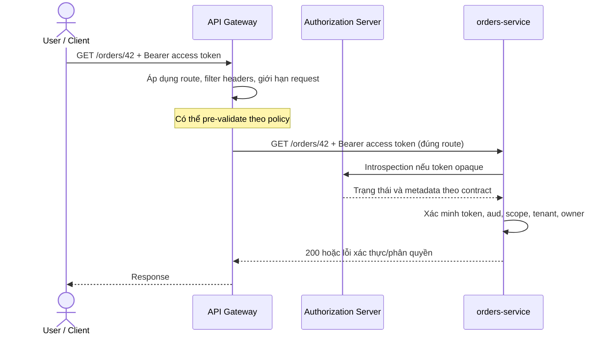
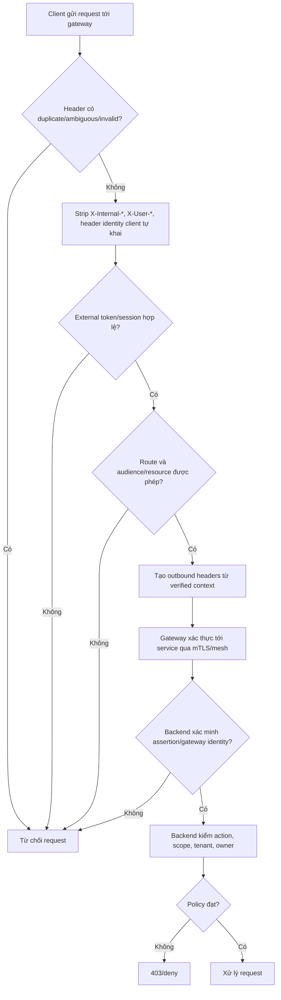

# Header forwarding giữa gateway và service

Trong hệ thống microservice, client thường không gọi thẳng từng API mà đi qua **API gateway** hoặc reverse proxy. Gateway nhận request từ Internet, có thể xác thực access token, chọn route rồi **forward** request cùng một số HTTP header tới service nội bộ. Cách làm này giảm trùng lặp ở lớp biên, nhưng cũng tạo ra một câu hỏi bảo mật: **service phía sau dựa vào đâu để biết header nhận được thực sự là thông tin do gateway đáng tin xác nhận, chứ không phải giá trị client tự khai?**

Giả sử frontend gửi:

```http
GET /api/orders/42 HTTP/1.1
Host: api.example.test
Authorization: Bearer <access-token>
X-User-Id: admin
X-User-Roles: SUPER_ADMIN
```

Hai header `X-User-Id` và `X-User-Roles` **không đáng tin chỉ vì chúng xuất hiện trong request**. Client có thể tự đặt chúng. Nếu gateway chuyển nguyên các header đó xuống `orders-service` và backend tin chúng để phân quyền, kẻ tấn công có thể cố nâng đặc quyền mà không cần giả mạo chữ ký JWT.

Trong chương **Token transport** của module **SECURITY_TOKEN_SECURITY_FUNDAMENTALS**, bài học nghiên cứu ranh giới tin cậy **client → gateway → service**, cách bảo vệ khi forward `Authorization` và các header identity/authorization, lựa chọn gateway validation hay backend validation, JWT và opaque access token, token exchange, audience/scope, OAuth 2.0/OIDC, refresh token, mTLS/DPoP, xử lý header giả mạo và phòng chống token bị đánh cắp hoặc phát lại.

**Nguyên tắc xuyên suốt:** một HTTP header chỉ là dữ liệu trên đường truyền. **Danh tính và quyền** chỉ được tin khi bắt nguồn từ bằng chứng đã được xác minh và được chuyển qua một **kênh có bảo vệ, có xác định bên gửi và bên nhận**.

## 1. Header forwarding là gì?

**Header forwarding** là việc thành phần trung gian nhận HTTP request và đưa tiếp một số header tới upstream/backend. Một số header giữ chức năng của HTTP, một số mang thông tin truyền vết, và một số có thể chứa credential hay kết quả xác thực.

| Nhóm header | Ví dụ | Mục đích | Mức độ nhạy cảm |
| --- | --- | --- | --- |
| Credential | `Authorization: Bearer ...`, `Cookie` | Chứng minh phiên hoặc quyền truy cập | **Rất cao**; có thể dùng lại credential nếu bị lộ |
| Identity context tự định nghĩa | `X-User-Id`, `X-User-Roles`, `X-Tenant-Id` | Truyền thông tin người dùng/tenant | **Không đáng tin** nếu do client gửi; chỉ có giá trị khi provenance đã được bảo đảm |
| Internal identity assertion | `X-Internal-Auth` với assertion được ký | Gateway phát biểu ngữ cảnh đã xác minh cho backend | Cao; phải xác minh issuer, audience, expiry và kênh |
| Proxy/network metadata | `Forwarded`, `X-Forwarded-For`, `X-Forwarded-Proto`, `X-Forwarded-Host` | Địa chỉ IP, scheme, host ban đầu qua proxy | Có thể bị spoof nếu không xây dựng chuỗi proxy tin cậy |
| Truy vết | `traceparent`, `X-Request-Id` | Correlation request giữa các service | Không phải bằng chứng xác thực; cần giới hạn kích thước/định dạng |
| HTTP protocol | `Host`, `Content-Length`, `Connection`, `Transfer-Encoding` | Điều khiển định tuyến/khung thông điệp | Cần parser/proxy chuẩn; lỗi chuẩn hóa có thể dẫn tới request smuggling |

Không nên có một quy tắc duy nhất «forward tất cả headers». Gateway cần biết **header nào được client phép gửi**, **header nào phải loại bỏ**, **header nào gateway được phép tạo**, **header nào chỉ được chuyển tới một backend cụ thể**.

### 1.1. Hai trạng thái khác nhau: "đã có header" và "đã xác minh danh tính"

Ví dụ:

```text
Client gửi:       X-User-Id: alice
Gateway thấy:     X-User-Id: alice
Service nhận:     X-User-Id: alice
```

Không có bước nào trong chuỗi trên chứng minh **Alice** thật sự là chủ thể. Trái lại:

```text
Client gửi access token
    |
    v
Gateway xác minh chữ ký/issuer/audience/type/expiry
    |
    v
Gateway suy ra sub=user-123 từ claims đã xác minh
    |
    v
Gateway gửi assertion được ký, dành cho orders-service
    |
    v
Service xác minh assertion và kiểm quyền trên Order 42
```

Trong mô hình thứ hai, giá trị `sub` có **nguồn gốc xác minh được**, và service biết assertion dành cho chính nó. Đây mới là nền tảng để cân nhắc giao trách nhiệm authentication cho gateway.

## 2. Ba mô hình chuyển tiếp token và identity context

Không có một mô hình tốt nhất cho mọi hệ thống; phải chọn rõ cách gateway và backend chia sẻ trách nhiệm.

| Mô hình | Gateway làm gì? | Service làm gì? | Điểm cần bảo vệ |
| --- | --- | --- | --- |
| **A. Token pass-through** | Định tuyến, có thể pre-validate, forward access token gốc | **Tự xác minh access token** và phân quyền | Không chuyển token sai audience; bảo vệ bearer token trên từng hop |
| **B. Gateway validation + internal assertion** | Xác minh token ngoài, phát assertion ngắn hạn dành cho backend | Xác minh assertion, trust gateway và kiểm quyền nghiệp vụ | Chống header spoofing, bảo vệ khóa/kênh, giới hạn audience/TTL |
| **C. Token exchange / delegation** | Đổi token ngoài lấy token mới cho service đích qua AS | Xác minh **token mới** như resource server | AS kiểm soát audience, scope, actor/delegation và grant |

Một hệ thống có thể dùng nhiều mô hình theo từng route, nhưng **không nên trộn tùy tiện**. Ví dụ, cùng endpoint vừa chấp nhận `Authorization` gốc vừa tin `X-User-Roles` tự khai sẽ rất khó xác định nguồn quyền có thẩm quyền.

### 2.1. Mô hình A: forward access token gốc

Luồng:



Với **JWT access token**, `orders-service` thường xác minh chữ ký/issuer/audience và các claim bằng khóa tin cậy mà không cần introspection trên mỗi request. Với **opaque access token**, nó có thể hỏi AS qua introspection và kiểm tra resource binding.

**Chỉ forward token nếu nó đúng đối tượng nhận theo hợp đồng.** Nếu JWT có `aud=api-gateway` nhưng backend là `orders-service`, backend không được tự chấp nhận token chỉ vì gateway đã nhìn thấy nó. Cần quy định liệu gateway và backend là **một logical resource** có audience chung, hay phải sử dụng mô hình assertion/token exchange để chuyển tiếp qua ranh giới.

**Ưu điểm:** service chủ động kiểm tra token và ít phụ thuộc vào một header identity do gateway khai. **Đánh đổi:** bearer token gốc đi sâu hơn vào mạng nội bộ và có thêm nơi phải bảo vệ trước log, leak, replay.

### 2.2. Mô hình B: gateway xác minh rồi gửi internal assertion

Luồng:

```mermaid
sequenceDiagram
    actor C as Client
    participant G as Gateway
    participant S as orders-service

    C->>G: Authorization: Bearer <external-access-token>
    G->>G: Xác minh issuer, audience, type, expiry, policy
    G->>G: Bỏ headers identity do client gửi
    G->>G: Phát signed assertion aud=orders-service, TTL ngắn
    G->>S: X-Internal-Auth: <signed-assertion> qua kênh bảo vệ
    S->>S: Xác thực gateway; kiểm chữ ký/iss/aud/exp của assertion
    S->>S: Kiểm scope/tenant/owner và trạng thái Order
    S-->>G: Response
    G-->>C: Response
```

Internal assertion có thể là JWT ký bởi gateway hoặc issuer nội bộ đáng tin, **nhưng không nên mặc nhiên coi nó là OAuth access token chuẩn**. Đó là một loại credential nội bộ có profile, bên nhận, mục đích và khóa tin cậy được định nghĩa riêng.

Ví dụ **payload minh họa** cho assertion nội bộ, chưa được ký:

```json
{
  "iss": "https://gateway.internal.example.test",
  "aud": "orders-service",
  "sub": "user-123",
  "client_id": "shop-web",
  "tenant_id": "tenant-a",
  "granted_scopes": ["orders:read"],
  "iat": 1893456000,
  "exp": 1893456030,
  "jti": "b51647e2-2c7e-45fb-b39e-5a1dbf5a342f"
}
```

Các claim `granted_scopes` và `tenant_id` ở đây là **claim nội bộ do hệ thống định nghĩa**. Service phải biết chính xác claim nào được phép tin, ý nghĩa và cách xác minh. `jti` có thể hỗ trợ truy vết hoặc chính sách chống replay **nếu được thực thi bằng cơ chế trạng thái**, không tự làm assertion one-time.

Điều kiện tối thiểu:

- Gateway **không** copy các header như `X-User-Id`, `X-User-Roles` từ request ngoài rồi coi đó là dữ liệu đáng tin.
- Gateway phát assertion từ **claims/token/session đã kiểm chứng**, với audience **đúng service đích**, thời hạn ngắn và tập quyền giới hạn.
- Service biết trước **issuer/khóa** được tin cậy, giới hạn loại assertion, kiểm `iss`, `aud`, `exp`/`nbf`, chữ ký và những ràng buộc khác.
- Kết nối gateway → service được bảo vệ bằng TLS/mTLS hoặc cơ chế nhận dạng service-to-service có mức bảo đảm tương đương; **không có đường vào trực tiếp** cho client giả mạo gateway.
- Backend vẫn kiểm tra **authorization trên đối tượng** và không chỉ tin một trường `is_admin=true` tổng quát.

Nếu chỉ dùng header thuần `X-Authenticated-User: user-123` mà **không ký**, độ tin cậy phụ thuộc hoàn toàn vào việc đảm bảo request **chỉ có thể đến từ gateway đã xác thực** và tất cả proxy trung gian thực thi quy tắc lọc/sinh lại header. Đây là mô hình có thể tồn tại trong mạng quản lý chặt nhưng có rủi ro cấu hình cao; assertion được ký và audience-bound giúp thu hẹp rủi ro hơn.

### 2.3. Mô hình C: token exchange cho service đích

Trong OAuth 2.0, cơ chế **Token Exchange** (RFC 8693) có thể cho phép một thành phần nhận token đầu vào và xin **token mới** phù hợp với resource server đích, theo chính sách AS.

```text
Token client → gateway:
    iss=https://auth.example.test
    aud=public-api
    scope=orders:read

Gateway trao đổi token với AS theo grant/ủy quyền được phép.

Token gateway → orders-service:
    iss=https://auth.example.test
    aud=orders-service
    scope=orders:read
    actor/delegation: theo profile và chính sách AS
```

**Không tự đổi claim `aud` hoặc `scope` bằng cách sửa payload JWT**. AS là bên quyết định client/gateway có được đổi token và được xin scope/resource nào. Token đầu ra không được mở rộng quyền trái grant/delegation. Nếu gateway chỉ hành động với quyền của chính service, `client_credentials` có thể phù hợp hơn on-behalf-of; khi đó **service principal không tự động là user**.

## 3. Quy tắc vàng: strip rồi mới set các header identity nội bộ

Một lỗi rất phổ biến:

```text
Gateway nhận từ client:
  X-User-Id: attacker
  X-User-Roles: ADMIN

Gateway định thêm:
  X-User-Id: user-123
  X-User-Roles: USER

Service nhận header trùng tên và parser chọn bản đầu:
  X-User-Id: attacker
  X-User-Roles: ADMIN
```

Ngay cả khi gateway «có ghi đè», hành vi của thư viện HTTP khi thấy **duplicate header**, gộp bằng dấu phẩy hoặc chọn giá trị đầu/cuối có thể khác nhau. **Không để giá trị không đáng tin cùng tồn tại** với giá trị do gateway xác nhận.

### 3.1. Quy trình an toàn cho request inbound

1. **Từ chối request mơ hồ**: header credential trùng, cú pháp không hợp lệ, kích thước quá lớn, conflict parser hoặc framing HTTP đáng ngờ.
2. **Chuẩn hóa tên header theo HTTP** (tên header không phân biệt chữ hoa/chữ thường), xử lý biến thể/gạch dưới theo proxy/framework và chặn alias có thể bị diễn giải cùng nghĩa.
3. **Loại bỏ toàn bộ header identity/authorization nội bộ do client gửi**, kể cả các biến thể như `X-Authenticated-User`, `X-Internal-Auth`, `X-User-Id`, `X-User-Roles`, `X-Tenant-Id`.
4. **Xác thực request/token bên ngoài** theo route và cơ chế đã chọn.
5. **Tạo mới** assertion hoặc metadata nội bộ từ nguồn được xác minh; đưa vào request outbound theo **allowlist**.
6. **Gửi qua kênh gateway → service được bảo vệ**, chỉ tới backend đã cấu hình tương ứng.
7. Backend **xác minh nguồn** của identity context (assertion đã ký hoặc gateway identity được chứng thực) và thực thi quyền nghiệp vụ.



**Bẫy cấu hình:** nếu gateway chỉ strip `X-Internal-Auth` nhưng service lại tin `X-Auth-User` hoặc `X-Forwarded-User`, attacker có thể đổi sang tên header còn sót. Cần có một **schema duy nhất và documented** cho mọi metadata nội bộ; tránh sinh nhiều tên đồng nghĩa không được lọc đồng nhất.

### 3.2. Không dùng `append` khi cần `replace`

Khi tạo header đã được xác minh, gateway nên dùng thao tác kiểu **set/replace** sau khi loại bỏ giá trị inbound, không phải append:

```java
// Pseudocode: outbound chỉ chứa headers đã được allowlist.
outboundHeaders.remove("X-Internal-Auth");
outboundHeaders.set("X-Internal-Auth", signedInternalAssertion);
```

Không giả định request HTTP không phân biệt hoa/thường nhưng framework map lại giữ nhiều bản sao thành các key khác nhau; hãy dùng thư viện header chuẩn và kiểm tra test với `x-internal-auth`, `X-INTERNAL-AUTH`, nhiều giá trị cùng tên, dấu phẩy và biến thể proxy normalization.

## 4. Forward `Authorization`: giữ nguyên hay bỏ?

`Authorization` là credential quan trọng. Không có quy tắc «luôn forward» hoặc «luôn strip» phù hợp mọi kiến trúc. **Phải chọn theo route và mô hình trust**.

| Mục đích route | Xử lý header `Authorization` bên ngoài | Backend dựa vào điều gì? |
| --- | --- | --- |
| **Token pass-through tới đúng RS** | Forward access token nếu RS là audience được phép và không có leak qua route khác | Backend tự validate access token đầy đủ |
| **Gateway authentication, internal assertion** | **Không forward bearer token gốc** trừ khi có nhu cầu được xét duyệt riêng | Backend xác minh internal assertion/kênh trusted gateway |
| **Token exchange** | Thay bằng **token mới đúng audience**, không đưa token ngoài xuống backend | Backend validate token do AS phát cho chính nó |
| **Public/anonymous endpoint** | Thường bỏ credential nếu endpoint không cần, tránh chuyển tiếp vô ích | Backend áp dụng policy anonymous, không tự tin header ngoài |
| **OAuth token endpoint ở AS** | Chỉ chuyển request tới đúng AS theo contract; bảo vệ client authentication | AS xác thực client và kiểm grant; không leak credential sang service khác |

Không forward refresh token của người dùng tới API nghiệp vụ. Refresh token được gửi tới **AS/token endpoint**, không tới resource server để đọc/ghi dữ liệu. Tương tự, **ID token OIDC** dùng tại client/Relying Party; gateway hoặc backend không nên chấp nhận ID token như OAuth access token chỉ vì chữ ký và issuer hợp lệ.

### 4.1. Audience và issuer không được bỏ qua khi qua gateway

Nếu token ngoài chứa:

```json
{
  "iss": "https://auth.example.test",
  "sub": "user-123",
  "aud": "payments-api",
  "scope": "payments:read",
  "exp": 1893456900
}
```

thì route tới `orders-service` **không được phép chấp nhận token này** chỉ vì `iss` cùng AS. Gateway cần route policy phù hợp, và RS nào tự validate cũng phải kiểm audience của **chính mình**. Một gateway nhận request bằng token hợp lệ cho thanh toán **không thể tự biến** nó thành token gọi quản lý đơn hàng.

Ngay cả khi `scope` có chuỗi `orders:read`, cũng không thay được `aud`. **Issuer** trả lời *ai phát hành*, **audience** trả lời *token dành cho ai*, **scope** trả lời *phạm vi thao tác nào*; backend còn phải kiểm quyền chủ sở hữu/tenant.

### 4.2. Redirect, retry và chuyển route có thể làm lộ bearer token

Gateway/proxy phải tránh chuyển `Authorization` hoặc `Cookie` sang một host khác do redirect/upstream tự chỉ định. Nếu backend trả `302 Location: https://evil.example.net`, gateway **không nên tự theo redirect rồi forward credential** ngoài cấu hình tin cậy.

Với retry, token có thể xuất hiện trên nhiều lần gọi upstream; cần đảm bảo **idempotency** của thao tác, giới hạn retry và bảo vệ credential mỗi lần. Request retry tới route khác hoặc service fallback không được vô tình mang bearer token của audience ban đầu.

Không đặt raw access token trong URL, query string, log, error message, trace/span attribute hoặc diagnostic dump. Nếu cần correlation, dùng định danh request và fingerprint không đảo ngược theo chính sách thay vì in token.

## 5. Proxy metadata: `Forwarded` và `X-Forwarded-*` không phải bằng chứng identity

Ví dụ ingress thường nhận:

```http
Forwarded: for=203.0.113.10;proto=https;host=api.example.test
X-Forwarded-For: 203.0.113.10
X-Forwarded-Proto: https
X-Forwarded-Host: api.example.test
```

Các giá trị này phục vụ **xác định địa chỉ client, scheme/host gốc** khi request đi qua proxy, nhưng client ở Internet có thể **tự gửi header cùng tên**. Chúng **không chứng minh** request xuất phát từ một IP đáng tin, sử dụng HTTPS bên ngoài hay là người dùng được xác thực.

### 5.1. Thiết lập trust chain cho proxy

Các bước khuyến nghị:

1. Xác định ingress/reverse proxy nào được phép nhận traffic từ Internet.
2. Tại trust boundary ngoài cùng, **xóa hoặc chuẩn hóa header forwarding do client tự gửi** theo policy.
3. Proxy đáng tin tạo/thêm thông tin dựa trên **kết nối thực sự nhìn thấy**, không dựa vào giá trị client khai.
4. Backend chỉ đọc `Forwarded`/`X-Forwarded-*` khi request đến từ **proxy chain được định danh và cho phép**.
5. Giới hạn số hop và thiết lập quy tắc parser đáng tin cho danh sách IP; không đơn giản lấy IP đầu tiên trong `X-Forwarded-For` do request khai.

Nếu ứng dụng sử dụng `X-Forwarded-Proto` để xác định cookie `Secure` hay tạo redirect URI OAuth, sai cấu hình có thể gây cookie không an toàn, redirect sai hoặc lỗi callback. **X-Forwarded-Host/Proto không phải nguồn cấu hình issuer/audience được tin**: expected issuer và expected audience vẫn nên tới từ cấu hình backend/AS–RS.

### 5.2. Header mang IP không phải authorization

Ngay cả một IP client được xác định đúng cũng không tự chứng minh người dùng có quyền đọc hóa đơn. NAT, VPN, proxy và mạng nội bộ thay đổi ý nghĩa IP theo thời gian. Có thể sử dụng IP làm một **tín hiệu rủi ro** trong chính sách, nhưng không thay token validation, scope và quyền tài nguyên.

## 6. TLS termination, mTLS và "tin gateway" nghĩa là gì?

**TLS termination** thường xảy ra tại gateway: client kết nối HTTPS tới gateway, gateway giải mã request rồi mở một kết nối mới tới backend. Tại đó có **hai trust boundaries**:

```text
Client --HTTPS--> Gateway --TLS/mTLS/mesh--> Service
                   ^                          ^
                   |                          |
            xác minh external token    xác minh gateway/service
```

HTTPS ở kết nối đầu **không tự đảm bảo** kết nối gateway → service an toàn, và không ngăn một ứng dụng khác trong mạng nội bộ gọi trực tiếp tới service nếu firewall/mesh cho phép.

### 6.1. Chỉ dùng "mạng nội bộ" đã đủ chưa?

**Chưa đủ** như một giả định chung. Mạng riêng có thể chứa workload bị chiếm, service không được quản lý, hoặc cổng backend vô tình bị public. Nếu backend chỉ kiểm `X-User-Roles: ADMIN` và giả định «request nội bộ chắc chắn từ gateway», một service nội bộ bị compromise có thể gửi header giả.

Cần biện pháp nhận dạng bên gọi như **mTLS service identity**, service mesh authentication/authorization, network policy, firewall, cùng giới hạn service nào được gọi route nào. Một kênh mTLS chỉ chứng minh danh tính peer theo PKI đã cấu hình; backend vẫn phải biết **peer nào được phép phát identity assertion**.

### 6.2. Header chứa chứng chỉ client có tin được không?

Khi mTLS từ client bên ngoài kết thúc tại gateway, backend **không trực tiếp nhìn thấy** certificate gốc. Header như `X-Client-Cert` hoặc `X-Forwarded-Client-Cert` có thể truyền metadata, nhưng **không tự là chứng cứ TLS**. Nếu client hoặc workload khác được phép tự gửi header này, backend có thể bị giả mạo danh tính.

Nếu cần truyền identity của mTLS client, gateway phải:

- Xác minh chứng chỉ trên kết nối ngoài.
- Loại bỏ header certificate do client tự đặt và chỉ tạo lại từ TLS state đáng tin.
- Chuyển qua kết nối gateway → service đã xác thực, hoặc gói kết quả vào **signed assertion** có audience và thời hạn.
- Service xác thực gateway/nguồn assertion và chỉ chấp nhận định dạng đã thỏa thuận.

**Chép nguyên PEM certificate** vào header không chứng minh người gửi **đang sở hữu private key** của certificate đó tại hop backend.

## 7. DPoP và sender-constrained token có forward được không?

OAuth 2.0 **DPoP** (RFC 9449) và **mTLS-bound access token** (RFC 8705) giảm rủi ro bearer token bị đánh cắp bằng cách ràng buộc quyền sử dụng token với khóa/chứng chỉ của sender.

### 7.1. DPoP proof gắn với HTTP request cụ thể

DPoP proof JWT chứa các trường như:

| Claim | Vai trò |
| --- | --- |
| `htm` | HTTP method mà proof được phát cho |
| `htu` | HTTP URI đích theo quy tắc profile |
| `iat` | Thời điểm proof được phát |
| `jti` | Định danh proof phục vụ kiểm soát replay |
| `ath` | Hash của access token trong trường hợp request trình access token |

Nếu client tạo proof cho:

```text
POST https://api.example.test/orders
```

nhưng gateway forward request vào:

```text
POST https://orders-service.internal/orders
```

backend **không thể mặc định dùng nguyên DPoP proof** như bằng chứng cho URL nội bộ. Ngữ cảnh method/URI, khóa sender, audience token và nơi thực hiện proof validation phải được thiết kế theo trust boundary.

Một phương án là **gateway xác minh DPoP proof tại ingress** theo URL bên ngoài, sau đó phát internal assertion/token mới cho backend, kèm thông tin assurance đã kiểm chứng theo hợp đồng. Backend xác minh assertion **dành cho nó**. Nếu backend tự kiểm DPoP, phải bảo đảm nó nhận đúng ngữ cảnh URL bên ngoài **từ proxy đáng tin** và profile đó hỗ trợ kiến trúc đã chọn.

**Không cache "DPoP hợp lệ" theo access token rồi bỏ qua proof trên request tiếp theo.** Cần kiểm `htm`/`htu`, signature, key binding, thời gian và chống dùng lại `jti` theo chính sách ở đúng nơi proof được xác minh.

### 7.2. mTLS-bound token sau TLS termination

Một access token có thể được ràng buộc với chứng chỉ client qua `cnf`/thumbprint. Nếu mTLS bị terminate ở gateway, service ở hop sau **không có cùng kết nối client–gateway**. Service phải dựa vào một kết quả sender validation đáng tin, được gateway attest với ràng buộc rõ, hoặc dùng token nội bộ mới được cấp theo kiến trúc.

Chỉ forward `Authorization` và `X-Client-Cert` không đủ để kết luận sender constraint đã được đáp ứng. Gateway phải thực sự **kiểm tra quyền sở hữu khóa trên kết nối ngoài**, và backend phải biết **ai chịu trách nhiệm** về bước đó.

### 7.3. Sender constraint không thay audience

Một proof DPoP hoặc mTLS hợp lệ không làm token `aud=orders-api` trở thành token được chấp nhận bởi `payments-api`. Trước khi cho phép, backend hoặc gateway/AS theo mô hình đã chọn vẫn phải kiểm **issuer, audience, type, scope và lifetime**.

## 8. Ví dụ cấu hình chính sách route: header nào được đi tiếp?

Pseudo-YAML dưới đây minh họa policy khai báo, **không phải cú pháp mặc định của một gateway cụ thể**:

```yaml
# Pseudoconfiguration dành cho thảo luận kiến trúc
routes:
  - path: /api/orders/**
    backend: orders-service
    external:
      trusted_issuers: [https://auth.example.test]
      expected_resource: public-api
      required_scopes: [orders:read]
      accepted_token_type: oauth_access_token
    transport:
      mode: signed_internal_assertion
      strip_incoming_identity_headers: true
      drop_external_authorization_header: true
      allow_forward_headers:
        - Content-Type
        - Accept
        - traceparent
        - X-Request-Id
      generate_header: X-Internal-Auth
      assertion:
        issuer: https://gateway.internal.example.test
        audience: orders-service
        max_lifetime_seconds: 30
      backend_identity:
        require_mtls: true
        allowed_service_identity: spiffe://example.test/ns/orders/sa/orders-service
```

**Giải thích:** Gateway chỉ cấp assertion sau khi xác minh external token theo policy. `expected_resource: public-api` là giá trị ví dụ cho **resource mà gateway được ủy quyền đại diện**, không mặc nhiên thỏa điều kiện audience của service phía sau; service phía sau nhận một **assertion mới** có `aud=orders-service`.

Không coi `X-Request-Id`, `traceparent` hoặc `Accept` là identity. Các giá trị từ client có thể được chấp nhận như dữ liệu tracing sau giới hạn kích thước/cú pháp, hoặc gateway có thể sinh một correlation ID mới. Không cho request ID do client gửi quyết định quyền, tenant hoặc khóa truy cập.

Trong sản xuất, phải xác minh **routing**, allowlist outbound, handling của nhiều giá trị header, TLS/mTLS và sự phù hợp với mesh/framework; cấu hình giả lập không tự có chức năng bảo mật.

## 9. Java pseudocode: xây dựng outbound header an toàn ở gateway

Đoạn Java sau dùng interface khái niệm, **không phải API chuẩn của Spring Cloud Gateway**. Mục đích minh họa thứ tự trách nhiệm: loại bỏ header không đáng tin, xác minh credential, tạo assertion **từ verified context**, xây request outbound tối thiểu.

```java
HttpRequest forwardToOrders(HttpRequest inbound) {
    RoutePolicy route = routeRegistry.requireKnownRoute(inbound.path());

    // Không chấp nhận Authorization hoặc identity header mơ hồ.
    headerPolicy.rejectDuplicateCredentialsAndAmbiguousNames(
        inbound.headers()
    );
    headerPolicy.rejectInvalidFramingAndOversizedHeaders(
        inbound.headers()
    );

    // Xác minh access token với issuer, expected resource, type,
    // expiry, sender proof và những điều kiện profile tương ứng.
    VerifiedExternalIdentity identity = externalVerifier.verify(
        inbound,
        route.expectedIssuer(),
        route.expectedResource()
    );

    // Không dùng bất kỳ X-User-Id/X-Roles/X-Internal-* từ client.
    // Xây mới headers theo allowlist thay vì copy rồi cố patch.
    HttpHeaders outbound = new HttpHeaders();
    outbound.set("Accept", safeHeader(inbound, "Accept"));
    outbound.set("Content-Type", safeHeader(inbound, "Content-Type"));
    outbound.set("X-Request-Id", requestIds.generateOrValidate(
        inbound.headers().getFirst("X-Request-Id")
    ));

    InternalAssertion assertion = internalAssertionIssuer.sign(
        identity.subject(),
        identity.clientId(),
        identity.grantedScopesFor(route),
        identity.tenantClaimsAllowedFor(route),
        "orders-service",    // Audience cố định theo route
        Duration.ofSeconds(30)
    );

    outbound.set("X-Internal-Auth", assertion.serialized());
    // Không copy header Authorization ngoài trong mode này.

    return backendTransport.send(
        route.backend(),
        inbound.method(),
        route.mapTrustedPath(inbound.path()),
        outbound,
        inbound.body(),
        backendTransport.requireMutualTlsIdentity(route.backend())
    );
}
```

**Các lưu ý bắt buộc:**

1. `externalVerifier.verify` là một **validator token thực sự**, không phải decoder JWT; nó phải kiểm chữ ký/introspection, issuer, audience/resource, token type, thời hạn, ràng buộc sender proof nếu có và chính sách cần thiết.
2. `safeHeader` phải xử lý header thiếu đúng cách; ví dụ pseudocode không định nghĩa hành vi chi tiết của thư viện. **Không chuyển `Content-Type: null` hoặc dữ liệu không hợp lệ** sang upstream.
3. `InternalAssertionIssuer.sign` dùng khóa được quản lý riêng và profile rõ ràng; không đưa nguyên raw external token vào assertion hoặc log.
4. `route.backend()` đến từ **route registry tin cậy**, không phải một URL do client tự gửi để tránh SSRF/token forwarding ngoài ý muốn.
5. `requireMutualTlsIdentity` biểu diễn kiểm tra **đích mTLS đáng tin**; client gateway cũng phải được service xác thực ở đầu nhận.
6. Mã minh họa không xử lý streaming body, timeout, retry, error mapping, cancellation hoặc kiểm soát HTTP/2→HTTP/1 framing; các việc này phải được framework/proxy tin cậy thực hiện.

### 9.1. Phía service phải làm gì?

Service **không nên** viết:

```java
// SAI: mọi client nội bộ đều có thể gửi header này nếu route lộ.
String userId = request.header("X-User-Id");
String role = request.header("X-User-Roles");
if ("ADMIN".equals(role)) {
    deleteOrder(userId, orderId);
}
```

Thay vào đó:

```java
Response readOrder(InternalRequest request, String orderId) {
    // Peer phải là gateway/service đã được cho phép trên mTLS/mesh.
    serviceAuth.requireAllowedCaller(
        request.peerIdentity(), "gateway-service"
    );

    // Assertion có chữ ký hợp lệ từ issuer nội bộ tin cậy,
    // đúng audience=orders-service, profile, exp, nbf nếu có.
    VerifiedInternalIdentity identity = assertionVerifier.verify(
        request.singleHeader("X-Internal-Auth"),
        "https://gateway.internal.example.test",
        "orders-service"
    );

    if (!identity.scopes().contains("orders:read")) {
        return forbidden("insufficient_scope");
    }
    Order order = orderStore.findById(orderId);
    if (order == null) {
        return notFound();
    }
    if (!identity.tenantId().equals(order.tenantId())
            || !authorization.canRead(
                identity.subject(), identity.clientId(), order)) {
        return forbidden("not_authorized_for_object");
    }
    return ok(order);
}
```

**Điểm mấu chốt:** dù assertion hợp lệ, `orders-service` vẫn kiểm **scope và quyền đối tượng**. Nếu đơn hàng thuộc tenant khác hoặc đã bị thu hồi quyền, header "user-123" đáng tin **không đủ** để đọc tài nguyên đó.

## 10. Header spoofing, duplicate header và HTTP request smuggling

Lớp transport có nhiều vấn đề khác ngoài JWT:

### 10.1. Header case-insensitive và duplicate value

Tên field của HTTP **không phân biệt chữ hoa/chữ thường**. Request có thể chứa:

```http
X-Internal-Auth: fake
x-internal-auth: another-fake
X-User-Id: attacker
X-USER-ID: admin
```

Một số proxy và framework có thể gộp, giữ danh sách, lấy giá trị đầu hoặc cuối. Vì vậy:

- Reject duplicate **credential** hoặc identity header khi trường đó theo contract chỉ được xuất hiện một lần.
- Loại bỏ mọi biến thể case-insensitive trước khi tạo header nội bộ.
- Không parse `Authorization` hoặc `X-Internal-Auth` bằng `String.contains()`.
- Không nhận header có tên khác nhau nhưng bị proxy chuẩn hóa thành một tên (ví dụ underscore/dash trong một số stack) mà không có quy tắc rõ.
- Xây outbound request từ **allowlist** sẽ dễ kiểm soát hơn copy toàn bộ và sửa vài field.

### 10.2. HTTP framing và request smuggling

Lỗi xử lý khác nhau giữa proxy và backend với `Content-Length`, `Transfer-Encoding`, `Connection` hoặc chuyển đổi HTTP/2 ↔ HTTP/1 có thể khiến hai thành phần **hiểu ranh giới request khác nhau**. Một request độc hại có thể bị gắn phần dữ liệu sau thành request kế tiếp, dẫn tới đi vòng xác thực/route.

Đây là vấn đề thuộc **HTTP parsing và proxy hardening**:

- Sử dụng gateway/reverse proxy và HTTP libraries được cập nhật, xử lý đúng các RFC hiện hành.
- Từ chối request framing mơ hồ, header bất hợp lệ và giới hạn kích thước.
- Không tự forward tùy tiện các **hop-by-hop fields**, kể cả tên field được liệt kê trong `Connection`.
- Kiểm thử đường HTTP/1.1, HTTP/2 và các proxy trung gian theo kiến trúc.
- Không viết parser header thủ công để làm «giải pháp bảo mật» nếu có thư viện/proxy đáng tin.

**`Authorization` không phải hop-by-hop field theo mặc định**, vì thế cách giữ/bỏ nó phải dựa trên **policy route**, không phải sao chép danh sách hop-by-hop mà không hiểu mục đích.

### 10.3. Header injection/CRLF và giới hạn tài nguyên

Giới hạn độ dài header và số lượng header tránh **DoS**. Không lấy giá trị header chưa kiểm soát ghép thẳng vào log, audit, redirect hoặc response header. Middleware/proxy nên từ chối ký tự điều khiển và định dạng sai theo HTTP stack được hỗ trợ.

Nếu một header identity đi qua nhiều lớp CDN → ingress → gateway → mesh → service, phải mô tả **thành phần nào được thêm/xóa/sửa** và điểm nào được xem là trust boundary. Một lớp proxy chưa được kiểm soát có thể phá mọi giả định của service.

## 11. OAuth 2.0/OIDC và ranh giới token khi forward

### 11.1. Access token JWT hoặc opaque

Với **JWT access token**, bên chịu trách nhiệm validation phải kiểm chữ ký, algorithm/key allowlist, `iss`, `aud`, `exp`/`nbf`, token type/profile và những claim bắt buộc. Không chỉ Base64URL decode rồi forward `sub` hoặc `roles`.

Với **opaque access token**, gateway hoặc RS dùng introspection từ AS theo RFC 7662 với kênh và client authentication được phép. Phản hồi `active=true` **không tự chứng minh token dành cho mọi service**; phải có `aud`/resource binding hoặc cam kết introspection theo RS đủ mạnh.

Nếu gateway cache kết quả introspection, có cửa sổ **stale** sau khi AS revoke. Một assertion nội bộ phát từ kết quả cache quá cũ có thể tiếp tục mang quyền đã bị rút; TTL, invalidation và kiểm quyền động cần theo mức độ rủi ro.

### 11.2. ID token khác access token

**OIDC ID token** thường có `aud=client_id` và dành cho client/Relying Party. Nó có thể chứa `auth_time`, `acr`, `amr` để mô tả sự kiện xác thực, nhưng **không phải bearer access token gọi API**.

Không được để gateway nhận ID token rồi tạo `X-User-Id` cho mọi service chỉ vì issuer/chữ ký hợp lệ. Muốn sử dụng bằng chứng identity từ OIDC, gateway/BFF phải có **luồng đăng nhập/session đã được xác minh** và mô hình ủy quyền API rõ ràng. ID token không tự cung cấp `orders:read` hay quyền trên Order 42.

### 11.3. Refresh token không được đi qua các route tài nguyên

Refresh token dùng tại **AS token endpoint** để xin access token mới. Nó có thể bị rotate, thu hồi hoặc hết absolute/idle expiry. Forward refresh token từ gateway xuống `orders-service`, `payments-service` hoặc mọi API nghiệp vụ là **mở rộng nơi có credential dài hạn** không cần thiết.

Nếu gateway/BFF giữ refresh token server-side, nó chỉ gửi tới AS theo flow và client binding được phép. Nếu browser dùng session/refresh cookie tại BFF, **CSRF protection** còn cần tại boundary browser → BFF; `HttpOnly` và `SameSite` không thay việc kiểm Origin/CSRF token khi endpoint có side effect.

### 11.4. Claim không thay được resource authorization

Giả sử assertion có:

```json
{
  "sub": "user-123",
  "tenant_id": "tenant-a",
  "granted_scopes": ["orders:read"],
  "aud": "orders-service"
}
```

Đây là payload minh họa. Nếu `Order 42` thuộc `tenant-b`, service phải **từ chối**, dù gateway đã xác minh danh tính và assertion có scope đúng. Forward claim không biến việc kiểm **owner, tenant, resource state, hạn mức, role hiện hành** thành nhiệm vụ tùy chọn.

## 12. Dữ liệu nhận từ gateway được dùng ở đâu?

Một mẫu thiết kế rõ trách nhiệm:

| Thông tin | Ai cung cấp nguồn tin? | Ai kiểm tra cuối? | Lưu ý |
| --- | --- | --- | --- |
| `sub` / user identity | AS hoặc OIDC session được xác minh; gateway attest lại nếu có | Gateway + service theo trust model | Không tin `X-User-Id` do client gửi |
| `client_id` | AS/verified token/grant | Gateway và service khi client policy cần | Public client ID không tự chứng minh sở hữu secret |
| `scope` | AS trong access token/introspection | Service thực thi endpoint/action | Không lấy từ `X-Scope` tự khai |
| `aud` | AS cho access token; gateway/AS cho assertion mới | Bên nhận tương ứng | Mỗi hop dùng audience đúng |
| `tenant_id` | Nguồn identity/authorization đáng tin | Service kiểm tenant của tài nguyên | Không mặc định user được truy cập mọi object của tenant |
| Client IP | Chuỗi proxy được nhận diện, kết nối thực tế | Gateway/risk policy | Tín hiệu phụ, không là quyền |
| Request ID/tracing | Gateway hoặc caller theo policy | Observability pipeline | Không dùng làm authentication evidence |
| Device/certificate binding | Kết nối TLS hoặc DPoP proof được xác minh | Thành phần nhận trách nhiệm proof validation | Header chứa cert không tự là bằng chứng |

Nếu service cần kiểm quyền động, gateway không nên đóng băng role vào assertion dài hạn rồi cho phép nó thay thế dữ liệu mới nhất. Assertion ngắn hạn có thể chuyển **identity context**, nhưng quyết định quyền cho một hóa đơn, đơn hàng hoặc giao dịch có thể thay đổi giữa thời điểm gateway tạo assertion và lúc service xử lý.

## 13. Các anti-pattern thường gặp

| Anti-pattern | Rủi ro | Cách xử lý |
| --- | --- | --- |
| Gateway forward toàn bộ headers từ Internet | Attacker tự khai user/role/tenant | Strip identity headers; tạo outbound allowlist |
| Gateway dùng `add` thay vì `set` | Duplicate header có thể được backend diễn giải sai | Xóa inbound và set một giá trị duy nhất; reject ambiguity |
| Service tin `X-User-Id` từ bất kỳ kết nối nội bộ | Workload bị chiếm giả mạo user | Authenticated gateway/service identity và assertion được xác minh |
| Service public route trực tiếp không qua gateway | Bỏ qua lớp kiểm tra biên | Network policy, private listeners, service auth và zero-trust policy |
| Dùng `X-Forwarded-For` làm bằng chứng quyền admin | IP bị spoof hoặc NAT/proxy sai | Dùng token + authorization; IP chỉ làm risk signal |
| `X-Forwarded-Proto` từ client được coi là sự thật TLS | Cấu hình cookie/redirect/security bị thao túng | Chỉ tin proxy headers từ proxy được cấu hình |
| JWT chỉ decode rồi chuyển `sub` | Claims có thể giả | Verify chữ ký, issuer, audience, type, lifetime |
| Gateway xác minh access token rồi service B nhận dù `aud` chỉ dành cho A | Token substitution/cross-resource confusion | Token exchange hoặc assertion đúng audience |
| Chuyển raw external bearer token cho mọi microservice | Credential lộ ở nhiều hop, nguy cơ replay | Least exposure, token đích riêng, BFF/assertion theo kiến trúc |
| Forward OIDC ID token như OAuth access token | Sai mục đích và audience | Phân biệt validators và loại token |
| Forward refresh token cho resource server | Rò credential dài hạn | Chỉ gửi refresh token đến AS token endpoint |
| Chỉ có TLS client→gateway, hop nội bộ dùng HTTP không tin cậy | Lộ token/headers, giả mạo hoặc MITM trong mạng | TLS/mTLS hoặc service mesh identity + network policy |
| Tin `X-Client-Cert` mà không xác minh | Client giả thông tin certificate | Gateway kiểm TLS, attest kết quả và backend kiểm nguồn |
| DPoP proof dùng lại trên URL nội bộ khác | Sai htm/htu hoặc bỏ chống replay | Verify tại boundary đúng; dùng token/assertion mới nếu cần |
| Header role đúng nhưng không kiểm tenant/object | BOLA/IDOR | Authorization trong service theo object hiện tại |
| Retry/redirect forward Authorization sang host ngoài | Rò bearer token | Route pinning, chặn cross-host credential forwarding |
| JWKS/introspection cache dùng chung thiếu issuer/audience | Cache poisoning hoặc token sai resource | Key namespace theo issuer/audience/profile, TTL/invalidation |
| Gateway down nên cho service trực tiếp public access | Bypass toàn bộ kiểm soát | Fail closed; backend luôn cần principal được xác thực |
| Tin traceparent/request ID là identity | Attacker kiểm soát correlation | Chỉ dùng observability; sanitize/generate |

## 14. Case study: marketplace có gateway, orders và payments

Hệ thống:

```text
Client (web/mobile)
       |
       | Bearer access token
       v
  API Gateway
    |         |
    v         v
orders-svc   payments-svc
```

Gateway ban đầu forward nguyên request gồm:

```http
Authorization: Bearer <access-token-for-orders>
X-User-Id: user-123
X-User-Roles: ADMIN
X-Tenant-Id: tenant-a
```

`orders-svc` lấy `X-User-Id` và `X-Tenant-Id` để cho phép đọc đơn mà không xác thực các trường đó. Một kẻ tấn công thay `X-Tenant-Id` thành `tenant-b` và backend có nguy cơ đọc dữ liệu sai tenant. Dù gateway xác minh bearer token, việc nó **không strip header identity** khiến backend bị lừa về ngữ cảnh quyền.

Sau khi sửa:

1. Gateway reject request header credential mơ hồ; bỏ mọi `X-User-*`/`X-Tenant-*`/`X-Internal-*` từ client.
2. Gateway xác minh token ngoài: issuer đúng, `aud` tương ứng resource được phép, lifetime, type, scope và sender proof nếu có.
3. Gateway phát `X-Internal-Auth` đã ký cho `orders-svc`, `aud=orders-service`, TTL rất ngắn; không forward raw token ngoài theo mode này.
4. `orders-svc` xác thực gateway bằng service identity và xác minh assertion có chữ ký, đúng issuer và audience.
5. `orders-svc` kiểm `orders:read`, tenant thực tế của Order 42, owner, trạng thái và chính sách.
6. Khi client cần `payments-svc`, gateway có **route policy riêng** và phát assertion/token đích riêng; không tái sử dụng assertion dành cho orders.

**Kết quả bảo mật mong muốn:** kẻ tấn công không thể nâng quyền bằng cách tự thêm header identity, không thể dùng token sai audience giữa services và không thể đọc đối tượng chỉ nhờ một scope tổng quát.

## 15. Ma trận kiểm thử header forwarding

| Ca kiểm thử | Đầu vào / tình huống | Kỳ vọng |
| --- | --- | --- |
| Request hợp lệ | Bearer token đúng audience, scope; không có header giả | Gateway và service xác minh thành công; xét quyền object |
| Client giả `X-User-Id` | Header user ID khác `sub` token | Header bị strip; service chỉ tin verified context |
| Client giả `X-User-Roles: ADMIN` | Token user bình thường | Không nâng quyền |
| Client giả `X-Internal-Auth` | Assertion do client tự cung cấp | Gateway bỏ; không forward nguyên giá trị |
| Header trùng khác case | `X-Internal-Auth` và `x-internal-auth` | Reject ambiguity hoặc loại trước khi tạo mới |
| Duplicate Authorization | Hai header bearer khác nhau | Từ chối/không chọn tùy ý token đầu hoặc cuối |
| Header chứa nhiều giá trị bằng dấu phẩy | `X-User-Id: alice,bob` | Không parse thành identity hợp lệ nếu schema đòi một giá trị |
| Underscore/dash normalization | `X_User_Id` và `X-User-Id` | Không tạo bypass qua proxy normalization |
| Header quá dài / ký tự điều khiển | Payload vượt giới hạn hoặc CRLF bất hợp lệ | Từ chối trước khi forward |
| `X-Forwarded-For` giả | Client tự gửi IP admin | Không dùng làm bằng chứng admin, proxy xử lý đúng trust chain |
| `X-Forwarded-Proto` giả | Client tự khai https khi request không như vậy | Chỉ tin ingress/proxy được cấu hình |
| Truy cập service trực tiếp | Bỏ qua gateway, tự gửi headers | Service từ chối do peer/credential không hợp lệ |
| Workload nội bộ giả gateway | Peer identity không có quyền phát assertion | Service từ chối |
| Assertion chữ ký sai | Payload role bị sửa | Service từ chối |
| Assertion `aud` sai | Assertion dành `payments-service` vào orders | Service từ chối |
| Assertion hết hạn | `now >= exp` | Service từ chối |
| Assertion issuer không tin | `iss=attacker-service` | Service từ chối |
| Token ngoài sai audience | Access token của payments gửi vào orders route | Gateway/RS từ chối, không đổi audience bằng header |
| OIDC ID token vào API | Token có `aud=client_id` | Không bị chấp nhận như access token |
| Refresh token đưa vào route API | Credential refresh bị trình như bearer | Từ chối; không forward đến RS |
| Token exchange xin scope rộng hơn | Scope/resource ngoài grant | AS không cấp quyền vượt chính sách |
| Token đa audience ngoài policy | `aud` chứa nhiều services không cho phép | Service từ chối theo policy |
| Opaque token introspection inactive | `active=false` | Gateway/RS từ chối |
| Opaque introspection active nhưng sai resource | Đúng issuer, sai audience | Từ chối |
| DPoP proof URL ngoài bị forward sai đích | `htu` không khớp nơi xác minh | Không tự coi proof là hợp lệ ở backend |
| DPoP `jti` bị dùng lại | Proof cũ gửi lần thứ hai | Chặn replay theo profile |
| mTLS client certificate bị giả trong header | Không có TLS proof nhưng có `X-Client-Cert` | Từ chối claim certificate tự khai |
| Gateway→backend mất mTLS | Kết nối/peer không được xác thực | Fail closed |
| Gateway retry sang backend khác | Route fallback khác audience | Không leak bearer/assertion sai audience |
| Backend redirect sang host lạ | Có `Location` ngoài allowlist | Không forward credentials sang host đó |
| Token hợp lệ, scope sai | Thiếu `orders:read` | 403/insufficient_scope theo policy |
| Token và scope đúng, tenant sai | Order thuộc tenant khác | Từ chối quyền đối tượng |
| Policy role bị rút | Cached identity/authorization cũ | Phản ánh thay đổi quyền theo freshness policy |
| Gateway không sẵn sàng | Service có thể bị gọi trực tiếp | Không chuyển sang fail-open |
| CORS/CSRF với cookie session | Browser tự gửi session cookie qua gateway | Kiểm CSRF/Origin theo kiến trúc cookie-auth |

Đối với test tích hợp, hãy thực sự chạy request qua **chuỗi proxy thực tế**, kể cả chuyển HTTP/2 → HTTP/1.1 nếu sử dụng, và qua service mesh khi áp dụng. Unit test chỉ kiểm mapper header chưa chứng minh cấu hình ingress đã loại mọi đường bypass.

## 16. Checklist triển khai production

1. **Chọn mô hình rõ ràng:** mỗi route là token pass-through, internal assertion hay token exchange? Ai validate token ở từng hop?
2. **Xác minh token đúng vai trò:** JWT/opaque access token có issuer, audience, type, expiry và scope phù hợp? ID token/refresh token có bị từ chối ở RS?
3. **Header allowlist:** gateway có strip toàn bộ client-supplied identity/authorization context rồi **tạo mới** từ verified principal? Có xử lý duplicate/case/alias không?
4. **`Authorization` theo route:** có forward đúng nơi được phép và không leak qua redirect, retry, fallback hoặc logs? Có bỏ bearer gốc khi dùng assertion/token exchange?
5. **Gateway identity:** service có xác thực peer bằng mTLS/mesh hoặc nguồn có mức bảo vệ tương ứng? Có chặn truy cập trực tiếp ngoài gateway không?
6. **Internal assertion:** có chữ ký, issuer tin cậy, audience riêng của service, TTL ngắn, claim schema nghiêm ngặt và quy tắc replay khi cần?
7. **Proxy metadata:** `Forwarded`/`X-Forwarded-*` được sanitize bởi ingress đáng tin, backend chỉ tin proxy chain cho phép, không dùng IP làm quyền?
8. **TLS termination:** nếu dùng mTLS-bound token hoặc client certificate, hệ thống có kiểm và attest proof tại đúng boundary thay vì tin header certificate?
9. **DPoP:** proof có được kiểm theo method/URI bên ngoài, token binding, `jti`/nonce và được xử lý đúng khi đổi hop?
10. **HTTP parser:** hệ thống reject duplicate credential, request framing mơ hồ, oversized/invalid headers và xử lý hop-by-hop đúng chuẩn?
11. **Authorization động:** service còn kiểm tenant, owner, role/resource state, scope theo thời điểm thực thi, không dùng forwarded claims như quyền tuyệt đối?
12. **Cache và thu hồi:** JWKS/introspection/assertion cache có TTL và invalidation hợp lý, không chấp nhận quyền cũ quá thời hạn/rủi ro cam kết?
13. **Trace và logging:** request ID được tạo/kiểm soát; raw token, cookie, signature assertion và bí mật client không xuất hiện trong access log/tracing?
14. **Fail closed:** gateway, mesh hoặc AS lỗi không làm service bỏ qua identity checks hay cho phép đường truy cập trực tiếp?
15. **Kiểm thử end-to-end:** đã có negative tests cho spoofing, duplicate/case, direct-to-service, wrong audience, ID token confusion, DPoP/mTLS, retry/redirect và cross-tenant?

## Tổng kết

**Header forwarding giữa gateway và service là một phần của ranh giới tin cậy, không chỉ là thao tác sao chép HTTP fields.** Nếu backend tin `X-User-Id`, `X-User-Roles` hoặc `X-Tenant-Id` mà client có thể tự gửi, hệ thống có thể bị **header spoofing và privilege escalation** dù JWT ngoài có chữ ký hợp lệ. Gateway cần **loại bỏ header identity không đáng tin**, xác minh token ngoài theo issuer/audience/type/expiry/scope, rồi chuyển ngữ cảnh qua mô hình được định nghĩa rõ: **pass-through để RS tự validate**, **signed internal assertion** hoặc **token exchange** cho đúng service.

Trên mỗi hop, cần bảo vệ kênh và xác thực peer, tách client IP/proxy metadata khỏi identity, kiểm soát duplicate header và HTTP parsing, không forward raw token/refresh token tới sai đích, và không dùng lại DPoP/mTLS proof ngoài ngữ cảnh đã được xác minh. Sau tất cả, **service vẫn chịu trách nhiệm phân quyền cho tài nguyên cụ thể**. Một gateway đáng tin giúp truyền tải bằng chứng, nhưng không tự biến mọi request đi qua gateway thành request có quyền.

**Tài liệu tham khảo:** RFC 9110 (HTTP Semantics và header fields); RFC 9112 (HTTP/1.1 message framing); RFC 7239 (Forwarded HTTP Extension); RFC 6750 (OAuth 2.0 Bearer Token Usage); RFC 6749 (OAuth 2.0 Authorization Framework); RFC 7519 (JSON Web Token); RFC 8725 (JWT Best Current Practices); RFC 9068 (JWT Profile for OAuth 2.0 Access Tokens); RFC 7662 (Token Introspection); RFC 8693 (OAuth 2.0 Token Exchange); RFC 8705 (OAuth mTLS); RFC 9449 (DPoP); RFC 9700 (OAuth 2.0 Security Best Current Practice); OpenID Connect Core 1.0.
