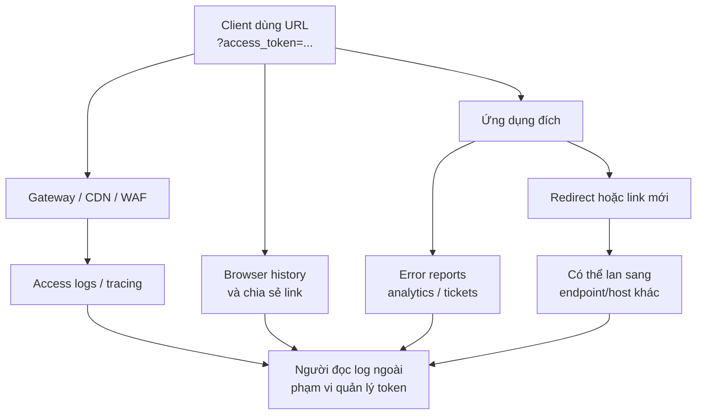
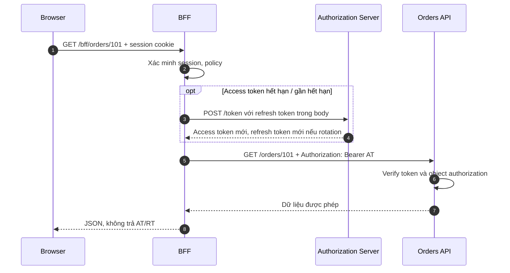

# Không truyền token qua query string

## Mục tiêu học tập

Trong module **SECURITY_TOKEN_SECURITY_FUNDAMENTALS**, token là credential liên kết mô hình tin cậy với vòng đời xác thực và phân quyền: access token dùng để gọi Resource Server, refresh token dùng tại Authorization Server, JWT/opaque token được kiểm tra theo issuer, audience, scope và trạng thái. Chủ đề **Token transport** đặt ra câu hỏi: **credential phải đi qua kênh nào để không bị lộ ngoài ý muốn?**

Bài học tập trung vào nguyên tắc **không đưa access token, refresh token hoặc credential phiên vào URL query string**. Sau khi học, bạn có thể:

- Giải thích vì sao `?access_token=...` là phương thức vận chuyển nguy hiểm dù kết nối dùng HTTPS.
- Phân tích rủi ro token xuất hiện trong browser history, server/proxy/CDN logs, monitoring, analytics, `Referer`, cache, đường redirect và link được chia sẻ.
- Sử dụng `Authorization: Bearer <access-token>` qua HTTPS cho OAuth 2.0 Resource Server theo RFC 6750 và xác định giới hạn của các phương thức mang token khác.
- Phân biệt **authorization code trong OAuth redirect** với **access token trong URL**, tránh sửa lỗi bằng cách chuyển token vào fragment hoặc cookie một cách thiếu kiểm soát.
- Đề xuất giải pháp cho **SPA, BFF, WebSocket, Server-Sent Events (SSE), tải tệp và signed URL** mà không vô tình truyền credential sống dài qua query.
- Thiết kế bước chặn query token, redaction ở mọi tầng, kiểm thử và ứng phó khi token đã bị lộ.

## 1. Tại sao token trong query string đặc biệt nguy hiểm?

Một bearer access token là credential: **bên nào sở hữu token còn hiệu lực** có thể thử trình nó với Resource Server phù hợp theo quyền trong token. Điều này đúng với cả **JWT có chữ ký** và **opaque token**. Chữ ký JWT bảo vệ nội dung không bị sửa; nó **không ngăn sao chép và phát lại nguyên chuỗi token**.

Ví dụ request **không nên sử dụng**:

```http
GET /orders/101?access_token=<raw-access-token> HTTP/1.1
Host: api.example.com
```

Phần sau dấu `?` là **query string** của URL. Khác với header `Authorization`, URL thường được dùng làm:

- Khóa truy cập của trình duyệt, một mục trong lịch sử duyệt web và nội dung người dùng có thể sao chép/chia sẻ.
- Trường đầu vào của access logs, load balancer, reverse proxy, API gateway, CDN, WAF, tracing và công cụ giám sát.
- Đối tượng cache, redirect, phân tích traffic hoặc một phần metadata trong báo cáo lỗi.
- Giá trị mà các tầng trung gian dùng để dựng lại full URL trong dashboard/ticket/hồ sơ sự cố.

Chỉ cần **một nơi xử lý URL ngoài dự kiến** lưu hoặc chuyển tiếp đầy đủ query string, credential có thể lọt vào hệ thống có chính sách truy cập/retention kém hơn nơi lưu token chính thức.

> **Nguyên tắc:** URL là **địa chỉ tài nguyên**, không phải kho credential. Đừng đặt **bearer access token**, **refresh token**, **ID Token** hay session secret vào query string để “tiện gọi API”.

### Thay đổi vị trí token có ý nghĩa gì?

```text
KHÔNG NÊN:
GET https://api.example.com/orders/101?access_token=eyJ...

NÊN:
GET https://api.example.com/orders/101
Authorization: Bearer eyJ...
```

Trong ví dụ thứ hai, URL không còn chứa token. Tuy nhiên, **header `Authorization` vẫn là bí mật**: reverse proxy hoặc application logging cấu hình sai vẫn có thể ghi nó. Di chuyển token vào header **giảm một lớp bề mặt rò rỉ đặc thù của URL**, không thay thế TLS, xác thực, quyền API và log redaction.

## 2. RFC 6750 nói gì về vận chuyển bearer token?

**RFC 6750 — OAuth 2.0 Bearer Token Usage** mô tả các phương thức client có thể dùng để truyền bearer access token tới Resource Server:

| Phương thức | Vị trí | Đánh giá thực tế |
| --- | --- | --- |
| **Authorization request header** (`2.1`) | `Authorization: Bearer <token>` | **Phương thức nên dùng** cho các HTTP API hỗ trợ header. Resource Server OAuth Bearer phải hỗ trợ phương thức này. |
| **Form-encoded body** (`2.2`) | Tham số `access_token` trong body `application/x-www-form-urlencoded` | Chỉ dùng dưới điều kiện hạn chế của RFC; không dùng GET và không phải lựa chọn mặc định cho API hiện đại. |
| **URI query parameter** (`2.3`) | `?access_token=<token>` | RFC ghi nhận để tương thích nhưng **không khuyến nghị**, vì rủi ro bảo mật gắn với URL. |

RFC 6750 quy định client **không dùng nhiều hơn một phương thức truyền bearer access token trong cùng một request**. Việc token xuất hiện đồng thời trong header và query có thể gây parsing ambiguity hoặc tạo đường đi vượt qua chính sách ở các tầng.

**Kết luận triển khai:** Đối với ứng dụng/API mới, dùng **`Authorization` header qua HTTPS**; không tự bật hỗ trợ query parameter chỉ vì một client khó cấu hình header. Nếu thiết bị/thư viện không hỗ trợ, hãy xem lại kiến trúc thay vì đẩy credential có giá trị cao vào URL.

### 2.1. Cú pháp request chuẩn

```http
GET /orders/101 HTTP/1.1
Host: api.example.com
Authorization: Bearer <access-token>
Accept: application/json
```

Resource Server cần:

1. Chấp nhận request qua **TLS/HTTPS được cấu hình đúng**; bảo vệ token trên đường truyền.
2. Đọc access token tại vị trí giao thức cho phép; giới hạn kích thước/cú pháp và loại bỏ token ở vị trí trái chính sách.
3. Với **JWT**, xác minh chữ ký/thuật toán, issuer (`iss`), audience (`aud`), thời gian (`exp`/`nbf`), loại token và scope.
4. Với **opaque token**, dùng introspection hoặc nguồn xác minh đáng tin, kiểm tra trạng thái active và các thuộc tính/giới hạn cần thiết.
5. Kiểm tra quyền trên **đối tượng, tenant và hành động**; bearer token có scope đọc không được mặc nhiên xem mọi dữ liệu.

Không dùng refresh token tại Resource Server: refresh token chỉ dùng với **token endpoint của AS** bằng phương thức và hợp đồng phù hợp.

### 2.2. Tại sao không chuyển token sang HTTP body cho mọi request?

Tham số form-body của RFC 6750 có điều kiện riêng, như dùng body `application/x-www-form-urlencoded` thích hợp, **không dùng phương thức GET**, và client/Resource Server phải đáp ứng quy tắc của profile. Nó **không phải** khuyến nghị chung để nhúng token vào mọi JSON body hoặc biến POST thành cơ chế đăng nhập tùy tiện.

Body cũng có thể bị log ở APM, error reporting, reverse proxy và hệ thống debug. Vì vậy **`Authorization` header là lựa chọn chuẩn** cho bearer access token trong API; ở OAuth token endpoint, refresh token nằm trong **body form** của request cấp token mới theo OAuth, **không nằm trong URL**.

## 3. Những đường rò rỉ URL mà HTTPS không chặn được

HTTPS mã hóa dữ liệu trên đường truyền tới điểm kết thúc TLS, nhưng **không xóa URL khỏi trình duyệt, máy chủ, CDN, proxy hoặc hệ thống phân tích đang được phép xem request**. Nơi TLS terminate có thể đọc full path/query. Rò rỉ thường không đến từ việc “bẻ khóa TLS”, mà từ cơ chế lưu/chia sẻ thông tin phục vụ vận hành.

| Đường rò rỉ | Cơ chế | Hậu quả khi URL chứa token |
| --- | --- | --- |
| **Browser history/bookmark** | URL được lưu hoặc sao chép qua lịch sử, bookmark, đồng bộ thiết bị theo tính năng trình duyệt. | Token có thể tồn tại lâu hơn phiên cần thiết, bị chia sẻ lại. |
| **Reverse proxy/API gateway logs** | Nhiều cấu hình ghi request target/full URL; token nằm trong phần query. | Người đọc log có thể nhận bearer credential. |
| **CDN, WAF, load balancer** | Tầng trung gian có thể ghi mẫu request, cache key, sự kiện bảo mật. | Credential đi vào nhiều vùng quản trị và retention. |
| **APM, tracing, analytics** | Trường `http.url`/`url.full`/request attributes có thể chứa query. | Token xuất hiện trong dashboard, metrics attachments, tickets. |
| **Referrer (`Referer`)** | Trình duyệt có thể đưa URL nguồn theo `Referrer-Policy` và quan hệ origin/site. | Query có thể bị chuyển trong một số luồng điều hướng/request. |
| **Redirect** | Ứng dụng/proxy có thể chép tham số query sang URL đích hoặc tạo link tiếp theo. | Token có thể bị lan truyền qua các host/endpoint khác. |
| **Chia sẻ link/screenshot** | Người dùng gửi URL cho hỗ trợ kỹ thuật, chat nhóm, email. | Token trở thành thông tin chia sẻ ngoài phạm vi chủ sở hữu. |
| **Cache và lưu vết request** | URL có thể xuất hiện ở cache key hoặc nhật ký cache ngay cả khi không cache response. | Credential bị lưu vết ở nơi không dành để giữ bí mật. |
| **Báo cáo lỗi, crash report** | Exception hoặc network debugger ghi đầy đủ URL lỗi. | Token lọt vào dữ liệu giám sát hoặc hệ thống bên thứ ba. |

### 3.1. Ví dụ đường rò rỉ qua quan sát URL



Đây là **các điểm có thể rò rỉ**, không phải khẳng định mọi trình duyệt hoặc mọi proxy đều lưu/truyền full query ở tất cả trường hợp. Kết quả thực tế phụ thuộc cấu hình và chính sách triển khai.

### 3.2. Cẩn trọng với `Referer`

Nếu người dùng đang xem:

```text
https://app.example.com/callback?access_token=<secret>
```

và trang tạo một request tiếp theo, header `Referer` có thể phản ánh URL nguồn theo chính sách referrer. **Không khẳng định mọi website bên ngoài đều thấy toàn bộ query:** trình duyệt hiện đại thường dùng chính sách mặc định như `strict-origin-when-cross-origin`, có thể chỉ gửi origin khi đi cross-origin và giảm thông tin khi chuyển HTTPS→HTTP. Nhưng:

- Request **cùng origin** có thể gửi URL nguồn kèm path/query khi chính sách cho phép.
- Chính sách `unsafe-url` hoặc những cấu hình cũ/khác có thể công bố nhiều hơn.
- Các công cụ nội bộ, redirect hoặc server log vẫn có thể xử lý full URL độc lập với `Referer`.

Có thể dùng `Referrer-Policy: no-referrer` hoặc chính sách phù hợp để **giảm một bề mặt lộ thông tin**, nhưng đó là **defense-in-depth**, không hợp thức hóa việc đưa token vào query.

### 3.3. Cache và `Cache-Control`

`Cache-Control: no-store` giúp hạn chế lưu HTTP response theo các cơ chế cache tuân thủ chỉ thị. Nó **không thể đảm bảo xóa URL khỏi** browser history, reverse proxy access log, CDN event, analytics hoặc screenshot.

Ngay cả API trả response không cache và dùng HTTPS, query chứa token vẫn có thể bị ghi lại. Vì vậy xử lý đúng là **không đặt token vào URL ngay từ đầu** rồi bổ sung cache policy hợp lý.

## 4. Phân biệt query, fragment, path và header

Một URL có các phần:

```text
https://api.example.com/orders/101?access_token=SECRET#panel
^^^^^^^^^^^^^^^^^^^^^^^ ^^^^^^^^^^ ^^^^^^^^^^^^^^^^^^^ ^^^^^^
scheme + authority      path       query              fragment
```

| Vị trí | Gửi trong HTTP request tới server? | Có an toàn để giữ token không? |
| --- | --- | --- |
| **Query** sau `?` | Có; là một phần request target. | **Không**: URL bị ghi/chia sẻ/lan truyền ở nhiều lớp. |
| **Path** (ví dụ `/token/SECRET`) | Có. | **Không**: cùng rủi ro URL, thường còn bị log rõ hơn. |
| **Fragment** sau `#` | Thông thường **không gửi đến server** trong HTTP request. | **Không nên** dùng làm cách thay thế lưu/chuyển access token; JS của trang có thể đọc, history/URL chia sẻ và extension vẫn là rủi ro. |
| **Authorization header** | Có, ở phần header HTTP. | **Vị trí được khuyến nghị** cho OAuth Bearer qua HTTPS, nhưng vẫn phải redact trong log. |
| **Cookie** | Trình duyệt gửi tự động theo domain/path/`SameSite` và các quy tắc khác. | Có thể phù hợp cho **session cookie `HttpOnly`** ở BFF; cần CSRF, phạm vi cookie và session lifecycle. |
| **Body form** | Có khi request có body thích hợp. | Phù hợp cho một số thao tác tại **token endpoint**; không phải nơi mặc định mang access token đến mọi Resource Server. |

**Sai lầm thường gặp:** Đổi `?access_token=...` thành `#access_token=...` rồi tuyên bố đã an toàn vì server không nhận fragment. Fragment vẫn nằm trong môi trường browser và có thể bị JavaScript trên trang đọc; trong các ứng dụng có XSS, đây vẫn là credential dễ bị lạm dụng. OAuth implicit grant từng trả access token qua fragment trong một số flow cũ, nhưng **không phải mẫu khuyến nghị cho thiết kế OAuth mới**; hãy ưu tiên Authorization Code + PKCE khi thích hợp.

## 5. Mẫu gọi API đúng: Authorization header + HTTPS

### 5.1. Client HTTP

Một request chuẩn:

```http
GET /orders/101 HTTP/1.1
Host: api.example.com
Accept: application/json
Authorization: Bearer <access-token>
```

Ví dụ Java dùng `java.net.http.HttpClient` (JDK 11+):

```java
HttpRequest request = HttpRequest.newBuilder()
    .uri(URI.create("https://api.example.com/orders/101"))
    .header("Accept", "application/json")
    .header("Authorization", "Bearer " + accessToken)
    .GET()
    .build();

// Không log request.headers() hay accessToken trong production.
HttpResponse<String> response =
    httpClient.send(request, HttpResponse.BodyHandlers.ofString());
```

Trong ví dụ, access token **không nằm trong URI**. Trình HTTP client vẫn phải bảo vệ token trong bộ nhớ và tránh ghi credential vào log/debugger. Không chuyển header `Authorization` sang host khác nếu client tự động follow redirect: thư viện HTTP có quy tắc chuyển tiếp header khác nhau; cần xác minh cấu hình redirect và giới hạn credential cho host/API đích.

### 5.2. Browser `fetch`

Nếu kiến trúc SPA phải giữ access token trong browser:

```javascript
// accessToken phải được quản lý theo threat model của ứng dụng.
const response = await fetch("https://api.example.com/orders/101", {
  method: "GET",
  headers: {
    "Authorization": "Bearer " + accessToken,
    "Accept": "application/json"
  }
});
```

Đừng viết:

```javascript
// KHÔNG NÊN: token xuất hiện trong URL và có thể đi vào log.
const url = "https://api.example.com/orders/101?access_token=" +
            encodeURIComponent(accessToken);
const response = await fetch(url);
```

**Lưu ý:** `fetch` với `Authorization` khi gọi cross-origin chịu quy tắc CORS/preflight của trình duyệt. Cần cấu hình CORS allowlist và các header thích hợp tại API; **không bỏ header để chuyển sang query** chỉ nhằm tránh preflight. XSS vẫn có thể lạm dụng access token mà JS nắm giữ; vì vậy BFF hoặc phương án token không JS-accessible nên được cân nhắc cho quyền nhạy cảm.

### 5.3. Backend for Frontend (BFF)

Với BFF, trình duyệt thường không nhận access/refresh token thô:



Cookie BFF nên có `Secure`, `HttpOnly`, `SameSite` phù hợp, thời hạn và server-side session revocation. Request thay đổi trạng thái cần CSRF protection và kiểm tra `Origin` theo chính sách. **`HttpOnly` ngăn JS đọc cookie trực tiếp, nhưng XSS đang chạy vẫn có thể gửi request bằng session hiện tại**; BFF không thay thế phòng XSS và phân quyền API.

## 6. Query chứa authorization code có giống query chứa token không?

**Không.** Trong **OAuth 2.0 Authorization Code flow**, Authorization Server thường chuyển browser trở lại redirect URI của client với **authorization code** và `state` trong query:

```http
HTTP/1.1 302 Found
Location: https://client.example.com/callback?code=<one-time-authorization-code>&state=<request-state>
```

Đây là bước được **giao thức thiết kế rõ ràng**, khác với việc đưa **access token** vào query để gọi API. Authorization code có thời gian sống ngắn, được dùng **một lần**, gắn với client/redirect URI và được đổi tại token endpoint; **PKCE** ràng buộc code với `code_verifier` đúng theo flow để giảm rủi ro code interception/injection.

| Tiêu chí | Authorization code trong callback | Access token trong URL API |
| --- | --- | --- |
| Vai trò | Credential trung gian để đổi lấy token tại AS. | Credential dùng trực tiếp ở Resource Server. |
| Tính một-lần-dùng | Code phải có cơ chế dùng một lần, thời hạn ngắn. | Bearer token có thể được trình nhiều lần cho tới khi hết hạn/thu hồi, trừ cơ chế ràng buộc bổ sung. |
| Bên nhận | OAuth client redirect endpoint + token endpoint AS theo hợp đồng. | Resource Server API theo audience. |
| Bảo vệ bắt buộc theo flow | `state`, PKCE, redirect URI matching, client authentication khi áp dụng; OIDC còn có `nonce`/ID Token validation theo profile. | Không đặt trong URL; dùng Authorization header, TLS, token validation. |
| Log/query leak | **Vẫn là bí mật nhạy cảm** phải tránh log và bảo vệ khỏi replay/code theft. | Rò rỉ trực tiếp credential có thể gọi API. |

**Quan trọng:** Có `code` trong query **không có nghĩa** được ghi code vào analytics hoặc log. Dù có PKCE, authorization code vẫn là thông tin nhạy cảm; cần giới hạn lịch sử, loại bỏ query sau khi xử lý phù hợp và không vô tình chuyển tiếp nó đến nơi khác.

### 6.1. Không nhầm `state` với access token

`state` giúp client liên kết authorization response với yêu cầu ban đầu, hỗ trợ chống CSRF và các luồng mix-up phù hợp; nó **không phải access token**. Không nhúng access token/refresh token vào `state` để “gửi kèm cho tiện”. Tương tự, `nonce` của OIDC dùng cho ràng buộc yêu cầu xác thực, không phải bearer token API.

### 6.2. Nguy cơ open redirect và sao chép query

Nếu một route như:

```text
/callback?code=...&state=...&next=https://other.example/path
```

tự động forward nguyên query sang URL `next` không tin cậy, authorization code hoặc các tham số nhạy cảm có thể bị lộ. Cần kiểm soát chặt redirect URI, nơi redirect và dữ liệu được giữ lại. Không copy toàn bộ query mặc định từ một callback hoặc API URL sang destination mới.

## 7. WebSocket, SSE và những trường hợp browser không đặt được header

Đôi khi lập trình viên đưa token vào query vì **browser API không cho tự đặt header `Authorization`** khi tạo connection. Đây là vấn đề cần giải bằng **thiết kế kênh xác thực**, không phải lý do để chuyển **refresh token hoặc access token sống dài** lên URL.

### 7.1. WebSocket trong trình duyệt

WebSocket API gốc ở browser không cho JavaScript tùy ý đặt header `Authorization` trong HTTP Upgrade handshake như `fetch`:

```javascript
// KHÔNG NÊN:
const ws = new WebSocket(
  "wss://realtime.example.com/ws?access_token=" + accessToken
);
```

Lựa chọn an toàn hơn tùy kiến trúc:

1. **BFF/session cookie:** WebSocket endpoint xác thực session server-side qua cookie `Secure`/`HttpOnly` phù hợp, kiểm tra **`Origin`** và chống cross-site WebSocket hijacking (CSWSH), áp dụng session expiry và quyền trên từng kênh/subscription.
2. **Application-level authentication sau handshake:** thiết lập `wss://`, sau đó gửi thông điệp authentication theo protocol ứng dụng. Điều này tránh token trong URL, nhưng yêu cầu **giới hạn thời gian chưa xác thực**, không xử lý dữ liệu/subscribe trước khi xác minh, bảo vệ message logs và đóng connection khi không hợp lệ.
3. **Một-lần-dùng, thời gian cực ngắn, audience hẹp connection ticket** nếu thực sự không thể dùng các cách trên. Ticket là credential **riêng cho một kết nối**, do backend tin cậy phát hành, được tiêu thụ nguyên tử, không dùng refresh token/long-lived access token. Nếu buộc phải đặt ticket trong query thì URL đó **vẫn phải redact**, giới hạn TTL và thu hồi; không coi ticket trong URL là hết rủi ro.

Không đặt refresh token vào `Sec-WebSocket-Protocol`/subprotocol để né query: header subprotocol được dùng để thương lượng protocol và cũng có thể được ghi log. Nếu dùng một cơ chế dựa trên subprotocol theo một hợp đồng đặc biệt, phải đánh giá privacy/độ tương thích/ghi log; đó **không phải** vị trí chung được RFC 6750 khuyến nghị cho OAuth bearer token.

### 7.2. Server-Sent Events (SSE)

API `EventSource` gốc ở browser không cung cấp cách đặt header tùy ý:

```javascript
// KHÔNG NÊN: dùng raw OAuth token trong URL SSE.
const stream = new EventSource(
  "/events?access_token=" + accessToken
);
```

Có thể cân nhắc:

- **SSE cùng origin sau BFF**: trình duyệt gửi session cookie, backend xác thực và kết nối upstream với token server-side.
- **Dùng `fetch` với streaming response** khi cần đặt `Authorization` header, nếu môi trường và giao thức của ứng dụng hỗ trợ; tự quản lý reconnect/stream parsing đúng cách.
- **Connection ticket ngắn hạn, một-lần-dùng** chỉ như ngoại lệ được threat-model; không dùng refresh token hoặc bearer access token có quyền rộng ở query.

Native browser SSE thường tự reconnect; nếu ticket đã tiêu thụ thì cần một cơ chế **xin ticket mới**, không kéo dài hiệu lực hoặc mở lại ticket cũ vô hạn để “sửa reconnect”.

### 7.3. Không nhầm ticket với access token thông thường

| Thuộc tính | OAuth access token dùng API | Ticket kết nối một lần (nếu hệ thống tự thiết kế) |
| --- | --- | --- |
| Mục đích | Gọi API theo audience/scope. | Chỉ mở đúng một phiên/kết nối cụ thể. |
| Thời hạn | Theo AS và risk policy, có thể nhiều phút. | Rất ngắn và giới hạn bởi kịch bản kết nối. |
| Quyền | Có thể truy cập nhiều endpoint cùng resource. | Nên chỉ cấp quyền đủ mở kết nối, không quyền API rộng. |
| Số lần sử dụng | Bearer access token thường được dùng nhiều lần khi còn hạn. | Chỉ một lần, được đánh dấu consumed nguyên tử. |
| Nguy cơ log URL | Cao nếu đặt trong query. | **Vẫn tồn tại** nếu ticket đặt trong query, dù tác động có thể được giảm. |

Đây là mẫu **giảm thiệt hại trong trường hợp bất khả kháng**, không phải ngoại lệ mặc định cho phép “đưa token lên URL”.

## 8. Link tải tệp, ảnh và signed URL

Một số hệ thống muốn tạo link tải tệp có thể mở trực tiếp trong trình duyệt hoặc dùng HTML ``/`<a>`, nơi việc gắn header `Authorization` không luôn thuận tiện. Không giải quyết bằng:

```text
https://files.example.com/download/42?access_token=<user-access-token>
```

**Phương án ưu tiên:**

- Download qua **BFF/session cookie**, backend gọi API lưu trữ bằng access token đúng audience rồi stream dữ liệu được phép.
- Dùng `fetch` với `Authorization` để lấy dữ liệu, sau đó tạo object URL tạm thời ở browser nếu UX cần tải file; giải phóng object URL khi xong và kiểm soát memory.
- Nếu chọn **pre-signed URL**, coi URL đó là **bearer capability riêng**: giới hạn thời gian cực ngắn phù hợp, phương thức, đối tượng/tệp, quyền và phạm vi; không nhúng OAuth access token gốc.

Pre-signed URL vẫn có thể lộ qua history, logs, Referer, link được chia sẻ và crash reports. Sự khác biệt là nó được thiết kế để **giới hạn quyền vào một hành động/tệp**, thay vì làm lộ access token có thể dùng ở nhiều endpoint. Tùy mức độ nhạy cảm, cần một-lần-dùng, kiểm tra người dùng hoặc cơ chế proxy/download thay thế.

### Chống cache và chuyển tiếp link nhạy cảm

Response tải tệp có thể cần `Cache-Control: private, no-store` tùy yêu cầu, `Content-Disposition` phù hợp và chính sách download audit. Tuy nhiên các header đó **không xóa** URL đã được gửi qua chat/email, browser history hoặc log. Nếu URL là credential, phải có TTL/thu hồi/chính sách truy cập tương ứng.

## 9. Chặn token trong query ở Resource Server và gateway

Giảm việc client **tạo URL chứa credential** là phòng ngừa ở nguồn. Nhưng server cũng nên chủ động chống việc **tiếp nhận hoặc lan truyền** token qua query:

1. **API contract:** chỉ hỗ trợ access token trong `Authorization` header, công bố rõ trong tài liệu client.
2. **Authentication middleware:** không bật hỗ trợ `access_token` ở query/form body nếu không cần, dù thư viện có option cho phép.
3. **Edge validation:** phát hiện tham số tên/định dạng credential bị cấm trong query và trả lỗi trung tính **trước khi route đi sâu hơn**, tránh parse rồi sử dụng.
4. **Log redaction ở ingress:** lọc query/URL từ **điểm đầu tiên có thể ghi log**. Chặn ở application không xóa token đã được edge/access log ghi trước đó.
5. **Không tự chuyển token từ query sang header ở proxy:** cách “repair” này vẫn để URL credential xuất hiện tại browser và gateway, và có thể tạo nhiều cách xác thực khó kiểm soát.
6. **Giới hạn redirect:** không tự động copy toàn bộ query hoặc header `Authorization` sang destination không đáng tin.
7. **Kiểm tra cấu hình cache:** không để responses nhạy cảm bị cache công khai do xử lý auth/query sai.

### 9.1. Ví dụ Java/Spring Security Resource Server

Một hướng cấu hình theo API Spring Security thông dụng (cần kiểm tra phiên bản và cấu hình thực tế):

```java
@Bean
SecurityFilterChain apiSecurity(HttpSecurity http) throws Exception {
    DefaultBearerTokenResolver resolver = new DefaultBearerTokenResolver();

    // Chỉ nhận Authorization header ở Resource Server.
    resolver.setAllowUriQueryParameter(false);
    resolver.setAllowFormEncodedBodyParameter(false);

    http.oauth2ResourceServer(oauth2 -> oauth2
        .bearerTokenResolver(resolver)
        .jwt(Customizer.withDefaults()));

    return http.build();
}
```

Đoạn code minh họa **đúng ý định cấu hình**, không phải cấu hình hoàn chỉnh về issuer, audience, method security, CSRF hoặc session. Trong Spring Security, `DefaultBearerTokenResolver` thông thường ưu tiên header và không bật đọc query parameter theo mặc định; vẫn cần xác minh không có custom resolver/filter/gateway khác cho phép query.

**Một chi tiết quan trọng:** một resolver được cấu hình “chỉ đọc header” có thể **bỏ qua** `?access_token=...` thay vì trả lỗi riêng khi cả header và query cùng tồn tại. Nhưng **URL có token đã bị lộ tới tầng nhận request**, kể cả application không dùng token đó. Nếu chính sách yêu cầu **chặn mọi URL có credential**, cần kiểm tra query ở gateway/filter, cùng với redaction **trước** điểm ghi log; không chỉ dựa vào resolver.

### 9.2. Response khi client gửi bearer token sai cách

Với giao thức OAuth Bearer, `invalid_request` có thể thích hợp khi một request dùng phương pháp mang token không hợp lệ, bao gồm một số trường hợp mang token đồng thời bằng nhiều phương thức. Ví dụ chính sách API chỉ chấp nhận header và từ chối query chứa bearer:

```http
HTTP/1.1 400 Bad Request
WWW-Authenticate: Bearer realm="orders", error="invalid_request"
Cache-Control: no-store
Content-Length: 0
```

Mã lỗi phải phù hợp với profile và chiến lược xử lý request của ứng dụng; không nhất thiết mọi `400` đều có `WWW-Authenticate`. **Tuyệt đối không phản chiếu URL/token** trong response body, `error_description`, header debug hoặc message lỗi cho client.

## 10. Quan sát hệ thống mà không ghi credential

**Transport an toàn và observability an toàn phải được thiết kế cùng nhau.** Khi API/gateway phát hiện token trong query, bản ghi an toàn có thể chứa:

```json
{
  "event_type": "CREDENTIAL_IN_URL_BLOCKED",
  "request_id": "req-39ac1e",
  "service": "orders-api",
  "route_template": "GET /orders/{id}",
  "query_contains_sensitive_parameter": true,
  "http_status": 400,
  "occurred_at": "2027-01-15T10:05:00Z"
}
```

Đây là **schema sự kiện nội bộ minh họa**; không có raw query, JWT payload, access token, refresh token hoặc user PII.

### Các lớp cần kiểm tra redaction

| Lớp | Rủi ro cụ thể | Cách kiểm soát |
| --- | --- | --- |
| Browser/SPA | `console.log(url)`, DevTools snapshot, error monitoring SDK. | Không đưa token vào URL/console, lọc URL trước telemetry. |
| Reverse proxy / ingress | `request_uri` hoặc full `$request` trong access log có query. | Chọn log format chỉ ghi path/route template; redact query ngay ở edge. |
| API gateway/CDN/WAF | URL lưu trong event, sampling, security logs. | Cấu hình masking và data retention/access riêng, xác minh với request test. |
| Application | Exception in toàn bộ request URI hay `toString()` của request. | Structured logging có allowlist field; không log headers/body/URL tùy ý. |
| HTTP clients | Redirect hoặc interceptor log request URL/header. | Filter sensitive fields trước logger; tránh forward auth cross-host. |
| Tracing/APM | `url.full`, `http.target`, span attributes/baggage chứa query. | Sanitize từ instrumentation, không gán credential thành tag. |
| Support/chat/tickets | Người dùng paste link có query. | Cảnh báo và tự động mask; hướng dẫn thu hồi credential nếu đã chia sẻ. |

**Không đủ nếu chỉ thay token trong application log bằng `***`**: yêu cầu có thể đã đi qua CDN và gateway trước đó. Hãy thử nghiệm **toàn bộ đường đi** từ browser đến API, bao gồm hệ thống kiểm thử, staging và production.

### Không đưa token vào metric hoặc trace ID

Metric label có thể được sao chép và lưu dài ngày. Tuyệt đối không dùng raw query, token, `jti` nhạy cảm, JWT claims chứa PII hoặc `Authorization` header làm nhãn metric. Nếu cần đối chiếu một token khi điều tra, cân nhắc **tham chiếu không thể đảo ngược** và có quyền truy cập hạn chế, không gửi credential thô vào analytics.

## 11. HTTPS, redirect và proxy: điều kiện cần nhưng chưa đủ

### 11.1. HTTPS/TLS

Với bearer token, sử dụng HTTPS và xác minh chứng chỉ/hostname là điều kiện thiết yếu. Tuy nhiên:

- HTTPS không ngăn reverse proxy tại điểm TLS termination ghi full URL.
- HTTPS không bảo vệ khỏi XSS đang chạy trong browser hoặc log ứng dụng.
- HTTPS không thay các bước kiểm chứng issuer, audience, signature, scope, thời hạn, revoke hoặc object policy.

Nên thiết lập HSTS, hạn chế mixed content và kiểm tra đường đi qua proxy theo kiến trúc. Nhưng **đưa token vào query của HTTPS URL vẫn là phương án không được khuyến nghị**.

### 11.2. Redirect

Một client HTTP hoặc ứng dụng có thể được chuyển hướng từ `https://api.example.com` tới một host khác. Không cho logic redirect:

- Copy `access_token` từ query nguồn sang URL đích.
- Giữ nguyên header `Authorization` khi chuyển sang một host/realm không được cho phép.
- Chuyển HTTPS sang HTTP và giữ credential.
- Biến URL nhập bởi user thành redirect destination mà không kiểm tra allowlist/contract.

Quy tắc chuyển tiếp header của HTTP library có thể khác nhau; **không dựa vào giả định “client luôn tự xóa Authorization khi đổi host”** mà chưa kiểm thử đúng thư viện và phiên bản.

### 11.3. Cache và `Vary`

Response dành riêng cho user nên có chính sách cache phù hợp, thường `Cache-Control: private` hoặc `no-store` theo độ nhạy cảm và flow. Shared cache/CDN cần hiểu rằng token/`Authorization` là thông tin xác thực và không cache/serve dữ liệu của user A cho user B. Không coi “query có token” là cache key đủ để bảo vệ dữ liệu; đó lại là cách làm lan truyền credential tới cache/observability.

## 12. Ứng phó khi đã phát hiện token trong URL

Giả sử một URL chứa bearer token đã xuất hiện trong log gateway hoặc support ticket. Đừng chỉ sửa client code rồi kết luận đã xong. Một quy trình phản ứng có thể gồm:

1. **Ngừng nguồn rò rỉ**: sửa client/gateway để không tạo URL chứa token, chặn các đường auth query; loại bỏ redirect và logger còn sao chép full URL.
2. **Đánh giá phạm vi**: xác định loại credential (access token, refresh token, cookie/session, signed URL), khoảng thời gian có thể bị lộ, hệ thống nhận URL và quyền truy cập log.
3. **Thu hồi thích hợp**: revoke refresh token/family hoặc phiên nếu có; đối với access token còn sống, dùng cơ chế revoke/denylist/introspection/TTL theo khả năng AS/RS; vô hiệu signed URL khi hỗ trợ.
4. **Không làm sự cố lan rộng**: tránh paste token thật vào ticket/nhóm chat, không đưa log raw vào công cụ phân tích không được phép; sử dụng request ID và tham chiếu an toàn.
5. **Xử lý bản sao ở nơi lưu**: theo chính sách tổ chức, khoanh vùng/redact dữ liệu khỏi log, trace, CDN event, báo cáo lỗi, cache hoặc tài liệu hỗ trợ; lưu bằng chứng điều tra có kiểm soát khi cần.
6. **Kiểm tra truy cập trái phép**: tìm các request bất thường tại đúng audience trong khoảng token còn hiệu lực; đánh giá quyền theo scope/object policy, replay và dấu hiệu refresh reuse.
7. **Khắc phục lâu dài**: thêm guardrail CI/lint, integration test, log redaction test, cảnh báo credential-in-URL và quy trình review transport.

**Lưu ý về JWT:** JWT access token tự chứa vẫn có thể được Resource Server chấp nhận tới `exp` dù client đã xóa URL hoặc AS đã revoke refresh token, nếu RS không có cơ chế kiểm tra trạng thái. **Chỉ đổi client secret hoặc xóa browser history không tự thu hồi bản sao JWT đã bị lộ**.

## 13. Bảng kịch bản kiểm thử

Giả sử Orders API chỉ chấp nhận OAuth Bearer access token trong `Authorization` header, có issuer `https://identity.example.com`, audience `api://orders` và scope tối thiểu theo endpoint.

| Tình huống | Kỳ vọng bảo mật |
| --- | --- |
| `GET /orders/101` với `Authorization: Bearer <valid-AT>` qua HTTPS. | API verify token, audience/scope/object policy; không đưa token vào URL hoặc logs. |
| `GET /orders/101?access_token=<AT>` không có header. | API/gateway từ chối theo chính sách; **không** sử dụng token query để xác thực. |
| Request có cả header `Authorization` hợp lệ và `?access_token=...`. | Chặn query credential nếu policy yêu cầu; không bỏ qua rò rỉ chỉ vì header hợp lệ. |
| `GET /orders/101?refresh_token=<RT>`. | Chặn; refresh token không được gửi đến Resource Server hoặc qua query. |
| `GET /orders/101#access_token=<AT>`. | Fragment không phải HTTP request target; không dùng fragment làm cách vận chuyển/lưu access token. |
| OAuth callback chứa `?code=...&state=...`. | Xử lý code flow với `state`/PKCE; code không được sao chép vào analytics/redirect ngoài ý muốn. |
| Gateway truy cập URL giả `?access_token=TEST_SECRET_DO_NOT_LOG`. | Kiểm tra không có `TEST_SECRET_DO_NOT_LOG` trong access log, APM, CDN/WAF events và ticket. |
| Browser fetch API cross-origin cần preflight vì header `Authorization`. | CORS đúng contract; không chuyển token sang query để né preflight. |
| WebSocket browser không đặt custom header được. | Dùng BFF cookie + Origin check hoặc auth message được bảo vệ; không đưa long-lived token vào `ws` URL. |
| SSE `EventSource` không hỗ trợ custom auth header. | Ưu tiên BFF cookie/fetch streaming; không dùng raw OAuth token trong query. |
| Tải file bằng link được chia sẻ. | Không đưa AT gốc vào query; nếu dùng signed URL, áp dụng TTL/quyền hẹp, chống log và thu hồi. |
| Token hết hạn nhưng URL cũ vẫn ở browser history. | Token phải bị RS từ chối; vẫn sửa nguồn rò rỉ vì refresh/credential khác có thể còn sống. |
| Token từ Orders bị dùng ở Billing API. | Billing từ chối theo `aud`; transport header đúng không thay validation. |
| HTTP client follow redirect sang host khác. | Không forward bearer token sang destination không tin cậy; không downgrade HTTPS. |
| API có `Cache-Control: no-store` nhưng gateway vẫn log URL. | Test **không đạt**; cache policy không thay log redaction hay loại bỏ token query. |

### Câu hỏi tự kiểm tra

1. Tại sao HTTPS **không đủ** để làm `?access_token=...` trở nên an toàn?
2. JWT có chữ ký hợp lệ nhưng bị sao chép từ browser history có thể gây ra rủi ro gì?
3. Vì sao `Authorization` header thường được ưu tiên hơn URL query theo RFC 6750?
4. Query chứa `code` của Authorization Code flow khác query chứa `access_token` khi gọi API thế nào? Vì sao code vẫn phải bảo vệ?
5. `Referrer-Policy: no-referrer` hoặc `Cache-Control: no-store` có thể xóa mọi nguy cơ token trong URL không?
6. Khi browser WebSocket/SSE không đặt được header `Authorization`, vì sao không nên đưa refresh token hoặc access token sống dài vào URL?
7. Một signed URL tải tệp có nên được xem là dữ liệu công khai chỉ vì nó không chứa OAuth access token gốc không?
8. Gateway đã reject `?access_token=...` nhưng access log của gateway vẫn ghi full query. Việc từ chối request có giải quyết xong rò rỉ không?
9. Vì sao truyền token qua header đúng chuẩn vẫn chưa đủ để bảo vệ khỏi token substitution và lỗi phân quyền?
10. Nếu token đã bị dán vào ticket hỗ trợ, vì sao xóa ticket hoặc xóa Web Storage tại client không đủ?

**Gợi ý trả lời:**

1. HTTPS bảo vệ trên đường truyền, nhưng URL vẫn hiện ở browser, gateway, log, cache, tracing hoặc support ticket.
2. Bên nắm raw bearer token có thể thử phát lại token tại API đúng audience trong cửa sổ hiệu lực, dù không thể sửa JWT.
3. Header `Authorization` là phương thức chuẩn giảm lộ token qua bề mặt URL, được Resource Server OAuth Bearer hỗ trợ.
4. Code dùng một lần tại AS và được bảo vệ bằng `state`/PKCE/redirect URI; access token là credential trực tiếp của RS. Code vẫn có thể bị đánh cắp nếu rò rỉ.
5. Không. Chúng chỉ giảm một số đường lộ; không xóa browser history hoặc access logs mọi nơi.
6. URL thường được ghi/chia sẻ; nên dùng BFF/session, message auth sau handshake hoặc ticket một-lần-dùng giới hạn cực chặt khi cần.
7. Không. Signed URL cũng là bearer capability; cần thời hạn, quyền hẹp, giới hạn chia sẻ/log và thu hồi.
8. Không. Credential đã đi qua điểm log; cần redact ngay tại edge và sửa client để không gửi token trong URL.
9. Header chỉ là vị trí vận chuyển; API vẫn phải kiểm chứng issuer, signature/trạng thái, audience, scope và quyền trên object.
10. Token có thể đã được sao chép ở nhiều hệ thống; cần rà soát nơi lộ, revocation/TTL và điều tra theo mức rủi ro.

## 14. Checklist triển khai

- [ ] API yêu cầu access token trong **`Authorization: Bearer` header qua HTTPS**, không chấp nhận OAuth token ở query theo mặc định.
- [ ] Không đặt access token, refresh token, ID Token, client secret hoặc session credential trong **query, path, fragment hoặc link chia sẻ**.
- [ ] Không đưa token vào URL chỉ để né CORS/preflight hoặc giới hạn native WebSocket/SSE browser API.
- [ ] Với OAuth redirect, phân biệt **authorization code** và access token; kiểm tra `state`/PKCE/redirect URI, bảo vệ code/query khỏi logs và redirect.
- [ ] Nếu dùng BFF, browser chỉ giữ session cookie được bảo vệ; token lưu phía server, kiểm tra CSRF, Origin, session và object authorization.
- [ ] Với WebSocket/SSE, thiết kế auth riêng; nếu buộc phải có connection ticket trong URL thì chỉ dùng ticket hẹp, ngắn hạn, một-lần-dùng và redact URL.
- [ ] Với download, không chèn access token gốc vào link; nếu dùng signed URL, đánh giá nó như **bearer credential giới hạn**.
- [ ] Chặn query credentials ở ingress và application **mà không log raw URL trước khi chặn**.
- [ ] Cấu hình masking cho access logs, CDN/WAF, gateway, APM/tracing, metrics, exception reporting, analytics và support tickets.
- [ ] Không forward header `Authorization` qua redirect không tin cậy; không copy query nguyên vẹn sang URL đích.
- [ ] Kiểm chứng `iss`, `aud`, `exp`, scope và loại token; với opaque token dùng introspection/trạng thái đáng tin.
- [ ] Dùng TTL hẹp, refresh rotation/revocation và mTLS/DPoP theo nhu cầu để giảm thiệt hại khi token bị lộ; nhớ rằng các cơ chế này không hợp thức hóa query transport.
- [ ] Thêm kiểm thử dùng **token giả** để đảm bảo query credential bị chặn và không xuất hiện trong bất kỳ log/trace/cache event nào.
- [ ] Có quy trình ứng phó: sửa nguồn lộ, đánh giá bản sao, revoke nếu phù hợp, đối chiếu access logs và cập nhật guardrail.

## Tài liệu nền tảng

- **RFC 6750 — The OAuth 2.0 Authorization Framework: Bearer Token Usage:** mục `2.1` (Authorization header), `2.2` (form body), `2.3` (URI query parameter), `5` (nguy cơ/cách giảm thiểu).
- **RFC 6749 — The OAuth 2.0 Authorization Framework:** Authorization Code flow, token endpoint, redirect và refresh token.
- **RFC 7636 — Proof Key for Code Exchange (PKCE):** ràng buộc authorization code với `code_verifier`.
- **RFC 9700 — Best Current Practice for OAuth 2.0 Security:** refresh token protection, giới hạn quyền/token và khuyến nghị bảo mật OAuth hiện đại.
- **RFC 7009 — OAuth 2.0 Token Revocation:** yêu cầu thu hồi credential khi cần.
- **RFC 7519 / RFC 9068:** JWT và JWT Profile for OAuth 2.0 Access Tokens, issuer/audience/scope/expiration.
- **RFC 8707 — Resource Indicators for OAuth 2.0:** ràng buộc access token với Resource Server đích.
- **RFC 8705 / RFC 9449:** mTLS và DPoP giúp giảm sử dụng lại token bị sao chép.
- **OWASP Information Exposure Through Query Strings in URL:** các đường lộ URL và nguyên tắc tránh credential ở query.
- **OWASP Logging Cheat Sheet:** tránh ghi bí mật, kiểm soát phân quyền và retention cho log.
- **MDN — Referrer-Policy, WebSocket API, EventSource, Fetch API:** hành vi browser/API có ảnh hưởng đến vận chuyển credential.

**Ghi nhớ:** **Không truyền OAuth bearer token qua query string.** Query là một phần URL nên dễ xuất hiện trong lịch sử, log, gateway, tracing, redirect và link được chia sẻ; **HTTPS không xóa các dấu vết này**. Hãy dùng **`Authorization: Bearer` qua HTTPS** cho HTTP API, thiết kế **BFF/session hoặc kênh xác thực riêng** khi browser không đặt được header, và kiểm tra **issuer, audience, scope, hạn dùng, thu hồi, quyền trên từng resource**. Quan trọng nhất: **chặn credential trong URL ngay tại nguồn, redact ở mọi tầng và có quy trình thu hồi khi lộ token**.
