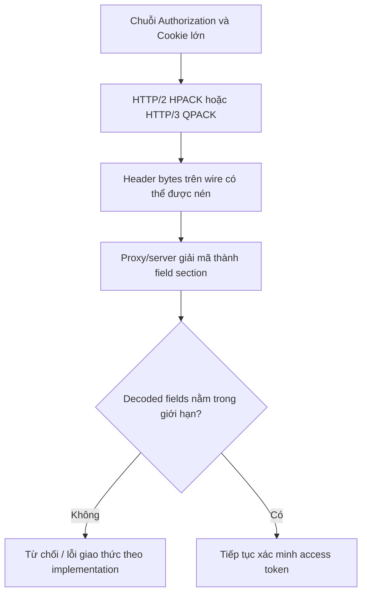
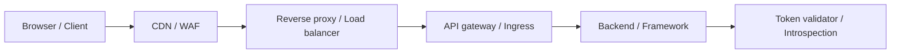
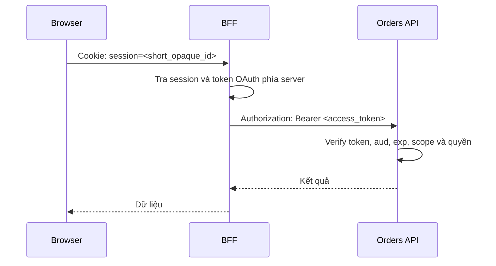

# Giới hạn kích thước header

## 1. Tình huống: token hợp lệ nhưng API vẫn từ chối

Một hệ thống bán hàng dùng OAuth 2.0/OIDC. Khi phát hành access token lần đầu, authorization server (AS) gắn các claims cơ bản như `iss`, `sub`, `aud`, `exp` và `scope`. Orders API nhận token qua HTTP:

```http
GET /orders HTTP/1.1
Host: orders-api.example.com
Authorization: Bearer <access_token>
```

Ban đầu mọi thứ hoạt động. Sau đó, nhóm phát triển nhúng thêm danh sách hàng trăm groups, roles và quyền theo tenant vào JWT. Tại môi trường local, request vẫn thành công; tại production, một số request bị từ chối trước khi đến ứng dụng, có thể xuất hiện lỗi **431 Request Header Fields Too Large** hoặc lỗi proxy khác.

Điều đáng chú ý: **token có thể chưa hết hạn, chữ ký hoàn toàn đúng, audience phù hợp**, nhưng request vẫn không thể đi qua lớp truyền tải do kích thước header vượt giới hạn của một thành phần HTTP.

Cũng có tình huống ngược lại: header vừa đủ nhỏ để đi qua proxy nhưng token sai `aud` hoặc thiếu scope. **Giới hạn kích thước và xác minh token là hai lớp kiểm soát khác nhau**.

> **Nguyên tắc:** Token được gửi trong HTTP header phải nằm trong ngân sách kích thước **của toàn bộ đường request**, không chỉ giới hạn của một server. Không được tăng quyền, chia nhỏ credential tùy ý hoặc chuyển access token sang URL để “né” lỗi header quá lớn.

Bài **Giới hạn kích thước header** thuộc chương **Token transport** của module `SECURITY_TOKEN_SECURITY_FUNDAMENTALS`. Chủ đề kết nối phương thức truyền token với JWT/opaque token, access/refresh token, claims, scope, audience, OAuth 2.0/OIDC, lưu trữ, thu hồi và chống đánh cắp hoặc replay.

## 2. Mục tiêu bài học

Sau bài này, bạn cần:

1. Phân biệt **kích thước chuỗi token**, **giá trị header**, **một header field** và **tổng HTTP field section**.
2. Hiểu vì sao JWT chứa nhiều claims, chuỗi Cookie dài hoặc gateway thêm metadata làm request vượt ngưỡng.
3. Biết giới hạn header **không có một con số cố định cho mọi server/HTTP version**.
4. Phân tích luồng qua **browser → CDN/WAF → reverse proxy → API gateway → backend**, xác định thành phần thực sự từ chối.
5. Phân biệt lỗi `431`, `400`, `413`, `414` và những lỗi proxy phát sinh gián tiếp.
6. Thiết kế **ngân sách header**, giới hạn đầu vào, log/metrics an toàn, kiểm thử ngưỡng và xử lý lỗi.
7. Giảm kích thước credential theo cách an toàn thay vì làm suy yếu xác minh token hoặc lộ bí mật.

## 3. “Kích thước header” thực ra là kích thước nào?

Trong HTTP, request có thể mang nhiều header fields:

```http
GET /orders?status=pending HTTP/1.1
Host: orders-api.example.com
Authorization: Bearer <access_token>
Cookie: session=<session_id>; locale=vi; preference=<value>
Accept: application/json
User-Agent: <browser_or_client>
Traceparent: <trace_context>
```

Cần phân biệt các đại lượng:

| Đại lượng | Phạm vi đo | Vì sao quan trọng? |
| --- | --- | --- |
| **Token bytes** | Chuỗi `<access_token>` thực tế được trình | Độ dài access token có thể thay đổi theo format/claims |
| **Header field value** | Chẳng hạn toàn bộ `Bearer <token>` | Có thêm tiền tố scheme, dấu cách |
| **Header field** | Tên `Authorization` và giá trị, cộng phần biểu diễn giao thức | Một tầng có thể áp dụng giới hạn **mỗi field** |
| **Header field section/list** | Tất cả header fields (và pseudo-headers khi áp dụng) | Nhiều tầng giới hạn **tổng kích thước** |
| **HTTP request line / request target** | Method, path và query trong HTTP/1.1 | Có giới hạn riêng; token trong URL là thiết kế rủi ro |
| **Request body** | Payload JSON/form/multipart | Không phải header; có giới hạn và chính sách riêng |
| **Response headers** | `Set-Cookie`, `WWW-Authenticate`, metadata... | Phản hồi cũng có thể gặp ngưỡng tại các hop |

**Không phải mọi giới hạn đều được tính bằng cùng công thức.** Một HTTP/1.1 server có thể áp dụng giới hạn trên từng dòng header hoặc tổng request headers; HTTP/2 và HTTP/3 mô tả field section với cơ chế nén và cách giới hạn riêng.

### 3.1. Ví dụ về chi phí của Bearer token

Với access token có **4.500 ký tự ASCII**, giá trị header:

```text
Bearer <4500 ASCII characters>
```

có độ dài khoảng **4.507 byte** ở phần value: 7 byte cho `Bearer ` cộng 4.500 byte token. Khi tính một HTTP/1.1 header line còn có tên field `Authorization`, dấu `: ` và kết thúc dòng; trong HTTP/2/3, cách tính theo field section có quy tắc khác.

**Token length khác total headers length.** Cookie, User-Agent, tracing metadata và các header do proxy thêm có thể khiến tổng request vượt ngưỡng ngay cả khi mỗi `Authorization` riêng lẻ nhỏ hơn giới hạn.

### 3.2. Byte và ký tự không phải lúc nào cũng bằng nhau

JWT compact và phần lớn opaque bearer tokens được truyền bằng tập ký tự ASCII phù hợp cú pháp; khi đó số ký tự thường trùng số byte của **giá trị token** trong biểu diễn HTTP tương ứng.

Nhưng các header khác có thể có quy tắc biểu diễn riêng; không được dùng `String.length()` của mọi chuỗi Unicode như phép đo byte chính xác ở tất cả các protocol. **Ngưỡng cấu hình của sản phẩm cần được hiểu theo tài liệu của chính sản phẩm**, kể cả cách nó tính tổng field section hay overhead.

## 4. Giới hạn HTTP không phải một con số toàn cầu

Không có quy tắc kiểu **“mọi Authorization header luôn tối đa 8 KB”** áp dụng phổ quát cho mọi ứng dụng HTTP.

Các chuẩn HTTP đặt ra cú pháp và cơ chế vận hành; **server, proxy, framework, CDN, WAF và HTTP client có thể áp dụng giới hạn khác nhau**. Con số 8 KiB, 16 KiB hoặc 32 KiB thường gặp trong các cấu hình hoặc ví dụ triển khai, nhưng phải coi là **giá trị triển khai**, không phải một quyền truyền tải được chuẩn bảo đảm.

### 4.1. HTTP/1.1

HTTP/1.1 sử dụng request line và các header lines trước body. Một server có thể giới hạn:

- Độ dài từng header line.
- Tổng byte trong header section.
- Số lượng fields.
- Độ dài request target.
- Thời gian nhận headers, đặc biệt để giảm slow-header/DoS.

Giả sử request gồm:

```text
Authorization: 4.5 KiB
Cookie:        2.3 KiB
Other headers: 1.8 KiB
---------------------
Tổng gần:      8.6 KiB (+ framing/overhead)
```

Một hop có ngân sách tổng **8 KiB** có thể từ chối dù `Authorization` riêng lẻ chỉ khoảng 4.5 KiB. Đây là ví dụ phép tính, **không phải ngưỡng mặc định của Nginx, Tomcat hay một sản phẩm cụ thể**.

### 4.2. HTTP/2

HTTP/2 biểu diễn headers bằng **field section** và sử dụng HPACK để nén trên đường truyền. Header names thường ở dạng chữ thường, ví dụ `authorization`, và có các pseudo-headers như `:method`, `:scheme`, `:authority`, `:path`.

**Không lấy số byte HPACK sau nén làm kích thước logic của header để quyết định có vượt giới hạn hay không.** Trong HTTP/2, cơ chế cấu hình/trao đổi giới hạn header list (chẳng hạn `SETTINGS_MAX_HEADER_LIST_SIZE`) liên quan tới **kích thước field list đã giải mã**, gồm chi phí tên/giá trị và overhead được chuẩn quy định.

Nói cách khác, nếu một chuỗi token lặp lại và HPACK nén nó tốt trên wire, điều đó **không đồng nghĩa** application hoặc HTTP/2 endpoint phải chấp nhận một decoded header quá lớn.

### 4.3. HTTP/3

HTTP/3 sử dụng QPACK và có setting `SETTINGS_MAX_FIELD_SECTION_SIZE` để thông báo giới hạn kích thước field section theo cơ chế HTTP/3.

Tương tự HTTP/2, không đánh đồng:

- Số byte nén trên đường truyền.
- Kích thước field section sau giải mã.
- Bộ nhớ/parser limits của server/gateway/backend.

Một deployment có thể nhận request tại CDN bằng HTTP/3, chuyển tiếp qua HTTP/2 và cuối cùng giao tiếp backend bằng HTTP/1.1. **Mọi đoạn kết nối có thể có giới hạn khác nhau**.

### 4.4. Nén header không phải giải pháp “lách” giới hạn



Không tăng vô hạn kích thước header chỉ vì “HTTP/2 đã nén”. Field-size controls còn phục vụ **bảo vệ tài nguyên, parser và khả năng tương tác**.

## 5. JWT vì sao dễ lớn hơn dự tính?

### 5.1. JWT compact và Base64url

JWT thường gặp ở dạng **JWS Compact Serialization**:

```text
BASE64URL(UTF8(protected_header_json)).
BASE64URL(UTF8(claims_json)).
BASE64URL(signature_bytes)
```

Ba phần được nối bằng hai dấu chấm. Với Base64url không padding, kích thước chuỗi biểu diễn một lượng byte thường tăng gần **4/3 lần** so với raw bytes, chưa kể header/segment separators.

Ví dụ đơn giản:

- JSON payload khoảng **3.000 byte** sau serialize UTF-8.
- Phần Base64url của payload dài khoảng **4.000 ký tự**.
- Protected header và signature tạo thêm các segment.
- Giá trị HTTP `Authorization` còn có `Bearer `.

Vì vậy **3 KB JSON không đồng nghĩa 3 KB Authorization header**.

### 5.2. Chữ ký ảnh hưởng kích thước

Chữ ký còn tùy thuật toán và kích thước khóa. Ví dụ đối với JWS chuẩn:

| Loại chữ ký minh họa | Số byte signature điển hình | Base64url không padding |
| --- | ---: | ---: |
| ECDSA P-256 / ES256 (JWS signature dạng `R || S`) | 64 byte | 86 ký tự |
| RSA 2048-bit / RS256 | 256 byte | 342 ký tự |

Đây là phép minh họa **kích thước**, không phải đề xuất chọn thuật toán chỉ vì ngắn hơn. Thuật toán phải theo **chính sách mật mã, khóa và profile tin cậy**, có validation đúng. Không được đổi sang `alg: none` hoặc thuật toán yếu để giảm header.

### 5.3. JWE và định dạng opaque

JWT mã hóa dạng **JWE Compact** thường có **năm segment**; kích thước còn phụ thuộc header, ciphertext, initialization vector, tag và encrypted key (tùy thuật toán).

Một **opaque access token** có thể là chuỗi bí mật ngẫu nhiên ngắn hơn JWT tự chứa, nhưng **không bắt buộc**: độ dài do AS và profile định nghĩa. Opaque token thường cần introspection/tra cứu metadata tại nguồn có thẩm quyền, làm thay đổi đánh đổi về độ trễ/độ mới/khả năng thu hồi.

**Không coi opaque token mặc định an toàn hơn chỉ vì ngắn**. Nó vẫn cần entropy cao, TTL, audience binding, bảo vệ vận chuyển và xác minh trạng thái.

### 5.4. Claims phình to thường là gốc vấn đề

Các nguyên nhân:

| Nội dung trong token | Vì sao dễ lớn? | Rủi ro ngoài kích thước |
| --- | --- | --- |
| `groups` chứa hàng trăm nhóm | Mảng string lặp lại | Quyền cũ, lộ cấu trúc tổ chức |
| `roles` của mọi tenant | Sao chép nhiều tập vai trò | Token có thể được dùng sai ngữ cảnh tenant |
| `permissions` từng đối tượng | Danh sách ACL rất lớn | Không còn mới khi quyền thay đổi |
| `profile` đầy đủ | Tên, email, địa chỉ, metadata | Rò rỉ dữ liệu cá nhân qua JWT có thể đọc |
| `aud` chứa mọi API | Nhiều định danh resource | Mở rộng nơi token bị đánh cắp có thể sử dụng |
| `authorization_details` mở rộng | Quyền giao dịch có cấu trúc chi tiết | Claim thừa/nhầm profile nếu nhúng không kiểm soát |
| `x5c` hoặc metadata khóa trong JOSE header | Dữ liệu chứng chỉ/khóa dài | Tăng kích thước header và bề mặt parser nếu không kiểm soát |
| Tên claim và giá trị quá dài | JSON chứa chuỗi dài lặp | Độ trễ parse và log overflow |

Giải pháp ưu tiên là **data minimization và least privilege**: resource server cần claims nào để xác minh token và ra quyết định? Đừng nhúng toàn bộ hồ sơ/quyền “để khỏi gọi database” mà không đánh giá size, freshness và privacy.

## 6. Authorization, Cookie, body và URL không thể hoán đổi tùy tiện

### 6.1. `Authorization: Bearer`

Cách trình access token phổ biến tại API theo OAuth 2.0 Bearer Token Usage (RFC 6750):

```http
GET /orders HTTP/1.1
Host: orders-api.example.com
Authorization: Bearer <access_token>
```

Dùng HTTPS/TLS, giữ nguyên giá trị token và kiểm tra tại resource server. Header này phải được coi là **sensitive** trong log/tracing. Nếu token lớn vượt ngưỡng, cần **giảm kích thước token hoặc điều chỉnh kiến trúc/config có kiểm soát**, không cắt chuỗi.

### 6.2. Cookie và session

Trong ứng dụng web có BFF, browser có thể gửi session cookie thay vì trực tiếp giữ OAuth access token:

```http
Cookie: __Host-session=<opaque_session_id>; locale=vi
```

BFF giữ access/refresh token tại backend và gọi API theo mô hình đã thiết kế. Session ID có thể ngắn hơn một JWT chứa nhiều claims, nhưng đây là **đánh đổi kiến trúc**, không phải việc “đặt JWT trong cookie” đơn giản.

Cookie có giới hạn do **trình duyệt và server** áp dụng; nhiều cookie cùng được gửi có thể làm `Cookie` header rất lớn. Thuộc tính `HttpOnly`, `Secure`, `SameSite` giúp kiểm soát các rủi ro khác nhau nhưng **không tăng ngân sách header**.

Một phản hồi có nhiều `Set-Cookie` fields hoặc cookie value lớn còn có thể gặp giới hạn **response** hoặc giới hạn lưu trữ của trình duyệt.

### 6.3. Request body

Refresh token theo OAuth thường gửi trong **form body** của request tới token endpoint, ví dụ:

```http
POST /token HTTP/1.1
Host: auth.example.com
Content-Type: application/x-www-form-urlencoded

grant_type=refresh_token&refresh_token=<encoded_refresh_token>
```

Lưu ý:

- Đây là **giao thức token endpoint**, không phải cách thay access token của Orders API.
- Form body có quy tắc percent/form-encoding riêng; không tự dùng parser URL cho `Authorization` header.
- Đưa credential vào body **không xóa rủi ro lộ**; body cũng cần TLS, log masking, giới hạn và policy.

RFC 6750 có mô tả form-encoded body như một phương thức trình bearer token với các ràng buộc cụ thể, nhưng **không nên tự thay đổi contract của API chỉ để né header limit**. Ưu tiên phương thức Authorization header khi có thể.

### 6.4. URL/query string: không phải cách chữa lỗi

**Không** chuyển access token từ header sang query:

```text
KHÔNG NÊN:
https://orders-api.example.com/orders?access_token=<secret>
```

Token trong URL có nguy cơ xuất hiện ở:

- Browser history và clipboard.
- Reverse proxy/CDN/access logs.
- Telemetry, analytics, screenshot, issue tracker.
- Hệ thống giám sát, cache và một số ngữ cảnh lộ referer.

URL cũng có **giới hạn độ dài riêng**, có thể gây `414 URI Too Long`. Percent-encoding hay Base64url không làm URL trở thành bí mật.

### 6.5. Cookie, Authorization và token trùng lặp

Không cho phép các cơ chế xác thực mơ hồ bị trộn tùy ý: một request có `Authorization` của user A nhưng cookie của user B cần được xử lý theo **chính sách xác thực rõ ràng**. Tránh tự “ghép” các token/chunks từ nhiều headers hoặc cookie fragments ngoài profile được định nghĩa và bảo vệ.

## 7. Giới hạn thực tế là **hop yếu nhất** trên đường đi

Một request production thường đi qua nhiều thành phần:



Mỗi hop có thể:

- Giới hạn tổng header bytes.
- Giới hạn một field hoặc số lượng fields.
- Thêm `Forwarded`, tracing, correlation ID hoặc metadata nội bộ.
- Chuyển HTTP/3 ↔ HTTP/2 ↔ HTTP/1.1.
- Loại bỏ/hợp nhất/chuẩn hóa một số trường theo policy.
- Trả lỗi trước khi request tới ứng dụng.

**Ngân sách truyền tải hiệu quả không lớn hơn giới hạn chặt nhất của các hop** sau khi trừ phần header và overhead thực tế.

### 7.1. Ví dụ minh họa nhiều tầng

Giả sử triển khai có các mức **giả định**:

| Thành phần | Giới hạn tổng request headers (minh họa) |
| --- | ---: |
| CDN/WAF | 16 KiB |
| API gateway | 8 KiB |
| Backend HTTP server | 12 KiB |

Trong đường này, gateway có mức **8 KiB** và có thể là điểm từ chối đầu tiên. Tuy nhiên, cần biết giới hạn có tính các bytes/fields giống nhau không, và **gateway hoặc proxy có thêm headers trước khi gửi backend** không. Những con số trên **không phải mặc định của sản phẩm nào**.

Nếu chỉ tăng backend từ 12 KiB lên 32 KiB, request vẫn có thể bị gateway từ chối ở 8 KiB.

### 7.2. Gateway thêm metadata cũng tốn ngân sách

Ví dụ gateway thêm các header:

```http
X-Request-Id: <correlation_id>
Traceparent: <trace_id>
Forwarded: for=<client_identifier>;proto=https
X-Internal-Policy-Context: <signed_metadata>
```

Phần bổ sung giúp quan sát/chuyển thông tin nhưng vẫn chiếm không gian. Nếu header tự khai từ Internet có tên giống header nội bộ, gateway phải **loại bỏ hoặc xác thực nguồn** trước khi tạo context đáng tin; vấn đề này vừa liên quan tới header size, vừa liên quan đến **giả mạo danh tính/ủy quyền**.

Tránh đẩy bản sao toàn bộ JWT claims thành hàng chục header `X-User-*` hoặc một header JSON rất lớn. Ngoài tăng kích thước, điều này tạo **nguy cơ tin header do caller giả mạo** và làm tăng diện lộ dữ liệu.

### 7.3. Vì sao local chạy được còn production lỗi?

Local có thể chạy trực tiếp backend và bỏ qua CDN/WAF/gateway. Một test chỉ kiểm tra Servlet/Spring handler **không đánh giá** được giới hạn của các tầng phía trước.

Một request bị proxy từ chối có thể **không xuất hiện trong access log của backend**, nên debug chỉ ở controller hoặc JWT validator sẽ không tìm thấy nguyên nhân.

## 8. Thiết lập ngân sách header trước khi tối ưu

### 8.1. Công thức gần đúng

Với request ASCII/Bearer qua HTTP/1.1:

```text
Total request-header bytes
  ≈ Authorization field
  + Cookie field
  + client headers (Accept, User-Agent, Origin...)
  + tracing/forwarding fields
  + HTTP formatting overhead

Authorization value bytes
  ≈ len("Bearer ") + token ASCII bytes
  ≈ 7 + token bytes
```

Ở HTTP/2/3, cần dùng **cách đo field section tương ứng**, không áp nguyên công thức HTTP/1.1 vào wire-compressed bytes.

Một cách lập kế hoạch:

```text
Allowable token size
  <= smallest_effective_header_limit
     - worst_case_other_headers
     - gateway_added_headers
     - protocol/accounting_overhead
     - safety_margin
```

Đây là **ngân sách vận hành**, không phải chuẩn RFC tính toán chung. Ngưỡng thực phải được đo và kiểm thử trong deployment.

### 8.2. Ví dụ với ngưỡng 8 KiB

Giả sử một gateway **giới hạn tổng decoded request header khoảng 8 KiB (8.192 byte)**. Nhóm dự kiến:

| Thành phần | Ngân sách ví dụ |
| --- | ---: |
| Cookie và session headers | 2.200 byte |
| Header thông thường (Accept, User-Agent, Origin...) | 900 byte |
| Tracing và metadata gateway | 600 byte |
| Reserve cho biến thiên/overhead | 1.000 byte |
| **Còn lại cho Authorization** | **3.492 byte** |

Tính đơn giản: `8.192 - 2.200 - 900 - 600 - 1.000 = 3.492` byte.

Nếu field Authorization gồm tên, ký tự phân cách và `Bearer `, phần token **phải nhỏ hơn 3.492 byte** một khoảng phù hợp, không thể dùng trọn 3.492 byte cho token.

Tuy nhiên, nếu trình duyệt gửi thêm cookies hoặc gateway tăng metadata, ngân sách thay đổi. Một số implementation còn tính overhead riêng cho mỗi field. **Hãy đo worst-case thực tế**, đừng lấy ví dụ trên làm một chuẩn cấu hình production.

### 8.3. Đơn vị KB, KiB và byte

- `1 KB` thường chỉ 1.000 byte trong cách ghi thập phân.
- `1 KiB` = 1.024 byte.
- `8 KiB` = 8.192 byte.

Tài liệu cấu hình của từng sản phẩm có thể dùng `k`/`K` theo quy ước riêng. Khi vận hành, nên ghi **byte chính xác** và cách đo để tránh lệch ngưỡng.

## 9. Giảm JWT size theo đúng ưu tiên bảo mật

### 9.1. Chỉ đưa claims cần thiết cho resource server

Một payload có thể quá rộng:

```json
{
  "iss": "https://auth.example.com",
  "sub": "employee-123",
  "aud": "https://orders-api.example.com",
  "scope": "orders:read",
  "roles": ["role-a", "role-b", "role-c"],
  "all_group_memberships": ["hundreds-of-groups"],
  "full_user_profile": {"address": "...", "phone": "..."},
  "permissions_for_every_tenant": {"...": ["..."]}
}
```

Ví dụ không phải token thật; các chuỗi mô tả được rút gọn. Về nguyên tắc, Orders API có thể chỉ cần:

```json
{
  "iss": "https://auth.example.com",
  "sub": "employee-123",
  "aud": "https://orders-api.example.com",
  "iat": 1900000000,
  "exp": 1900000900,
  "scope": "orders:read"
}
```

**Nhắc lại:** Ví dụ trên chỉ để minh họa giảm claims; JWT access token theo RFC 9068 còn có các yêu cầu profile cần tuân thủ. Không xóa `iss`, `aud`, `exp` hay thông tin bắt buộc chỉ để tiết kiệm byte.

### 9.2. Không nhúng toàn bộ danh sách nhóm/quyền

Thay vì đưa hàng trăm group/role:

1. Xác định **scope tối thiểu** cho access token và audience cụ thể.
2. Dùng định danh chủ thể ổn định như `(iss, sub)` để resource server ánh xạ với dữ liệu khi cần.
3. Tra cứu quyền nghiệp vụ từ **nguồn có thẩm quyền** hoặc policy service với cache có TTL/invalidation phù hợp.
4. Dùng claim nhóm/role **chỉ nếu thật sự cần**, có định nghĩa và không vượt ngân sách đã kiểm thử.
5. Giảm dữ liệu nhạy cảm không phục vụ quyết định API.

Bỏ một claim role khỏi token chỉ là cải thiện nếu **API vẫn thực hiện authorization đúng**. Không giảm JWT bằng cách bỏ luôn kiểm tra quyền.

### 9.3. Cân nhắc opaque access token

Với kiến trúc có introspection phù hợp, opaque token có thể:

- Giữ chuỗi access token ngắn.
- Đưa claims/metadata ra khỏi HTTP request.
- Cho phép AS quản lý trạng thái token tập trung.

Nhưng RS sẽ phải dựa trên **introspection/tra cứu được xác thực**, kiểm tra audience, scope, active, thời hạn và chính sách hiện hành. Cache introspection có thể tạo độ trễ thu hồi và thêm độ phức tạp.

JWT tự chứa có lợi thế xác minh cục bộ; opaque có lợi thế ẩn cấu trúc claims khỏi client và có thể rút ngắn transport. Chọn theo **security model và vận hành**, không chỉ theo số ký tự.

### 9.4. BFF và server-side session

Trong browser app, BFF có thể giữ OAuth access/refresh tokens **trên server**. Browser chỉ gửi cookie phiên với giá trị opaque đủ entropy:



BFF có thể giảm kích thước credential **trên đường browser → BFF**, nhưng BFF → Orders API vẫn cần bảo đảm `Authorization` vừa giới hạn của **đường backend**. BFF không phải cách làm biến mất giới hạn HTTP.

Cookie phiên phải có bảo vệ `Secure`, `HttpOnly`, `SameSite` phù hợp, chống CSRF và quản lý phiên/thu hồi. Không chuyển access token dài vào cookie để nghĩ rằng vấn đề đã biến mất.

### 9.5. Có nên nén JWT/claim cho nhỏ đi?

Không tự xây “JWT nén” rồi yêu cầu RS giải nén sau khi nhận:

- Interoperability với các thư viện/token profiles có thể hỏng.
- Decompression có thể tạo thêm nguy cơ tài nguyên/parser DoS.
- Nén dữ liệu có yếu tố bí mật trong một số bối cảnh còn có rủi ro rò rỉ theo side-channel.
- Việc nén trên HTTP/2/3 **không xóa giới hạn decoded field section**.

Một số chuẩn token có cơ chế nén ở profile cụ thể, nhưng **không nên tự thêm thuật toán nén tùy tiện** như một “bản vá” cho token quá lớn. Ưu tiên **giảm claims, đổi profile/token format có kiểm chứng hoặc đánh giá lại kiến trúc**.

## 10. Phản ứng HTTP khi header quá lớn

### 10.1. `431 Request Header Fields Too Large`

HTTP status **431** được định nghĩa cho trường hợp server từ chối xử lý request vì **header fields quá lớn**, có thể do **một field** hoặc tổng các fields.

Ví dụ response chung:

```http
HTTP/1.1 431 Request Header Fields Too Large
Content-Type: application/json
Cache-Control: no-store

{
  "error": "request_header_too_large",
  "message": "Yêu cầu vượt giới hạn header."
}
```

Response minh họa; server/proxy có thể tự sinh HTML/plaintext/empty response hoặc xử lý ở tầng giao thức. Đừng giả định mọi hop luôn trả JSON hoặc `431`. Với lỗi kích thước, request **có thể chưa bao giờ tới mã ứng dụng**.

### 10.2. Các lỗi dễ nhầm

| Mã/tình huống | Ý nghĩa điển hình | Phân biệt |
| --- | --- | --- |
| **431** | Request header fields quá lớn | Phù hợp nhất với giới hạn header |
| **400** | Bad Request | Có thể do header sai cú pháp hoặc giới hạn bị sản phẩm ánh xạ thành 400 |
| **413** | Content Too Large | Thường là request **content/body**, không phải giải pháp diễn đạt mọi header overflow |
| **414** | URI Too Long | Request target/URL dài, ví dụ query quá mức |
| **401** với `invalid_token` | API xác thực token không hợp lệ | Token sai chữ ký, audience, hạn... sau khi đã nhận và kiểm tra |
| **403** với `insufficient_scope` | Token hợp lệ nhưng thiếu quyền được cấp | Không phải lỗi kích thước |
| **5xx** từ proxy | Có thể là failure ở đường upstream/cấu hình | Không đủ bằng chứng để kết luận header overflow; cần trace/gateway logs |

Một ứng dụng nhận `431` **không nên tự refresh token vô hạn**. Nếu token mới vẫn chứa claims lớn, lỗi sẽ lặp. Một response `431` cũng **không phải dấu hiệu** token đã bị thu hồi hay cần nâng scope.

### 10.3. Bảo mật response và logs

Không phản hồi:

```json
{
  "error": "header_too_large",
  "offending_header": "Authorization: Bearer <full_secret>"
}
```

Đưa token vào body lỗi hoặc log để “debug” sẽ làm lộ credential. Thay vào đó, ghi **kích thước**, tên nhóm field nếu cần, request ID và hop trả lỗi theo quyền truy cập nội bộ; không ghi raw Authorization/Cookie/refresh token.

Nếu cần hỗ trợ client, thông báo chung “request headers vượt giới hạn” và chỉ ra cách cập nhật phiên/ứng dụng **mà không gửi token** cho bộ phận hỗ trợ.

## 11. Đặt giới hạn như một lớp chống DoS

Giới hạn header không chỉ là lỗi tương thích. Nó còn bảo vệ hệ thống khỏi:

- Request có **hàng nghìn header fields** gây tốn CPU/bộ nhớ parser.
- Header field cực dài làm tăng chi phí phân bổ bộ nhớ.
- JWT lớn hoặc malformed khiến decoder/crypto/JSON parser sử dụng tài nguyên đáng kể.
- Nhiều kết nối gửi headers chậm gây chiếm connection slots.
- Header nén nhỏ trên wire nhưng nở lớn khi giải mã.
- Tracing/logging vô tình lưu payload lớn và credential nhạy cảm.

Các lớp bảo vệ phối hợp:

1. **Limit ở edge/proxy:** tổng kích thước, từng field, số fields, timeouts.
2. **Limit ở backend HTTP parser:** không tin rằng edge luôn là đường duy nhất.
3. **Limit ở auth middleware:** nhận chỉ đúng scheme/profile, một credential hợp lệ, giới hạn độ dài token trước khi parse/verify.
4. **JWT/JSON parser:** giới hạn cấu trúc, kích thước, thuật toán, số claims/độ sâu khi phù hợp.
5. **Rate limits và resource quotas:** không để request malformed làm cạn CPU/crypto.
6. **WAF/caching/logging policy:** bảo vệ bí mật, tránh cache phản hồi cá nhân sai ngữ cảnh.

**Không cấu hình giới hạn vô hạn để “cho mọi token đi qua”.** Việc nâng limit cần threat model, khả năng tài nguyên và kiểm thử tải.

### 11.1. Truncate header là cách xử lý sai

Nếu token bị cắt ngắn trước khi tới validator, chữ ký hoặc so khớp opaque có thể không hợp lệ. Nhưng điều nguy hiểm hơn là tạo sự khác biệt parsing:

- Proxy thấy một giá trị, backend thấy giá trị khác.
- Một tầng chọn header `Authorization` đầu tiên, tầng khác chọn field cuối hoặc ghép lại.
- Kết quả cache hoặc identity context bị nhầm.

**Không tự động cắt `Authorization` hay `Cookie` để vừa bộ đệm.** Khi header vượt ngưỡng đã công bố, **từ chối rõ ràng** trước khi đi vào xử lý nghiệp vụ.

### 11.2. Duplicate Authorization headers

Ví dụ request sai/mơ hồ:

```http
Authorization: Bearer <token_A>
Authorization: Bearer <token_B>
```

Không viết logic “lấy token đầu tiên nếu token thứ hai quá lớn” hoặc “nối hai trường thành token duy nhất”. Các tầng HTTP có thể xử lý trường trùng khác nhau; với Authorization, nên dùng middleware chuẩn và **từ chối các request credential mơ hồ** theo chính sách, tránh nhầm lẫn giữa gateway và backend.

Cookie cũng có thể gặp các trường hoặc giá trị trùng tên, làm phát sinh nhầm phiên nếu parser khác nhau. Security review cần bao gồm **ambiguous fields và parser differentials**, không chỉ độ dài.

## 12. Giới hạn ở ứng dụng Java: lớp cuối, không thay cho edge

Ví dụ khái niệm với Java Servlet:

```java
import jakarta.servlet.http.HttpServletRequest;
import java.util.Enumeration;

public final class HeaderBudgetExample {
    // Giá trị này là CHÍNH SÁCH VÍ DỤ, không phải giới hạn HTTP chuẩn.
    private static final int MAX_AUTH_VALUE_ASCII_BYTES = 4096;

    private HeaderBudgetExample() {}

    public static boolean isAuthorizationHeaderWithinBudget(
            HttpServletRequest request
    ) {
        Enumeration<String> values =
                request.getHeaders("Authorization");

        if (!values.hasMoreElements()) {
            return true; // absence handled separately by authentication.
        }

        String value = values.nextElement();
        if (values.hasMoreElements()) {
            return false; // reject ambiguous duplicate credentials.
        }

        if (value == null ||
                value.length() > MAX_AUTH_VALUE_ASCII_BYTES) {
            return false;
        }

        // Minh họa đo chuỗi ASCII; từ chối ký tự không thuộc ASCII.
        for (int i = 0; i < value.length(); i++) {
            char c = value.charAt(i);
            if (c < 0x20 || c > 0x7e) {
                return false;
            }
        }

        return true;
    }
}
```

**Giới hạn của đoạn mã:**

- Chỉ đo và kiểm tra **một header value giả định ASCII**, chưa phải toàn bộ field section hay parser Bearer hoàn chỉnh.
- Không tự thực hiện chữ ký JWT, issuer/audience/expiry/scope validation.
- Không cho biết headers có bị **proxy/CDN từ chối trước khi vào Servlet** hay không.
- Không thay thế HTTP server/parser giới hạn **tổng fields**.
- `4096` chỉ là con số giả định; ứng dụng phải cấu hình theo ngân sách thực và chuẩn token của mình.

Ở production, nên dùng **authentication middleware/JWT validator có hỗ trợ giới hạn đầu vào**, kết hợp cấu hình edge/server. Không tự parse Bearer token bằng phép tách chuỗi không tuân chuẩn.

### 12.1. Chặn token quá lớn trước decoder

Luồng bảo vệ nên là:

```text
Receive request
  -> HTTP field-section limit
  -> auth header count/length/syntax check
  -> JWT/JWE/opaque profile parser
  -> cryptographic verification or trusted introspection
  -> iss/aud/exp/token-type validation
  -> scope/permission validation
  -> business operation
```

Nếu một token đã vượt mức cho phép, **không cần mất CPU để Base64url-decode, parse JSON hoặc verify chữ ký** trước khi từ chối. Tuy nhiên, **không bao giờ dùng kích thước hợp lệ làm bằng chứng token đáng tin**: token nhỏ vẫn có thể giả mạo hoặc sai quyền.

### 12.2. Kiểm tra tất cả đường vào

Một số deployment có:

- Public ingress tới service.
- Kênh internal service-to-service.
- Cron/batch jobs gọi trực tiếp backend.
- Health/admin endpoints.
- HTTP/2 gRPC gateway hoặc protocol adapter.

Nếu giới hạn chỉ nằm ở một ingress, đường vào khác có thể không được bảo vệ. Với service nội bộ, có thể dùng HTTP metadata nhưng vẫn cần chính sách kích thước và xác thực riêng. Không chuyển access token sang một metadata field tùy tiện chỉ để tránh kiểm tra tiêu chuẩn.

## 13. Chẩn đoán lỗi header lớn mà không làm lộ token

### 13.1. Quy trình điều tra

Giả sử client báo lỗi 431 khi tải đơn hàng:

1. **Tìm hop trả lỗi:** CDN/WAF, gateway, backend HTTP server hay application? Dùng request ID và logs của từng hop.
2. **Xem protocol:** HTTP/1.1, HTTP/2 hay HTTP/3 tại từng đoạn. Có bước chuyển protocol không?
3. **Đo tổng headers** theo cách giới hạn của hop đang từ chối; phân biệt per-field và aggregate.
4. **So sánh độ dài Authorization** trước/sau thay đổi token issuer/profile; không lưu raw token.
5. **Kiểm tra Cookie**: số cookie, kích thước session/preference/tracking cookies, domain/path có khiến browser gửi dư không?
6. **Kiểm tra headers do gateway thêm**: tracing, forwarded, identity context, policy metadata.
7. **Đối chiếu AS token issuance**: có thêm roles/groups/claims hoặc thay đổi thuật toán/profile làm token dài hơn không?
8. **Thử lại qua đường production-like** bằng test tokens có độ dài được điều khiển.
9. **Khắc phục nguyên nhân gốc** bằng tối giản claims/cookies hoặc cấu hình các hop có kiểm soát.
10. **Theo dõi regression** bằng metrics về kích thước và tỷ lệ 431.

Nếu lỗi chỉ xảy ra với user thuộc nhiều groups, nguyên nhân có thể là **JWT chứa group membership quá lớn**. Nếu lỗi chỉ xảy ra sau khi trình duyệt lưu nhiều preferences/cookies, hãy kiểm tra **Cookie header** trước khi kết luận JWT quá lớn.

### 13.2. Không nhờ người dùng dán token thật để debug

Không yêu cầu gửi:

- Raw JWT/opaque access token.
- Refresh token.
- Toàn bộ header `Authorization`.
- Session cookie hoặc browser network HAR chưa được ẩn bí mật.
- Private key, client secret hoặc DPoP proof nguyên vẹn.

Thay vào đó, có thể thu thập:

```json
{
  "request_id": "req-example-42",
  "http_version_at_edge": "HTTP/2",
  "authorization_value_length_bytes": 4200,
  "cookie_value_length_bytes": 2800,
  "total_decoded_header_budget_bytes": 8192,
  "rejection_layer": "gateway",
  "response_status": 431
}
```

Đây là **metadata minh họa**. Chỉ ghi những trường thật sự cần thiết và kiểm soát truy cập, retention, không coi mọi giá trị telemetry đều công khai.

### 13.3. Khi một token tăng kích thước đột biến

Cần kiểm tra thay đổi ở AS:

- Thêm `groups`, `roles`, `permissions` hoặc danh sách tenant.
- Thay signature algorithm làm segment dài hơn.
- Thay JOSE header có `kid`/certificate chain hoặc custom metadata.
- Thêm audiences hoặc trường authorization details.
- Trả token khác loại/nhầm **ID token** vào `Authorization`.
- Thay đổi claim serialization và ký tự Unicode ảnh hưởng byte length.

**Tuyệt đối không sửa payload JWT thủ công để rút ngắn rồi dùng lại token**: chữ ký sẽ không còn hợp lệ. Muốn token ngắn hơn phải sửa **chính sách phát hành tại AS** hoặc chọn token profile phù hợp.

## 14. Làm gì khi cần tăng giới hạn header?

Đôi khi tăng giới hạn là hợp lý, nhất là khi có header metadata cần thiết và đã tối ưu token. Nhưng phải làm có kiểm soát.

### 14.1. Checklist thay đổi cấu hình

1. Xác định **hop nào đang từ chối** và cơ chế tính kích thước.
2. Thống kê kích thước thực tế theo percentile/worst-case trong dữ liệu **không chứa bí mật**.
3. Ước lượng tăng RAM/CPU/parser trên mỗi connection/request khi nâng ngưỡng.
4. Đặt giới hạn **per-field, tổng fields, số fields và timeout** theo khả năng của sản phẩm.
5. Đồng bộ CDN/WAF/proxy/gateway/backend; tránh chỗ cho 32 KiB, chỗ chỉ cho 8 KiB.
6. Cập nhật WAF, rate limit và logging để ngăn header-bombing.
7. Kiểm thử cả HTTP/1.1, HTTP/2, HTTP/3 và các đường chuyển protocol đang dùng.
8. Theo dõi sau rollout; nếu 431/400 bất thường, biết cách rollback.
9. Tài liệu hóa ngân sách tối đa dành cho `Authorization` và `Cookie`.
10. Không nới ngưỡng chỉ vì một user có 2.000 roles mà chưa xét data minimization.

### 14.2. Cấu hình minh họa không gắn với sản phẩm

```yaml
# Pseudo-config để mô tả ngân sách hệ thống, KHÔNG chạy trực tiếp.
http_request_policy:
  max_total_decoded_header_bytes: 16384
  max_authorization_value_bytes: 6144
  max_cookie_value_bytes: 4096
  max_header_field_count: 100
  reject_ambiguous_authorization: true
  mask_sensitive_headers_in_logs:
    - authorization
    - cookie
    - proxy-authorization
```

Tên thuộc tính và con số **chỉ minh họa tư duy thiết kế**. Để triển khai cần đọc tài liệu của CDN/WAF/reverse proxy/HTTP server thực tế, chọn các setting tương ứng và kiểm tra chúng tính byte ra sao.

Không coi tính năng “max Authorization length” ở ứng dụng là đủ khi CDN/backend vẫn áp các ngưỡng khác. Nhiều sản phẩm còn có giới hạn response headers và HTTP/2/3 riêng.

## 15. Kiểm soát cookie và response headers

### 15.1. Cookie lớn có thể làm request vượt ngưỡng

Browser thường gửi các cookies phù hợp domain/path/same-site policy. Một ứng dụng có:

```text
session=...
preferences=...
feature_flags=...
analytics=...
legacy_identity=...
```

sẽ gửi tổng các cặp cookie trong `Cookie` header khi request thỏa điều kiện. Khi cookie tiếp tục lớn dần hoặc được nhân bản từ nhiều subdomains, **tổng Cookie** có thể lấn át Authorization.

Các cách cải thiện:

- Dùng **session ID opaque ngắn**, lưu state lớn phía server.
- Không đưa toàn bộ profile, roles hoặc JSON dung lượng lớn vào session cookie.
- Giới hạn cookie domain/path để tránh gửi không cần thiết.
- Xóa cookie legacy đúng `Name/Domain/Path`, tránh hai phiên bản trùng tên gây ambiguity.
- Quản lý số lượng cookies và bộ phận tạo cookies trong ứng dụng.
- Không chuyển token từ Authorization sang Cookie chỉ để né ngưỡng: nó vẫn là header.

### 15.2. Response headers và Set-Cookie

Nếu response có nhiều `Set-Cookie`, proxy/browser có thể áp giới hạn phản hồi hoặc từng cookie. Một số cookie có thể bị bỏ qua/reject do limit của browser.

Vì thế, kiểm thử cả **đường phản hồi OAuth/BFF/session** chứ không chỉ request tới API. Một authorization server phát JWT/ID token qua JSON response sẽ chịu **body limits** của client/AS, nhưng khi client trình access token vào header tới RS, giới hạn header mới xuất hiện.

## 16. Liên hệ với scope, audience, refresh token và replay

### 16.1. Token nhỏ nhưng thiếu phân quyền vẫn nguy hiểm

Chẳng hạn access token nhỏ có:

```json
{
  "iss": "https://auth.example.com",
  "sub": "user-123",
  "aud": "https://orders-api.example.com",
  "exp": 1900000900,
  "scope": "orders:read orders:write"
}
```

API vẫn phải kiểm tra:

- Issuer và chữ ký/introspection.
- Audience của đúng Orders API.
- Hạn dùng và trạng thái thu hồi khi cần.
- Scope của hành động.
- Quyền hiện hành trên tenant, đơn hàng hoặc bản ghi.
- Proof DPoP/mTLS nếu token sender-constrained.

**Giảm kích thước JWT không được đồng nghĩa bỏ các kiểm tra bảo mật bắt buộc**. Nếu bỏ nhóm/role khỏi token, có thể cần policy lookup hiện hành tại RS.

### 16.2. Access token và refresh token có đường đi khác nhau

Refresh token thường được trình đến **AS token endpoint** qua request body theo OAuth 2.0; không phải credential cho Orders API. Không giải quyết header overflow ở RS bằng cách gửi **refresh token** thay access token.

Refresh token có thể áp dụng **rotation, reuse detection và family revocation**. Những biện pháp đó bảo vệ vòng đời refresh, nhưng không làm `Authorization` của access token đã phát hành tự ngắn lại.

### 16.3. Chống đánh cắp và phát lại

Header size limit giúp giảm một số kiểu DoS nhưng **không ngăn bearer token bị đánh cắp**. Các lớp khác vẫn cần:

- HTTPS/TLS cho request mang token.
- Không đặt token ở URL, log hoặc telemetry.
- Access token đúng audience/scope và thời hạn phù hợp.
- Thu hồi hoặc kiểm tra trạng thái khi cần.
- Sender-constraining như **DPoP (RFC 9449)** hoặc **mTLS-bound token (RFC 8705)** khi profile hỗ trợ.
- Kiểm tra replay proof/nonce, thời gian và khóa đúng quy tắc của cơ chế PoP.

Một JWT ngắn hơn nhưng được trình qua HTTP không mã hóa hoặc bị ghi trong access log **không trở nên an toàn hơn**.

## 17. Ma trận kiểm thử header-size và token transport

Dùng **test tokens**, không sử dụng credential production. Các giới hạn dưới đây là thông số của **deployment kiểm thử**, không phải tiêu chuẩn toàn Internet.

| Ca kiểm thử | Kết quả mong đợi | Điều được kiểm chứng |
| --- | --- | --- |
| JWT nhỏ, `iss/aud/exp/scope` hợp lệ | Request đến validator rồi qua bước quyền | Đường truyền và token validation |
| JWT nhỏ nhưng sai `aud` | RS từ chối xác thực | Kích thước hợp lệ không đồng nghĩa token hợp lệ |
| JWT lớn hơn giới hạn riêng Authorization | Từ chối rõ ràng, không truncate | Per-field limit |
| Authorization vừa ngưỡng nhưng nhiều cookies | Có thể bị từ chối theo aggregate limit | Tổng request headers |
| Một field rất dài | Từ chối trước parser/token crypto khi vượt limit | Bảo vệ tài nguyên |
| Nhiều fields nhỏ làm vượt tổng | Từ chối theo field-section limit | Aggregate field section |
| Hàng nghìn header fields | Từ chối theo count/size policy | Header-bombing |
| HTTP/1.1 header line vừa/dư ngưỡng | Ứng xử theo cấu hình sản phẩm | Per-line vs total |
| HTTP/2 HPACK nén tốt nhưng decoded fields quá lớn | Không được lách decoded field-size limit | Compression không thay validation |
| HTTP/3 QPACK có decoded field section quá ngưỡng | Từ chối theo HTTP/3 policy | Field-section size |
| CDN limit nhỏ hơn backend | CDN từ chối; backend không có request log | Xác định hop yếu nhất |
| Gateway bổ sung tracing làm vượt backend limit | Backend hoặc upstream từ chối | Budget có tính headers được thêm |
| Cookie legacy tăng kích thước | Có cảnh báo/giảm cookie đúng cách | Cookie budget |
| `Authorization` lặp 2 lần với token khác | Từ chối theo policy | Tránh ambiguous credentials |
| Có header điều khiển/ký tự xuống dòng | Từ chối malformed request | Header injection/parser hardening |
| Token bị cắt ngắn bởi một lớp cấu hình sai | Không cho phép truy cập, có cảnh báo | Không sử dụng token truncate |
| JWT payload có hàng trăm groups | Đo độ tăng bytes; ưu tiên minimization | Claim bloat |
| JWS profile đổi signature algorithm | Kích thước được đo lại; crypto policy vẫn đúng | Signing-size budget |
| Thay access JWT bằng opaque theo thiết kế | RS dùng introspection đáng tin và đúng audience | Đánh đổi format |
| API trả `431` | Client không refresh vòng lặp vô hạn | Error handling |
| API trả `401 invalid_token` | Client phân biệt lỗi xác thực | Không nhầm 401 và 431 |
| API trả `403 insufficient_scope` | Không thay token bằng refresh token ở RS | Đúng phân quyền |
| Token trong query thay vì header | Test chính sách phát hiện/từ chối | Không dùng URL workaround |
| BFF cookie phiên ngắn nhưng access token backend lớn | Test cả Browser→BFF và BFF→API | Không bỏ sót hop |
| Response `Set-Cookie` lớn | Quan sát giới hạn response/browser | Giới hạn hai chiều |
| Error handler có token thật trong response/log | Test **thất bại** | Không tiết lộ credential |
| Client gửi header rất lớn và chậm | Timeouts/rate limits chặn hợp lý | Resource exhaustion |
| Request qua alternate internal path | Vẫn áp giới hạn và xác thực | Không đi vòng edge |
| Thay gateway limit từ 8 lên 16 KiB | Kiểm thử đầy đủ mọi hop và load | Change management |
| Mất kết nối khi request đã bị edge từ chối | Client xử lý lỗi theo loại, không gửi bí mật để debug | Safe client fallback |

### 17.1. Kiểm thử boundary

Giả sử một hop áp giới hạn **L** byte theo cách tính của nó. Dùng requests **đã được sinh bằng test data** tại các mức:

```text
L - 2 bytes:  kiểm tra đường thành công nếu các điều kiện khác đạt
L - 1 bytes:  kiểm tra sát ngưỡng
L bytes:      kiểm tra ranh giới theo policy thực
L + 1 bytes:  kiểm tra từ chối
L + 2 bytes:  kiểm tra từ chối và log an toàn
```

Cần lưu ý **các lớp HTTP có cách tính khác nhau**, nên dựng request bằng công cụ test có thể đo bytes trước và sau chuyển protocol. Với JWT chữ ký hợp lệ, không thể chỉ thêm ký tự vào token; cần cho **issuer thử nghiệm phát hành token thật với payload/claims được điều khiển** hoặc tách test giới hạn HTTP khỏi test chữ ký.

### 17.2. Test tích hợp cần bao phủ cả nhiều hop

Không chỉ kiểm thử handler Java với MockMvc hay unit test trên chuỗi `Authorization`. Phải kiểm thử trên đường có CDN/proxy/gateway như production hoặc một staging có cấu hình tương đương, cả request có Cookie và metadata tracing.

Với HTTP/2/3, kiểm tra cả **decoded field section limits** và những ngưỡng chuyển protocol. Một request bị từ chối trước khi vào JVM không thể được phát hiện chỉ bằng Java middleware logs.

## 18. Tình huống thực tế: nhóm người dùng khiến token vượt ngưỡng

Một nhân viên thuộc 20 nhóm khi đăng nhập:

```text
JWT payload:     nhỏ
Authorization:   nhỏ
Cookie:          ổn định
Kết quả:         200 nếu được quyền
```

Một quản trị viên được gắn 500 nhóm vì cấu trúc tổ chức:

```text
JWT payload:     lớn do groups[]
Authorization:   tăng đáng kể sau Base64url
Cookie:          không đổi
Kết quả:         431 tại gateway (trong giả định cấu hình)
```

Nhóm phát triển có thể muốn tăng limit toàn hệ thống. Nhưng cách phân tích tốt hơn:

1. Orders API có thật sự cần 500 group names để xác định `orders:read` không?
2. Có thể phát access token **đúng audience và scope**, không nhúng group directory đầy đủ?
3. Có thể giữ group membership tại policy service với cache/thu hồi phù hợp?
4. ID token và access token có bị nhầm mục đích; có đang đưa thông tin profile vào AT không?
5. Có cookie/session thừa làm giảm ngân sách không?
6. Nếu cần tăng limit, đã thống nhất CDN/gateway/backend, kiểm thử bảo mật và tải chưa?

**Kết quả kỳ vọng:** Token ngắn hơn, ít dữ liệu nhạy cảm hơn, phù hợp least privilege; API vẫn thực hiện quyền chính xác trên dữ liệu. Nếu resource server cần thêm thông tin hiện hành, dùng nguồn quyền được bảo vệ thay vì sao chép tất cả vào token.

## 19. Checklist khi vận hành

1. **Đúng token:** API chỉ nhận access token đúng profile; không nhận ID token/refresh token để né lỗi header.
2. **Đúng vị trí:** Dùng Authorization header hoặc contract tiêu chuẩn phù hợp; không đưa access token vào URL.
3. **Đúng kích thước:** Có ngân sách per-field, aggregate headers, field count và safety margin không?
4. **Đúng protocol:** Đã kiểm tra HTTP/1.1, HTTP/2, HTTP/3 và các bước chuyển đổi thực tế chưa?
5. **Đúng hop:** Giới hạn CDN/WAF/proxy/gateway/backend có được ghi nhận và phối hợp không?
6. **JWT tối thiểu:** AS có tránh nhúng đầy đủ group/role/profile không cần thiết không?
7. **Claims bắt buộc:** Việc tối ưu có giữ issuer, audience, hạn dùng, token type/profile và quyền cần xác minh không?
8. **Cookie:** Có tránh session/cookie JSON dài, legacy cookies và domain/path quá rộng không?
9. **Chống DoS:** Giới hạn header có kết hợp parser size limits, timeouts và rate limits không?
10. **Không truncate:** Request vượt limit được từ chối rõ ràng, không cắt/ghép Authorization tùy ý?
11. **Header mơ hồ:** Credential trùng lặp hoặc nhầm giữa Cookie/Authorization có bị chặn theo policy không?
12. **Bảo vệ bí mật:** Log/traces/errors không chứa token, cookie hoặc Authorization header nguyên vẹn?
13. **HTTP errors:** Client có phân biệt 431/400/414 với 401/403 và tránh retry refresh vô hạn không?
14. **Đổi limit:** Có đánh giá CPU/RAM/WAF và test tải trước khi nâng ngưỡng không?
15. **Least privilege:** Access token giới hạn scope/audience/TTL và API kiểm tra quyền tài nguyên hiện hành không?
16. **Quan sát:** Có metrics phân phối header sizes, lỗi per hop, thay đổi JWT claims và alert regression không?
17. **End-to-end tests:** Đã thử user nhiều nhóm, nhiều cookies, proxy-added headers và đường internal bypass chưa?

## 20. Tổng kết

**Giới hạn kích thước header là một ràng buộc an toàn và khả năng tương tác của HTTP**, không phải lỗi ngẫu nhiên của JWT. Khi access token/JWT chứa nhiều claims, giá trị `Authorization: Bearer ...` có thể lớn hơn dự tính do Base64url, chữ ký và metadata. Đồng thời, `Cookie`, tracing và headers do gateway thêm cũng chiếm ngân sách. Giới hạn hiệu quả phụ thuộc **hop chặt nhất**, khác nhau theo HTTP/1.1, HTTP/2, HTTP/3 và theo cấu hình triển khai.

Biện pháp bền vững là **thiết kế token tối thiểu, đo byte ở đúng lớp, kiểm thử toàn đường request và cấu hình giới hạn có kiểm soát**. Không cắt token, không chuyển credential vào URL, không nén JWT tùy tiện và không bỏ issuer/audience/scope validation để token ngắn hơn. Nếu cần, sử dụng **opaque token, policy lookup hoặc BFF/session server-side** theo threat model.

Cuối cùng, token **đi qua header thành công** mới chỉ hoàn thành lớp truyền tải. Resource server vẫn phải xác minh nguồn phát hành, chữ ký hoặc introspection, audience, thời hạn, scope, quyền hiện hành và cơ chế chống sử dụng token bị đánh cắp theo chính sách.

## Tài liệu chuẩn để tìm hiểu thêm

- **RFC 9110 — HTTP Semantics:** HTTP field semantics, giới hạn thực thi và response code.
- **RFC 9112 — HTTP/1.1:** framing, request line và cách biểu diễn header fields.
- **RFC 9113 — HTTP/2:** field sections, HPACK và `SETTINGS_MAX_HEADER_LIST_SIZE`.
- **RFC 9114 — HTTP/3:** QPACK và `SETTINGS_MAX_FIELD_SECTION_SIZE`.
- **RFC 6585 — Additional HTTP Status Codes:** `431 Request Header Fields Too Large`.
- **RFC 6750 — OAuth 2.0 Bearer Token Usage:** cách trình access token bằng HTTP Authorization và các rủi ro.
- **RFC 7515 — JSON Web Signature (JWS):** Base64url/JWS Compact Serialization và chữ ký.
- **RFC 7519 — JSON Web Token (JWT):** JWT claims, `iss`, `aud`, `exp`.
- **RFC 9068 — JWT Profile for OAuth 2.0 Access Tokens:** claims/profile phù hợp cho access token JWT.
- **RFC 7662 — OAuth 2.0 Token Introspection:** lựa chọn xác minh metadata token opaque.
- **RFC 6265 — HTTP State Management Mechanism:** cookies và quy tắc xử lý Cookie/Set-Cookie.
- **RFC 9700 — Best Current Practice for OAuth 2.0 Security:** bảo vệ access/refresh tokens, giảm lạm dụng OAuth.
