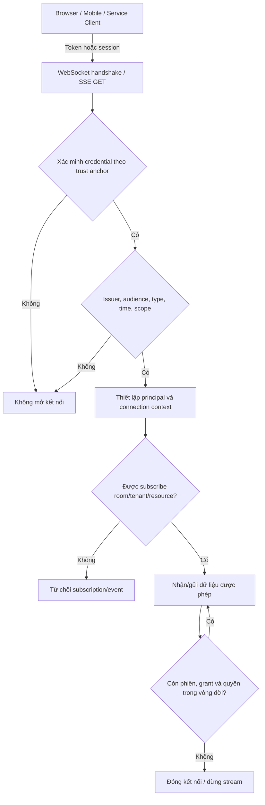
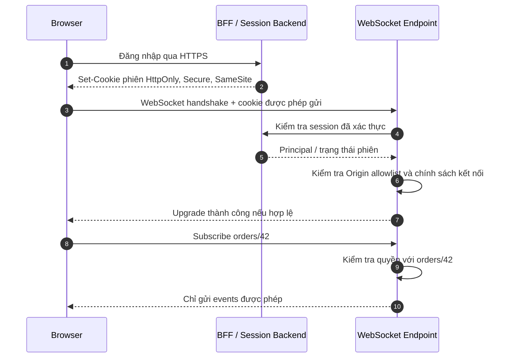
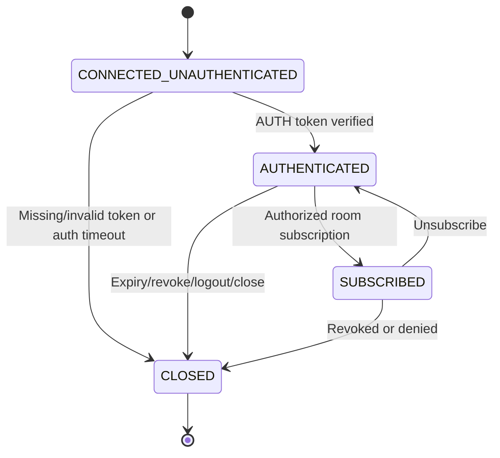
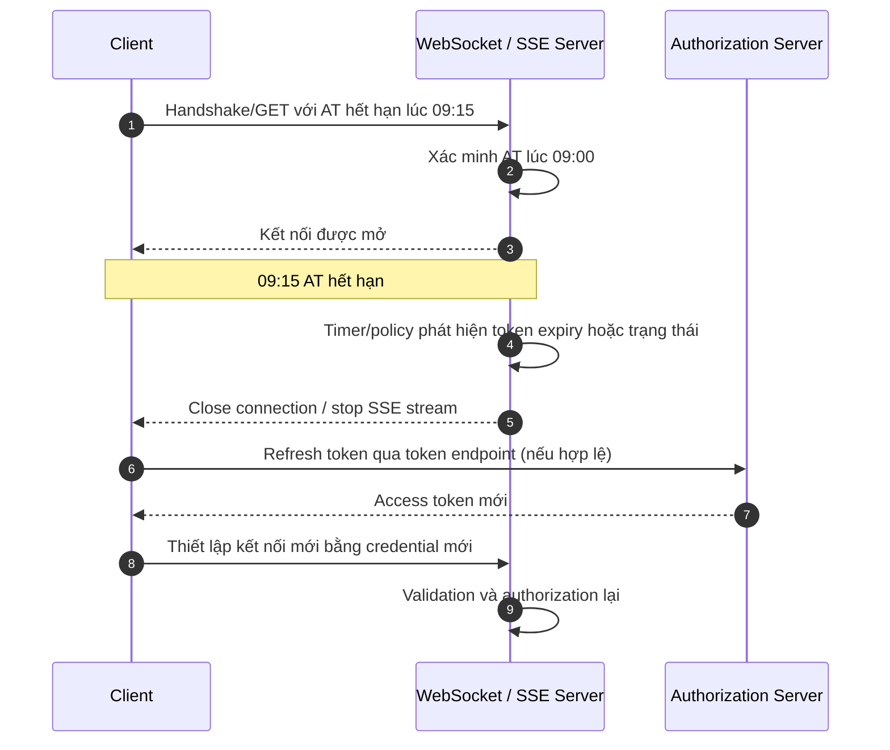

# WebSocket hoặc SSE token

Một ứng dụng theo dõi đơn hàng dùng **WebSocket** để nhận thông báo tức thời, trong khi trang báo cáo dùng **Server-Sent Events (SSE)** để xem tiến độ xử lý. Cả hai đều duy trì kết nối lâu hơn một HTTP request thông thường. Khi cần xác thực, lập trình viên dễ thử gắn access token vào URL, bỏ qua thời hạn token sau khi kết nối mở, hoặc chỉ kiểm tra quyền lúc bắt đầu rồi phát sự kiện của mọi tenant. Đây đều là những điểm có thể khiến **token bị lộ, bị phát lại hoặc được sử dụng vượt quyền**.

Bài thuộc chương **Token transport** của module `SECURITY_TOKEN_SECURITY_FUNDAMENTALS`. Mục tiêu là hiểu cách vận chuyển và xác minh access token khi dùng WebSocket/SSE trong OAuth 2.0/OpenID Connect (OIDC): lựa chọn giữa cookie phiên, header `Authorization` và ticket ngắn hạn; kiểm tra JWT/opaque token, issuer, audience và scope; bảo vệ kênh truyền; xử lý kết nối sau khi token hết hạn/thu hồi; phân quyền từng subscription, room và event; phòng chống token bị đánh cắp hoặc phát lại.

## 1. Vấn đề mới khi chuyển từ REST sang kết nối kéo dài

Với REST, mỗi request thường độc lập: client gửi `Authorization: Bearer ...`, resource server kiểm tra access token, kiểm tra quyền của endpoint và kết thúc response. WebSocket hoặc SSE có thêm **vòng đời kết nối**:

- **WebSocket** bắt đầu bằng HTTP handshake rồi nâng cấp thành kết nối hai chiều. Sau handshake, dữ liệu đi theo **WebSocket frames/messages**, không phải một HTTP request mới cho mỗi thông điệp.
- **SSE** sử dụng HTTP response streaming, thường là `GET` với `Content-Type: text/event-stream`. Server đẩy sự kiện một chiều; client muốn gửi lệnh vẫn dùng HTTP request riêng hoặc kênh khác.
- Một kết nối có thể **sống lâu hơn access token** được dùng khi thiết lập kết nối.
- Quyền subscription, room, tenant hoặc bản ghi có thể **thay đổi trong lúc kết nối đang mở**.
- Tự động reconnect có thể phát sinh **yêu cầu xác thực mới**, cần xử lý nếu phiên đã hết hạn hoặc bị thu hồi.

**Câu hỏi trọng tâm:** token được dùng ở **handshake**, trong **message đầu tiên**, khi **reconnect** hay tại **mỗi hành động/event**? Câu trả lời phụ thuộc giao thức và thiết kế, nhưng mỗi điểm dùng thông tin xác thực phải có ranh giới tin cậy rõ ràng.

## 2. Bảng so sánh WebSocket, SSE và HTTP API

| Tiêu chí | HTTP REST | WebSocket | SSE |
|---|---|---|---|
| Kênh giao tiếp | Request/response | Hai chiều, frames sau handshake | Một chiều server → client, HTTP streaming |
| Giai đoạn khởi tạo | HTTP request | HTTP Upgrade/handshake hoặc cơ chế HTTP tương ứng | HTTP GET bắt đầu stream |
| Browser gửi header `Authorization` tùy ý? | Có thể với `fetch` | **Không** qua WebSocket constructor chuẩn trong browser | **Không** qua `EventSource` constructor chuẩn |
| Cookie theo phiên | Có, theo chính sách browser | Có thể được gửi trong handshake | Có thể được gửi theo quy tắc credentials/cookie |
| Bên nhận token | API/RS | Endpoint handshake hoặc tầng xác thực thông điệp | HTTP endpoint tạo stream |
| Kiểm tra quyền về sau | Mỗi request | Cần chính sách cho từng message/subscribe/room | Cần chính sách chọn/lọc từng event được phát |
| Thời hạn token sau mở kết nối | Request mới xác minh mới | **Không tự đóng** khi `exp` đi qua | **Không tự ngừng** stream khi `exp` đi qua |
| Reconnect | App chủ động request | App thường phải tự implement | `EventSource` có cơ chế reconnect |
| Nguy cơ đặc biệt | CSRF/XSS/log headers | Cross-Site WebSocket Hijacking, lộ token tại handshake, room privilege | Token trong URL, stream sai tenant, `Last-Event-ID` và reconnect |

**Lưu ý:** Non-browser WebSocket clients có thể cấu hình header `Authorization` tùy theo thư viện. Giới hạn “không đặt header tùy ý” ở bảng áp dụng cho **WebSocket API trong browser**, không có nghĩa giao thức WebSocket cấm xác thực bằng header trong mọi loại client.

## 3. Trust model: token chỉ là một phần quyết định

Trong mô hình OAuth 2.0:

- **Authorization Server (AS)** phát hành access token cho client, giới hạn audience, scope, thời hạn và grant.
- **Client** trình access token theo cách mà endpoint hỗ trợ.
- **Resource Server (RS)** xác minh token và thực thi authorization trước khi tạo kết nối hoặc phát thông điệp.
- **ID token OIDC** dành cho client xác nhận người dùng đã được xác thực; **refresh token** dành cho token endpoint của AS. Không gửi hai loại này vào WebSocket/SSE để thay access token.



**Không tin chuỗi token chỉ vì nó “giống JWT”.** Khi nhận JWT access token, RS phải xác minh chữ ký từ issuer được cấu hình tin cậy, thuật toán/key, `iss`, `aud`, `exp`/`nbf`, loại token và các claims theo profile. Khi nhận opaque token, RS dùng introspection/tra cứu trạng thái từ AS tin cậy rồi kiểm tra `active` và metadata cần thiết.

**Không nhầm validation với authorization:** một token hợp lệ có `scope=orders.read` vẫn có thể bị từ chối đăng ký room đơn hàng của tenant khác.

## 4. WebSocket browser: không thể tự đặt header Authorization trong constructor

JavaScript WebSocket API chuẩn có dạng:

```javascript
const socket = new WebSocket(
  "wss://realtime.example.test/ws/orders",
  ["orders.v1"]
);
```

Tham số thứ hai là **danh sách subprotocols**, không phải object chứa HTTP headers. Browser không cung cấp giao diện thông dụng như `new WebSocket(url, { headers: ... })` để đặt `Authorization: Bearer ...`. Ví dụ sau **không phải API browser hợp lệ**:

```javascript
// KHÔNG phải cách dùng WebSocket browser chuẩn.
new WebSocket("wss://realtime.example.test/ws", {
  headers: { Authorization: "Bearer SOME_ACCESS_TOKEN" }
});
```

Những phương án được sử dụng gồm:

1. **Cookie phiên an toàn** cho handshake, đặc biệt khi có BFF/session backend.
2. **Ticket riêng ngắn hạn, dùng một lần**, được cấp qua HTTP endpoint đã xác thực; handshake mang ticket thay vì access/refresh token lâu hơn.
3. **Xác thực trong thông điệp WebSocket đầu tiên**, nhưng server phải giữ kết nối chưa xác thực ở trạng thái hạn chế và chặn mọi subscription/hành động trước khi xác minh.
4. **Header Authorization** khi client là non-browser và thư viện/hạ tầng hỗ trợ.

**Không tự dùng `Sec-WebSocket-Protocol` làm nơi nhét access token.** Header này dành cho đàm phán subprotocol. Một số ứng dụng dùng cách đó như workaround, nhưng token có thể bị lộ trong handshake logs, bị trả lại như tên protocol, chịu ràng buộc cú pháp và gây nhầm lẫn với xử lý subprotocol thật. Nếu bắt buộc dùng một cơ chế riêng, cần thiết kế/đánh giá an ninh rõ ràng; nó không phải phương án mặc định an toàn.

## 5. WebSocket qua cookie phiên: lợi ích và CSWSH

Với ứng dụng có backend quản lý session, browser có thể gửi cookie phù hợp khi mở WebSocket. Backend xác thực **cookie/session đã được server cấp** rồi gắn principal vào kết nối.



**Ưu điểm:** Browser JavaScript không cần đọc access token hoặc refresh token của OAuth nếu BFF giữ token phía server. Cookie `HttpOnly` giảm bề mặt JavaScript đọc credential.

**Rủi ro đặc thù:** Cross-Site WebSocket Hijacking (**CSWSH**). Một website độc hại có thể tìm cách mở WebSocket tới ứng dụng đích từ browser của người dùng. Nếu browser tự gửi cookie phiên và server chỉ kiểm tra cookie, website độc hại có thể đọc hoặc gửi thông điệp qua WebSocket được nâng cấp.

### Các bước bảo vệ kết nối cookie-based

- **Kiểm tra header `Origin` ở server** theo allowlist nguồn web mà ứng dụng chấp nhận. Browser gửi `Origin` trong handshake, nhưng **non-browser client có thể giả mạo hoặc không gửi Origin**; Origin là bảo vệ phía browser, không thay authentication.
- **Xác minh session/cookie thực sự còn hiệu lực** trước khi nâng cấp, không chỉ kiểm tra cookie tồn tại.
- **CSRF/CSWSH policy** phù hợp với mô hình ứng dụng, có thể dùng cơ chế token/handshake riêng khi cần; không dựa hoàn toàn vào `SameSite`.
- **Giới hạn cookie scope** bằng `Secure`, `HttpOnly`, `SameSite`, `Domain`, `Path` phù hợp, tránh chia sẻ session với subdomain không tin cậy.
- **Không coi CORS như tường lửa WebSocket.** Handshake WebSocket không có cùng cơ chế CORS enforcement như `fetch`; server phải tự thực thi Origin policy.
- **Sau handshake vẫn kiểm tra quyền từng message/subscription**, không suy rằng tất cả room của cùng user đều hợp lệ.

Ví dụ request handshake rút gọn:

```http
GET /ws/orders HTTP/1.1
Host: realtime.example.test
Upgrade: websocket
Connection: Upgrade
Origin: https://app.example.test
Cookie: __Host-session=SESSION_PLACEHOLDER
Sec-WebSocket-Key: PLACEHOLDER_BASE64_KEY
Sec-WebSocket-Version: 13
```

Đây là ví dụ minh họa HTTP/1.1 Upgrade, không phải handshake hoàn chỉnh dùng được nguyên văn. WebSocket có những cơ chế thiết lập trên HTTP/2 tương ứng tùy hạ tầng; mọi trường hợp vẫn cần bảo vệ phiên và Origin. Không ghi cookie, header Authorization hoặc ticket chưa được làm mờ vào access log.

## 6. WebSocket ticket ngắn hạn dùng một lần

Nếu client cần xác thực bằng Bearer access token nhưng browser WebSocket API không đặt được header `Authorization`, một mẫu phù hợp là **đổi access token lấy một ticket riêng cho WebSocket** qua một HTTP request đã xác thực.

```mermaid
sequenceDiagram
    autonumber
    participant B as Browser
    participant T as Ticket Service
    participant AS as Authorization Server
    participant WS as WebSocket Gateway
    B->>T: POST /realtime/ws-ticket với session/có bearer auth
    T->>AS: Xác minh access token nếu cần
    AS-->>T: Trạng thái và claims đã xác minh
    T->>T: Kiểm tra scope, tenant; cấp ticket ngẫu nhiên TTL ngắn
    T-->>B: Ticket một lần
    B->>WS: WSS handshake kèm ticket
    WS->>T: Consume ticket nguyên tử
    T-->>WS: Principal, audience, scope, tenant và hạn dùng
    WS->>WS: Kiểm tra Origin, policy và dùng ticket chỉ một lần
    WS-->>B: Kết nối được mở
```

Ticket **không nên được coi là một access token OAuth thông thường**. Nó là capability/credential nội bộ được thiết kế cho một kênh cụ thể, với phạm vi chặt hơn:

| Thuộc tính | Ví dụ | Tại sao cần? |
|---|---|---|
| `ticket_digest` | Digest/HMAC của chuỗi ticket | Không lưu ticket gốc trong kho tra cứu khi không cần. |
| `audience` | `realtime-ws` | Ticket không dùng tại HTTP API khác. |
| `subject_ref` và `client_ref` | Principal đã được xác minh | Không dựa vào user ID do browser tự khai. |
| `scope/permissions` | `orders.events.read` | Chỉ phục vụ use case realtime cụ thể. |
| `tenant_id`, `resource_limits` | Tenant và loại subscription được phép | Giới hạn kết nối nhận dữ liệu. |
| `issued_at`, `expires_at` | Ví dụ TTL 20 giây | Hạn chế cửa sổ lấy cắp ticket. |
| `consumed_at` hoặc trạng thái CAS | Chưa dùng / đã dùng | Một ticket chỉ khởi tạo được một kết nối. |
| `session_ref` hoặc `grant_ref` | Phiên/grant liên kết | Dễ vô hiệu khi logout hoặc revoke. |

**TTL 20 giây chỉ là ví dụ**, không phải chuẩn bắt buộc. Thời hạn phải đủ cho handshake hợp lệ nhưng ngắn theo mức rủi ro. Sinh ticket bằng CSPRNG với entropy cao, **consume atomically** để hai handshake dùng cùng ticket không cùng thành công, không cho đổi tenant/room sau cấp ticket nếu chính sách không cho phép.

### Ticket có thể nằm trong URL không?

Về mặt kỹ thuật, browser có thể tạo WebSocket với một ticket trong query:

```javascript
async function connectWithTicket() {
  const response = await fetch("/api/realtime/ws-ticket", {
    method: "POST",
    credentials: "same-origin",
    headers: { "X-CSRF-Token": getCsrfToken() }
  });
  if (!response.ok) throw new Error("Cannot issue realtime ticket");

  const body = await response.json();
  const url = new URL("wss://realtime.example.test/ws/orders");
  url.searchParams.set("ticket", body.ticket);

  const ws = new WebSocket(url.toString(), ["orders.v1"]);
  return ws;
}
```

Hàm `getCsrfToken()` và API cấp ticket là thành phần **do ứng dụng triển khai**, ví dụ giả định browser dùng session cookie và CSRF token. Nếu client có access token, HTTP request cấp ticket có thể dùng header `Authorization` qua `fetch` theo hợp đồng. **Không đưa access/refresh token gốc vào URL WebSocket.**

Ticket trong URL **vẫn có thể bị lộ** ở web server/gateway access logs, traces, observability, debugger hoặc công cụ giám sát. Vì vậy cần:

- Chặn hoặc redact query parameter chứa ticket trong logs, traces và metrics.
- Truyền qua `wss://`; không dùng `ws://` cho kết nối bảo vệ qua Internet.
- Chỉ cấp ticket cho principal/token đã xác minh, ràng buộc đúng mục đích, audience và quyền.
- TTL ngắn, dùng một lần, **không chấp nhận replay** sau consume.
- Không trả ticket qua link chia sẻ, email hoặc analytics; không gửi ticket sang API khác.
- Nếu ticket không còn hợp lệ, xin ticket mới qua phiên/credential hợp lệ; không nới TTL hoặc tắt validation.

**Ticket giảm giá trị credential trong URL, không xóa rủi ro URL hoàn toàn.** Nếu cookie phiên đã phù hợp và an toàn, có thể dùng cookie trực tiếp thay ticket; lựa chọn dựa trên trust boundary và ứng dụng.

## 7. WebSocket xác thực qua thông điệp đầu tiên

Một số hệ thống mở handshake trước, rồi client gửi thông điệp ứng dụng kiểu `AUTH`:

```json
{
  "type": "AUTH",
  "access_token": "ACCESS_TOKEN_PLACEHOLDER"
}
```

Server chỉ nên chuyển trạng thái từ `UNAUTHENTICATED` sang `AUTHENTICATED` sau khi xác minh access token thành công; mọi `SUBSCRIBE`, `PUBLISH`, `JOIN_ROOM`, `SEND` trước đó đều bị từ chối.



**Những rủi ro phải giải quyết:** handshake được chấp nhận trước khi biết danh tính nên có thể bị lạm dụng tài nguyên; token có thể bị ghi trong message tracing; phải đặt timeout xác thực, giới hạn số kết nối, kích thước thông điệp, tốc độ và backpressure. Không gửi dữ liệu nhạy cảm cho socket chưa xác thực.

Không nên sử dụng một trường token do client gửi trong **mỗi message** như danh tính tự khai rồi bỏ xác minh. Tốt hơn là giữ principal đã xác minh trong connection context và áp dụng authorization theo hành động; khi yêu cầu reauthentication, phải có protocol/state machine riêng và ngăn chuyển quyền trái phép.

## 8. SSE: EventSource gốc không tự đặt Authorization header

SSE thường được dùng để phát tiến độ xử lý, thông báo hoặc dòng trạng thái. Browser nhận sự kiện bằng:

```javascript
const source = new EventSource("/api/orders/events");

source.addEventListener("order-updated", (event) => {
  const data = JSON.parse(event.data);
  renderOrderUpdate(data);
});
```

Browser `EventSource` gốc không cho JavaScript thêm header `Authorization: Bearer ...` tùy ý. Đối với **same-origin**, cookie phù hợp có thể được gửi trong request theo chính sách browser. Với **cross-origin** và credential cookies, phải dùng `withCredentials: true` và server cấu hình CORS hợp lệ:

```javascript
const stream = new EventSource(
  "https://realtime.example.test/api/orders/events",
  { withCredentials: true }
);
```

Với cross-origin có credentials, server không thể dùng `Access-Control-Allow-Origin: *`; phải cho phép origin cụ thể và cấu hình `Access-Control-Allow-Credentials: true` theo CORS. Cookie còn bị chi phối bởi `SameSite`, `Secure` và chính sách cookie của browser. **`withCredentials: true` không tự cấp quyền truy cập** và không bảo đảm cookie sẽ được gửi trong mọi bối cảnh.

### SSE server trả gì?

```http
HTTP/1.1 200 OK
Content-Type: text/event-stream
Cache-Control: no-cache, no-store
X-Accel-Buffering: no

id: evt-941
event: order-updated
data: {"orderId":"42","status":"SHIPPED"}

```

Đây là response minh họa; header điều khiển buffering như `X-Accel-Buffering` phụ thuộc proxy cụ thể, không phải một yêu cầu bắt buộc của SSE. Mỗi event kết thúc bằng dòng trống. Không đưa access/refresh token hoặc dữ liệu chưa được phép công bố vào `data:`, `id:` hay tên sự kiện.

SSE vẫn là một HTTP response kéo dài. **Sau khi trả HTTP 200 và bắt đầu stream, server không thể thay đổi status thành 401 cho chính response đó** khi token hết hạn; phải đóng stream/gián đoạn phát và quyết định lại khi client tạo request mới.

## 9. SSE với bearer access token: hai hướng triển khai

Nếu ứng dụng dùng Bearer access token thay cho session cookie, có hai hướng phổ biến.

### Hướng A — dùng `fetch` streaming thay EventSource gốc

`fetch` có thể gửi header `Authorization` theo HTTP thông thường và đọc response body dưới dạng stream:

```javascript
async function startAuthorizedEventStream(accessToken, signal) {
  const response = await fetch("/api/orders/events", {
    method: "GET",
    headers: {
      Authorization: "Bearer " + accessToken,
      Accept: "text/event-stream"
    },
    cache: "no-store",
    signal
  });

  if (!response.ok || !response.body) {
    throw new Error("Stream unavailable or not authorized");
  }

  const reader = response.body.getReader();
  try {
    while (true) {
      const item = await reader.read();
      if (item.done) break;
      // Chuyển bytes sang SSE parser đúng chuẩn trước khi xử lý events.
      processEventStreamChunk(item.value);
    }
  } finally {
    reader.releaseLock();
  }
}
```

`processEventStreamChunk` là hàm **do ứng dụng bổ sung**; ví dụ chỉ minh họa cách dùng Bearer header. Khi tự dùng `fetch`, ứng dụng phải tự đảm nhiệm **parse SSE đúng chuẩn, nối lại kết nối, retry, `Last-Event-ID`, refresh token, hủy stream và kiểm soát lỗi**. Không giả định mỗi chunk đọc được tương ứng đúng một event; event có thể bị chia qua nhiều chunk.

### Hướng B — dùng cookie hoặc ticket ngắn hạn cho EventSource

Nếu dùng BFF/session backend, `EventSource` có thể xác thực bằng cookie phiên. Nếu bắt buộc dùng ticket, client có thể lấy ticket qua `POST` đã xác thực, sau đó mở EventSource URL chứa ticket ngắn hạn dùng một lần:

```javascript
async function openTicketedSse() {
  const response = await fetch("/api/realtime/sse-ticket", {
    method: "POST",
    credentials: "same-origin",
    headers: { "X-CSRF-Token": getCsrfToken() }
  });
  if (!response.ok) throw new Error("No SSE ticket");

  const body = await response.json();
  const url = new URL("/api/orders/events", window.location.origin);
  url.searchParams.set("ticket", body.ticket);
  return new EventSource(url.toString());
}
```

Tương tự WebSocket, **ticket trong query vẫn là secret** có thể bị ghi log. Cần redaction và one-time/short-lived semantics. Khó khăn riêng của SSE là **EventSource tự động reconnect** và có thể yêu cầu lại cùng URL/ticket đã dùng; nếu ticket là **one-time**, kết nối lại sẽ thất bại. Cần một thiết kế rõ ràng: ví dụ khi stream đứt, đóng EventSource và xin ticket mới qua endpoint được xác thực, hoặc dùng cookie phiên thay ticket. Không vô hiệu tính one-time để “sửa” lỗi reconnect mà không phân tích replay.

**Không đưa raw access token hoặc refresh token lâu hạn vào query SSE.** Token query sẽ dễ lọt vào URL logs, monitoring và công cụ gỡ lỗi; ticket không được phép trở thành “access token giả” có thể dùng ở mọi API.

## 10. SSE `Last-Event-ID` và quyền khi replay sự kiện

SSE hỗ trợ trường `id:` cho sự kiện. Khi kết nối lại, browser `EventSource` có thể gửi `Last-Event-ID` để server tiếp tục từ vị trí đã biết.

```text
event: order-updated
id: evt-941
data: {"orderId":"42","status":"SHIPPED"}

event: order-updated
id: evt-942
data: {"orderId":"43","status":"PAID"}

```

**Event ID không phải access token, session ID hay quyền truy cập.** Server không được trả mọi event sau `evt-941` chỉ vì client gửi `Last-Event-ID: evt-941`. Cần:

- Xác minh **credential hiện tại** khi reconnect.
- Kiểm tra quyền của principal với **tập event được replay**, kể cả tenant/owner/ACL từng event.
- Ràng buộc event cursor với stream/tenant/channel thích hợp; không dùng cursor do client tự khai để nhảy sang luồng khác.
- Giới hạn retention/replay window và số event trả lại; tránh truy vấn vô hạn hoặc tiết lộ lịch sử ngoài phạm vi.
- Hỗ trợ duplicate/delayed events theo semantics ứng dụng; `Last-Event-ID` không bảo đảm business exactly-once.
- Không đưa credential, dữ liệu nội bộ hay thông tin có thể dùng để truy cập trái phép vào giá trị `id`.

Nếu người dùng mất quyền xem đơn hàng sau khi stream bắt đầu, event cũ trong replay vẫn phải được lọc hoặc stream bị từ chối theo chính sách. Một event đã gửi đến client **không thể bị “rút lại”** chỉ bằng revoke token.

## 11. WebSocket/SSE và phân quyền room, channel, tenant

Một lỗi thường gặp là xác minh token đúng nhưng gắn principal vào một kết nối được phép đăng ký mọi room. Ví dụ WebSocket client gửi:

```json
{
  "type": "SUBSCRIBE",
  "channel": "tenant-b/orders",
  "orderId": "42"
}
```

Token đã được xác minh có `sub=user-a`, `scope=orders.read` và `tenant_id=tenant-a`. **Không được cho phép subscription tới `tenant-b`** nếu policy không cho phép truy cập liên tenant.

Ma trận quyết định mẫu:

| Bước | Câu hỏi | Kết quả nếu không đạt |
|---|---|---|
| Token validation | JWT signature/introspection, issuer, audience, time, token type hợp lệ? | Không mở hoặc chấm dứt kết nối. |
| Endpoint authorization | Token có `orders.events.read` hoặc scope được chính sách yêu cầu? | Không cho subscription/SSE stream. |
| Room authorization | Chủ thể được tham gia channel/room theo tenant và role không? | Từ chối `SUBSCRIBE` hoặc stream tương ứng. |
| Resource authorization | Có quyền xem đơn hàng `orderId=42` không? | Không phát sự kiện liên quan bản ghi đó. |
| Ongoing policy | Quyền có thay đổi, session/grant bị revoke hoặc user logout không? | Loại subscription, ngừng phát hoặc đóng kết nối. |
| Message action | Nếu WebSocket hỗ trợ `PUBLISH`/`SEND`, principal có quyền thao tác không? | Từ chối riêng từng hành động. |

**Không tin room ID, tenant ID hoặc user ID chỉ vì client đưa trong message.** Các giá trị đó là **đầu vào yêu cầu tài nguyên**, cần tra cứu và kiểm tra quyền dựa trên principal tin cậy.

Khi WebSocket dùng STOMP, server cần bảo vệ không chỉ `CONNECT` mà cả `SUBSCRIBE`, `SEND` và destination mapping. `StompHeaders`, `simpDestination` hoặc thông tin user tự khai trong frame không phải bằng chứng quyền. Trong Spring Messaging có thể dùng authorization manager/interceptor phù hợp; phải ràng buộc destinations với authenticated principal và policy nghiệp vụ.

## 12. Token hết hạn nhưng kết nối vẫn mở

**Đây là sai lầm nghiêm trọng nhất về vòng đời:** RS kiểm tra JWT `exp` khi WebSocket handshake lúc 09:00, nhưng kết nối vẫn mở đến 12:00. JWT hết hạn lúc 09:15; nếu server không áp dụng quy tắc sau handshake, kết nối có thể tiếp tục gửi dữ liệu nhạy cảm nhiều giờ.



Các chiến lược có thể kết hợp:

1. **Đóng tại `exp`:** khi phát hiện JWT hết hạn, server đóng WebSocket hoặc SSE stream; client kết nối lại bằng access token/phiên hợp lệ.
2. **Reauthentication trong protocol:** thiết kế message/token-update riêng nếu ứng dụng cần giữ socket, nhưng phải xác minh token mới trước khi cấp quyền mới và ngăn downgrade/privilege confusion.
3. **Giới hạn tuổi kết nối:** tự đóng sau một khoảng thời gian tối đa, kể cả khi session backend còn hiệu lực.
4. **Kiểm tra trạng thái/grant định kỳ hoặc trước event nhạy cảm:** cần thiết nếu yêu cầu phát hiện revoke nhanh; lưu ý cache/introspection TTL.
5. **Push revoke/disable events:** khi có tín hiệu đáng tin cậy từ AS/session store, loại principal khỏi room hoặc đóng kết nối ngay, phối hợp trên nhiều node.

Không có một quy tắc chuẩn “mọi WebSocket bắt buộc close chính xác tại `exp`” áp dụng cho mọi kiến trúc. Nhưng ứng dụng phải **định nghĩa rõ** khi nào quyền tiếp tục phát sự kiện hết hiệu lực và kiểm thử được. Không được mặc định token validation tại handshake bao phủ toàn bộ đời kết nối.

## 13. Revoke, logout và kết nối trên nhiều node

Khi refresh token bị revoke hoặc người dùng logout, access JWT đã phát hành có thể vẫn còn hạn tại RS **nếu RS chỉ kiểm chữ ký**. Một opaque token có thể trả `active=false` khi introspection mới, nhưng cache `active=true` có thể trì hoãn phát hiện.

Với kết nối kéo dài, hệ thống cần cơ chế bổ sung:

| Cơ chế | Lợi ích | Giới hạn |
|---|---|---|
| **Timer đóng theo thời hạn token** | Không giữ kết nối sau thời điểm `exp` đã biết. | Không tự phát hiện revoke sớm. |
| **Event thông báo revoke phiên/grant** | Nhanh chóng tìm kết nối liên quan để đóng. | Cần bus đáng tin và phân phối tới mọi node. |
| **Periodic session/grant check** | Kiểm tra quyền còn tồn tại. | Tăng tải, có khoảng trễ theo chu kỳ. |
| **Authorization per subscription/event** | Chặn phát dữ liệu sau khi quyền đối tượng thay đổi. | Chi phí kiểm tra, cần policy/cache đúng. |
| **Connection registry phân tán** | Tìm và đóng kết nối trên nhiều gateway/pod. | Cần tính nhất quán, cleanup và xử lý node chết. |
| **Short-lived connections** | Giới hạn cửa sổ quyền tồn tại. | Tăng số lần handshake/reconnect. |

### WebSocket

Khi không chấp nhận token ở **HTTP handshake**, trả mã HTTP thích hợp (thường `401` hoặc `403`) và **không upgrade**. Khi kết nối đã nâng cấp, không thể trả một HTTP `401` cho frame. Server có thể đóng WebSocket với close status phù hợp, ví dụ **1008 — Policy Violation** khi vi phạm chính sách. Mã close và thông điệp nên được thiết kế nhất quán, không tiết lộ token hay chi tiết quyền nhạy cảm.

### SSE

Nếu chưa bắt đầu stream, trả HTTP `401/403` khi validation/authorization thất bại. Sau khi đã bắt đầu `200 text/event-stream`, server chỉ có thể **ngừng phát và đóng response**, hoặc dùng một sự kiện ứng dụng không nhạy cảm để báo trạng thái nếu protocol đã định nghĩa. Browser `EventSource` có thể tự reconnect; phải kiểm tra lại phiên/credential, không tiếp tục stream chỉ vì request có `Last-Event-ID`.

**Lưu ý:** theo mô hình EventSource, server có thể dùng HTTP `204 No Content` ở một request kết nối mới để yêu cầu ngừng reconnect. Không dựa vào việc một event tên `logout` tự làm `EventSource` ngừng; client phải xử lý đóng hoặc thay đổi trạng thái thích hợp.

## 14. Spring Boot: bảo vệ WebSocket handshake dùng session

Giả sử browser dùng **BFF/session cookie**. Một cấu hình Spring Framework minh họa đăng ký WebSocket endpoint và giới hạn origin:

```java
@Configuration
@EnableWebSocket
public class OrdersWebSocketConfig implements WebSocketConfigurer {
    private final WebSocketHandler ordersHandler;
    private final HandshakeInterceptor authHandshake;

    public OrdersWebSocketConfig(WebSocketHandler ordersHandler,
                                 HandshakeInterceptor authHandshake) {
        this.ordersHandler = ordersHandler;
        this.authHandshake = authHandshake;
    }

    @Override
    public void registerWebSocketHandlers(
            WebSocketHandlerRegistry registry) {

        registry.addHandler(ordersHandler, "/ws/orders")
            .addInterceptors(authHandshake)
            .setAllowedOrigins("https://app.example.test");
    }
}
```

Một `HandshakeInterceptor` rút gọn kiểm tra principal từ phiên đã được xác thực:

```java
@Component
public class AuthenticatedHandshakeInterceptor
        implements HandshakeInterceptor {

    @Override
    public boolean beforeHandshake(
            ServerHttpRequest request,
            ServerHttpResponse response,
            WebSocketHandler handler,
            Map<String, Object> attributes) {

        Principal principal = request.getPrincipal();
        if (principal == null) {
            response.setStatusCode(HttpStatus.UNAUTHORIZED);
            return false;
        }

        attributes.put("verifiedPrincipalName", principal.getName());
        return true;
    }

    @Override
    public void afterHandshake(
            ServerHttpRequest request,
            ServerHttpResponse response,
            WebSocketHandler handler,
            Exception exception) {
        // No-op trong ví dụ.
    }
}
```

Hai đoạn Java là **các cấu phần minh họa**, lược `import` và cấu hình `SecurityFilterChain`/session infrastructure. Không nên giả định `request.getPrincipal()` luôn có sẵn nếu chưa cấu hình session authentication hoặc bộ lọc bảo mật phù hợp. `setAllowedOrigins` là một lớp kiểm tra Origin; vẫn cần áp dụng session/CSRF/CSWSH policy và bảo vệ message authorization. Non-browser clients có thể không tuân quy tắc Origin của browser, nên chính sách dành cho chúng có thể khác.

**Bảo vệ sau handshake là phần không thể thiếu.** `verifiedPrincipalName` không có nghĩa được subscribe bất kỳ room nào. Trong `WebSocketHandler` hoặc tầng messaging, mỗi message loại `SUBSCRIBE`/`SEND` phải được so với principal, tenant và resource hiện hành. Không xây dựng principal từ field `userId` client tự điền.

Nếu endpoint dùng access token thay cookie, interceptor cần xác minh token/ticket bằng một service đã ràng buộc trust anchor, audience, type, expiry và scope; không tự decode Base64 JWT rồi tin payload.

## 15. Spring MVC SSE: mở stream sau khi kiểm tra quyền

Với Spring MVC, có thể dùng `SseEmitter` để trả sự kiện. Ví dụ giả định endpoint nhận **principal đã được xác thực** bởi Spring Security và yêu cầu scope `orders.read`:

```java
@RestController
@RequestMapping("/api/orders")
public class OrdersEventsController {

    private final AuthorizedEventsService eventsService;

    public OrdersEventsController(AuthorizedEventsService eventsService) {
        this.eventsService = eventsService;
    }

    @GetMapping(
        path = "/events",
        produces = MediaType.TEXT_EVENT_STREAM_VALUE
    )
    @PreAuthorize("hasAuthority('SCOPE_orders.read')")
    public SseEmitter events(Authentication authentication) {
        return eventsService.openStreamFor(authentication);
    }
}
```

`AuthorizedEventsService` là service giả định. Nó phải giới hạn event theo **principal, issuer, tenant và quyền trên đơn hàng**; quản lý timeout, hoàn tất và lỗi emitter, dọn subscription khi client ngắt, đồng thời áp dụng chính sách khi quyền thay đổi. **Đoạn code không triển khai những kiểm tra sau khi stream đã mở**, nên không phải một mẫu triển khai bảo mật đầy đủ.

Nếu sử dụng **session cookie** thay access token OAuth trực tiếp, ứng dụng có thể áp dụng policy phù hợp với session principal và role; không mặc định session authentication tạo sẵn authority `SCOPE_orders.read`. Nếu dùng **Bearer JWT/opaque**, Spring Security Resource Server cần validation issuer/audience/type/scope và quyền đối tượng trước khi đi vào controller.

### Proxy và buffering cho SSE

Streaming cần được cấu hình ở reverse proxy/load balancer để tránh response bị buffer, idle timeout không mong muốn hoặc mất sự kiện. Cân nhắc:

- `Content-Type: text/event-stream` và policy `Cache-Control` không cho lưu dữ liệu nhạy cảm.
- Disable buffering/compression theo hành vi proxy nếu chúng khiến event bị trì hoãn; kiểm tra end-to-end trên hạ tầng thực.
- Heartbeat event/comment định kỳ khi cần, nhưng **heartbeat không thay token validation**.
- Dọn event subscribers khi disconnect, giới hạn queue, backpressure và tổng số kết nối.
- Không log nội dung event nhạy cảm hoặc URI query chứa ticket/credential.

## 16. HTTP status, close code và lỗi phía client

| Giai đoạn | Lỗi | Kết quả phù hợp |
|---|---|---|
| HTTP request cấp ticket | Thiếu access/session credential | HTTP `401` trước khi cấp ticket. |
| HTTP request cấp ticket | Credential hợp lệ nhưng thiếu quyền | HTTP `403`, không cấp ticket. |
| WebSocket handshake | Cookie/session/ticket không hợp lệ | HTTP `401/403`, không nâng cấp. |
| WebSocket đã mở | Token hết hạn, revoke hoặc không được subscribe | Từ chối message hoặc đóng socket, ví dụ status `1008` theo policy. |
| SSE GET trước khi trả stream | Token sai `aud` hoặc hết hạn | HTTP `401`. |
| SSE GET trước khi trả stream | Scope/tenant không cho phép | HTTP `403` hoặc `404` theo chính sách. |
| SSE stream đã bắt đầu | Token/phiên hết hạn hoặc bị revoke | Ngừng phát và đóng stream; client reconnect qua credential hợp lệ. |
| SSE reconnect | Ticket một lần đã dùng | Xin ticket mới qua request xác thực, không tái sử dụng ticket cũ. |
| Bất kỳ kênh nào | Nguồn xác thực không khả dụng | Không tự `PERMIT` khi không thể xác minh token. |

Đối với Bearer HTTP request thông thường, RFC 6750 có thể dùng `WWW-Authenticate: Bearer`, `invalid_token` hoặc `insufficient_scope` theo trường hợp. **Sau khi WebSocket đã nâng cấp hoặc SSE đã bắt đầu response, HTTP status không còn được dùng để báo từng lỗi ứng dụng.** Cần quy định protocol lỗi phía client, không trả token hoặc claims nhạy cảm qua messages.

## 17. Nguy cơ thực tế khi vận chuyển token

| Lỗi thiết kế | Vì sao nguy hiểm | Cách giảm thiểu |
|---|---|---|
| Đưa raw access/refresh token vào `ws://...?...` hoặc SSE query | Dễ xuất hiện trong logs, telemetry, monitoring; `ws://` không bảo vệ kênh. | Dùng `wss://`/HTTPS, session hoặc ticket ngắn hạn, redact URL. |
| Dùng `Sec-WebSocket-Protocol` như “header Authorization bí mật” | Subprotocol/handshake có thể bị log hoặc phản hồi; sai ngữ nghĩa protocol. | Dùng session/ticket hoặc xác thực ứng dụng thiết kế riêng. |
| Cookie WebSocket nhưng không kiểm `Origin` | Website độc hại có thể thử CSWSH qua browser người dùng. | Origin allowlist, session check và policy CSRF/CSWSH. |
| Chỉ kiểm token lúc handshake | Kết nối vẫn nhận dữ liệu sau khi `exp` hoặc revoke. | Connection lifetime, revalidation và đóng kết nối theo chính sách. |
| WebSocket cho subscribe mọi room sau login | Người dùng có thể xem dữ liệu tenant khác. | Policy theo destination/room/resource, kiểm tra khi join và khi phát. |
| SSE replay từ `Last-Event-ID` không lọc tenant | Lộ event lịch sử của người khác. | Kiểm tra principal và quyền trên event khi replay. |
| Retry token/ticket đã dùng vô hạn | Tăng rủi ro replay, quá tải và lộ credential. | Retry có giới hạn, cấp ticket mới qua endpoint được bảo vệ. |
| API chấp nhận ID token hoặc refresh token làm access token | Nhầm mục đích token, mở rộng quyền sai. | Token-type/profile validation và audience riêng. |
| Hệ thống tin gateway mà service chấp nhận header user tự khai | Có thể bypass authentication khi gọi trực tiếp service. | Bảo vệ hop nội bộ, không tin header không được xác thực. |
| Không quản lý queue/backpressure | Một client chậm hoặc độc hại giữ nhiều event trong RAM. | Limit connection/room/rate/queue, timeout và cleanup. |
| Log `Authorization`, cookie hoặc ticket nguyên bản | Credential có thể bị sao chép và phát lại. | Redact, hạn chế quyền log, audit bằng tham chiếu an toàn. |

**Dùng TLS là bắt buộc trong kênh chứa credential**, nhưng không giải quyết XSS, cookie hijacking, token replay sau khi lộ hoặc quyền truy cập sai tenant. Các ranh giới kiểm tra phải được giữ ở tầng ứng dụng.

## 18. Ma trận kiểm thử WebSocket và SSE

Giả sử ứng dụng có `orders-api`, `realtime-ws`, issuer `https://id.example.test`; endpoint đọc event yêu cầu `orders.events.read`, người dùng chỉ được xem đơn hàng thuộc tenant của mình.

| ID | Kịch bản | Kỳ vọng |
|---|---|---|
| W01 | Browser WebSocket mở bằng cookie phiên hợp lệ, Origin cho phép. | Qua handshake nếu session/CSWSH checks và policy đều đạt. |
| W02 | Cookie hợp lệ nhưng `Origin` thuộc website lạ. | Từ chối handshake. |
| W03 | Header cookie không có session hợp lệ. | HTTP `401/403` trước khi upgrade. |
| W04 | Browser cố tự đặt header `Authorization` qua WebSocket constructor. | Test/tài liệu xác nhận API browser chuẩn không hỗ trợ. |
| W05 | Non-browser gửi Bearer header đến WebSocket. | Server chỉ chấp nhận nếu route hỗ trợ và token validation đầy đủ. |
| W06 | Token JWT đúng chữ ký nhưng `aud=payments-api`. | WebSocket/SSE cho `orders-api` từ chối. |
| W07 | Token hợp lệ nhưng thiếu `orders.events.read`. | Từ chối subscription/stream. |
| W08 | Token hợp lệ, đúng scope, nhưng subscribe room của tenant khác. | Từ chối room và không phát dữ liệu. |
| W09 | Client WebSocket gửi `SUBSCRIBE` trước message `AUTH` trong mô hình auth-first-frame. | Không cho thao tác; giới hạn timeout/tài nguyên. |
| W10 | Xác thực first-frame với JWT sai chữ ký. | Đóng socket/từ chối, không đặt principal. |
| W11 | Ticket ngắn hạn hết hạn trước handshake. | Từ chối và yêu cầu ticket mới. |
| W12 | Hai kết nối cùng consume một ticket. | Chỉ một kết nối được chấp nhận nhờ atomic consume. |
| W13 | Access token gốc xuất hiện trong query URL hoặc logs. | Kiểm thử bảo mật thất bại; thay bằng session/ticket và redact. |
| W14 | Token hết hạn khi WebSocket đã mở. | Đóng/reauth theo chính sách, không phát mãi. |
| W15 | Người dùng bị revoke khi đang nhận event trên nhiều pod. | Mọi kết nối liên quan ngừng phát trong độ trễ cam kết. |
| W16 | WebSocket đang mở, principal gửi message `PUBLISH` không được cấp quyền. | Từ chối message bất kể handshake hợp lệ. |
| S01 | SSE `EventSource` same-origin có cookie phiên hợp lệ. | Stream mở nếu principal được phép. |
| S02 | SSE cross-origin có credentials nhưng server trả `Access-Control-Allow-Origin: *`. | Browser không cấp quyền đọc stream; cấu hình phải bị phát hiện là sai. |
| S03 | EventSource gốc yêu cầu đặt `Authorization` tùy ý. | Không được hỗ trợ trực tiếp; dùng cookie, ticket hoặc `fetch` streaming. |
| S04 | SSE qua `fetch` với Bearer hợp lệ. | Server xác minh issuer/aud/scope; client phải parse/reconnect đúng. |
| S05 | EventSource reconnect dùng lại one-time ticket. | Không replay ticket; client cần cấp ticket mới hoặc dùng session. |
| S06 | `Last-Event-ID` chỉ đến event thuộc tenant khác. | Không trả dữ liệu tenant khác trong replay. |
| S07 | Quyền xem đơn hàng bị thu hồi giữa stream. | Server ngừng phát event liên quan/đóng stream theo policy. |
| S08 | SSE đã gửi `200`, token hết hạn sau đó. | Không cố trả HTTP `401` trên response đang stream; đóng và kiểm tra lại khi reconnect. |
| S09 | Proxy buffer hàng trăm event rồi gửi muộn. | Test cấu hình streaming/latency phát hiện, không được tưởng stream realtime. |
| S10 | Client đọc chậm, server queue vô hạn. | Kiểm thử giới hạn buffer/backpressure và cleanup. |
| T01 | Opaque token introspection `active=false`. | Không mở WebSocket/SSE. |
| T02 | Introspection timeout hoặc AS gián đoạn. | Không mặc định cho phép. |
| T03 | ID token hoặc refresh token được gửi thay access token. | Từ chối vì sai loại/bên nhận. |
| T04 | Logout trong lúc WS/SSE đang mở. | Ngừng phát theo cơ chế phiên/revocation; kết nối mới bị xác minh lại. |

**Lưu ý về test:** một test `@WithMockUser` hoặc fake principal ở Spring chỉ chứng minh **authorization mapping**, không chứng minh JWT signature/introspection hoạt động. Cần integration test với AS/JWKS thử nghiệm hoặc mock introspection có hợp đồng rõ, test Origin/cookie thực qua browser và test kết nối sau `exp`/logout trên nhiều server node.

## 19. Thiết kế audit và giám sát không lộ credential

Các sự kiện quan trọng gồm `CONNECTION_ATTEMPT`, `AUTH_SUCCESS`, `AUTH_FAILURE`, `SUBSCRIBE_DENIED`, `STREAM_OPEN`, `STREAM_CLOSED`, `TOKEN_EXPIRED`, `GRANT_REVOKED` và `REPLAY_TICKET_DETECTED`.

Có thể ghi:

- `trace_id`, `connection_id`, `event_id` đã được sinh nội bộ;
- issuer/subject/client/tenant tham chiếu **sau khi xác minh**, audience và loại scope được yêu cầu;
- destination/room/resource ở mức cần thiết và không vượt quy định dữ liệu;
- quyết định `PERMIT`/`DENY`, mã nguyên nhân, policy version, thời điểm UTC;
- số kết nối, độ trễ xác thực, thời gian reconnect, lượng event, queue pressure, trạng thái revoke propagation.

**Không ghi** raw access token, refresh token, ID token, `Authorization` header, cookie phiên, ticket hoặc DPoP private key. Nếu cần tương quan ticket/token với sự kiện, dùng digest/HMAC hoặc reference an toàn theo chính sách khóa và retention, tránh biến audit thành kho credential.

Một `AUTH_SUCCESS` ở handshake cũng **không chứng minh** user đích thân đang sử dụng kết nối: Bearer token/cookie có thể đã bị đánh cắp. Điều tra phải phân biệt kết quả xác thực credential với danh tính bên thực sự điều khiển client.

## 20. Bài tập tình huống

### Tình huống A — access token trong URL WebSocket

SPA đặt `wss://realtime.example.test/ws?access_token=...`, gateway ghi đầy đủ request URI và nhóm hỗ trợ có quyền đọc logs.

**Câu hỏi:** WSS đã đủ an toàn chưa?

> **Chưa.** WSS bảo vệ truyền qua mạng nhưng không ngăn gateway/logging ghi query. Nên dùng BFF session hoặc ticket TTL ngắn dùng một lần, đồng thời redact URL logs và kiểm soát truy cập logs.

### Tình huống B — WebSocket với cookie nhưng thiếu Origin

Người dùng đăng nhập ứng dụng A; trang web X mở WebSocket đến A và browser có thể gửi cookie phiên.

**Câu hỏi:** Kiểm tra cookie có ngăn CSWSH không?

> **Không đủ.** Server phải kiểm tra Origin cho browser, session còn hợp lệ và chính sách CSWSH/CSRF phù hợp. CORS của `fetch` không tự bảo vệ WebSocket.

### Tình huống C — token hết hạn, socket vẫn hoạt động

JWT hết hạn lúc 09:15, WebSocket mở lúc 09:00 nhưng tiếp tục phát dữ liệu tới 11:00.

**Câu hỏi:** Chữ ký JWT sai hay chính sách kết nối sai?

> Có thể chữ ký ban đầu hoàn toàn đúng. Lỗi nằm ở **vòng đời authorization của kết nối**: server không đóng hoặc kiểm tra lại quyền khi token hết hạn theo chính sách yêu cầu.

### Tình huống D — SSE token ticket và reconnect

EventSource mở thành công bằng ticket dùng một lần. Mạng ngắt, browser tự reconnect tới cùng URL kèm ticket cũ.

**Câu hỏi:** Có nên cho ticket cũ dùng lại không?

> Không nên tự mở rộng one-time ticket để xử lý reconnect. Cần protocol reconnect xin ticket mới bằng session/credential hợp lệ hoặc chuyển sang cookie-session, vẫn xác thực và phân quyền lại.

### Tình huống E — đúng audience, sai room

Token có `aud=realtime-ws`, `scope=orders.events.read`, nhưng người dùng tenant A subscribe `tenant-b/orders`.

**Câu hỏi:** Chỉ kiểm aud/scope có đủ không?

> **Không.** Server phải xác minh quyền cấp tenant/room/tài nguyên cho từng subscription và event. Token hợp lệ không cho phép đọc dữ liệu tenant B.

### Câu hỏi tự đánh giá

1. Vì sao browser WebSocket API không được dùng theo cách giống `fetch` với header `Authorization`?
2. WebSocket authentication bằng cookie cần thêm kiểm tra gì để giảm CSWSH?
3. Ticket ngắn hạn dùng một lần giảm loại rủi ro nào, và vẫn có thể lộ ở đâu?
4. Xác thực trong message đầu tiên cần chặn những hành động nào trước khi có principal?
5. `EventSource` khác `fetch` streaming khi gửi Bearer header và xử lý reconnect thế nào?
6. Tại sao `Last-Event-ID` không phải bằng chứng quyền truy cập event lịch sử?
7. Tại sao kết nối không tự đóng khi JWT access token hết hạn?
8. Khác biệt giữa `401/403` trước WebSocket upgrade và đóng socket sau upgrade là gì?
9. Khi grant/token bị revoke trên AS, làm thế nào bảo đảm mọi pod đang giữ kết nối ngừng phát?
10. Vì sao xác minh token thành công chưa đủ để subscribe mọi room của người dùng?

## 21. Ghi nhớ

- **WebSocket** duy trì kênh hai chiều; **SSE** duy trì HTTP stream một chiều. Cả hai cần kế hoạch xác thực và ủy quyền **trong suốt vòng đời kết nối**, không chỉ tại lúc mở.
- **Browser WebSocket và EventSource chuẩn không hỗ trợ đặt header Authorization tùy ý**. Chọn cookie phiên an toàn, ticket một lần hoặc cơ chế xác thực ứng dụng có ranh giới rõ; `fetch` streaming là lựa chọn nếu cần Bearer header cho SSE.
- **Không đưa raw access/refresh token vào URL**. Ticket cũng là secret khi nằm trong query: TTL ngắn, one-time, audience/scope hẹp, atomic consume và redaction.
- **Cookie WebSocket phải chống CSWSH**: xác thực session, kiểm tra Origin theo allowlist và bảo vệ phiên/CSRF; CORS không tự thay WebSocket Origin policy.
- **JWT/opaque validation vẫn bắt buộc**: issuer, chữ ký hoặc introspection, token type, audience, expiry và scope. ID token/refresh token không thay access token của RS.
- **Authorization theo room/tenant/event** là bắt buộc. Kết nối đã xác thực không cho phép subscribe hay phát dữ liệu ngoài phạm vi quyền.
- **Expiry, revoke và logout** phải tác động tới những kết nối đang mở; có thể đóng theo `exp`, kiểm tra lại quyền, đẩy sự kiện revoke và tái xác thực khi reconnect.
- **SSE `Last-Event-ID` chỉ là cursor**, không phải credential. Reconnect/replay vẫn cần validation và lọc event theo quyền hiện tại.
- **WSS/HTTPS, redaction, rate limit, backpressure và audit an toàn** hỗ trợ phòng chống token bị đánh cắp/phát lại và bảo vệ hạ tầng realtime.

### Tài liệu chuẩn và hướng dẫn tham khảo

- [RFC 6455 — The WebSocket Protocol](https://www.rfc-editor.org/rfc/rfc6455): HTTP handshake, subprotocol, Origin và close codes.
- [WHATWG WebSockets Standard](https://websockets.spec.whatwg.org/): WebSocket API trong browser.
- [WHATWG HTML — Server-sent events](https://html.spec.whatwg.org/multipage/server-sent-events.html): EventSource, event stream, reconnection và Last-Event-ID.
- [RFC 6749 — The OAuth 2.0 Authorization Framework](https://www.rfc-editor.org/rfc/rfc6749): access/refresh token và token endpoint.
- [RFC 6750 — OAuth 2.0 Bearer Token Usage](https://www.rfc-editor.org/rfc/rfc6750): truyền Bearer token và các lỗi API.
- [RFC 7662 — OAuth 2.0 Token Introspection](https://www.rfc-editor.org/rfc/rfc7662): trạng thái và metadata của opaque token.
- [RFC 9068 — JWT Profile for OAuth 2.0 Access Tokens](https://www.rfc-editor.org/rfc/rfc9068) và [RFC 8725 — JSON Web Token Best Current Practices](https://www.rfc-editor.org/rfc/rfc8725): JWT validation, audience, issuer và chống token confusion.
- [RFC 9700 — Best Current Practice for OAuth 2.0 Security](https://www.rfc-editor.org/rfc/rfc9700): giảm thiệt hại khi token lộ, bảo vệ grant và token.
- [RFC 9449 — DPoP](https://www.rfc-editor.org/rfc/rfc9449) và [RFC 8705 — OAuth 2.0 mTLS](https://www.rfc-editor.org/rfc/rfc8705): sender-constrained tokens khi được kiến trúc hỗ trợ.
- [OWASP WebSocket Security Cheat Sheet](https://cheatsheetseries.owasp.org/cheatsheets/WebSocket_Security_Cheat_Sheet.html): chống CSWSH, xác thực, phân quyền và giới hạn tài nguyên.
- [Spring Framework — WebSocket](https://docs.spring.io/spring-framework/reference/web/websocket.html), [Spring MVC Asynchronous Requests](https://docs.spring.io/spring-framework/reference/web/webmvc/mvc-ann-async.html) và [Spring Security WebSocket Security](https://docs.spring.io/spring-security/reference/servlet/integrations/websocket.html): cấu hình handshake, SseEmitter và bảo mật messaging trong Java.
