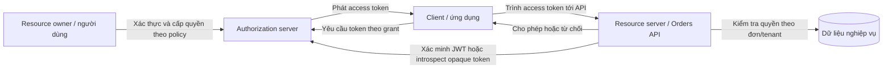
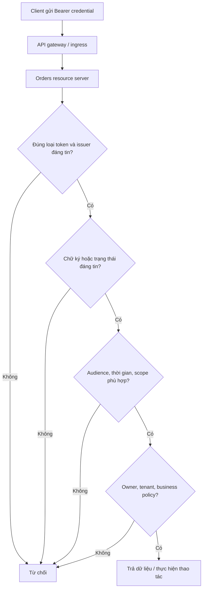
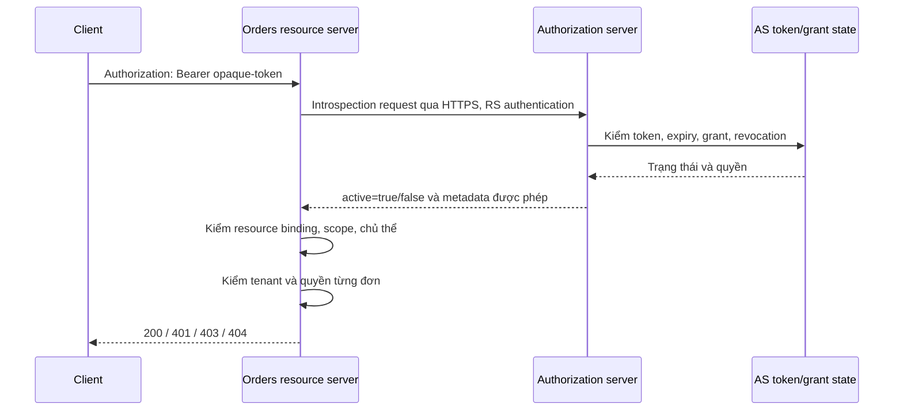
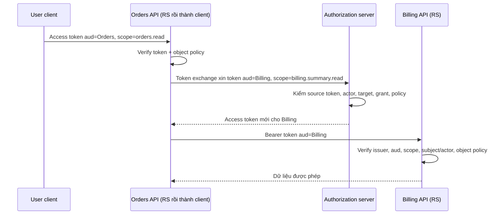
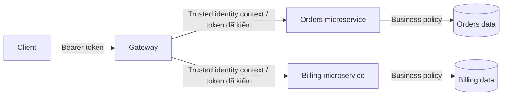
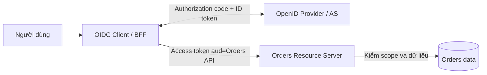

# Vai trò resource server

Một ứng dụng bán hàng đã đăng nhập người dùng qua OpenID Connect (OIDC) và nhận access token từ authorization server. Khi client gọi `GET /orders/42` với header `Authorization: Bearer <access-token>`, **ai** sẽ quyết định request được phép đọc đơn 42? Không phải giao diện đăng nhập, cũng không đơn thuần là nơi đã phát hành token. **Resource server** — trong ví dụ là **Orders API** — là bên **tiếp nhận credential, bảo vệ tài nguyên và thực thi kiểm soát truy cập**.

Đây là bài học thuộc chương **OAuth2 roles** của module **SECURITY_TOKEN_SECURITY_FUNDAMENTALS**. Chúng ta sẽ xác định trách nhiệm của resource server trong mô hình tin cậy OAuth 2.0/OIDC, phân biệt JWT và opaque access token, access/refresh/ID token, kiểm tra `issuer`, `audience`, `scope`, claims và trạng thái token, cũng như xử lý thu hồi, lưu trữ, token theft/replay và phân quyền ở cấp đối tượng.

Sau bài này, bạn có thể:

- Phân biệt bốn vai trò OAuth 2.0 và chỉ ra **trách nhiệm riêng của resource server**.
- Giải thích sự khác nhau giữa **token authentication**, **token validation** và **resource authorization**.
- Xây dựng luồng xác minh **JWT access token** hoặc **opaque access token** trước khi cho phép API.
- Phân biệt `scope`, `aud`, user roles và quyền trên từng đơn hàng/tenant.
- Thiết kế phản hồi HTTP 401/403, Bearer challenge và chính sách fail-closed.
- Hiểu ranh giới tin cậy khi có API gateway, BFF, microservices, token exchange, DPoP hoặc mTLS.
- Kiểm thử những lỗi thường gặp như chấp nhận ID token, sai audience, token đã thu hồi, hoặc Broken Object Level Authorization (BOLA).

## 1. Resource server là gì?

Theo mô hình vai trò của OAuth 2.0 (RFC 6749), **resource server (RS)** là **máy chủ lưu trữ tài nguyên được bảo vệ, có khả năng tiếp nhận và phản hồi yêu cầu truy cập sử dụng access token**. Nó có thể là HTTP API, dịch vụ nội bộ hoặc một tập endpoint phía sau gateway.

Ví dụ:

- **Orders API** bảo vệ thông tin đơn hàng và thao tác tạo, sửa, hủy đơn.
- **Billing API** bảo vệ hóa đơn, phương thức thanh toán, hoàn tiền.
- **Document API** bảo vệ tệp theo chủ sở hữu, nhóm và quyền chia sẻ.
- **Reporting API** bảo vệ các báo cáo phân tích có thể chứa dữ liệu nhạy cảm.

Trong mô hình này, **resource server không chỉ là chỗ đọc dữ liệu**. Nó còn nhận trách nhiệm kiểm tra rằng một access token **có thể được sử dụng ở đây**, cho **đúng loại thao tác**, bởi **đúng chủ thể** và đối với **đúng đối tượng dữ liệu**.

Một số hệ thống gộp authorization server và resource server trong cùng ứng dụng hoặc cùng nhà cung cấp. Tuy nhiên, **về mặt logic**, đây vẫn là **hai vai trò khác nhau**: một bên phát hành/đánh giá grant và một bên bảo vệ tài nguyên tại thời điểm request.

### 1.1. Bốn vai trò nền tảng

| Vai trò OAuth 2.0 | Nhiệm vụ chính | Ví dụ |
| --- | --- | --- |
| **Resource owner** | Thực thể có khả năng cấp quyền truy cập tài nguyên được bảo vệ, thường là người dùng cuối | Người sở hữu tài khoản bán hàng |
| **Client** | Ứng dụng yêu cầu quyền và dùng access token gọi API | Web app, BFF, mobile app, batch service |
| **Authorization server (AS)** | Xác thực/đánh giá grant theo flow, phát hành token và áp dụng chính sách cấp quyền | `https://login.example.com` |
| **Resource server (RS)** | Nhận access token, xác minh token và thực thi quyền truy cập tài nguyên | `https://api.example.com/orders` |

**Không nhầm OAuth role với role nghiệp vụ** như `ROLE_ADMIN`, `sales_manager` hoặc `order_viewer`. “Resource server” là **vai trò của thành phần hệ thống** trong giao thức; “admin” là một **quyền/vai trò ứng dụng** và không tự phát sinh từ OAuth.

### 1.2. Quan hệ giữa các vai trò



Mũi tên RS → AS trong sơ đồ là **tùy kiến trúc**. Resource server dùng **JWT có chữ ký** thường có thể xác minh cục bộ sau khi lấy public keys tin cậy; resource server dùng **opaque token** có thể cần **introspection**. Không phải mọi API đều phải gọi AS cho **mỗi request**.

## 2. Trách nhiệm và giới hạn của resource server

Hãy chia trách nhiệm RS thành **sáu lớp**:

1. **Tiếp nhận credential đúng giao thức:** ví dụ HTTP `Authorization: Bearer <access-token>` qua HTTPS; không thu thập secret ở URL/log.
2. **Xác minh token đáng tin:** JWT signature hoặc introspection/tra cứu đáng tin của opaque token; issuer, token type, audience, thời hạn và trạng thái.
3. **Xác định quyền token thực cấp:** scope, claims hoặc permission theo hợp đồng; không tin quyền do client tự khai.
4. **Đánh giá quyền đối tượng:** owner, tenant, tổ chức, trạng thái đơn, hạn mức, quan hệ chia sẻ, điều kiện nghiệp vụ.
5. **Thực thi quyết định:** chỉ trả dữ liệu/cho ghi khi mọi điều kiện hợp lệ; trả 401/403/404 phù hợp, tránh lộ thông tin.
6. **Giới hạn hậu quả khi bị lộ token:** audience, TTL, revocation/policy checks, sender constraint và audit an toàn.

Resource server **không nên**:

- Tự phát hành access token thay authorization server, trừ khi nó **đồng thời đảm nhiệm vai trò AS một cách tường minh và an toàn**.
- Coi **authorization code**, **refresh token**, **ID token**, session cookie của ứng dụng khác hoặc client secret là OAuth access token cho API.
- Chấp nhận JWT chỉ vì có ba phần hoặc payload đọc được.
- Bỏ qua kiểm tra audience với lý do tất cả API đều dùng cùng issuer/khóa.
- Dựa hoàn toàn vào frontend ẩn nút `Delete` để bảo vệ endpoint.
- Cho phép token có scope đọc truy cập mọi tenant vì `sub` đã được xác minh.

> **Nguyên tắc:** AS cấp một khả năng truy cập theo grant và policy; RS là bên áp dụng khả năng đó **trên từng request, tài nguyên và điều kiện hiện hành**.

## 3. Resource server không phải client và authorization server

Một nhầm lẫn phổ biến: “API nhận token rồi tự gọi AS, vậy API chính là client?”. Cần phân biệt **vai trò theo ngữ cảnh từng tương tác**:

- Khi **Orders API nhận access token** của web app và bảo vệ `GET /orders`, nó đang đóng vai **resource server**.
- Khi **Orders API cần gọi Billing API**, nó có thể trở thành **OAuth client** của một request downstream và phải lấy token phù hợp.
- Khi một dịch vụ **tự phát hành OAuth token** cho các ứng dụng khác, nó đang đảm nhiệm **authorization server**.

Một tiến trình có thể mang nhiều vai trò, nhưng **không được trộn chính sách giữa các vai trò**. Token mà Orders API nhận với `aud=orders-api` không tự trở thành token để Orders API gọi Billing API.

### 3.1. AS quyết định gì; RS quyết định gì?

| Quyết định | Thông thường bên chịu trách nhiệm |
| --- | --- |
| Client nào có thể dùng grant type/đăng ký redirect URI? | AS |
| Người dùng đã xác thực và consent theo flow nào? | AS/OP |
| Scope và resource nào được cấp vào token? | AS |
| Token có chữ ký hợp lệ theo khóa issuer? | RS xác minh bằng khóa do AS công bố/trust |
| Opaque token có `active=true` theo trạng thái AS? | AS trả kết quả; RS kiểm tra và áp dụng |
| Access token có dành cho **Orders API** không? | RS kiểm `aud`/resource binding |
| Scope có đủ để xem danh sách đơn không? | RS |
| User có được đọc đơn thuộc tenant X lúc này không? | RS cùng policy/data service |
| Có được hoàn tiền 5 triệu cho giao dịch cụ thể không? | Billing RS và policy nghiệp vụ |

**AS không cần biết toàn bộ từng bản ghi dữ liệu** để đưa ra một grant hữu ích. **RS không nên tự giả định** scope đã bao hàm owner/tenant permissions; những chính sách này có thể thay đổi sau khi token được phát hành.

## 4. Access token là credential RS cần nhận

**Access token** đại diện một khả năng truy cập đã được AS cấp. Token có thể là **JWT**, **opaque** hoặc định dạng khác theo hợp đồng. Với HTTP OAuth Bearer token, client thường trình:

```http
GET /v1/orders/42 HTTP/1.1
Host: api.example.com
Accept: application/json
Authorization: Bearer <orders-api-access-token>
```

Theo RFC 6750, `Bearer` là **authentication scheme** cho bearer access token. Bên sở hữu **bản sao token** có thể trình nó nếu không có proof-of-possession bổ sung, nên RS và client phải bảo vệ token khỏi bị tiết lộ.

### 4.1. Access token khác ID token và refresh token

| Credential | Bên nhận/mục đích | RS xử lý thế nào? |
| --- | --- | --- |
| **OAuth access token** | Được cấp để gọi resource server | Chấp nhận để **xác minh và xét quyền** nếu đúng profile/issuer/audience |
| **OIDC ID token** | Dành cho OIDC client xác minh đăng nhập, `aud` chứa client ID | **Từ chối** nếu bị dùng như OAuth access token |
| **Refresh token** | Dành cho AS/token endpoint để xin access token mới | **Từ chối**, không dùng để gọi API |
| **Authorization code** | Client đổi tại AS/token endpoint với điều kiện flow | **Từ chối** ở API |
| **Session cookie của BFF** | Backend dùng để xác thực phiên ứng dụng | Không tự coi là bearer access token; nếu RS có auth cookie riêng phải là cơ chế được thiết kế rõ |

Một ID token có thể **cùng issuer, cùng `sub` và chữ ký hợp lệ** như access token, nhưng audience và mục đích khác nhau. API chỉ kiểm chữ ký JWT sẽ dễ mắc **cross-JWT confusion** (nhầm các token có định dạng giống nhau nhưng phục vụ mục đích khác).

### 4.2. Bearer không đồng nghĩa JWT

RS có thể nhận `Authorization: Bearer <opaque-string>`; chuỗi opaque không giải mã được thành JSON claims ở phía API. Ngược lại, RS có thể nhận JWT access token; decode chỉ cho thấy payload, **không xác minh tính xác thực**. Việc RS nhận dạng token và chọn verifier phải dựa trên **profile/issuer đã cấu hình**, không chỉ số dấu chấm do input tùy ý quyết định.

## 5. Những ranh giới tin cậy trong một request



Từng lớp có nhiệm vụ:

- **Network/TLS:** bảo vệ credential trên đường truyền, nhưng không chứng minh token có quyền.
- **Gateway:** có thể xác minh ở biên, rate limit và chuẩn hóa request; không tự được tin nếu client có đường gọi vào service phía sau.
- **Authentication/token validation:** kiểm tra nguồn, mục đích, trạng thái token.
- **Authorization:** ánh xạ scope/subject và chính sách thành quyết định với endpoint và object.
- **Data layer:** thực thi lọc tenant/owner, tránh truy cập dữ liệu ngoài vùng quyền.

**Một token hợp lệ tại gateway vẫn có thể thiếu quyền với một đơn hàng cụ thể**. Trách nhiệm cuối cùng thuộc hệ thống bảo vệ resource, dù logic được hiện thực tại service, gateway, policy engine hay kết hợp nhiều lớp.

## 6. Resource server cần kiểm tra những gì ở JWT access token?

Đối với **JWT access token được ký (JWS)**, RS thường có thể xác minh cục bộ. Một payload minh họa:

```json
{
  "iss": "https://login.example.com",
  "sub": "user-42",
  "aud": "https://api.example.com/orders",
  "client_id": "orders-web-client",
  "scope": "orders.read orders.create",
  "iat": 1795000000,
  "nbf": 1795000000,
  "exp": 1795000900,
  "jti": "example-token-42"
}
```

Đây là **claims minh họa đã decode**, không phải JWT đã được xác minh. RS phải dùng thư viện JWT/OAuth đáng tin với chính sách cụ thể:

1. **Issuer (`iss`):** chỉ chấp nhận đúng AS được cấu hình; không tin một issuer lạ chỉ vì chữ ký kiểm chứng được với khóa do request tự gợi ý.
2. **Chữ ký:** kiểm JWS signature bằng public key hoặc secret **đã được ủy quyền cho issuer** theo algorithm allowlist và key type phù hợp.
3. **Token type/profile:** ví dụ JWT access-token profile RFC 9068 dùng `typ=at+jwt`; chặn ID token hoặc loại JWT khác.
4. **Audience (`aud`):** token phải dành cho **chính resource server**. Orders API không chấp nhận token `aud=billing-api`.
5. **Thời gian (`exp`, `nbf`, `iat`):** chưa hết hạn, đã tới thời điểm hiệu lực; xử lý NumericDate theo **giây**, có clock skew nhỏ có cấu hình.
6. **Schema:** claim types phù hợp profile; `aud` string hoặc mảng theo JWT; `scope` theo hợp đồng, không so khớp substring.
7. **Scope/permissions:** đúng quyền thao tác, ví dụ `orders.read`; tiếp tục áp dụng policy user/tenant/object.
8. **State bổ sung nếu cần:** denylist, session version, account status, token binding, DPoP/mTLS proof tùy threat model.

### 6.1. Vì sao signature chưa đủ?

Giả sử issuer ký ID token cho `orders-web-client` có `sub=user-42`. Nếu Orders API chỉ kiểm chữ ký và `sub`, API có thể coi **ID token dành cho client** là **access token dành cho API**. Đây là lỗi token substitution.

Tương tự, access token ký đúng với `aud=shipping-api` không được gọi Orders API. **Issuer trả lời ai phát hành; audience trả lời token dành cho ai; scope trả lời khả năng token được cấp** — cần xác minh các chiều độc lập.

### 6.2. Public key và JWKS rotation

Khi AS dùng chữ ký bất đối xứng, RS có thể lấy **JWKS** (JSON Web Key Set) từ nguồn tin cậy đã cấu hình hoặc discovery metadata được kiểm soát. `kid` trong JOSE header giúp chọn key trong **tập khóa tin cậy**.

- Không tải `jku`, `x5u` hay URL từ header token chưa xác minh chỉ vì chúng xuất hiện trong token.
- Không dùng `kid` như đường dẫn file, URL tùy ý hoặc câu truy vấn chưa được bảo vệ.
- Không chấp nhận `alg=none` cho JWT access token yêu cầu ký; chặn algorithm/key confusion.
- Cập nhật JWKS có giới hạn/rate limit, gắn cache theo issuer; chuẩn bị giai đoạn hai khóa khi AS xoay key.
- Nếu private signing key bị lộ, cần kế hoạch thu hồi trust/keys và tokens bị ảnh hưởng; không coi rotation bình thường là đủ cho mọi sự cố.

### 6.3. Không biến `roles` trong token thành toàn quyền

Một AS có thể thêm claim `roles` theo hợp đồng riêng. RS chỉ được dùng claim từ **issuer tin cậy** và phải biết ngữ nghĩa, tenant, thời hạn cập nhật và scope tương ứng. Role `admin` do client tự gửi qua `X-Role` hoặc JSON body **không có giá trị chứng minh quyền**.

JWT tự chứa có thể chứa quyền **cũ** sau khi user mất membership. Với thao tác nhạy cảm, RS cần tra policy hiện hành hoặc có cơ chế revocation-aware phù hợp.

## 7. Resource server xử lý opaque access token ra sao?

**Opaque token** không có cấu trúc claims cho RS tự giải mã. Resource server cần nguồn trạng thái **đáng tin**, thường là **OAuth 2.0 Token Introspection** (RFC 7662) của AS.



Ví dụ request được giản lược (chưa thể hiện phương thức xác thực RS):

```http
POST /oauth2/introspect HTTP/1.1
Host: login.example.com
Content-Type: application/x-www-form-urlencoded

token=<opaque-access-token>&token_type_hint=access_token
```

RS cần **xác thực với introspection endpoint** theo policy, ví dụ mTLS hoặc client authentication phù hợp. Chỉ AS/trust service được cấu hình mới là nguồn đáng tin. `token_type_hint` là **gợi ý**, không chứng minh token thật là access token.

### 7.1. Introspection response có `active=true`

Ví dụ theo **hợp đồng AS cụ thể**:

```json
{
  "active": true,
  "iss": "https://login.example.com",
  "sub": "user-42",
  "client_id": "orders-web-client",
  "aud": "https://api.example.com/orders",
  "scope": "orders.read",
  "exp": 1795000900
}
```

RS cần:

- Kiểm `active` thực sự là boolean `true`, không phải string tùy tiện.
- Xác định **token dành cho Orders API** bằng `aud` hoặc cơ chế resource binding đáng tin được AS cam kết.
- Kiểm scope, chủ thể và quyền trên dữ liệu.
- Áp dụng các điều kiện thời gian/trạng thái được trả, đồng thời xử lý cache và revocation policy.

**RFC 7662 không bắt buộc mọi AS trả `aud` trong mọi response.** Nếu introspection không chứa audience, RS **không được tự coi `active=true` là đủ**; cần hợp đồng ràng buộc tài nguyên, chẳng hạn AS chỉ trả active cho chính resource server được xác thực hoặc metadata riêng có thể kiểm chứng. Không có chứng cứ đáng tin ⇒ **từ chối**.

### 7.2. Token inactive

```json
{"active": false}
```

HTTP 200 từ introspection chỉ là **cuộc gọi tra cứu thành công**, không có nghĩa token hợp lệ. Resource server phải từ chối token `active=false`. AS có thể không tiết lộ lý do vì token hết hạn, bị revoke, không tồn tại hoặc bên gọi không được quyền introspect.

### 7.3. Introspection endpoint unavailable

Nếu AS timeout hoặc trả response không thể xác minh, RS không có bằng chứng token hợp lệ. **Fail closed**: không cấp dữ liệu nhạy cảm. Có thể trả **503/5xx** cho sự cố hạ tầng thay vì mô tả sai thành credential lỗi, hoặc dùng **cache còn thời hạn hợp lệ** nếu chính sách cho phép. **Không dùng dữ liệu cache đã hết hạn để tự mở quyền**.

## 8. Scope là quyền của token; object policy là quyền với tài nguyên

Đây là ranh giới quan trọng nhất của resource server.

Giả sử user `user-42` có access token:

```json
{
  "sub": "user-42",
  "aud": "https://api.example.com/orders",
  "scope": "orders.read"
}
```

Token này **có thể hợp lệ để yêu cầu đọc Orders API**; nhưng nó **không tự cấp quyền xem mọi đơn hàng**. Ví dụ `GET /orders/9001` trỏ tới đơn của tenant khác phải bị chặn ngay cả khi token đúng chữ ký và scope.

| Điều kiện | Ví dụ | Ai kiểm? |
| --- | --- | --- |
| **Token validity** | Chữ ký hợp lệ hoặc `active=true` | RS theo profile |
| **Audience** | `aud=orders-api` | RS |
| **Scope** | `orders.read` để gọi endpoint đọc | RS |
| **Subject** | `sub=user-42` | RS xác định từ token đã xác minh |
| **Tenant membership** | User đang thuộc `tenant-a` | RS/policy service |
| **Object ownership** | Order 42 thuộc tenant A | RS/database |
| **Business rule** | Đơn đã khóa không cho sửa | RS/business policy |
| **Field-level access** | Không trả số tài khoản thanh toán cho người không được phép | RS/serialization/data policy |

### 8.1. Scope không đồng nghĩa role

- `orders.read`: quyền **token** được phép yêu cầu thao tác đọc Orders API.
- `sales_manager`: vai trò **nghiệp vụ** của chủ thể, có thể đến từ policy DB hoặc claim đáng tin.
- `tenant_id`: ngữ cảnh tenant; không phải bằng chứng đủ về membership hiện hành.
- `order.owner_id`: thuộc tính tài nguyên phải lấy từ dữ liệu đáng tin.

Không dùng phép so khớp scope bằng substring: `orders.read.all` không tự tương đương `orders.read` trừ khi hợp đồng định nghĩa rõ. Parse tập scope theo cú pháp/profile và so sánh nguyên giá trị.

### 8.2. Deny by default

Nếu thiếu token, token sai audience, scope không rõ, user không thuộc tenant, policy không trả lời hoặc bản ghi không nằm trong phạm vi, **không cấp quyền**. Tình huống không xác định phải được xử lý an toàn, không trở thành “allow cho tới khi AS hoạt động lại”.

## 9. Ví dụ toàn bộ request: đọc một đơn hàng

Giả sử Orders API có endpoint:

```http
GET /v1/orders/42 HTTP/1.1
Host: api.example.com
Authorization: Bearer <orders-access-token>
```

Một pipeline hợp lý:

1. Nhận đúng một Bearer credential và giới hạn kích thước/header.
2. Chọn verifier đã cấu hình cho access-token issuer/profile.
3. Xác minh JWT hoặc opaque token, audience của Orders API, thời hạn và trạng thái.
4. Kiểm scope `orders.read`.
5. Xác định `sub`, client và các ngữ cảnh đáng tin (user hay workload).
6. Tải **Order 42** trong ngữ cảnh tenant được phép, hoặc đánh giá owner/policy.
7. Trả đúng các trường được phép; ngăn truy cập trường nhạy cảm và dữ liệu cross-tenant.

Pseudocode minh họa:

```java
// PSEUDOCODE: không phải API cụ thể của một framework Java.
HttpResponse getOrder(HttpRequest request, String orderId) {
    RawCredential raw = bearerParser.parseStrictly(request);
    if (raw.isMissingOrInvalid()) {
        return unauthorizedWithBearerChallenge();
    }

    VerifiedAccessToken token = resourceServerVerifier.verify(
        raw.token(),
        "https://login.example.com",
        "https://api.example.com/orders"
    );
    if (!token.isAccepted()) {
        return unauthorizedInvalidToken();
    }

    if (!token.scopes().contains("orders.read")) {
        return forbiddenInsufficientScope("orders.read");
    }

    // Không tin orderId, tenantId hay userId trong request làm quyền.
    Order order = ordersRepository.findById(orderId);
    if (order == null) {
        return notFound();
    }

    if (!orderPolicy.canRead(
            token.issuer(),
            token.subject(),
            token.clientId(),
            order.tenantId(),
            order)) {
        return forbiddenOrNotFoundAccordingToDisclosurePolicy();
    }

    return ok(orderPolicy.allowedView(order, token.subject()));
}
```

Ứng dụng thực tế nên dùng framework security/JWT library tin cậy, **không tự cài đặt mật mã** hay parser Bearer bằng regex lỏng lẻo. Kiểm tra `token.isAccepted()` trong ví dụ phải bao gồm **source integrity, token type, audience, time, schema** và policy tương ứng.

### 9.1. API cho phép danh sách nhưng chặn đối tượng

Nếu token có `orders.read`, endpoint `GET /orders` cũng phải **lọc danh sách theo tenant/user**. Không nên trả toàn bộ dữ liệu rồi chỉ ẩn các bản ghi không phù hợp ở frontend. Đối với truy vấn theo ID, SQL/ORM nên dùng điều kiện tenant/owner hoặc kiểm tra policy trước khi trả object để giảm nguy cơ BOLA.

### 9.2. Tách thao tác đọc và ghi

| Endpoint | Scope ví dụ | Điều kiện nghiệp vụ bổ sung |
| --- | --- | --- |
| `GET /orders/{id}` | `orders.read` | Owner/tenant có quyền xem |
| `GET /orders` | `orders.read` | Chỉ liệt kê trong vùng được phép |
| `POST /orders` | `orders.create` | Client/user được tạo trong tenant này |
| `PATCH /orders/{id}` | `orders.update` | Trạng thái đơn cho sửa, đúng quyền dữ liệu |
| `POST /orders/{id}/cancel` | `orders.cancel` | Người dùng được hủy, hạn mức và trạng thái cho phép |

**Tên scope là ví dụ tự định nghĩa**, không phải bộ scope bắt buộc của OAuth 2.0. API và AS phải có hợp đồng chung về ngữ nghĩa các tên.

## 10. HTTP 401, 403 và Bearer challenge

Resource server phải phản hồi lỗi theo ngữ nghĩa HTTP và cách dùng Bearer token. RFC 6750 định nghĩa `WWW-Authenticate` Bearer challenge cùng các error codes.

| Tình huống | Phản hồi điển hình | Ý nghĩa |
| --- | --- | --- |
| Thiếu credential | **401 Unauthorized** với Bearer challenge | Chưa có credential phù hợp |
| Token sai chữ ký, hết hạn, sai issuer/audience/type | **401**, có thể `invalid_token` | Credential không được chấp nhận |
| Request Bearer sai cú pháp, trùng phương thức truyền | **400 Bad Request**, có thể `invalid_request` | Request authentication không hợp lệ |
| Token hợp lệ nhưng thiếu scope | **403 Forbidden**, `insufficient_scope` nếu phù hợp | Token không có quyền thao tác |
| Đúng scope nhưng không được xem order khác tenant | **403 hoặc 404** theo chính sách | Object-level authorization failure |
| Không tra cứu được AS/introspection do outage | **503/5xx** theo policy, fail closed | Lỗi hạ tầng, không phải tự động cấp quyền |

Ví dụ thiếu token:

```http
HTTP/1.1 401 Unauthorized
WWW-Authenticate: Bearer realm="orders-api"
```

Ví dụ token không hợp lệ:

```http
HTTP/1.1 401 Unauthorized
WWW-Authenticate: Bearer realm="orders-api", error="invalid_token"
```

Ví dụ thiếu scope:

```http
HTTP/1.1 403 Forbidden
WWW-Authenticate: Bearer realm="orders-api", error="insufficient_scope", scope="orders.create"
```

**`scope` trong challenge là gợi ý quyền cần cho resource**, không phải bằng chứng AS đã cấp thêm quyền. Client phải xin scope mới theo luồng OAuth hợp lệ. Không đưa access token, refresh token, claims nhạy cảm hoặc chi tiết key/trust vào `error_description`, response body hoặc log.

Không phải mọi 403 đều là `insufficient_scope`: sai owner/tenant dù scope đủ là **lỗi policy đối tượng**. API có thể dùng 404 để tránh tiết lộ sự tồn tại của resource theo threat model.

## 11. RS và audience: token dành cho ai?

**Audience** là ràng buộc **token được phát hành cho bên nhận nào**. Trong JWT access token profile (RFC 9068), resource server phải xác minh token có `aud` phù hợp với identifier của **chính RS**.

Ví dụ:

| Token | `aud` | Resource server đang nhận | Kết luận |
| --- | --- | --- | --- |
| A | `https://api.example.com/orders` | Orders API | Xét tiếp nếu token, scope, policy đều hợp lệ |
| B | `https://api.example.com/billing` | Orders API | **Từ chối** |
| C | `orders-web-client` | Orders API | Thường là ID token/client audience; **từ chối** theo profile API |
| D | `https://api.example.com/orders` | Billing API | **Từ chối** |

Hai API có cùng domain, issuer hoặc JWT key set **không tự có cùng audience**. Identifier có thể là URL logic hoặc giá trị khác đã được AS/RS thống nhất; không đoán audience chỉ dựa vào hostname.

### 11.1. Resource Indicators

RFC 8707 mô tả tham số `resource` cho client chỉ định tài nguyên đích khi AS hỗ trợ. Ví dụ:

```text
client_id = orders-web-client
requested_scope = "orders.read"
resource = "https://api.example.com/orders"
```

**AS quyết định** việc cấp token và audience thực tế; **RS kiểm tra** audience từ token/metadata đã xác minh. Client không được tự đặt `aud` trong header/body rồi mong RS tin rằng token thuộc API đó.

### 11.2. Token có nhiều audiences

JWT `aud` có thể là một mảng. Nếu AS cố ý phát token cho nhiều RS và profile cho phép, mỗi RS phải xác minh **identifier của mình có trong tập đúng** và áp dụng policy bổ sung. Tuy vậy, token nhiều audiences tăng **blast radius** của một bản sao bearer token bị lộ; trong nhiều kiến trúc nên ưu tiên token dành riêng cho từng API.

## 12. RS với người dùng và RS với service-to-service khác nhau gì?

Resource server có thể phục vụ hai loại truy cập:

### 12.1. User-delegated access

Web app hoặc mobile client nhận token sau flow có người dùng. Access token có thể có `sub` là người dùng, `client_id` là ứng dụng và scope được cấp. RS phải kiểm cả **token đã được cấp**, **quyền hiện hành của người dùng** và **đối tượng**.

Ví dụ user A có `orders.read` không được dùng token đọc đơn của user B ở tenant khác. Consent cho ứng dụng đọc dữ liệu không có nghĩa user có thể cấp thêm quyền vượt quyền của chính mình.

### 12.2. Client Credentials / workload access

Một backend job dùng `client_credentials` để nhận access token bằng danh tính service. `sub` trong token có thể đại diện **OAuth client** hoặc workload theo profile, không nhất thiết là người dùng; `client_id` cũng giúp RS xác định actor theo hợp đồng.

Ví dụ `reporting-worker` có `reports.read` để truy cập Reporting API, nhưng không được nhận định đó là một user đã qua MFA hoặc được quyền xem mọi dữ liệu tenant. RS áp dụng **service policy** và giới hạn tài nguyên của workload.

| Yêu cầu | Token chủ thể | Điều RS phải kiểm |
| --- | --- | --- |
| Người dùng xem đơn của mình | User-delegated access token | User subject, client, scope, owner/tenant |
| Batch xuất báo cáo nội bộ | Workload/client token | Workload identity, audience, scope, tập dữ liệu được phép |
| Service tạo hóa đơn theo yêu cầu user | Delegated downstream token hoặc mô hình tương đương | Actor + user context đáng tin, quyền Billing API và đối tượng |

**Không dùng một rule duy nhất `sub != null ⇒ đã xác thực người dùng`**. Subject có ý nghĩa theo issuer/grant/profile và token type. RS phải hiểu ngữ nghĩa trước khi gắn với account hoặc business role.

## 13. Khi resource server trở thành client của API khác

Một yêu cầu thường gặp:

1. User client gọi **Orders API** bằng access token có `aud=orders-api`.
2. Orders API cần gọi **Billing API** để lấy tình trạng thanh toán.
3. Nếu Orders API chuyển nguyên token user có `aud=orders-api` sang Billing, Billing phải **từ chối** token sai audience.

Giải pháp phụ thuộc nghiệp vụ:

- **Token exchange/on-behalf-of (RFC 8693)** khi AS hỗ trợ: Orders trình token nguồn và actor/authentication phù hợp để xin token mới dành Billing API, scope hẹp và delegation policy.
- **Client Credentials** khi Orders thực hiện tác vụ kỹ thuật bằng danh tính service của mình; Billing vẫn cần kiểm service có quyền thực hiện hành động.
- **Downstream delegation hợp đồng riêng** khi nền tảng áp dụng, nhưng không bỏ qua issuer/audience/scope và chống confused deputy.



**Token exchange không tự bảo đảm quyền đầu ra bị thu hẹp**; AS phải kiểm tra ai xin, token nào được trao đổi, quyền gì, người dùng gốc nào và resource đích. Không dùng chính danh tính backend có quyền rộng để bỏ qua quyền người dùng gốc nếu nghiệp vụ yêu cầu ủy quyền thay mặt người dùng (**confused deputy**).

## 14. Resource server trong kiến trúc gateway và microservices

Một gateway có thể đảm nhiệm **một phần token validation**:



Tuy nhiên, **resource server là vai trò logic** bảo vệ tài nguyên, không bắt buộc khớp với một process cụ thể. Gateway có thể kiểm issuer/audience chung, nhưng mỗi service vẫn phải bảo vệ **scope và quyền riêng** theo dữ liệu của nó.

### 14.1. Trusted identity headers phải được bảo vệ

Nếu gateway thêm header nội bộ:

```text
X-Verified-Subject: user-42
X-Verified-Issuer: https://login.example.com
X-Verified-Scope: orders.read
```

Các header trên chỉ là **minh họa**. Backend chỉ có thể tin chúng khi:

- Gateway **loại bỏ mọi giá trị do client tự gửi** với cùng tên trước khi đặt giá trị đã xác minh.
- Backend chỉ có thể được gọi từ **gateway/workload đáng tin**, bằng mTLS/service auth, network policy hoặc cơ chế tương đương.
- Dữ liệu được **ràng buộc với request** và không thể bị sửa trên hop nội bộ.
- Có chính sách tách API audiences; không dùng một token sai audience cho nhiều service.
- Backend vẫn áp dụng **object-level authorization**.

Nếu người ngoài có thể gọi thẳng backend với `X-Verified-Subject: admin`, hệ thống đã tạo lỗ hổng mạo danh dù gateway hoạt động đúng.

### 14.2. Một JWT issuer cho tất cả dịch vụ không phải toàn quyền

Các microservices có thể dùng cùng AS và JWKS. **Việc cùng public key kiểm được chữ ký không có nghĩa mọi dịch vụ nhận mọi token**. Mỗi RS phải có expected audience và allowed scopes riêng, hoặc một resource-group contract rõ được kiểm soát.

### 14.3. Cache trạng thái ở gateway

Nếu gateway cache kết quả introspection `active=true`, token vừa bị thu hồi có thể còn được sử dụng đến cache expiry. Phải xác định **revocation latency budget**, gắn cache với issuer/RS/audience và tránh dùng kết quả introspection của API A để thay việc kiểm token tại API B.

## 15. Revocation và quyền thay đổi: RS biết thế nào?

RS phải chấp nhận trade-off giữa **xác minh offline nhanh** và **phát hiện thu hồi nhanh**.

| Kiểu token/cơ chế | RS kiểm tra | Hạn chế đối với thu hồi |
| --- | --- | --- |
| JWT access token tự chứa, xác minh offline | Chữ ký, claims, time, policy | Logout/revoke refresh token **không tự vô hiệu JWT access token đã cấp** trước `exp` |
| Opaque token + introspection | AS trả `active` và metadata | Có thể thấy revocation khi tra cứu, nhưng **cache** tạo trễ |
| JWT + denylist/`jti` hoặc session version | Signature + claims + lookup trạng thái | Tăng lookup/đồng bộ state, cần xử lý outage |
| JWT/opaque + policy DB | Token validity + quyền hiện hành | Có thể chặn account bị khóa/đổi membership nếu lookup được thực hiện đúng |

Một số tình huống:

- User logout; BFF xóa session và AS thu hồi refresh token. JWT access token cũ có thể vẫn được RS chấp nhận offline đến `exp` nếu không có kiểm tra trạng thái bổ sung.
- User bị gỡ khỏi tenant A; token vẫn có `scope=orders.read`. **Orders RS phải kiểm membership hiện hành** nếu chính sách yêu cầu tác động ngay.
- AS xoay signing keys bình thường; RS cần JWKS cache/rotation strategy để xác minh các token còn hạn. Nếu **key bị compromise**, cần chiến lược thu hồi trust và xử lý các token đã ký.

### 15.1. Resource server không nhận refresh token để “tự refresh”

Refresh token được client trình tới **AS/token endpoint**. RS không yêu cầu caller cung cấp refresh token để API “sửa token hết hạn”. Khi access token không hợp lệ, RS trả lỗi thích hợp; client mới là bên thực hiện refresh/re-authorization theo grant và chính sách.

### 15.2. Không coi `jti` là chống replay tự động

Claim `jti` là một token identifier. RS chỉ kiểm chữ ký và thấy `jti` **chưa ngăn bearer token bị sao chép dùng nhiều lần**. Nếu cần phát hiện/reject replay, phải có cơ chế state, sender binding hoặc điều kiện tương ứng. Với access token dùng cho nhiều request hợp lệ, không thể mặc nhiên cấm mọi `jti` xuất hiện lần thứ hai.

## 16. Bearer token theft, DPoP và mTLS tại resource server

RS thường nhận **Bearer access token**: bên sở hữu chuỗi token có thể gửi nó. Nếu attacker sao chép được token đúng audience/scope, JWT signature vẫn hợp lệ hoặc opaque `active` vẫn là true. RS cần hiểu rằng **token validation không tự xác thực thiết bị/người giữ token**.

Biện pháp giảm rủi ro:

- HTTPS/TLS; không log `Authorization` header hoặc token trong URL/trace.
- Scope tối thiểu, audience hẹp, TTL access token phù hợp, object authorization.
- Monitoring phát hiện hành vi bất thường, revocation hoặc policy lookup theo rủi ro.
- **Sender-constrained access tokens** như DPoP hoặc certificate-bound tokens bằng mTLS khi threat model phù hợp.

### 16.1. DPoP

DPoP (RFC 9449) dùng token bị ràng buộc với khóa và proof được ký. Với token DPoP-bound, request thường có:

```http
GET /v1/orders/42 HTTP/1.1
Host: api.example.com
Authorization: DPoP <dpop-bound-access-token>
DPoP: <signed-proof-jwt>
```

RS cần kiểm token và proof theo profile: khóa/`cnf` binding, HTTP method `htm`, URI `htu`, `iat`, `jti`, `ath` và nonce/replay protection khi áp dụng. Không chấp nhận DPoP-bound token như bearer thuần chỉ vì token có chữ ký/`active` hợp lệ.

### 16.2. mTLS-bound access token

Với mTLS certificate-bound token (RFC 8705), RS kiểm kết nối mTLS, certificate binding so với token/AS metadata. Header có thể vẫn là `Authorization: Bearer <token>`, **nhưng chỉ chuỗi token thôi chưa đủ** vì ràng buộc chứng chỉ phải được xác minh.

DPoP và mTLS **không thay thế `aud`, `scope` hoặc owner/tenant policy**. Chúng giảm khả năng dùng bản sao token bên ngoài môi trường nắm giữ khóa, nhưng không loại bỏ mọi tấn công XSS/RCE khi attacker có thể điều khiển client hợp lệ để gọi API.

## 17. Resource server và OIDC: nơi nào xác minh ID token?

OIDC là lớp **authentication** xây trên OAuth 2.0. Một OIDC client/Relying Party kiểm **ID token** để xác minh kết quả đăng nhập, thường với `aud` chứa **client_id** của mình. Resource server OAuth kiểm **access token** để quyết định truy cập API.



**Không được** dùng ID token như access token chỉ vì `sub` là user và OP đã ký nó. Đồng thời, việc OIDC client đã tạo session đăng nhập không tự chứng minh user hiện có quyền với mọi resource.

Nếu ứng dụng cần **step-up authentication** cho tác vụ nhạy cảm, RS hoặc backend phải có cách nhận ngữ cảnh xác thực đáng tin theo thiết kế (ví dụ policy dựa trên `acr`/`auth_time` từ nguồn đã xác minh hoặc một authorization context token profile phù hợp). **`iat` của access token mới không đồng nghĩa user vừa hoàn thành MFA**.

## 18. HTTP security: TLS, CORS, proxy và logging

### 18.1. TLS bảo vệ credential đang truyền

RS nên chỉ chấp nhận credential qua **HTTPS** trong môi trường production, xác minh cấu hình TLS/certificates và bảo vệ các hop sau reverse proxy. Nếu TLS kết thúc ở gateway, dữ liệu đi tiếp tới service phải được bảo vệ bởi mTLS, mạng tin cậy có chính sách hoặc cơ chế truyền danh tính phù hợp threat model. **TLS không ngăn token bị lộ từ log, browser XSS hoặc server compromise**.

### 18.2. CORS không phải kiểm tra OAuth

Khi browser SPA gọi API cross-origin với `Authorization` header, browser thường cần CORS preflight. Cấu hình `Access-Control-Allow-Origin` giúp browser quyết định script nào có thể đọc response; **không chứng minh token hợp lệ** và không chặn non-browser attacker đang giữ bearer token. RS phải xác minh access token trên request thực, không cho phép chỉ vì `Origin` thuộc allowlist.

### 18.3. Reverse proxy và headers

Một reverse proxy có thể bỏ `Authorization`, khiến API trả 401 dù token hợp lệ. Cách sửa là **cấu hình forwarding chính xác** và bảo vệ hop, không đưa token vào query parameter để né lỗi. Khi proxy xác minh token và gửi trusted identity context, RS phải bảo vệ đường trực tiếp và xóa spoofed headers như đã nêu ở phần gateway.

### 18.4. Logs và tracing

Không ghi:

- Access token, refresh token, ID token nguyên dạng.
- `Authorization`, `Cookie`, `Set-Cookie` headers chưa được redact.
- Token trong URL/query, exception stack metadata, APM spans hoặc analytics.

Nên ghi **metadata tối thiểu sau xác minh**: issuer, resource audience, OAuth client ID khi cần, endpoint, kết quả kiểm scope/policy, correlation ID và reason code. Nếu cần token fingerprint, chọn cơ chế HMAC/digest có rủi ro liên kết phù hợp, không để log trở thành cơ sở dữ liệu credential.

## 19. Case study: đúng chữ ký nhưng đọc sai tenant

**Bối cảnh:** `seller-web` được cấp JWT access token bởi AS tin cậy, có `aud=orders-api`, `scope=orders.read` và `sub=user-42`. User 42 đang thuộc tenant A. Một request:

```http
GET /v1/orders/9001 HTTP/1.1
Host: api.example.com
Authorization: Bearer <valid-orders-access-token>
```

Order 9001 thuộc tenant B.

**Cách làm sai:** RS xác minh chữ ký, expiry và scope rồi trả dữ liệu. **Hậu quả:** BOLA/IDOR làm rò đơn hàng của tenant khác.

**Cách làm đúng:** RS xác minh token, kiểm `orders.read`, sau đó dùng membership và thuộc tính order **đáng tin trong data/policy layer** để từ chối. Có thể trả 404 thay 403 nhằm không tiết lộ order tồn tại theo chính sách.

**Bài học:** OAuth token validation trả lời credential có thể được xử lý; **resource authorization** trả lời thao tác cụ thể trên dữ liệu cụ thể có được phép hay không.

## 20. Case study: opaque token active nhưng audience sai

**Bối cảnh:** Billing API và Orders API cùng dùng AS. Một client được cấp opaque token cho Billing API, scope `payments.read`. RS Orders gọi introspection và nhận `active=true` nhưng không kiểm resource binding.

**Cách làm sai:**

```text
if introspection.httpStatus == 200 &&
   introspection.active == true:
    allow()
```

**Vấn đề:** `active` chỉ xác nhận token đang được AS coi là hoạt động trong ngữ cảnh tra cứu; không cho phép Orders dùng token Billing. **Cách làm đúng:** RS cần bằng chứng token dành cho Orders API (`aud` hoặc resource-bound introspection contract), scope phù hợp và policy dữ liệu.

Nếu introspection response **không cung cấp resource binding** và AS không cam kết introspection theo RS, **không được mặc định cho phép**.

## 21. Case study: một backend vừa là resource server vừa là client

**Bối cảnh:** Orders API nhận token user để xem đơn; sau đó cần Shipping API trả tình trạng vận chuyển.

**Sai lầm:** Orders chuyển nguyên `Authorization` header đầu vào sang Shipping, dù token chỉ có `aud=orders-api`. Nếu Shipping kiểm audience đúng, request bị từ chối; nếu Shipping không kiểm, đó là lỗ hổng token substitution.

**Cách thiết kế:**

1. Orders RS kiểm token nguồn và user có quyền đọc đơn.
2. Orders (ở vai client downstream) xin access token **dành cho Shipping** qua delegation/token exchange hoặc credential service phù hợp.
3. Shipping RS kiểm issuer, audience, scope, actor/user context và quyền tracking tương ứng.
4. Không chuyển quyền rộng hơn chỉ vì Orders có quyền kỹ thuật mạnh.

**Bài học:** Một service mang nhiều vai trò nhưng mỗi access token có **đối tượng nhận, phạm vi và hợp đồng riêng**.

## 22. Các anti-pattern phổ biến tại resource server

| Anti-pattern | Hậu quả | Thay bằng |
| --- | --- | --- |
| Chấp nhận mọi JWT có chữ ký hợp lệ | ID token hoặc access token cho API khác bị dùng nhầm | Token type/profile + issuer + audience |
| Decode payload rồi đọc `roles` | Client có thể giả claims | Xác minh chữ ký/trust, token type và schema trước |
| Bỏ `aud` vì “cùng issuer” | Token substitution giữa APIs | Expected resource identifier riêng từng RS |
| Opaque introspection `active=true` ⇒ allow all | Token sai resource hoặc thiếu scope | Resource binding + scope + object policy |
| So khớp `scope.contains("read")` | Quyền bị hiểu nhầm | Parse tập scope và so sánh tên đầy đủ |
| Role admin trong client header được tin | Leo thang quyền | Chỉ dùng claims/policy từ nguồn đáng tin |
| Chỉ ẩn nút ở frontend | Direct HTTP requests vẫn thực hiện được | RS thực thi quyền server-side |
| JWT hết hạn nhưng chấp nhận vì có `sub` | Credential quá hạn | Kiểm `exp`/`nbf` với clock policy |
| Một access token `aud=*` cho mọi API | Tăng blast radius khi token lộ | Audience/resource restriction |
| JWT offline được xem là thu hồi tức thì khi logout | Token cũ còn được dùng đến `exp` | TTL/denylist/introspection/session policy |
| API chấp nhận refresh token làm Bearer | Lộ credential dài hạn, sai mục đích | Refresh chỉ tại AS/token endpoint |
| Gateway truyền identity header không bảo vệ | Spoofing downstream | Authenticate gateway/hop; strip headers |
| API A forward token sai audience cho B | Confused deputy/token substitution | Token exchange/client auth phù hợp |
| Introspection timeout ⇒ allow | Fail-open | Từ chối truy cập, lỗi hạ tầng hoặc cache còn hợp lệ theo policy |
| DPoP-bound token thiếu proof vẫn được nhận | Bỏ qua sender constraint | Verify proof/certificate binding đầy đủ |

## 23. Ma trận kiểm thử resource server

Không chỉ kiểm happy path `200 OK`. Tối thiểu nên có:

| # | Đầu vào/điều kiện | Kết quả mong đợi |
| --- | --- | --- |
| 1 | Không có header `Authorization` | 401 và Bearer challenge phù hợp |
| 2 | Bearer token trống hoặc header trùng lặp | Từ chối, không xử lý nghiệp vụ |
| 3 | JWT giả payload `scope=orders.admin`, chữ ký sai | 401 |
| 4 | JWT `alg=none` hoặc thuật toán ngoài allowlist | Từ chối |
| 5 | JWT ký đúng nhưng issuer không tin cậy | 401 |
| 6 | JWT `aud=Billing API` gửi Orders API | 401 hoặc invalid_token theo profile |
| 7 | OIDC ID token `aud=orders-web-client` gửi làm Bearer | Từ chối |
| 8 | Refresh token hoặc authorization code gửi API | Từ chối |
| 9 | JWT hết hạn hoặc chưa tới `nbf` | 401 theo clock policy |
| 10 | JWT dùng `kid` lạ/jku URL attacker | Không tải key tùy ý; từ chối nếu không xác minh được |
| 11 | Opaque introspection HTTP 200, `active=false` | Từ chối |
| 12 | Opaque `active=true` nhưng không chứng minh audience phù hợp | Không tự cho phép |
| 13 | Introspection/JWKS unavailable và không có bằng chứng hợp lệ | Fail closed, không trả dữ liệu |
| 14 | Access token đúng audience nhưng thiếu `orders.read` | 403, có thể `insufficient_scope` |
| 15 | Token có `orders.read` nhưng order của tenant khác | 403/404, không trả dữ liệu |
| 16 | Token đủ quyền nhưng order bị khóa không cho sửa | 403 theo business policy |
| 17 | Client Credentials token được xử lý nhầm là user token | Từ chối hành vi yêu cầu user context |
| 18 | API gateway nhận spoofed `X-Verified-Subject` | Loại header client, không mạo danh được |
| 19 | Orders chuyển nguyên token sai audience cho Billing | Billing từ chối |
| 20 | Token bị thu hồi, introspection cache stale | Hành vi đúng mục tiêu revocation latency |
| 21 | DPoP token không có proof/`ath` sai/`htu` sai | Từ chối theo DPoP profile |
| 22 | mTLS-bound access token không có client certificate đúng | Từ chối |
| 23 | Access token bị lộ trong log/tracing | Redaction ngăn token thô xuất hiện |
| 24 | User đổi tenant membership khi JWT chưa hết hạn | RS áp dụng policy hiện hành theo mục tiêu bảo mật |

Cần phối hợp **unit tests** cho access-policy functions, **integration tests** cho JWT/JWKS/introspection, **negative security tests** cho audience/type/scope, **failure injection** cho AS outage và cache/revocation. Kiểm thử trạng thái token phải cùng **issuer/profile** mà production sẽ dùng; không chỉ dựng JWT giả rồi cho phép.

## 24. Checklist khi thiết kế một resource server

1. **Tài nguyên nào được bảo vệ?** Các endpoint, bản ghi, tenant, trường dữ liệu và thao tác ghi có policy rõ ràng chưa?
2. **AS nào đáng tin?** Trusted issuer, JWKS/introspection endpoint và token profiles được cấu hình, không lấy từ input tùy ý?
3. **API nhận credential gì?** Chỉ access token phù hợp, chặn ID token/refresh token/session credential không thuộc profile?
4. **JWT validation đầy đủ?** Signature, key/algorithm, `iss`, `aud`, `exp`, `nbf`, token type và schema?
5. **Opaque validation đáng tin?** Introspection xác thực với AS, `active` đúng kiểu, resource binding và expiry/scope?
6. **Audience đúng API?** Không dùng một token của API khác vì cùng issuer, cùng hostname hay client đáng tin?
7. **Scope đúng endpoint?** Parse các giá trị trọn vẹn, phân biệt hoa/thường và không dùng substring/prefix tùy tiện?
8. **Object authorization đầy đủ?** Owner, tenant, membership hiện hành, trạng thái nghiệp vụ, field-level filtering và hạn mức?
9. **User khác workload?** RS hiểu subject/actor theo grant, không mặc định `sub` luôn là người dùng vừa đăng nhập?
10. **HTTP errors đúng?** 401/`invalid_token` khi credential sai, 403/`insufficient_scope` khi thiếu scope, 403/404 theo object policy?
11. **Gateway trust được bảo vệ?** Không thể bypass gateway hoặc spoof trusted identity headers?
12. **Downstream tokens đúng audience?** API A xin token riêng cho API B qua delegation/service identity hợp lệ?
13. **Revocation và stale claims?** TTL, introspection caching, denylist, state lookup và key compromise đáp ứng mục tiêu?
14. **Bearer security?** TLS, tránh token trong URL/log, least privilege; DPoP/mTLS được xác minh nếu profile áp dụng?
15. **Theo dõi và kiểm thử?** Có audit metadata an toàn, negative tests và quy trình ứng phó khi token hoặc signing key bị lộ?

**Kết luận:** **Resource server là bên bảo vệ tài nguyên và thực thi quyết định cho từng request**. Authorization server có thể cấp access token phù hợp, nhưng một token chỉ là **điều kiện đầu vào**. Resource server phải xác minh nguồn/token type/trạng thái, kiểm **issuer + audience + time + scope**, rồi thực thi **quyền của chủ thể trên dữ liệu cụ thể**. Nguyên tắc này áp dụng cho JWT và opaque token, user-delegated access và Client Credentials, gateway và microservices. Khi bearer token có thể bị sao chép hoặc quyền thay đổi trong phiên, RS còn phải xét TTL, thu hồi, replay/sender constraint và rủi ro còn lại.

## Tài liệu tham khảo

- [RFC 6749 — The OAuth 2.0 Authorization Framework](https://www.rfc-editor.org/rfc/rfc6749): mục 1.1 định nghĩa OAuth roles; scope, authorization grants, access và refresh tokens.
- [RFC 6750 — OAuth 2.0 Bearer Token Usage](https://www.rfc-editor.org/rfc/rfc6750): `Authorization: Bearer`, `WWW-Authenticate`, 401/403 và security considerations.
- [RFC 7519 — JSON Web Token (JWT)](https://www.rfc-editor.org/rfc/rfc7519): claims `iss`, `sub`, `aud`, `exp` và `nbf`.
- [RFC 7515 — JSON Web Signature (JWS)](https://www.rfc-editor.org/rfc/rfc7515): signature verification và JOSE protected header.
- [RFC 7517 — JSON Web Key (JWK)](https://www.rfc-editor.org/rfc/rfc7517): public keys và JWKS.
- [RFC 8725 — JWT Best Current Practices](https://www.rfc-editor.org/rfc/rfc8725): token type separation, issuer/audience checks và key/algorithm confusion.
- [RFC 9068 — JWT Profile for OAuth 2.0 Access Tokens](https://www.rfc-editor.org/rfc/rfc9068): resource-server validation của JWT access tokens và `at+jwt`.
- [RFC 7662 — OAuth 2.0 Token Introspection](https://www.rfc-editor.org/rfc/rfc7662): kiểm opaque token, `active` và metadata.
- [RFC 8707 — Resource Indicators for OAuth 2.0](https://www.rfc-editor.org/rfc/rfc8707): resource/audience restriction.
- [RFC 8693 — OAuth 2.0 Token Exchange](https://www.rfc-editor.org/rfc/rfc8693): token delegation và exchange cho downstream APIs.
- [RFC 7009 — OAuth 2.0 Token Revocation](https://www.rfc-editor.org/rfc/rfc7009): thu hồi OAuth tokens.
- [RFC 9449 — OAuth 2.0 Demonstrating Proof of Possession (DPoP)](https://www.rfc-editor.org/rfc/rfc9449): DPoP proof và sender-constrained access tokens.
- [RFC 8705 — OAuth 2.0 Mutual-TLS Client Authentication and Certificate-Bound Access Tokens](https://www.rfc-editor.org/rfc/rfc8705): mTLS-bound tokens.
- [RFC 9700 — Best Current Practice for OAuth 2.0 Security](https://www.rfc-editor.org/rfc/rfc9700): các rủi ro và kiểm soát OAuth trong thực tế.
- [OpenID Connect Core 1.0](https://openid.net/specs/openid-connect-core-1_0.html): ID token, OAuth client `aud` và ngữ cảnh xác thực.
- [OWASP API Security Top 10 — API1: Broken Object Level Authorization](https://owasp.org/API-Security/editions/2023/en/0xa1-broken-object-level-authorization/): rủi ro phân quyền theo đối tượng tại API.
