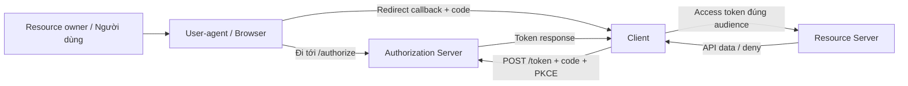
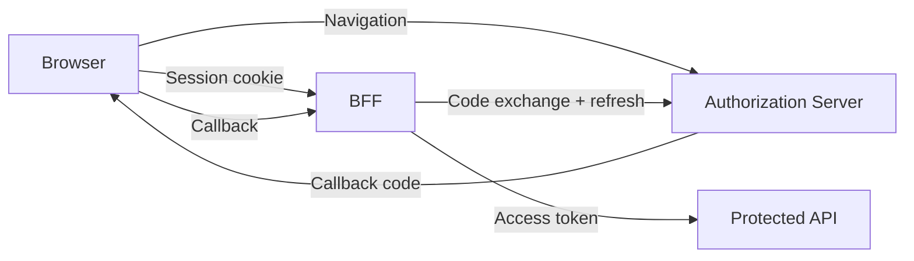

# User-agent và redirect

Trong OAuth 2.0, **user-agent** thường là trình duyệt hoặc thành phần duyệt web mà người dùng điều khiển. Nó giúp đưa người dùng từ **client** tới **authorization server (AS)** để xác thực, xem yêu cầu cấp quyền và quay về **redirect URI** của client. User-agent là **kênh vận chuyển phía trước (*front-channel*)**, chứ **không phải một trong bốn vai trò cốt lõi** của OAuth 2.0. Vì trình duyệt nằm giữa các hệ thống khác nhau, mọi giá trị đi qua redirect đều phải được coi là dữ liệu có thể quan sát, thay đổi hoặc phát lại cho đến khi những ràng buộc thích hợp được xác minh.

Trong **Authorization Code Flow**, AS không trả access token trực tiếp trong redirect URL. Khi xác thực và ủy quyền đáp ứng chính sách, AS gửi **authorization code ngắn hạn, dùng một lần** về redirect URI đã đăng ký; sau đó client đổi code qua **token endpoint** bằng kết nối HTTP POST phù hợp và **PKCE**. Redirect **không chứng minh client đã được phép làm mọi việc**: client còn phải kiểm tra `state`, ràng buộc issuer, code exchange, token, audience, scope và policy tài nguyên.

**Thông điệp trung tâm:** *user-agent giúp thực hiện bước tương tác, còn authorization server và client chịu trách nhiệm bảo vệ ranh giới tin cậy*. Chỉ chuyển hướng tới đúng URI đã đăng ký, ràng buộc response với request ban đầu, tránh đưa token/secret vào URL và không cho một redirect tùy ý biến thành điểm lấy cắp authorization code.

Bài thuộc chương **OAuth2 roles** trong module **SECURITY_TOKEN_SECURITY_FUNDAMENTALS**: học mô hình tin cậy và vòng đời JWT, opaque token, access/refresh token trong authentication, authorization và OAuth 2.0/OIDC; đồng thời học phát hành, xác minh claims, scope, audience, lưu trữ, thu hồi và chống token bị đánh cắp hoặc phát lại. Trọng tâm ở đây là **vai trò user-agent và luồng redirect**, không phải cách tự phát hành JWT.

## 1. Mục tiêu học tập

Sau bài học, bạn có thể:

1. Chỉ ra **bốn vai trò OAuth 2.0** và giải thích user-agent nằm ở đâu trong tương tác giữa chúng.
2. Phân biệt **authorization endpoint**, **redirect URI**, **token endpoint** và **resource server**.
3. Mô tả từng bước Authorization Code + PKCE qua user-agent mà không trộn **front-channel code** với **back-channel token exchange**.
4. Hiểu cách AS đối chiếu `redirect_uri` với URI đã đăng ký, tại sao wildcard, open redirect và callback nhầm host gây rò rỉ code.
5. Phân biệt nhiệm vụ của `state`, PKCE `code_challenge`/`code_verifier`, OIDC `nonce` và issuer binding.
6. Phân tích các rủi ro **authorization code interception/injection, login CSRF, mix-up, phishing, token leakage, session fixation** và các cơ chế giảm thiểu.
7. Thiết kế redirect cho **server-side web app, SPA/BFF, native mobile app** theo ranh giới bảo mật của từng client.
8. Đọc cấu hình Java/Spring Security OAuth2 Client, xử lý callback và kiểm thử đường thành công/thất bại.
9. Chẩn đoán lỗi `redirect_uri_mismatch`, state mismatch, PKCE failure và audience mismatch mà **không log token hay authorization code**.

## 2. Bốn vai trò OAuth 2.0 và vị trí user-agent

Theo RFC 6749, OAuth 2.0 định nghĩa các vai trò:

| Vai trò | Trách nhiệm chính | Ví dụ |
| --- | --- | --- |
| **Resource owner** | Chủ thể có quyền cho phép truy cập một tài nguyên; thường là người dùng | Người sở hữu các đơn hàng |
| **Client** | Ứng dụng xin quyền và sử dụng access token theo grant đã cấp | Web app `storefront` |
| **Authorization server** | Xác thực/ủy quyền theo chính sách, phát hành authorization code và token | `https://id.example.test` |
| **Resource server** | Bảo vệ API và xác minh access token/permission trước khi trả tài nguyên | `orders-api` |

**User-agent không phải vai trò thứ năm của OAuth 2.0 theo RFC 6749.** Nó là phương tiện mà resource owner dùng để tương tác với client và AS trong một số flow, phổ biến nhất là **trình duyệt web**. User-agent còn có thể là system browser trên thiết bị di động, thay vì WebView nhúng trong app.

Vì user-agent thực hiện điều hướng HTTP, nó có thể nhìn thấy **URL**, trạng thái điều hướng, một số cookie theo domain, trang HTML và tham số trong callback. Đây là **kênh ít tin cậy hơn trao đổi trực tiếp giữa backend client và AS**; vì thế code và dữ liệu front-channel luôn cần ràng buộc với phiên yêu cầu và sử dụng đúng mục đích.



**Hai đường trao đổi khác nhau**:

- **Front-channel:** AS ↔ user-agent ↔ client qua redirect. Có thể bị browser, lịch sử, extension, các trang/công cụ quan sát can thiệp tùy mô hình.
- **Back-channel:** client backend ↔ AS token endpoint qua HTTPS; bí mật cần nằm trong môi trường được bảo vệ. Với public SPA/mobile, token request có thể khởi tạo từ thiết bị nhưng vẫn phải tuân thủ HTTPS, PKCE và chính sách client công khai.

Không nên hiểu “back-channel” là mọi client đều có backend giữ secret. **SPA và native app là public client trong nhiều kiến trúc**, nên không thể cất client secret an toàn như confidential server.

## 3. Từ trình duyệt tới authorization server: luồng cơ bản

Giả sử người dùng muốn đăng nhập ứng dụng quản lý đơn hàng:

- **Client:** `storefront` tại `https://app.example.test`.
- **AS/IdP:** `https://id.example.test`.
- **Redirect URI đăng ký:** `https://app.example.test/login/oauth2/code/storefront`.
- **Resource server:** `orders-api`; access token dành cho API này.

Các hostname ở đây là **ví dụ**; không phải hệ thống đăng nhập thật.

### 3.1. Bước 1: client chuẩn bị authorization request

Client tạo một **giao dịch đăng nhập** (*authorization transaction*) và lưu các dữ liệu ràng buộc tại nơi phù hợp:

- `state` không đoán được để liên kết callback với giao dịch và chống một số dạng CSRF.
- PKCE `code_verifier` ngẫu nhiên cho **chính giao dịch này**, từ đó tạo `code_challenge` theo `S256`.
- Issuer/AS dự kiến, `client_id`, redirect URI, scope/resource và phiên trình duyệt tương ứng.
- Nếu dùng OIDC và profile/flow yêu cầu, sinh `nonce` và lưu để đối chiếu ID token.

Ví dụ authorization URL đã tách dòng để dễ đọc:

```http
GET /authorize?response_type=code
    &client_id=storefront
    &redirect_uri=https%3A%2F%2Fapp.example.test%2Flogin%2Foauth2%2Fcode%2Fstorefront
    &scope=openid%20profile%20orders%3Aread
    &state=STATE_THU_NGHIEM_NGAU_NHIEN
    &code_challenge=CHALLENGE_S256_THU_NGHIEM
    &code_challenge_method=S256 HTTP/1.1
Host: id.example.test
```

Trong request thực, URI cần được tạo **đúng encoding và trên một dòng hợp lệ**; các giá trị `STATE...` và `CHALLENGE...` là placeholder, không đáp ứng yêu cầu entropy của một luồng production. Authorization request có thể có các tham số khác tùy profile, chẳng hạn `nonce` OIDC, `resource` theo RFC 8707 hoặc `prompt`.

**Không đưa `code_verifier` vào authorization URL.** Chỉ gửi `code_challenge`; verifier được giữ lại để chứng minh quyền đổi code ở token endpoint.

### 3.2. Bước 2: user-agent mở authorization endpoint

Trình duyệt điều hướng tới AS. AS có thể:

1. Xác định client và redirect URI có được phép hay không.
2. Xác thực người dùng bằng mật khẩu, passkey, MFA hoặc tái sử dụng phiên SSO đáp ứng policy.
3. Cho người dùng biết app xin phạm vi quyền nào và yêu cầu consent khi cần.
4. Kiểm tra grant, scope/resource/audience và các điều kiện AS đặt ra.

Đây là bước **AS thực hiện quyết định**, không phải trình duyệt tự cấp quyền. Client không thể dùng query `scope=admin` hay hiển thị nút “Đồng ý” tự chế để bắt AS phát quyền trái policy.

Nếu authentication/MFA/consent bắt buộc **chưa hoàn tất**, AS **không được trả authorization code đại diện grant đã được chấp thuận**, càng không được phát access/refresh token có thể dùng cho quyền đang chờ.

### 3.3. Bước 3: authorization server redirect trở về client

Khi grant được giải quyết thành công, AS đưa user-agent tới **redirect URI đã được xác thực**, mang theo authorization code và giá trị `state` nếu client đã gửi:

```http
HTTP/1.1 302 Found
Location: https://app.example.test/login/oauth2/code/storefront?code=CODE_THU_NGHIEM&state=STATE_THU_NGHIEM_NGAU_NHIEN
Cache-Control: no-store
```

Mã 302 chỉ minh họa một kiểu redirect. Việc chọn HTTP redirect status cần xét request/method và an toàn bảo mật; xem phần về 303/307 bên dưới.

**Authorization code không phải access token.** Browser đã thấy code trong URL nên code cần ngắn hạn, dùng một lần, ràng buộc client/redirect URI và PKCE. Không đưa access token hay refresh token vào `Location` trong Authorization Code Flow.

Nếu client đã dùng `state`, callback phải khớp **chính xác** với state của giao dịch tương ứng. Nếu không khớp hoặc không tìm được transaction, không được tiếp tục đổi code.

### 3.4. Bước 4: client kiểm tra callback và đổi code

Client xử lý callback:

1. Tìm giao dịch được khởi tạo **trước đó** bằng session/state.
2. Kiểm tra `state`, issuer/bối cảnh AS khi áp dụng và callback path đúng client registration.
3. Chặn lỗi/mismatch/mã được sử dụng lại; không tin `code` chỉ vì nó xuất hiện ở query.
4. Dùng **`code_verifier` của đúng giao dịch** gửi HTTP POST đến **token endpoint đáng tin**.
5. AS xác minh code còn hạn, chưa dùng, đúng client, redirect URI đã ràng buộc và PKCE `S256`.
6. AS phát token theo grant và policy; client xác minh kết quả đúng token type, issuer, audience, thời hạn và OIDC claims khi áp dụng.

Token request minh họa:

```http
POST /oauth2/token HTTP/1.1
Host: id.example.test
Content-Type: application/x-www-form-urlencoded
Accept: application/json

grant_type=authorization_code&code=CODE_THU_NGHIEM&redirect_uri=https%3A%2F%2Fapp.example.test%2Flogin%2Foauth2%2Fcode%2Fstorefront&client_id=storefront&code_verifier=VERIFIER_THU_NGHIEM
```

**Confidential client phải thực hiện client authentication phù hợp** với đăng ký, ví dụ HTTP Basic, `private_key_jwt` hoặc mTLS. Form trên chỉ minh họa trường grant. `code_verifier` ở production phải là chuỗi gốc được sinh đúng chuẩn, không phải placeholder.

### 3.5. Bước 5: client gọi resource server

Sau khi có access token, client gọi API bằng cơ chế phù hợp:

```http
GET /api/orders/123 HTTP/1.1
Host: api.example.test
Authorization: Bearer <ACCESS_TOKEN_THU_NGHIEM>
```

Resource server phải xác minh **access token đúng audience**, issuer, thời hạn, chữ ký JWT hoặc introspection opaque, scope và policy tài nguyên. Một OIDC ID token có `aud` là client không được dùng thay access token gọi API.

```mermaid
sequenceDiagram
    actor U as Resource owner
    participant B as User-agent
    participant C as OAuth Client
    participant AS as Authorization Server
    participant RS as Orders API
    U->>B: Chọn đăng nhập
    B->>C: GET /login
    C->>C: Tạo state, verifier; lưu transaction
    C-->>B: Redirect đến /authorize + challenge
    B->>AS: GET /authorize
    AS->>U: Authentication, MFA, consent nếu cần
    U-->>AS: Hoàn tất điều kiện
    AS-->>B: Redirect tới callback có code + state
    B->>C: GET callback?code=...&state=...
    C->>C: Validate state, issuer, transaction
    C->>AS: POST /token + code + verifier
    AS->>AS: Verify client, code, redirect binding, PKCE
    AS-->>C: JSON access token (+ ID/refresh nếu được cấp)
    C->>RS: Access token qua Authorization header
    RS->>RS: Validate iss, aud, exp, scope, policy
    RS-->>C: Dữ liệu nếu được phép
```

## 4. Redirect URI là một ranh giới bảo mật

**Redirect URI** là địa chỉ callback của **client** nơi AS gửi authorization response bằng user-agent. Nó khác **authorization endpoint của AS**, **token endpoint** và **API URL**.

| Địa chỉ | Bên sở hữu | Nhận loại dữ liệu nào? |
| --- | --- | --- |
| `https://id.example.test/authorize` | Authorization server | Authorization request từ client qua user-agent |
| `https://app.example.test/login/oauth2/code/storefront` | OAuth client | Authorization response, thường có `code` và `state` |
| `https://id.example.test/oauth2/token` | Authorization server | POST đổi authorization code/refresh grant |
| `https://api.example.test/api/orders` | Resource server | Access token dành cho API |

AS cần lưu **registered redirect URIs** cho từng `client_id`. Không được tin một `redirect_uri` do request tự gửi mà không đối chiếu với registration và các quy tắc profile.

### 4.1. So khớp URI chính xác

Trong mô hình OAuth hiện đại, nên dùng **exact redirect URI matching** theo đăng ký của client; ngoại lệ có quy tắc riêng như **loopback redirect URI với cổng động của native app** theo RFC 8252/RFC 9700. Ví dụ nếu callback đăng ký là:

```text
https://app.example.test/oauth/callback
```

Những giá trị sau **không được tự coi là cùng một URI**:

```text
https://app.example.test/oauth/callback/
https://app.example.test/oauth/other
https://app.example.test.evil.test/oauth/callback
https://evil.test/oauth/callback
http://app.example.test/oauth/callback
https://app.example.test/oauth/callback?next=https://evil.test
```

Dù một số URI có thể giống nhau khi trình duyệt chuẩn hóa ở tầng khác, AS **không tự** áp dụng quy tắc “cùng host là đủ”, “startsWith”, “bỏ dấu slash” hoặc “URL thuộc subdomain bất kỳ”. Một khác biệt nhỏ ở path/query/scheme có thể làm code gửi tới endpoint không thuộc dự kiến.

Định danh callback có thể chứa query đã đăng ký theo ràng buộc OAuth; **redirect URI đăng ký không được chứa fragment**. Khi tạo redirect response, AS phải ghép các tham số response theo đúng quy tắc URI, tránh ghi đè hoặc chuyển sang domain do client chỉ định.

### 4.2. Wildcard, prefix và path traversal

Những ý tưởng sau nguy hiểm khi không có profile bảo vệ nghiêm ngặt:

- Cho phép `https://*.example.test/*` cho mọi OAuth client của tổ chức.
- Chấp nhận bất kỳ callback bắt đầu bằng `https://app.example.test`.
- Chấp nhận `http://` vì “proxy phía trước có TLS”.
- Cho phép `next`, `returnUrl` hoặc path suffix tùy ý dẫn đến trang khác.
- Dùng parser URL tự xây, tạo sai khác giữa AS, proxy và trình duyệt ở percent encoding, dấu `@` hoặc host Unicode.

**Ví dụ sai**:

```java
// SAI: "https://app.example.test.evil.test/steal"
// cũng bắt đầu bằng chuỗi đang kiểm tra.
boolean allowed =
    requestedRedirect.startsWith("https://app.example.test");
```

**Hướng đúng:** chọn URI trong **allowlist chính xác đã gắn với client ID** sau khi parse theo quy tắc chuẩn của profile, có ngoại lệ riêng rất hẹp cho các kiểu native app được đặc tả. Không tự dùng substring/regex rộng như cơ chế cấp quyền.

### 4.3. Open redirect trong chính client

Ngay cả khi AS chỉ gửi code đến callback được đăng ký, vẫn nguy hiểm nếu callback đó chuyển tiếp sang URL do attacker kiểm soát:

```text
Registered redirect_uri:
  https://app.example.test/oauth/callback

Callback có tính năng:
  /oauth/callback?next=https://evil.test/collect
```

Nếu ứng dụng/AS xây đường chuyển tiếp sai, authorization code hoặc state có thể lọt vào redirect tiếp theo, referrer, log hoặc JavaScript của trang đích. Để giảm rủi ro:

- Callback OAuth nên là **endpoint chuyên dụng**, không dùng làm open redirect.
- Sau khi xử lý code, xóa code/state khỏi URL hiển thị trước khi tải thành phần ngoài khi có thể.
- Giá trị `next` chỉ nên được chọn từ route nội bộ được kiểm soát hoặc allowlist rất chặt, không nhận URL tuyệt đối tùy ý.
- Không đưa `code`, `state`, access/refresh token vào `Location` chuyển tiếp.
- Thiết lập `Referrer-Policy` và chính sách tải nội dung bên thứ ba phù hợp ở trang callback.

## 5. Vai trò của `state`: chống nhầm giao dịch và CSRF

`state` là giá trị client gửi trong authorization request và AS gửi **nguyên vẹn** trở lại trong authorization response khi đã có. Client dùng nó để xác định callback thuộc **giao dịch nào** đã được mở từ trình duyệt đó.

### 5.1. Những điều client cần làm

1. Tạo `state` không đoán được hoặc sử dụng cơ chế bảo vệ tương đương theo framework/protocol.
2. Ràng buộc state với **browser session** và authorization transaction được khởi tạo ở client.
3. Lưu riêng từng transaction trong trường hợp người dùng mở nhiều tab.
4. Khi callback tới, so sánh chính xác với state đã phát cho giao dịch, không tự lấy state mới từ request làm “đúng”.
5. Hủy transaction sau khi dùng hoặc khi quá hạn; không chấp nhận callback tới muộn.

```text
startLogin():
    tx = newAuthorizationTransaction()
    tx.state = secureRandomOpaqueValue()
    tx.pkceVerifier = secureRandomPkceVerifier()
    tx.expectedIssuer = configuredIssuer
    tx.clientId = configuredClientId
    tx.redirectUri = registeredRedirectUri
    persistForThisBrowserSession(tx, shortTTL)
    redirectToAuthorizationEndpoint(tx)

handleCallback(code, returnedState):
    tx = findPendingTransactionForCurrentBrowser(returnedState)
    require tx exists and not expired or consumed
    require returnedState equals tx.state
    require issuer response/context matches tx.expectedIssuer
    exchangeCodeUsing(tx.pkceVerifier, tx.clientId, tx.redirectUri)
    consume(tx)
```

Đây là **mã giả**; dùng thư viện OAuth/OIDC đáng tin để xử lý state/PKCE thay vì tự xây một hệ thống giao dịch trong production.

### 5.2. Vì sao login CSRF nguy hiểm?

Trong một cuộc tấn công **login CSRF** hoặc **authorization response injection**, attacker cố làm trình duyệt nạn nhân nhận callback OAuth thuộc một giao dịch mà nạn nhân không chủ động mở. Nếu client không kiểm tra state/binding, phiên của nạn nhân có thể bị gắn vào tài khoản hoặc grant của attacker, gây nhầm danh tính, rò dữ liệu được nạn nhân nhập, hoặc các biến thể tấn công khác.

**Không lấy một giá trị state hardcoded cho mọi phiên**. Đồng thời không coi chỉ có state là đủ bảo vệ mọi hình thức code injection; PKCE, binding code/client/redirect và issuer là những lớp kiểm soát khác.

### 5.3. State có phải credential không?

`state` thường không phải access token, nhưng vẫn là **giá trị bảo vệ giao dịch**; tiết lộ hoặc dự đoán state có thể làm giảm khả năng chống CSRF/response injection. Không log đầy đủ state hoặc nhét dữ liệu cá nhân/secret vào state dạng plaintext. Nếu muốn mang application context như đường quay về sau đăng nhập, lưu thông tin đó phía server gắn với state, không cho browser tự sửa tùy ý.

## 6. PKCE: bảo vệ authorization code qua front-channel

**Proof Key for Code Exchange (PKCE, RFC 7636)** ràng buộc authorization code với một bí mật ngẫu nhiên `code_verifier` do client tạo cho từng giao dịch.

### 6.1. S256 hoạt động thế nào?

Từ `code_verifier`:

```text
code_challenge =
    BASE64URL-ENCODE(SHA256(ASCII(code_verifier)))

code_challenge_method = S256
```

Client gửi **`code_challenge`** tại authorization endpoint. Sau khi nhận code ở redirect callback, client gửi **`code_verifier`** tới token endpoint. AS kiểm tra:

```text
S256(receivedCodeVerifier) == challengeBoundToAuthorizationCode
```

Nếu attacker chỉ lấy được authorization code từ URL/log nhưng **không có verifier**, token endpoint sẽ từ chối code exchange, khi AS thực thi PKCE đúng chuẩn. **PKCE không làm authorization code trở thành dữ liệu an toàn để log**, và không ngăn mọi nguy cơ XSS khi attacker kiểm soát luôn môi trường giữ verifier.

### 6.2. Các sai lầm PKCE phổ biến

| Sai lầm | Hậu quả |
| --- | --- |
| Dùng một verifier cố định cho mọi lần đăng nhập | Dễ phá binding giao dịch; giảm bảo vệ |
| Gửi verifier trong authorization URL | Tiết lộ bí mật cần giữ đến token request |
| Tạo verifier mới lúc callback | Không khớp challenge ban đầu |
| Không lưu challenge gắn đúng authorization code ở AS | Có thể bỏ qua hoặc nhầm PKCE |
| Cho client tự yêu cầu `plain` để bypass `S256` | Giảm bảo vệ nếu server/policy không kiểm soát |
| Cho phép downgrade PKCE khi token request thiếu verifier | Phá ràng buộc code nếu AS đã nhận challenge |
| Log `code_verifier` ở HTTP client/interceptor | Bị lộ proof dùng để đổi code |

**Dùng PKCE cho Authorization Code Flow theo profile OAuth hiện đại**, kể cả khi client confidential có thể bổ sung client authentication. Với public client, PKCE đặc biệt quan trọng vì không thể trông cậy vào secret giữ kín trong app đã phát cho người dùng.

### 6.3. PKCE, state và nonce không thay thế nhau

| Cơ chế | Ràng buộc chính | Ở đâu? |
| --- | --- | --- |
| **`state`** | Callback gắn đúng authorization transaction/browser, giúp chống CSRF/nhầm phiên | Authorization request và redirect response |
| **PKCE** | Authorization code gắn với verifier của giao dịch | Challenge ở authorize; verifier ở token request |
| **OIDC `nonce`** | ID token gắn với yêu cầu authentication OIDC khi áp dụng | OIDC request và claim trong ID token |
| **Issuer binding / `iss`** | Response/token thuộc đúng AS dự kiến | Transaction, authorization response khi hỗ trợ, token validation |
| **Registered `redirect_uri`** | Authorization response chỉ tới callback được phép của client | Client registration, authorize và code exchange |

Theo security best practice, PKCE có thể hỗ trợ chống một số dạng CSRF khi client/AS bảo đảm tính ràng buộc; tuy nhiên **không bỏ thiết kế transaction/state một cách tùy tiện** khi framework và flow dựa vào nó. OIDC `nonce` cần kiểm tra theo các điều kiện flow/profile, không đánh đồng với state.

## 7. OIDC: redirect là đăng nhập và xác thực danh tính, không chỉ cấp quyền

**OpenID Connect (OIDC)** xây trên OAuth 2.0 để cung cấp kết quả xác thực người dùng cho relying party. Với **OIDC Authorization Code Flow**, client có thể yêu cầu:

```text
response_type=code
scope=openid profile email
client_id=web-client-123
redirect_uri=https://app.example.test/login/oauth2/code/oidc
state=...
nonce=...  (khi flow/profile sử dụng)
```

Sau callback và code exchange, token response có thể gồm **ID token** và access token theo OIDC. Client phải:

- Xác minh **ID token** từ issuer tin cậy, chữ ký/thuật toán, `aud` chứa client ID, thời gian và các claims cần thiết theo OIDC.
- Kiểm tra `nonce` khi được yêu cầu/sử dụng; không chỉ tin ID token có `sub`.
- Không dùng ID token làm Bearer token gọi API nghiệp vụ.
- Dùng access token đúng `aud` và scope cho resource server; policy tài nguyên còn được kiểm tra tại API.

### 7.1. Phiên SSO và MFA không do user-agent tự quyết định

Browser có thể giữ cookie phiên AS để tái sử dụng SSO. Nhưng **AS** xác định phiên đã đủ mạnh, có hết hạn hoặc cần MFA/step-up theo `max_age`, `acr_values` hoặc policy hay không. Người dùng nhìn thấy redirect thành công không đồng nghĩa đã đạt mọi assurance nếu AS triển khai sai.

Nếu scope nhạy cảm cần MFA mà hiện tại chỉ xác thực một yếu tố, AS phải hoàn tất step-up **trước khi cấp grant** tương ứng. Trong client, đừng tin một tham số query `mfa=true` để suy ra IdP đã thực sự xác minh yếu tố thứ hai.

### 7.2. Callback OIDC không phải trang login thông thường

Một callback nhận code/state cần **kiểm tra transaction, issuer và code exchange** trước khi tạo phiên ứng dụng. Không tự tạo phiên đăng nhập hoàn chỉnh ngay khi có request `GET /callback?code=...`; bất cứ ai cũng có thể gửi một GET tới URL đó. Phiên ứng dụng chỉ được thiết lập sau khi kết quả OAuth/OIDC được xác minh đúng.

## 8. Authorization response và phương thức redirect

### 8.1. Query, fragment và `form_post`

Các cơ chế vận chuyển response có thể khác nhau theo flow/response mode:

| Response mode | Dữ liệu chuyển qua user-agent thế nào? | Lưu ý |
| --- | --- | --- |
| **Query** trong Authorization Code Flow thông thường | `?code=...&state=...` trong redirect URI | Code có thể nằm trong URL/browser history/log; cần PKCE, state và callback sạch |
| **Fragment** của các flow trả token front-channel kiểu legacy | `#access_token=...` hoặc dữ liệu tương tự | Dễ đưa token tới browser script; tránh Implicit Flow trong thiết kế hiện đại |
| **`form_post`** theo extension/profile (ví dụ OIDC) | Browser gửi authorization response qua HTML form POST tới callback | Cần hỗ trợ CSRF/session/SameSite đúng profile; **không phải** token endpoint form |

**Token endpoint vẫn là POST trực tiếp đến AS với `application/x-www-form-urlencoded`**, khác hoàn toàn với browser POST callback của `form_post`. Không trộn hai giao thức chỉ vì cả hai đều có body dạng form.

### 8.2. 302, 303 và nguy cơ 307

HTTP redirect có nhiều status code với cách xử lý method/body khác nhau:

- **302 Found** thường dẫn tới GET trong nhiều tình huống browser, nhưng có lịch sử/khác biệt xử lý phương thức.
- **303 See Other** hướng client tới request GET ở URL đích sau một POST; phù hợp khi muốn browser đổi sang GET sau thao tác nhận credential/consent.
- **307 Temporary Redirect** giữ nguyên method và body của request trước đó.

**Nguy cơ quan trọng:** nếu AS nhận **HTTP POST chứa mật khẩu/OTP** rồi trả **307** về callback thuộc client, user-agent có thể **gửi lại chính body chứa credential** sang client redirect URI. Đây là lỗi rất nghiêm trọng. Security BCP cảnh báo lựa chọn redirect status code có thể làm rò thông tin xác thực; khi chuyển user-agent khỏi endpoint đã nhận credential POST, phải dùng hành vi chuyển sang GET an toàn (thường **303**) thay vì 307/308 bảo toàn body.

Điều này **không có nghĩa** mọi response OAuth bắt buộc phải 303; cần chọn status theo flow, request method và framework. Nguyên tắc bất biến là **không được chuyển tiếp body đăng nhập/secret tới redirect URI của client**.

### 8.3. Không để browser cache trang/callback nhạy cảm

Tại các điểm chứa code/token hoặc dữ liệu danh tính nhạy cảm, có thể sử dụng `Cache-Control: no-store` và các header phù hợp, cùng `Referrer-Policy` hạn chế rò URL. Chặn tải script/asset bên thứ ba trên callback trước khi code/state được xử lý an toàn; nếu dùng trang trung gian, tránh ghi code vào HTML, analytics hoặc log.

**Chỉ gỡ code khỏi URL sau khi đọc được là chưa đủ**: URL có thể đã được ghi ở ingress hoặc browser history. Bảo vệ nhiều lớp là: code ngắn hạn/một lần + PKCE + state + redirect chặt + không log + referrer/redirect hygiene.

## 9. Một redirect thành công không chứng minh người dùng cấp mọi scope

Authorization request có thể chứa:

```text
scope=openid orders:read orders:cancel
```

AS có thể:

- Từ chối yêu cầu hoặc một phần tùy giao thức/chính sách.
- Cấp **chỉ** `openid orders:read` sau khi người dùng/phần policy phù hợp.
- Yêu cầu xác thực lại hoặc MFA để cấp `orders:cancel`.

Client chỉ được dựa trên **granted scope** từ token response/token đã xác minh, không coi query ban đầu là quyền đã cấp. Resource server cũng phải kiểm tra `aud` và quyền tài nguyên cụ thể.

Một redirect mang `code` không nói cho API rằng “user được hủy đơn” nếu token được phát từ code ấy không có scope `orders:cancel` hoặc policy tài nguyên không cho phép.

### 9.1. Authorization response lỗi

Nếu người dùng từ chối consent, AS có thể redirect trở lại **URI đã được xác nhận** với `error=access_denied` và `state` liên quan:

```http
HTTP/1.1 302 Found
Location: https://app.example.test/login/oauth2/code/storefront?error=access_denied&state=STATE_THU_NGHIEM
```

Client phải nhận diện lỗi và **không tạo session/access token** chỉ vì callback tồn tại.

**Lưu ý cực kỳ quan trọng:** nếu `redirect_uri` không hợp lệ hoặc không thuộc client đã đăng ký, AS **không được redirect user-agent tới URI chưa được tin đó chỉ để báo lỗi**, vì hành vi ấy biến AS thành open redirect. Cần hiển thị lỗi bằng kênh/phương thức an toàn tại AS.

## 10. Các kiểu tấn công gắn với user-agent và redirect

### 10.1. Authorization code interception

Attacker lấy được code từ callback URL, redirect handler, log, custom URI scheme hoặc môi trường browser. Nếu client/AS không dùng PKCE hoặc ràng buộc code sai, attacker có thể cố đổi code thành token.

**Giảm thiểu:** PKCE `S256`, code ngắn hạn/một lần, ràng buộc client/redirect URI, HTTPS và không log code; với native app ưu tiên redirect có đặc tính chống chiếm đoạt phù hợp.

### 10.2. Open redirect và callback phishing

Attacker khai thác `redirect_uri` kiểm tra lỏng hoặc chính callback của client tự chuyển tiếp đến host của attacker. Người dùng có thể thấy trang AS thật, nhưng code lại được đưa sang đích khác.

**Giảm thiểu:** đăng ký và exact-match callback, chặn open redirect, kiểm soát `next` và không cho fragment/query bí mật đi theo redirect phụ.

### 10.3. Login CSRF và authorization response injection

Attacker ép browser nạn nhân mở callback có code của một giao dịch khác. Nếu client không ràng buộc state với đúng phiên hoặc không kiểm PKCE, nạn nhân có thể bị gắn vào phiên/identity không dự kiến.

**Giảm thiểu:** state/transaction một lần, PKCE, session binding, chống code injection, xác minh issuer và kiểm tra OIDC token sau exchange.

### 10.4. Authorization server mix-up

Một client làm việc với **nhiều AS** có thể bị đánh lừa để gửi code hoặc token request đến nhầm AS nếu không ràng buộc authorization response với **issuer dự kiến**. Kết quả có thể là code/credential đi sai nơi hoặc client tin kết quả từ một AS không đúng giao dịch.

**Giảm thiểu:** theo dõi issuer/authorization server đã chọn **trên từng transaction**; dùng cơ chế **issuer identifier trong authorization response** theo RFC 9207 khi hỗ trợ, hoặc những cơ chế mix-up defense được profile cho phép, và xác minh token issuer. Không để callback tùy ý quyết định token endpoint URL bằng giá trị chưa tin cậy.

### 10.5. XSS và malicious browser extension

Nếu client web giữ verifier, state, access token hoặc refresh token trong môi trường JavaScript dễ bị xâm nhập, XSS có thể lấy hoặc lạm dụng các giá trị đó. Một extension nguy hiểm cũng có thể xem URL hoặc nội dung trang tùy quyền được cấp.

**Giảm thiểu:** chống XSS/CSP, kiểm soát third-party scripts, hạn chế token ở browser bằng BFF khi phù hợp, session cookies được bảo vệ, referrer hygiene và đánh giá quyền extension. **PKCE không làm XSS vô hại.**

### 10.6. Redirect body replay bằng 307/308

AS hoặc một thành phần trung gian dùng redirect bảo toàn POST body sau khi user gửi mật khẩu. Credential có thể đi tới callback client.

**Giảm thiểu:** không redirect credential POST bằng mã giữ method/body; dùng response semantics an toàn, kiểm thử redirect chain thực sự trong browser.

### 10.7. Token leakage qua URL

Access/refresh token nằm trong URL query/fragment, callback redirect thứ hai, analytics hoặc `Referer`. Người đọc URL/log có thể sao chép bearer token.

**Giảm thiểu:** Authorization Code + PKCE thay cho Implicit/Front-channel access-token delivery trong ứng dụng hiện đại; không lưu token vào URL, không log full callback URI, bảo vệ token response/refresh storage.

## 11. Browser cookies, SameSite, CSRF và CORS

### 11.1. Cookie phiên ở client

Server-side web client có thể lưu authorization transaction ở server, browser giữ cookie session. Cookie nên được cấu hình theo kiến trúc:

- `Secure` khi truyền qua HTTPS.
- `HttpOnly` để JavaScript không đọc giá trị cookie phiên.
- `SameSite` phù hợp với **kiểu redirect callback** và chính sách chống CSRF.
- Giới hạn `Path`/`Domain` và thời hạn, xoay session ID sau đăng nhập theo rủi ro.

**SameSite=Lax** thường hỗ trợ top-level cross-site GET navigation callback, nhưng các flow dùng **`form_post`** có thể cần thiết kế cookie/correlation khác vì cross-site POST chịu ràng buộc SameSite. Không hạ bảo vệ mọi cookie sang `SameSite=None` chỉ để sửa lỗi callback; nếu cần `None`, phải có `Secure` và cơ chế chống CSRF/session bảo đảm.

`HttpOnly` không ngăn mọi dạng CSRF hoặc XSS thực hiện request thay user. Cookie flags là lớp bảo vệ, không thay state/PKCE và xác minh token.

### 11.2. Authorization redirect khác CORS

Một **top-level browser navigation** đến AS và callback qua HTTP redirect không hoạt động giống XMLHttpRequest/fetch CORS. **CORS không phải cơ chế bảo vệ `redirect_uri`** và không thay state/PKCE.

- CORS quyết định JavaScript từ origin khác có được đọc **cross-origin HTTP response** trong browser theo chính sách hay không.
- Redirect URI validation quyết định AS **được phép gửi authorization response đến đâu**.
- PKCE/transaction state ràng buộc code và callback với giao dịch.

Với SPA gọi token endpoint trực tiếp, AS có thể cần hỗ trợ CORS phù hợp **cho token endpoint**, nhưng không vì vậy mà bật `Access-Control-Allow-Origin: *` cùng credential trên mọi endpoint hoặc coi client origin là chứng cứ xác thực.

### 11.3. Referrer policy và URL history

Callback chứa `code` có thể bị lộ khi trang callback tải tài nguyên bên thứ ba hoặc redirect tiếp nếu cấu hình sai. Nên:

1. Tạo trang/endpoint callback tối giản, không chạy analytics khi code còn trên URL.
2. Dùng `Referrer-Policy` hạn chế tiết lộ URL nhạy cảm.
3. Sau xử lý đúng, chuyển người dùng đến URL sạch không có code/state.
4. Không đưa authorization code, access token hoặc refresh token vào fragment/query để sử dụng lâu dài.
5. Tắt log full request URI ở proxy/nginx/APM cho callback.

## 12. Server-side web app, SPA, BFF và native app

### 12.1. Server-side confidential web client

Trong kiến trúc này:

- Browser tới AS, nhận redirect callback trên **backend của client**.
- Backend lưu `state`/PKCE verifier và xử lý code exchange.
- Access/refresh token có thể được giữ phía server, browser chỉ có cookie phiên ứng dụng.
- Backend gọi API đúng audience/scope thay mặt phiên người dùng theo grant đã cấp.

Ưu điểm là dễ giữ token/secret khỏi JavaScript, nhưng vẫn phải chống CSRF, session fixation, cookie theft, SSRF, open redirect và kiểm soát backend storage/log.

### 12.2. SPA/public browser client

SPA có thể thực hiện Authorization Code + PKCE và xử lý callback bằng JavaScript theo profile; nó không thể giữ **client secret** trong bundle. Cần:

- Dùng PKCE `S256` và transaction state phù hợp.
- Bảo vệ redirect URI, browser storage và script execution, chống XSS.
- Không tự dùng Implicit Flow để đưa access token vào fragment URL chỉ vì thuận tiện.
- Đánh giá refresh token exposure; áp dụng rotation/sender-constraining và chính sách AS nếu có refresh token.
- Cân nhắc **BFF** để chuyển phần giữ token về backend nếu mục tiêu bảo mật/phạm vi ứng dụng phù hợp.

### 12.3. BFF — Backend for Frontend

BFF là một biến thể backend client giữ OAuth tokens, trong khi browser dùng cookie phiên với BFF. Khi đó:



Vì browser gửi cookie tới BFF, cần chống CSRF đúng cách; BFF cũng phải bảo vệ refresh token và không log credential. BFF giảm exposure token tới JavaScript trong nhiều cấu hình, **không xóa mọi nguy cơ XSS hoặc CSRF**.

### 12.4. Native mobile/desktop: dùng external user-agent

Theo RFC 8252, native app nên dùng **external user-agent** như system browser để thực hiện OAuth authorization, thay vì embedded WebView tự thu thập mật khẩu:

- System browser giúp IdP thực thi login/MFA và quản lý session trong môi trường browser đáng tin cậy hơn.
- App không trực tiếp nhìn thấy password của người dùng.
- PKCE ràng buộc authorization code với chính phiên của app.
- Redirect callback được xử lý qua app-claimed HTTPS link, custom scheme hoặc loopback interface theo platform/profile.

Những kiểu redirect có rủi ro riêng và phải đăng ký/kiểm tra phù hợp.

## 13. Redirect URI của native app: ngoại lệ cần hiểu đúng

### 13.1. Claimed HTTPS URI

Ứng dụng di động có thể dùng **app-claimed HTTPS redirect URI** (ví dụ universal links/app links). Hệ điều hành liên kết domain HTTPS với app theo cơ chế platform. Ưu điểm là AS có thể dùng định danh HTTPS thông thường, nhưng thiết lập domain association phải đúng và tránh callback rơi về website không được bảo vệ.

### 13.2. Private-use URI scheme

Ví dụ:

```text
com.example.app:/oauth2redirect
```

Một ứng dụng khác có thể có khả năng đăng ký scheme trùng trên một số platform, làm phát sinh **code interception**. PKCE là lớp thiết yếu: code bị lấy mà không có verifier không thể được đổi thành token nếu AS thực thi đúng. Nên dùng scheme có tính nhận diện và hướng dẫn platform, kiểm thử callback hijacking.

### 13.3. Loopback redirect

Desktop/native app có thể dùng loopback URI:

```text
http://127.0.0.1:49152/callback
http://[::1]:49152/callback
```

Port có thể là một **cổng động** do app mở trên giao diện loopback. Đây là **ngoại lệ được quy định** cho so khớp redirect URI của native app: AS có thể cho phép phần **port** thay đổi khi URI được đăng ký theo kiểu loopback, còn scheme/host/path và những thành phần khác phải được xử lý đúng profile.

Các điểm cần tránh:

- Không tự dùng ngoại lệ này cho mọi web client có `http://` callback.
- Không binding listener tới mọi network interface thay vì loopback khi không cần thiết.
- Không bỏ PKCE vì “127.0.0.1 chỉ có trên máy người dùng”; ứng dụng khác trên cùng máy có thể can thiệp.
- Không chấp nhận mọi path/host chỉ vì cổng động được phép.

## 14. Một client có nhiều authorization server: chống mix-up

Giả sử ứng dụng hỗ trợ đăng nhập bằng AS-A và AS-B. Mỗi lần bắt đầu login, client phải lưu **issuer dự kiến và endpoint của đúng AS**:

```text
Transaction T-1:
  selectedIssuer = https://id-a.example.test
  clientId = storefront-a
  redirectUri = https://app.example.test/oauth/callback/a
  state = state-for-T1
  pkceVerifier = verifier-for-T1
```

Khi callback đến, client không chỉ nhìn `state` rồi đoán issuer dựa vào query/tên nhà cung cấp do browser gửi. Cần đối chiếu issuer/authorization response với **AS đã chọn lúc bắt đầu transaction**. Nếu hỗ trợ RFC 9207, issuer identifier `iss` trong authorization response giúp chống **authorization server mix-up** khi được kiểm tra đúng.

Các biện pháp bổ sung:

- Dùng **redirect URI khác nhau** cho các AS khi phù hợp (một dạng mix-up defense).
- Không lấy token endpoint URL từ `iss` do callback tự khai mà chưa đối chiếu cấu hình đáng tin.
- Xác minh issuer và audience của ID token/access token theo profile sau code exchange.
- Không gửi client secret, code hoặc PKCE verifier của AS-A sang token endpoint AS-B.
- Bảo vệ callback của mọi AS bằng state/PKCE/issuer binding, kể cả khi một AS chỉ dùng cho nhân viên nội bộ.

**Đừng coi cùng một `sub` giữa các AS là cùng một người dùng.** Danh tính cần ngữ cảnh issuer và policy ánh xạ rõ ràng, đặc biệt khi kết nối tài khoản.

## 15. Java/Spring Security OAuth2 Client: cấu hình redirect

**Spring Security OAuth2 Client** hỗ trợ Authorization Code Flow, callback handling, state/PKCE và token exchange theo phiên bản/cấu hình. Ưu tiên dùng framework đã được kiểm thử thay vì tự ghép authorize URL và tự lưu code/verifier.

Ví dụ một Spring Boot server-side web client:

```yaml
spring:
  security:
    oauth2:
      client:
        registration:
          storefront:
            provider: example-oidc
            client-id: storefront
            # Confidential client: cấu hình secret qua secret manager.
            # Không đưa secret thật vào repository hoặc log.
            client-secret: REPLACE_WITH_SERVER_SIDE_SECRET
            authorization-grant-type: authorization_code
            redirect-uri: "{baseUrl}/login/oauth2/code/{registrationId}"
            scope:
              - openid
              - profile
              - orders:read
        provider:
          example-oidc:
            issuer-uri: https://id.example.test
```

Đây là **cấu hình minh họa**, không nên commit placeholder secret làm giá trị production. Khi dùng discovery, metadata từ issuer phải được kiểm chứng; redirect URI thực tế sau khi render `baseUrl` phải khớp URI client đã đăng ký tại AS.

### 15.1. Cấu hình filter chain cơ bản

```java
import org.springframework.context.annotation.Bean;
import org.springframework.context.annotation.Configuration;
import org.springframework.security.config.Customizer;
import org.springframework.security.config.annotation.web.builders.HttpSecurity;
import org.springframework.security.web.SecurityFilterChain;

@Configuration
class WebSecurityConfig {
    @Bean
    SecurityFilterChain webSecurity(HttpSecurity http) throws Exception {
        http
            .authorizeHttpRequests(auth -> auth
                .requestMatchers("/", "/public/**", "/error").permitAll()
                .anyRequest().authenticated()
            )
            .oauth2Login(Customizer.withDefaults());
        return http.build();
    }
}
```

Với cấu hình mặc định phổ biến của Spring Security, đường bắt đầu đăng nhập có dạng:

```text
/oauth2/authorization/storefront
```

Và callback:

```text
/login/oauth2/code/storefront
```

Những đường này phụ thuộc custom security configuration/version, không phải hằng số của OAuth. Cần kiểm tra `redirect-uri` đã đăng ký, phiên bản Spring Security, cách cấu hình client secret, PKCE, state và OIDC checks theo môi trường thực tế.

### 15.2. Reverse proxy và giá trị `baseUrl`

Một app chạy nội bộ tại `http://localhost:8080` nhưng public URL là `https://app.example.test` có thể sinh callback sai nếu xử lý forwarded headers không đúng. Hãy:

1. Cấu hình external base URL/forwarded header handling **chỉ tin proxy được quản trị**.
2. Xóa/ghi đè các header `Forwarded`/`X-Forwarded-*` do client ngoài tự chèn tại proxy.
3. Đăng ký redirect URI công khai, HTTPS, đúng path tại AS.
4. Kiểm thử callback thật qua gateway/staging, không chỉ ở local machine.

**Không để attacker thay `Host` hoặc `X-Forwarded-Host` để khiến app tự tạo redirect URI tới domain của attacker.** Nếu hệ thống sử dụng callback động cho nhiều tenant, cần allowlist host/tenant và ràng buộc với client registration, không dựa vào Host header chưa tin cậy.

### 15.3. Tránh custom success handler làm lộ credential

Sau OAuth login, ứng dụng có thể chuyển người dùng về trang ban đầu. Success handler không được:

```java
// SAI: đưa access token lên URL sau login.
response.sendRedirect(
    "/home?access_token=" + oauth2AccessToken.getTokenValue()
);
```

Nên lưu token ở **server-side authorized client store** hoặc cơ chế được thiết kế phù hợp, rồi redirect tới URL nội bộ sạch. Không đặt nguyên ID token, refresh token, code verifier hoặc access token vào flash attributes không được bảo vệ, log, URL hoặc analytics.

## 16. Java: mô hình xử lý callback an toàn

Không nên tự triển khai đầy đủ OAuth bằng controller thủ công, nhưng mã giả Java giúp chỉ ra **thời điểm được phép thiết lập phiên**.

```java
public LoginResult handleAuthorizationCallback(
    HttpServletRequest request,
    String authorizationCode,
    String returnedState
) {
    LoginTransaction tx = loginTransactions.findForBrowser(
        request.getSession(false), returnedState
    ).orElseThrow(InvalidOAuthResponseException::new);

    if (tx.isExpired()
            || tx.isConsumed()
            || !constantTimeMatches(returnedState, tx.state())) {
        throw new InvalidOAuthResponseException();
    }

    // expectedIssuer, redirectUri và token endpoint lấy từ registration
    // đã lưu với giao dịch, KHÔNG lấy từ query string tùy ý.
    verifyAuthorizationResponseIssuerIfApplicable(request, tx);

    TokenResult tokens = oauthClient.exchangeCode(
        tx.expectedTokenEndpoint(),
        authorizationCode,
        tx.pkceVerifier(),
        tx.clientId(),
        tx.redirectUri()
    );

    // Xác minh token profile/OIDC ID token và claims đúng client/issuer.
    verifiedTokenService.validate(tokens, tx);
    loginTransactions.consumeAtomically(tx.id());
    sessionService.establishAuthenticatedSession(tx, tokens);

    return LoginResult.success();
}
```

**Đây là mã minh họa chứ không phải đoạn có thể chạy độc lập**: các interface/helper là giả định, chưa xử lý đầy đủ concurrency, error response, multi-tab, state storage, browser session, session rotation hoặc commit ordering. Một ứng dụng thực nên dựa vào **Spring Security OAuth2 Client** và các bộ xử lý đã được kiểm thử.

Điểm quan trọng:

- **Không tạo authenticated session ngay khi thấy callback có `code`.**
- **Không đổi code nếu `state`/transaction/issuer không đúng**.
- **Không cho callback tự chọn token endpoint**.
- **Không log code/verifier/token/ID token** khi gặp lỗi.
- **Không biến code từng sử dụng hoặc callback tới muộn thành phiên mới**.

## 17. Kiểm thử redirect URI, state, PKCE và issuer

### 17.1. Ma trận kiểm thử tối thiểu

| Case | Input/bối cảnh | Kết quả mong đợi |
| --- | --- | --- |
| Đăng nhập bình thường | Registered redirect, state đúng, PKCE đúng, grant được phép | Client xác minh token và tạo phiên |
| Sai `redirect_uri` | URI không thuộc registration | AS từ chối; không redirect đến URI lạ |
| Callback thiếu `state` | Transaction đã gửi state | Client từ chối, không token exchange |
| Callback state ngẫu nhiên | Không có transaction tương ứng | Client từ chối |
| Callback state của tab khác | Sai browser/transaction binding | Client không lấy nhầm verifier |
| Callback replay | Cùng code/state đã dùng | Không tạo grant/phiên mới trái policy |
| PKCE verifier sai | Code đúng, verifier khác challenge | Token endpoint trả `invalid_grant` |
| PKCE verifier bị thiếu | Flow đã yêu cầu PKCE | Token endpoint từ chối |
| Code hết hạn | Code quá hạn AS quy định | Token endpoint từ chối |
| Client ID khác | Code được cấp cho client khác | Token endpoint từ chối |
| Redirect URI sai khi code exchange | Khác URI đã ràng buộc | Token endpoint từ chối |
| AS issuer khác | Callback/response thuộc AS khác | Client từ chối hoặc xử lý đúng mix-up defense |
| Scope yêu cầu không được cấp | Client xin `orders:cancel`, AS không cấp | API không cho cancel |
| Sai audience token | Access token dành API A gửi API B | B từ chối |
| ID token gửi đến API | Token OIDC có aud client | RS từ chối |
| Consent bị từ chối | `error=access_denied` | Không tạo authenticated session |
| MFA chưa hoàn tất | AS vẫn ở bước pending | Không phát code/token cho grant chưa đủ |
| Open redirect trong callback | `next` trỏ host attacker | Không chuyển code/token đến host đó |
| Callback tải third-party analytics | URL còn `code` | Không rò code qua `Referer`/telemetry |
| 307 sau POST mật khẩu | Redirect bảo toàn POST body | Test phát hiện và chặn hành vi lộ password |
| Redirect qua untrusted Host | Header Host giả | Không sinh redirect URI attacker |
| Native loopback port động | Registered loopback URI theo profile | Chỉ cho phép thay port theo ngoại lệ hợp lệ |
| Native custom scheme hijack | App khác chặn code | PKCE ngăn đổi code khi attacker thiếu verifier |
| Proxy access logs | URL callback có code thử nghiệm | Không log nguyên code/state |

### 17.2. Test “state mismatch” cần xác nhận cả side effect

Trong một test server-side client, đừng chỉ assert rằng callback trả HTTP 400. Cần kiểm tra:

- **Token endpoint không bị gọi** với code sai transaction.
- Không tạo session authenticated/ghi user identity.
- Không cấp refresh token mới hoặc lưu authorized client khi state sai.
- Không log authorization code, state, PKCE verifier hoặc raw token response.

Mã giả unit test:

```java
@Test
void callbackWithUnknownStateMustNotExchangeCode() {
    LoginTransaction existing = pendingTransaction("expected-state");
    transactionStore.save(existing);

    assertThrows(InvalidOAuthResponseException.class, () ->
        loginCallbackService.handle(
            browserSession(existing),
            "CODE_TEST_ONLY",
            "attacker-chosen-state"
        )
    );

    verifyNoInteractions(tokenEndpointClient);
    verifyNoInteractions(authenticatedSessionWriter);
}
```

Các helper/fixture trong ví dụ là **abstraction để diễn giải test**, không phải thư viện có sẵn. Kiểm thử tích hợp với OAuth provider thử nghiệm cần xác minh behavior thực tế ở browser và proxy.

### 17.3. Test end-to-end xuyên front-channel và back-channel

1. Client tạo transaction với state/verifier ngẫu nhiên và mở authorization URL.
2. Browser hoàn tất đăng nhập/MFA/consent tại AS thử nghiệm.
3. Xác minh AS chỉ redirect tới callback đã đăng ký, `code` và `state` được truyền theo profile.
4. Client xác minh state/issuer, gửi **POST form-urlencoded** chứa code/verifier qua TLS tới đúng token endpoint.
5. AS từ chối dùng code thứ hai, verifier sai hoặc redirect URI khác.
6. Client xác minh ID token nếu là OIDC; resource server xác minh access token đúng audience/scope.
7. Lặp lỗi `access_denied`, expired code, state mismatch, issuer mix-up, 307 redirect và open redirect.
8. Kiểm tra sink log: code, verifier, state, access/refresh/ID token **không xuất hiện nguyên văn**.

## 18. Chẩn đoán lỗi redirect và OAuth login

| Triệu chứng | Nguyên nhân có thể | Cách xử lý |
| --- | --- | --- |
| AS báo `redirect_uri_mismatch` | URI request khác registration do path, scheme, slash hoặc reverse proxy | So khớp URI chính xác và cấu hình external base URL |
| Browser về callback nhưng login thất bại | `state` không khớp/transaction hết hạn hoặc mất session cookie | Kiểm tra session binding, SameSite và TTL; không tắt state validation |
| `invalid_grant` sau callback | Code đã dùng/hết hạn, PKCE verifier sai hoặc redirect URI sai ở token exchange | Kiểm tra binding transaction và thử code mới |
| Đăng nhập lỗi chỉ trên nhiều tab | Dùng một biến verifier/state toàn cục | Lưu transaction riêng theo state/tab |
| Lỗi chỉ sau chuyển domain/proxy | Host/Forwarded header sai hoặc callback HTTP thay vì HTTPS | Sửa trusted proxy config và registration |
| OIDC ID token không hợp lệ | `iss`, `aud`, `nonce` hoặc thời hạn sai | Xác minh đúng profile/registration, không bỏ kiểm tra |
| Callback từ AS sai | Multi-AS mix-up hoặc cấu hình client nhầm | Ràng buộc issuer/token endpoint theo transaction |
| 401 tại API sau login thành công | Access token sai audience/expired/issuer hoặc không phải access token | Kiểm tra token issuance và cấu hình resource server |
| 403 tại API sau login thành công | Scope/role/policy chưa cho phép | Kiểm tra granted scope và owner/tenant; không coi login là toàn quyền |
| Browser bị redirect liên tục | Cookie session không được lưu hoặc flow/state fail rồi khởi động lại | Kiểm tra cookie/SameSite/callback và chính sách retry |
| Có code trong access log | Proxy ghi full request URI | Ngừng nguồn lộ, xử lý code/token theo sự cố và dùng route template |
| Native callback không quay về app | Scheme/app link/loopback listener cấu hình sai | Kiểm tra platform registration và PKCE/redirect matching |

### 18.1. Logging an toàn trong quá trình debug

Những giá trị có thể log theo policy:

```json
{
  "event": "oauth_callback_rejected",
  "client_registration": "storefront",
  "service": "web-app",
  "request_id": "request-test-12",
  "reason_code": "STATE_MISMATCH",
  "result": "DENIED"
}
```

Đây là metadata minh họa. Không log:

- Full authorization URL nếu nó mang `state` hoặc dữ liệu người dùng.
- Callback URL chứa `code` hoặc `state`.
- PKCE `code_verifier`, OIDC `nonce`, client secret/`client_assertion`.
- Access token, refresh token, ID token hoặc raw token response.
- Cookie phiên, HTTP `Authorization` hoặc toàn bộ HTTP exchange.

Nếu nghi token thực sự bị lộ, thu hồi grant/refresh token và xem xét access token còn hiệu lực, log sink và bản sao theo quy trình ứng phó; **chỉ sửa log format không vô hiệu credential đã lộ**.

## 19. Bài tập thực hành

### Bài A — Xác định từng vai trò

Một người dùng truy cập `shop.example.test`, được trình duyệt chuyển tới `id.example.test`, sau đó quay về `shop.example.test/callback` và ứng dụng gọi `orders-api`.

Hãy xác định **resource owner**, **client**, **authorization server**, **resource server** và **user-agent**. Người nào quyết định scope được cấp, bên nào kiểm tra quyền đọc đơn hàng số 123?

**Định hướng:** user-agent là trình duyệt chuyên chở redirect; AS quyết định grant/scope; RS kiểm tra token và policy trên đơn hàng cụ thể.

### Bài B — Tìm lỗ hổng redirect URI

AS cho phép mọi `redirect_uri` bắt đầu bằng chuỗi:

```text
https://app.example.test
```

Hãy giải thích vì sao `https://app.example.test.evil.test/steal` có thể qua kiểm tra prefix, điều gì xảy ra với authorization code và cách sửa bằng registered redirect URI allowlist/exact matching.

**Tiêu chí đạt:** không dùng `startsWith` hoặc wildcard host rộng; URI không được phép phải bị từ chối **không redirect tới đó**.

### Bài C — Xử lý callback lạ

Browser của user A đang có transaction:

```text
state = state-A
pkce_verifier = verifier-A
issuer = https://id-a.example.test
```

Một request đến:

```text
/callback?code=code-from-other-flow&state=state-B
```

Hãy nêu các bước client cần làm, có được gửi code đi token endpoint hay không và những sự kiện audit nào nên ghi.

**Định hướng:** state không khớp → từ chối, không token exchange, không tạo login session. Log reason code, không log code/state thực.

### Bài D — So sánh state, PKCE và nonce

Điền bảng cho ba vấn đề:

1. Attacker ép callback thuộc giao dịch khác vào browser nạn nhân.
2. Attacker lấy được authorization code nhưng không có PKCE verifier.
3. ID token OIDC được gửi lại từ một lần authentication khác trong ngữ cảnh yêu cầu nonce.

Xác định cơ chế kiểm soát chính và những kiểm tra khác vẫn cần. **Không trả lời rằng một giá trị duy nhất bảo vệ mọi tình huống.**

### Bài E — Native app và loopback

App desktop đăng ký callback loopback với cổng động và dùng system browser. Hãy mô tả:

- Cách app mở listener chỉ trên loopback.
- Cách AS áp dụng ngoại lệ khớp **port** theo RFC 8252.
- Vì sao phải dùng PKCE và code một lần.
- Vì sao không dùng ngoại lệ loopback làm giấy phép chấp nhận `http://` callback cho mọi web client.

### Bài F — Sự cố 307 redirect sau POST mật khẩu

Một AS nhận biểu mẫu đăng nhập `POST /login` có password. Sau đó server trả **307** sang callback OAuth của client.

Hãy phân tích điều gì có thể được trình duyệt gửi tới callback và đề xuất status/flow phù hợp. Viết test xác minh không có raw password/OTP xuất hiện ở request đến client callback.

**Tiêu chí đạt:** hiểu 307 bảo toàn method/body, tránh chuyển credential POST sang client.

### Bài G — Multi-provider issuer mix-up

Ứng dụng tích hợp hai OIDC issuers. Client lưu `state` nhưng không lưu issuer dự kiến và chọn token endpoint theo query `provider` của callback.

Hãy sửa thiết kế: lưu issuer/client/token endpoint trong transaction lúc bắt đầu, xác minh authorization response issuer theo profile/RFC 9207 khi hỗ trợ và không gửi code/verifier sang endpoint do callback tự chọn.

### Bài H — Đánh giá thiết kế SPA hay BFF

Một SPA cần gọi nhiều API và giữ refresh token dài hạn. So sánh hai hướng:

- SPA tự xử lý code exchange PKCE, giữ token trong browser và gọi API.
- BFF giữ access/refresh token ở backend, browser chỉ gửi cookie phiên đến BFF.

Phân tích **XSS, CSRF, SameSite, token storage, audience/scope, rollback/logout và logging**. Chọn hướng phù hợp với rủi ro sản phẩm, không giả định BFF tự động giải quyết mọi vấn đề.

## 20. Checklist trước khi triển khai

- [ ] Xác định đúng **bốn vai trò OAuth 2.0**; user-agent chỉ là kênh tương tác/front-channel, không phải AS hoặc RS.
- [ ] Dùng Authorization Code + PKCE theo profile hiện đại; không chuyển access token vào fragment/query callback để thay thế.
- [ ] Mỗi authorization transaction có state/PKCE verifier riêng và được ràng buộc với browser/session, client, issuer và redirect URI.
- [ ] `code_challenge` được gửi ở authorize, `code_verifier` chỉ ở token request; AS xác minh PKCE đúng với code.
- [ ] Authorization response chỉ gửi đến **registered redirect URI** được xác thực; áp dụng exact matching theo profile, ngoại lệ native loopback chỉ với port.
- [ ] Không cho wildcard/prefix redirect URI rộng hoặc callback open redirect đến attacker domain.
- [ ] AS không redirect lỗi tới một `redirect_uri` không được phép.
- [ ] Client kiểm tra state/transaction/issuer trước code exchange, không tạo session từ raw `code`.
- [ ] Authorization code ngắn hạn, một lần, gắn với client, redirect URI và PKCE.
- [ ] Token endpoint URL lấy từ issuer/registration tin cậy, không lấy trực tiếp từ callback/query/JWT chưa xác minh.
- [ ] Với nhiều AS, có cơ chế issuer binding/mix-up defense; kiểm tra `iss` của response/token theo profile.
- [ ] OIDC client xác minh ID token, audience client ID, thời hạn, `nonce` khi áp dụng; không dùng ID token thay access token ở API.
- [ ] AS hoàn tất authentication/MFA/consent và xét granted scope trước khi cấp code/token.
- [ ] Resource server kiểm tra JWT signature hoặc opaque introspection, issuer, audience, expiry, token type, scope và resource policy.
- [ ] Callback page không tải third-party scripts/analytics khi code/state còn trong URL; có referrer/log hygiene và chuyển sang URL sạch.
- [ ] Không dùng 307/308 để redirect POST chứa password/OTP từ AS sang callback client.
- [ ] Browser cookie `Secure`, `HttpOnly`, `SameSite` và CSRF protection phù hợp với GET callback hay `form_post`; không hạ cookie bảo mật tùy tiện.
- [ ] Server-side web app/SPA/BFF/native client được chọn theo threat model; public client không dựa vào client secret nhúng.
- [ ] Native app ưu tiên external user-agent, app-claimed HTTPS/custom scheme/loopback theo RFC 8252 và PKCE.
- [ ] Reverse proxy chỉ tin forwarded headers từ proxy quản trị; không để Host header của attacker tạo redirect URI.
- [ ] CORS và redirect URI validation được xử lý như **hai vấn đề khác nhau**.
- [ ] Không log authorization code, state, PKCE verifier, nonce, access/refresh/ID token hoặc full callback URL.
- [ ] Test state mismatch, open redirect, prefix collision, wrong issuer, PKCE failure, replay, cookie/SameSite, 307 credential leak và sai audience.

## 21. Câu hỏi tự kiểm tra

**1. User-agent có phải vai trò OAuth 2.0 thứ năm không?** Không. OAuth 2.0 có bốn vai trò cốt lõi; user-agent là phương tiện để người dùng và client/AS tương tác qua redirect.

**2. Authorization endpoint và redirect URI có cùng một nơi không?** Không. Authorization endpoint thuộc AS; redirect URI là callback thuộc client.

**3. AS trả access token trực tiếp trong URL callback ở Authorization Code Flow có phù hợp không?** Không. AS trả authorization code; client đổi code qua token endpoint với các kiểm tra cần thiết.

**4. Vì sao `redirect_uri` không nên cho phép prefix hoặc wildcard tùy ý?** Vì attacker có thể chọn URI cùng tiền tố hoặc host khác và nhận code/response ngoài chủ đích.

**5. `state` được dùng để làm gì?** Ràng buộc callback với authorization transaction/browser đã khởi tạo, giúp ngăn CSRF và nhầm phiên.

**6. PKCE `code_challenge` và `code_verifier` được gửi ở đâu?** Challenge ở authorization request; verifier ở token request để AS kiểm tra code binding.

**7. Nếu callback có code đúng cú pháp nhưng state sai, client có nên đổi code không?** Không. Phải từ chối trước token exchange.

**8. OAuth client có thể đăng nhập người dùng bằng ID token rồi gửi ID token làm Bearer cho Orders API không?** Không. ID token dành cho OIDC client; API phải nhận access token đúng audience/profile.

**9. CORS có thay thế được redirect URI validation không?** Không. CORS điều khiển cross-origin fetch; redirect URI validation giới hạn nơi AS gửi authorization response.

**10. Tại sao AS không nên dùng HTTP 307 sau POST mật khẩu để chuyển tới callback client?** 307 giữ method/body, có nguy cơ gửi password/OTP sang callback.

**11. Native app dùng loopback redirect có được phép thay port động không?** Có thể theo ngoại lệ native loopback của RFC 8252; không được tự nới lỏng các thành phần URI khác hoặc bỏ PKCE.

**12. Browser thấy code trong URL nghĩa là code không cần bảo vệ?** Không. Code vẫn cần ngắn hạn, một lần, PKCE, state và chống log/referrer leakage.

**13. Multi-provider OAuth cần kiểm tra thêm gì?** Cần ràng buộc issuer/AS với transaction và chống AS mix-up; không chọn token endpoint theo tham số callback chưa tin.

**14. Đăng nhập thành công có tự cấp quyền xem mọi đơn hàng không?** Không. AS quyết định granted scopes; RS còn kiểm tra audience, scope và policy trên từng đơn hàng.

**15. `SameSite=Lax` có luôn phù hợp với mọi kiểu callback OIDC không?** Không. Cross-site `form_post` và các flow khác có yêu cầu cookie khác; phải thiết kế theo response mode và chống CSRF.

**16. Client có thể dựa vào URL mà user-agent mở để xác nhận MFA đã xong không?** Không. AS phải xác thực theo policy và client chỉ thiết lập phiên sau khi grant/token/OIDC checks được xác minh.

## 22. Tài liệu tiêu chuẩn tham khảo

- **RFC 6749 — The OAuth 2.0 Authorization Framework:** bốn vai trò OAuth, authorization endpoint, redirection endpoint, authorization code grant, state.
- **RFC 7636 — Proof Key for Code Exchange (PKCE):** `code_challenge`, `code_verifier`, bảo vệ code qua front-channel.
- **RFC 8252 — OAuth 2.0 for Native Apps:** external user-agent, app-claimed HTTPS, private-use scheme và loopback redirect/port ngoại lệ.
- **RFC 9207 — OAuth 2.0 Authorization Server Issuer Identification:** tham số `iss` trong authorization response giúp chống mix-up.
- **RFC 9700 — Best Current Practice for OAuth 2.0 Security:** redirect URI, PKCE, CSRF, mix-up, redirect codes và bảo mật flow hiện đại.
- **RFC 8707 — Resource Indicators for OAuth 2.0:** chỉ định resource/audience dự kiến khi xin quyền.
- **RFC 9126 — OAuth 2.0 Pushed Authorization Requests:** bảo vệ và chuyển authorization request parameters bằng một cơ chế đẩy trước theo AS hỗ trợ.
- **RFC 9101 — The OAuth 2.0 Authorization Framework: JWT-Secured Authorization Request (JAR):** biểu diễn authorization request có bảo vệ toàn vẹn theo profile.
- **RFC 6750 — OAuth 2.0 Bearer Token Usage:** đưa access token đến resource server và nguy cơ token lộ qua URI/log.
- **OpenID Connect Core 1.0:** ID token, nonce, OAuth-based login, authorization response và callback checks.
- **OWASP OAuth 2.0 Security Cheat Sheet:** các kiểm soát triển khai cho redirect, state, PKCE và bảo vệ token.

**Kết luận:** user-agent giúp người dùng đi qua authorization server và trở lại client, nhưng nó **không phải bên xác thực hay cấp quyền**. Hãy xem redirect là một **ranh giới tin cậy**: AS chỉ gửi response tới **redirect URI đã đăng ký**, client chỉ đổi code sau khi kiểm tra **state, PKCE và issuer binding**, rồi dùng **access token đúng audience/scope** ở API. Một redirect đẹp mắt hoặc một callback có `code` **không đủ** để chứng minh người dùng đã được cấp quyền; mọi bước phải được xác minh và không được để credential rò qua URL, log hoặc redirect phụ.
