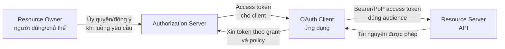
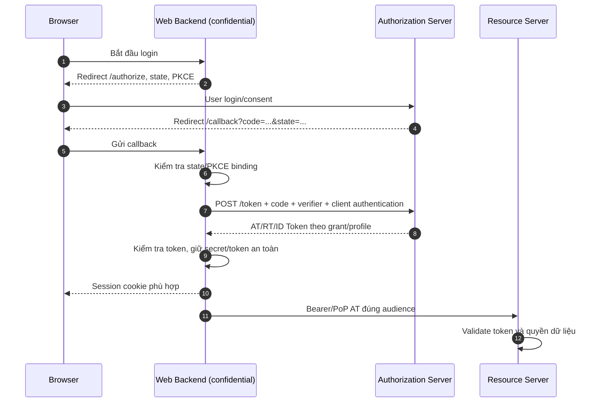
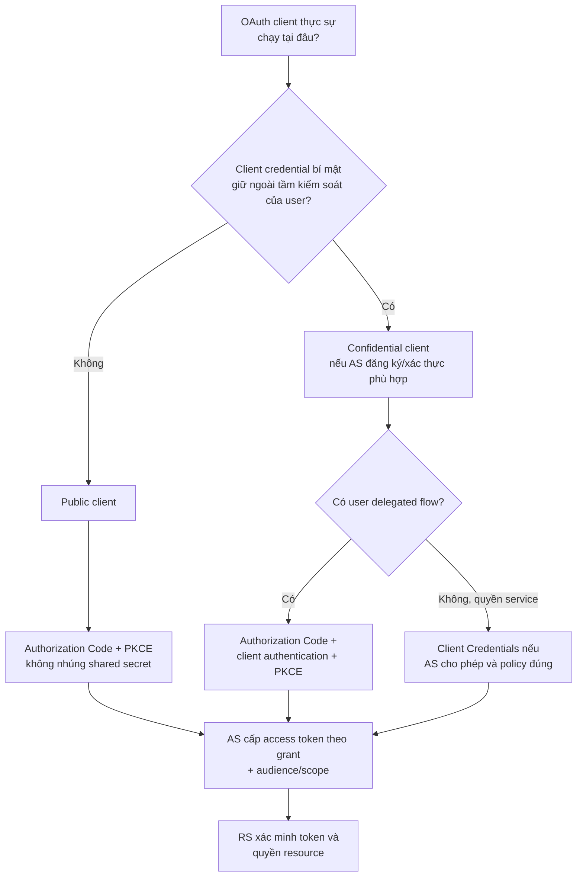

# Confidential client và public client

## Mục tiêu học tập

Trong module **SECURITY_TOKEN_SECURITY_FUNDAMENTALS**, chúng ta học mô hình tin cậy và vòng đời token bảo mật: phân biệt JWT với opaque token, access token với refresh token, và kiểm tra issuer, audience, scope, thời hạn, quyền, trạng thái thu hồi để hạn chế token bị đánh cắp hoặc phát lại. Để hiểu **ai được quyền xin các token đó**, cần nắm đúng các vai trò OAuth 2.0, đặc biệt là **confidential client** và **public client**.

Sau bài này, bạn có thể:

- Nêu tiêu chí phân loại client: **khả năng bảo mật thông tin xác thực client**, không phải việc ứng dụng “nội bộ”, có giao diện hay dùng HTTPS.
- Phân biệt **client authentication**, **user authentication**, **client authorization** và **ủy quyền truy cập API**.
- Giải thích tại sao một ứng dụng SPA hoặc mobile không trở thành confidential client chỉ bằng cách nhúng `client_secret` vào mã nguồn.
- Thiết kế **Authorization Code + PKCE** cho public client và luồng confidential client với client authentication khi cần.
- So sánh **SPA, mobile/native, backend web application, Backend for Frontend (BFF)** và máy–máy (M2M).
- Phân tích việc phát hành, lưu trữ, làm mới, xoay vòng và thu hồi token theo rủi ro của từng loại client.
- Nhận diện các lỗi như secret bị lộ, dùng `client_id` làm bằng chứng, nhầm ID Token với access token và dùng credential service để vượt quyền người dùng.

## 1. Bốn vai trò OAuth 2.0: ai đang làm gì?

Trong OAuth 2.0, **client** không đồng nghĩa với **người dùng**, và **Authorization Server** cũng không đồng nghĩa với **Resource Server**.

| Vai trò | Nhiệm vụ chính | Ví dụ ở hệ thống Orders |
| --- | --- | --- |
| **Resource Owner (RO)** | Chủ thể có thẩm quyền cấp hoặc từ chối quyền truy cập tài nguyên được bảo vệ, theo mô hình hệ thống. | Người dùng có quyền truy cập đơn hàng của mình. |
| **Client** | Ứng dụng yêu cầu quyền truy cập tài nguyên từ AS và dùng access token để gọi API. | `sales-portal`, ứng dụng mobile hoặc `report-worker`. |
| **Authorization Server (AS)** | Xác thực/kiểm tra các bên theo luồng, áp dụng grant và chính sách, phát hành token. | `https://identity.example.com`. |
| **Resource Server (RS)** | Lưu/tiếp nhận yêu cầu tài nguyên và xác minh access token trước khi thực thi quyền. | `Orders API` hoặc `Billing API`. |



**Client type** là một tính chất bảo mật của **ứng dụng xin token**. Nó **không** thay thế vai trò Resource Owner hay quy định danh tính người dùng. Một confidential client vẫn có thể phục vụ người dùng cuối, còn một public client vẫn có thể truy cập tài nguyên sau khi được cấp quyền theo luồng hợp lệ.

> **Điểm cốt lõi:** Trong OAuth, “confidential” và “public” mô tả **khả năng giữ bí mật credential của chính client**, không mô tả token có chứa dữ liệu riêng tư hay người dùng có được phép truy cập API hay không.

## 2. Confidential client và public client được phân biệt thế nào?

Theo **RFC 6749 `2.1**, confidential client có khả năng giữ bí mật credential của mình hoặc dùng phương thức xác thực client an toàn khác. Public client **không có khả năng bảo đảm bí mật credential** của mình theo mô hình triển khai, ví dụ mã chạy trên thiết bị do người dùng kiểm soát.

### So sánh tổng quát

| Tiêu chí | **Confidential client** | **Public client** |
| --- | --- | --- |
| Môi trường điển hình | Backend/server có ranh giới truy cập và vận hành kiểm soát được. | SPA chạy trong browser; mobile/native/desktop app phân phối cho người dùng. |
| Khả năng giữ `client_secret` | Có thể bảo vệ secret/key phía server theo threat model. | Không thể coi secret dùng chung được nhúng trong app là bí mật. |
| Client authentication tại token endpoint | Có thể và thường phải xác thực theo cấu hình AS, ví dụ `client_secret_basic`, `private_key_jwt` hoặc mTLS. | Không được dựa vào shared secret tĩnh nhúng trong browser/app; AS dùng kiểm tra phù hợp với public client và grant. |
| `client_id` | Định danh đăng ký client; **không phải secret**. | Cũng chỉ là định danh; có thể xuất hiện công khai trong request. |
| Authorization Code flow | Có thể dùng, với client authentication phù hợp; PKCE vẫn nên được áp dụng để bảo vệ code flow. | Có thể dùng với **PKCE**, không đòi secret có thể giữ an toàn. |
| Client Credentials grant chuẩn | Phù hợp với confidential client được AS cho phép. | **Không dành cho public client** theo RFC 6749 `4.4. |
| Nguy cơ chính | Lộ server secret/private key, backend compromise, log/DB sai, confused deputy. | XSS, code interception, giả mạo app, malware trên thiết bị, token trong storage. |
| Refresh token | Có thể được cấp theo policy; vẫn phải bảo vệ, có thể áp dụng rotation/revocation/binding. | Nếu AS cấp, cần biện pháp replay protection như rotation hoặc sender-constraining theo OAuth Security BCP. |

Phân loại này **không phụ thuộc tên framework**. Một website có React/Vue/Angular trên frontend có thể dùng backend confidential client theo mẫu BFF. Ngược lại, một “ứng dụng nội bộ” thuần JavaScript vẫn là **public client** nếu credential phải nằm trong browser của người dùng.

### 2.1. Tại sao `client_id` không phải cơ chế xác thực?

`client_id` cho biết **client tự nhận mình là đăng ký nào**. Nó có thể xuất hiện trong URL authorization request, token request hoặc metadata. Bất kỳ người nào biết giá trị này đều có thể đưa chuỗi đó vào request.

```text
client_id = sales-spa
```

Đoạn trên **không chứng minh** request thực sự đến từ một bản ứng dụng do nhà phát triển phát hành. AS cần dựa trên **redirect URI, PKCE, grant, chính sách đăng ký, client authentication nếu phù hợp** và các biện pháp khác. Một public client không thể tự chứng minh “tôi là ứng dụng chính hãng duy nhất” chỉ nhờ chuỗi `client_id` công khai.

### 2.2. “Đặt secret trong frontend” không làm client trở nên confidential

Ví dụ **sai**:

```javascript
// KHÔNG AN TOÀN: bundle trình duyệt có thể bị xem và sao chép.
const clientId = "sales-spa";
const clientSecret = "embedded-shared-secret"; // KHÔNG đặt secret thật tại đây.
```

Mã JavaScript tải xuống browser, bundle map, DevTools, extension hoặc người vận hành thiết bị đều có thể làm lộ chuỗi được nhúng. Obfuscation, minification, đổi tên biến và mã hóa bằng khóa nằm cùng ứng dụng **không thiết lập được ranh giới bí mật**.

Tương tự, **APK/IPA/ứng dụng desktop** được phân phối tới thiết bị người dùng không thể bảo đảm một `client_secret` dùng chung không bị trích xuất. Nền tảng có Secure Enclave/Keystore hoặc attestation có thể bổ sung khả năng giữ **khóa theo thiết bị/instance**, nhưng không tự động biến mọi bản app cài đặt thành confidential client theo giả định truyền thống; AS phải có mô hình đăng ký, ràng buộc và kiểm chứng riêng.

## 3. Ba câu hỏi khác nhau: xác thực client, xác thực user và cấp quyền

Một thiết kế OAuth an toàn phải tránh trộn lẫn các quyết định:

| Câu hỏi | Bằng chứng/cơ chế ví dụ | Điều không nên suy ra |
| --- | --- | --- |
| **Client là ai?** | `client_id` kèm client authentication nếu confidential; thông số đăng ký/grant/PKCE nếu public. | Client xác thực thành công thì có mọi scope. |
| **Người dùng là ai?** | Login tại AS/OP bằng session, MFA, OIDC ID Token theo luồng. | User đã login thì được gọi mọi Resource Server. |
| **Được cấp quyền gì?** | Grant, consent, policy của AS, `aud` và `scope` được phát hành. | Client xin `admin` là AS phải cấp `admin`. |
| **Được thao tác lên object nào?** | Authorization policy của RS: owner/tenant/ACL/ABAC/ReBAC. | Token `scope=orders:read` được đọc mọi đơn của mọi tenant. |

**Client authentication không phải user authentication.** Khi backend dùng `client_secret_basic` hoặc `private_key_jwt`, AS biết client confidential đã chứng minh credential đăng ký. AS **chưa vì thế xác minh danh tính một người dùng cuối**. Ngược lại, public SPA có thể đăng nhập user qua OIDC thành công dù nó không giữ `client_secret`.

### ID Token và access token khác nhau

- **OIDC ID Token** là thông tin xác thực dành cho **OIDC client/Relying Party**; claim `aud` thường nhắm tới `client_id` của client.
- **OAuth access token** là credential được trình với **Resource Server**, cần đúng issuer, audience, loại token, scope và quyền dữ liệu.
- **Refresh token** được trình ở **token endpoint của AS** để xin token mới; không đưa tới Orders API hoặc Billing API.

Một API không được chấp nhận ID Token làm access token chỉ vì chữ ký đúng và cùng issuer, bất kể client là public hay confidential.

## 4. Public client: Authorization Code + PKCE

Một **SPA** chạy trong browser hoặc ứng dụng **native/mobile** thường không giữ được secret tĩnh dùng chung. Authorization Code flow với **PKCE** cho phép client xin token mà không cần nhúng secret vào app. PKCE dùng **`code_verifier`** ngẫu nhiên có entropy cao và **`code_challenge`** được dẫn xuất (thường phương thức `S256`) để ràng buộc lần đổi authorization code với phiên yêu cầu hợp lệ.

### 4.1. Luồng minh họa

```mermaid
sequenceDiagram
    autonumber
    participant U as User / Browser
    participant C as Public Client (SPA)
    participant AS as Authorization Server
    participant RS as Orders API
    C->>C: Tạo code_verifier, code_challenge S256 và state
    C->>U: Chuyển hướng đến /authorize với challenge + state
    U->>AS: Đăng nhập/consent theo policy
    AS-->>U: Redirect tới redirect_uri với code + state
    U-->>C: Nhận callback
    C->>C: Kiểm tra state + redirect context
    C->>AS: POST /token: code + code_verifier + client_id
    AS->>AS: Kiểm tra code, redirect_uri, PKCE và grant
    AS-->>C: Access token; refresh token nếu policy cho phép
    C->>RS: Authorization: Bearer AT qua HTTPS
    RS->>RS: Validate token + quyền resource
```

**PKCE không phải client authentication bằng shared secret.** Nó ràng buộc authorization code với bên nắm `code_verifier` của giao dịch. Kẻ lấy được riêng **authorization code** nhưng không có verifier tương ứng sẽ khó đổi code thành token; tuy vậy, PKCE **không ngăn XSS** đang chạy trong ứng dụng đọc token sau khi cấp hoặc lợi dụng phiên hiện tại.

### 4.2. Request minh họa

Authorization request (đã rút gọn, các giá trị trong dấu ngoặc nhọn chỉ là placeholder):

```http
GET /authorize?response_type=code&client_id=sales-spa&redirect_uri=https%3A%2F%2Fapp.example.com%2Fcallback&scope=openid%20orders%3Aread&state=<unguessable-state>&code_challenge=<s256-challenge>&code_challenge_method=S256 HTTP/1.1
Host: identity.example.com
```

Ở token endpoint:

```http
POST /oauth2/token HTTP/1.1
Host: identity.example.com
Content-Type: application/x-www-form-urlencoded

grant_type=authorization_code&client_id=sales-spa&code=<authorization-code>&redirect_uri=https%3A%2F%2Fapp.example.com%2Fcallback&code_verifier=<original-code-verifier>
```

Không có `client_secret` trong ví dụ public client. Authorization code là credential **ngắn hạn, dùng một lần**, phải được bảo vệ khỏi log/query leak và kiểm tra `state`, redirect URI, `code_verifier` phù hợp; với OIDC còn phải xử lý `nonce`/ID Token validation theo flow đã chọn.

**Lưu ý:** các ví dụ là ký hiệu giao thức, không đại diện cho một Authorization Server cụ thể. Thư viện OAuth/OIDC đáng tin nên đảm nhiệm tạo verifier/state, redirect và kiểm chứng theo profile; không tự viết lại giao thức bằng các chuỗi nối URL thiếu bảo vệ.

### 4.3. Bảo vệ redirect URI và luồng đăng nhập

Đối với public client, redirect URI là một ranh giới quan trọng vì AS gửi **authorization code** về đó. Cần:

- Đăng ký redirect URI chính xác theo chính sách AS; không cho client tự chọn URL nhận code ngoài đăng ký.
- Không dùng open redirect hoặc sao chép `code`, `state` sang host do attacker chỉ định.
- Kiểm tra `state`, PKCE và sự liên kết với phiên yêu cầu; nếu client giao tiếp nhiều AS, xét biện pháp chống mix-up theo profile (ví dụ RFC 9207).
- Với mobile/native, dùng redirect mechanism phù hợp nền tảng (loopback URI, claimed HTTPS/app links hoặc custom scheme theo RFC 8252), nhận diện nguy cơ app khác chặn scheme.
- Không gửi access token qua query string; trong Authorization Code flow, **code** trong redirect theo giao thức **không phải** access token API.

Việc có một redirect URI hợp lệ **chưa đủ** để biến public client thành confidential client; kiểm tra redirect ngăn code đến sai đích, còn credential secret vẫn không thể được giả định là bí mật ở môi trường browser/app phân phối.

## 5. Confidential client: backend giữ được credential

Một **server-side web application**, API gateway ứng dụng hoặc BFF do tổ chức kiểm soát có thể giữ credential trong kho server-side. Khi đăng ký với AS như **confidential client**, nó dùng client authentication khi gọi token endpoint theo phương thức AS chấp thuận.

Các ví dụ **client authentication**:

| Phương thức | Cách hoạt động | Lưu ý bảo mật |
| --- | --- | --- |
| `client_secret_basic` | Gửi client ID/secret theo HTTP Basic ở token endpoint qua TLS. | Chỉ dùng secret phía server; không log `Authorization`; quản lý vòng đời/rotation của secret. |
| `client_secret_post` | Secret nằm trong form body của token request theo profile hỗ trợ. | Dễ bị ghi body vào log; thông thường ưu tiên phương thức an toàn hơn nếu AS hỗ trợ. |
| `private_key_jwt` | Client ký assertion bằng private key, AS xác minh bằng key đã đăng ký. | Bảo vệ private key, kiểm tra audience/thời gian/`jti`/anti-replay theo profile. |
| **Mutual TLS (mTLS)** | Xác thực client bằng chứng chỉ trong kết nối TLS theo profile. | Quản lý cert/key, chuỗi proxy và xác thực chứng chỉ đúng ranh giới. |

**Client authentication phải được kiểm chứng bởi AS**, không phải client tự đặt header `X-Confidential: true`. Secret hoặc private key phía server cũng có thể bị lộ nếu log, container, CI/CD, backup hoặc IAM permission yếu. “Confidential” nghĩa là **có khả năng bảo vệ theo mô hình triển khai**, không phải **bất khả xâm phạm**.

### 5.1. Authorization Code flow với confidential backend



Ví dụ token request (giả định client đăng ký `client_secret_basic`; secret nằm ở backend):

```http
POST /oauth2/token HTTP/1.1
Host: identity.example.com
Authorization: Basic <base64-client-id-and-secret>
Content-Type: application/x-www-form-urlencoded

grant_type=authorization_code&code=<authorization-code>&redirect_uri=https%3A%2F%2Fportal.example.com%2Fcallback&code_verifier=<original-verifier>
```

**Không** ghi basic credential, authorization code, refresh token hoặc full token response vào log. Secret phải nằm trong secret manager/kho bảo vệ server, không được đưa vào template HTML, JavaScript bundle hay API response.

Backend có thể dùng session cookie `Secure`, `HttpOnly`, `SameSite` phù hợp và chống CSRF cho request thay đổi trạng thái. `HttpOnly` giảm rủi ro JavaScript đọc cookie thô, nhưng **XSS vẫn có thể gửi request qua phiên đang hoạt động**; vẫn cần xử lý DOM an toàn, CSP và phân quyền ở API.

### 5.2. Khi nào dùng client authentication mạnh hơn?

Tùy yêu cầu kiểm soát và năng lực AS, confidential client có thể dùng `private_key_jwt` hoặc mTLS thay cho shared secret dài hạn để giới hạn rủi ro quản lý credential dùng chung. Tuy nhiên:

- Private key vẫn cần **lưu trữ, xoay và thu hồi** an toàn; không tự động an toàn chỉ vì dùng chữ ký.
- Assertion dùng `private_key_jwt` có thể bị replay nếu AS không kiểm tra claims/thời hạn/`jti` theo profile.
- Certificate trong mTLS cần bảo đảm chứng chỉ thuộc client được đăng ký; không tin header giả do phía request tự gửi.
- Sender-constrained **access token** là một kiểm soát khác với **client authentication**. AS có thể xác thực client rồi vẫn cấp bearer access token nếu profile/chính sách như vậy.

## 6. BFF: kết hợp browser frontend với confidential OAuth client

**Backend for Frontend (BFF)** giúp giảm việc đưa access/refresh token vào môi trường JavaScript. Trong mẫu thường dùng:

1. Browser giao tiếp với BFF và giữ **session cookie**, không giữ raw access token hoặc refresh token.
2. BFF, khi được AS đăng ký và xác thực như confidential client, thực hiện code exchange và quản lý token trong kho server-side.
3. BFF dùng access token đúng audience để gọi API; browser nhận dữ liệu đã qua kiểm tra session và quyền.
4. Khi token hết hạn, BFF thực hiện refresh/rotation theo trạng thái grant và cập nhật kho token server-side.

```text
Browser UI                       BFF                         AS/RS
  |                               |                           |
  |--- Cookie session ----------->|                           |
  |                               |--- AT / RT server-side --->|
  |<-- JSON được phân quyền ------|<-- dữ liệu từ RS ----------|

Không có raw access/refresh token trong response gửi cho JavaScript.
```

**Phân loại đúng:** Browser vẫn là môi trường công khai không thể giữ secret. BFF có thể là **confidential OAuth client** vì token và client credential nằm ở server. Không nói rằng “SPA trở thành confidential” chỉ vì frontend được triển khai cùng backend; điều cần xem là **thành phần nào thực sự là client được đăng ký với AS và giữ credential ở đâu**.

### BFF không chữa mọi lỗi bảo mật

- XSS trong frontend có thể dùng session cookie đang hoạt động để gọi BFF và đọc những response cùng origin được phép.
- Cookie cần chống CSRF, session fixation, hijacking, session expiry/revocation và giới hạn origin/host.
- Backend có thể thành *confused deputy* nếu dùng token service quyền cao để phục vụ yêu cầu user không có quyền.
- BFF vẫn cần kiểm tra yêu cầu người dùng và Resource Server phải xác minh token, audience, scope, quyền trên object/tenant.
- Mỗi access/refresh token ở server phải được bảo vệ khỏi rò qua logs, tracing, database và lỗi chuyển tiếp Authorization header.

### 6.1. Khi ứng dụng có nhiều thành phần

Một sản phẩm có browser SPA, backend API và worker định kỳ **không nhất thiết chỉ có một OAuth client duy nhất**. Có thể cần đăng ký riêng:

- `portal-bff`: confidential client của Authorization Code flow, quản lý token người dùng server-side.
- `report-worker`: confidential client dùng Client Credentials với scope máy–máy hẹp.
- `native-app`: public client của Authorization Code + PKCE, không dùng secret dùng chung của backend.

Nếu AS hỗ trợ mô hình distributed client nhiều thành phần, phải theo profile/đăng ký mà AS quy định. Không tái sử dụng cùng `client_secret` từ backend cho app mobile hoặc SPA chỉ vì chúng thuộc cùng một sản phẩm.

## 7. Client Credentials grant: khi client hành động cho chính nó

Luồng **Client Credentials** trong RFC 6749 `4.4 dành cho **confidential client** được AS cho phép yêu cầu access token dựa trên danh tính/quyền của ứng dụng. Nó không có bước người dùng đăng nhập để cấp delegated access trong luồng này.

Ví dụ `report-worker` gọi Orders API để tạo báo cáo định kỳ:

```http
POST /oauth2/token HTTP/1.1
Host: identity.example.com
Authorization: Basic <base64-report-worker-credentials>
Content-Type: application/x-www-form-urlencoded

grant_type=client_credentials&scope=orders%3Asummary%3Aread
```

AS có thể trả:

```json
{
  "access_token": "<orders-access-token>",
  "token_type": "Bearer",
  "expires_in": 900,
  "scope": "orders:summary:read"
}
```

Resource Server phải kiểm tra `iss`, `aud`, thời hạn, token type, scope và quyền của **service principal** theo chính sách. **Không coi service access token là bằng chứng người dùng cuối đã đồng ý** với bất kỳ thao tác cụ thể nào.

### 7.1. Client Credentials không phải “bỏ qua authorization”

Một client confidential có thể xác thực hoàn toàn đúng nhưng bị AS từ chối scope `orders:admin` vì client chỉ được đăng ký `orders:summary:read`. Việc kiểm tra:

```text
valid_client_authentication = true
requested_scope = orders:admin
registered_grants/scopes do not permit orders:admin

Result: từ chối cấp quyền vượt phạm vi.
```

Nếu service A dùng token Client Credentials quyền cao để truy cập Billing rồi trả dữ liệu cho user ít quyền hơn, vẫn có nguy cơ *confused deputy*. Service phải đánh giá **quyền user/actor**, tenant và object policy trước khi tiết lộ dữ liệu.

Theo RFC 6749, **refresh token SHOULD NOT được cấp với Client Credentials grant**. Workload thường xin access token mới khi cần theo cơ chế client authentication; không giả định worker có refresh token hoặc dùng refresh token thay cho việc bảo vệ private key/client secret.

## 8. Public client và việc bảo vệ refresh token

Refresh token có thể giữ quyền truy cập lâu hơn access token nên rủi ro ở browser/mobile cao. Dù là public hay confidential, **refresh token vẫn là credential nhạy cảm** và chỉ được dùng ở token endpoint của AS.

**OAuth 2.0 Security Best Current Practice (RFC 9700)** đặt yêu cầu bảo vệ replay cho refresh token của **public client**: AS dùng **refresh token rotation hoặc sender-constrained refresh token** theo profile phù hợp nếu cấp refresh token. AS cũng cần ràng buộc token với client, phạm vi grant/resource và thời hạn; không cấp refresh token tùy tiện.

### 8.1. Refresh token rotation

```text
Grant / family F
  R0: ACTIVE  --refresh-->  R0: ROTATED, R1: ACTIVE
  R1: ACTIVE  --refresh-->  R1: ROTATED, R2: ACTIVE

R0 bị trình lại sau rotation -> reuse signal
AS có thể revoke refresh token active/family theo replay policy.
```

Điểm cần lưu ý:

- Token cũ phải **ngừng có thể sử dụng**, AS giữ trạng thái/quan hệ đủ để phát hiện reuse.
- Refresh đồng thời hoặc response bị mất có thể làm token cũ xuất hiện lại. Client cần **single-flight**, retry policy và khả năng tái đăng nhập.
- Đổi token nhưng không cập nhật state nguyên tử có thể tạo hai thế hệ active song song.
- Rotation không chặn được mọi lần đánh cắp: nếu attacker nắm token active và dùng trước client hợp lệ, AS có thể chỉ phát hiện khi token cũ được trình lại.
- Revoke refresh family **không tự bảo đảm** JWT access token đã phát hành lập tức bị RS từ chối nếu RS chỉ xác minh chữ ký tới `exp`.

### 8.2. Sender-constraining và giới hạn

Một refresh token có thể được ràng buộc với khóa/chứng chỉ theo profile, khiến **chỉ sao chép chuỗi token** không đủ để xin token mới nếu attacker không có bằng chứng sở hữu khóa. Với DPoP (RFC 9449), AS cần xác minh proof phù hợp; với mTLS (RFC 8705) cần xác thực chứng chỉ/khóa đúng profile.

Tuy vậy:

- Nếu attacker có cả token lẫn khóa, cơ chế ràng buộc có thể không đủ.
- XSS đang chạy trong SPA có thể lợi dụng **khả năng ký/gọi request** của ứng dụng dù private key không thể xuất ra khỏi Web Crypto.
- Sender-constraining token **không tự biến public client thành confidential client**; hai vấn đề mô tả các bảo đảm khác nhau.
- AS vẫn kiểm tra client, grant, scope, audience/resource, consent, session và trạng thái token.

### 8.3. Nơi lưu refresh token

| Nơi lưu | Nguy cơ | Cân nhắc |
| --- | --- | --- |
| `localStorage` của SPA | XSS cùng origin đọc token trực tiếp, dữ liệu có thể tồn tại lâu. | Tránh lưu refresh token dài hạn ở JS-accessible storage khi có phương án tốt hơn. |
| `sessionStorage` | XSS trong tab vẫn đọc được. | Giảm một phần persistence nhưng **không giải quyết XSS**. |
| Memory JavaScript | Active XSS có thể sử dụng/hook token, reload có thể mất state. | Hạn chế persistence nhưng không phải kho bí mật cô lập khỏi script đang chạy. |
| Mobile secure storage | Thiết bị có thể bị compromise/malware; bảo vệ phụ thuộc nền tảng. | Dùng API Keystore/Keychain phù hợp, rotation hoặc sender binding nếu hỗ trợ. |
| Server token vault của BFF/backend | Secret/token nằm server, browser chỉ có session reference. | Bảo vệ DB, secret management, session, CSRF và backend compromise. |

Không log raw refresh token, access token, client assertion, `Authorization` header, cookie session hay private key vào telemetry, error reporting hoặc support tickets.

## 9. Confidential client vẫn phải bảo vệ secret và vòng đời token

Client confidential không được hiểu là “một lần cấp secret thì mãi mãi an toàn”. Credential có thể lộ qua:

- Repository, CI/CD logs, Docker image hoặc cấu hình đóng gói.
- Environment dump, memory snapshot, debugger và crash report.
- Gateway/APM log HTTP `Authorization: Basic ...` hoặc token endpoint response.
- Cấp quyền quá rộng ở secret manager hoặc token registry.
- Credential bị dùng chung giữa staging/production hoặc nhiều workload.

### Các biện pháp nền tảng

1. Lưu client secret/private key trong **secret manager, HSM/KMS hoặc kho phù hợp**; không hard-code vào source code hay browser bundle.
2. Dùng **TLS** khi gọi AS/RS; xác minh chứng chỉ và hostname, không cho phép downgrade.
3. Xoay và thu hồi credential khi có rủi ro; dùng key version/`kid` theo profile khi xác thực JWT client assertion.
4. Giới hạn mỗi client được dùng những grant, resource và scope nào; tách credential giữa workload/môi trường khác nhau.
5. Dùng token ngắn hạn, audience/scope tối thiểu, bảo vệ refresh token và state/rotation theo policy.
6. Redact credential ở gateway, APM, tracing và logs; audit danh tính client **sau khi xác thực**, không dựa vào client ID tự khai ở request lỗi.
7. Khi credential bị lộ, đánh giá các access token đã cấp: **xoay client secret không tự động thu hồi JWT còn hiệu lực tại RS**.

### Lỗi client authentication và token validation khác nhau

Nếu secret/certificate của confidential client không hợp lệ tại token endpoint, AS có thể trả lỗi OAuth `invalid_client`. Nếu authorization code hết hạn/đã sử dụng hoặc grant không phù hợp, có thể là `invalid_grant`. Khi client đã nhận access token nhưng token sai `aud` hoặc không đủ scope tại RS, lỗi xảy ra **ở Resource Server**, không phải bằng chứng client credential sai.

Không thiết kế flow như sau:

```text
RS từ chối access token -> thử lại bằng client_secret của frontend
```

Đó là nhầm lẫn vai trò. Client phải xin token đúng resource/grant ở AS; RS phải kiểm chứng theo hợp đồng của chính API và không bao giờ yêu cầu app browser đưa client secret để vượt lỗi.

## 10. Resource Server xác minh token như nhau về nguyên tắc

Khi Orders API nhận token, việc token bắt nguồn từ **public SPA** hay **confidential backend** không tự cho phép API bỏ qua kiểm tra. Resource Server cần:

1. Kiểm tra token được mang qua kênh phù hợp, thường `Authorization: Bearer` qua HTTPS; không đặt access token vào query string.
2. Xác định issuer tin cậy; với JWT xác minh chữ ký/thuật toán bằng key gắn đúng issuer, với opaque token dùng introspection tin cậy.
3. Kiểm tra `iss`, `aud`, `exp`/`nbf`, loại access token và các yêu cầu profile.
4. Kiểm tra `scope`/permission và quan hệ tenant/owner/ACL của tài nguyên hiện tại.
5. Kiểm tra cơ chế sender-constraining (mTLS/DPoP) nếu token thuộc profile đó, không fallback chấp nhận token thiếu proof.
6. Áp dụng trạng thái thu hồi, giới hạn phiên hoặc kiểm tra quyền động nếu yêu cầu nghiệp vụ cần.

### Ví dụ JWT access token

```json
{
  "iss": "https://identity.example.com",
  "sub": "user-42",
  "aud": "api://orders",
  "client_id": "sales-spa",
  "scope": "orders:read",
  "iat": 1800000000,
  "exp": 1800000900
}
```

Đây là **payload minh họa, không phải token hoàn chỉnh**. Việc nhìn thấy `client_id=sales-spa` chỉ cho biết claim mà issuer đã ký/khẳng định theo profile. Nó **không có nghĩa** API phải tin token yếu hơn hoặc mạnh hơn một cách tự động dựa vào tên “spa”, cũng không có nghĩa user được xem mọi đơn hàng.

Ở Resource Server, thông thường:

```text
allow(request) =
    tokenAuthenticAndActiveUnderPolicy
    AND issuerTrusted
    AND audienceMatchesThisAPI
    AND accessTokenTypeExpected
    AND requiredScopeGranted
    AND actorOrUserMayAccessRequestedObject
```

**Phân loại client là thông tin đầu vào của chính sách cấp token/rủi ro**, không phải lý do vô hiệu các validator ở API.

## 11. Những lỗi bảo mật hay gặp khi phân loại client

| Sai lầm | Hậu quả | Cách sửa |
| --- | --- | --- |
| Đưa `client_secret` vào SPA/mobile và đăng ký như confidential. | Mọi bản app có thể làm lộ secret, giả mạo client. | Đăng ký public client và dùng grant/PKCE phù hợp; không nhúng secret dùng chung. |
| Cho rằng `client_id` công khai đủ xác thực ứng dụng. | Client bất kỳ có thể tự khai cùng ID. | Không dùng client ID làm bằng chứng; áp dụng registration/PKCE/client auth theo loại client. |
| Không dùng PKCE với public Authorization Code flow. | Tăng rủi ro đánh cắp/tiêm authorization code. | Dùng PKCE `S256` và kiểm tra binding cùng các biện pháp CSRF/mix-up phù hợp. |
| Dùng implicit grant để “tránh cần backend/secret”. | Access token có thể xuất hiện qua browser front channel, tăng rủi ro. | Dùng Authorization Code + PKCE theo hướng dẫn OAuth hiện đại. |
| Coi login user thành công là confidential client auth. | Trộn bằng chứng danh tính user với danh tính ứng dụng. | Tách user authentication, client authentication và cấp quyền. |
| Cho public client dùng Client Credentials với secret nhúng sẵn. | Credential bị trích xuất, token service bị lạm dụng. | M2M confidential client đặt ở backend, phân quyền service đúng mục đích. |
| Coi BFF bảo đảm không còn XSS/CSRF. | Script có thể lạm dụng session, request thay đổi trạng thái. | Bảo vệ session cookie, CSRF, DOM/CSP và object authorization. |
| Để access/refresh token vào `localStorage` vì “JWT đã ký”. | XSS có thể đọc credential và phát lại. | Giảm JS token exposure, BFF/memory phù hợp, TTL và refresh rotation. |
| Không ràng buộc refresh token với client/grant. | Credential bị dùng ở client khác hoặc xin quyền vượt grant. | Client/grant binding, rotation/sender-constraining, TTL/revocation. |
| Coi client authentication thành công là có mọi scope. | Client service dễ leo thang quyền. | AS giới hạn scope/resource và RS kiểm tra object policy. |
| Dùng ID Token thay access token tại API. | Cross-token confusion và sai audience. | RS chỉ chấp nhận OAuth access token đúng profile. |
| Bỏ `aud` vì token cùng issuer và đúng chữ ký. | Token cho API A bị dùng ở API B. | Mỗi RS xác minh audience chính xác. |
| Gộp mọi sản phẩm vào một client ID/secret. | Khó giới hạn quyền, rotate, audit, điều tra xâm nhập. | Đăng ký riêng theo thành phần, môi trường và grant cần thiết. |

## 12. Chọn loại client theo kiến trúc thực tế

| Kiến trúc | Phân loại hợp lý theo mô hình triển khai | Flow và kiểm soát trọng tâm |
| --- | --- | --- |
| SPA chỉ chạy ở browser, gọi API trực tiếp. | **Public client**. | Authorization Code + PKCE, redirect URI chính xác, bảo vệ XSS/token storage, scope và audience hẹp. |
| Mobile/native/desktop app trên thiết bị người dùng. | **Public client** trong mô hình điển hình. | Authorization Code + PKCE, redirect mechanism theo platform, secure storage, refresh token protection. |
| Server-side web app giữ token và client secret ở backend. | **Confidential client** nếu AS đăng ký và xác thực phù hợp. | Authorization Code + client authentication, PKCE khi có thể, session/CSRF và token vault. |
| SPA frontend + BFF giữ token/secret ở server. | **BFF là confidential OAuth client**; browser là môi trường công khai. | Authorization Code qua BFF, browser session cookie, server-side refresh/rotation, XSS/CSRF controls. |
| Worker định kỳ đọc Orders API theo quyền của chính service. | **Confidential client**. | Client Credentials, client authentication, scope `orders:summary:read`, secret/key rotation. |
| Browser gửi request thẳng đến AS bằng client ID/secret lấy từ backend rồi nhúng vào JS. | **Không thành confidential** chỉ vì secret gốc từng nằm trên server. | Thiết kế lại: BFF trao đổi token server-side hoặc chuyển sang public flow. |
| App có frontend, backend và nhiều workers. | Có thể gồm **nhiều client registrations**. | Mỗi thành phần có grant, callback, credential, scope và ranh giới lưu trữ riêng. |

### Cây quyết định nhanh



Sơ đồ là **cách tư duy**, không phải bộ quy tắc tự động đăng ký. Trong thực tế còn có grant, profile ngành, security attestation và thành phần phân tán. Nếu chưa xác lập được khả năng giữ bí mật credential, **không giả định client là confidential** chỉ vì mong muốn có client secret.

## 13. Kịch bản thực hành: Sales Portal, Mobile và Report Worker

Hệ thống có ba client:

```text
AS: https://identity.example.com
Orders API: aud=api://orders
Billing API: aud=api://billing

sales-spa      -> public browser client
sales-mobile   -> public native client
report-worker  -> confidential backend client
```

AS chỉ cấp quyền tối thiểu theo đăng ký/ủy quyền, Orders API kiểm tra audience và object policy.

| Tình huống | Kết luận đúng |
| --- | --- |
| `sales-spa` yêu cầu Authorization Code + PKCE không có client secret. | **Hợp lý** với public client nếu redirect/grant/policy đúng. |
| Developer đưa `client_secret` chung vào JavaScript của `sales-spa` để “an toàn hơn”. | **Sai**: secret công khai qua browser bundle, không chứng minh client. |
| `sales-mobile` được phân phối cho hàng nghìn máy, tất cả dùng một secret tĩnh. | **Sai** khi coi secret đó là bí mật; cần public-client flow/bảo vệ theo platform. |
| `report-worker` dùng `client_credentials` để xin `orders:summary:read`. | **Hợp lý** nếu AS xác thực confidential client và chính sách cho phép scope/resource. |
| `sales-spa` xin `orders:admin` nhưng user chỉ được đọc đơn. | **Không được tự cấp**; AS từ chối hoặc giới hạn phạm vi theo policy. |
| Token `aud=api://orders` được `sales-spa` gửi tới Billing API. | **Billing từ chối** dù JWT do cùng AS ký và còn hạn. |
| User đăng nhập OIDC, nhận ID Token có `aud=sales-spa` rồi dùng gọi Orders API. | **Từ chối**: ID Token không phải access token của Orders API. |
| BFF có client secret server-side nhưng gửi refresh token cho browser để lưu ở `localStorage`. | **Phá ranh giới BFF**, tăng nguy cơ XSS đánh cắp credential. |
| `report-worker` có scope ghi theo quyền service, backend trả dữ liệu Billing nhạy cảm cho user bất kỳ. | **Sai**: confused deputy; phải kiểm tra user/tenant/object policy trước khi tiết lộ. |
| SPA có refresh token rotation, nhưng XSS lấy token active trước khi rotation. | **Vẫn có rủi ro**; rotation chỉ giúp hạn chế/phát hiện reuse, không ngăn mọi lần dùng đầu tiên. |
| Confidential client bị lộ secret; tổ chức xoay secret nhưng JWT cũ vẫn còn hạn. | Cần đánh giá token đã phát hành/revocation; **xoay secret không tự hủy mọi access token cũ**. |

### Câu hỏi tự kiểm tra

1. Confidential client khác public client theo tiêu chí nào? Có phải “ứng dụng được xây cho nội bộ” hay không?
2. Vì sao `client_id` không đủ làm bằng chứng xác thực và `client_secret` nhúng trong SPA không còn là secret?
3. PKCE bảo vệ bước nào của Authorization Code flow? Nó có chặn XSS đọc access token sau issuance không?
4. Confidential backend đã xác thực tại token endpoint thì có đồng nghĩa đã xác thực một người dùng cuối không?
5. Khi triển khai SPA + BFF, thành phần nào được đăng ký và hoạt động như confidential OAuth client?
6. Vì sao Client Credentials không phải phương án “đăng nhập thay người dùng” và không dành cho SPA public client?
7. Refresh token của public client nên có cơ chế replay protection nào theo OAuth Security BCP nếu AS quyết định phát hành?
8. Nếu token đến từ client confidential nhưng có `aud` sai, Orders API có nên nhận không?
9. Nếu confidential service gọi Billing thay mặt user, cần bảo vệ gì để tránh confused deputy?
10. Vì sao dùng DPoP với key không xuất được vẫn không làm một public SPA miễn nhiễm XSS?

**Gợi ý trả lời:** (1) Khả năng giữ credential client và phương thức xác thực phù hợp, không phải độ phổ biến hay tính nội bộ của app. (2) Client ID công khai; shared secret nằm trong code phân phối có thể bị trích xuất. (3) PKCE bảo vệ code exchange, không bảo vệ token đã cấp khỏi mã XSS. (4) Không; client và user là hai danh tính/điều kiện khác nhau. (5) BFF ở server, không phải JavaScript trong browser. (6) Client Credentials dựa trên quyền service principal của confidential client, không có delegated user grant. (7) Rotation hoặc sender-constrained refresh token theo profile, cùng TTL/client/grant binding. (8) Không; mỗi RS phải kiểm tra audience. (9) Kiểm tra ngữ cảnh user/actor, delegation, scope/resource và object policy. (10) Active XSS có thể gọi các khả năng ký/request mà trang có, dù không xuất được bytes khóa.

## 14. Checklist triển khai

- [ ] Xác định **thành phần OAuth client thực sự** và khả năng giữ bí mật credential trước khi chọn loại đăng ký.
- [ ] Không nhúng shared `client_secret`/private key của confidential client vào SPA/mobile/desktop app phân phối cho người dùng.
- [ ] Không coi `client_id`, CORS origin, redirect URI hoặc header tự khai là bằng chứng client authentication.
- [ ] Với public Authorization Code client, dùng **PKCE `S256`**, redirect URI đã đăng ký và liên kết giao dịch bằng `state`; với OIDC kiểm tra thêm điều kiện profile như `nonce`.
- [ ] Với confidential client, dùng client authentication do AS hỗ trợ, bảo vệ secret/key server-side và thực hiện rotation/revocation khi cần.
- [ ] Không dùng Client Credentials grant cho public SPA; dành cho confidential workload có quyền service được AS cấp tường minh.
- [ ] Khi dùng BFF, browser giữ session cookie phù hợp; access/refresh token và client credential được quản lý ở backend.
- [ ] Bảo vệ session/BFF bằng `Secure`, `HttpOnly`, `SameSite`, CSRF protection, chống XSS và object-level authorization.
- [ ] Nếu AS cấp refresh token cho public client, triển khai rotation hoặc sender-constraining theo RFC 9700, cùng client binding và policy thời gian.
- [ ] Phân biệt client authentication, user authentication, OAuth grant, issuer/audience/scope và quyền trên từng tài nguyên.
- [ ] Resource Server xác minh JWT/opaque token, token type, `iss`, `aud`, thời hạn, scope và trạng thái thu hồi theo policy, không bỏ qua vì loại client.
- [ ] Không dùng ID Token/refresh token/client assertion làm bearer access token để gọi API.
- [ ] Giới hạn scope/resource riêng cho từng client và môi trường; không tái sử dụng một credential có đặc quyền khắp hệ thống.
- [ ] Không ghi raw access token, refresh token, `Authorization` header, client secret hoặc private key trong logs/tracing/analytics.
- [ ] Kiểm thử code interception, XSS, client secret exposure, redirect URI lệch, sai audience, thiếu scope, token reuse và trường hợp service cấp dữ liệu vượt quyền user.

## Tài liệu nền tảng

- **RFC 6749 — The OAuth 2.0 Authorization Framework:** các vai trò (`1.1`), client types (`2.1`), client authentication, Authorization Code, Client Credentials và refresh token.
- **RFC 7636 — Proof Key for Code Exchange (PKCE):** `code_verifier`, `code_challenge` và bảo vệ authorization code.
- **RFC 8252 — OAuth 2.0 for Native Apps:** redirect URI, external user-agent và mô hình public native client.
- **RFC 9700 — Best Current Practice for OAuth 2.0 Security:** bảo vệ public client, PKCE, refresh token rotation/sender-constraining và giảm rủi ro OAuth.
- **RFC 7591 — OAuth 2.0 Dynamic Client Registration Protocol:** đăng ký metadata client, trong đó có phương thức xác thực token endpoint khi áp dụng.
- **RFC 7523 — JSON Web Token (JWT) Profile for OAuth 2.0 Client Authentication and Authorization Grants:** JWT client assertion và những claim cần xác minh theo profile.
- **RFC 8705 — OAuth 2.0 Mutual-TLS Client Authentication and Certificate-Bound Access Tokens:** mTLS client authentication và ràng buộc access token.
- **RFC 9449 — OAuth 2.0 Demonstrating Proof of Possession (DPoP):** ràng buộc token với khóa và proof theo request.
- **RFC 7519 / RFC 9068:** JWT và JWT Profile for OAuth 2.0 Access Tokens, kiểm tra issuer, audience, thời hạn và token type.
- **OpenID Connect Core 1.0:** ID Token, xác minh người dùng ở OIDC client và luồng login.
- **OWASP OAuth2 Cheat Sheet / OAuth 2.0 for Browser-Based Applications:** các lưu ý kiến trúc SPA, token storage, BFF và client security.

**Ghi nhớ:** **Confidential client** có khả năng giữ và chứng minh credential của chính ứng dụng trong môi trường được bảo vệ; **public client** không thể dựa vào shared secret nhúng trong browser/mobile. Public client có thể dùng **Authorization Code + PKCE**; confidential backend/BFF có thể dùng **client authentication** và Client Credentials khi quyền service phù hợp. Nhưng **loại client không thay việc xác minh access token, audience, scope, thời hạn, thu hồi và quyền trên dữ liệu**. Bảo mật đúng phải nối liền **cách đăng ký client → luồng cấp token → bảo vệ nơi lưu/vận chuyển → kiểm chứng và phân quyền tại API**.
