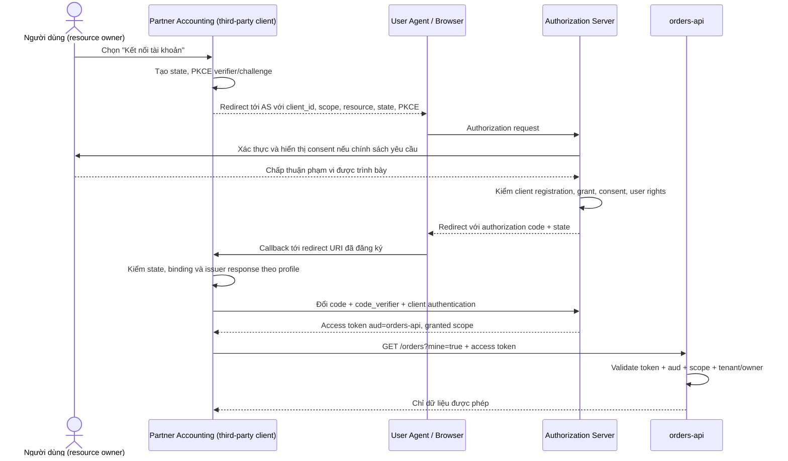

# First-party và third-party client trong OAuth 2.0

Một ngân hàng có ứng dụng mobile của chính mình và đồng thời cho phép một ứng dụng quản lý chi tiêu bên ngoài, sau khi người dùng chấp thuận, đọc lịch sử giao dịch. Cả hai ứng dụng đều có thể là **OAuth 2.0 client**, dùng cùng authorization server (AS) và gọi cùng một resource server (RS). Tuy nhiên, **quan hệ sở hữu, mục đích sử dụng dữ liệu, quyền được đăng ký và ranh giới tin cậy** của chúng rất khác nhau.

Ứng dụng do ngân hàng phát triển thường được gọi là **first-party client** đối với hệ sinh thái ngân hàng. Ứng dụng bên ngoài thường được gọi là **third-party client**. Hai nhãn này giúp mô tả **mối quan hệ giữa tổ chức cung cấp tài nguyên/dịch vụ và ứng dụng**, nhưng **không tự nói client có thể giữ bí mật hay được cấp những scope nào**. Một third-party backend có thể là confidential client xác thực mạnh; một first-party SPA vẫn là public client không thể giữ `client_secret` an toàn trong mã JavaScript.

Trong chương **OAuth2 roles** của module **SECURITY_TOKEN_SECURITY_FUNDAMENTALS**, bài học phân biệt hai mô hình client qua vòng đời token: OAuth 2.0/OIDC, access token và refresh token, JWT và opaque token, claims, scope, audience, phát hành, lưu trữ, xác minh, thu hồi và những biện pháp ngăn token bị đánh cắp/phát lại. Đích đến là hiểu **ai được tin ở ranh giới nào**, chứ không phải gắn nhãn «nội bộ = an toàn» hoặc «bên thứ ba = không đáng tin» một cách máy móc.

> **Quy tắc trọng tâm:** *first-party/third-party* là quan hệ kinh doanh và vận hành; *public/confidential* là khả năng bảo vệ/xác thực client; *scope/audience/consent/policy* quyết định quyền token; **RS luôn phải xác minh access token và quyền tài nguyên**. Không nhóm khái niệm nào có thể thay thế nhóm khác.

## 1. Nhắc lại bốn vai trò chuẩn của OAuth 2.0

RFC 6749 mô tả bốn vai trò cốt lõi:

| Vai trò | Trách nhiệm chính | Ví dụ trong hệ sinh thái ngân hàng |
| --- | --- | --- |
| **Resource owner** | Chủ thể có khả năng cho phép truy cập tài nguyên được bảo vệ; thường là người dùng | Khách hàng sở hữu dữ liệu tài khoản |
| **Client** | Ứng dụng yêu cầu quyền truy cập tài nguyên thay mặt chủ thể hoặc theo grant khác | App ngân hàng, ứng dụng quản lý chi tiêu, dịch vụ batch |
| **Authorization server (AS)** | Xác thực/ủy quyền theo grant và chính sách, phát access token; có thể phát refresh token | `https://auth.bank.example.test` |
| **Resource server (RS)** | Lưu/điều khiển tài nguyên, kiểm tra access token và quyền thực thi | `accounts-api`, `payments-api` |

**OAuth 2.0 không định nghĩa "first-party" và "third-party" như hai loại client xác thực tương đương `public` và `confidential`.** Vì vậy không có công thức chuẩn `client_type=first_party` tự mang ngữ nghĩa bảo mật trong giao thức. Một authorization server có thể dùng metadata riêng như `owner_organization`, `trust_tier` hay `consent_policy`, nhưng đó là **chính sách sản phẩm/tổ chức**, không phải phép kiểm token tự có của OAuth.

**OIDC** bổ sung tầng xác thực danh tính: client trong OIDC còn được gọi là **Relying Party (RP)**, và AS hỗ trợ OIDC là **OpenID Provider (OP)**. Client có thể yêu cầu `openid` để nhận ID token dành cho **chính client**, khác với access token dành cho API.

### 1.1. "Party" phụ thuộc quan hệ đang xét

Một tổ chức có thể là first-party trong ngữ cảnh này và third-party trong ngữ cảnh khác:

```text
Ngân hàng A
  AS/OP: auth.bank-a.example.test
  RS:    accounts.bank-a.example.test
  Client: mobile-bank-a               -> First-party với A

Công ty Fintech B
  Client: budget-app-b                -> Third-party với A
  Khi B cung cấp API cho chính hệ thống B:
  Client: finance-dashboard-b        -> First-party với B
```

Từ «first-party» chỉ có ý nghĩa khi biết **first-party đối với ai và tài nguyên nào**. Nó không phải thuộc tính vĩnh viễn của một app, không thể suy ra chỉ từ domain, có logo chung hay được đặt trong cùng một mạng.

## 2. First-party client là gì?

Trong cách dùng phổ biến, **first-party client** là ứng dụng do **chính tổ chức sở hữu/vận hành dịch vụ và tài nguyên** xây dựng hoặc kiểm soát để người dùng làm việc với hệ thống của họ.

Ví dụ:

- SPA quản lý đơn hàng do nền tảng thương mại điện tử phát triển, gọi `orders-api` của nền tảng.
- Ứng dụng mobile chính thức của ngân hàng, xin quyền từ AS ngân hàng để gọi API ngân hàng.
- Web backend quản trị nội bộ do tổ chức quản lý, dùng token với audience `admin-api`.
- Dịch vụ batch do tổ chức sở hữu, dùng `client_credentials` để gọi API nội bộ theo service principal.

Các ví dụ **không đồng nghĩa mọi first-party client có chung loại client**. SPA/mobile là public client theo khả năng giữ bí mật; web backend/batch có thể là confidential client nếu bảo vệ credential được.

### 2.1. First-party có được bỏ consent không?

Trong một số hệ thống, AS **có thể** giản lược hoặc không hiển thị consent UI cho ứng dụng first-party do tổ chức vận hành và quyền sử dụng được xác lập qua quan hệ dịch vụ/chính sách. Nhưng đây là **quyết định theo policy, pháp lý và trải nghiệm**, không phải quy tắc bắt buộc của OAuth 2.0.

Ví dụ, một app ngân hàng chính thức có thể không cần yêu cầu người dùng chấp thuận lặp lại để xem số dư của chính họ. Nhưng khi app xin quyền truy cập dữ liệu cực kỳ nhạy cảm, chia sẻ với bên khác hoặc thực hiện giao dịch đặc quyền, tổ chức vẫn có thể cần consent rõ ràng, xác thực mạnh hoặc phê duyệt nghiệp vụ.

**First-party không có nghĩa:**

- Được xin `*` hoặc scope quản trị tùy ý.
- Được bỏ qua `aud`, `iss`, chữ ký JWT, `exp` hoặc kiểm tra owner/tenant.
- Có thể cất `client_secret` vào SPA/mobile.
- Có thể lấy ID token gọi resource server như access token.
- Không cần bảo vệ refresh token, CSRF hoặc replay.
- Không cần đăng ký redirect URI, PKCE hay xác thực client theo loại client.

### 2.2. Tách các ứng dụng first-party thành client registration riêng

Một tổ chức có thể sở hữu cả mobile app, SPA, BFF và backend admin, nhưng không nên nhất thiết cấp **cùng một `client_id` và cùng tập quyền**.

```text
client_id=shop-spa          -> public; orders:read, orders:create
client_id=shop-mobile       -> public; orders:read, orders:create
client_id=shop-bff          -> confidential; orders:read, orders:create
client_id=admin-console     -> confidential; orders:read, orders:refund
client_id=inventory-batch   -> confidential; inventory:sync (service principal)
```

Tách registration giúp quản lý redirect URI, grant types, client authentication, scopes tối đa, token lifetime và thu hồi từng ứng dụng. Việc các client «cùng công ty» không phải lý do để dùng một credential dài hạn cho tất cả.

## 3. Third-party client là gì?

**Third-party client** là ứng dụng do một **tổ chức hoặc chủ thể khác** với bên cung cấp API/tài nguyên quản lý, sử dụng OAuth để xin quyền truy cập theo chính sách AS.

Ví dụ:

- Ứng dụng lập ngân sách do đối tác phát triển, xin `accounts:read` từ AS ngân hàng thay mặt khách hàng.
- Ứng dụng lịch bên ngoài xin đọc lịch người dùng từ nền tảng lịch.
- Dịch vụ vận chuyển của đối tác xin đọc thông tin đơn hàng được phép từ nền tảng thương mại.
- Hệ thống kế toán của đối tác gọi API qua một confidential client đã được đăng ký và được cấp quyền dịch vụ hoặc delegated authorization.

Third-party không nhất thiết là «ứng dụng ác ý». Nó có thể được kiểm toán, ký hợp đồng, dùng mTLS, `private_key_jwt` và được AS đăng ký chính thức. Nhưng **ranh giới kiểm soát giữa hai tổ chức** khác nhau, khiến bảo vệ dữ liệu, consent, audit và giới hạn quyền cần được thiết kế rõ.

### 3.1. Third-party không tự là resource owner

Khi khách hàng cấp quyền đọc giao dịch cho app tài chính B, **khách hàng vẫn là resource owner** trong mô hình delegated authorization; B chỉ là **client được cấp phạm vi quyền cụ thể**. B không trở thành chủ tài khoản và không được thực hiện thao tác ngoài grant.

Điều kiện cần phân biệt:

```text
Khách hàng đăng nhập tại AS ngân hàng    -> authentication
Người dùng đồng ý cấp scope cho app B     -> delegated authorization
AS cấp access token aud=accounts-api     -> token issuance
App B gọi accounts-api                   -> token presentation
RS kiểm token + scope + account owner    -> resource authorization
```

Người dùng bấm «Đồng ý» không thể cấp cho B một quyền **người dùng chưa sở hữu**, không thể bỏ qua hạn mức pháp lý hoặc làm mất quyền kiểm tra của RS.

### 3.2. Third-party và app marketplace/plugin

Một ứng dụng nằm trong marketplace của nền tảng vẫn có thể là **third-party** nếu nhà phát triển bên ngoài sở hữu và vận hành nó. Việc nền tảng duyệt listing hoặc đối tác mang nhãn «verified» có thể làm tăng độ tin cậy vận hành, nhưng **không tự thay đổi** client từ public thành confidential, không chứng minh mọi request hợp lệ và không làm scope trở nên vô hạn.

Với các app do vendor xây theo hợp đồng nhưng được vận hành hoàn toàn bởi tổ chức cung cấp API, việc gắn nhãn first/third có thể tùy định nghĩa quản trị. Cần ghi rõ **bên nào giữ credential, xử lý dữ liệu, vận hành hạ tầng và chịu trách nhiệm khi có sự cố**.

## 4. First-party/third-party khác public/confidential như thế nào?

Đây là hai trục **độc lập**:

| | **Public client** | **Confidential client** |
| --- | --- | --- |
| **First-party** | SPA/mobile chính thức của tổ chức: không giữ bí mật client nhúng trong app an toàn | BFF/web backend/admin service do chính tổ chức vận hành và bảo vệ credential |
| **Third-party** | Mobile app/desktop/SPA do đối tác phát triển: không giữ `client_secret` an toàn | Backend đối tác giữ secret/private key và xác thực với AS theo hợp đồng |

**Public/confidential** là phân loại liên quan năng lực bảo vệ credential và phương thức xác thực client. **First/third-party** là phân loại theo quan hệ sở hữu và mức kiểm soát/tin cậy của tổ chức.

### 4.1. `client_id` có phải secret không?

**Không.** `client_id` là định danh client; public client có thể trình nó công khai. Một kẻ tấn công có thể copy `client_id` của SPA chính thức rồi tạo request. `client_id` **không đủ** để chứng minh request thực sự đến từ app chính chủ.

AS phải dựa vào cơ chế phù hợp như **authorization code + PKCE**, redirect URI, user authentication, state, client registration, chính sách, và với confidential client là **client authentication** bằng phương thức đã cấu hình.

**Không chấp nhận logic:**

```java
// SAI: client_id được khai trong request không chứng minh quyền first-party.
if ("bank-mobile".equals(request.clientId())) {
    return issueTokenWithScope("accounts:*");
}
```

Đây là lỗ hổng tự nâng quyền nếu AS coi danh xưng ứng dụng thay cho kiểm tra grant, resource owner, policy và các ràng buộc client.

### 4.2. Confidential client cũng không có quyền vô điều kiện

Một third-party backend có thể sử dụng `private_key_jwt` hoặc mTLS để chứng minh danh tính client. Điều đó chỉ trả lời **ai đang gọi AS**, không tự trả lời **client có được đọc tài khoản của user-123 hay hoàn tiền cho Order 42 hay không**.

Một confidential first-party backend cũng có thể bị compromise; private key bị lộ, cấu hình scope quá rộng hoặc token forwarding sai audience vẫn là rủi ro thực tế.

### 4.3. First-party không giống "trusted application" theo mặc định

AS có thể duy trì trust tiers như:

```text
owner_relationship: FIRST_PARTY | THIRD_PARTY
client_authentication: NONE | CLIENT_SECRET | PRIVATE_KEY_JWT | MTLS
data_access_tier: BASIC | SENSITIVE | RESTRICTED
consent_requirement: ALWAYS | CONDITIONAL | EXEMPT_BY_POLICY
```

Đây là **metadata quản trị minh họa**, không phải enum bắt buộc của OAuth. Từng quyết định cấp token phải dựa vào tất cả thông tin liên quan, không chỉ một nhãn `FIRST_PARTY`.

## 5. So sánh ba tình huống cùng một authorization server

Giả sử một nền tảng có:

```text
Authorization Server: https://auth.shop.example.test
Resource Server:      https://api.shop.example.test/orders
Logical audience:     orders-api
```

| Client | Quan hệ | Client type | Luồng điển hình | Scope được xem xét |
| --- | --- | --- | --- | --- |
| `shop-spa` | First-party | Public | Authorization code + PKCE | `orders:read`, `orders:create` |
| `partner-accounting` | Third-party | Confidential backend | Authorization code với xác thực client và PKCE theo chính sách | `orders:read` sau ủy quyền/consent |
| `warehouse-sync` | First-party service | Confidential | `client_credentials` | `inventory:sync` cho service principal |

Một third-party mobile client có thể là public và dùng authorization code + PKCE như `shop-spa`. Một third-party backend xử lý sự kiện theo hợp đồng có thể dùng `client_credentials` nếu AS cho phép. **Không có ánh xạ cứng "third-party = authorization code" hoặc "first-party = client credentials".**

### 5.1. Vì sao tách grant theo nhu cầu?

- **Authorization code + PKCE:** thích hợp khi cần người dùng đăng nhập/ủy quyền thông qua browser hoặc system browser; AS quản lý người dùng/consent.
- **Client credentials:** dành cho client truy cập với **quyền của chính nó**, không biểu diễn một lần người dùng cuối trực tiếp đồng ý trong grant đó.
- **Refresh token grant:** xin access token mới từ AS theo phạm vi grant còn hiệu lực; không mở quyền mới ngoài grant.
- **Token exchange/delegation:** nếu được AS hỗ trợ, nhận token cho resource/service đích với giới hạn quyền được ủy quyền.

**Không dùng password grant/Resource Owner Password Credentials** để third-party app thu mật khẩu người dùng như một cách «đơn giản hóa» OAuth. OAuth security BCP hiện đại khuyến nghị không sử dụng grant này; nó làm mất lợi ích tách client khỏi credential người dùng. Implicit flow cũng không nên là lựa chọn mặc định cho ứng dụng mới khi có authorization code + PKCE.

## 6. Luồng third-party delegated authorization

Khi người dùng muốn nối app kế toán bên ngoài vào dữ liệu đơn hàng, luồng điển hình:



Trong authorization code flow, **authorization code** đi qua browser tới client, còn access token được AS phát ở token endpoint. Với confidential backend, token exchange diễn ra qua server-side connection sau khi xác thực client; với public client, PKCE bảo vệ việc đổi code theo khả năng của client.

**Không yêu cầu người dùng nhập mật khẩu ngân hàng ngay trong form của third-party client**. User authentication nên diễn ra ở AS/OP theo luồng đăng nhập thích hợp, để third-party không trực tiếp sở hữu mật khẩu của người dùng.

### 6.1. Các tham số authorization request

Ví dụ URL được trình bày thành nhiều dòng để dễ đọc; trong HTTP thực, tham số cần URL-encode đúng:

```text
GET https://auth.shop.example.test/authorize
  ?response_type=code
  &client_id=partner-accounting
  &redirect_uri=https%3A%2F%2Fpartner.example.net%2Foauth%2Fcallback
  &scope=orders%3Aread
  &resource=https%3A%2F%2Fapi.shop.example.test%2Forders
  &state=<cryptographically-random-state>
  &code_challenge=<derived-pkce-challenge>
  &code_challenge_method=S256
```

Đây là **request minh họa**:

- `scope=orders:read` chỉ là **phạm vi yêu cầu**, không bảo đảm đã được cấp.
- `resource` là resource indicator theo **RFC 8707** nếu AS hỗ trợ, không phải tham số tự tạo để thay đổi `aud` sau khi token đã phát hành.
- `state` phải chống đoán và được **ràng buộc với phiên/request khởi tạo**; kiểm khi callback quay lại.
- `code_challenge` được suy ra từ `code_verifier` bí mật tạm thời của lần yêu cầu, không dùng chuỗi hardcoded.
- Redirect URI phải khớp registration và tuân theo chính sách AS; không để client đổi sang host bất kỳ bằng tham số tùy ý.

Trong các profile OIDC, request có thể thêm `openid`, `nonce` và các tham số nhận dạng khác. **OIDC ID token** được client xác minh cho login, không được đưa vào `Authorization: Bearer` gọi `orders-api`.

### 6.2. Consent UI không thay kiểm tra quyền của AS/RS

Khi third-party xin:

```text
scope = orders:read orders:refund
```

AS có thể từ chối `orders:refund` vì client không nằm trong allowlist, người dùng không có quyền, yêu cầu cần step-up hoặc chính sách bảo mật không cho phép. Ngay cả khi consent UI hiển thị và user đồng ý, AS cũng phải bảo đảm **granted scopes không vượt quyền được phép**.

Trường hợp AS cấp scope nhỏ hơn request, client phải tôn trọng tập **thực sự được cấp**, không giả định đã nhận cả hai quyền.

## 7. Scope, audience và claims cho hai loại quan hệ client

### 7.1. Mô hình ba tập scope

Một cách mô hình hóa đơn giản:

```text
GrantedScopes ⊆ RequestedScopes
                ∩ ClientAllowedScopes
                ∩ PrincipalOrGrantAllowedScopes
                ∩ ResourcePolicyScopes
```

Đây là **mô hình giảng dạy**, không phải thuật toán bắt buộc của chuẩn. Nếu client không gửi `scope`, AS có thể dùng default scope hoặc từ chối theo policy. Với `client_credentials` không có resource owner đang cấp delegated consent trong request, thay điều kiện quyền của người dùng bằng **quyền của service principal/client**.

First-party có thể được đăng ký scope rộng hơn third-party theo lý do nghiệp vụ, nhưng **không nên dùng cùng một claim scope với nghĩa mâu thuẫn** giữa client.

| Scope ví dụ | First-party app | Third-party partner | Kiểm tra cuối tại RS |
| --- | --- | --- | --- |
| `orders:read` | Có thể được cho phép theo policy | Có thể được cấp sau consent/contract | Có quyền đọc đơn nào, thuộc tenant nào? |
| `orders:create` | Có thể được cấp cho luồng đặt hàng | Chỉ nếu có nhu cầu và policy cho phép | Hạn mức, trạng thái giỏ, quyền người mua |
| `orders:refund` | Chỉ client/role đủ điều kiện, có thể cần step-up | Thường hạn chế nghiêm ngặt hoặc không cấp | Quyền hoàn tiền, hạn mức, approvals |
| `inventory:sync` | Service nội bộ có thể xin | Partner tích hợp có thể xin nếu có hợp đồng | Service principal và dữ liệu nào được đồng bộ |

Không suy ra «first-party có `orders:read`» thì toàn bộ nhân viên/người dùng được xem mọi đơn. **Scope là điều kiện cần nhưng không thay thế kiểm tra owner, tenant, row-level policy và ngữ cảnh hành động.**

### 7.2. Audience khác với client ID

Ví dụ payload **JWT access token** rút gọn:

```json
{
  "iss": "https://auth.shop.example.test",
  "sub": "user-123",
  "aud": "orders-api",
  "client_id": "partner-accounting",
  "scope": "orders:read",
  "iat": 1893456000,
  "exp": 1893456900
}
```

Đây là JSON minh họa, **không phải token được ký**. Với RS:

- `iss`: authorization server đã phát hành token.
- `aud`: token dành cho `orders-api`, không tự dùng được ở `payments-api`.
- `client_id`: client đã xin token là `partner-accounting`.
- `sub`: người dùng/chủ thể theo profile; không phải định danh của API.
- `scope`: hành động được cấp theo contract, không tự là quyền trên mọi Order.
- `exp`: thời hạn token; không nói refresh token còn dùng đến bao giờ.

Nếu AS phát **JWT access token theo RFC 9068**, cần có JOSE header và claims bắt buộc đúng profile, không chỉ các claim rút gọn trên. RS phải kiểm chữ ký, thuật toán/khóa tin cậy, `iss`, `aud`, `typ`, thời hạn và schema.

**`client_id=shop-spa` không tự là bằng chứng first-party.** RS có thể có policy theo client registration đã được AS xác minh, nhưng không được tin `X-Client-Id` hoặc `client_id` do client tự đưa trong body/header API request.

### 7.3. Third-party có được dùng access token ở API khác không?

Không, trừ khi **token được cấp cho audience đó** và chính sách phù hợp. Một token có `aud=orders-api` không được trình tới `payments-api` chỉ vì cùng issuer hoặc vì partner có hợp đồng với cả hai API.

Nếu client cần gọi nhiều API, AS có thể cấp token riêng theo resource hoặc theo profile multi-audience được thiết kế rõ. Việc giữ **audience hẹp** thường giúp giảm phạm vi tác động khi token bị lộ.

### 7.4. Role là thuộc tính của ai?

Cần phân biệt:

1. **OAuth role**: client, AS, RS, resource owner — vai trò trong giao thức.
2. **Business role**: `ADMIN`, `ACCOUNTANT`, `SUPPORT` — thuộc tính nghiệp vụ của user/service.
3. **Client relation**: first-party/third-party — quan hệ tổ chức.
4. **Client authentication class**: public/confidential — khả năng bảo vệ credential.

Một third-party client **không được tự thêm** `role=ADMIN` vào token và đòi RS tin. Nếu access token có role/permission claims, chúng phải được phát từ nguồn có thẩm quyền, được xác minh và **được RS diễn giải theo policy**. Đừng tạo quy tắc «client thuộc first-party thì mọi `role` gửi lên đều đáng tin».

## 8. OIDC: client của AS và bên sử dụng ID token

OAuth 2.0 tập trung vào **ủy quyền truy cập tài nguyên**; OIDC thêm giao thức **xác thực danh tính**.

Một first-party web app có thể là **OIDC RP** đăng nhập người dùng bằng OP của tổ chức. Một third-party service cũng có thể là RP khi người dùng chọn «Sign in with ...». Trong cả hai trường hợp, ID token:

```json
{
  "iss": "https://login.example.test",
  "sub": "user-123",
  "aud": "partner-accounting",
  "iat": 1893456000,
  "exp": 1893456900,
  "nonce": "request-bound-nonce"
}
```

được phát hành cho **client/RP có `client_id` tương ứng**, không phải access token dành cho `orders-api`. RP phải xác minh theo OIDC Core: issuer, signature, audience, expiry, `nonce` khi áp dụng và các ràng buộc profile.

Các scope OIDC như `openid`, `profile`, `email` nói về dịch vụ định danh và claims người dùng. Chúng **không tự là quyền** gọi API nghiệp vụ.

### 8.1. «Sign in with» không đồng nghĩa delegated API access

Khi người dùng đăng nhập vào third-party app bằng OP của nền tảng, app có thể biết người dùng đã được OP xác thực và nhận claims được phép. Điều đó **không có nghĩa** app được quyền đọc lịch sử đơn hàng hay thanh toán từ các RS của nền tảng.

Muốn truy cập resource, client cần **access token** có audience/scope phù hợp và grant cho phép; RS vẫn kiểm quyền tài nguyên.

### 8.2. `offline_access` và refresh token

Third-party có thể yêu cầu `offline_access` trong OIDC khi muốn hoạt động lúc người dùng không hiện diện. Nhưng scope này **không bảo đảm AS sẽ cấp refresh token**; quyết định còn phụ thuộc client type, grant, consent và chính sách OP.

Với first-party cũng vậy: được tổ chức sở hữu **không làm refresh token vĩnh viễn**. AS cần absolute/idle expiry, rotation hoặc sender constraint khi phù hợp và cơ chế revocation.

## 9. Phát hành và quản lý quyền theo client registration

AS cần ghi nhận **ai vận hành client** và **client có thể được cấp gì** trước khi xử lý token request. Đối với third-party, quy trình đăng ký thường cần thêm thông tin về bên cung cấp app, redirect URI, cách xử lý dữ liệu, điều khoản hợp đồng, liên hệ bảo mật và chính sách consent.

Ví dụ **pseudoconfiguration**:

```yaml
# Chỉ minh họa policy, không phải cấu hình OAuth chuẩn của một AS.
clients:
  shop-spa:
    relationship: first_party
    application_type: browser
    oauth_type: public
    allowed_grants: [authorization_code]
    require_pkce_s256: true
    allowed_scopes: [openid, orders:read, orders:create]
    allowed_resources: [orders-api]
    consent_policy: by_product_policy

  partner-accounting:
    relationship: third_party
    organization_id: partner-001
    oauth_type: confidential
    token_endpoint_auth: private_key_jwt
    allowed_grants: [authorization_code, refresh_token]
    redirect_uris:
      - https://partner.example.net/oauth/callback
    require_pkce_s256: true
    allowed_scopes: [openid, profile, orders:read]
    allowed_resources: [orders-api]
    consent_policy: explicit_or_previously_granted
    refresh_token_policy:
      rotation: true
      absolute_lifetime_days: 30

  warehouse-sync:
    relationship: first_party
    oauth_type: confidential
    token_endpoint_auth: mtls
    allowed_grants: [client_credentials]
    allowed_scopes: [inventory:sync]
    allowed_resources: [inventory-api]
    consent_policy: not_user_delegated
```

Các giá trị này **không phải enum/config chuẩn** có thể copy chạy ngay. AS thực tế sẽ dùng schema/framework riêng. Điểm cần thấy là `relationship` chỉ là **một input cho policy**; `oauth_type`, authentication method, grant, redirect URI, scope, audience, consent và token lifetime phải được quản lý độc lập.

### 9.1. Client verification và đăng ký đối tác

Một third-party client có thể phải qua:

- Xác minh tên tổ chức, quyền sở hữu domain/redirect URI, liên hệ bảo mật và mục đích sử dụng dữ liệu.
- Review scope nhạy cảm, cách bảo quản refresh token và quy trình xóa dữ liệu.
- Hợp đồng, audit, hạn mức/rate limit hoặc kiểm soát môi trường sandbox/production.
- Quy trình cấp và thay khóa client authentication; phát hiện token reuse, thu hồi client bị compromise.

Những bước này cải thiện **governance**, nhưng vẫn không biến external client thành nguồn đáng tin tuyệt đối. AS/RS phải **thực thi bằng kỹ thuật** giới hạn đã phê duyệt ở mỗi luồng cần thiết.

### 9.2. App verification không thay consent hay resource policy

Một app được phê duyệt có thể nhận scope `orders:read`, nhưng chỉ để đọc những tài nguyên user/contract cho phép. Nếu access token bị trình tới đơn của tenant khác, RS phải từ chối dù `client_id` thuộc một partner đã kiểm toán.

## 10. Client authentication không phải resource authorization

Với confidential client, AS có thể yêu cầu:

| Phương thức | Bằng chứng client | Rủi ro cần kiểm soát |
| --- | --- | --- |
| `client_secret_basic` hoặc phương thức secret phù hợp | Bí mật client gửi an toàn tới token endpoint | Secret rò trong log/config; rotation và giới hạn truy cập |
| `private_key_jwt` | Assertion ký bởi private key được đăng ký cho client | Bảo vệ khóa, kiểm issuer/audience/time/`jti` của client assertion |
| mTLS client authentication | Chứng chỉ client tin cậy và proof tại TLS handshake | PKI, renewal, proxy termination và xác minh chứng chỉ |

Public client không thể biến thành confidential chỉ vì được nhà cung cấp API gọi là first-party. Một `client_secret` nhúng trong bundle JavaScript, native app binary hay source công khai **không có khả năng bảo mật như secret phía backend**.

Để tránh nhầm lẫn:

```text
Client authenticated?          -> AS biết caller là registered client nào.
Grant/consent allowed?         -> Client được xin quyền gì và cho chủ thể nào?
Access token audience valid?   -> RS này có phải đích của token không?
Scope/resource policy valid?   -> Request này có được thao tác trên object không?
```

Chỉ khi **tất cả ràng buộc liên quan đạt** mới được thực hiện thao tác.

## 11. Mô hình policy Java: không nâng quyền dựa vào first-party

Đoạn dưới là **pseudocode Java**, các interface dùng để mô tả trách nhiệm của AS chứ không phải API có sẵn của một framework:

```java
TokenGrant authorizeClient(
    AuthenticatedOrRegisteredClient client,
    OAuthGrant grant,
    Set<String> requestedScopes,
    Resource requestedResource
) {
    // 1. Client/grant authentication đúng theo loại client.
    clientPolicy.requireRegisteredAndEnabled(client);
    clientPolicy.requireAllowedGrant(client, grant.type());
    clientSecurity.verifyPerClientType(client, grant);

    // 2. Đích/token scope không được do client tự quyết.
    resourcePolicy.requireAllowedResource(client, requestedResource);
    Set<String> requestedOrDefault = requestedScopes.isEmpty()
        ? scopePolicy.defaultsFor(client, grant, requestedResource)
        : Set.copyOf(requestedScopes);

    if (!client.registeredAllowedScopes().containsAll(requestedOrDefault)) {
        throw invalidScope();
    }

    // 3. Policy được đánh giá độc lập với nhãn first-party.
    Set<String> allowedByGrant = grantPolicy.allowedScopes(
        client, grant, requestedResource
    );
    Set<String> allowedByResource = resourcePolicy.allowedScopes(
        client, grant, requestedResource
    );
    Set<String> consentedOrExempt = consentPolicy.authorizedScopes(
        client, grant, requestedResource
    );

    Set<String> granted = intersection(
        requestedOrDefault,
        allowedByGrant,
        allowedByResource,
        consentedOrExempt
    );

    // Một AS có thể từ chối toàn bộ nếu không thể cấp scope được yêu cầu.
    tokenPolicy.requireValidGrantForToken(client, grant, granted);

    // Chỉ AS phát token với aud/scope/lifetime đã quyết định.
    return tokenIssuer.issue(
        grant.subjectOrClientPrincipal(),
        client.registeredClientId(),
        requestedResource,
        granted,
        tokenPolicy.lifetimeFor(client, grant)
    );
}
```

Ở đây `consentPolicy.authorizedScopes` phải **tự diễn giải** delegated vs non-delegated grant. Với `client_credentials`, không giả định có resource owner đang đồng ý trực tiếp; policy cho service principal sẽ là nguồn cấp quyền. Với first-party, `consentPolicy` có thể quy định exempt trong những điều kiện cụ thể — không đồng nghĩa quyền luôn được cấp.

**Không copy đoạn code thành AS production**: xử lý authorization code, PKCE, redirect URI, replay prevention, client authentication, token issuance và security logging cần framework hoặc implementation đã được kiểm thử theo profile OAuth/OIDC áp dụng.

### 11.1. Validation tại resource server vẫn độc lập

```java
Response getOrder(String rawAccessToken, String orderId) {
    VerifiedAccessToken token = verifier.verify(
        rawAccessToken,
        "https://auth.shop.example.test",
        "orders-api"
    );

    if (!token.scopes().contains("orders:read")) {
        return forbidden("insufficient_scope");
    }
    Order order = orders.find(orderId);
    if (order == null) {
        return notFound();
    }

    // Không phân biệt cho phép toàn bộ vì client first-party.
    if (!tenantPolicy.matches(token, order)
            || !authorization.canRead(token.subject(), order)) {
        return forbidden("not_authorized_for_resource");
    }
    return ok(order);
}
```

Ví dụ giả định token đại diện người dùng. Với access token được cấp theo `client_credentials`, `subject` có thể là service principal và policy phải đánh giá quyền dịch vụ, không tự gán service thành user. `verifier.verify` phải xác thực đầy đủ chữ ký JWT hoặc introspection opaque, issuer/audience/type/time theo hợp đồng.

## 12. Access token, refresh token và lưu trữ ở hai mô hình

| Yếu tố | First-party client | Third-party client |
| --- | --- | --- |
| Access token | Phải được bảo vệ dù tổ chức sở hữu client | Phải được bảo vệ; token lộ qua partner có thể gây truy cập sai quyền |
| Refresh token | AS quyết định có cấp; rotation, expiry, revoke theo chính sách | Chỉ cấp khi cần/được phép; thường cần kiểm soát mạnh lifecycle, consent và audit |
| JWT vs opaque | Do AS/RS chọn; client không tự suy claim nếu token opaque | Tương tự, không được phụ thuộc payload access token không có contract |
| Client secret | Chỉ giữ ở thành phần confidential có khả năng bảo vệ | Third-party confidential phải bảo vệ secret/private key tại hệ thống riêng |
| SPA/mobile | Public client dù «chính thức»; PKCE, secure storage, chống XSS/malware | Public client dù đã được duyệt; cần cùng lớp bảo vệ thích hợp |
| Token audience | Chỉ gọi RS nằm trong `aud` được cấp | Không được dùng token của tài nguyên A để gọi tài nguyên B |
| Logging/telemetry | Không ghi raw token vào log, URL hoặc trace | Tương tự; cần kiểm toán chia sẻ dữ liệu và sự cố đối tác |

### 12.1. Nên giữ token ở đâu?

- **Web backend/BFF:** ưu tiên giữ access/refresh token **server-side** trong kho được bảo vệ; browser sử dụng session cookie `Secure; HttpOnly; SameSite` phù hợp. Backend vẫn phải chống CSRF vì browser tự gửi session cookie.
- **SPA:** nếu ứng dụng thao tác với token trong JavaScript, cần threat model XSS. `localStorage` không miễn nhiễm XSS; `HttpOnly` cookie giảm khả năng script đọc token nhưng vẫn tạo bề mặt CSRF với các endpoint dùng cookie.
- **Native mobile:** dùng các khả năng lưu trữ được bảo vệ của hệ điều hành như Keychain/Keystore, tránh nhúng secret có thể trích xuất trong binary.
- **Backend third-party:** khóa ký client và refresh token chỉ nằm tại backend đối tác, có phân quyền/rotation, không gửi chúng tới frontend hoặc nhân viên không liên quan.

**Không nên lựa chọn storage chỉ theo nhãn first-party/third-party**. Loại client, thành phần nào có quyền truy cập token, threat model XSS/CSRF và khả năng thu hồi mới quyết định.

### 12.2. Refresh token rotation và thời gian sống

Với public client, OAuth 2.0 Security Best Current Practice (RFC 9700) yêu cầu AS dùng cơ chế bảo vệ **sender-constrained refresh token hoặc refresh token rotation** để phát hiện/hạn chế replay. Với confidential client, vẫn cần xem xét bảo vệ credential, client binding, expiry và thu hồi.

Một cách triển khai có rotation:

```text
R0 được cấp -> refresh hợp lệ -> AS cấp R1, R0 consumed
R1 được dùng -> AS cấp R2, R1 consumed
R0/R1 xuất hiện lại -> từ chối, đánh giá reuse/family revoke
```

AS cần kiểm **absolute expiry**, **inactivity expiry** và trạng thái token family theo chính sách. Rotation **không tự mở rộng grant hoặc deadline tuyệt đối**, và việc revoke refresh token **không mặc nhiên vô hiệu hóa tức thời mọi access token JWT** còn hạn nếu RS không có cơ chế trạng thái bổ sung.

### 12.3. DPoP, mTLS và token bị đánh cắp

Một access token dạng **bearer** bị lộ có thể bị dùng lại tới khi hết hạn/thu hồi trong phạm vi audience/scope đã cấp. Điều này xảy ra với cả first-party và third-party.

AS có thể phát **sender-constrained token** bằng DPoP (RFC 9449) hoặc mTLS (RFC 8705) khi kiến trúc hỗ trợ, hạn chế kẻ chỉ sở hữu chuỗi token mà không có khóa riêng. Tuy nhiên:

- Ràng buộc sender **không thay** kiểm tra `aud` hay `scope`.
- DPoP proof phải được kiểm theo request, time, method/URI, key binding và chống replay `jti`; không cache «proof hợp lệ» cho mọi request.
- mTLS chứng minh quyền sở hữu private key trong TLS handshake, không thể chỉ chuyển header certificate tự khai giữa proxy/service rồi coi đã xác thực.
- Token bị lộ trong cùng môi trường có private key vẫn có rủi ro; cần storage, phát hiện bất thường, revoke và rate limit.

## 13. Rủi ro thường gặp với third-party

### 13.1. Consent phishing và yêu cầu quyền quá rộng

Một client đối tác có thể xin nhiều scope hơn mục đích người dùng dự kiến. Nếu AS chỉ hiển thị nút «Cho phép» mà không có thông tin về ứng dụng, dữ liệu, phạm vi và hậu quả, người dùng dễ cấp quyền ngoài mong đợi.

Biện pháp:

- Hiển thị danh tính app/đơn vị vận hành và scope bằng ngôn ngữ dễ hiểu, đúng với quyền thật.
- Phân loại scope nhạy cảm, yêu cầu review/verification và step-up khi phù hợp.
- Dùng **least privilege** và consent có thể thu hồi.
- Không để UI nhận `client_name`, logo hoặc `scope_description` hoàn toàn từ tham số request chưa được xác thực mà không kiểm registration.

### 13.2. Redirect URI và code interception

Third-party client thường có redirect URI tại domain do đối tác kiểm soát. Nếu AS chấp nhận wildcard hoặc open redirect không kiểm soát, authorization code có thể bị đưa tới endpoint attacker.

- Đăng ký và so khớp redirect URI theo quy tắc OAuth BCP/profile.
- Dùng authorization code + PKCE `S256`.
- Bảo vệ `state`/session binding; thêm issuer check (ví dụ `iss` trong authorization response theo RFC 9207) khi thích hợp để chống mix-up.
- Tránh gửi access token trong URL fragment/query theo flow không cần thiết; không lộ code/token qua log, history, referrer.
- Backend confidential client còn phải xác thực tại token endpoint.

**PKCE và `state` không đồng nghĩa**: PKCE ràng buộc code với client tạo challenge; state ràng buộc authorization response với request và phiên người dùng. Một số profile có thể đưa ra cơ chế thay thế tương đương, nhưng không được loại bỏ phòng thủ CSRF chỉ vì «client thuộc first-party».

### 13.3. Compromised partner và rủi ro chuỗi cung ứng

Khi backend third-party bị xâm nhập, attacker có thể đánh cắp **client secret/private key**, access token và refresh token của nhiều người dùng. Điều này khác với sự cố một user lộ token.

AS/nhà cung cấp API cần có khả năng:

- Vô hiệu hóa từng `client_id`/credential, thu hồi grant hoặc token family liên quan.
- Thay khóa và yêu cầu partner đăng ký credential mới.
- Giảm scope/giới hạn audience/lifetime, rate limit và phát hiện lưu lượng bất thường.
- Thông báo, kiểm toán và rà soát quyền dữ liệu được cấp cho đối tác.

Ngay cả ứng dụng first-party cũng có **supply-chain risk** (CI/CD, thư viện, malware), vì vậy nội bộ không được miễn các kiểm soát tương đương chỉ nhờ chung tổ chức.

### 13.4. Data sharing và trách nhiệm ngoài giao thức

OAuth quyết định **client có thể truy cập tài nguyên qua API khi đáp ứng chính sách**; nó không tự điều khiển dữ liệu đã được đối tác tải về sẽ bị lưu bao lâu, chia sẻ cho ai hoặc xóa khi người dùng rút quyền. Với third-party, cần chính sách hợp đồng, quyền riêng tư, data minimization, hạn lưu, audit và quy trình revoke/erase ngoài giao thức OAuth.

**Revocation ngăn truy cập token trong tương lai theo mức hiệu lực của kiến trúc**; nó không thể thu hồi dữ liệu mà client đã nhận trước đó nếu không có quy trình quản lý dữ liệu riêng.

## 14. Rủi ro thường gặp với first-party

### 14.1. «Cùng công ty» nên bỏ kiểm tra token ở API

Một microservice nội bộ có thể chấp nhận header `X-User-Id` do gateway gửi. Nếu service có đường gọi trực tiếp, attacker hoặc workload bị chiếm có thể tự khai user/role.

Giải pháp: API gateway strip các header danh tính do client gửi, xác minh token đúng issuer/audience/type, rồi dùng **signed internal assertion** hoặc kênh service identity mTLS được xác thực theo trust model. Service vẫn cần authorization trên tài nguyên.

### 14.2. Chia sẻ một token cho mọi API

First-party app có thể gọi cả `orders-api` và `billing-api`. Token có `aud=orders-api` không được mặc nhiên forward tới `billing-api`. Dùng resource indicators (RFC 8707), token riêng hoặc token exchange (RFC 8693) nếu hỗ trợ để giới hạn audience và scope.

### 14.3. Hardcode client secret trong mobile/SPA

Vì ứng dụng là «chính thức», đội phát triển có thể đưa `client_secret` vào mobile bundle hoặc JavaScript. Kẻ tấn công có thể trích xuất secret; AS không được xem nó như bằng chứng confidential client.

Nên phân loại mobile/SPA là **public client**, dùng authorization code + PKCE và các bảo vệ client/thiết bị phù hợp. Nếu cần confidential client, đưa thành phần giữ secret sang backend/BFF.

### 14.4. Dùng quyền quản trị được truyền từ frontend

Một endpoint `POST /refund` không được tin `role=ADMIN` hoặc `is_first_party=true` do frontend gửi. Dù client là first-party, dữ liệu từ browser vẫn nằm ở **trust boundary không đáng tin**. Quyết định quyền phải dựa trên token/context đã xác minh và dữ liệu nghiệp vụ ở backend.

## 15. Các anti-pattern cần tránh

| Sai lầm | Vì sao nguy hiểm? | Cách đúng |
| --- | --- | --- |
| First-party = confidential | SPA/mobile không giữ secret an toàn | Xác định public/confidential theo khả năng thực tế |
| Third-party = public | Backend đối tác có thể xác thực bằng khóa/chứng chỉ | Phân loại client type độc lập với quan hệ tổ chức |
| Chỉ cần `client_id` khớp app chính thức | `client_id` là định danh công khai | Áp dụng grant, PKCE, redirect binding và policy |
| Client first-party luôn được `admin:*` | Vượt least privilege | Allowed scopes theo từng registration và grant |
| Third-party được cấp scope nào user bấm đồng ý | User không thể cấp quyền mình không có | AS kiểm client allowed scopes, user, resource policy |
| Confidential client có client secret nên được đọc mọi user | Client authentication không phải user authorization | Kiểm delegated grant/consent hoặc service principal |
| AS bỏ `state`/PKCE cho first-party | Login CSRF/code injection/interception | Bảo vệ flow theo threat model và OAuth BCP |
| Third-party thu mật khẩu user để lấy token | Lộ credential và phá separation of concerns | Redirect tới AS với code + PKCE |
| Dùng ID token gọi API | ID token dành cho RP, sai token purpose | Dùng access token đúng audience và scope |
| Chỉ xác minh `iss` rồi bỏ `aud` | Token của API khác được dùng nhầm | RS kiểm audience của chính mình |
| Forward access token qua mọi microservice | Lộ bearer token, sai audience | Token đích riêng/exchange hoặc assertion được bảo vệ |
| Chỉ ẩn nút UI thay vì check scope ở API | Client có thể gọi API trực tiếp | Enforce scope/tenant/owner/resource state ở RS |
| Refresh token không giới hạn hoặc không revoke | Token lộ có thể xin access token lâu dài | Expiry, rotation/sender constraint, revocation |
| Bên thứ ba đã verified nên miễn mọi audit | Partner vẫn có thể compromise hoặc vượt mục đích dữ liệu | Monitoring, review, contract và incident response |
| Coi consent withdrawal làm xóa mọi data đã tải | OAuth revoke không truy hồi dữ liệu đã sao chép | Quy trình xóa/retention ngoài giao thức |
| First-party cùng domain nên không cần CSRF | Cookie tự gửi; subdomain same-site có thể bị chiếm | SameSite + CSRF token/Origin và chống XSS |
| Cho service `client_credentials` giả làm user | Token service principal không là user login | Policy service rõ, delegation nếu cần user context |
| Nghĩ token ký JWT không cần revocation policy | JWT offline có thể được dùng tới `exp` | TTL, kiểm quyền động, introspection/denylist nếu cần |

## 16. Case study: ngân hàng và ứng dụng lập ngân sách

### 16.1. Bối cảnh

Ngân hàng `Bank-A` vận hành AS, API tài khoản và ứng dụng mobile chính thức. Đối tác `Budget-B` muốn cung cấp tính năng phân loại chi tiêu cho người dùng ngân hàng.

```text
Bank-A
  AS: auth.bank-a.example.test
  RS: accounts-api
  First-party client: bank-a-mobile

Budget-B
  Third-party client: budget-b-backend
  Redirect: https://budget-b.example.net/oauth/callback

Người dùng U: chủ tài khoản được phép đọc qua API
```

Yêu cầu nghiệp vụ: `Budget-B` chỉ đọc giao dịch từ những tài khoản user đã cấp quyền, không được chuyển tiền.

### 16.2. Thiết kế phù hợp

1. Bank-A đăng ký `budget-b-backend` làm confidential third-party client, xác minh tổ chức/redirect URI và giới hạn scope `accounts:read`.
2. Người dùng khởi tạo kết nối từ Budget-B, được chuyển tới AS Bank-A qua authorization code flow và PKCE.
3. AS xác thực user, hiển thị consent phù hợp và chỉ cấp quyền đọc nếu user/policy cho phép.
4. Budget-B backend xác thực tại token endpoint, nhận access token **`aud=accounts-api`**, có `scope=accounts:read` và lifetime thích hợp.
5. Budget-B chỉ gọi `accounts-api`. RS xác minh chữ ký hoặc opaque introspection, issuer, audience, scope, thời hạn và account owner.
6. Nếu được cấp refresh token, Budget-B cất tại backend, quản lý rotation, expiry và client binding. Không đưa refresh token tới browser.
7. Khi user ngắt kết nối, Bank-A thu hồi grant/token tương ứng theo chính sách; Budget-B dừng đồng bộ và xử lý dữ liệu đã nhận theo quy định.

### 16.3. Tình huống từ chối

| Tình huống | Kết quả bảo mật |
| --- | --- |
| Budget-B xin thêm `payments:write` ngoài registration | AS không cấp ngoài policy |
| Budget-B gửi access token đúng issuer nhưng `aud=accounts-api` sang payments API | Payments API từ chối sai audience |
| Budget-B sửa JSON JWT để thêm `accounts:admin` | Chữ ký không hợp lệ; RS từ chối |
| Budget-B có `accounts:read` nhưng đọc tài khoản của user khác | RS từ chối theo quyền đối tượng |
| User rút consent, refresh token chưa tới absolute expiry | AS từ chối refresh theo trạng thái grant |
| Confidential client secret bị lộ | Bank-A có thể revoke/rotate credential và grant theo playbook |
| Budget-B giữ dữ liệu đã xuất sau revoke | Cần quy trình quản lý dữ liệu ngoài OAuth; revoke token không xóa bản sao |

### 16.4. Khi nào mô hình first-party khác?

Nếu `bank-a-mobile` thực hiện chức năng xem số dư, AS có thể đơn giản hóa consent theo chính sách first-party. Nhưng app mobile vẫn là **public client**, cần PKCE, bảo vệ token trên thiết bị, audience/scope chính xác và kiểm quyền tài khoản tại RS. Một «app chính thức» bị reverse-engineer hoặc bị malware chiếm vẫn có thể làm lộ access token như bất cứ public client nào.

## 17. Ma trận kiểm thử cho first-party và third-party

| Ca kiểm thử | Điều kiện | Kỳ vọng |
| --- | --- | --- |
| First-party SPA đăng ký public | `client_id=shop-spa`, code + PKCE hợp lệ | AS xử lý theo grant/policy, không đòi embedded secret |
| Third-party SPA đăng ký public | Client bên ngoài có PKCE và redirect hợp lệ | Có thể được cấp theo chính sách, không mặc định từ chối chỉ vì third-party |
| Third-party backend confidential | Xác thực private-key JWT/mTLS đúng | AS biết client; quyền vẫn phụ thuộc grant/consent |
| First-party backend confidential | Xác thực client đúng | Không mặc định cấp scope quản trị |
| Sao chép `client_id` của app chính thức | Request không có session/grant/PKCE hợp lệ | Không tự cấp token/quyền first-party |
| Nhúng `client_secret` vào SPA | Credential bị đọc từ bundle | Không được coi là confidential secret an toàn |
| Third-party xin scope ngoài allowed | `accounts:read payments:write` | AS từ chối hoặc không cấp scope ngoài policy |
| User consent nhưng user không có quyền | User xin ủy quyền trên tài khoản khác | Không cấp quyền ngoài user/resource policy |
| AS cấp scope nhỏ hơn requested | Chỉ cấp `accounts:read` | Client dùng đúng granted scope, không giả định phần bị cắt |
| Authorization code không có PKCE đúng | Sai/missing `code_verifier` theo profile | Không đổi được code |
| Redirect URI không khớp | Attacker đưa redirect host khác | AS từ chối |
| OAuth callback `state` sai | Code/response bị gắn sai phiên | RP/client từ chối |
| Client dùng password grant để thu mật khẩu | Third-party xin username/password trực tiếp | Không hỗ trợ trong thiết kế BCP mới |
| First-party nhận ID token | `aud=shop-spa` | Client xác minh OIDC; không dùng ID token gọi API |
| Third-party nhận ID token | `aud=partner-accounting` | RP xác minh OIDC; không tự có quyền API |
| Access token sai issuer | `iss` không được RS tin | RS từ chối |
| Access token sai audience | `aud=payments-api` tại `accounts-api` | RS từ chối |
| JWT bị sửa scope | Thay `scope` không có chữ ký hợp lệ | RS từ chối |
| Opaque token `active=false` | AS đã thu hồi | RS từ chối |
| Opaque token thiếu resource binding | Introspection chỉ `active=true`, contract không xác nhận audience | RS không được tự coi hợp lệ cho mọi API |
| Token đúng scope, sai owner | Tài khoản thuộc user khác | RS từ chối quyền tài nguyên |
| Service token `client_credentials` | Không có user trực tiếp cấp consent | Xử lý theo service principal policy |
| Token bị dùng lại ở đúng audience | Bearer token bị lộ trước expiry | Rủi ro replay tồn tại; TTL/sender binding/revoke phải giảm thiểu |
| Refresh token cũ sau rotation | Trình lại token đã consumed | AS từ chối, xử lý reuse theo policy |
| Third-party bị disable | Client registration bị khóa | Không cấp token/refresh mới trái policy |
| First-party app bị compromise | Internal service/token credentials bị đánh cắp | Áp dụng thu hồi và incident response, không miễn vì first-party |
| Partner mất consent | User rút quyền sau khi dữ liệu đã được tải | Dừng truy cập mới và áp dụng data retention/erasure policy |
| Gateway chuyển token sai resource | Token của AS đúng nhưng `aud` khác RS | Không forward/bypass audience; RS từ chối |

Để kiểm thử đáng tin, cần dùng **authorization server/resource server thật hoặc môi trường kiểm thử tương đương**, token đã được ký hợp lệ và token giả mạo. Không chỉ thay đổi JSON payload rồi kiểm so sánh chuỗi. Test public/confidential, consent, grant, audience, revocation và quyền owner/tenant cần độc lập để chỉ ra nguồn lỗi cụ thể.

## 18. Checklist thiết kế và vận hành

1. **Định nghĩa party theo ngữ cảnh:** first-party/third-party đối với AS/RS/tổ chức nào? Ai sở hữu, vận hành và xử lý dữ liệu?
2. **Không nhầm trục phân loại:** app là public hay confidential dựa trên khả năng bảo vệ credential, độc lập với quan hệ sở hữu?
3. **Tách client registrations:** mỗi SPA/mobile/backend/partner có `client_id`, grant, redirect URI, authentication method, scope và resource hợp lý?
4. **Authorization flow an toàn:** public client dùng code + PKCE; confidential client xác thực tại token endpoint, kiểm redirect/state/issuer binding theo profile?
5. **Scope/audience tối thiểu:** AS giới hạn requested → allowed → granted; phát access token cho đúng RS; không dùng chung token sai audience?
6. **Consent theo policy:** rõ app, người vận hành, dữ liệu và hành động; không coi click consent thay quyền user hoặc hợp đồng?
7. **OIDC đúng vai trò:** RP xác minh ID token có `aud=client_id`; RS dùng access token đúng audience, type, issuer và expiry?
8. **API authorization:** RS kiểm scope, client/principal nếu cần, owner, tenant, hạn mức và trạng thái resource; không tin role do browser gửi?
9. **Refresh/token lifetime:** chính sách phát, lưu, rotation/sender constraint, absolute/idle expiry và revocation phù hợp loại client và rủi ro?
10. **Storage:** backend giữ secret/refresh token server-side; SPA/mobile không nhúng client secret; cookie session có CSRF/XSS protection và `SameSite` phù hợp?
11. **Incident response:** có thể revoke từng client/grant/token family, thay khóa, điều tra token theft/replay và phản ánh revoke tới RS trong độ trễ đã định?
12. **Third-party governance:** có review scope nhạy cảm, audit, hợp đồng, data minimization và quy trình ngắt kết nối/xóa dữ liệu?
13. **Gateway/microservice:** không tin identity headers do client tự khai, không bỏ `aud` ở hop nội bộ, dùng token exchange/internal assertion khi cần?
14. **Observability/test:** không log raw token, có metric grant/consent/revoke; negative tests bao phủ client type, relation, scope, aud, redirect, PKCE và object-level authorization?

## Tổng kết

**First-party client** và **third-party client** mô tả quan hệ giữa ứng dụng với tổ chức sở hữu/vận hành tài nguyên, **không phải hai loại bảo mật được OAuth 2.0 xác nhận tự động**. Cả hai đều là client trong mô hình bốn vai trò OAuth; mỗi client còn phải được phân loại **public/confidential**, đăng ký grant, redirect URI, quyền và phương thức xác thực đúng. First-party có thể được tổ chức áp dụng consent giản lược nhưng **không được bỏ kiểm tra token hoặc nâng quyền tự động**. Third-party có thể là confidential và được cấp quyền hợp lệ sau khi AS kiểm registration, grant, consent và policy; nhưng không trở thành resource owner.

Trong cả hai mô hình, **authorization server là nơi quyết định phát hành**, access token có **issuer, audience, scope và thời hạn**, còn **resource server xác minh token và thực thi quyền trên tài nguyên thật**. Refresh token phải được bảo vệ, giới hạn, rotate/thu hồi theo rủi ro; OIDC ID token dùng cho client chứ không thay access token. Điều cần nhớ là **quan hệ tổ chức tạo ngữ cảnh chính sách, không thay thế cryptographic validation, least privilege, consent, token storage và chống theft/replay**.

**Tài liệu tham khảo:** RFC 6749 (The OAuth 2.0 Authorization Framework, Roles, Client Types, Client Registration và Grants); RFC 7636 (Proof Key for Code Exchange); RFC 9700 (Best Current Practice for OAuth 2.0 Security); RFC 6750 (Bearer Token Usage); RFC 8707 (Resource Indicators for OAuth 2.0); RFC 9068 (JWT Profile for OAuth 2.0 Access Tokens); RFC 7662 (Token Introspection); RFC 7009 (Token Revocation); RFC 8693 (Token Exchange); RFC 8705 (OAuth 2.0 Mutual-TLS); RFC 9449 (DPoP); RFC 9207 (Authorization Server Issuer Identification); OpenID Connect Core 1.0.
