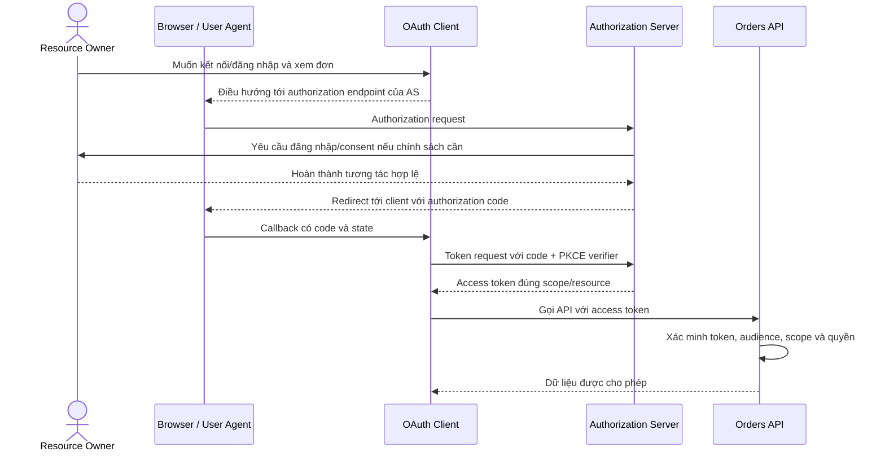
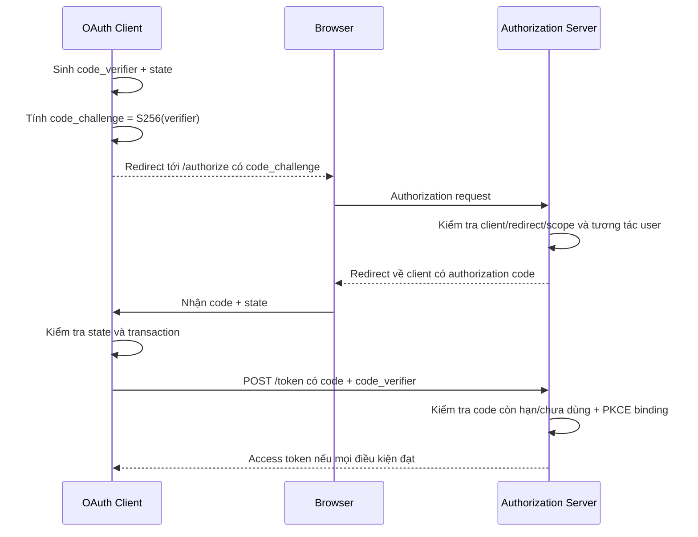
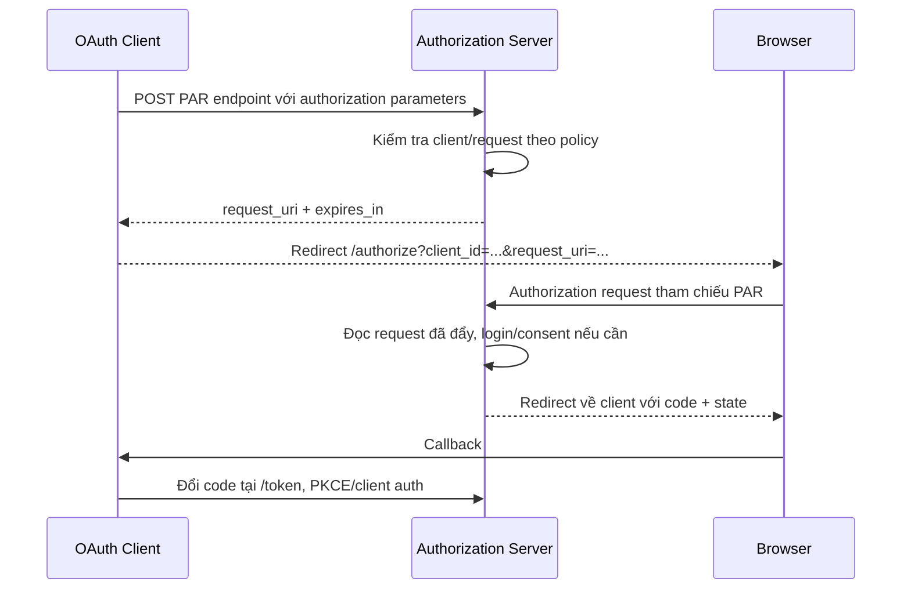

# Điểm cuối authorization

## 1. Điểm cuối authorization là gì?

Trong OAuth 2.0, **authorization endpoint** (điểm cuối cấp phép, thường được đặt tên là `/authorize`) là giao diện do **authorization server (AS)** cung cấp để **resource owner/người dùng tương tác thông qua user agent** và cho phép hoặc từ chối một yêu cầu truy cập do client khởi tạo. Khi dùng luồng **Authorization Code**, thành công ở điểm cuối này thường tạo **authorization code ngắn hạn**, rồi client đem code tới **token endpoint** để đổi lấy token.

Ví dụ một web application muốn người dùng cho phép đọc đơn hàng:

```text
User/Browser -> Authorization Endpoint (/authorize)
             -> Đăng nhập người dùng khi cần
             -> Kiểm tra client, scope, resource, consent/policy
             -> Trả authorization code về redirect_uri đã đăng ký

OAuth Client -> Token Endpoint (/token)
             -> Đổi authorization code + PKCE verifier
             -> Nhận access token (và các token khác nếu được cấp)
             
OAuth Client -> Orders API (resource server)
             -> Trình access token đúng audience
             -> API xác minh và phân quyền
```

**Không đồng nhất:** “Người dùng đã bấm Cho phép tại authorization endpoint” với “mọi API đều phải chấp nhận mọi token của client”. Authorization endpoint chỉ là **một phần của chuỗi tin cậy**; AS còn kiểm tra grant khi phát token, còn resource server kiểm tra issuer, audience, thời hạn, scope, quyền trên tài nguyên và trạng thái thu hồi khi cần.

> **Điểm cần nhớ:** Authorization endpoint là điểm **khởi tạo và xử lý tương tác cấp phép với user agent**, không phải nơi client gửi refresh token để lấy access token mới. Trong luồng Authorization Code chuẩn hiện đại, access token được lấy từ **token endpoint** qua một giao dịch riêng.

Bài **“Điểm cuối authorization”** thuộc chương **OAuth2 roles** của module `SECURITY_TOKEN_SECURITY_FUNDAMENTALS`. Nội dung đặt điểm cuối này trong vai trò của OAuth 2.0/OIDC và vòng đời security token, kết nối JWT, opaque access token, refresh token, `scope`, `audience`, phát hành, lưu trữ, thu hồi và phòng chống đánh cắp hoặc phát lại token.

## 2. Bốn vai trò OAuth 2.0 tương tác thế nào?

OAuth 2.0 phân biệt bốn vai trò chức năng, dù trong thực tế một sản phẩm có thể đảm nhiệm nhiều vai trò:

| Vai trò | Trách nhiệm | Ví dụ |
| --- | --- | --- |
| **Resource owner** | Bên có khả năng cấp quyền truy cập protected resource | Người dùng có quyền đối với đơn hàng |
| **Client** | Phần mềm yêu cầu và sử dụng quyền truy cập | Web portal, mobile app, backend job |
| **Authorization server (AS)** | Xác thực/ủy quyền theo grant và chính sách, phát hành token | `https://auth.example.com` |
| **Resource server (RS)** | Lưu trữ hoặc phục vụ protected resources, xác minh access token và quyền | Orders API |

Một web browser **không phải vai trò OAuth thứ năm theo nghĩa giao thức**. Browser là **user agent** được dùng để điều hướng người dùng tới AS và trả phản hồi về client. Với SPA, code client có thể chạy ngay trong browser; với ứng dụng BFF, code OAuth client chính có thể chạy ở backend, còn browser chỉ mang tương tác người dùng và session.



**Resource owner không nhất thiết là một user được hiện diện trong mọi grant.** Ví dụ `client_credentials` thường phục vụ client/workload, không có bước đăng nhập user tại authorization endpoint. Vì vậy **không phải mọi OAuth flow đều phải đi qua `/authorize`**.

### 2.1. “Authorization” ở hai vị trí khác nhau

Từ *authorization* đôi khi được dùng cho hai quyết định:

1. **Ở AS:** client có thể nhận một grant/token với scope/resource nào?
2. **Ở RS:** request cụ thể có được sửa đơn 42 của tenant Alpha không?

Kết quả tại AS tạo ra **giới hạn tối đa của token** theo chính sách, nhưng không tự thay thế việc RS kiểm tra quyền trên tài nguyên và quyền hiện hành của chủ thể.

## 3. Phân biệt các endpoint dễ nhầm

| Endpoint | Bên cung cấp | Bên gọi chủ yếu | Mục đích |
| --- | --- | --- | --- |
| **Authorization endpoint** | AS | Browser/user agent thông qua redirect | Tương tác xác thực, consent/authorization; trả code hoặc phản hồi phù hợp |
| **Token endpoint** | AS | OAuth client | Đổi authorization code, refresh token hoặc xử lý grant được hỗ trợ để cấp token |
| **Pushed Authorization Request (PAR) endpoint** | AS nếu hỗ trợ | OAuth client | Đẩy request authorization qua kênh trực tiếp, nhận `request_uri` |
| **Token revocation endpoint** | AS nếu hỗ trợ | OAuth client được phép | Yêu cầu thu hồi token |
| **Token introspection endpoint** | AS nếu hỗ trợ | RS/client có quyền theo chính sách | Tra trạng thái và metadata token |
| **UserInfo endpoint** | OIDC provider nếu triển khai OIDC | Client với access token phù hợp | Trả claims của người dùng theo giao thức OIDC |
| **Protected resource endpoint** | RS | Client với access token | Truy cập dữ liệu nghiệp vụ |

Ví dụ URL minh họa:

```text
Authorization: https://auth.example.com/authorize
Token:         https://auth.example.com/token
Introspection: https://auth.example.com/introspect
Revocation:    https://auth.example.com/revoke
Orders API:    https://orders-api.example.com/orders
```

**Tên path không được chuẩn OAuth cố định.** Một AS có thể dùng `/oauth2/authorize`, `/protocol/openid-connect/auth` hoặc đường dẫn khác. Không suy đoán endpoint từ tên miền; client nên sử dụng **metadata/cấu hình của issuer đáng tin** và các URL chính thức do AS công bố.

### 3.1. OAuth Authorization Server Metadata

RFC 8414 định nghĩa metadata của OAuth authorization server, có các trường như `issuer`, `authorization_endpoint`, `token_endpoint` và những khả năng được công bố.

Với OIDC, có cơ chế **OpenID Provider Configuration** ở endpoint discovery tương ứng theo OIDC. Địa chỉ discovery và cách xây dựng URL phụ thuộc profile/issuer đã định; **không** nhập URL do request chưa tin cậy đưa vào rồi tự tải cấu hình/khóa.

Ví dụ metadata giản lược (minh họa):

```json
{
  "issuer": "https://auth.example.com",
  "authorization_endpoint": "https://auth.example.com/authorize",
  "token_endpoint": "https://auth.example.com/token",
  "response_types_supported": ["code"],
  "code_challenge_methods_supported": ["S256"]
}
```

Client phải **ràng buộc metadata với issuer đã được chọn tin cậy**, hỗ trợ TLS và chống nhầm lẫn khi làm việc với nhiều authorization servers.

## 4. Tại sao authorization endpoint được gọi qua browser?

Trong authorization code flow, client cần người dùng tương tác trực tiếp với AS khi cần:

- Đăng nhập bằng phương thức mà AS hỗ trợ (mật khẩu, passkey, MFA, session SSO...).
- Xem thông tin client đang xin quyền gì.
- Cấp hoặc từ chối consent khi chính sách yêu cầu.
- Được chuyển về ứng dụng bằng một kết quả **giới hạn và có thể xác minh**.

**Client không được yêu cầu người dùng đưa mật khẩu của AS vào form riêng để “lấy code thay”**. Việc chuyển tới AS giúp giữ ranh giới thông tin xác thực: user nhập/đáp ứng challenge trên hệ thống AS, không qua client bên thứ ba.

### 4.1. Front channel và back channel

**Front channel** đi qua user agent/browser:

```text
Client -> Browser redirect -> AS /authorize
AS -> Browser redirect -> Client redirect_uri?code=...&state=...
```

**Back channel** (hoặc request trực tiếp tới token endpoint) do OAuth client thực hiện:

```text
Client -> AS /token
          grant_type=authorization_code
          code=...
          code_verifier=...
          client authentication khi cần
AS -> Client
      access_token, expires_in, token_type, ...
```

Với SPA chạy thuần browser, token request có thể là `fetch` trực tiếp từ browser và cần CORS đúng; đó vẫn là **token endpoint**, không phải authorization endpoint. Phân biệt “back channel” theo **vai trò và mục đích giao thức**, không luôn đồng nghĩa có một backend bí mật.

### 4.2. Không gửi thông tin xác thực người dùng qua client

Khi user đăng nhập tại AS, client thường chỉ nhận **authorization code** và sau đó tokens theo quyền đã được cấp. Client không nên nhìn thấy mật khẩu/MFA secret của user tại AS. Nếu một ứng dụng yêu cầu nhập mật khẩu IdP trên trang của chính ứng dụng để gọi OAuth, cần xem xét lại kiến trúc và rủi ro phishing, credential leakage.

## 5. Authorization request gồm những gì?

Đối với **Authorization Code Grant** cơ bản, client khởi tạo request tới authorization endpoint bằng browser navigation.

Ví dụ URL đã mã hóa tham số:

```http
GET /authorize?response_type=code&client_id=orders-web&redirect_uri=https%3A%2F%2Fclient.example.com%2Fcallback&scope=orders%3Aread&state=<random_state>&code_challenge=<s256_challenge>&code_challenge_method=S256 HTTP/1.1
Host: auth.example.com
```

Các giá trị `<random_state>` và `<s256_challenge>` chỉ là placeholder, **không phải giá trị dùng trong production**.

| Tham số | Vai trò | Điểm an ninh quan trọng |
| --- | --- | --- |
| `response_type=code` | Yêu cầu authorization code | Không tự đổi sang flow trả access token qua front channel |
| `client_id` | Định danh OAuth client đã đăng ký | **Không phải bí mật**, không tự chứng minh client đã xác thực |
| `redirect_uri` | Địa chỉ client muốn nhận kết quả | Phải được AS kiểm tra chặt với URI đã đăng ký |
| `scope` | Quyền/phạm vi client muốn xin | **Yêu cầu** không đồng nghĩa **được cấp** |
| `state` | Giá trị client dùng liên kết request với callback | Phải khó đoán, ràng buộc transaction/session và được xác minh |
| `code_challenge` | Giá trị dẫn xuất từ code verifier | AS phải lưu/ràng buộc với authorization code |
| `code_challenge_method=S256` | Thuật toán PKCE | Ưu tiên S256; ngăn downgrade theo chính sách |
| `resource` | Resource Indicators, nếu AS hỗ trợ | AS phải kiểm tra resource hợp lệ, không sao chép mù vào audience |
| `nonce` | Giá trị OIDC nếu flow/client sử dụng | Ràng buộc ID token và chống phát lại theo quy tắc OIDC |
| `prompt`, `max_age` | Tùy chọn OIDC khi hỗ trợ | Chi phối tương tác/xác thực lại, không tự cấp quyền API |

**Các tham số trên không phải tất cả đều bắt buộc trong mọi request OAuth.** Điều kiện bắt buộc và hỗ trợ phụ thuộc grant, AS, PKCE/BCP, OIDC và metadata. Ví dụ `redirect_uri` có thể có quy tắc yêu cầu/cho phép bỏ trong trường hợp đã đăng ký rõ; dù thế, AS vẫn phải chọn URI đích duy nhất và đúng theo hợp đồng.

### 5.1. GET hay POST?

Trong OAuth 2.0 (RFC 6749), authorization endpoint phải hỗ trợ **HTTP GET**; AS có thể hỗ trợ **POST** theo quy định giao thức. Trong web flow phổ biến, client điều hướng browser tới authorization URL, do đó GET được sử dụng rộng rãi.

**Không đặt bearer access token, refresh token, client secret hoặc mật khẩu vào authorization URL.** Các query parameters có thể lọt vào history, browser/plugin, CDN/proxy logs và telemetry. Phần request thường chỉ chứa **đề nghị cấp quyền**, nonce/challenge và dữ liệu ràng buộc không phải credential dài hạn.

### 5.2. Scope phải được AS quyết định, không phải client tự cấp

Ví dụ client xin:

```text
scope=orders:read orders:write payments:refund
```

Nếu client chỉ đăng ký cho phép `orders:read` và người dùng chỉ có quyền xem đơn, AS không được **mặc định cấp tất cả** chỉ vì request có chuỗi scope. AS phải xét client registration, grant, user/workload, consent, tài nguyên đích và policy.

Nếu AS cấp scope khác request, token response theo OAuth 2.0 cần phản ánh **scope thực nhận** khi tiêu chuẩn yêu cầu. Resource server vẫn kiểm tra quyền nghiệp vụ của request chứ không lấy màn consent làm bằng chứng user được sửa mọi dữ liệu.

## 6. PKCE tại authorization endpoint và token endpoint

**Proof Key for Code Exchange (PKCE, RFC 7636)** ràng buộc authorization code với một **code verifier** do client tạo. Với phương thức `S256`:

```text
code_verifier:  chuỗi ngẫu nhiên hợp lệ, client giữ kín trong transaction
code_challenge = BASE64URL(SHA256(ASCII(code_verifier))) không padding

/authorize nhận:  code_challenge, code_challenge_method
/token nhận:      authorization_code, code_verifier
```

AS lưu hoặc bảo vệ liên kết giữa authorization code và `code_challenge`. Khi client đem code tới token endpoint, AS tính lại challenge từ verifier rồi so khớp theo profile.



### 6.1. Ví dụ Java sinh verifier và challenge

```java
import java.nio.charset.StandardCharsets;
import java.security.MessageDigest;
import java.security.SecureRandom;
import java.util.Base64;

public final class PkceExample {
    private static final SecureRandom SECURE_RANDOM = new SecureRandom();

    private static String randomUrlSafe(int byteCount) {
        byte[] bytes = new byte[byteCount];
        SECURE_RANDOM.nextBytes(bytes);

        return Base64.getUrlEncoder()
                .withoutPadding()
                .encodeToString(bytes);
    }

    public static void main(String[] args) throws Exception {
        // 32 byte ngẫu nhiên -> 43 ký tự Base64url, hợp lệ cho verifier.
        String codeVerifier = randomUrlSafe(32);
        String state = randomUrlSafe(32);

        byte[] digest = MessageDigest.getInstance("SHA-256")
                .digest(codeVerifier.getBytes(StandardCharsets.US_ASCII));

        String codeChallenge = Base64.getUrlEncoder()
                .withoutPadding()
                .encodeToString(digest);

        // Chỉ log metadata; KHÔNG log verifier, state hay code thật.
        System.out.println("code_challenge_method=S256");
        System.out.println("challenge length=" + codeChallenge.length());
        System.out.println("state length=" + state.length());

        // Lưu codeVerifier và state vào transaction store được bảo vệ.
        // Xây authorization request bằng URI/query builder đúng chuẩn.
    }
}
```

Đây chỉ là **ví dụ tạo dữ liệu**, không phải OAuth client hoàn chỉnh. Phải có quản lý transaction, storage, redirect URI, session, exact state verification, xử lý callback, token endpoint request và error handling bằng thư viện phù hợp.

### 6.2. PKCE không phải “mã hóa code”

Authorization code vẫn có thể xuất hiện tại redirect URI qua front channel. **PKCE khiến người chỉ lấy được code không dễ đổi thành token nếu thiếu verifier**. Nó không mã hóa code, không thay TLS, không tự kiểm soát scope/audience và không làm refresh token an toàn khỏi bị lấy cắp.

Client dùng PKCE không được ghi `code_verifier` vào authorization URL, browser history hoặc logs. Verifier phải nằm ở **phía client thực hiện token request**, ràng buộc với đúng transaction.

### 6.3. Ngăn downgrade và reuse

AS cần:

- Chấp nhận `S256` theo profile và yêu cầu PKCE cho clients/grants khi chính sách bắt buộc.
- Ràng buộc code challenge với **authorization code cụ thể**.
- Kiểm tra token request không thể bỏ verifier khi code đã cấp với PKCE.
- Không tự hạ từ `S256` sang `plain` khi request không phù hợp chính sách.
- Đảm bảo authorization code **dùng một lần**; code bị trình lại phải bị từ chối và xử lý theo chính sách.
- Ràng buộc code với đúng client và `redirect_uri` khi áp dụng.

OAuth 2.0 Security BCP (RFC 9700) tăng cường hướng dẫn dùng PKCE, kể cả với confidential clients. Không dựa vào client secret như biện pháp duy nhất chống chặn/đánh tráo authorization code.

## 7. `redirect_uri`: điểm kiểm tra quan trọng nhất

Authorization endpoint thường trả kết quả bằng cách redirect browser về một URI của client. Nếu AS chấp nhận `redirect_uri` tùy ý:

```text
GET /authorize?
    client_id=legitimate-client
    &redirect_uri=https://attacker.example/callback
    &response_type=code
```

AS có thể gửi **authorization code** hoặc dữ liệu nhạy cảm tới nơi kẻ tấn công kiểm soát. Đây là một rủi ro lớn về **authorization code leakage/open redirect**.

### 7.1. Đăng ký trước và so khớp nghiêm ngặt

AS cần có **registered redirect URIs** phù hợp cho từng client, và kiểm tra request theo chuẩn/profile. Nguyên tắc quan trọng:

- Không chấp nhận redirect tới domain bất kỳ chỉ vì có cùng tiền tố.
- Không coi `https://client.example.com` và `https://client.example.com.evil.invalid` là cùng đích.
- Không dùng wildcard rộng như `https://*.example.com/*` để bao mọi redirect.
- Không tin redirect URI do user nhập mà không thuộc đăng ký.
- Không dựa vào HTTP `Referer` hoặc `Host` như bằng chứng URI đã được phê duyệt.
- Theo security BCP, ưu tiên **exact string matching** với ngoại lệ được quy định, ví dụ một số trường hợp cổng loopback redirect cho native apps.

Ví dụ cấu hình:

```yaml
client_id: "orders-web"
registered_redirect_uris:
  - "https://client.example.com/oauth/callback"
  - "https://client.example.com/account/connect/callback"
```

Đây là **cấu hình mô tả**, không phải file thực thi của một AS cụ thể.

### 7.2. Không trả lỗi qua một redirect URI không tin cậy

Nếu request có `redirect_uri` sai, AS **không được redirect browser tới URI đó** để báo lỗi, vì bản thân hành động ấy có thể tạo open redirect hoặc leak dữ liệu. AS nên hiển thị trang lỗi an toàn trên **origin của AS** hoặc xử lý theo profile.

Nếu redirect URI **đã được xác minh hợp lệ** nhưng người dùng từ chối quyền, AS có thể gửi **authorization error response** về client qua URI đã xác thực, kèm `state` khi request có state.

### 7.3. Open redirect trong chính ứng dụng client

Ngay cả URI đã đăng ký có thể không an toàn nếu endpoint của client làm open redirect:

```text
https://client.example.com/callback?next=https://attacker.example/
```

Nếu callback ngay lập tức chuyển tiếp `code` và các tham số tùy tiện tới `next`, code có thể bị rò rỉ. Client callback phải **xử lý code/state trước, không phản chiếu credential trong redirect**, không làm open redirect và kiểm soát Referrer-Policy, logs, URL cleanup.

## 8. `state` và chống callback CSRF

OAuth client cần liên kết phản hồi authorization với **yêu cầu do chính nó tạo**. Tham số `state` thường được dùng để giảm rủi ro **cross-site request forgery (CSRF)** và authorization response injection.

Một mô hình:

1. Trước redirect, client sinh `state` ngẫu nhiên khó đoán.
2. Client lưu `state` **gắn với transaction/session browser**, cùng issuer, redirect URI và PKCE verifier.
3. Gửi `state` ở authorization request.
4. Callback phải mang đúng `state` của transaction còn hoạt động.
5. Client kiểm tra chính xác và **đánh dấu transaction đã sử dụng** trước hoặc trong tiến trình đổi code.
6. Sai/thiếu/không khớp state → từ chối callback, không gắn phiên sai.

```text
Transaction trước redirect:
  state = s-unique
  pkceVerifier = v-unique
  issuer = https://auth.example.com
  redirectUri = https://client.example.com/callback
  sessionBinding = browser-session-42

Callback:
  /callback?code=c-123&state=s-unique

Client:
  compare callback.state với transaction.state
  kiểm tra binding/session/expiry/one-time-use
  chỉ khi hợp lệ mới thực hiện token exchange
```

**Không dùng** giá trị `state=123` cố định, user ID, timestamp có thể đoán hoặc chỉ lấy nguyên `returnUrl` làm state. Nếu cần lưu thông tin điều hướng nội bộ, lưu **server-side theo state ngẫu nhiên** hoặc dùng cấu trúc có bảo vệ tính toàn vẹn và chống giả mạo theo threat model.

### 8.1. State và PKCE có quan hệ gì?

Cả hai giúp liên kết giao dịch nhưng không đồng nhất:

| Cơ chế | Ràng buộc chủ yếu | Kiểm tra ở đâu? |
| --- | --- | --- |
| `state` | Authorization response/callback với transaction của client | **OAuth client** tại redirect callback |
| PKCE `code_challenge/code_verifier` | Authorization code với bí mật verifier của client | **AS** tại token endpoint |
| `nonce` trong OIDC | ID token với authentication request khi profile yêu cầu/sử dụng | **OIDC client** sau khi xác minh ID token |
| `iss` trong authorization response (RFC 9207) | Kết quả authorization với issuer tương ứng | **Client** khi nhận response để chống AS mix-up |

Một số profile/ứng dụng dùng PKCE đúng cách như một thành phần CSRF protection, nhưng việc **bỏ `state`** phải có cơ sở theo BCP và đặc tả liên quan, không dựa vào suy đoán rằng “có PKCE là khỏi cần kiểm tra callback”. Với ứng dụng thông thường, `state` ràng buộc phiên và giao dịch là biện pháp rõ ràng, hữu ích.

### 8.2. Kiểm tra state trước khi phát hành phiên ứng dụng

Không tạo session user mới, không ghi token vào user đang đăng nhập, không điều hướng tới dữ liệu riêng **trước khi callback được kiểm tra**. Sai lệch binding có thể dẫn tới login CSRF, session swapping hoặc tài khoản của kẻ tấn công được gắn vào browser của nạn nhân.

## 9. Authorization code response

Khi mọi điều kiện được AS chấp nhận trong Authorization Code flow, AS tạo authorization code và redirect browser về client:

```http
HTTP/1.1 302 Found
Location: https://client.example.com/callback?code=<short_lived_code>&state=<original_state>
Cache-Control: no-store
```

Authorization code:

- **Ngắn hạn** và chỉ có thể đổi một lần.
- Được ràng buộc với **client** mà code đã được cấp.
- Gắn với `redirect_uri` khi profile/request yêu cầu.
- Gắn `code_challenge`/PKCE verifier khi sử dụng PKCE.
- Không phải access token để gọi API.
- Không được trở thành bí mật dài hạn; không lưu code trong log, URL history/tracking của ứng dụng nếu có thể tránh.

AS có thể bổ sung `iss` theo RFC 9207 khi hỗ trợ. Client phải kiểm tra phản hồi theo contract và không nhận các tham số lạ làm bằng chứng phát hành token.

### 9.1. Code là kết quả trung gian, không phải “được cấp toàn quyền”

Browser nhận code **không chứng minh API đã cấp quyền dữ liệu**. Client còn phải gửi code tới token endpoint, nơi AS xác minh one-time use, client binding, redirect URI/PKCE và policy. Access token được cấp có thể có **scope/resource hẹp hơn request** hoặc token request có thể bị từ chối nếu grant không còn phù hợp.

### 9.2. Mẫu token request

```http
POST /token HTTP/1.1
Host: auth.example.com
Content-Type: application/x-www-form-urlencoded

grant_type=authorization_code&code=<authorization_code>&redirect_uri=https%3A%2F%2Fclient.example.com%2Fcallback&client_id=orders-web&code_verifier=<original_verifier>
```

Ví dụ mô tả **public client có PKCE**. Với confidential client, AS phải xác thực client theo phương thức đăng ký (ví dụ một hình thức authentication tại token endpoint); không gửi client secret trong URL hoặc JavaScript của public client.

`redirect_uri` trong token request phải đáp ứng ràng buộc so với authorization request/code theo profile. Client không được tự thay URI để đổi code sang một callback khác.

### 9.3. Token response minh họa

```http
HTTP/1.1 200 OK
Content-Type: application/json
Cache-Control: no-store
Pragma: no-cache

{
  "access_token": "<access_token_for_orders>",
  "token_type": "Bearer",
  "expires_in": 600,
  "scope": "orders:read"
}
```

Refresh token chỉ xuất hiện **nếu AS quyết định cấp** theo client/grant/consent và chính sách. Không tự mặc định request tới `/authorize` phải luôn trả refresh token ở `/token`.

## 10. Authorization error response: từ chối đúng chỗ

Người dùng có thể từ chối consent, chưa đăng nhập hoặc AS không cho phép scope/resource.

**Khi redirect URI đã được kiểm tra hợp lệ**, AS có thể redirect lỗi theo OAuth:

```http
HTTP/1.1 302 Found
Location: https://client.example.com/callback?error=access_denied&state=<original_state>
Cache-Control: no-store
```

Các mã lỗi OAuth authorization endpoint thông dụng gồm:

| `error` | Ý nghĩa chung | Hướng xử lý |
| --- | --- | --- |
| `access_denied` | Resource owner hoặc AS từ chối cấp phép | Client không được phát token; UX giải thích ở mức phù hợp |
| `invalid_request` | Thiếu/sai tham số hoặc cấu trúc request không hợp lệ | Sửa client request |
| `unauthorized_client` | Client không được phép dùng kiểu authorization request này | Kiểm tra registration/grant |
| `unsupported_response_type` | AS không hỗ trợ `response_type` được yêu cầu | Sử dụng flow được công bố |
| `invalid_scope` | Scope không hợp lệ/không được hỗ trợ hoặc nằm ngoài chính sách | Điều chỉnh scope hoặc grant |
| `server_error` | AS không thể xử lý request vì lỗi server | Không tự cấp quyền; retry theo contract |
| `temporarily_unavailable` | AS tạm quá tải/bảo trì | Thông báo người dùng; không bypass |
| OIDC `login_required` | Không đáp ứng request khi cần login, thường với `prompt=none` | Chuyển sang tương tác được phép |
| OIDC `consent_required` | Cần consent nhưng yêu cầu không cho tương tác | Bắt đầu luồng tương tác nếu phù hợp |
| OIDC `interaction_required` | Cần tương tác khác theo OIDC | Xử lý ở client theo giao thức |

**Không phải mọi lỗi đều được redirect.** Khi client ID hoặc `redirect_uri` không được xác minh, redirect tới URL do request chỉ định là không an toàn. Cũng không hiển thị cho client chi tiết về tài khoản, chính sách nội bộ hoặc secret của AS.

### 10.1. Không nhầm lỗi authorize với lỗi API

- `error=access_denied` từ authorization endpoint: **không phát authorization code vì yêu cầu cấp phép bị từ chối**.
- `invalid_grant` từ token endpoint: code/refresh token sai, hết hạn, đã dùng lại hoặc không hợp lệ theo grant.
- `401 invalid_token` từ Orders API: access token không hợp lệ cho resource server.
- `403 insufficient_scope` từ Orders API: token hợp lệ nhưng không đủ scope cho tác vụ.

Client không nên phản ứng với mọi lỗi bằng cách “thử refresh token liên tục”. Quy trình xử lý phải theo **đúng endpoint và đúng loại lỗi**.

## 11. Authorization endpoint trong OpenID Connect

**OpenID Connect (OIDC)** xây dựng lớp xác thực danh tính trên OAuth 2.0. Khi client yêu cầu scope `openid`, request trở thành yêu cầu OIDC theo các điều kiện giao thức, và authorization endpoint cũng có thể xử lý các tham số OIDC:

```http
GET /authorize?response_type=code&client_id=orders-web&redirect_uri=https%3A%2F%2Fclient.example.com%2Fcallback&scope=openid%20profile%20orders%3Aread&state=<state>&nonce=<nonce>&code_challenge=<challenge>&code_challenge_method=S256 HTTP/1.1
Host: auth.example.com
```

### 11.1. Xác thực user không đồng nghĩa phân quyền API

AS/OP có thể xác thực người dùng bằng passkey, MFA, SSO session hoặc phương thức khác. Kết quả **OIDC ID token** (thường nhận ở token endpoint trong code flow) cung cấp thông tin về sự kiện xác thực cho **OIDC client**.

Access token, ngược lại, phục vụ **resource server**. Orders API không được chấp nhận ID token làm access token dù cùng issuer hoặc có `sub` user quen thuộc.

| Token | Bên nhận dự kiến | Dùng để làm gì? |
| --- | --- | --- |
| **Authorization code** | OAuth client đổi tại token endpoint | Chứng cứ trung gian của authorization transaction |
| **ID token** | OIDC client; `aud` thường chứa client ID | Client xác minh thông tin xác thực người dùng |
| **Access token** | Resource server có audience phù hợp | Truy cập protected resources |
| **Refresh token** | Authorization server | Cấp access token mới trong giới hạn grant |

### 11.2. `nonce`, `auth_time`, `max_age`

- **`nonce`:** client tạo và gửi qua authorization request; khi profile/flow dùng nonce, client phải kiểm tra claim nonce trong ID token đã xác minh để liên kết kết quả xác thực với request.
- **`max_age`:** khi hỗ trợ theo OIDC, yêu cầu giới hạn tuổi của lần xác thực; có thể khiến OP cần xác thực người dùng lại.
- **`auth_time`:** claim trong ID token mô tả thời điểm xác thực theo OIDC; không có nghĩa role/tenant/ACL hiện tại đã được cập nhật.
- **`prompt=none`:** yêu cầu xử lý không có tương tác trực tiếp; nếu không thể, OP trả lỗi OIDC phù hợp thay vì tự hiển thị UI trái yêu cầu.

**Xác thực lại người dùng không tự chứng minh họ vẫn được phép hoàn tiền hoặc sửa dữ liệu tenant.** Phân quyền còn phụ thuộc scope/grant và policy tại RS.

### 11.3. `offline_access` không tự cấp refresh token

Trong OIDC, `offline_access` có ngữ nghĩa xin quyền truy cập khi user không hiện diện, với các điều kiện consent/policy cụ thể. Client yêu cầu scope này **không buộc AS cấp refresh token**. Nếu được cấp, RT phải bảo vệ bằng rotation hoặc sender-constraining theo threat model và yêu cầu bảo mật liên quan.

## 12. Quyền tối thiểu, resource và audience

Authorization endpoint nhận **yêu cầu cấp quyền**, không phải nơi client tự quyết định ràng buộc final token.

### 12.1. Requested scopes và granted scopes

Ví dụ client xin:

```text
orders:read orders:write payments:refund
```

AS chỉ cho phép `orders:read` theo chính sách của client/user và resource. Kết quả sau khi đổi code có thể là access token:

```json
{
  "iss": "https://auth.example.com",
  "sub": "user-123",
  "aud": "https://orders-api.example.com",
  "iat": 1900000000,
  "exp": 1900000600,
  "scope": "orders:read"
}
```

Đây là **payload JWT minh họa, chưa có chữ ký và chưa đầy đủ yêu cầu của mọi token profile**, đặc biệt RFC 9068. JWT hoặc opaque access token đều cần chính sách tương đương: issuer, audience, thời hạn, phạm vi và quyền theo grant.

Nếu AS **thu hẹp scope** so với yêu cầu, client phải biết phạm vi được cấp qua response theo OAuth. Client không được tự thêm `orders:write` vào JWT hoặc xem user đã consent là đủ để làm mọi hành động.

### 12.2. Resource Indicators (RFC 8707)

Khi AS hỗ trợ, authorization request có thể chỉ rõ resource dự định bằng tham số `resource`:

```text
response_type=code
client_id=orders-web
resource=https://orders-api.example.com
scope=orders:read
...
```

AS phải kiểm tra resource này thuộc phạm vi nó có thể phát token và client được phép sử dụng. Giá trị `resource` trong request **không phải lệnh buộc AS sao chép thành `aud`**, vì mapping audience phụ thuộc AS/RS profile.

Khi client muốn dùng nhiều APIs, ưu tiên hỏi liệu có thể xin **token riêng cho từng audience** để hạn chế ảnh hưởng nếu token bị lộ. Token multi-audience chỉ được cấp khi thật sự phù hợp chính sách.

### 12.3. RAR cho yêu cầu có cấu trúc

Rich Authorization Requests (RFC 9396) có thể dùng `authorization_details` để diễn tả quyền chi tiết hơn scope đơn giản, như quyền hoàn tiền một giao dịch cụ thể.

```json
{
  "authorization_details": [
    {
      "type": "payment_refund",
      "actions": ["refund"],
      "transaction_id": "payment-456",
      "max_amount": "250000",
      "currency": "VND"
    }
  ]
}
```

Đây là **profile ứng dụng minh họa**, không phải mẫu chuẩn hóa cho mọi API. Việc client đề nghị số tiền không có nghĩa AS cấp quyền cho số tiền đó; cả AS và RS phải kiểm tra policy và ngữ cảnh giao dịch.

## 13. Consent và authentication UX: AS phải kiểm soát

### 13.1. Authorization endpoint không phải “đồng ý cho mọi thứ”

Một luồng tốt thể hiện rõ các quyền client thực sự cần:

- Client nào xin phép?
- Tài nguyên/API nào được nhắm tới?
- Quyền nào là đọc, ghi, xóa hoặc thao tác tài chính?
- Quyền nào được client đã đăng ký và user hiện tại cho phép?
- Có yêu cầu tương tác bổ sung/step-up không?

AS có thể dựa trên **consent trước đó**, chính sách first-party/trusted client hoặc tổ chức để quyết định có hiển thị consent screen. **Không phải mọi OAuth request đều bắt buộc hiện một màn consent**, nhưng mọi grant phải tuân chính sách cấp quyền.

### 13.2. Phân biệt đăng nhập và consent

- **Authentication:** user là ai/đã xác thực ở mức nào.
- **Consent:** user có chấp thuận client truy cập quyền nhất định không, theo chính sách áp dụng.
- **Authorization decision:** AS có cho phép scope/resource/grant hay không, dựa cả client, user và policy.
- **Resource authorization:** RS quyết định request cụ thể được làm gì với dữ liệu.

Consent không thể nâng quyền user vượt policy; user chỉ có quyền đọc đơn không thể cho client quyền hoàn tiền nếu họ không có quyền đó.

### 13.3. Chống phishing và clickjacking

Authorization endpoint và trang login/consent là **ranh giới tin cậy cao**:

- Dùng HTTPS/TLS, HSTS và các biện pháp chống chặn lưu lượng thích hợp.
- Bảo vệ các trang nhạy cảm khỏi clickjacking bằng `Content-Security-Policy: frame-ancestors` và header tương thích khi cần.
- Không để client tự cung cấp HTML/JavaScript chạy trong origin AS qua tham số request.
- Không đưa credential hoặc mã OTP trong redirect URL.
- Hiển thị danh tính client đã đăng ký từ nguồn AS tin cậy, không tin tên/icon do query tự khai.
- Thực thi CSRF protection cho các form đăng nhập/consent nếu dùng cookie AS và có tác vụ đổi trạng thái.
- Đánh giá rủi ro open redirect trong các trang login/logout và đường điều hướng.

## 14. Các rủi ro cụ thể tại authorization endpoint

### 14.1. Authorization code interception

Attacker có thể lấy code từ callback URL/log/URI handler bị chiếm. Nếu client dùng PKCE, code bị chặn khó đổi thành token nếu thiếu verifier. Tuy nhiên, cần đồng thời:

- Redirect URI đã đăng ký và so khớp nghiêm ngặt.
- Code ngắn hạn và one-time use.
- Client binding + PKCE verification tại token endpoint.
- TLS và log masking.
- Callback không làm open redirect.
- Bảo vệ verifier và transaction.

### 14.2. Authorization response injection và login CSRF

Attacker tạo một code cho **tài khoản của attacker**, rồi cố đưa code đó vào callback của browser nạn nhân. Nếu client không kiểm tra state/transaction, nạn nhân có thể bị đăng nhập nhầm vào tài khoản attacker.

Hậu quả có thể là dữ liệu người dùng vô tình được nhập vào tài khoản kẻ tấn công. Biện pháp:

- Ràng buộc response với transaction/browser session bằng state hoặc cơ chế CSRF đã được chứng minh phù hợp profile.
- Kiểm tra issuer và PKCE đúng.
- Không dùng code nhận bất kỳ lúc nào từ URL như yêu cầu đăng nhập tự hợp lệ.
- Đánh dấu transaction đã hoàn thành, chống replay.

### 14.3. Authorization server mix-up

Client hỗ trợ nhiều AS có thể nhận callback từ AS X nhưng tưởng đến từ AS Y và gửi code tới token endpoint sai. Điều này có thể làm lộ code hoặc ngữ cảnh authorization.

Các biện pháp:

- Ràng buộc transaction với **issuer đã được lựa chọn** trước redirect.
- Sử dụng **issuer identification trong authorization response** (RFC 9207) khi AS hỗ trợ và client áp dụng.
- So khớp `iss` trong response với issuer của transaction.
- Có **redirect URIs riêng cho từng AS** theo kiến trúc/BCP khi cần.
- Không tùy tiện thay token endpoint theo tham số callback không tin cậy.

**Chỉ có một `state` không tự bảo đảm chống mọi biến thể mix-up** nếu client không ràng buộc đúng issuer và endpoint. Cần chọn biện pháp theo profile và hỗ trợ của AS.

### 14.4. Redirect URI tampering

Nguy cơ: AS dùng `startsWith("https://client.example.com")` thay vì exact redirect matching. Attacker có thể dùng:

```text
https://client.example.com.evil.invalid/callback
```

Giá trị này **không thuộc origin** `https://client.example.com`. So sánh tiền tố là lỗi bảo mật, không phải một “cách làm linh hoạt”.

### 14.5. Scope escalation

Client sửa authorization URL thêm `payments:refund`, `admin` hoặc resource khác. AS phải kiểm tra **client registration, resource owner, consent và policy hiện hành**; không cấp thêm quyền chỉ vì URL có tên scope.

### 14.6. Token substitution: ID token hay access token?

Client hoặc API có thể bị nhầm nếu dùng JWT chung issuer:

- ID token `aud=client_id` không dùng để gọi Orders API.
- Access token `aud=Orders API` không thay cho ID token trong xác minh đăng nhập OIDC.
- Authorization code không gửi tới resource server.
- Refresh token không gửi vào `Authorization: Bearer` của Orders API.

**Loại token, audience và profile là ranh giới riêng**.

## 15. PAR: Pushed Authorization Requests

Khi authorization request chứa nhiều tham số hoặc dữ liệu nhạy cảm/chức năng phức tạp, **Pushed Authorization Requests (RFC 9126)** cho phép client **gửi nội dung request trực tiếp tới AS** trước khi browser navigation.

Quy trình khái niệm:

1. Client gửi authorization parameters tới **PAR endpoint** qua kết nối trực tiếp bảo vệ.
2. AS kiểm tra các điều kiện phù hợp, lưu/đại diện request và trả `request_uri` có tuổi thọ ngắn.
3. Client điều hướng browser tới authorization endpoint kèm `client_id` và `request_uri`.
4. AS truy xuất request đã được đẩy, tiếp tục authentication/consent rồi trả kết quả theo flow.



PAR giúp giảm việc đặt **toàn bộ authorization parameters** vào browser URL và có thể tăng khả năng kiểm soát request integrity tùy policy. Nhưng:

- PAR **không phải token endpoint** và `request_uri` không phải access token.
- `request_uri` có tuổi thọ và cách sử dụng do profile quy định.
- AS phải ràng buộc request với client và tránh thay nội dung ngoài chính sách.
- Không tự tin tham số qua PAR là quyền đã được cấp.
- PAR không thay PKCE, callback validation, `state`, issuer binding hoặc access-token validation.

Ví dụ response PAR minh họa:

```json
{
  "request_uri": "urn:ietf:params:oauth:request_uri:example-opaque-reference",
  "expires_in": 90
}
```

Giá trị và TTL chỉ minh họa; request URI thực tế do AS cấp.

## 16. JAR: JWT-Secured Authorization Request

**JWT-Secured Authorization Request (JAR, RFC 9101)** cho phép truyền authorization request như một **request object** dạng JWT, thường được ký để bảo vệ tính toàn vẹn và nguồn tạo theo profile.

Các lựa chọn có thể gồm:

- `request`: mang request object trực tiếp nếu profile cho phép.
- `request_uri`: tham chiếu request object theo cơ chế được hỗ trợ.
- Kết hợp JAR và PAR trong kiến trúc triển khai có quy định.

JAR có thể giảm nguy cơ tham số authorization bị thay đổi trên đường đi, nhưng AS vẫn phải kiểm tra:

1. Signature/trust của request object theo client registration.
2. Các claims và tham số bắt buộc, thời gian, issuer/audience của request object theo profile.
3. `redirect_uri`, client ID, scope, resource và chính sách.
4. Tránh **parameter pollution** khi thông tin ngoài request object mâu thuẫn với bên trong.
5. Replay/expiration và giới hạn kích thước, parse input an toàn.

**JWT request object không phải JWT access token.** Nó là **biểu diễn yêu cầu cấp phép**, không chứng minh user đã cấp quyền hay resource server phải chấp nhận token.

### 16.1. Khi nào dùng PAR/JAR?

| Vấn đề | Cơ chế có thể hỗ trợ |
| --- | --- |
| URL authorization rất dài | PAR giảm tham số trên front channel |
| Cần bảo vệ request khỏi bị sửa | JAR request object đã xác minh, hoặc profile yêu cầu |
| Cần ràng buộc client và validation sớm | PAR cùng client authentication/policy phù hợp |
| Authorization details phức tạp | RAR kết hợp PAR/JAR theo thiết kế |
| Cần user login/consent và authorization code | **Vẫn phải** qua authorization endpoint, các kiểm tra callback và token endpoint |

Không dùng PAR/JAR chỉ để thay thế tất cả kiểm soát redirect, state hoặc PKCE. Những lớp này bảo vệ **các ranh giới khác nhau**.

## 17. Browser, SPA, BFF và mobile: khác nhau ở đâu?

### 17.1. SPA chạy thuần trên browser

Một SPA là **public client** khi toàn bộ code và credential chạy trong browser. Nó thường:

- Điều hướng browser đến authorization endpoint.
- Nhận code qua redirect URI thuộc SPA origin.
- Kiểm tra state và giữ PKCE verifier theo transaction.
- Gọi token endpoint bằng CORS nếu AS cho phép, với code verifier.
- Giữ token theo threat model và gọi RS đúng audience.
- Không nhúng client secret trong JS như một bí mật.

**Rủi ro chính:** XSS có thể khai thác session, đánh cắp access/refresh tokens JS có thể truy cập hoặc lợi dụng API gọi thay user. Authorization endpoint không tự giải quyết XSS sau khi token được cấp.

### 17.2. Backend-for-Frontend (BFF)

BFF có thể đóng vai OAuth client phía server:

```text
Browser -> BFF -> redirect /authorize
AS -> Browser -> BFF callback với code
BFF -> /token -> lấy AT/RT, lưu phía server
Browser -> BFF qua HttpOnly session cookie
BFF -> Orders API với AT đúng audience
```

Lợi ích là browser không cần trực tiếp giữ OAuth refresh token. Đánh đổi là session store, cookies, CSRF và việc đồng bộ refresh token phía backend.

**BFF vẫn phải kiểm tra state, redirect URI, PKCE, client authentication theo cấu hình và chống login CSRF.** Có BFF không phải lý do bỏ kiểm tra authorization response.

### 17.3. Native/mobile

Ứng dụng native dùng **system browser/external user-agent** để tương tác với AS, không nên thu thập mật khẩu IdP trong một webview không được tin cậy theo kiểu nhúng. Redirect có thể dùng claimed HTTPS URI hoặc loopback/private-use scheme theo profile/platform.

RFC 8252 mô tả các cân nhắc đặc thù; một số loopback redirect cho native app có **ngoại lệ về cổng** khi so khớp đăng ký, không được mở rộng thành wildcard tùy tiện cho web client.

Ứng dụng mobile cũng là public client nếu không thể giữ secret được phân phối trong app như bí mật lâu dài.

### 17.4. Workload không cần authorize endpoint

`client_credentials` dùng token endpoint để xin token cho **chính client/workload**, không cần user agent hoặc code. Không xây giả browser redirect cho batch job chỉ vì mọi flow đều được gắn nhãn “OAuth login”.

## 18. Authorization endpoint và bảo vệ credential

### 18.1. Những thông tin có thể lộ qua front channel

Authorization request và response có thể đi qua:

- Browser history/URL bar.
- HTTP access logs của proxy, AS và client callback.
- Browser extensions.
- Client-side telemetry/analytics.
- Referrer hoặc các chuyển hướng không an toàn.

**Authorization code vẫn là credential nhạy cảm dù ngắn hạn.** Đừng ghi code, state, PKCE verifier hay request URI nhạy cảm nguyên văn vào logs. Không dán full callback URL chứa code vào issue tracker.

### 18.2. Các HTTP headers và chính sách an toàn

Có thể áp dụng:

- HTTPS/TLS và HSTS theo deployment.
- `Cache-Control: no-store` với response nhạy cảm.
- `Referrer-Policy` hạn chế để tránh phát tán query parameters.
- CSP và chống XSS cho login, consent và callback pages.
- Chống clickjacking cho trang tương tác nhạy cảm.
- Session cookies của AS/BFF có `Secure`, `HttpOnly`, `SameSite` phù hợp; chống CSRF.

Không nhầm cookie session của AS với access token OAuth. Cookies của AS giúp duy trì **phiên xác thực tại AS**, nhưng việc client có được cấp token vẫn theo grant, consent và policy.

### 18.3. Header size và query length

Nếu authorization URL có quá nhiều `scope`, `claims`, `authorization_details` hoặc metadata khác, trình duyệt/gateway có thể gặp giới hạn URL/request target. **PAR** là một cách giảm việc đưa request phức tạp lên URL khi AS hỗ trợ.

Không chuyển **access token** sang authorization query để né giới hạn `Authorization` ở resource server. Đây là hai điểm giao thức khác nhau và token trong URL có rủi ro lộ rất cao.

## 19. Authorization code cấp xong thì AS còn phải kiểm tra gì?

Tại **token endpoint**, AS vẫn phải kiểm tra:

- Authorization code có tồn tại và **chưa hết hạn/chưa dùng** không?
- Code có được cấp cho **đúng client** không?
- `redirect_uri` khi tham gia grant có phù hợp với URI đã gắn code không?
- `code_verifier` có chứng minh đúng `code_challenge` đã đăng ký không?
- Confidential client authentication đã đạt theo policy chưa?
- Consent/grant, resource/scope và trạng thái client/chủ thể còn đáp ứng quy tắc nào?
- Access token phát hành nhắm đúng audience và scopes được cấp, không vượt quá policy hiện hành?
- Nếu OIDC, ID token có đúng issuer/audience và claims/profile cần thiết không?

**Không xem một authorization code mới là bằng chứng AS phải phát token bất kể điều kiện khác.** Code được cấp ở front channel còn phải trải qua ràng buộc của token endpoint.

### 19.1. JWT hay opaque access token sau khi đổi code?

AS có thể phát:

| Dạng access token | Đặc điểm | Kiểm tra phía resource server |
| --- | --- | --- |
| **JWT signed access token** | Có thể tự chứa claims và chữ ký | Xác minh chữ ký, `iss`, `aud`, thời gian, token type/profile, scope và quyền |
| **Opaque access token** | Chuỗi client/RS không tự diễn giải | Introspection/tra cứu đáng tin, trạng thái active, audience, scope, TTL và policy |
| **Sender-constrained access token** | Có binding với khóa/chứng chỉ | Ngoài kiểm tra token, xác minh proof DPoP/mTLS theo profile |

**Authorization endpoint không quyết định một mình việc RS xác minh ra sao.** Token profile, issuance policy và RS validation phải thống nhất từ thiết kế.

### 19.2. Refresh token và vòng đời lâu dài

Nếu client được cấp refresh token, nó chỉ dùng tại AS token endpoint. AS cần giới hạn theo client/grant, scope/resource và kiểm soát replay bằng rotation hoặc sender-constraining khi áp dụng, đặc biệt với public clients theo RFC 9700.

Client không đưa refresh token vào `/authorize` hoặc callback URL. Revocation/logout/role change có thể khiến access token đã cấp cần được chặn sớm bởi các cơ chế bổ sung; claims trong JWT cũ **không tự thay đổi**.

## 20. Pseudo-code xử lý authorization endpoint an toàn

### 20.1. Authorization endpoint phía AS

```text
function handleAuthorizationRequest(browserRequest):
    request = parseAndLimitAuthorizationRequest(browserRequest)

    client = trustedClientRegistry.find(request.client_id)
    if client missing:
        return showSafeErrorOnAuthorizationServer()

    # PHẢI kiểm tra redirect trước khi có thể gửi response ra URI.
    if not registeredRedirectUriMatches(client, request.redirect_uri):
        return showSafeErrorOnAuthorizationServer()

    if not responseTypeAllowed(client, request.response_type):
        return redirectValidatedError("unauthorized_client", request.state)

    if not validPkceParametersForPolicy(request):
        return redirectValidatedError("invalid_request", request.state)

    if not validScopesAndResourcesForClient(request, client):
        return redirectValidatedError("invalid_scope", request.state)

    # Kiểm tra consent/authentication không được dựa trên
    # claims/role do client tự gửi.
    user = authenticateViaAuthorizationServerSessionIfRequired()
    if authenticationCannotBeCompletedUnderRequestPolicy():
        return redirectValidatedError(oidcOrOAuthError(), request.state)

    granted = evaluateAuthorization(
        client = client,
        subject = user,
        requestedScopes = request.scope,
        requestedResource = request.resource,
        consent = verifiedConsentOrPolicyDecision()
    )

    if not granted.allowed:
        return redirectValidatedError("access_denied", request.state)

    code = issueShortLivedSingleUseCode(
        boundClient = client,
        boundRedirect = validatedRedirectUri(),
        boundChallenge = request.code_challenge,
        grantedScopes = granted.scopes,
        grantedResource = granted.resource,
        subject = user,
        boundIssuer = trustedIssuer()
    )

    return redirectToValidatedClientCallback(
        code = code,
        state = request.state,
        issuer = trustedIssuerIfResponseIdentificationEnabled()
    )
```

Đây là **pseudocode giáo dục**, không phải thư viện OAuth server để triển khai trực tiếp. Nó lược bỏ cấu trúc request object/PAR, CSRF protection cho form AS, session/auth_time, risk/MFA, audit, replay/transaction, error redirection rules chi tiết, đồng bộ giữa nodes và các điều kiện của từng RFC/profile.

**Đặc biệt:** Không xử lý “redirect URI không khớp” bằng cách trả `error=invalid_request` tới chính URI đó. Lỗi phải được hiển thị/từ chối trên origin an toàn của AS khi chưa có redirect URI hợp lệ.

### 20.2. Callback phía OAuth client

```text
function handleOAuthCallback(callbackRequest, browserSession):
    transaction = loadPendingAuthorizationTransaction(browserSession)

    if transaction missing or transaction.expired:
        rejectCallback()

    if not exactStateMatches(callbackRequest.state, transaction.state):
        rejectCallback()

    if not issuerResponseMatchesTrustedTransaction(
        callbackRequest, transaction.issuer
    ):
        rejectCallback()

    if callbackRequest.error exists:
        finishTransactionWithoutIssuingSession()
        showSafeOAuthError()

    if callbackRequest.code missing:
        rejectCallback()

    # Không lấy token endpoint từ URL callback.
    tokenResponse = postToTrustedTokenEndpoint(
        issuer = transaction.issuer,
        code = callbackRequest.code,
        redirectUri = transaction.redirectUri,
        codeVerifier = transaction.codeVerifier,
        clientAuthentication = configuredMethodIfRequired()
    )

    validateTokenResponseAndOidcIdTokenIfApplicable(tokenResponse)
    completeTransactionOnce()
    establishApplicationSessionSafely(tokenResponse)
```

Client nên xóa/giảm thời gian tồn tại query chứa authorization code trong browser URL sau khi xử lý an toàn. Không tự thêm quyền hoặc chọn sai tài khoản dựa trên `sub` chưa được xác minh từ ID token.

## 21. Các lỗi triển khai thường gặp

| Sai sót | Hậu quả | Hướng khắc phục |
| --- | --- | --- |
| Nhận `redirect_uri` bất kỳ | Code hoặc lỗi bị gửi tới trang attacker | Đăng ký và so khớp URI nghiêm ngặt |
| Dùng `startsWith` cho redirect URI | Nhận domain giả mạo có cùng tiền tố | Exact matching theo BCP và ngoại lệ rõ |
| Redirect error tới URI chưa xác minh | Open redirect/leak | Hiển thị lỗi trên AS origin |
| Không bind `state` với browser session | Login CSRF, code injection | State khó đoán, transaction binding và one-time validation |
| Có PKCE nhưng bỏ `code_verifier` khi đổi code | Code bị chặn có thể bị lạm dụng | AS bắt buộc kiểm tra binding challenge/verifier |
| Cho phép PKCE downgrade trái policy | Giảm bảo vệ code interception | S256 và enforcement theo profile |
| Authorization code dùng nhiều lần | Replay và token issuance lặp | One-time code và xử lý reuse |
| Code dùng với client khác | Cross-client code misuse | Bind code với client |
| Nhiều AS nhưng không bind issuer | Authorization server mix-up | RFC 9207 hoặc cơ chế BCP tương ứng |
| Scope client đề nghị trở thành scope cấp | Excess privilege | Client/grant/user/consent/resource policy |
| Nhầm `client_id` với client secret | Public client bị coi như đã xác thực | Client authentication đúng tại token endpoint |
| Gửi user password qua ứng dụng client | Lộ thông tin đăng nhập IdP | Browser trực tiếp tới AS login |
| Nhận ID token như access token tại RS | Cross-token confusion | Phân loại token và audience validation |
| Dùng access token trong authorization URL | Token leakage qua URL/log | Chỉ dùng tham số authorization được phép |
| Lưu code/PKCE verifier nguyên văn trong log | Credential leakage | Redact URL/log, bảo vệ transaction |
| Tin `prompt=none` luôn thành công | Login/consent policy bị bỏ | Trả lỗi OIDC thích hợp nếu cần tương tác |
| Dùng `state` như return URL không bảo vệ | Open redirect hoặc CSRF | Sinh state ngẫu nhiên + server-side mapping |
| PAR request_uri được coi là token | Nhầm loại credential | Request reference, vẫn phải qua authorize/token |
| Bỏ kiểm tra at RS sau khi user consent | Truy cập tài nguyên trái quyền | RS kiểm tra token + quyền bản ghi |
| Refresh token được gửi tới Orders API | Sai mục đích credential | Chỉ trình RT tại AS token endpoint |
| Frontend hard-code client secret | Secret công khai | Public client dùng PKCE, confidential client secret ở server |

## 22. Ma trận kiểm thử authorization endpoint

Dùng **authorization server thử nghiệm** với client `orders-web` được đăng ký callback `https://client.example.com/callback`, hỗ trợ Authorization Code + PKCE S256 và resource Orders API. Các ca bên dưới minh họa kiểm thử theo contract/profile; không dùng tài khoản hoặc token production.

| Ca | Kết quả mong đợi | Kiểm tra |
| --- | --- | --- |
| Request hợp lệ với code+PKCE, user chấp thuận | Redirect về callback với `code` và state phù hợp | Happy path |
| Client ID không đăng ký | Lỗi an toàn trên AS, không redirect tùy ý | Trusted registration |
| Redirect URI không được đăng ký | Không redirect tới URI đó | Open redirect prevention |
| URI có domain tiền tố giống client | Từ chối | Exact redirect matching |
| URI hợp lệ nhưng user từ chối consent | Redirect error `access_denied` tới URI hợp lệ | Authorization refusal |
| Thiếu/sai `response_type` | Lỗi OAuth phù hợp | Grant/response policy |
| Client bị cấm authorization code grant | Từ chối | Client policy |
| Scope chưa đăng ký | Từ chối hoặc thu hẹp theo policy | Least privilege |
| Client xin resource Payments nhưng chỉ được Orders | Không cấp quyền resource sai | Resource validation |
| PKCE S256 đúng | Code đổi được khi verifier đúng | PKCE binding |
| PKCE verifier sai | Token endpoint từ chối đổi code | Code interception defense |
| Code thiếu PKCE khi profile bắt buộc | Authorization/token request bị từ chối | No downgrade |
| Hai token requests dùng cùng authorization code | Không thể cùng thành công | One-time code |
| Code bị đổi bởi client khác | Từ chối | Client binding |
| `redirect_uri` ở token request khác URI đã bind | Từ chối | Redirect binding |
| Callback thiếu `state` đã yêu cầu | Client từ chối | CSRF binding |
| Callback `state` của một browser session khác | Client từ chối | Login CSRF |
| Callback state đã dùng một lần | Client từ chối replay | One-time transaction |
| Client hỗ trợ 2 AS, callback từ issuer sai | Client từ chối | Mix-up prevention |
| OIDC `nonce` không khớp ID token | Client từ chối | OIDC replay binding |
| OIDC `prompt=none` nhưng cần login | Trả lỗi OIDC phù hợp | No forced interaction |
| OIDC `max_age` yêu cầu authentication mới | OP xử lý re-auth theo policy | Authentication freshness |
| Không có `openid` nhưng client coi access token như ID token | Client không được coi là OIDC login hợp lệ | Token type |
| Request tới PAR endpoint hợp lệ | Trả request_uri, dùng được tại authorize | PAR |
| PAR request_uri hết hạn | Từ chối | PAR expiration |
| JAR signature sai | Từ chối | Request object integrity |
| JAR params trong/ngoài mâu thuẫn | Xử lý theo profile, không tự chọn quyền rộng hơn | Parameter integrity |
| Authorization request URL chứa secret | Test policy phát hiện/loại bỏ | Secret leakage |
| Callback cố open redirect mang code | Không leak code tới domain ngoài | Callback hardening |
| Error path trả `redirect_uri` chưa tin cậy | Không redirect | Error safety |
| Code xuất hiện trong access logs | Test thất bại, phải redact | Logging secrecy |
| Authorization endpoint bị iframe clickjacking | Chính sách framing ngăn theo threat model | UI protection |
| Login/consent form thiếu CSRF protection | Test thất bại | AS session security |
| Access token có `aud` sai Orders API | RS từ chối dù authorize thành công | Audience validation |
| Access token đúng nhưng thiếu scope ghi | RS từ chối thao tác ghi | Scope/authorization |
| Token dùng tại resource server sau khi revoke | Từ chối theo contract thu hồi và TTL | Token lifecycle |
| Confidential client token request thiếu authentication | Từ chối theo policy | Client authentication |
| Browser SPA gửi client secret hard-coded | Security review báo lỗi | Public-client model |
| Authorization endpoint bị flood URL/header lớn | Giới hạn và xử lý không lộ credential | DoS/resource budgets |

### 22.1. Kiểm thử end-to-end đúng đường đi

Không dừng ở test controller `/authorize`. Cần thử **đầy đủ**:

```text
User agent
  -> authorization request
  -> login/consent
  -> redirect callback
  -> state/issuer/PKCE binding
  -> token endpoint
  -> token validation
  -> Orders API access
  -> logout/revocation khi cần
```

Một authorization endpoint trả `302` chính xác **chưa đủ** để kết luận flow bảo mật nếu client bỏ qua state, token endpoint cho phép code reuse hoặc Orders API bỏ kiểm tra audience.

## 23. Tình huống thực tế: client muốn dùng Orders và Payments

Giả sử ứng dụng `orders-web` cần hiển thị đơn hàng, sau đó có thêm chức năng hoàn tiền:

**Thiết kế thiếu an toàn:**

- Ngay lúc login, client xin `orders:read payments:refund users:admin`.
- AS hiển thị màn “Cho phép tất cả”.
- Token được cấp audience chung cho Orders, Payments, Users APIs.
- Resource servers chỉ kiểm tra chữ ký, không kiểm tra audience riêng hay quyền trên tài nguyên.

Hệ quả là một access token bị lộ có thể có phạm vi sử dụng rất rộng.

**Thiết kế tốt hơn:**

1. Trong authorization request ban đầu, xin **chỉ `orders:read`** cho Orders API.
2. AS kiểm tra client registration, user policy và consent nếu cần; trả authorization code.
3. Client đổi code tại token endpoint bằng PKCE, nhận access token đúng audience và thời hạn hợp lý.
4. Khi user thực sự muốn hoàn tiền, sử dụng **luồng authorization bổ sung** hoặc cơ chế scope/resource mới mà AS hỗ trợ, với chính sách và xác thực tăng cường khi cần.
5. Payments API kiểm tra audience Payments, scope hoàn tiền, quyền user hiện hành, tenant/giao dịch/hạn mức.
6. Refresh token, nếu cấp, không được tự tăng scope/resource khi làm mới.

Authorization endpoint là nơi khởi đầu **quá trình xin và quyết định quyền**, không nên được dùng như công cụ xin “quyền cao nhất có thể” cho tiện về sau.

## 24. Checklist khi thiết kế hoặc review

1. **AS metadata:** Client lấy `authorization_endpoint` từ issuer đã được tin cậy và đúng profile không?
2. **Đúng role:** Có phân biệt AS, client, resource owner, user agent và RS không?
3. **Đúng flow:** Request dùng `response_type=code` và PKCE khi chính sách bắt buộc; không tự dùng implicit/flow lỗi thời?
4. **Client registration:** AS xác minh client ID, grant/response type, redirect URIs, allowed scopes/resources?
5. **Redirect:** Có so khớp URI chính xác theo profile, không wildcard/open redirect?
6. **Error routing:** Khi redirect URI sai, AS có từ chối tại origin của mình, không redirect sang URI tấn công?
7. **CSRF:** Client tạo state/transaction và xác minh callback gắn browser session, code verifier và issuer?
8. **PKCE:** Challenge S256 đúng, verifier được bảo vệ và ràng buộc code không thể bị bỏ qua?
9. **Code:** Authorization code ngắn hạn, một lần dùng, ràng buộc client/redirect/PKCE?
10. **Mix-up:** Nếu có nhiều AS, client xác minh issuer response hoặc cơ chế BCP tương đương?
11. **User interaction:** AS thực hiện authentication/consent/step-up theo policy, không tin role từ query?
12. **Scopes/resource:** Token được cấp ít quyền, đúng audience và không dùng lại cho mọi API?
13. **OIDC:** Khi dùng OIDC, ID token, `nonce`, `aud`, `auth_time` được kiểm tra đúng profile, không đem ID token gọi API?
14. **PAR/JAR:** Nếu sử dụng, request URI/object được ràng buộc, xác minh và giới hạn thời gian/size?
15. **Transport:** Không đưa access/refresh token, verifier, client secret vào URL hoặc log; HTTPS và security headers đúng?
16. **Token endpoint:** Code exchange có kiểm tra PKCE, client binding, redirect URI, expiration và one-time use?
17. **Resource server:** Access token được xác minh chữ ký/introspection, issuer, audience, scope, trạng thái, quyền dữ liệu?
18. **Refresh/logout:** Có chính sách refresh rotation/sender-constraining, session/revocation và stale claims khi cần?
19. **Monitoring:** Audit có đủ correlation ID và lý do từ chối nhưng không log credential nguyên vẹn?
20. **Tests:** Đã thử callback injection, state mismatch, redirect URI tampering, AS mix-up, code replay và token-type confusion?

## 25. Kết luận

**Authorization endpoint** là điểm kết nối giữa **OAuth client, browser/user agent, resource owner và authorization server** để xử lý yêu cầu ủy quyền. Trong luồng **Authorization Code + PKCE**, endpoint nhận authorization request, thực thi chính sách client/scope/resource, tương tác đăng nhập/consent khi cần, rồi trả về **authorization code** qua redirect URI đã đăng ký. **Token endpoint** mới thực hiện đổi code và phát access token; **resource server** tiếp tục xác minh token và quyền trên dữ liệu.

Một hệ thống an toàn không chỉ cần `/authorize` trả redirect đúng. Nó cần **redirect URI strict matching, state/callback binding, PKCE S256, code one-time use, issuer chống mix-up, consent/policy ít quyền, OIDC token-type separation, quản lý claims và vòng đời token**. Những kiểm soát này liên kết với nhau nhưng giải quyết **các ranh giới tin cậy khác nhau**.

## Tài liệu chuẩn để tìm hiểu thêm

- **RFC 6749 — The OAuth 2.0 Authorization Framework:** authorization endpoint, authorization code grant, token endpoint, redirect và scope.
- **RFC 7636 — Proof Key for Code Exchange by OAuth Public Clients:** code verifier, S256, PKCE binding.
- **RFC 9700 — Best Current Practice for OAuth 2.0 Security:** bảo vệ OAuth authorization code, PKCE, redirect URI và các thực hành an ninh.
- **RFC 9207 — OAuth 2.0 Authorization Server Issuer Identification:** issuer trong authorization response để giảm authorization server mix-up.
- **RFC 8414 — OAuth 2.0 Authorization Server Metadata:** issuer và metadata các endpoints/capabilities.
- **RFC 8707 — Resource Indicators for OAuth 2.0:** xác định resource dự kiến nhận access token.
- **RFC 9126 — OAuth 2.0 Pushed Authorization Requests:** đẩy authorization request qua PAR endpoint.
- **RFC 9101 — The OAuth 2.0 Authorization Framework: JWT-Secured Authorization Request (JAR):** request object được bảo vệ.
- **RFC 9396 — OAuth 2.0 Rich Authorization Requests:** `authorization_details` và quyền có cấu trúc.
- **RFC 8252 — OAuth 2.0 for Native Apps:** external user-agent và redirect URIs cho ứng dụng native.
- **RFC 9068 — JWT Profile for OAuth 2.0 Access Tokens:** claims và quy tắc xác minh JWT access token tại resource server.
- **RFC 7662 — OAuth 2.0 Token Introspection:** trạng thái và metadata token opaque.
- **RFC 7009 — OAuth 2.0 Token Revocation:** thu hồi token/grant.
- **OpenID Connect Core:** `openid`, ID token, `nonce`, `auth_time`, `prompt` và `max_age`.
