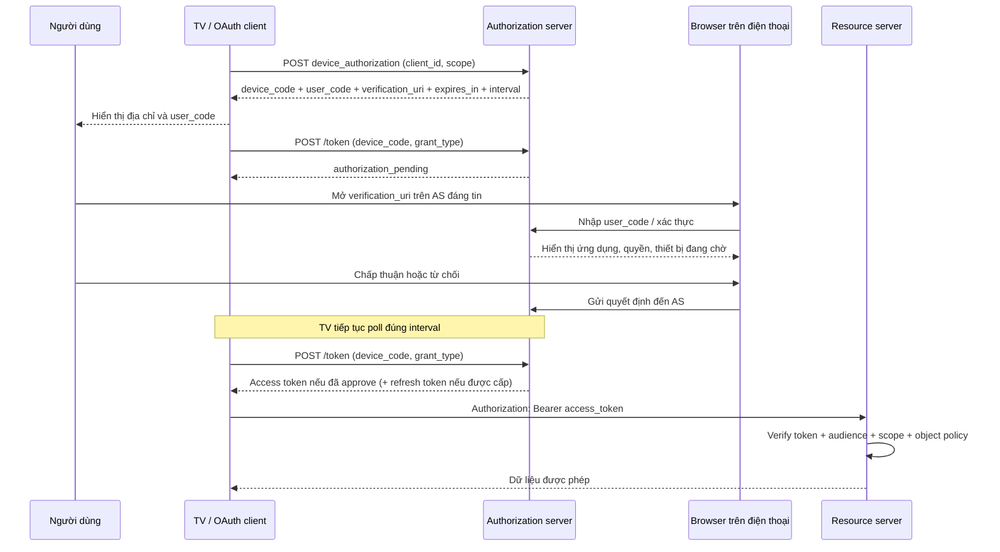
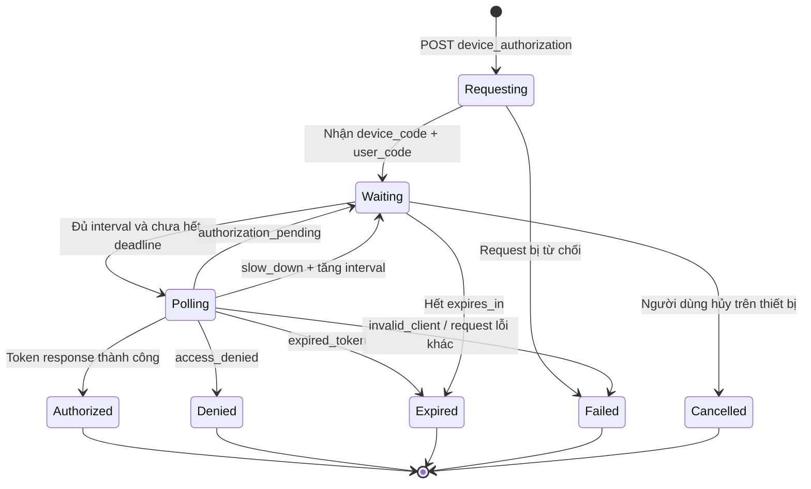
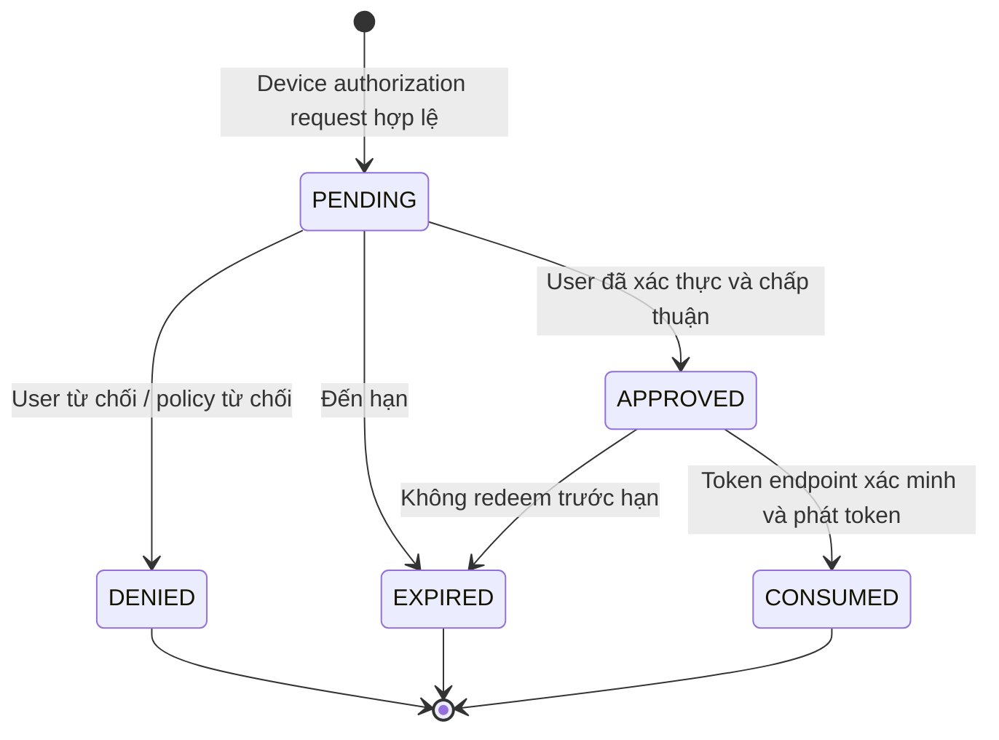

# Device Authorization Grant

Hãy hình dung một ứng dụng xem phim chạy trên smart TV. Người dùng muốn truy cập danh sách phim của mình nhưng việc nhập mật khẩu, MFA hoặc thao tác với biểu mẫu phức tạp bằng điều khiển TV rất bất tiện. Ứng dụng có thể hiển thị một **mã ngắn** và một **địa chỉ xác minh**; người dùng mở địa chỉ đó trên điện thoại hoặc máy tính đáng tin cậy để đăng nhập và phê duyệt. TV tiếp tục hỏi authorization server theo nhịp cho phép, nhận access token **chỉ khi** yêu cầu được chấp thuận.

Đó là **OAuth 2.0 Device Authorization Grant** (RFC 8628), thường được gọi là *device flow*. Luồng này phù hợp với thiết bị **hạn chế đầu vào** (*input-constrained devices*) hoặc **không có trình duyệt đủ khả năng xác thực** (*browserless clients*). Nó không yêu cầu người dùng gõ mật khẩu vào thiết bị đó. Tuy nhiên, **mã trên TV không phải access token**; một bên lừa người dùng nhập mã do kẻ tấn công tạo ra vẫn có thể khiến người dùng **cấp quyền cho phiên của kẻ tấn công** nếu không cảnh giác và nếu giao diện xác minh thiếu kiểm soát.

Bài thuộc chương **OAuth2 flows**, module **SECURITY_TOKEN_SECURITY_FUNDAMENTALS**. Trọng tâm là luồng phát hành và sử dụng token theo OAuth 2.0, mô hình tin cậy giữa client, authorization server và resource server; JWT/opaque access token, refresh token, claims/scope/audience, lưu trữ, thu hồi, chống lộ token và chống phát lại. Device Authorization Grant là **cách lấy token**, không thay thế việc resource server kiểm tra token và quyền trên tài nguyên.

Sau bài học, bạn có thể:

- Giải thích mục đích của Device Authorization Grant, phân biệt với Authorization Code + PKCE và Client Credentials.
- Vẽ được chuỗi tương tác giữa thiết bị, trình duyệt thứ hai, authorization server và API.
- Phân biệt rõ `device_code`, `user_code`, `verification_uri` và `verification_uri_complete`.
- Gửi request tới **device authorization endpoint** rồi **poll token endpoint** đúng nhịp, xử lý `authorization_pending`, `slow_down`, `access_denied` và `expired_token`.
- Nhận biết giới hạn bảo mật của public client, bảo vệ user code, device code và bearer token khỏi đoán mã, phishing và replay.
- Chọn cách lưu access/refresh token cho TV, CLI và thiết bị dùng chung; phân quyền theo scope và audience.
- Thiết kế test cases cho hết hạn, từ chối, request song song, phê duyệt nhầm thiết bị, polling quá nhanh và sự cố mạng.

## 1. Device Authorization Grant giải quyết vấn đề gì?

Trong Authorization Code flow thông thường, client điều hướng người dùng tới trình duyệt để đăng nhập và nhận authorization code qua redirect URI. Với **smart TV, máy chơi game, máy in, thiết bị IoT có màn hình nhỏ hoặc terminal không có browser**, việc điều hướng, điền form và nhận redirect có thể khó hoặc không khả thi.

RFC 8628 tách **hai kênh**:

1. **Thiết bị cần quyền (device client):** hiển thị mã và địa chỉ, đồng thời gửi request tới token endpoint để kiểm tra trạng thái.
2. **Thiết bị có trình duyệt (secondary device):** người dùng tự truy cập **authorization server**, xác thực theo chính sách và quyết định có chấp thuận yêu cầu của thiết bị thứ nhất không.

Authorization server liên kết hai kênh thông qua một **giao dịch chờ phê duyệt có thời hạn**. Device client **không bao giờ được nhận token chỉ vì mã đã được hiển thị**; token chỉ được phát hành sau khi yêu cầu phù hợp đã được người dùng/AS phê duyệt và client hoàn tất token request.

### 1.1. Những trường hợp phù hợp

| Ngữ cảnh | Vì sao device flow hữu ích? | Điều phải cân nhắc |
| --- | --- | --- |
| **Smart TV/console** | Không cần nhập mật khẩu dài bằng điều khiển | Màn hình dùng chung, giữ session, mã bị chụp ảnh |
| **CLI trên máy từ xa** | Terminal không có browser phù hợp, người dùng dùng điện thoại/laptop để xác minh | Lộ mã trong terminal recording/log, máy chủ chia sẻ |
| **Máy in có màn hình nhỏ** | Nhập user code dễ hơn màn hình đăng nhập | Ai được bind tài khoản vào thiết bị, reset khi chuyển chủ sở hữu |
| **Thiết bị IoT tương tác với người dùng** | Có thể tách bước xác thực khỏi thiết bị | Phải có kênh hiển thị đủ rõ và xác nhận ý định |
| **Kiosk có người dùng luân phiên** | Có thể mở phiên theo người dùng hiện tại | Tự động logout, thu hồi phiên, không giữ refresh token giữa người dùng |

**Không nên dùng device flow chỉ để né thiết kế redirect/PKCE** khi client có browser đủ khả năng và Authorization Code + PKCE phù hợp hơn. Nó cũng **không phải cơ chế đăng nhập headless tự động** cho server job không có người dùng: công việc service-to-service thường nên dùng Client Credentials/workload identity theo hợp đồng.

## 2. Các vai trò OAuth 2.0 trong device flow

| Vai trò | Thực thể minh họa | Trách nhiệm |
| --- | --- | --- |
| **Resource owner** | Người dùng sở hữu tài khoản xem phim | Xác thực và cho phép/không cho phép quyền theo quy tắc AS |
| **OAuth client** | Ứng dụng trên smart TV | Khởi tạo device authorization, hiển thị mã, poll token endpoint, giữ token |
| **Authorization server (AS)** | `https://login.example.com` | Phát mã, quản lý giao dịch chờ, xác thực người dùng và quyết định cấp token |
| **Resource server (RS)** | `https://api.example.com/library` | Nhận access token, xác minh issuer/audience/scope và quyền thư viện |
| **Secondary browser** | Điện thoại hoặc laptop của người dùng | Công cụ người dùng dùng để đến AS; **không phải OAuth client nhận token thay TV** |

**Cần phân biệt:** điện thoại ở bước nhập mã không bắt buộc nhận OAuth access token của ứng dụng TV. Sau khi người dùng chấp thuận trên trình duyệt, **TV nhận token từ token endpoint**, không phải qua redirect từ browser về TV.

### 2.1. Client là public hay confidential?

Phần lớn ứng dụng phân phối trong firmware hoặc chương trình TV/CLI mà người dùng có thể trích xuất là **public clients**. `client_id` là identifier, **không phải bí mật** và **không tự xác thực client**. Không nhúng một `client_secret` dùng chung vào binary rồi gọi đó là confidential.

Một thiết bị/backend đặc biệt có thể có credential được bảo vệ đủ tốt và client authentication được AS hỗ trợ. Nếu **thực sự là confidential client**, yêu cầu token endpoint phải xác thực client theo phương thức đã đăng ký. **Device Authorization Grant không miễn client authentication khi chính sách OAuth yêu cầu**, nhưng cũng không tự biến một public client thành confidential.

## 3. Luồng tổng thể: hai thiết bị, một giao dịch được AS quản lý



Sơ đồ mô tả một phiên thành công. Khi người dùng **từ chối** hoặc **mã hết hạn**, token endpoint **không phát access token**; client phải dừng polling và xử lý trạng thái phù hợp.

### 3.1. Không có “bước bí mật” giữa điện thoại và TV

Điện thoại giúp người dùng tương tác với trang xác minh của AS. Nó **không gửi access token qua Bluetooth/QR/message cho TV** trong giao thức RFC 8628. Quan hệ giữa hai phía được AS quản lý:

- **`user_code`:** mã người dùng **nhìn thấy và nhập**.
- **`device_code`:** credential dài, khó đoán, do TV **trình cho token endpoint**.
- **Authorization transaction:** bản ghi trạng thái do AS quản lý, ràng buộc với đúng client, mã, thời gian và quyết định.

Nếu một ứng dụng tự xây API “điện thoại gửi access token cho TV theo mã 6 chữ số”, đó **không còn là luồng chuẩn RFC 8628** và dễ tạo lỗ hổng chuyển credential sang thiết bị không được phép.

## 4. Điều kiện tiên quyết và discovery

Trước khi bắt đầu, OAuth client và AS phải hỗ trợ **grant type** và **device authorization endpoint** tương ứng.

- Client được **đăng ký với AS** (ít nhất có `client_id`).
- AS công bố hoặc cung cấp **device authorization endpoint** được client tin cậy; nếu hỗ trợ OAuth Authorization Server Metadata (RFC 8414), metadata có thể chứa `device_authorization_endpoint` và `grant_types_supported`.
- Client biết **token endpoint**, cơ chế client authentication nếu có, scope được phép, audience/resource cần xin và chính sách cấp refresh token.
- Thiết bị có cách hiển thị `verification_uri` và `user_code` cho người dùng (màn hình, terminal hoặc giao diện tương đương).
- Có HTTPS và khả năng xác minh chứng chỉ cho kết nối tới AS.

Ví dụ **metadata giản lược** — URL và giá trị là minh họa, không phải một endpoint thật:

```json
{
  "issuer": "https://login.example.com",
  "device_authorization_endpoint": "https://login.example.com/oauth2/device_authorization",
  "token_endpoint": "https://login.example.com/oauth2/token",
  "grant_types_supported": [
    "authorization_code",
    "urn:ietf:params:oauth:grant-type:device_code"
  ]
}
```

**Đừng tự suy đoán** URL từ hostname hoặc chấp nhận endpoint bất kỳ do người dùng/token đưa ra. Client phải cấu hình issuer/metadata đáng tin và quản lý chuyển đổi cấu hình an toàn. Không phải AS nào cũng hỗ trợ device flow; nếu không hỗ trợ, cần thông báo rõ và chọn flow phù hợp khác thay vì tự bắt chước bằng một API thiếu kiểm soát.

## 5. Bước 1: xin device_code và user_code

Client gửi HTTP `POST` tới **device authorization endpoint** với content type `application/x-www-form-urlencoded`. Với public client, `client_id` là tham số cần thiết; `scope` là tùy chọn theo RFC 8628 và hợp đồng AS.

```http
POST /oauth2/device_authorization HTTP/1.1
Host: login.example.com
Content-Type: application/x-www-form-urlencoded
Accept: application/json

client_id=tv-player-client&scope=library.read%20playback.start
```

AS kiểm client/grant, yêu cầu quyền, chính sách và điều kiện của phiên rồi cấp thông tin tạm thời. Nếu AS hỗ trợ **Resource Indicators (RFC 8707)**, client có thể có cơ chế chỉ định resource đích theo hợp đồng AS, ví dụ `resource=https%3A%2F%2Fapi.example.com%2Flibrary`. **Không coi tham số `resource` là bắt buộc của RFC 8628**, và không cho client tự quyết định `aud` trong token.

### 5.1. Client authentication tại device authorization endpoint

Trong ví dụ public client, `client_id` định danh ứng dụng nhưng **không bí mật**. Nếu AS yêu cầu confidential client xác thực, nó phải dùng cơ chế đã đăng ký phù hợp, chẳng hạn private-key JWT hoặc mTLS. Server không được coi việc biết một client ID là bằng chứng đủ rằng người gọi sở hữu client bí mật.

**Đừng gửi username/password người dùng từ TV** tới device authorization endpoint. Người dùng đăng nhập qua **trang xác minh của AS** trên secondary browser, không chia sẻ mật khẩu với thiết bị có giao diện hạn chế.

## 6. Bước 2: response của device authorization endpoint

Ví dụ phản hồi RFC 8628:

```http
HTTP/1.1 200 OK
Content-Type: application/json
Cache-Control: no-store

{
  "device_code": "dvc_Qr7tP2v6X8z4mN0-example-secret",
  "user_code": "WDJB-MJHT",
  "verification_uri": "https://login.example.com/activate",
  "verification_uri_complete": "https://login.example.com/activate?user_code=WDJB-MJHT",
  "expires_in": 600,
  "interval": 5
}
```

Các giá trị chỉ để học cú pháp. Không copy các “mã ví dụ” vào ứng dụng thật. Mã phải do AS tạo bằng nguồn ngẫu nhiên và chính sách an toàn.

| Thuộc tính | Bắt buộc trong RFC 8628? | Ý nghĩa | Ai sử dụng? |
| --- | --- | --- | --- |
| `device_code` | **Có** | Mã dài, khó đoán, đại diện giao dịch chờ và được gửi tới token endpoint | **Client/thiết bị**, giữ bí mật |
| `user_code` | **Có** | Mã dễ nhập, liên kết người dùng với giao dịch chờ | **Người dùng** nhập tại AS |
| `verification_uri` | **Có** | Địa chỉ người dùng mở bằng browser để xác minh và phê duyệt | **Người dùng/secondary browser** |
| `verification_uri_complete` | **Không** | URI chứa `user_code` để giảm thao tác, có thể dùng QR/link | **Secondary browser**, phải kiểm domain và xác nhận phiên |
| `expires_in` | **Có** | Số giây mà `device_code` và `user_code` còn hiệu lực theo giao dịch | Client tính timeout; AS thực thi expiry |
| `interval` | **Không** | Số giây tối thiểu giữa các lần poll token endpoint | Client; **mặc định 5 giây** nếu vắng mặt |

### 6.1. `device_code` không phải `user_code`

**Device code** được thiết kế có entropy cao, không hiển thị để người dùng nhập thủ công. Nó là credential để **client đã khởi tạo yêu cầu** kiểm tra trạng thái và nhận token sau phê duyệt. Nếu attacker có device code và điều kiện cần thiết tại token endpoint, họ có thể thử redeem giao dịch; vì vậy phải bảo vệ nó như một secret tạm thời.

**User code** được thiết kế ngắn, rõ, dễ đọc và dễ nhập. Nó **không phải** access token hoặc refresh token. Vì số khả năng nhỏ hơn một secret ngẫu nhiên dài, AS phải có **rate limiting, thời hạn ngắn và kiểm soát việc đoán user code**.

Không lưu mã trong URL của ứng dụng người dùng trừ trường hợp `verification_uri_complete` do **AS cấp**; không gửi mã dưới dạng credentials tới những domain lạ.

### 6.2. `expires_in` không phải `expires_at`

`expires_in=600` nghĩa là thời gian sống **tính bằng giây kể từ phản hồi**, không phải Unix timestamp. Client nên tính một **deadline theo đồng hồ monotonic** dựa trên thời điểm nhận phản hồi, trừ dung sai và xử lý độ trễ; AS mới là **nguồn thẩm quyền** quyết định mã có còn hiệu lực hay không.

Khi hết hạn, client phải **dừng polling** và chỉ bắt đầu một **device authorization request mới** nếu người dùng muốn thử lại. Không kéo dài `expires_in` trên UI hay giữ user code cũ để người dùng nhập tiếp.

## 7. Bước 3: hiển thị mã và hướng dẫn người dùng

Ví dụ màn hình TV:

```text
Kết nối tài khoản của bạn với TV

1. Dùng điện thoại/máy tính bạn tin cậy để mở:
   https://login.example.com/activate

2. Nhập mã:
   WDJB-MJHT

3. Kiểm tra rằng bạn muốn kết nối
   ứng dụng TV này với tài khoản của mình.

Mã sẽ hết hạn; không chia sẻ mã theo lời nhắn
từ người lạ.
```

**Thiết bị chỉ hiển thị code do authorization server trả về cho phiên của chính nó.** Nó không tự tạo mã “giống mẫu” rồi hy vọng AS chấp nhận. Khi người dùng mở đúng domain AS:

1. AS yêu cầu đăng nhập nếu chưa có phiên phù hợp và thực thi MFA/reauthentication theo policy.
2. Người dùng nhập `user_code` hoặc dùng `verification_uri_complete`.
3. AS tìm **giao dịch chờ hợp lệ** tương ứng và hiển thị **tên ứng dụng, quyền được yêu cầu và thông tin thiết bị/phiên nếu có**.
4. Người dùng **xác nhận đúng thiết bị họ muốn kết nối** và chọn phê duyệt/từ chối.
5. AS ghi quyết định vào giao dịch; TV chỉ biết kết quả khi poll.

### 7.1. QR code có bỏ qua xác nhận không?

**Không.** `verification_uri_complete` và QR code có thể nhập sẵn `user_code` để thuận tiện. **Không được coi việc quét QR là consent**. AS vẫn phải xác thực người dùng, hiển thị đầy đủ thông tin thích hợp và nhận quyết định phê duyệt.

Thiết bị nên **vẫn hiển thị user code** để người dùng so đối chiếu trên trang AS. QR có thể bị thay thế bằng sticker/mã độc hại dẫn tới **phishing site**. Người dùng cần xác nhận domain thật của nhà cung cấp thay vì chỉ tin mã QR hoặc lời nhắn.

### 7.2. Không khiến người dùng phê duyệt “mã của người khác”

Một người lạ có thể tự tạo device authorization request bằng tài khoản client công khai rồi gửi **user code của họ** cho nạn nhân, yêu cầu “nhập mã để nhận quà/xác minh tài khoản”. Nếu nạn nhân đăng nhập và phê duyệt, **token có thể được cấp cho client đang giữ device code của attacker**, không phải thiết bị của nạn nhân.

Vì vậy AS phải làm rõ **ứng dụng nào, thiết bị nào, quyền nào** đang được kết nối; UI nên cảnh báo người dùng **chỉ chấp thuận nếu chính họ vừa khởi tạo yêu cầu trên thiết bị đang sở hữu**. Không dùng ngôn ngữ như “nhập mã từ bất kỳ người hỗ trợ nào” một cách thiếu kiểm soát.

## 8. Bước 4: client poll token endpoint

Trong khi người dùng dùng điện thoại, **TV gửi token request có chu kỳ** đến AS, không chờ redirect:

```http
POST /oauth2/token HTTP/1.1
Host: login.example.com
Content-Type: application/x-www-form-urlencoded
Accept: application/json

grant_type=urn%3Aietf%3Aparams%3Aoauth%3Agrant-type%3Adevice_code&device_code=dvc_Qr7tP2v6X8z4mN0-example-secret&client_id=tv-player-client
```

Các tham số chính:

| Tham số | Vai trò |
| --- | --- |
| `grant_type=urn:ietf:params:oauth:grant-type:device_code` | **Giá trị grant type chuẩn**, phải gửi khi redeem device code |
| `device_code` | **Code bí mật** từ device authorization response, ràng buộc giao dịch |
| `client_id` | **Bắt buộc nếu client không xác thực với AS**; đối chiếu với giao dịch đã khởi tạo |
| Client authentication | Nếu client thuộc loại phải xác thực, AS kiểm theo phương thức đã đăng ký |

`grant_type` phải là **giá trị URN chính xác** khi form được giải mã. URL encoding trong request chỉ là biểu diễn HTTP form, không phải giá trị khác.

**Không gửi `user_code` trong token request.** Người dùng nhập user code **trên trang AS**, còn client gửi device code tới token endpoint. Không cho `user_code` đóng vai secret thay thế `device_code`.

### 8.1. Response khi người dùng chưa phê duyệt

```http
HTTP/1.1 400 Bad Request
Content-Type: application/json
Cache-Control: no-store

{
  "error": "authorization_pending"
}
```

Đây **không phải lỗi cần hiển thị là “đăng nhập thất bại”**. Nó nghĩa là AS chưa nhận được quyết định cuối cùng. Client giữ màn hình hướng dẫn, **đợi đủ interval** rồi poll tiếp, miễn chưa quá deadline.

### 8.2. Response khi poll quá nhanh

```http
HTTP/1.1 400 Bad Request
Content-Type: application/json

{
  "error": "slow_down"
}
```

Khi nhận `slow_down`, client **phải tăng khoảng cách giữa các lần poll lên ít nhất 5 giây** so với trước, cho lần tiếp theo **và các lần sau** trong giao dịch. Ví dụ interval đang 5 giây thì tăng thành ít nhất 10 giây; nếu lại nhận `slow_down`, tiếp tục tăng thêm ít nhất 5 giây.

Không khắc phục bằng vòng lặp HTTP không ngắt hoặc retry ngay. Server có thể áp dụng thêm rate limit, và client cần backoff khi gặp timeout/network error.

## 9. Bảng trạng thái polling và kết quả

RFC 8628 định nghĩa các mã lỗi đặc trưng của device flow. Client phải dựa vào **`error` từ token endpoint** chứ không coi mọi HTTP 400 là cùng một trạng thái.

| `error` | Ý nghĩa | Client xử lý |
| --- | --- | --- |
| `authorization_pending` | Người dùng chưa hoàn thành quyết định | **Tiếp tục poll** sau interval |
| `slow_down` | AS yêu cầu giảm tần suất poll | **Tăng interval ít nhất 5 giây**, rồi tiếp tục |
| `access_denied` | Người dùng/AS không cho phép | **Dừng polling**, hiển thị không được cấp quyền |
| `expired_token` | Device code hết hạn | **Dừng polling**, bỏ giao dịch, cho phép khởi tạo mới |
| Lỗi OAuth khác như `invalid_client`, `invalid_grant`, `invalid_request` | Sai client, sai credential, token/grant hoặc request | **Không vòng lặp vô hạn**; xử lý theo hợp đồng AS, dừng khi không thể phục hồi |
| Token response thành công | AS đã phê duyệt và chấp nhận device code | **Dừng polling**, lưu token an toàn và gọi API đúng scope/audience |

### 9.1. State machine phía client



Khi đã thành công hoặc kết thúc bằng lỗi, client phải **dừng mọi goroutine/thread/job polling của giao dịch cũ**. Không khởi chạy song song nhiều vòng poll cho cùng device code, nhất là sau khi giao diện bị reload.

### 9.2. Những mã lỗi không nên diễn giải sai

- `authorization_pending` không phải “token hết hạn”; client có thể tiếp tục trong deadline.
- `slow_down` không cho phép poll với interval cũ; client phải tăng nhịp chờ.
- `access_denied` không phải tín hiệu client nên tự xin scope khác rồi poll cùng code; muốn thử lại phải khởi tạo giao dịch mới theo policy.
- `expired_token` áp dụng cho giao dịch device authorization; không thể sửa bằng cách kéo dài timer phía client.
- `invalid_client` có thể cho thấy cấu hình client authentication sai; đừng lặng lẽ bỏ client authentication để “thử lại”.

## 10. Thuật toán polling chuẩn: interval, timeout và retry

Theo RFC 8628, nếu response không chứa `interval`, client dùng **5 giây** làm interval ban đầu. Client **phải chờ ít nhất interval giữa các token requests**; điều chỉnh khi `slow_down` hoặc network errors.

Pseudocode:

```text
function runDeviceGrant(deviceAuthorizationResponse):
    deviceCode = deviceAuthorizationResponse.device_code
    interval = deviceAuthorizationResponse.interval ?? 5 seconds
    deadline = monotonicNow() + deviceAuthorizationResponse.expires_in

    while monotonicNow() < deadline:
        waitAtLeast(interval)
        if userCancelled():
            return CANCELLED
        if monotonicNow() >= deadline:
            return EXPIRED

        response = callTokenEndpoint(
            grant_type = "urn:ietf:params:oauth:grant-type:device_code",
            device_code = deviceCode,
            client_id = registeredClientId,
            clientAuthentication = ifRequiredByClientType
        )

        if response.isSuccessWithAccessToken():
            secureStore.saveTokens(response)
            return AUTHORIZED

        if response.error == "authorization_pending":
            continue
        if response.error == "slow_down":
            interval = interval + atLeast(5 seconds)
            continue
        if response.error == "access_denied":
            return DENIED
        if response.error == "expired_token":
            return EXPIRED

        if response.isTemporaryTransportFailure():
            interval = increaseWithBoundedBackoff(interval)
            continueOnlyWhileBeforeDeadline()

        return TERMINAL_ERROR

    return EXPIRED
```

Đây là **mã giả**; hệ thống thực cần HTTP timeouts, cancellation, trạng thái ứng dụng, bảo vệ token response và quản lý concurrency. Không cài đặt vòng lặp `while(true)` không giới hạn, không bỏ `interval` để “đăng nhập nhanh hơn”.

### 10.1. Vấn đề network timeout

Nếu client gửi token request rồi kết nối đứt:

- Client **không biết** AS có hoàn tất một lần redeem hay chưa.
- Không nên retry ngay không giới hạn; RFC 8628 khuyến nghị **giảm tần suất** khi gặp connection timeout, có thể bằng exponential backoff.
- Nếu authorization đã hoàn tất và response token bị mất, device code có thể **đã được tiêu thụ** theo chính sách AS. Client phải xử lý thất bại/restart rõ ràng, không giả định code vẫn dùng được vô hạn.
- Phải dừng khi deadline hết hạn, kể cả lỗi mạng vẫn tiếp diễn.

### 10.2. Trường hợp người dùng nhập mã chậm

UI có thể hiển thị thời gian còn lại ước tính nhưng **AS quyết định** mã còn hợp lệ không. Khi giao dịch hết hạn, client xóa mã cũ khỏi UI và cho người dùng chủ động bắt đầu lại. Không biến timeout thành “người dùng đã từ chối” nếu AS chưa đưa quyết định đó.

## 11. Bước 5: token endpoint trả access token

Sau khi người dùng chấp thuận đúng giao dịch, AS có thể trả **OAuth access token**:

```http
HTTP/1.1 200 OK
Content-Type: application/json
Cache-Control: no-store
Pragma: no-cache

{
  "access_token": "<access-token-for-library-api>",
  "token_type": "Bearer",
  "expires_in": 900,
  "scope": "library.read playback.start",
  "refresh_token": "<optional-refresh-token>"
}
```

**Refresh token là tùy chọn**; AS có thể không cấp cho client này, thiết bị này hoặc grant này. `expires_in` trong token response thường mô tả **access token lifetime**; nó khác `expires_in` của device authorization response vốn mô tả **hạn dùng của device/user code**.

Client phải:

1. Kiểm HTTP status và token response schema theo thư viện OAuth/AS đã chọn.
2. Kiểm `token_type` và chỉ gửi access token tới API bằng phương thức phù hợp.
3. Tôn trọng **scope thực cấp**: không mặc định AS phê duyệt toàn bộ scope client yêu cầu.
4. Lưu access token/refresh token trong vùng phù hợp threat model, không log hoặc đưa lên UI.
5. Không gửi access token tới host ngoài audience/AS-approved resource.
6. Dừng polling cho device code và hủy/loại thông tin giao dịch tạm thời khi xong.

**Không lấy access token từ trang xác minh trên điện thoại.** Token trả cho device client từ **token endpoint**, dưới một kết nối được bảo vệ, sau khi AS kiểm giao dịch.

### 11.1. Phân biệt device code với access token

| Thứ | Ai phát hành? | Dùng ở đâu? | Có được trình làm Bearer tại API không? |
| --- | --- | --- | --- |
| `user_code` | AS | Form nhập mã tại `verification_uri` | **Không** |
| `device_code` | AS | Token endpoint cùng grant type device code | **Không** |
| Access token | AS | Resource server đúng audience | **Có**, nếu profile là Bearer và còn hiệu lực |
| Refresh token (nếu cấp) | AS | Token endpoint, refresh grant | **Không** |
| ID token (nếu OIDC cấp) | OP/AS | OIDC client xác minh login | **Không**, không thay access token |

## 12. Resource server vẫn phải xác minh token

Device flow chỉ thay đổi **cách lấy access token**, không thay đổi nghĩa vụ của API. Ví dụ client gọi:

```http
GET /v1/library/me HTTP/1.1
Host: api.example.com
Authorization: Bearer <access-token-for-library-api>
```

Library API phải kiểm:

- **Đúng loại** access token, không chấp nhận `device_code`, `user_code`, ID token, refresh token hoặc authorization code.
- **Nguồn đáng tin**: JWT/JWS signature với key/algorithm/issuer được cấu hình hoặc opaque token qua introspection/trust lookup đáng tin.
- **Audience**: token dành cho Library API; nếu JWT access token theo RFC 9068, kiểm `aud` khớp resource identifier của API.
- **Thời hạn/trạng thái**: `exp`, `nbf`, `active` khi introspection, revocation policy.
- **Scope**: `library.read` đủ cho endpoint; `playback.start` không tự cấp quyền quản lý mọi thư viện.
- **Object-level authorization**: user có quyền với thư viện và hồ sơ hiện hành, không được xem tài khoản khác chỉ vì đổi đường dẫn.

Ví dụ JWT payload **minh họa**:

```json
{
  "iss": "https://login.example.com",
  "sub": "user-42",
  "aud": "https://api.example.com/library",
  "client_id": "tv-player-client",
  "scope": "library.read playback.start",
  "iat": 1795000000,
  "exp": 1795000900
}
```

Payload này **không phải JWT đã xác minh** và không phải định dạng bắt buộc cho mọi token device flow. JWT phải được xác minh chữ ký/claims; opaque token có thể không đọc được `aud` trực tiếp. Việc client lấy token qua TV không cho Library API bỏ qua issuer/audience/scope/object policy.

## 13. Authorization server phải quản lý trạng thái giao dịch an toàn

Một triển khai device grant đúng cần một **bản ghi giao dịch có thời hạn**:

```text
DeviceAuthorization {
    id: internal-transaction-id,
    client_id: "tv-player-client",
    device_code_digest: "<secure-digest>",
    user_code_lookup: "<protected-lookup-key>",
    requested_scopes: ["library.read"],
    requested_resources: ["https://api.example.com/library"],
    created_at: ...,
    expires_at: ...,
    poll_interval_seconds: 5,
    approval_status: PENDING | APPROVED | DENIED | EXPIRED,
    authorized_subject: null | trusted-user-id,
    consumed_at: null | timestamp
}
```

Đây là mô hình khái niệm, không phải schema bắt buộc của RFC 8628. AS cần:

1. **Sinh device code khó đoán** bằng CSPRNG, lưu an toàn, so sánh theo cơ chế tránh lộ trạng thái/bí mật.
2. **Sinh user code dễ nhập nhưng đủ khó đoán trong lifetime**, giới hạn số lần thử và tốc độ nhập.
3. Ràng buộc transaction với **client ID đã đăng ký**, scopes/resources yêu cầu và timeout.
4. Chỉ đổi trạng thái `APPROVED` sau khi xác thực đúng người dùng và có quyết định có chủ ý theo policy.
5. Xác minh device code ở token endpoint: chưa hết hạn, chưa bị tiêu thụ, client phù hợp, quyền còn hiệu lực.
6. **Cấp token và tiêu thụ device code nguyên tử**, tránh hai token requests đồng thời đều nhận quyền ngoài policy.
7. Có chiến lược cleanup trạng thái/secret và audit metadata, không ghi token thô trong logs.

### 13.1. State machine phía AS



Nếu user đã phê duyệt nhưng **device code hết hạn trước lần poll tiếp theo**, AS cần xử lý theo luật hiệu lực của giao dịch; không được phát token cho một code không còn hợp lệ chỉ vì trước đó đã bấm chấp thuận.

### 13.2. Code collision và client binding

AS phải bảo đảm `user_code` dẫn tới đúng giao dịch chờ trong phạm vi quản lý/định danh của nó. Nếu hai giao dịch có user code giống nhau nhưng AS tra cứu không phân biệt được, người dùng có thể phê duyệt nhầm thiết bị. Token endpoint không thể chỉ kiểm device code tồn tại; nó phải kiểm **client được cấp device code** và áp dụng client authentication khi phù hợp.

## 14. Threat model: user code guessing, phishing và token theft

Device flow có những tấn công đặc thù vì **mã và quyết định xác thực nằm trên hai thiết bị**.

### 14.1. User code ngắn có thể bị đoán

User code ngắn làm UX tốt nhưng giảm entropy so với device code. Nếu trang xác minh cho phép thử vô hạn, attacker có thể đoán **một giao dịch đang chờ**, chấp thuận hoặc tương tác sai.

Phòng vệ AS:

- Sinh mã bằng nguồn ngẫu nhiên an toàn, không dùng số tăng tuần tự hoặc `Math.random()`.
- Giới hạn số lần thử trên mỗi user code/phiên/client/IP theo thiết kế, tránh chỉ dựa một nguồn như IP vì NAT.
- Sử dụng **thời hạn ngắn**, hủy code khi đã hết hạn/tiêu thụ/từ chối.
- Không tiết lộ chi tiết cho phép liệt kê giao dịch/chủ thể; cân nhắc trả thông báo lỗi nhất quán.
- Giám sát tốc độ nhập sai, pattern dò mã và sự cố liên quan.

**Rate limiting là một phần quan trọng của bảo mật user code**, không thể thay bằng “mã trông đủ dài”.

### 14.2. Device code phải khó đoán và giữ bí mật

Device code **không được** tạo từ `user_code` theo quy tắc đoán được, không nên xuất hiện trong QR/link dành cho người dùng. Nếu attacker lấy được device code và có thể giả mạo client theo chính sách token endpoint, họ có thể thử nhận token sau khi nạn nhân phê duyệt.

Client phải tránh ghi device code vào console debug, URL/query, telemetry, crash report hoặc log của HTTP client. AS cần ràng buộc code với client và trạng thái giao dịch, giới hạn số lần redeem và tiêu thụ code đúng một lần theo policy.

### 14.3. Device-code phishing

Kịch bản:

1. Attacker khởi tạo device flow với một OAuth client mà họ kiểm soát hoặc mạo nhận một ứng dụng.
2. Attacker nhận `user_code` và bảo nạn nhân mở trang xác minh thật của AS để nhập mã đó.
3. Nạn nhân tưởng mình “xác minh bảo mật” hoặc “đăng nhập hỗ trợ kỹ thuật”, nên chấp thuận yêu cầu.
4. Token được phát hành cho **client giữ device code của attacker**, cho phép attacker dùng quyền được cấp.

Đây là **tấn công lừa người dùng cấp quyền**, không cần trang xác minh giả. Do đó **chỉ kiểm domain thật của AS là chưa đủ**. UI xác minh cần hiển thị tên client, phạm vi quyền, mô tả thiết bị/thời điểm phù hợp và cảnh báo rõ: **chỉ chấp thuận mã đang hiện trên thiết bị bạn muốn kết nối**.

AS nên xem xét chống client impersonation, tên ứng dụng dễ gây nhầm, yêu cầu consent quá rộng và phishing bất thường; user phải có cách **từ chối** và kiểm tra các thiết bị đã liên kết/thu hồi phiên.

### 14.4. QR-code substitution và domain spoofing

Mã QR dán lên TV ở nơi công cộng có thể dẫn tới một website phishing, dù giao diện trông giống AS. Client nên hiển thị **địa chỉ dễ kiểm tra** và user code, không chỉ QR. Người dùng phải tránh gửi mật khẩu/OTP vào địa chỉ do tin nhắn lạ cung cấp. AS/client dùng HTTPS và không chuyển token sang host ngoài hợp đồng.

### 14.5. Token replay sau khi được cấp

Kể cả device authorization hoàn toàn đúng, **bearer access token bị lộ** từ TV/CLI vẫn có thể được dùng bởi người giữ bản sao nếu token chưa hết hạn và không có sender constraint. Phòng vệ:

- Scope và audience tối thiểu, access token TTL phù hợp.
- Không log token, mã hóa credential khi lưu và hạn chế quyền runtime.
- Refresh token rotation hoặc sender constraint theo loại client và chính sách.
- Revocation, phát hiện bất thường, logout khỏi thiết bị dùng chung.
- Cân nhắc DPoP/mTLS-bound access token khi AS và RS hỗ trợ; **device grant tự nó không phải proof-of-possession**.

## 15. User experience an toàn cho thiết bị có màn hình

Chỉ một màn hình “Nhập mã để đăng nhập” là chưa đủ cho thiết bị dùng chung. Một UI tốt cần:

1. **Hiển thị verification URI dễ đọc** thuộc domain AS đáng tin, không chỉ một QR không kiểm chứng được.
2. **Hiển thị user code rõ ràng**, phân nhóm để giảm nhầm chữ/số, có hướng dẫn nhập trên điện thoại.
3. **Thông báo không chia sẻ mã**, chỉ dùng khi chính người dùng vừa chọn “Kết nối tài khoản” trên TV.
4. **Nêu quyền đang yêu cầu ở mức dễ hiểu** và quyền truy cập sẽ gắn với thiết bị nào.
5. **Có nút hủy** trên thiết bị, dừng vòng poll, dọn UI; AS xử lý giao dịch chờ theo chính sách.
6. **Hiển thị thời hạn còn lại ước tính**; không để mã cũ hiện sau hết hạn.
7. **Không tự động bắt đầu lại device flow vô hạn** khi bị từ chối hoặc hết hạn.
8. **Có nút đăng xuất/ngắt liên kết thiết bị**, kể cả khi giao dịch đã hoàn tất.

AS trên trình duyệt nên cho người dùng **xác nhận tên ứng dụng và quyền**, kiểm tra code/thiết bị đang được phê duyệt, rồi mới bấm Allow. Nên có đường dẫn quản lý các ứng dụng/thiết bị đã cấp quyền để thu hồi khi cần.

## 16. Ví dụ CLI headless không có browser

Một CLI chạy trên máy chủ từ xa muốn truy cập API theo **danh tính người dùng**. Nếu không thể mở browser cục bộ hay nhận redirect, device flow có thể là lựa chọn.

Console có thể in:

```text
$ example-cli login

Open https://login.example.com/activate
on a trusted browser and enter code: WDJB-MJHT

Waiting for approval...
Do not share this code with people you do not trust.

[After approval]
Login completed. Granted scope: reports.read
```

CLI không nên in `device_code` hay access/refresh token. Đặc biệt trong môi trường CI/CD hoặc remote SSH:

- Terminal output có thể bị ghi lại bởi session recorder.
- Shell history/logs có thể bị truy cập bởi người khác.
- CLI chạy dưới shared OS account có thể làm lẫn thông tin người dùng.
- Credential phải được lưu ở **OS credential store/secret store** phù hợp thay vì plaintext `~/.config/credentials.json` nếu có lựa chọn bảo vệ tốt hơn.
- Sau khi user logout, cần xóa credential cục bộ và xử lý revoke theo AS policy.

**Không sử dụng device flow để “đăng nhập CI/CD” bằng việc nhờ nhân viên nhập mã cho job định kỳ.** Nếu workload là service không đại diện người dùng tại thời điểm thực hiện, cân nhắc Client Credentials hoặc workload federation theo mô hình quyền.

## 17. Một client Java cần tổ chức code ra sao?

Không cần tự viết mật mã OAuth. Tối ưu là dùng SDK hỗ trợ RFC 8628. Tuy vậy, hiểu những thành phần tối thiểu giúp tránh lỗi:

```java
// PSEUDOCODE kiểu Java: tên lớp/method chỉ minh họa.
DeviceAuthorizationResponse startDeviceLogin() {
    return trustedOAuthClient.requestDeviceAuthorization(
        configuredDeviceAuthorizationEndpoint,
        registeredClientId,
        Set.of("library.read", "playback.start")
    );
}

TokenResponse waitForUserApproval(DeviceAuthorizationResponse start) {
    long deadline = monotonicClock.now() + seconds(start.expiresIn());
    long intervalSeconds = start.intervalOrDefault(5);

    showVerificationUi(
        start.verificationUri(),
        start.userCode(),
        start.verificationUriCompleteIfPresent()
    );

    while (monotonicClock.now() < deadline && !userCancelled()) {
        safeWaitAtLeastSeconds(intervalSeconds);

        TokenPollResult result = trustedOAuthClient.pollDeviceGrant(
            configuredTokenEndpoint,
            registeredClientId,
            start.deviceCode()
        );

        switch (result.errorOrStatus()) {
            case AUTHORIZATION_PENDING:
                continue;
            case SLOW_DOWN:
                intervalSeconds += 5;
                continue;
            case ACCESS_DENIED:
                throw new AuthorizationDenied();
            case EXPIRED_TOKEN:
                throw new DeviceCodeExpired();
            case SUCCESS:
                return result.validatedTokenResponse();
            default:
                throw new DeviceLoginFailed();
        }
    }
    throw new DeviceLoginCancelledOrExpired();
}
```

Đây **không phải mã chạy trực tiếp**; lớp `trustedOAuthClient`, `monotonicClock` và các enum là thành phần giả định. Để triển khai thật cần:

- SDK OAuth và HTTP client hỗ trợ TLS validation, timeout, retry có giới hạn, cancellation và JSON parsing an toàn.
- Quản lý interval khi network errors (backoff), tránh tạo nhiều pollers cho cùng code.
- Client authentication nếu client thuộc loại confidential theo đăng ký.
- Xử lý token response khác nhau giữa AS và scope thực cấp.
- Lưu token vào OS-backed storage/keystore theo threat model.
- Log chỉ metadata như correlation ID, trạng thái giao dịch, elapsed time và error code, **không log code/token**.

### 17.1. Cảnh báo về timeout sau khi AS đã phê duyệt

Nếu token request thành công ở AS nhưng response bị mất, client có thể không nhận access token. Không “đoán” access token từ `user_code` hoặc tiếp tục dùng mã đã consumed vô hạn. Sau retry có kiểm soát theo hợp đồng, UI có thể yêu cầu người dùng khởi tạo giao dịch mới. Backend AS phải xử lý token issuance và device-code consumption một cách nhất quán.

## 18. OAuth Device Grant và OpenID Connect (OIDC)

**RFC 8628 định nghĩa một OAuth 2.0 authorization grant**, không tự động định nghĩa kết quả đăng nhập OIDC. Nếu một OpenID Provider hỗ trợ device flow cùng OIDC và client xin scope `openid` theo hợp đồng, token response có thể bao gồm **ID token** và access token theo quy tắc extension/profile của OP. **Không được mặc định mọi AS có device flow đều trả ID token**.

Khi ID token được cấp:

- OIDC client phải xác minh **`iss`, `aud` (client ID), chữ ký, thời gian và các yêu cầu profile**.
- API/resource server **không dùng ID token làm access token**, dù `sub` giống nhau.
- UserInfo endpoint, nếu được hỗ trợ và client có scope phù hợp, dùng **access token** theo OIDC contract; không phải `device_code` hoặc `user_code`.
- Một access token mới phát hành lúc 12:00 **không chứng minh người dùng vừa làm MFA** nếu chưa có ngữ cảnh xác thực được kiểm chứng; `iat` khác `auth_time`.

Device grant cũng **không đồng nghĩa PKCE**. PKCE bảo vệ Authorization Code flow; device flow có cơ chế giao dịch và mã riêng. Đừng tự thêm `code_verifier` hoặc `code_challenge` rồi giả định AS xử lý theo RFC 8628 trừ khi có extension được định nghĩa và hỗ trợ.

## 19. Lưu trữ và vòng đời token trên TV/CLI

Khi nhận access token, client phải đánh giá:

| Credential/thông tin | Nơi lưu/độ bền thường phù hợp | Rủi ro chính |
| --- | --- | --- |
| `user_code` | Chỉ hiển thị trong lúc chờ; xóa khi kết thúc | Phishing, user nhập nhầm, ảnh chụp màn hình |
| `device_code` | Bộ nhớ tạm của client cho phiên polling, bảo vệ như secret | Bị đánh cắp/redeem sai client hoặc replay |
| Access token | Memory hoặc protected OS/device credential cache theo nhu cầu | Token bearer bị copy và dùng tại API |
| Refresh token (nếu được cấp) | Keystore/secure storage hoặc server-side store phù hợp | Cho phép gia hạn quyền lâu hơn; compromise lâu dài |
| `client_id` | Cấu hình đăng ký client | Không phải bí mật, không là bằng chứng client authentication |
| Private key/cert (nếu client thực sự có) | Secure element/keystore/HSM phù hợp | Mất khóa ảnh hưởng client identity/sender constraint |

### 19.1. TV dùng chung và logout

Trên TV của khách sạn, quán café hoặc thiết bị bán lại, việc giữ refresh token lâu dài có thể gây rò quyền qua người dùng tiếp theo. Cần:

- Xác định **thiết bị cá nhân hay thiết bị chia sẻ**.
- Có luồng **logout/unlink account** rõ ràng, xóa token cục bộ và thu hồi grant/token khi có thể.
- Không hiện danh tính, danh sách tài khoản, device code hoặc token của người dùng trước sau khi phiên kết thúc.
- Dùng TTL/idle expiry và chính sách tái xác thực cho dịch vụ nhạy cảm.
- Quản lý việc reset thiết bị, đổi chủ sở hữu và backup/restore để token không tự chuyển sang người khác.

### 19.2. Refresh token cho public client

TV/CLI phân phối đại trà thường là **public clients**, nên không dựa vào client secret cố định trong phần mềm để bảo vệ refresh token. Theo OAuth Security BCP (RFC 9700), refresh token cấp cho public client phải được bảo vệ bằng **rotation hoặc sender-constraining**, cùng chính sách expiry/revocation phù hợp.

Nếu rotation được bật, client phải thay refresh token cũ bằng token mới **nguyên tử**, tránh nhiều luồng refresh đồng thời làm AS phát hiện reuse giả. Một refresh token bị đánh cắp hoặc sử dụng lại phải dẫn tới xử lý sự cố theo chính sách token family/grant.

**Refresh token không bắt buộc** được AS cấp sau device grant. Client phải hỗ trợ trường hợp chỉ có access token ngắn hạn và yêu cầu login mới khi hết phiên.

## 20. Phân quyền và quyền riêng tư sau khi đăng nhập

Một device flow thành công **không cho client mọi quyền**. Ví dụ user approve `library.read`:

- TV có thể gửi access token đúng audience để lấy thư viện của chủ thể đó.
- Không được tự ý gọi `POST /admin/users` hoặc xem thư viện của user khác.
- API phải từ chối `scope` không đủ, `aud` sai, token hết hạn hoặc account/tenant không có quyền.
- Với hành động nhạy cảm như mua hàng, đổi phương thức thanh toán hoặc xóa dữ liệu, ứng dụng có thể cần thêm scope và step-up/confirmation theo chính sách.

**Consent trên điện thoại không thay thế authorization tại resource server**. User có thể đã chấp thuận OAuth scopes, nhưng quyền trên từng đơn/phim/tài khoản vẫn phải được resource server kiểm tra.

Nếu access token là JWT, RS phải xác minh signature, issuer, audience, lifetime, token type và quyền; nếu opaque, RS cần introspection/trust lookup đáng tin và resource binding. Logout/thu hồi refresh token **không tự vô hiệu JWT access token tự chứa** đang còn hạn nếu RS chỉ xác minh offline, nên cần TTL ngắn hoặc cơ chế revocation-aware theo threat model.

## 21. Case study 1: TV của gia đình

**Bối cảnh:** Người dùng mở ứng dụng TV và chọn “Kết nối tài khoản”. TV yêu cầu `library.read playback.start`; AS trả mã 8 ký tự và thời hạn 10 phút. Người dùng mở trang kích hoạt trên điện thoại cá nhân.

**Thiết kế đúng:**

1. TV hiển thị verification URI **thuộc domain AS thật** và user code.
2. TV poll token endpoint **5 giây/lần hoặc theo `interval` thực cấp**, không spam.
3. Điện thoại mở AS, người dùng xác thực và xem **đúng ứng dụng TV**, scopes đang xin.
4. AS chỉ cấp token khi người dùng **phê duyệt**; TV nhận token tại token endpoint.
5. TV lưu token theo device storage policy, gọi Library API; API kiểm audience, scope và quyền trên thư viện.
6. Khi người dùng chọn “Ngắt liên kết”, TV xóa credential và thực hiện revoke/unlink theo khả năng AS.

**Rủi ro còn lại:** Ai đang cầm điều khiển TV có thể sử dụng phiên đã đăng nhập nếu không có khóa màn hình/parental control hoặc user confirmation cho thao tác nhạy cảm. Bảo vệ bearer token không thay kiểm soát người dùng vật lý.

## 22. Case study 2: Attacker gửi mã kích hoạt qua tin nhắn

**Bối cảnh:** Người dùng nhận tin nhắn “Để xác minh tài khoản, truy cập trang kích hoạt chính thức và nhập mã `ABCD-EFGH`”. Đây là **mã attacker tạo từ device authorization request của họ**, không hiện trên TV của nạn nhân.

**Nếu người dùng approve**, AS có thể cấp access token cho client giữ device code mà attacker đang kiểm soát. Domain trang xác minh vẫn có thể là domain thật; đó là lý do **chỉ kiểm URL không đủ**.

**Phòng vệ:**

- Người dùng chỉ nhập mã **đang hiện trên thiết bị của chính mình** sau khi vừa chủ động kết nối.
- Trang AS hiển thị tên ứng dụng, thiết bị, scopes và xác nhận có chủ ý.
- AS áp dụng risk checks, phát hiện phê duyệt bất thường, rate limits, chống client branding giả.
- Client hiển thị cảnh báo chống phishing và cho phép từ chối/thu hồi grant.

**Bài học:** user code là **mã liên kết giao dịch**, không phải “OTP đăng nhập an toàn chung” gửi theo lời yêu cầu của người khác.

## 23. Case study 3: CLI trên bastion và polling không kiểm soát

**Bối cảnh:** CLI remote được chạy từ nhiều SSH sessions; mỗi phiên tự poll token endpoint mỗi 100 ms. Người dùng chưa nhập mã, AS trả `slow_down`.

**Sai lầm:** CLI vẫn poll 100 ms vì nghĩ server trả HTTP 400 do “chưa đăng nhập”. Hậu quả: rate limiting, AS overload, lỗi vận hành và khả năng abuse.

**Thiết kế đúng:** CLI bắt đầu theo `interval` hoặc mặc định 5 giây, **tăng ít nhất 5 giây sau `slow_down`**, dùng backoff khi timeout, dừng tại `expires_in` và hủy pollers khi người dùng đóng phiên. Không log device code và token trong SSH session recording; với CLI trên máy dùng chung cần credential isolation theo OS user/session.

## 24. Các anti-pattern phổ biến

| Anti-pattern | Hậu quả | Cách sửa |
| --- | --- | --- |
| Gọi `device_code` là “mã người dùng cần nhập” | Lộ credential poll/redeem, làm sai UI | Chỉ hiển thị `user_code`; giữ device code bí mật |
| TV tự tạo user code hoặc tái sử dụng code mãi mãi | AS không kiểm soát giao dịch, dễ đoán/replay | AS tạo, bind và đặt expiry |
| Chỉ gửi user code tới token endpoint | Sai RFC 8628, mất ranh giới client/user | Token request dùng `device_code` và grant type đúng |
| Chờ browser redirect callback về TV | Không đúng đặc điểm device flow | Client poll token endpoint |
| Poll liên tục mỗi 100 ms | Vi phạm interval, DoS/rate limiting | Mặc định 5 giây nếu vắng interval, xử lý `slow_down` |
| Coi `authorization_pending` là đăng nhập thất bại | UX sai, hủy quá sớm | Tiếp tục chờ theo deadline |
| Coi `access_denied` như pending | Poll mã đã từ chối | Dừng và yêu cầu flow mới nếu user muốn |
| Không dừng khi hết hạn | Tốn tài nguyên và gây nhầm giao dịch | Dừng theo `expires_in`/`expired_token` |
| Quét QR là tự động consent | Người dùng có thể approve sai giao dịch | AS xác thực + hiển thị quyền + xác nhận |
| Trang AS không hiển thị ứng dụng/quyền/thiết bị | Device-code phishing dễ thành công | Confirm đúng client và thiết bị |
| Cho user code đoán không giới hạn | Đoán/chèn vào giao dịch chờ | CSPRNG, rate limit, entropy và expiry |
| Nhúng client secret cố định trong TV app | Secret dễ bị trích xuất, public client bị giả là confidential | Đăng ký public client hoặc dùng khóa bảo vệ thật nếu có |
| Gửi `device_code` làm Bearer tới API | Sai loại token, lộ code | API chỉ nhận access token đúng profile |
| Lưu refresh token plaintext hoặc log ra console | Chiếm quyền dài hạn | Secure storage, rotation/revocation |
| Coi có `openid` là chắc chắn có ID token | Không tương thích nhiều AS/profile | Kiểm capability OIDC và token response thực |
| Bỏ qua `aud`/`scope` vì đã approve trên điện thoại | API chấp nhận token sai tài nguyên/quyền | RS verify audience, scope, object policy |
| Tự động retry mọi HTTP 400 vô hạn | Đánh đồng lỗi terminal và pending | Phân loại error, dừng khi cần |

## 25. Ma trận kiểm thử Device Authorization Grant

Để kiểm tra đúng flow, cần **integration tests với AS**, unit tests cho state machine/poll interval, security tests cho guessing/phishing và fault injection cho timeout/retry.

| # | Tình huống | Kết quả mong đợi |
| --- | --- | --- |
| 1 | Client hợp lệ gọi device authorization endpoint | Nhận đúng các trường bắt buộc, codes có expiry |
| 2 | AS response không có `interval` | Client mặc định **5 giây** |
| 3 | `verification_uri_complete` không có | Client vẫn hiển thị `verification_uri` và `user_code` |
| 4 | Public client chưa đăng ký hoặc client ID không hợp lệ | AS từ chối theo policy |
| 5 | Client dùng grant type khác URN chuẩn | Token endpoint từ chối |
| 6 | Client poll với `user_code` thay `device_code` | Không cấp token |
| 7 | User chưa mở trang xác minh | `authorization_pending` và client poll đúng nhịp |
| 8 | AS trả `slow_down` lần đầu | Tăng interval ít nhất **5 giây** |
| 9 | AS trả `slow_down` nhiều lần | Tiếp tục tăng interval, không trở lại nhịp cũ |
| 10 | Network timeout khi polling | Backoff, không retry ngay vô hạn |
| 11 | User từ chối | `access_denied`, client dừng |
| 12 | `device_code` đã hết hạn | `expired_token` hoặc timeout, client dừng |
| 13 | User approve trước deadline | Token endpoint cấp token đúng client/scope/policy |
| 14 | User approve sau deadline | Không cấp token cho giao dịch hết hạn |
| 15 | Attacker đoán user code liên tiếp | Rate limit/lockout/risk controls giảm khả năng thành công |
| 16 | Nhiều giao dịch tạo gần nhau có user code va chạm | AS không phê duyệt nhầm transaction |
| 17 | Client B trình device code cấp cho client A | AS từ chối client binding |
| 18 | Device code đã được redeem được trình lại | Không phát thêm token trái chính sách |
| 19 | Hai pollers đồng thời gửi cùng device code đã approve | AS atomic consume, không double-issue |
| 20 | Client click Cancel khi đang pending | Dừng poll và dọn UI/credential tạm |
| 21 | AS có thể trả scope hẹp hơn request | Client chỉ coi scope được cấp là quyền thực |
| 22 | Device code/user code xuất hiện trong log/URL ứng dụng | Redaction và kiểm thử phát hiện rò rỉ |
| 23 | Device flow phishing: user nhập code của attacker | UI AS làm rõ client/quyền/thiết bị, có nút từ chối và risk alerts |
| 24 | TV dùng chung logout hoặc reset | Xóa credential và revoke/unlink theo policy |
| 25 | Access token `aud=library-api` gọi Billing API | Billing từ chối vì sai audience |
| 26 | User có `library.read` nhưng truy cập dữ liệu người khác | RS chặn theo owner/tenant policy |
| 27 | Refresh token của public client bị reuse sau rotation | AS áp dụng reuse-detection và family policy |
| 28 | Token endpoint trả `invalid_client` | Client không hạ client authentication rồi retry |
| 29 | Một access token JWT cũ còn hạn sau logout | Hành vi theo TTL/revocation design, không tuyên bố đã chặn ngay nếu verifier offline |
| 30 | OIDC ID token nếu được cấp bị dùng làm Bearer tại API | RS từ chối sai token type/audience |

**Lưu ý kiểm thử bảo mật:** không chạy kịch bản phishing/đoán mã trên AS production không được phép; dùng môi trường thử nghiệm do tổ chức kiểm soát và giới hạn tỷ lệ request.

## 26. Checklist trước khi triển khai production

1. **Bài toán có phù hợp không?** Client thực sự bị hạn chế input/browser hay nên dùng Authorization Code + PKCE?
2. **AS hỗ trợ đúng chuẩn?** Có device authorization endpoint, grant type, token endpoint, registration và metadata/trust rõ ràng?
3. **Client classification đúng?** TV/CLI public client không dùng client secret cố định như bí mật; confidential client xác thực đúng?
4. **Device authorization request đúng?** HTTPS, `client_id`, scope/resource được đăng ký và hợp đồng AS?
5. **Response được hiểu đúng?** `device_code` giữ bí mật, `user_code` hiển thị, `verification_uri` đáng tin, `verification_uri_complete` tùy chọn?
6. **UI chống phishing?** User nhìn thấy code trên thiết bị mình đang kết nối; AS hiển thị app/quyền/thiết bị và cần consent có chủ ý?
7. **AS chống đoán mã?** CSPRNG, entropy, rate limiting, expiry và user-code collision checks?
8. **Polling đúng?** Dùng interval được cấp hoặc mặc định 5 giây, tăng ít nhất 5 giây khi `slow_down`, backoff khi lỗi mạng?
9. **Dừng đúng lúc?** Xử lý `access_denied`, `expired_token`, hủy từ UI, HTTP lỗi terminal và cleanup pollers?
10. **Token endpoint an toàn?** Đúng device grant URN, device code/client binding, client authentication nếu cần, atomic consume?
11. **Token response được kiểm?** Token type, scope thực cấp, TTL, optional refresh token và lưu trữ đúng threat model?
12. **RS tự bảo vệ?** Xác minh JWT/opaque, issuer, audience, token type, expiry, scope, quyền trên object?
13. **Có giới hạn blast radius?** Access token TTL/scope/audience, refresh rotation hoặc sender constraint theo loại client?
14. **Có logout/unlink?** Thiết bị dùng chung, thiết bị bị mất/bán lại, revoke grant và chính sách access token còn hạn?
15. **Monitoring/audit không làm lộ bí mật?** Correlation ID, trạng thái và error code, không có device code, access/refresh token hoặc mật khẩu?
16. **Đã chạy negative tests?** Pending, slow down, denial, expiry, guessed code, client mismatch, duplicate redeem, network timeout và phishing UI?

**Kết luận:** **Device Authorization Grant là luồng xin quyền dành cho thiết bị khó tương tác**, không phải cơ chế gửi mật khẩu hay access token giữa điện thoại và TV. **AS phát hai mã có mục đích khác nhau**: người dùng nhập `user_code` tại trang xác minh, client trình **`device_code` tại token endpoint** theo nhịp polling bị giới hạn. AS chỉ cấp access token cho đúng client và giao dịch đã được phê duyệt khi còn hiệu lực. An toàn của luồng phụ thuộc vào **mã khó đoán, thời hạn ngắn, rate limiting, UI chống phishing, token binding, lưu trữ/thời gian sống phù hợp và validation tại resource server**. Device flow hoàn tất thành công **không loại bỏ trách nhiệm kiểm tra audience, scope, quyền dữ liệu và chống token theft/replay**.

## Tài liệu tham khảo

- [RFC 8628 — OAuth 2.0 Device Authorization Grant](https://www.rfc-editor.org/rfc/rfc8628): định nghĩa device authorization request/response, user code, device code, token polling, error codes và bảo mật.
- [RFC 6749 — The OAuth 2.0 Authorization Framework](https://www.rfc-editor.org/rfc/rfc6749): các vai trò, access/refresh token, token endpoint, client authentication và scope.
- [RFC 8414 — OAuth 2.0 Authorization Server Metadata](https://www.rfc-editor.org/rfc/rfc8414): discovery và `device_authorization_endpoint` metadata.
- [RFC 9700 — Best Current Practice for OAuth 2.0 Security](https://www.rfc-editor.org/rfc/rfc9700): kiểm soát OAuth, public clients, refresh token rotation/sender constraint và replay.
- [RFC 6750 — OAuth 2.0 Bearer Token Usage](https://www.rfc-editor.org/rfc/rfc6750): gửi access token qua `Authorization: Bearer` và bảo vệ bearer tokens.
- [RFC 8707 — Resource Indicators for OAuth 2.0](https://www.rfc-editor.org/rfc/rfc8707): lựa chọn resource đích theo khả năng AS.
- [RFC 7009 — OAuth 2.0 Token Revocation](https://www.rfc-editor.org/rfc/rfc7009): thu hồi access/refresh tokens khi logout/unlink.
- [RFC 7662 — OAuth 2.0 Token Introspection](https://www.rfc-editor.org/rfc/rfc7662): xác minh opaque token tại resource server.
- [RFC 9068 — JWT Profile for OAuth 2.0 Access Tokens](https://www.rfc-editor.org/rfc/rfc9068): JWT access token, `aud` và RS validation.
- [RFC 9449 — OAuth 2.0 Demonstrating Proof of Possession (DPoP)](https://www.rfc-editor.org/rfc/rfc9449): sender-constrained tokens và giới hạn replay.
- [OpenID Connect Core 1.0](https://openid.net/specs/openid-connect-core-1_0.html): phân biệt ID token/`openid` với access token và các điều kiện OIDC.
- [OWASP OAuth 2.0 Cheat Sheet](https://cheatsheetseries.owasp.org/cheatsheets/OAuth2_Cheat_Sheet.html): bảo vệ OAuth clients, token handling, consent và các lỗi thường gặp.
