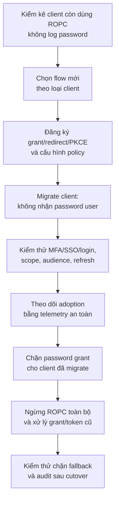

# Resource Owner Password Credentials as legacy pattern

## Mục tiêu học tập

Trong module **SECURITY_TOKEN_SECURITY_FUNDAMENTALS**, chúng ta nghiên cứu mô hình tin cậy và vòng đời token bảo mật trong OAuth 2.0/OIDC: JWT và opaque token, access token và refresh token, phát hành, kiểm tra `iss`, `aud`, `scope`, lưu trữ, thu hồi và phòng chống token bị đánh cắp hoặc phát lại. Để áp dụng đúng các cơ chế đó, cần hiểu **cách client nhận token** và tại sao một số *grant type* từng được cho phép trong OAuth 2.0 nay không còn phù hợp về bảo mật.

Bài này tập trung vào **Resource Owner Password Credentials (ROPC)**, còn gọi là **password grant**, như **mẫu luồng cũ (legacy pattern) cần nhận diện và loại bỏ**, chứ **không phải hướng dẫn triển khai cho hệ thống mới**.

Sau bài học, bạn có thể:

- Giải thích ROPC từng được mô tả ở **RFC 6749 `4.3** và khác gì so với Authorization Code.
- Nêu rõ khuyến nghị hiện hành: **RFC 9700 (OAuth 2.0 Security Best Current Practice) yêu cầu không sử dụng ROPC**.
- Phân tích vì sao ROPC làm client biết **mật khẩu Resource Owner**, phá ranh giới tin cậy và không tương thích tốt với MFA, passkeys, SSO và federation.
- Phân biệt **xác thực người dùng bằng mật khẩu**, **xác thực OAuth client**, **ủy quyền cấp access token** và **xác minh token tại Resource Server**.
- Lựa chọn thay thế phù hợp: **Authorization Code + PKCE**, BFF/confidential backend, OAuth Device Authorization hoặc Client Credentials cho workload thực sự không có người dùng.
- Lập kế hoạch **ngừng password grant** và bảo vệ token/grant cũ trong quá trình di chuyển, tránh fallback không an toàn.
- Xây dựng ma trận kiểm thử để bảo đảm client mới không thu thập password và AS từ chối `grant_type=password`.

> **Kết luận cần nhớ từ đầu:** ROPC là một phần lịch sử của OAuth 2.0, **không phải một lựa chọn tương đương về bảo mật** với các luồng hiện đại. Khi thiết kế hoặc nâng cấp hệ thống, không nên chọn ROPC chỉ vì nó dễ gọi bằng một HTTP POST.

## 1. Bối cảnh: ROPC là một grant type cũ

Trong OAuth 2.0, **grant** là cơ sở để Authorization Server (AS) phát hành access token cho một client theo chính sách. Các vai trò chính:

| Vai trò | Trách nhiệm | Ví dụ |
| --- | --- | --- |
| **Resource Owner** | Chủ thể có thẩm quyền cấp quyền truy cập tài nguyên. | Người dùng sở hữu hoặc được phân quyền đọc đơn hàng. |
| **Client** | Ứng dụng muốn gọi API, xin access token từ AS. | `sales-portal`, mobile app, `report-worker`. |
| **Authorization Server** | Kiểm tra grant, xác thực theo luồng, quyết định scope/audience và phát hành token. | `https://identity.example.com`. |
| **Resource Server** | API kiểm tra access token và quyền trên dữ liệu. | Orders API với audience `api://orders`. |

**ROPC** cho phép client nhận trực tiếp **username/password của Resource Owner**, sau đó gửi cặp credential ấy tới **token endpoint** của AS để đổi lấy token. Nó từng được đưa vào RFC 6749 với kỳ vọng sử dụng hạn chế khi mức độ tin cậy giữa Resource Owner và client rất cao.

Tên chuẩn: **Resource Owner Password Credentials Grant**; tham số `grant_type=password`.

Trong các sản phẩm IAM/SDK, cùng ý tưởng này có thể xuất hiện dưới tên **password grant**, **direct access grant**, **direct password login**, **direct grant** hoặc một chức năng đăng nhập trực tiếp tương tự. Tên thương mại không tự quyết định chức năng có đúng ROPC hay không: cần nhìn xem **ứng dụng client có thu và chuyển mật khẩu người dùng sang AS thay vì chuyển người dùng đến giao diện đăng nhập của AS** hay không.

### Phân biệt phiên bản tiêu chuẩn

| Tài liệu | Ý nghĩa liên quan đến ROPC |
| --- | --- |
| **RFC 6749 `4.3 (2012)** | Mô tả password grant như một lựa chọn lịch sử của OAuth 2.0, với điều kiện sử dụng rất hạn chế. |
| **RFC 9700 — Best Current Practice for OAuth 2.0 Security** | Nêu rõ **ROPC MUST NOT be used**. Đây là chỉ dẫn bảo mật hiện hành cần ưu tiên khi thiết kế hệ thống. |
| **OAuth 2.1** | Các bản thảo/thiết kế OAuth 2.1 loại bỏ password grant; không nên suy rằng một bản thảo là RFC đã được ban hành nếu chưa kiểm tra trạng thái tài liệu. |

**Đừng dùng việc “RFC 6749 có định nghĩa” để kết luận ROPC vẫn nên được triển khai.** Một đặc tả cũ có thể mô tả cơ chế nhằm tương thích, trong khi khuyến nghị bảo mật mới hơn yêu cầu ngừng sử dụng cơ chế đó.

## 2. ROPC vận hành ra sao? Chỉ để đọc hiểu hệ thống cũ

Trong ROPC, client **tự hiển thị hoặc quản lý form đăng nhập** và nhận username/password của người dùng. Sau đó client gọi thẳng token endpoint:

```mermaid
sequenceDiagram
    autonumber
    participant U as Resource Owner
    participant C as OAuth Client (legacy)
    participant AS as Authorization Server
    participant RS as Resource Server
    U->>C: Nhập username + password vào client
    Note over C: Client có quyền nhìn thấy mật khẩu người dùng
    C->>AS: POST /token với grant_type=password<br/>+ username/password
    AS->>AS: Xác thực password và áp dụng policy
    alt Credential được chấp nhận trong hệ cũ
        AS-->>C: Access token; refresh token nếu được cấp
        C->>RS: Authorization: Bearer AT
        RS->>RS: Xác minh token và quyền
    else Credential / grant bị từ chối
        AS-->>C: OAuth error
    end
```

Ví dụ dạng request **lịch sử** để nhận biết trong log/source code (placeholder, **không dùng để triển khai**):

```http
POST /oauth2/token HTTP/1.1
Host: identity.example.com
Content-Type: application/x-www-form-urlencoded
Authorization: Basic <encoded-confidential-client-credentials-if-applicable>

grant_type=password&username=demo-user&password=%3Credacted%3E&scope=orders%3Aread
```

Ý nghĩa các trường:

- `grant_type=password`: yêu cầu sử dụng ROPC; **không phải** tham số đăng nhập của Authorization Code.
- `username` và `password`: **credential của người dùng cuối**, được client tiếp nhận và truyền đi.
- `scope`: tập quyền client xin, **không chứng minh AS sẽ cấp** quyền ấy.
- `Authorization: Basic ...`: nếu client là **confidential client** và AS yêu cầu client authentication, đó là credential **của ứng dụng**; **khác** username/password của Resource Owner.

Request trên không có authorization redirect, không có authorization code, không có `code_verifier`/PKCE. Password của user đi qua runtime của client trước khi tới AS. **HTTPS vẫn cần thiết nhưng không xóa được việc client đã thấy mật khẩu**.

Ví dụ response có thể từng tồn tại trong một triển khai cũ:

```json
{
  "access_token": "<opaque-or-jwt-access-token>",
  "token_type": "Bearer",
  "expires_in": 900,
  "refresh_token": "<refresh-token-if-policy-allows>",
  "scope": "orders:read"
}
```

Không phải AS nào cũng cấp refresh token và không phải access token nào cũng là JWT. Token response không phải bằng chứng có quyền đọc mọi đơn: **RS vẫn kiểm tra issuer, audience, loại token, thời hạn, scope và owner/tenant policy**.

**Cảnh báo về ví dụ:** Đoạn HTTP chỉ nhằm giúp bảo trì nhận diện dấu vết legacy. **Không gọi request này với credential thật, không thêm ROPC vào sản phẩm mới và không lưu mật khẩu trong logs hay test fixtures.**

## 3. Vấn đề gốc: client biết mật khẩu của Resource Owner

Trong Authorization Code flow hiện đại, user được đưa đến **giao diện xác thực do AS/Identity Provider kiểm soát**. OAuth client nhận **authorization code** rồi đổi code lấy token; nó không cần biết mật khẩu. ROPC đảo ngược ranh giới đó: ứng dụng client **nhận và vận chuyển credential đăng nhập của user**.

| Khía cạnh | **ROPC/password grant (legacy)** | **Authorization Code + PKCE** |
| --- | --- | --- |
| Nơi user nhập mật khẩu | Giao diện/runtime do client kiểm soát. | Giao diện xác thực của AS/OP hoặc thành phần đăng nhập được ủy quyền của hệ danh tính. |
| Client thấy password user? | **Có, theo bản chất luồng.** | **Không cần và không nên.** |
| Authorization redirect | Không có bước redirect theo code flow. | Có front-channel authorization request/response. |
| PKCE | Không phải cơ chế của ROPC. | Ràng buộc authorization code với code verifier. |
| Phương thức đăng nhập | Bị buộc vào khả năng client thu một cặp password. | AS có thể tự chọn password, MFA, passkeys, federation hoặc chính sách xác thực khác. |
| OAuth consent/đồng ý | Không có bước consent của authorization redirect tiêu chuẩn. | AS có thể trình consent/áp dụng policy theo ngữ cảnh. |
| Loại client | Confidential client authentication **không loại bỏ** việc client nhìn thấy user password. | Public client dùng PKCE; confidential client còn xác thực client khi phù hợp. |
| Kiểm chứng tại RS | Vẫn phải kiểm tra access token. | Vẫn phải kiểm tra access token. |

**Client có thể là ứng dụng “chính chủ” nhưng vẫn là nơi không nên giữ mật khẩu.** Một ứng dụng chính chủ có thể bị XSS, compromise CI/CD, lộ logs, supply-chain attack hoặc có nhiều người vận hành. Khi password tới client, biên tấn công không còn chỉ nằm ở Identity Provider.

### Mật khẩu nguy hiểm khác bearer access token ở đâu?

Nếu access token bị đánh cắp, scope, audience và thời hạn có thể giới hạn phần nào hậu quả (dù vẫn nguy hiểm). Mật khẩu người dùng có thể:

- Được dùng để **đăng nhập lại**, xin token mới nếu hệ thống vẫn chấp nhận password, hoặc truy cập các dịch vụ dùng cùng credential.
- Có thời gian tồn tại dài hơn access token và không ràng buộc tự nhiên với một audience/scope.
- Được người dùng **tái sử dụng** ở các dịch vụ khác, ngoài phạm vi mà AS có thể kiểm soát.
- Trở thành mục tiêu cho phishing, credential stuffing, keylogger và log scraping.

**TTL ngắn của access token không làm mật khẩu đã lộ trở nên vô hại.** Refresh token rotation cũng không thể chữa việc password bị thu và đưa qua client.

## 4. Vì sao OAuth Security BCP yêu cầu không dùng ROPC?

ROPC thất bại về kiến trúc ở nhiều mặt:

### 4.1. Mở rộng phạm vi nơi phải tin cậy

AS không còn là nơi duy nhất cần được tin để xử lý mật khẩu: **mọi client triển khai ROPC** trở thành một điểm có thể tiếp nhận, đọc, ghi hoặc làm lộ password. Khi có 20 ứng dụng client, chỉ một app bị tấn công cũng có thể thành điểm rò tài khoản người dùng.

Sử dụng `client_secret` ở confidential backend **không giải quyết** việc người dùng phải gửi password đến backend ấy. **Client authentication** chứng minh danh tính của client với AS, không thay thế nguyên tắc tách password khỏi client.

### 4.2. Tạo thói quen đưa password cho ứng dụng bên thứ ba

ROPC khiến user quen với việc nhập credential của Identity Provider trong những giao diện **không phải giao diện Identity Provider**. Người dùng khó phân biệt ứng dụng hợp lệ và trang/phần mềm giả mạo thu thập mật khẩu.

Authorization Code redirect đến miền AS/IdP chính thức giúp **đặt trách nhiệm xác thực ở nhà cung cấp danh tính**. Dĩ nhiên redirect vẫn cần chống phishing, state/PKCE, URI và browser security, nhưng ranh giới mật khẩu khác hẳn ROPC.

### 4.3. Không phù hợp với MFA và phương thức xác thực hiện đại

ROPC giả định có thể gửi một cặp username/password để hoàn thành xác thực tại token endpoint. Điều này **không phù hợp tốt** với:

- Multi-factor authentication (MFA) có bước xác nhận bổ sung, challenge/risk-based step-up.
- Passkeys/WebAuthn và phương thức **phishing-resistant**, vốn yêu cầu phiên browser và tương tác với authenticator.
- Federation/SSO, nơi AS có thể chuyển tới một IdP khác và client không biết password ở IdP đó.
- Conditional Access, CAPTCHA, thiết bị được quản lý, chính sách theo địa điểm và nhiều bước xác thực động.
- Đăng nhập passwordless, social login hoặc các phương thức tài khoản không có mật khẩu.

Một nhà cung cấp có thể xây **extension riêng** để nhận OTP hoặc các tham số phụ, nhưng đó không phải cách làm ROPC trở thành lựa chọn được khuyến nghị. Nó thường làm client phải hiểu sâu hơn về quy trình xác thực và tiếp tục mở rộng bề mặt credential.

### 4.4. Kém tách biệt giữa xác thực, consent và ủy quyền

ROPC biến **việc biết password** thành điều kiện trung tâm để xin token, trong khi OAuth cần phân biệt:

1. **Authentication:** user là ai và có được xác thực đủ mạnh không?
2. **Authorization:** client nào được xin scope/resource nào, dựa trên grant và policy?
3. **Token issuance:** AS đã cấp access token nào, với `aud`/`scope`/TTL gì?
4. **API authorization:** RS kiểm tra token và quyền trên dữ liệu cụ thể ra sao?

Việc AS kiểm tra scope trong ROPC **không làm mất** nhu cầu consent hoặc policy, nhưng luồng không cung cấp cơ chế tương tác tiêu chuẩn của authorization redirect để trình consent, step-up và chuyển danh tính qua IdP hiện đại.

### 4.5. Tăng nguy cơ password spraying và vận hành sai

Một endpoint chấp nhận `grant_type=password` có thể bị sử dụng như điểm thử cặp username/password ở quy mô lớn. Cần bảo vệ chống brute force bất kể AS có hỗ trợ password login hay không, nhưng ROPC tạo ra thêm giao diện API cho việc gửi credential người dùng và thường đi kèm các **automation/client khó kiểm soát**.

Nếu ứng dụng ghi request body của token endpoint vào log, **mật khẩu sẽ nằm trong telemetry**. Nếu frontend thu password bằng script, **XSS hoặc thư viện bên thứ ba** có thể tiếp cận password trước khi truyền đi. Không thể khắc phục triệt để bằng `Cache-Control: no-store`, hash password ở client hay tắt console logging.

## 5. ROPC không biến mọi token nó tạo ra thành “đặc biệt”

Đây là điểm dễ nhầm: **lỗ hổng của ROPC là luồng thu và dùng mật khẩu của user**, không phải việc tất cả access token sau đó đều có định dạng riêng.

AS cũ có thể phát hành:

```json
{
  "iss": "https://identity.example.com",
  "sub": "user-42",
  "aud": "api://orders",
  "client_id": "legacy-portal",
  "scope": "orders:read",
  "iat": 1800000000,
  "exp": 1800000900
}
```

Đây là **payload JWT minh họa**, không phải một token được ký hoàn chỉnh. Nó có thể giống bề ngoài với token được cấp từ Authorization Code flow. Vì vậy:

- **Không được suy grant type chỉ bằng nhìn thấy `sub`, `client_id` hoặc `scope`**. Nếu cần phân biệt token theo chính sách, AS phải đưa ra bằng chứng/claim hoặc metadata được tin theo hợp đồng.
- Resource Server vẫn phải xác minh chữ ký và issuer đáng tin, audience đúng API, loại access token, thời hạn, scope và quyền trên order/tenant.
- Một opaque token phải được kiểm tra qua nguồn tin cậy/introspection; không tự giải mã opaque token hoặc coi `active=true` là quyền trên mọi API.
- **ID Token OIDC** dành cho client, không phải bearer access token ở Resource Server. ROPC **không tự cung cấp OIDC identity flow chuẩn**, dù một sản phẩm có thể có extension riêng.
- **Refresh token** được dùng tại AS; việc cấp refresh token sau ROPC có thể kéo dài hậu quả khi password/client bị compromise. AS phải quản lý rotation, binding và revocation khi có.

**Không nên dùng RS để “chữa” password grant bằng cách chỉ bắt buộc một scope khác**, rồi giữ nguyên client nhập password. RS không nhìn thấy toàn bộ bề mặt mất mật khẩu tại client. Việc loại bỏ ROPC phải xảy ra từ **client và AS**, bên cạnh validation tại RS.

## 6. Những sai lầm phổ biến khi lý giải ROPC

| Nhận định sai | Thực tế cần hiểu |
| --- | --- |
| “Ứng dụng là first-party nên ROPC vẫn là mặc định tốt.” | First-party không xóa việc app nhìn thấy password; RFC 9700 yêu cầu không dùng ROPC. |
| “Backend confidential có secret nên xử lý user password là an toàn.” | Secret xác thực **client**, không giảm bản chất rủi ro thu password của user. |
| “Có HTTPS thì password không thể lộ.” | HTTPS bảo vệ đường truyền, không bảo vệ khỏi XSS, log, malware hoặc backend compromise. |
| “Không có refresh token thì ROPC hết rủi ro.” | Password vẫn đi qua client; có thể bị lưu, tái sử dụng hoặc thử lại. |
| “ROPC có thể thay thế login OIDC và MFA.” | Nó không cung cấp browser authentication/interaction tiêu chuẩn cho các hình thức hiện đại. |
| “Chỉ cần đổi `grant_type=password` thành `client_credentials`.” | Client Credentials cho **ứng dụng**, không đại diện quyền của user; đổi như vậy có thể tạo confused deputy. |
| “ROPC không có redirect nên ít bị tấn công hơn Authorization Code.” | Tránh redirect không bù được việc đưa password vào client và thiếu PKCE/browser security flow. |
| “Đổi từ JWT sang opaque sẽ giải quyết ROPC.” | Token format không thay đổi điểm user password bị thu. |
| “PKCE có thể thêm vào ROPC để làm nó an toàn.” | PKCE bảo vệ **authorization code exchange**, không bảo vệ ROPC gửi password. |
| “Đã ngừng hỗ trợ ROPC thì mọi access token cũ tự hết hiệu lực.” | Token đã cấp có thể vẫn được RS nhận đến `exp` hoặc khi bị revoke theo policy. |

## 7. Lựa chọn thay thế theo loại ứng dụng

Không có một luồng duy nhất cho mọi tình huống. Hãy dựa vào **ai đang cần quyền** và **client có giữ được credential của chính nó không**.

| Bối cảnh | Thay thế phù hợp | Lý do |
| --- | --- | --- |
| **SPA chạy trong browser**, user đăng nhập rồi gọi API. | Authorization Code **+ PKCE** với public client; cân nhắc BFF. | User xác thực ở AS/OP, client không cần nhìn password. |
| **Backend web application** hoặc **BFF** có server tin cậy. | Authorization Code + PKCE, client authentication khi AS yêu cầu. | Token/secret được quản lý server-side; browser dùng session. |
| **Mobile/native/desktop** có người dùng. | Authorization Code + PKCE với external user-agent và redirect mechanism thích hợp (RFC 8252). | Không nhúng shared client secret, dùng login AS. |
| **TV/CLI/thiết bị nhập liệu hạn chế** có user. | OAuth 2.0 **Device Authorization Grant** (RFC 8628), nếu AS hỗ trợ và sản phẩm phù hợp. | User hoàn tất đăng nhập ở thiết bị/browser có khả năng tương tác. |
| **Worker service-to-service không có user**. | **Client Credentials** ở confidential client, scope/audience tối thiểu. | Quyền của service principal, không yêu cầu password user. |
| **API A gọi API B thay mặt user**. | Token Exchange (RFC 8693), on-behalf-of/delegation theo chính sách AS nếu hỗ trợ. | Không mượn password user để lấy token mới; bảo toàn ngữ cảnh ủy quyền. |
| **Ứng dụng cần OIDC login/SSO/MFA**. | OIDC Authorization Code flow với xác minh ID Token và session policy. | Cho phép AS/OP kiểm soát quá trình xác thực và đăng nhập liên kết. |

Các lựa chọn trên phải được **AS hỗ trợ, client đăng ký đúng grant và scope, RS nhận đúng audience**. Không có nghĩa mọi AS đều tự hỗ trợ Device Flow, Token Exchange hoặc BFF nếu chưa cấu hình.

### 7.1. Authorization Code + PKCE: luồng nên ưu tiên với người dùng

```mermaid
sequenceDiagram
    autonumber
    participant U as User / Browser
    participant C as OAuth Client
    participant AS as Authorization Server / OIDC OP
    participant RS as Orders API
    C->>C: Tạo state + code_verifier + code_challenge S256
    C-->>U: Redirect tới AS authorization endpoint
    U->>AS: Đăng nhập bằng phương thức AS hỗ trợ
    AS->>AS: MFA/passkey/federation/consent theo policy
    AS-->>U: Redirect về client với code + state
    U->>C: Callback code + state
    C->>C: Kiểm tra state và binding của request
    C->>AS: Token request: code + code_verifier<br/>+ client authentication nếu confidential
    AS->>AS: Validate code, PKCE, redirect URI, client
    AS-->>C: Access token; ID Token/refresh nếu grant cho phép
    C->>RS: Access token đúng audience qua HTTPS
    RS->>RS: Verify token + scope + object policy
```

Trong luồng mới, **password (nếu AS có dùng)** chỉ được xử lý trong phạm vi giao diện xác thực/IdP. Client có thể xử lý authorization code, `state`/PKCE, ID Token và access token, nhưng **không nhận username/password của user để tự chuyển tiếp đến token endpoint**.

#### Dấu hiệu phân biệt trong HTTP

**Authorization Code + PKCE** gửi user qua authorization endpoint:

```http
GET /authorize?response_type=code&client_id=sales-portal&redirect_uri=https%3A%2F%2Fportal.example.com%2Fcallback&scope=openid%20orders%3Aread&state=<state>&code_challenge=<challenge>&code_challenge_method=S256 HTTP/1.1
Host: identity.example.com
```

Sau callback, client đổi code:

```http
POST /oauth2/token HTTP/1.1
Host: identity.example.com
Content-Type: application/x-www-form-urlencoded

grant_type=authorization_code&code=<short-lived-code>&redirect_uri=https%3A%2F%2Fportal.example.com%2Fcallback&code_verifier=<verifier>
```

**Không có trường `username`/`password` gửi từ OAuth client đến token endpoint** trong code exchange. Với confidential backend, bổ sung **client authentication** theo đăng ký. Cần xử lý state/CSRF, exact redirect URI matching, PKCE và chống issuer mix-up ở hệ thống đa AS theo profile liên quan. **Không tự đưa access token vào query string** chỉ vì callback ban đầu chứa authorization code.

### 7.2. BFF: giảm quyền tiếp xúc token trong JavaScript

**Backend for Frontend** đặc biệt hữu ích khi SPA hiện nay thu password để gọi ROPC và giữ access/refresh token trong `localStorage`. Trong thiết kế mới:

1. Browser chuyển qua AS để user đăng nhập; BFF xử lý authorization callback và token exchange.
2. BFF giữ **access token, refresh token và client credential server-side** trong kho được bảo vệ.
3. Browser chỉ giữ **session cookie `Secure`, `HttpOnly`, `SameSite`** thích hợp và gọi BFF.
4. BFF xin token mới khi cần, truyền access token **server-to-server** đến API có đúng audience và scope.
5. BFF/RS kiểm tra session, CSRF, user authorization, owner/tenant policy; **không gửi raw AT/RT trở lại JavaScript**.

```text
Trước (legacy):
User password -> SPA/backend -> AS password grant -> AT/RT trong app

Sau (BFF):
Browser -> AS login -> authorization code -> BFF -> AT/RT server-side
Browser <-> BFF qua session cookie; BFF -> RS bằng access token
```

Cookie `HttpOnly` ngăn JavaScript đọc trực tiếp cookie, **không ngăn XSS đang chạy thực hiện request trong phiên**. BFF vẫn cần chống XSS/CSRF và quản lý session, không phải “di chuyển sang backend là xong”.

### 7.3. Device Authorization: không yêu cầu thiết bị gửi password của user

Với ứng dụng TV/CLI/thiết bị khó nhập, luồng Device Authorization (RFC 8628) dùng **device code** và **user code**: user mở verification URI trên browser/thiết bị có thể đăng nhập, nhập code/hoàn tất consent, còn client hạn chế khả năng nhập liệu thăm dò trạng thái theo quy tắc AS.

Nó **không phải** cách bảo client gửi username/password. Cần bảo vệ user code/device code, hạn dùng, chống phishing/remote code injection và tuân thủ polling interval. **Không nhầm device code hoặc user code với bearer access token** có thể tự dùng ở API.

### 7.4. Client Credentials không phải cách đăng nhập thay user

`grant_type=client_credentials` có thể dùng ở confidential service để xin access token đại diện **quyền ứng dụng**. Nếu một user đang thao tác ở portal, không được âm thầm chuyển tất cả request sang một service token quyền cao rồi bỏ qua user-level authorization.

```text
Không đúng:
ROPC bị tắt -> backend dùng service admin token cho mọi user

Đúng:
User login qua Authorization Code/OIDC
-> AS cấp token theo grant/user/client
-> RS xác minh audience/scope và tenant/owner policy
```

Trong luồng service không có user cuối, Client Credentials là lựa chọn đúng **nếu AS cấp quyền service phù hợp**. Tránh tự tạo một tài khoản “robot-user” với username/password để tiếp tục dùng ROPC cho job định kỳ.

## 8. Kế hoạch di chuyển khỏi ROPC trong hệ thống đang vận hành

Việc ngừng hỗ trợ password grant gồm **hai thay đổi độc lập**: **ứng dụng không còn thu password** và **AS không còn cấp token theo `grant_type=password`**. Chỉ xóa form ở UI nhưng để endpoint cũ còn hoạt động có thể khiến SDK/script hoặc bên tấn công tiếp tục gửi request.

### 8.1. Pha kiểm kê: biết chính xác còn ai đang sử dụng

Thu thập **metadata an toàn**, không dùng dữ liệu password thật:

| Thông tin cần biết | Dùng làm gì? | Giới hạn an toàn |
| --- | --- | --- |
| Danh sách `client_id` được cấu hình cho `password` grant. | Xác định app/integration cần migrate. | Phân biệt client ID tự khai với client được xác thực khi đọc log. |
| Tần suất `grant_type=password` theo client, môi trường và thời gian. | Đo phụ thuộc đang còn sử dụng. | **Không ghi request body** vì chứa password. |
| Loại client: SPA, mobile, desktop, backend, worker. | Chọn Authorization Code/Device Flow/Client Credentials. | Không suy loại client chỉ từ tên hoặc nơi lưu source code. |
| Scope và audience từng client thực sự cần. | Giữ chức năng nhưng giảm quyền. | Phân biệt `requested_scopes` và `granted_scopes`. |
| Sự phụ thuộc vào MFA/SSO/IdP/federation. | Thiết kế UX chuyển đổi. | Không sao chép password/OTP từ ứng dụng cũ sang ứng dụng mới. |
| Refresh tokens/grants hiện hữu và chính sách thu hồi. | Lập kế hoạch logout, cutover và xử lý token cũ. | Audit qua reference an toàn, không xuất raw token. |

Mọi số liệu về hoạt động client phải được lấy từ **nguồn đã xác minh**, không quy kết cho client chỉ dựa vào `client_id` attacker khai trong một request chưa xác thực.

### 8.2. Pha thiết kế: chọn luồng thay thế đúng đối tượng

1. Đăng ký client/grant/redirect URI phù hợp ở AS, tách public và confidential client.
2. Bật Authorization Code + PKCE cho app có người dùng; dùng external browser cho native client khi phù hợp.
3. Với SPA có backend và token nhạy cảm, cân nhắc BFF/session cookie + server token vault.
4. Với CLI/TV, đánh giá Device Authorization; với backend M2M thuần, dùng Client Credentials đúng resource/scope.
5. Nếu có OIDC, kiểm chứng `state`/`nonce`, issuer, ID Token audience/signature/expiry theo profile.
6. Điều chỉnh Resource Server kiểm tra `iss`, `aud`, token type, `scope` và object-level authorization, không dựa vào “token đến từ password grant nên trusted”.

Đừng **cố giữ nguyên giao diện đăng nhập client rồi chỉ đổi tên endpoint**. Chuyển đổi đúng là đưa **việc thu credential người dùng về AS/IdP**, thay vì để client tự tiếp tục thu và chuyển password qua API khác.

### 8.3. Pha triển khai có kiểm soát



Một lộ trình thực tế có thể gồm:

- Giao tiếp với owner của các client/integration, cung cấp SDK hoặc hướng dẫn luồng mới.
- Triển khai flow mới cho nhóm thử nghiệm, đo tỷ lệ đăng nhập thành công, MFA/SSO, renew token và lỗi redirect.
- Đặt **mốc ngừng password grant** theo kế hoạch tổ chức, xử lý các tích hợp chưa di chuyển thay vì giữ một “ngoại lệ vĩnh viễn”.
- Tắt `password` trong danh sách grant được phép của từng client; cuối cùng ngừng hỗ trợ trên AS khi có thể.
- **Không bật fallback** “nếu Authorization Code lỗi thì thử password grant” vì nó giữ lại toàn bộ điểm yếu.
- Xem xét grant/refresh token cũ: AS có thể phải thu hồi các phiên/refresh family liên quan, yêu cầu reauthentication hoặc áp dụng phương án migration session an toàn theo policy.
- Theo dõi log từ chối sau cutover để phát hiện client lỗi cấu hình và hành vi dò credential, nhưng không log password.

### 8.4. Gỡ endpoint cũ không tự thu hồi access token đã cấp

Một access token JWT đã được cấp trước khi chặn ROPC có thể còn hiệu lực đến `exp` nếu RS chỉ xác minh chữ ký và hạn dùng. Refresh token cũ có thể tiếp tục cấp token mới nếu AS vẫn cho phép refresh grant của phiên đó.

Vì vậy cần quyết định riêng:

- **Có thu hồi refresh token/family của các grant ROPC cũ không?** Nếu có, AS phải cập nhật trạng thái/consent/session đúng cách.
- **Có yêu cầu đăng nhập lại qua flow mới không?** Điều này thường giúp đưa user về chính sách MFA/SSO.
- **Access token còn hiệu lực có cần vô hiệu sớm không?** Có thể cần denylist/introspection/session-aware policy hoặc chấp nhận TTL ngắn trong phạm vi rủi ro.
- **Client có đang dùng token dành cho API A ở API B không?** Vẫn phải kiểm tra audience, tránh token substitution khi migration.

**Không dùng việc đổi client secret** làm biện pháp duy nhất để “thu hồi” mọi JWT access token đang lưu hành.

## 9. Nếu còn hệ thống legacy chưa thể xóa ngay thì sao?

**RFC 9700 yêu cầu không dùng ROPC**; giải pháp đích vẫn là loại bỏ. Trong một hệ thống đã tồn tại, việc chưa thể di chuyển ngay là **rủi ro cần được quản lý tạm thời**, không phải cơ sở để mở ROPC cho integration mới.

Những biện pháp **giảm thiểu trong quá trình chuyển đổi**, không biến ROPC thành an toàn:

1. **Không đăng ký client mới** cho password grant; giới hạn rõ các client legacy còn tồn tại và không cấp `admin`/nhiều resource chỉ để giảm lỗi.
2. **Áp dụng TLS** và cấu hình endpoint an toàn; tránh password trong query, URL, `Authorization` header tùy ý, logs, traces hoặc exception.
3. **Cắt giảm quyền/token lifetime**: AS chỉ cấp audience/scope tối thiểu; RS luôn xác minh token và object-level authorization.
4. **Rate limiting, risk monitoring, bảo vệ tài khoản** trước password spraying/credential stuffing; không dựa vào user/IP do client tự khai như bằng chứng duy nhất.
5. **Giới hạn quyền truy cập mã và hệ thống** đang xử lý password, kiểm tra logging/redaction của token endpoint và frontend, giám sát bất thường.
6. **Refresh token controls**: rotation/reuse detection hoặc sender-constraining theo loại client, binding với client/grant, expiry và revocation khi được cấp.
7. **Mốc ngừng hỗ trợ và owner chịu trách nhiệm** rõ ràng; đo telemetry để loại bỏ dependency còn lại.
8. **Không xây thêm workaround nhận OTP/password phụ** trong client để kéo dài luồng cũ.

**Biện pháp giảm thiểu không khắc phục mối nguy căn bản:** client vẫn nhìn thấy password người dùng. Khi hỗ trợ legacy vì ràng buộc vận hành, cần ghi nhận rủi ro, kế hoạch dừng và ưu tiên xóa luồng.

## 10. Client public, confidential và “mật khẩu của ai?”

Một nhầm lẫn quan trọng là đặt ba loại credential cạnh nhau:

| Credential | Thuộc về ai? | Nên được trình ở đâu? | Không được nhầm thành |
| --- | --- | --- | --- |
| **Resource Owner password** | Người dùng/identity account. | Tại giao diện xác thực của AS/IdP, không được OAuth client thu để thực hiện ROPC. | Client secret hoặc API access token. |
| **Client secret/private key** | OAuth confidential client. | Với AS khi client authentication theo profile; được giữ server-side. | Password người dùng hoặc bằng chứng consent. |
| **Access token** | Credential do AS cấp cho client để gọi resource theo grant. | Với **Resource Server đúng audience** qua kênh phù hợp. | Password, refresh token hoặc ID Token. |
| **Refresh token** | Credential gắn với client/grant cho việc làm mới. | Tại AS token endpoint, kèm ràng buộc phù hợp. | Access token để gọi Resource Server. |
| **OIDC ID Token** | Assertion xác thực hướng tới OIDC client. | Được client xác minh theo profile OIDC. | Access token dùng trực tiếp cho API. |
| **Authorization code** | Credential trung gian cho một giao dịch authorization. | Client đổi tại AS token endpoint kèm PKCE/client auth khi phù hợp. | Bearer access token có thể gửi đến RS. |

ROPC nhập nhằng hai ranh giới đầu: client phải **thu credential user** để xin token, dù OAuth có cơ chế phân biệt danh tính client và chủ thể. Một backend có thể giữ client secret hợp lệ và vẫn **không được** dùng ROPC trong thiết kế mới.

### Mã Java minh họa “chặn grant” tại token endpoint

Đây là **pseudocode cho chính sách loại bỏ ROPC**, không phải cách xây password grant:

```java
TokenResponse handleTokenRequest(TokenRequest request) {
    // Dừng password grant từ đầu. Không gọi code xác thực password user.
    if ("password".equals(request.grantType())) {
        audit.recordDeniedGrantType(
            safeCorrelationId(request),
            "PASSWORD_GRANT_DISABLED"
        ); // Không log username/password/body/secret.
        throw new OAuthError("unsupported_grant_type");
    }

    // Các grant còn lại được xử lý bằng pipeline hiện đại của AS.
    AuthenticatedClient client = authenticateClientIfRequired(request);
    return supportedGrantHandler.issue(client, request);
}
```

Đây là sơ đồ logic của một AS **không hỗ trợ password grant**. Mã lỗi có thể là `unsupported_grant_type` khi AS không hỗ trợ grant này, hoặc `unauthorized_client` khi grant type tồn tại nhưng **client cụ thể không được phép sử dụng**. Theo OAuth 2.0 token endpoint, client authentication thất bại là bài toán khác (`invalid_client`), còn lỗi credential/grant của ROPC cũ có thể dùng `invalid_grant` theo hợp đồng lịch sử.

**Bảo vệ log:** Dù kiểm tra grant type rồi từ chối, một gateway phía trước vẫn có thể ghi raw request body chứa `password`. Do đó cần redaction từ **điểm nhận đầu tiên**, không chỉ một audit statement an toàn trong handler.

## 11. Bảo vệ token sau khi thay thế ROPC

Đổi từ ROPC sang Authorization Code là **điều kiện kiến trúc quan trọng**, nhưng chưa hoàn tất bảo mật token. Các lớp vẫn cần:

| Giai đoạn | Kiểm soát cần thiết | Lỗi không được bỏ qua |
| --- | --- | --- |
| **Cấp authorization code** | Redirect URI đúng, `state`, PKCE, issuer mix-up protection khi đa AS. | Code interception, open redirect, login CSRF. |
| **Trao đổi token** | AS xác minh code, client auth nếu confidential, verifier, grant và policy. | Client ID tự khai bị coi là secret hoặc code dùng lại. |
| **Phát hành access token** | `iss`, `aud`, `scope`, thời hạn, loại token và quyền được cấp. | Token có audience rộng hoặc scope admin không có thẩm quyền. |
| **Lưu token** | Server-side BFF vault hoặc lưu trữ phù hợp; tránh raw AT/RT trong localStorage nếu có phương án tốt hơn. | XSS, logs chứa refresh token hoặc client secret. |
| **Transport** | HTTPS, `Authorization: Bearer` ở RS, không đặt token vào query. | URL/history/analytics/logs làm lộ credential. |
| **Resource Server validation** | Verify JWT hoặc introspect opaque token, issuer, audience, scope, token type và quyền dữ liệu. | Token substitution, ID Token confusion, BOLA/IDOR. |
| **Refresh** | Client/grant binding, rotation hoặc sender-constraining phù hợp, TTL/reuse detection. | Token bị đánh cắp làm mới vô hạn. |
| **Logout/revocation** | Thu hồi refresh family/session; quản lý JWT còn hạn tại RS khi cần. | Tin rằng xóa localStorage đã vô hiệu mọi bản sao. |

Một client có thể đang dùng luồng Authorization Code đúng nhưng vẫn **sai audience, lưu refresh token không an toàn hoặc thiếu object-level authorization**. Bảo mật không kết thúc ở lựa chọn grant type.

### Về passwordless và xác thực đa yếu tố

Thay ROPC giúp AS/IdP chọn cách xác thực người dùng (password, passkey, MFA, federation) độc lập với client. Nhưng **Authorization Code tự nó không bắt buộc MFA** và **OIDC ID Token không tự bảo đảm mức xác thực cụ thể**; cần cấu hình policy tại AS, cân nhắc `acr`/`amr` hoặc cơ chế assurance khi có yêu cầu và được profile hỗ trợ.

**Không suy:** “đã chuyển sang PKCE nên mọi user đã dùng MFA”. PKCE bảo vệ **authorization code**, không phải bằng chứng MFA.

## 12. Kiểm thử chuyển đổi và chặn ROPC

Thiết lập ví dụ:

```text
Issuer:    https://identity.example.com
Orders API audience: api://orders
Client sales-spa: public, Authorization Code + PKCE
Client portal-bff: confidential, Authorization Code + PKCE
Client report-worker: confidential, Client Credentials
Password grant: DISABLED
```

Chỉ dùng **credential giả và môi trường kiểm thử được phép**; tuyệt đối không đưa password thật vào fixture, screenshot, proxy capture hoặc log.

| Kịch bản | Kết quả mong đợi |
| --- | --- |
| `sales-spa` gửi `grant_type=password`. | AS từ chối; không xác thực mật khẩu, không phát hành AT/RT, không log raw body. |
| `portal-bff` gửi `grant_type=password` dù client secret đúng. | AS vẫn từ chối; confidential client không được ngoại lệ sử dụng ROPC. |
| Client chưa được phép một grant type được hỗ trợ. | `unauthorized_client` theo hợp đồng; khác với `unsupported_grant_type` khi AS không hỗ trợ toàn bộ grant. |
| User dùng SPA Authorization Code + PKCE và đăng nhập tại IdP. | Client không nhận password; `state`/PKCE và redirect được kiểm chứng; AS cấp token theo policy. |
| Authorization code bị dùng lại lần hai. | Token endpoint từ chối; code phải dùng một lần. |
| Đổi code với sai `code_verifier`. | Token endpoint từ chối theo PKCE; không cấp token. |
| Backend confidential có secret sai khi đổi code. | Client authentication thất bại; không cấp token. |
| Mobile app chứa shared client secret trong bundle. | Security review/test đánh dấu sai kiến trúc; chuyển thành public client và flow tương ứng. |
| User đăng nhập bằng MFA/passkey/IdP liên kết. | AS xử lý theo policy; OAuth client không cần nhận password/OTP. |
| SPA được cấp `orders:read` nhưng thử gọi Orders `PATCH`. | API từ chối nếu thiếu scope/quyền thao tác. |
| Access token `aud=api://orders` gọi Billing API. | Billing từ chối token vì sai audience. |
| ID Token OIDC được trình tới Orders API. | RS từ chối vì sai token type/purpose. |
| Worker M2M dùng Client Credentials với scope riêng. | Được phép khi AS policy cho phép; không giả làm user. |
| ROPC cũ bị tắt nhưng refresh token của legacy grant còn active. | Kiểm tra chính sách thu hồi/tái xác thực; không giả định tự mất hiệu lực. |
| Mạng lỗi khi code exchange. | Client retry đúng quy tắc, không fallback sang ROPC. |
| AS/RS ghi access logs hoặc request payload trong error reporting. | Không ghi password, code, raw AT/RT, client secret hoặc JWT claims nhạy cảm. |

### Câu hỏi tự kiểm tra

1. ROPC từng được định nghĩa trong tài liệu nào? Tại sao có định nghĩa không có nghĩa hiện nay nên dùng?
2. Cốt lõi nguy hiểm của ROPC là client nhận **credential nào**?
3. Vì sao confidential backend với `client_secret` hợp lệ vẫn không nên thu password người dùng để xin token?
4. ROPC có thể xử lý MFA, passkeys, SSO và federation theo các flow tiêu chuẩn hiện đại tốt như Authorization Code không?
5. PKCE bảo vệ bước nào? Có thể dùng PKCE để chữa bản chất ROPC không?
6. Nếu một job định kỳ đang dùng tài khoản “robot-user” + ROPC để gọi API, grant nào nên cân nhắc và giới hạn gì?
7. Khi chuyển từ ROPC sang BFF, browser nên giữ gì và token nên giữ ở đâu?
8. Ngừng password grant tại AS có tự khiến mọi JWT access token cũ bị RS từ chối ngay không?
9. OAuth client dùng code flow đúng nhưng gửi ID Token tới Orders API. Sai ở đâu?
10. Một public SPA có thể tự gửi `grant_type=password` ở một SDK cũ sau khi migration UI. Cần kiểm thử ở đâu để phát hiện?

**Gợi ý trả lời:**

1. RFC 6749 `4.3 mô tả lịch sử, nhưng RFC 9700 Security BCP hiện yêu cầu **không dùng ROPC**.
2. **Username/password của Resource Owner**, vốn không nên được OAuth client thu thay AS/IdP.
3. Client authentication và user authentication khác nhau; secret backend không xóa việc client nhìn thấy password.
4. Không; password-only token request không phù hợp với tương tác/IdP hiện đại, kể cả có extension vendor riêng.
5. PKCE ràng buộc authorization code với verifier; ROPC không có code exchange để bảo vệ.
6. Client Credentials cho confidential service thực sự có quyền ứng dụng; scope/audience hẹp và không giả định quyền user.
7. Browser dùng session cookie `Secure`/`HttpOnly` thích hợp, AT/RT và client credential giữ server-side; vẫn chống CSRF/XSS.
8. Không; cần xử lý JWT còn hạn và refresh family/grants cũ theo policy.
9. ID Token hướng tới OIDC client; API phải nhận access token đúng audience/profile.
10. Kiểm thử cả **client code/SDK** và **AS token endpoint**, xác nhận `grant_type=password` bị từ chối và log không chứa password.

## 13. Checklist triển khai và loại bỏ legacy pattern

- [ ] Ghi nhận **ROPC là legacy**, không chọn cho ứng dụng mới; tuân thủ RFC 9700: không sử dụng password grant.
- [ ] Kiểm kê client còn `grant_type=password` bằng metadata an toàn, **không ghi username/password hay raw token request body**.
- [ ] Chuyển các ứng dụng có user sang Authorization Code + PKCE; user xác thực tại AS/IdP.
- [ ] Dùng BFF/confidential backend khi cần giữ token server-side; browser chỉ có session được bảo vệ.
- [ ] Với native/mobile dùng public-client Authorization Code + PKCE và redirect phù hợp; không nhúng shared client secret.
- [ ] Với thiết bị nhập liệu hạn chế, cân nhắc Device Authorization nếu AS hỗ trợ.
- [ ] Với workload M2M không có user, dùng Client Credentials nếu AS cho phép; không tráo quyền service thành quyền người dùng.
- [ ] Tách rõ client authentication, user authentication, consent/ủy quyền, phát hành token và RS authorization.
- [ ] Không coi client ID, secret của confidential client hoặc JWT signature là giấy phép tự động cấp scope admin.
- [ ] Xác minh `state`, PKCE, redirect URI; với OIDC kiểm tra ID Token và `nonce` khi profile yêu cầu.
- [ ] Resource Server xác minh issuer, audience, thời hạn, token type, scope và quyền theo owner/tenant/object.
- [ ] Bảo vệ access/refresh token ở storage/transport; không dùng query string, không log credential, không nhầm ID Token/refresh token với access token.
- [ ] Nếu phát hành refresh token, áp dụng binding, TTL, rotation/sender-constraining theo client/risk policy và revocation.
- [ ] Chặn password grant ở AS ngay cả khi client secret đúng; **không fallback ROPC** khi flow mới lỗi.
- [ ] Xử lý token/grant legacy trước và sau cutover; không giả định tắt grant đã thu hồi JWT còn hạn.
- [ ] Kiểm thử `unsupported_grant_type`/`unauthorized_client`, code reuse, sai verifier, MFA/SSO, lỗi callback, scope/audience và log redaction.
- [ ] Theo dõi adoption, nỗ lực gọi grant cũ, phản hồi support và kế hoạch xóa hoàn toàn đường code thu mật khẩu.

## Tài liệu nền tảng

- **RFC 6749 — The OAuth 2.0 Authorization Framework:** `4.3` định nghĩa lịch sử Resource Owner Password Credentials; `4.1` Authorization Code; `4.4` Client Credentials; xử lý token request và lỗi OAuth.
- **RFC 9700 — Best Current Practice for OAuth 2.0 Security:** yêu cầu **không dùng Resource Owner Password Credentials grant**, các biện pháp chống replay, PKCE và bảo vệ refresh token.
- **RFC 7636 — Proof Key for Code Exchange (PKCE):** `code_verifier`, `code_challenge`, bảo vệ code exchange.
- **RFC 8252 — OAuth 2.0 for Native Apps:** native public client, external user-agent và redirect mechanism.
- **RFC 8628 — OAuth 2.0 Device Authorization Grant:** thiết bị nhập liệu hạn chế, user code và device flow.
- **RFC 8693 — OAuth 2.0 Token Exchange:** delegated/on-behalf-of token theo policy AS khi được hỗ trợ.
- **RFC 9207 — OAuth 2.0 Authorization Server Issuer Identification:** biện pháp chống AS mix-up trong authorization response.
- **RFC 7519 / RFC 9068:** JWT claims và JWT profile cho OAuth access token.
- **RFC 7662 / RFC 7009:** Token Introspection và Token Revocation.
- **OpenID Connect Core 1.0:** user authentication, ID Token, `nonce` và các yêu cầu client kiểm chứng OIDC.
- **OWASP OAuth 2.0 Cheat Sheet:** các hướng dẫn tăng cường bảo mật OAuth/OIDC và tránh luồng lỗi thời.

**Ghi nhớ:** **ROPC = OAuth client nhận mật khẩu user rồi đổi trực tiếp lấy token tại AS**. Đây là legacy pattern được mô tả trong RFC 6749 nhưng **RFC 9700 yêu cầu không sử dụng**. Thay thế bằng **Authorization Code + PKCE** cho ứng dụng có user, **BFF** để giữ token khỏi JavaScript khi phù hợp, **Device Authorization** cho thiết bị hạn chế hoặc **Client Credentials** cho service thực sự hoạt động bằng quyền riêng. Sau migration vẫn phải bảo vệ **access/refresh token, audience, scope, thời hạn, thu hồi và quyền trên từng resource**; bỏ password grant chỉ là một phần của mô hình tin cậy an toàn.
