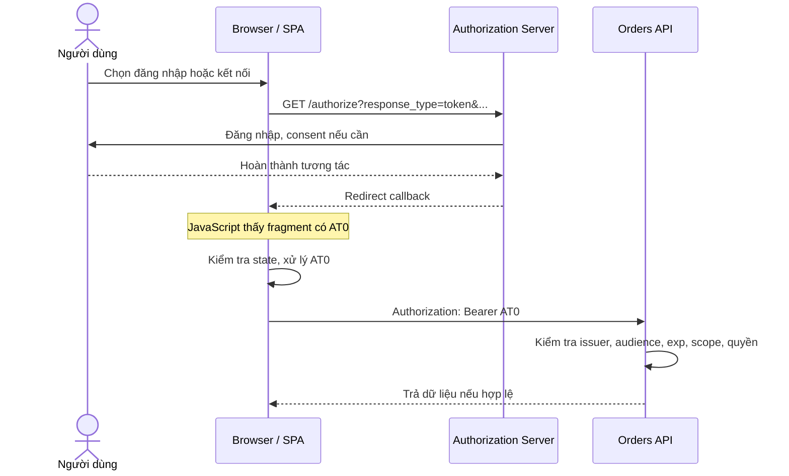
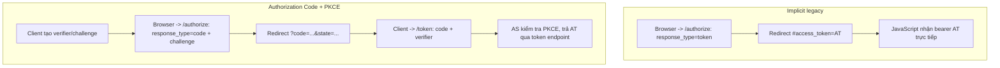

# Implicit flow and why it is discouraged

## 1. Tình huống mở đầu: access token xuất hiện trong URL của trình duyệt

Một ứng dụng Single-Page Application (SPA) cũ dùng OAuth 2.0 để đọc đơn hàng. Khi người dùng bấm **Đăng nhập/Kết nối tài khoản**, ứng dụng chuyển trình duyệt tới authorization server (AS) và yêu cầu `response_type=token`.

Sau khi người dùng đăng nhập và chấp thuận quyền, AS redirect browser về:

```text
https://client.example.com/callback
  #access_token=<bearer_access_token>
  &token_type=Bearer
  &expires_in=600
  &state=<original_state>
```

Phần từ dấu `#` trở đi được gọi là **URI fragment**. JavaScript tại `client.example.com` có thể đọc fragment để lấy access token rồi gọi Orders API.

Luồng này từng được gọi là **OAuth 2.0 Implicit Grant**, hay ngắn gọn là *implicit flow*. Điểm khác biệt quan trọng: **access token được trả trực tiếp trong authorization response qua browser/front channel**. Không có bước client dùng một authorization code ngắn hạn kết hợp PKCE verifier để đổi token tại token endpoint.

Nếu token là **bearer token** và bị mã độc XSS, browser extension, URL handling sai hoặc code bên thứ ba lấy được, kẻ tấn công có thể dùng token đó để gọi resource server trong giới hạn scope/audience và thời hạn. Việc access token là JWT có chữ ký hợp lệ **không ngăn người khác dùng lại chuỗi bearer bị đánh cắp**.

> **Kết luận sớm:** Với ứng dụng OAuth mới, **không nên chọn implicit grant**. Nên sử dụng **Authorization Code + PKCE** (và khi phù hợp, BFF/backend quản lý token) để tránh việc trả access token trực tiếp qua authorization response. Cách mới cũng cần phòng chống XSS, bảo vệ token, xác minh callback và phân quyền API; PKCE không phải giải pháp cho mọi rủi ro.

Bài thuộc chương **OAuth2 flows** của module `SECURITY_TOKEN_SECURITY_FUNDAMENTALS`. Nội dung giải thích cách implicit flow hoạt động, vì sao bị khuyến nghị tránh sử dụng, sự khác biệt với OIDC implicit/hybrid, và cách di chuyển an toàn sang OAuth 2.0/OIDC hiện đại. Các khái niệm đi kèm là JWT, opaque token, access/refresh token, issuer, scope, audience, vòng đời cấp phát–xác minh–thu hồi, và phòng chống token bị lấy cắp hoặc phát lại.

## 2. Mục tiêu học tập

Sau bài học, bạn có thể:

1. Diễn giải `response_type=token` và phân biệt authorization endpoint với token endpoint.
2. Mô tả chính xác **URL fragment** được browser xử lý như thế nào, tránh khẳng định sai rằng fragment luôn gửi tới web server.
3. Chỉ ra rủi ro của access token nằm trong **front channel**, đặc biệt khi là bearer token.
4. Giải thích vì sao implicit flow **không hỗ trợ cơ chế trao đổi authorization code gắn PKCE**.
5. Hiểu rằng OAuth 2.0 implicit grant **không được cấp refresh token** theo RFC 6749.
6. Phân biệt OAuth implicit grant và các response types **OIDC implicit/hybrid**.
7. Thiết kế **Authorization Code + PKCE** cho SPA, native client hoặc BFF đúng ranh giới.
8. Tạo checklist migration và ma trận kiểm thử cho các ứng dụng còn sử dụng implicit flow.

## 3. Nhắc lại các vai trò trong OAuth 2.0

| Vai trò | Chức năng | Ví dụ |
| --- | --- | --- |
| **Resource owner** | Bên có quyền cho phép truy cập resource theo chính sách | Người dùng sở hữu đơn hàng |
| **Client** | Ứng dụng yêu cầu và sử dụng quyền được cấp | Web SPA hoặc BFF |
| **Authorization server (AS)** | Xử lý authorization request và cấp token theo grant/policy | `https://auth.example.com` |
| **Resource server (RS)** | API xác minh access token và quyền trên dữ liệu | Orders API |

Browser là **user agent** tham gia điều hướng, không tự động là một resource server hoặc một authorization server. Với SPA thuần, phần lớn mã OAuth client chạy trong browser nên đây là **public client**: không thể coi client secret nhúng vào JavaScript là bí mật.

Phải phân biệt:

- **Authorization endpoint**, thường `/authorize`: nơi browser được chuyển tới để tương tác đăng nhập/consent và nhận authorization response.
- **Token endpoint**, thường `/token`: nơi client thực hiện token request theo grant hợp lệ; chẳng hạn đổi authorization code kèm PKCE verifier để lấy access token.
- **Resource endpoint**: API nghiệp vụ nhận access token đúng audience.

Tên URL thực tế do AS công bố qua metadata hoặc cấu hình tin cậy; `/authorize` và `/token` chỉ là ví dụ phổ biến.

## 4. OAuth 2.0 implicit grant hoạt động thế nào?

### 4.1. Authorization request với `response_type=token`

Theo mô hình OAuth 2.0 gốc (RFC 6749), client khởi tạo browser navigation tới AS:

```http
GET /authorize?response_type=token&client_id=orders-spa&redirect_uri=https%3A%2F%2Fclient.example.com%2Fcallback&scope=orders%3Aread&state=<random_state> HTTP/1.1
Host: auth.example.com
```

Giải thích các thành phần:

| Tham số | Ý nghĩa | Cần chú ý |
| --- | --- | --- |
| `response_type=token` | Yêu cầu access token ngay từ authorization endpoint | Dấu hiệu cốt lõi của OAuth implicit grant |
| `client_id` | Định danh client đã đăng ký | Không phải client secret |
| `redirect_uri` | URI callback của client | AS phải kiểm tra URI đã đăng ký chặt chẽ |
| `scope` | Phạm vi client yêu cầu | AS không phải cấp nguyên mọi quyền được xin |
| `state` | Liên kết authorization response với transaction/session của client | Chống callback CSRF và response injection khi dùng đúng |

`<random_state>` chỉ là placeholder minh họa. Trong hệ thống thật, giá trị phải được tạo khó đoán, gắn với browser session và xác minh ở callback.

### 4.2. AS tương tác người dùng rồi redirect token

Sau khi AS xác thực người dùng và đánh giá grant, client, resource và consent, AS có thể trả:

```http
HTTP/1.1 302 Found
Location: https://client.example.com/callback#access_token=<token>&token_type=Bearer&expires_in=600&state=<original_state>
Cache-Control: no-store
```

Phản hồi thuộc **authorization endpoint**, chứ không phải JSON response tại token endpoint. Ví dụ đơn giản giả định AS cấp bearer access token cho Orders API; token vẫn phải có scope, audience, thời hạn và các điều kiện tương ứng theo kiến trúc.

**Một chi tiết rất quan trọng:** Trong request HTTP tiếp theo tới `client.example.com`, browser **không gửi URI fragment** như một phần request-target. Thông thường server nhận đường dẫn `/callback`, còn fragment nằm trong URL phía user agent và có thể được JavaScript của trang đọc qua `window.location.hash`.

Vì vậy không nên nói “token trong fragment luôn tự động bị gửi tới web server, proxy hoặc Referer”. Rủi ro thực tế nằm ở việc **token hiện diện trong browser/front channel** và có thể bị code chạy tại client origin, extension, URL handling, history, telemetry, một số chuyển hướng hoặc cơ chế khác xử lý/làm lộ.

### 4.3. SPA lấy token rồi gọi API

Một ứng dụng legacy có thể làm:

```javascript
// CHỈ minh họa hành vi legacy, KHÔNG phải hướng dẫn triển khai OAuth mới.
const fragment = new URLSearchParams(window.location.hash.slice(1));
const accessToken = fragment.get("access_token");
const returnedState = fragment.get("state");

// Legacy client cần kiểm tra state, token type, transaction, ...
// Không sử dụng fragment/accessToken chưa kiểm tra làm bằng chứng tin cậy.
// Không log hoặc gửi accessToken tới URL khác.
```

Sau khi lấy token, client gọi:

```http
GET /orders HTTP/1.1
Host: orders-api.example.com
Authorization: Bearer <access_token>
```

Orders API phải **xác minh token độc lập**: chữ ký JWT hoặc introspection đáng tin, issuer, audience, thời hạn, token type/profile, scope và quyền trên bản ghi. Việc user bấm “Cho phép” ở AS **không tự thay thế authorization tại resource server**.

### 4.4. Sơ đồ luồng implicit



**Điểm thiếu trong sơ đồ:** Không có bước `authorization_code + code_verifier -> /token`. Chính sự khác biệt này khiến implicit flow không có cách áp dụng **PKCE cho bước đổi authorization code**, và access token được chuyển qua browser response.

## 5. Vì sao implicit từng phổ biến?

Khi OAuth 2.0 được công bố (RFC 6749, 2012), nhiều ứng dụng JavaScript chạy hoàn toàn trong browser gặp các giới hạn thực tế:

- SPA là public client, không giữ được client secret phía server.
- Browser-based HTTP request tới token endpoint khác origin và hỗ trợ CORS chưa được các AS triển khai nhất quán.
- Lập trình viên muốn nhận token chỉ bằng một lần redirect, không cần bước đổi code ở token endpoint.
- Kiến trúc frontend thường tránh duy trì backend chỉ để xử lý OAuth.

Vì vậy, implicit grant được thiết kế như một cách tối giản để đưa access token trực tiếp tới user agent/client.

**Bối cảnh hiện nay đã khác:** Authorization Code + PKCE được hỗ trợ rộng rãi, token endpoints có thể hỗ trợ CORS khi dành cho browser-based clients, và các kiến trúc BFF/token-mediating backend đã rõ hơn. Giá trị thuận tiện lịch sử không còn đủ bù cho rủi ro của việc phát access token qua authorization response.

### 5.1. “Deprecated” hay “discouraged”?

Cần dùng ngôn ngữ chính xác:

- **RFC 6749** vẫn là tài liệu gốc mô tả implicit grant.
- **OAuth 2.0 Security Best Current Practice (RFC 9700)** khuyến nghị clients **không sử dụng implicit grant và các response types phát access token trong authorization response**.
- Các nền tảng mới thường hướng tới **Authorization Code + PKCE**, nhưng tình trạng hỗ trợ/loại bỏ implicit khác nhau giữa AS và hệ thống legacy.
- Một số đặc tả **OIDC implicit/hybrid** vẫn tồn tại về mặt giao thức; điều đó không đồng nghĩa nên chọn chúng cho ứng dụng mới.

Không nói một cách tuyệt đối “mọi server trên thế giới đã cấm response_type=token” hoặc “mọi implicit token chắc chắn bị đánh cắp”. Lý do tránh dùng là **thiết kế có bề mặt lộ token lớn hơn và thiếu các lớp ràng buộc code exchange hiện đại**.

## 6. Rủi ro chính: access token đi qua front channel

### 6.1. Front channel là vùng khó kiểm soát trọn vẹn

Authorization response đi qua browser, nơi có thể chạy:

- JavaScript của chính SPA.
- Code của thư viện thứ ba được nhúng.
- Các extension có quyền truy cập trang.
- Công cụ ghi lại hành vi hoặc telemetry nếu được cấp quyền/triển khai sai.
- Logic chuyển hướng, callback và quản lý URL do ứng dụng viết.

Access token bearer là **credential có giá trị sử dụng trực tiếp**. Ai có token có thể thử trình ở đúng resource server và phạm vi mà nó được cấp, trừ khi có ràng buộc bên gửi/biện pháp khác.

Khi AS trả access token thẳng tới fragment, client phải đặt credential có giá trị sử dụng **vào môi trường front channel** chỉ để hoàn thành bước authorization.

### 6.2. URL fragment không phải HTTP header hay query

Phân biệt:

| Vị trí | Browser thường truyền thế nào? | Khả năng lộ |
| --- | --- | --- |
| **URL fragment** `#access_token=...` | Không thuộc request-target HTTP gửi tới server đích | JavaScript, URL bar/history, extension, xử lý URL/chuyển hướng sai |
| **Query string** `?access_token=...` | Nằm trong request target gửi tới server | Server/proxy logs, history, cache, analytics, Referrer theo policy |
| **Authorization header** | Browser/HTTP client gửi tới API đích | Proxy/server logs nếu không redact, network nếu không TLS, script nếu token JS giữ |
| **Request body** | Truyền theo request tới endpoint | Server logs/tracing nếu cấu hình sai, TLS/body policy |
| **HttpOnly session cookie** | Browser tự gửi tới origin/path phù hợp | CSRF/session abuse; JS không đọc qua document.cookie nhưng vẫn có thể kích hoạt request |

**Không được nói fragment luôn xuất hiện trong Referer header:** fragment thông thường bị loại khỏi HTTP request và Referer. Dù vậy, việc URL fragment được giữ trong browser hoặc bị **chương trình chủ động sao chép** sang nơi khác vẫn có thể dẫn tới lộ token.

### 6.3. XSS tại callback là kịch bản đặc biệt nguy hiểm

Nếu trang callback có lỗ hổng XSS, code độc hại có thể đọc `window.location.hash` trong khi access token còn ở đó:

```text
AS redirect -> https://client.example.com/callback#access_token=AT0

Browser loads callback page
  -> trusted client JS đọc fragment
  -> injected JS cũng có thể đọc fragment
  -> attacker lấy bearer AT0
  -> thử gọi Orders API tới khi token bị từ chối
```

Khi dùng Authorization Code + PKCE, callback chủ yếu nhận **code**, và code bị đánh cắp riêng lẻ khó đổi token nếu thiếu verifier. Với SPA có XSS chạy cùng origin, kẻ tấn công vẫn có thể tìm cách truy cập verifier hoặc token mới, nên **PKCE giảm một lớp rủi ro nhưng không giải quyết XSS hoàn toàn**.

### 6.4. Third-party script và browser extension

Một thư viện analytics hoặc widget được tải trong cùng page context có thể có mức quyền JavaScript lớn. Nếu nó bị xâm nhập hoặc triển khai thiếu kiểm soát, token trong fragment/bộ nhớ có thể bị truy cập.

Các biện pháp như CSP, quản lý dependency và Trusted Types giúp giảm một số đường tấn công, nhưng **đưa access token qua fragment vẫn làm token xuất hiện trực tiếp tại browser callback**.

### 6.5. Redirect handling và fragment leakage

Một callback có open redirect, redirect không đúng thứ tự hoặc code sao chép toàn bộ `window.location.href` sang đích khác có thể làm lộ fragment.

Cần hiểu rõ: **không phải mọi HTTP redirect tự động gửi fragment tới bất kỳ server nào**. Tuy nhiên, có các vấn đề về **fragment inheritance trong một số chuỗi redirect** và việc ứng dụng tự dựng URL đích có fragment/query. Vì vậy đừng đặt credential trong URL và đừng trông cậy một chuỗi redirect phức tạp sẽ luôn bảo vệ nó.

Callback cần hạn chế open redirect, sử dụng Referrer-Policy phù hợp, không gửi callback URL chứa token vào analytics và tránh lưu/hiển thị URI nguyên vẹn.

## 7. Bearer token bị lộ có thể được dùng lại

### 7.1. Chữ ký JWT đúng không ngăn token theft

Giả sử access token JWT chứa:

```json
{
  "iss": "https://auth.example.com",
  "sub": "user-123",
  "aud": "https://orders-api.example.com",
  "exp": 1900000600,
  "scope": "orders:read"
}
```

Khi Orders API kiểm tra chữ ký thành công, nó biết token phù hợp với issuer và chưa bị sửa theo key/profile. Nhưng với **bearer token**, API không tự biết người trình token có phải đúng browser ban đầu hay không.

Kẻ tấn công giữ một bản sao có thể:

1. Trình token tới Orders API có audience khớp.
2. Đọc dữ liệu trong phạm vi `orders:read` nếu API không có lớp ngăn khác.
3. Tiếp tục cho tới khi `exp` đến hoặc token bị vô hiệu theo cơ chế thu hồi.

**JWT vs opaque không quyết định bearer replay:** opaque token bị sao chép cũng có thể bị dùng tương tự nếu resource server introspection chấp nhận nó. Định dạng không thay thế sender-constraining.

### 7.2. Access token đúng audience vẫn cần quyền nghiệp vụ

Dù token hợp lệ, resource server vẫn cần xác minh:

- Token dành cho **đúng API** theo `aud`/resource binding.
- Token có đủ `scope` cho hành động.
- Chủ thể/client có quyền **hiện hành** trên tenant/bản ghi.
- Trạng thái tài khoản, grant hoặc token có bị thu hồi theo chính sách không.
- DPoP/mTLS proof nếu access token được ràng buộc khóa.

Giảm token TTL và scope/audience giúp hạn chế hậu quả nếu token lộ, nhưng không chữa được nhược điểm **đưa token ngay qua front channel**.

## 8. Thiếu bước code exchange: PKCE không áp dụng như thế nào?

### 8.1. PKCE bảo vệ một authorization code

Trong Authorization Code + PKCE:

```text
Client tạo code_verifier bí mật cho một transaction
  -> tính code_challenge = BASE64URL(SHA256(ASCII(verifier)))
  -> gửi challenge tới /authorize
  -> nhận authorization code ở callback
  -> gửi code + verifier tới /token
  -> AS kiểm tra verifier trước khi cấp token
```

PKCE giảm rủi ro **authorization code bị chặn** rồi được đổi bởi bên không giữ verifier. Nó cũng giúp bảo vệ một số lớp tấn công tiêm/chuyển đổi code khi được kết hợp đúng với transaction binding và issuer/redirect validation.

### 8.2. Implicit không có code để ràng buộc PKCE

Trong OAuth implicit grant:

```text
/authorize?response_type=token
  -> AS trả ngay access_token ở redirect fragment
  -> không có authorization_code để gửi tới /token
  -> không có bước /token kiểm tra code_verifier
```

Do đó, không thể “bật PKCE” trên `response_type=token` và kỳ vọng nó có tác dụng **như trong authorization code grant**. Một AS có thể chấp nhận thêm tham số PKCE trong một request tùy biến, nhưng **không làm thay đổi bản chất implicit token delivery** nếu access token vẫn được phát qua authorization response.

### 8.3. Client authentication cũng không phải phép màu

Trong Authorization Code flow của confidential client, token endpoint có thể xác thực client. SPA thuần là public client nên thường **không giữ client secret** và dựa trên PKCE cùng các ràng buộc khác.

Không nói “Code + PKCE an toàn vì chắc chắn client luôn xác thực bằng secret”. Lợi ích chính so với implicit là **token không nằm trong authorization response** và code exchange có **verifier binding**, dù public client vẫn chịu rủi ro XSS và token storage.

## 9. Refresh token và giới hạn duy trì phiên

Theo **RFC 6749**, authorization server **không được phát hành refresh token trong implicit grant**.

Lý do thực tiễn phù hợp với mô hình này: implicit trả access token ngay qua front channel; cấp refresh token dài hạn qua cùng đường sẽ làm tăng mạnh khả năng kẻ tấn công duy trì truy cập khi lấy được credential.

Tuy nhiên, **không có refresh token không làm implicit trở thành an toàn**. Ứng dụng vẫn có thể lộ access token đang còn hạn; để duy trì phiên, client có thể cần yêu cầu authorization mới.

### 9.1. “Silent renew” trong legacy SPA

Một số ứng dụng trước đây dùng **hidden iframe** tới authorization endpoint với `prompt=none` (trong OIDC) để lấy token mới dựa trên cookie phiên của AS.

Hạn chế:

- Third-party cookie restrictions và anti-tracking khiến silent renew bằng iframe không đáng tin trên nhiều môi trường.
- Các cơ chế iframe/cross-site cần xem xét CSP, framing, cookie, CORS và CSRF riêng.
- Nhận access token mới qua front channel lặp đi lặp lại vẫn không giải quyết nguy cơ token lộ.
- Session/consent có thể đã hết hạn hoặc cần user interaction; AS phải trả lỗi phù hợp, không mặc nhiên luôn cấp lại.

**Không dùng sự bất tiện của silent renew làm lý do nhét refresh token vào fragment hoặc URL.** Trong kiến trúc hiện đại, Code + PKCE và chính sách RT rotation/sender-constraining (nếu được cấp) hoặc BFF thường phù hợp hơn.

### 9.2. Refresh token trong Code + PKCE

Khi dùng authorization code grant, AS **có thể** cấp refresh token tùy loại client, consent/grant và policy; không bắt buộc mọi code flow đều nhận RT.

Với public client được cấp RT, OAuth Security BCP yêu cầu cơ chế chống replay phù hợp, chẳng hạn:

- **Refresh token rotation + reuse detection**.
- **Sender-constrained refresh token** gắn với khóa/chứng chỉ theo profile.

Refresh token chỉ được gửi tới **token endpoint**, không đem tới Orders API hoặc authorization URL. Rotation giúp hạn chế quyền duy trì truy cập khi RT bị sao chép, nhưng không tự vô hiệu ngay mọi access token JWT còn hạn.

## 10. State, nonce, issuer và callback vẫn phải kiểm tra

Một câu trả lời dễ sai là: “Implicit có `state` thì đã an toàn”. `state` giải quyết một **vấn đề khác** với bảo vệ access token.

### 10.1. State và authorization response injection

Client tạo `state` ngẫu nhiên khó đoán, lưu gắn với transaction/browser session rồi so khớp khi callback quay lại.

Nếu client bỏ qua state, attacker có thể đưa một authorization response do attacker khởi tạo vào browser của nạn nhân, gây **login CSRF, session confusion hoặc gắn nhầm token với account**.

Dù `state` được kiểm tra đúng, access token **vẫn tồn tại trong browser fragment**. `state` không mã hóa token, không ràng buộc token vào private key và không ngăn XSS đọc token.

### 10.2. Authorization server mix-up

Client có thể dùng nhiều AS. Nếu không ràng buộc authorization request với **issuer đã chọn**, callback từ AS khác có thể bị xử lý sai.

Trong flow mới, dùng transaction issuer binding và, khi hỗ trợ, **RFC 9207 issuer identification** trong authorization response hoặc cơ chế BCP tương đương. Không tự chọn token endpoint theo query/fragment callback chưa tin cậy.

Implicit flow càng nên được loại bỏ trong kiến trúc nhiều AS thay vì bù bằng các điều kiện tùy biến không được kiểm chứng.

### 10.3. OIDC nonce

Trong các OIDC response types cụ thể, `nonce` ràng buộc ID token với authentication request và phải được xác minh theo OIDC. Nhưng nonce **không biến bearer access token được gửi qua fragment thành sender-constrained token**.

Đừng lẫn:

| Giá trị | Bên kiểm tra chính | Bảo vệ ranh giới nào? |
| --- | --- | --- |
| `state` | OAuth client ở callback | Request/response transaction, CSRF |
| PKCE `code_verifier` | AS ở token endpoint | Authorization code exchange |
| OIDC `nonce` | OIDC client khi xác minh ID token | Authentication request/ID token binding |
| `iss` response | OAuth client khi hỗ trợ | AS mix-up |
| `aud` access token | Resource server | Nơi token được phép sử dụng |
| Sender constraint `cnf`/proof | RS/AS theo profile | Bằng chứng bên trình token sở hữu khóa |

## 11. Phân biệt OAuth implicit và OIDC implicit/hybrid

Đây là chỗ thường gây nhầm nhất.

### 11.1. OAuth 2.0 implicit grant

Đặc trưng:

```text
response_type=token
=> authorization response chứa access_token
=> thường trong URL fragment
=> không có authorization code exchange
```

Đây là luồng mà RFC 9700 khuyên clients **không sử dụng**.

### 11.2. OIDC implicit flow

OpenID Connect Core định nghĩa các implicit response types như:

```text
response_type=id_token
response_type=id_token token
```

- `id_token`: ID token có thể được trả qua front channel; **không phải access token**.
- `id_token token`: cả ID token và access token có thể được trả qua front channel.
- Các quy tắc OIDC về `nonce`, chữ ký, issuer, audience, thời hạn và token hash phải được thực thi theo response type/profile.

**Không nói mọi OIDC implicit response đều nhất thiết chứa access token**: `response_type=id_token` không yêu cầu access token theo cách `id_token token` có.

Tuy nhiên, với OIDC implicit, front-channel token delivery và bề mặt browser vẫn cần đánh giá. Thiết kế mới thường chọn **OIDC Authorization Code + PKCE** thay vì implicit OIDC.

### 11.3. OIDC hybrid flow

OIDC hybrid có thể dùng các response types:

```text
response_type=code id_token
response_type=code token
response_type=code id_token token
```

Chúng kết hợp authorization code với một số token hoặc ID token ở front channel. Không đồng nhất hybrid với OAuth `response_type=token`, cũng không tự kết luận có `code` trong response thì **mọi rủi ro front-channel token exposure đã được loại bỏ**.

Nếu muốn tránh đưa **access token** qua authorization response, cần chọn flow/profile không phát access token ở front channel, thường **`response_type=code` + PKCE**.

### 11.4. Bảng so sánh

| Flow/response type | Authorization response | Có bước code exchange? | Access token qua front channel? | Định hướng |
| --- | --- | --- | --- | --- |
| OAuth implicit `token` | Access token | Không | **Có** | Tránh dùng cho thiết kế mới |
| OAuth code `code` | Authorization code | **Có** | **Không** | Ưu tiên với PKCE |
| OIDC implicit `id_token` | ID token | Không | Không theo response type này | Cần đánh giá rủi ro/front-channel; thường chọn code flow |
| OIDC implicit `id_token token` | ID token + access token | Không | **Có** | Tránh khi có lựa chọn code flow |
| OIDC hybrid `code id_token` | Code + ID token | Có | Không theo response type này | Chỉ dùng nếu profile thực sự yêu cầu |
| OIDC hybrid `code token` | Code + access token | Có | **Có** | Front-channel AT vẫn là rủi ro |
| OIDC hybrid `code id_token token` | Code + ID token + access token | Có | **Có** | Front-channel AT vẫn là rủi ro |

**ID token không bao giờ được dùng làm access token của Orders API chỉ vì cả hai là JWT.** OIDC client kiểm tra ID token theo quy tắc riêng, còn RS kiểm tra access token theo issuer/audience/profile của API.

## 12. Đề xuất thay thế: Authorization Code + PKCE

### 12.1. Luồng mới khác ở đâu?

Client chuyển browser tới authorization endpoint với:

```text
response_type=code
code_challenge=BASE64URL(SHA256(ASCII(code_verifier)))
code_challenge_method=S256
state=<transaction_bound_random_value>
```

AS trả về:

```text
https://client.example.com/callback?code=<authorization_code>&state=<state>
```

Client xác minh callback rồi gửi:

```text
POST /token
grant_type=authorization_code
code=<authorization_code>
code_verifier=<original_verifier>
redirect_uri=<registered_redirect_uri>
client_id=<public_client_id>   # khi áp dụng theo AS/profile
```

AS xác minh code chưa dùng, client/grant, redirect binding và PKCE verifier trước khi phát access token. Token đến client qua **token endpoint response**, không nằm trong fragment của authorization redirect.

### 12.2. Sơ đồ so sánh



Hai flow **đều** cần TLS, redirect URI đúng, state/transaction, AS/issuer binding và resource server validation. Code + PKCE **không** tự loại bỏ nguy cơ XSS ở SPA giữ AT trong JavaScript.

## 13. Ví dụ đầy đủ về Authorization Code + PKCE

### 13.1. Bước 1 — tạo verifier, challenge và state

Ví dụ Java sinh giá trị an toàn:

```java
import java.nio.charset.StandardCharsets;
import java.security.MessageDigest;
import java.security.SecureRandom;
import java.util.Base64;

public final class PkceGenerator {
    private static final SecureRandom RNG = new SecureRandom();

    private static String randomBase64Url(int byteCount) {
        byte[] bytes = new byte[byteCount];
        RNG.nextBytes(bytes);
        return Base64.getUrlEncoder()
                .withoutPadding()
                .encodeToString(bytes);
    }

    public static void main(String[] args) throws Exception {
        // 32 byte ngẫu nhiên -> 43 ký tự Base64url.
        String verifier = randomBase64Url(32);
        String state = randomBase64Url(32);

        byte[] sha256 = MessageDigest.getInstance("SHA-256")
                .digest(verifier.getBytes(StandardCharsets.US_ASCII));
        String challenge = Base64.getUrlEncoder()
                .withoutPadding()
                .encodeToString(sha256);

        // Không in verifier, state, authorization code hoặc token thật.
        System.out.println("PKCE method=S256");
        System.out.println("challenge length=" + challenge.length());

        // Lưu verifier + state trong transaction/session được bảo vệ.
        // Xây URI qua URL builder, không nối chuỗi tùy tiện.
    }
}
```

Đoạn code **chỉ minh họa tạo dữ liệu**. Một OAuth client thực tế phải quản lý issuer, redirect, transaction expiration/one-time use, browser session, token response validation, lỗi OAuth và bảo mật storage.

PKCE verifier theo RFC 7636 là chuỗi có cú pháp/độ dài được quy định; ví dụ 32 byte ngẫu nhiên mã hóa Base64url không padding cho kết quả dài 43 ký tự, nằm trong khoảng hợp lệ. `S256` dùng ASCII của verifier, không phải chuỗi Unicode tùy ý.

### 13.2. Bước 2 — authorization request

```http
GET /authorize?response_type=code&client_id=orders-spa&redirect_uri=https%3A%2F%2Fclient.example.com%2Fcallback&scope=orders%3Aread&state=<state>&code_challenge=<challenge>&code_challenge_method=S256 HTTP/1.1
Host: auth.example.com
```

AS phải kiểm tra client đã đăng ký, redirect URI, flow/response type và policy scope/resource. Client không được tự chuyển request sang một AS hoặc redirect URI ngoài danh sách tin cậy.

### 13.3. Bước 3 — authorization response

```http
HTTP/1.1 302 Found
Location: https://client.example.com/callback?code=<short_lived_code>&state=<same_state>
Cache-Control: no-store
```

Client cần kiểm tra state **trước khi đổi code**, đồng thời xử lý issuer identification nếu có/nếu nhiều AS. Code phải ngắn hạn và dùng một lần.

Authorization code ở query vẫn là **credential trung gian nhạy cảm**. Không lưu full callback URL vào analytics, log hoặc issue tracker; nên dọn query sau khi xử lý an toàn.

### 13.4. Bước 4 — token request

```http
POST /token HTTP/1.1
Host: auth.example.com
Content-Type: application/x-www-form-urlencoded

grant_type=authorization_code&client_id=orders-spa&code=<code>&redirect_uri=https%3A%2F%2Fclient.example.com%2Fcallback&code_verifier=<verifier>
```

Đây là public client ví dụ. Confidential client/BFF còn cần client authentication theo đăng ký. Không nhúng client secret trong mã JS của SPA.

### 13.5. Bước 5 — token response

```http
HTTP/1.1 200 OK
Content-Type: application/json
Cache-Control: no-store
Pragma: no-cache

{
  "access_token": "<orders_access_token>",
  "token_type": "Bearer",
  "expires_in": 600,
  "scope": "orders:read"
}
```

Refresh token hoặc ID token chỉ có khi AS/OP quyết định cấp theo grant/OIDC profile, không mặc định trong mọi response.

Đối với SPA trực tiếp gọi token endpoint khác origin, AS cần **hỗ trợ CORS phù hợp**. CORS không xác thực client; client/grant/PKCE và các quy tắc phát token vẫn cần kiểm tra đầy đủ.

### 13.6. Bước 6 — gọi resource server

```http
GET /orders HTTP/1.1
Host: orders-api.example.com
Authorization: Bearer <orders_access_token>
```

Orders API không chấp nhận token chỉ vì client đã hoàn tất PKCE. Resource server phải kiểm tra access token, issuer, audience, thời hạn, scope, loại token và quyền bản ghi theo policy.

## 14. Lựa chọn kiến trúc: SPA trực tiếp, token-mediating backend hay BFF?

### 14.1. SPA trực tiếp giữ access token

Trong browser-based public client:

```text
Browser SPA
  -> /authorize?response_type=code&code_challenge=...
  -> callback có code
  -> fetch /token với code_verifier
  -> nhận access token trong JavaScript
  -> gọi Orders API
```

Điểm tốt hơn implicit là **token không đi qua authorization redirect** và có PKCE binding khi đổi code.

Nhưng:

- XSS cùng origin có thể đọc token tại nơi JS truy cập hoặc gọi API bằng quyền đang có.
- Browser extension/third-party script có thể gây rủi ro.
- Storage (memory, sessionStorage, localStorage, IndexedDB) có trade-off về persistence và khả năng JS đọc.
- Nếu cấp refresh token, cần rotation hoặc sender-constraining và điều phối nhiều tab/worker.

Không nói “Code + PKCE khiến localStorage an toàn tuyệt đối”. Nó cải thiện **luồng cấp token**, không tự giải quyết **nơi giữ token**.

### 14.2. BFF giữ OAuth tokens phía server

Một **Backend-for-Frontend (BFF)** có thể là confidential OAuth client:

```mermaid
sequenceDiagram
    participant B as Browser
    participant F as BFF
    participant AS as Authorization Server
    participant API as Orders API
    B->>F: Bắt đầu login
    F-->>B: Redirect /authorize?response_type=code...
    B->>AS: Authorization request
    AS-->>B: Redirect tới BFF callback có code
    B->>F: Callback code + state
    F->>AS: Token request code + PKCE + client auth khi cần
    AS-->>F: Access token + refresh token nếu được cấp
    F->>F: Lưu OAuth tokens ở server; tạo session
    F-->>B: HttpOnly, Secure session cookie
    B->>F: Gọi ứng dụng bằng session cookie
    F->>API: Gọi Orders API bằng access token
    API-->>F: Kết quả hợp lệ
    F-->>B: Dữ liệu
```

Lợi ích là **JavaScript không trực tiếp nhận OAuth refresh/access token** nếu triển khai BFF đúng. Browser chỉ dùng session credential.

Đổi lại BFF phải bảo vệ:

- Session cookie `Secure`, `HttpOnly`, `SameSite` theo bối cảnh.
- CSRF cho các endpoint có side effects.
- XSS vẫn có thể kích hoạt request bằng session, dù không đọc RT.
- Token vault, client secret/private key và refresh rotation phía backend.
- Đồng bộ refresh giữa nhiều pod, thu hồi phiên và kiểm soát access token tới đúng API.

### 14.3. Token-mediating backend

Một số hệ thống cho backend giữ refresh token, nhưng vẫn **trả access token cho browser** để gọi API trực tiếp. Điều này khác BFF đầy đủ:

- Giảm khả năng JS đọc RT dài hạn.
- Access token vẫn có thể xuất hiện ở frontend.
- Endpoint backend cấp AT từ session cookie phải chống CSRF, session abuse và rate-limiting.
- Scope/audience của AT phải giới hạn theo nhiệm vụ thực tế.

Chọn kiến trúc dựa trên threat model, mức nhạy cảm, khả năng vận hành và trải nghiệm, **không chỉ** dựa trên ít HTTP round trips nhất.

### 14.4. So sánh ngắn

| Mô hình | Token qua authorization fragment? | JS thấy OAuth access token? | Nơi quản lý refresh token |
| --- | --- | --- | --- |
| Legacy implicit SPA | **Có** | Có | Không có RT theo implicit grant chuẩn |
| Modern code + PKCE SPA | Không | Thường có | Browser nếu AS cấp RT |
| Token-mediating backend | Không | Có thể có | Backend |
| BFF code + PKCE | Không | Không theo thiết kế BFF đầy đủ | Backend |

## 15. ID token, access token và token-type confusion

Với OIDC, một client có thể nhận **ID token** sau authorization code flow. ID token phục vụ **xác minh kết quả xác thực** tại OIDC client.

| Loại credential | Dành cho bên nào? | Dùng đúng |
| --- | --- | --- |
| **Authorization code** | Client đổi tại token endpoint | Xin token sau khi AS kiểm tra binding |
| **Access token** | RS có audience phù hợp | Gọi API được bảo vệ |
| **ID token** | OIDC client; `aud` thường là client ID | Xác minh sự kiện đăng nhập của user |
| **Refresh token** | AS/token endpoint | Xin AT mới trong phạm vi grant |

Sai lầm:

```text
ID token có sub=user-123 và chữ ký đúng
  -> ứng dụng gửi ID token như Bearer tới Orders API
  -> Orders API chỉ kiểm tra chữ ký và sub
  -> nhầm ID token với access token
```

Resource server phải xác minh **token type/profile và audience**. ID token đúng chữ ký của cùng AS **không phải** access token hợp lệ của Orders API.

Implicit/hybrid flows có nhiều loại JWT đi qua front channel nên rủi ro **cross-token confusion** càng cần được xem xét. Code + PKCE không miễn kiểm tra loại token.

## 16. JWT, opaque token và audience không làm implicit an toàn hơn

### 16.1. JWT access token

Một JWT ký số có thể mang:

```json
{
  "iss": "https://auth.example.com",
  "sub": "user-123",
  "aud": "https://orders-api.example.com",
  "exp": 1900000600,
  "scope": "orders:read"
}
```

AS và RS cần tuân thủ profile thực tế; JSON trên **không phải token hoàn chỉnh có chữ ký**. Dù JWT có chữ ký đúng, ai lấy được **bearer JWT** vẫn có thể thử trình nó cho đúng audience.

Không nhúng thông tin cá nhân, roles/groups dư thừa chỉ vì token đi tới browser. Payload JWS thường đọc được khi Base64url decode; chữ ký không mã hóa nội dung.

### 16.2. Opaque access token

Opaque token có thể là handle ngẫu nhiên, resource server tra qua introspection hoặc nguồn có thẩm quyền. Nó có thể che claims khỏi client và giảm kích thước token, nhưng bearer opaque token bị đánh cắp **vẫn có thể bị dùng lại** nếu AS/RS chấp nhận.

Không nên nói chuyển implicit từ JWT sang opaque **loại bỏ được front-channel leakage**. Cách token được chuyển tới browser **vẫn không đổi**.

### 16.3. Scope, audience, TTL và quyền hiện hành

Bất kể định dạng, access token cần:

- **Scope tối thiểu** cho chức năng.
- **Audience đúng resource**, không mở rộng không cần thiết.
- **TTL phù hợp rủi ro** và cách thu hồi.
- Resource server kiểm tra **quyền tài nguyên hiện hành** khi cần.
- Không dùng lại access token cho Payments nếu chỉ được cấp cho Orders.

Giảm hậu quả khi token lộ là quan trọng, nhưng biện pháp gốc vẫn là **tránh flow trả access token ở authorization response**.

## 17. DPoP/mTLS và vì sao không nên dựa vào chúng để giữ implicit

**Sender-constrained access tokens** như DPoP (RFC 9449) hoặc mTLS-bound token (RFC 8705) giảm khả năng dùng một **chuỗi token bị sao chép riêng lẻ** nếu kẻ tấn công không có private key/chứng chỉ tương ứng.

Tuy nhiên:

- Token vẫn cần được cấp và sử dụng đúng OAuth profile.
- Client/AS/RS phải thực sự kiểm tra binding và proof theo từng request.
- XSS đủ quyền có thể **ra lệnh sử dụng khóa** hoặc gọi API trong phiên, dù khóa non-exportable.
- Không thể tự “bật DPoP trong implicit flow” rồi coi nó có tương đương Code + PKCE; thiếu bước code exchange vẫn còn.
- mTLS thường không thực tế cho nhiều SPA browser-based clients như với backend/service workloads.

**Ưu tiên chuyển khỏi implicit trước**, sau đó xem sender-constraining là lớp tăng cường dựa theo threat model và khả năng AS/RS.

## 18. Migration từ implicit sang Authorization Code + PKCE

### 18.1. Bước kiểm kê

Trước khi sửa:

1. Xác định toàn bộ client còn dùng `response_type=token`.
2. Tìm những callback đọc `window.location.hash` để lấy access token.
3. Kiểm kê AS/issuer, redirect URIs, client IDs và môi trường `dev/staging/prod`.
4. Ghi nhận scope, audience, loại token, TTL, storage và cách refresh hiện tại.
5. Kiểm kê hệ thống SSO/silent iframe renew, implicit SDK và browser compatibility.
6. Xác định có OIDC flow nào dùng `id_token token` hoặc hybrid front-channel token hay không.
7. Đánh giá API đang kiểm tra `aud`, `iss`, `exp`, token type và scope như thế nào.
8. Ghi nhận logging/analytics có lưu URL fragment, callback URL hoặc token hay không.

Không loại bỏ implicit chỉ tại giao diện và mặc định tất cả clients đã được migrate. Cần kiểm tra **cấu hình AS cho từng client** và đường xử lý trong thư viện OAuth.

### 18.2. Kế hoạch chuyển đổi thực tế

| Bước | Hành động | Kiểm soát bảo mật |
| --- | --- | --- |
| 1 | Chọn `response_type=code` cho ứng dụng | Không phát access token tại authorization endpoint |
| 2 | Bật Authorization Code + PKCE S256 trên AS | Token request phải chứng minh verifier |
| 3 | Đăng ký exact `redirect_uri` | Không wildcard/open redirect |
| 4 | Sinh `state` và transaction binding | Chống callback CSRF/session mix-up |
| 5 | Ràng buộc issuer cho multi-AS | Chống AS mix-up |
| 6 | Xử lý callback chỉ nhận code/error hợp lệ | Không chấp nhận access token trong fragment |
| 7 | Gọi token endpoint đúng issuer | TLS, PKCE, client auth khi cần, CORS nếu SPA |
| 8 | Đánh giá nơi lưu AT/RT | Cân nhắc BFF hoặc storage policy dựa threat model |
| 9 | Áp dụng refresh-token protection nếu được cấp | Rotation/reuse detection hoặc sender-constraining phù hợp |
| 10 | Kiểm thử API validation | Issuer, audience, type, exp, scope, resource ACL |
| 11 | Bảo vệ logs/telemetry/history | Không lưu credential |
| 12 | Tắt implicit grant cho client đã migrate | Không để fallback không an toàn |

### 18.3. Tránh fallback downgrade

Một anti-pattern:

```text
try Authorization Code + PKCE
  if token endpoint CORS/error:
      fallback response_type=token
```

Lỗi CORS hay config khi đổi code **phải được sửa ở AS/client deployment**, không được “chữa” bằng cách hạ cấp sang implicit. Nếu có ngắt dịch vụ, báo lỗi an toàn thay vì phát token qua front channel.

### 18.4. Rollout an toàn

- Bật flow mới ở môi trường test với AS configuration tương đương production.
- Tách metrics theo response type, client version và issuer.
- Deploy callback mới xử lý code/PKCE trước khi vô hiệu cấu hình cũ.
- Khi đã xác minh migration, loại quyền cấp `response_type=token` cho client.
- Kiểm tra cả ứng dụng/mobile/bản cũ còn truy cập; có kế hoạch chuyển đổi phiên theo chính sách.
- Thu hồi/reduce lifetime legacy tokens nếu sự cố hoặc mục tiêu bảo mật yêu cầu; hiểu rằng tắt implicit **không tự vô hiệu tất cả access token đã cấp**.
- Không log raw code, AT, RT, verifier trong quá trình chẩn đoán.

## 19. Ví dụ case study: SPA báo cáo nội bộ

### 19.1. Trước migration

Ứng dụng `reports-spa`:

```text
AS /authorize?response_type=token&scope=reports:read
  -> /callback#access_token=AT0
  -> JavaScript lưu AT0 vào localStorage
  -> Reports API
```

Vấn đề:

- Access token xuất hiện trong callback URL fragment.
- JS cùng origin có thể đọc token; `localStorage` không chống XSS.
- Ứng dụng thiếu code exchange gắn PKCE.
- Hết AT có thể phải gọi lại authorization endpoint/silent renew.
- Nếu token chứa quá nhiều groups/roles, rủi ro lộ claims và kích thước tăng.

### 19.2. Sau migration

Một lựa chọn:

```text
AS /authorize?response_type=code&code_challenge=...
  -> /callback?code=...&state=...
  -> client verify state/issuer
  -> /token? [POST form body chứa code + code_verifier]
  -> nhận AT đúng Reports audience, scope reports:read
  -> Reports API verify AT + resource authorization
```

**Không đặt access token trong query string của token request**. Dòng `/token?` ở sơ đồ chỉ là ký hiệu diễn tả endpoint; request thực tế phải sử dụng HTTP POST với form body hoặc cơ chế token endpoint đúng profile.

Có thể chọn **BFF** để giữ OAuth AT/RT ở server, giảm bề mặt lưu token phía SPA. Với SPA trực tiếp, bảo vệ XSS và storage vẫn bắt buộc.

### 19.3. Điều cần đo khi migration

- Tỷ lệ authorization callback được xác minh `state`/issuer thành công.
- Tỷ lệ PKCE code exchange thành công/thất bại.
- CORS errors ở token endpoint (nếu browser gọi trực tiếp).
- Số request legacy `response_type=token` còn xuất hiện.
- Lỗi sai `aud`, `scope`, token type ở Reports API.
- Tỷ lệ `invalid_grant` do code được dùng lại hoặc refresh token rotation.
- Việc logs/telemetry còn lưu URL callback/token hay không.

Không dùng metric có raw credential, email hoặc thông tin người dùng vượt nhu cầu quan sát.

## 20. Case study: authorization response injection

### 20.1. Legacy implicit với state yếu

Giả sử SPA chỉ kiểm tra `state` bằng một chuỗi cố định, không gắn browser session. Attacker xin access token cho tài khoản của mình rồi cố đưa một callback có token và state đó vào browser nạn nhân.

Ứng dụng có thể nhầm token của attacker là phiên của nạn nhân, khiến hành động người dùng trên UI có thể được ghi vào tài khoản attacker. Đây là lớp **login CSRF/authorization response injection**.

### 20.2. Code + PKCE giúp gì và chưa giúp gì?

Một flow mới nên:

1. Sinh state và PKCE verifier **riêng cho mỗi authorization transaction**.
2. Ràng buộc state/verifier với browser session và issuer.
3. Chỉ chấp nhận callback có state khớp transaction chưa dùng.
4. Đổi code tại token endpoint bằng verifier.
5. Xác minh ID token OIDC và nonce nếu sử dụng theo profile.
6. Tạo session sau khi token response đã được xác minh đầy đủ.

PKCE làm code không dễ đổi bởi bên chỉ có code. Nhưng nếu ứng dụng **không xác minh state/session** hoặc có XSS, vẫn có các đường tấn công riêng. Cần các lớp bảo vệ bổ sung, không hiểu PKCE thay thế toàn bộ chúng.

## 21. Xử lý lỗi đúng theo endpoint

Các lỗi cần phân biệt:

| Lỗi | Xuất hiện ở đâu | Ý nghĩa |
| --- | --- | --- |
| `access_denied` | Authorization response | User/AS từ chối grant |
| `invalid_request` | Authorization/token endpoint tùy ngữ cảnh | Request không hợp lệ |
| `invalid_scope` | AS | Scope không hợp lệ hoặc không cho phép theo policy |
| `invalid_grant` | Token endpoint | Code/RT không hợp lệ, hết hạn, đã dùng lại hoặc không khớp client/grant |
| `invalid_client` | Token endpoint | Client authentication thất bại |
| `401 invalid_token` | Resource server | Access token không hợp lệ cho API |
| `403 insufficient_scope` | Resource server | Access token hợp lệ nhưng thiếu phạm vi cấp quyền |

Client không nên phản ứng với mọi lỗi bằng một vòng lặp redirect hoặc refresh. Một ứng dụng legacy có thể lặp đi lặp lại `/authorize?response_type=token` khi AS từ chối do cookie/consent; migration nên xử lý **tái xác thực có kiểm soát** thay vì silent renew vô hạn.

### 21.1. Xử lý fragment khi còn hỗ trợ client legacy

Trong giai đoạn chuyển đổi, có thể vẫn có callback nhận legacy fragments. Một số nguyên tắc giảm rủi ro:

- Không dùng fragment không khớp transaction/state làm phiên hợp lệ.
- Không đưa `access_token` lên logs, analytics hoặc error reporting.
- Không copy fragment sang query/body của một dịch vụ khác.
- Không chuyển hướng sang external URL khi fragment còn mang token.
- Nếu thực sự cần tiếp tục hỗ trợ trong thời gian ngắn, có mốc chấm dứt rõ ràng ở AS.
- Khi đã chuyển xong, **từ chối legacy implicit response**, không chuyển token đó vào code path mới.

Đây là **biện pháp chuyển tiếp**, không phải phương án khuyến nghị triển khai implicit mới.

## 22. Những hiểu lầm phổ biến

| Hiểu lầm | Vì sao sai? | Cách hiểu đúng |
| --- | --- | --- |
| “Implicit an toàn vì token nằm sau `#`” | Browser JS/extension/URL handling vẫn có thể lấy token | Fragment không gửi qua HTTP request nhưng vẫn là front channel |
| “Fragment luôn xuất hiện trong Referer” | Browser thường loại fragment khỏi HTTP Referer | Rủi ro khác: JS, history, redirect/code copying |
| “Implicit là login OAuth tiêu chuẩn tốt nhất cho SPA” | Security BCP khuyên tránh | Code + PKCE, cân nhắc BFF |
| “Thêm PKCE param vào `response_type=token` là đủ” | Không có authorization code exchange | Dùng `response_type=code` + PKCE |
| “Public client không có secret nên buộc phải dùng implicit” | PKCE bảo vệ code exchange không cần secret đóng gói | SPA public client có thể dùng code + PKCE |
| “Code + PKCE ngăn mọi XSS” | JS bị chiếm vẫn có thể lạm dụng session/token | Cần CSP, output encoding, storage/BFF, least privilege |
| “Implicit cấp refresh token dài hạn cho tiện” | RFC 6749 cấm cấp RT trong implicit grant | Dùng code grant nếu cần RT, bảo vệ RT đúng chuẩn |
| “JWT ký số nên không bị replay” | Chữ ký không ràng buộc người trình bearer token | TTL, PoP khi phù hợp, revocation |
| “Opaque token làm implicit an toàn ngay” | Token vẫn đi qua front channel | Đổi flow, không chỉ đổi format |
| “OIDC implicit luôn có access token” | `response_type=id_token` không yêu cầu AT | Phân biệt các response types |
| “Có code trong hybrid là không lộ AT” | Hybrid `code token` vẫn phát AT qua front channel | Chọn code-only response nếu mục tiêu là tránh front-channel AT |
| “User consent là API tự cho phép mọi thao tác” | Token scope và quyền bản ghi phải kiểm tra riêng | RS validation/authorization độc lập |
| “CORS là xác thực SPA” | CORS không chứng minh client giữ secret | Client registration, PKCE, policy |
| “LocalStorage bảo mật nếu token ngắn hạn” | XSS cùng origin thường đọc được | Threat model; cân nhắc memory/BFF |
| “Tắt implicit là mọi token cũ bị thu hồi” | AT đã cấp có thể còn hạn | Revocation/introspection/TTL policy |
| “Có issuer đúng là nhận token ở mọi API” | Thiếu audience validation | RS kiểm tra `aud` và scope |

## 23. Ma trận kiểm thử bảo mật

Giả định client mới `orders-spa` dùng Authorization Code + PKCE S256 với AS `https://auth.example.com` và Orders API. Client legacy `orders-spa-old` từng dùng implicit.

| Ca kiểm thử | Kết quả mong đợi | Thuộc tính kiểm chứng |
| --- | --- | --- |
| Client mới dùng `response_type=code` | AS xử lý theo registration | Chọn flow mới |
| Client mới thử `response_type=token` sau migration | AS từ chối | Không fallback implicit |
| Client legacy chưa migrate được theo policy | Chỉ hỗ trợ có giới hạn thời gian; không mở lại mặc định | Kế hoạch deprecation |
| Callback có `#access_token` tới client mới | Không tạo phiên từ fragment | Token delivery isolation |
| Callback code có state khớp session | Tiếp tục token exchange | State binding |
| Callback state sai | Từ chối | CSRF defense |
| Callback state đã dùng | Từ chối | One-time transaction |
| Authorization code bị đánh cắp, không có verifier | Token endpoint từ chối | PKCE |
| PKCE verifier sai | Token endpoint từ chối | Verifier binding |
| Code cùng verifier bị dùng lần hai | Token endpoint từ chối reuse | Single-use code |
| Code được cấp cho client A nhưng client B đổi | Từ chối | Client binding |
| Redirect URI sai | AS không redirect tới URI chưa tin cậy | Open redirect prevention |
| Callback có code với issuer sai | Client từ chối | AS mix-up defense |
| OIDC nonce không khớp | Client từ chối ID token | OIDC binding |
| OIDC implicit `id_token` | Không nhầm là access token | Flow differentiation |
| OIDC hybrid `code token` | Test xác nhận AT vẫn qua front channel | Risk awareness |
| ID token gửi tới Orders API | API từ chối | Token-type isolation |
| Access token sai `aud` | API từ chối | Audience validation |
| Access token đúng `aud` nhưng thiếu scope | API từ chối hành động | Scope validation |
| AT hết hạn/đã revoke | API từ chối theo policy | Lifecycle enforcement |
| Bearer AT bị sao chép | Test xác minh giới hạn TTL/aud/scope và các lớp PoP nếu có | Replay threat model |
| RT được phát cho public client | Rotation/sender constraint đúng profile | Refresh replay protection |
| Hai tab cùng refresh RT | Không tạo refresh race trái phép | Single-flight/family |
| Token endpoint thiếu CORS cần thiết cho SPA | Client báo lỗi; không tự downgrade | Safe migration |
| XSS tại callback | Kiểm tra không có AT trong fragment của code flow | Giảm exposure |
| Third-party script cố đọc browser tokens | Các giới hạn đã thiết kế hoạt động; review risk | XSS/third-party threat |
| Redirect callback có open redirect | Không rò code/token sang external origin | URL safety |
| Token/fragment lộ trong analytics | Test **thất bại** | No secret logging |
| Hidden iframe silent renew thất bại | Không lặp redirect vô hạn | Browser cookie restrictions |
| Browser đóng/reload giữa auth flow | Transaction không bị chấp nhận sai session | Session binding |
| Token mới được cấp scope rộng hơn request | Từ chối hoặc theo policy minh bạch; không cấp quá quyền | Least privilege |
| Thay JWT bằng opaque trong implicit legacy | Không coi là đã sửa rủi ro front channel | Format vs flow |
| BFF trả OAuth RT trong cookie browser | Security review báo lỗi thiết kế | Server-side token boundary |
| Gateway nhận ID/AT nhầm profile | Từ chối | Cross-JWT confusion |
| AS gặp sự cố trong token exchange | Client fail safely, không implicit fallback | Fail closed |

### 23.1. Kiểm thử end-to-end

Một test tích hợp nên đi đủ đường:

```text
Browser bắt đầu đăng nhập
  -> client tạo state + PKCE verifier
  -> browser tới /authorize với response_type=code
  -> AS xác thực/consent và trả code
  -> client xác minh state + issuer
  -> client gọi /token với code_verifier
  -> AS phát access token scope/audience tối thiểu
  -> client gọi Orders API
  -> RS xác minh và kiểm tra quyền trên resource
  -> logout/refresh/revocation theo policy
```

Không chỉ test “AS trả 302” rồi kết luận hệ thống an toàn. Một lỗi ở callback, token endpoint, storage hoặc API validator đều có thể làm suy yếu flow mới.

## 24. Checklist migration và vận hành

1. **Discovery:** Client có lấy endpoint/issuer từ metadata đáng tin không?
2. **Flow:** Production client còn chấp nhận `response_type=token` không?
3. **PKCE:** Code flow đã dùng `S256` và AS kiểm tra verifier không?
4. **Redirect:** URI đăng ký được so khớp nghiêm ngặt; không wildcard/open redirect?
5. **State:** Có random state gắn browser session/transaction, one-time validation?
6. **Issuer:** Multi-AS client ràng buộc issuer và chống mix-up?
7. **OIDC:** Có kiểm tra ID token, `nonce`, audience/client ID và không nhầm ID token với access token?
8. **Front channel:** Authorization callback không còn access token trong fragment?
9. **Token endpoint:** Đã xác minh code, PKCE, client/grant và CORS khi SPA gọi trực tiếp?
10. **Client type:** SPA/public không chứa hard-coded client secret?
11. **Token format:** JWT/opaque access token theo profile, không lưu claims nhạy cảm không cần?
12. **Scope/audience:** AS cấp quyền tối thiểu, RS xác minh resource đích và quyền bản ghi?
13. **Storage:** Đã đánh giá XSS và browser storage; có cần BFF không?
14. **Refresh:** Nếu cấp RT, có rotation/reuse detection hoặc sender constraint phù hợp và giới hạn TTL/grant?
15. **PoP:** Nếu dùng DPoP/mTLS, RS/AS kiểm tra proof thật, không chỉ có claim cho đẹp?
16. **URL/log:** Không có raw token, code, verifier, session secret trong browser analytics/URL logs?
17. **Errors:** Client phân biệt `access_denied`, `invalid_grant`, `401` và `403`; không loop/fallback?
18. **Rollout:** Đã tắt implicit trên AS cho client migrate và xác minh legacy SDK không yêu cầu flow cũ?
19. **Revocation:** Có kế hoạch với access tokens legacy còn hiệu lực và các phiên cần thu hồi?
20. **Testing:** Đã test XSS callback, code interception, state mismatch, mix-up, token-type confusion và replay?

## 25. Tổng kết

**OAuth 2.0 implicit grant** (`response_type=token`) phát access token **ngay trong authorization response qua browser**, thường nằm ở **URL fragment**. Fragment thông thường không được gửi như request-target HTTP tới web server, nhưng token vẫn xuất hiện trong front channel, nơi JavaScript, extension, URL handling và các thành phần client có thể làm lộ nó. Với bearer token, bản sao bị đánh cắp có thể được sử dụng lại cho đến khi bị từ chối. Implicit cũng **không có bước authorization code exchange để gắn PKCE** và **không được cấp refresh token** theo RFC 6749.

Lựa chọn phù hợp cho ứng dụng mới là **Authorization Code + PKCE S256**, kết hợp xác minh `state`, redirect URI, issuer, OIDC nonce khi cần, kiểm tra access token tại resource server và chính sách bảo vệ token sau phát hành. Với browser, cân nhắc **BFF** để giảm lượng OAuth credential xuất hiện trong JavaScript. Đừng chỉ thay định dạng JWT thành opaque, tăng TTL hoặc thêm một tham số PKCE vào implicit request rồi coi rủi ro đã biến mất.

**Chuyển khỏi implicit là thay đổi một ranh giới tin cậy quan trọng: access token không còn được phát trực tiếp qua authorization response.** Đó là cải thiện nền tảng, nhưng an ninh tổng thể vẫn phụ thuộc vào nơi lưu token, chống XSS/CSRF, ít quyền nhất, audience, thu hồi và quyền hiện hành của từng request.

## Tài liệu chuẩn để tìm hiểu thêm

- **RFC 6749 — The OAuth 2.0 Authorization Framework:** định nghĩa implicit grant (Section 4.2), authorization code grant, token endpoint, access/refresh tokens.
- **RFC 9700 — Best Current Practice for OAuth 2.0 Security:** khuyến nghị tránh các response types phát access token trong authorization response, PKCE và các biện pháp bảo vệ OAuth.
- **RFC 7636 — Proof Key for Code Exchange by OAuth Public Clients (PKCE):** S256 code verifier/challenge và bảo vệ code exchange.
- **RFC 9207 — OAuth 2.0 Authorization Server Issuer Identification:** chống authorization server mix-up.
- **RFC 8414 — OAuth 2.0 Authorization Server Metadata:** issuer và cấu hình endpoint đáng tin.
- **RFC 6750 — OAuth 2.0 Bearer Token Usage:** cách trình bearer access token và rủi ro khi bearer bị lộ.
- **RFC 9068 — JWT Profile for OAuth 2.0 Access Tokens:** yêu cầu claims/profile và validation của JWT access token.
- **RFC 7662 — OAuth 2.0 Token Introspection:** kiểm tra trạng thái và metadata opaque access token.
- **RFC 7009 — OAuth 2.0 Token Revocation:** thu hồi tokens theo OAuth.
- **RFC 9449 — OAuth 2.0 Demonstrating Proof of Possession (DPoP):** token ràng buộc khóa và proof gửi request.
- **RFC 8705 — OAuth 2.0 Mutual-TLS Client Authentication and Certificate-Bound Access Tokens:** sender-constrained tokens cho profile hỗ trợ.
- **RFC 9126 — OAuth 2.0 Pushed Authorization Requests (PAR):** hạn chế tham số authorization phức tạp trên front channel khi cần.
- **OpenID Connect Core:** phân biệt code, implicit, hybrid response types và các quy tắc ID token/nonce.
- **OWASP OAuth2 Cheat Sheet / Cross Site Scripting Prevention Cheat Sheet:** các lưu ý triển khai và kiểm soát XSS trong web applications.
