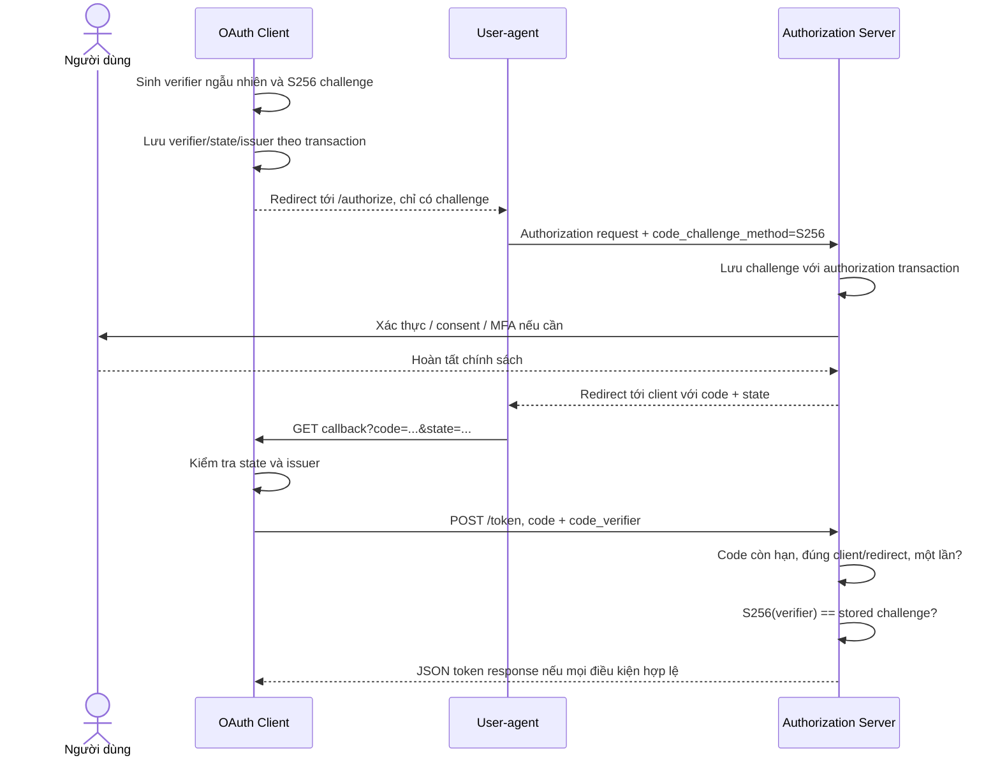

# Code verifier and code challenge

Trong OAuth 2.0 **Authorization Code Flow**, client đưa người dùng qua trình duyệt đến authorization server (AS) rồi nhận lại một **authorization code** qua redirect. Vì code đi qua *front-channel* — môi trường có thể bị quan sát hoặc chặn bởi một ứng dụng khác, log hoặc cơ chế redirect — chỉ nắm giữ code **không nên đủ** để đổi lấy access token. **Proof Key for Code Exchange (PKCE)**, được chuẩn hóa trong **RFC 7636**, giải quyết vấn đề đó bằng cách ràng buộc authorization code với một bí mật ngẫu nhiên mà client đã tạo **trước khi bắt đầu authorization request**.

PKCE có hai giá trị phải phân biệt:

- **`code_verifier`:** chuỗi ngẫu nhiên entropy cao do client sinh riêng cho **một lần authorization**; client giữ bí mật cho tới khi gọi token endpoint.
- **`code_challenge`:** giá trị dẫn xuất từ `code_verifier`, thường bằng phép biến đổi **`S256`**: SHA-256 rồi Base64URL không padding. Client gửi challenge ở authorization request để AS lưu cùng giao dịch/code.

Khi client đổi authorization code, nó trình `code_verifier` qua **HTTP POST tới token endpoint**. AS tự tạo lại challenge và so sánh với challenge đã lưu. Nếu không khớp, **không cấp access token**.

```text
Client tạo bí mật:       code_verifier
                              |
                              | SHA-256 rồi Base64URL, không padding
                              v
Authorization request:   code_challenge + code_challenge_method=S256
                              |
                              | AS gắn challenge với authorization code
                              v
Redirect về client:      authorization code
                              |
                              | Client gửi code + code_verifier tới /token
                              v
AS so sánh:              S256(received_verifier) == saved_challenge ?
                          Có -> tiếp tục kiểm tra grant và phát token
                          Không -> invalid_grant, không phát token
```

**Cần ghi nhớ:** `code_challenge` có thể xuất hiện trong URL vì nó không phải giá trị dùng trực tiếp để đổi code trong phương thức `S256`; **`code_verifier` không được gửi trong authorize URL, redirect callback, access token, log hoặc frontend analytics**.

Bài thuộc chương **OAuth2 flows** của module **SECURITY_TOKEN_SECURITY_FUNDAMENTALS**. Kiến thức PKCE gắn với mô hình tin cậy, vòng đời token JWT/opaque, access token/refresh token, OAuth 2.0/OIDC, phát hành và xác minh claims, scope, audience, lưu trữ, thu hồi và phòng chống token bị đánh cắp hoặc phát lại. Trọng tâm bài này là **`code_verifier`, `code_challenge` và ràng buộc code exchange**, không đồng nhất PKCE với toàn bộ hệ thống xác thực hoặc phân quyền.

## 1. Mục tiêu học tập

Sau khi hoàn thành bài, bạn có thể:

1. Giải thích PKCE giải quyết nguy cơ **authorization code interception** nào và không bảo vệ khỏi những nguy cơ nào.
2. Phân biệt chính xác `code_verifier` với `code_challenge`, nơi sinh, nơi lưu, nơi gửi và vòng đời của chúng.
3. Nêu giới hạn cú pháp của verifier: **43–128 ký tự** thuộc tập **unreserved**; sinh bằng nguồn ngẫu nhiên mật mã, tránh giá trị đoán được.
4. Tính `S256` theo RFC 7636 bằng **SHA-256(ASCII(verifier))** và **Base64URL không có dấu `=` padding**, phân biệt với Base64 thông thường.
5. Mô tả Authorization Code + PKCE từ `/authorize`, redirect `code`/`state` đến `POST /token`.
6. Thiết kế cách AS lưu challenge gắn với code, kiểm tra `code_verifier` khi exchange và **từ chối downgrade**.
7. Tách nhiệm vụ của PKCE khỏi `state`, OIDC `nonce`, issuer binding, redirect URI, xác thực client, audience và scope.
8. Sinh PKCE đúng bằng Java, kiểm thử với test vector chuẩn và phân tích các lỗi encoding/đồng thời/replay.
9. Đưa ra checklist áp dụng cho web backend, SPA/BFF, mobile/desktop và xử lý sự cố verifier bị lộ.

## 2. PKCE xuất hiện ở đâu trong OAuth 2.0?

OAuth 2.0 có **bốn vai trò chính**:

| Vai trò | Nhiệm vụ liên quan PKCE |
| --- | --- |
| **Resource owner** | Người dùng tương tác để xác thực, đồng ý cấp quyền khi cần; không tự tính/verifier cho ứng dụng |
| **Client** | Tạo verifier/challenge, lưu giao dịch, kiểm tra callback và trình verifier khi đổi code |
| **Authorization server (AS)** | Ghi nhớ challenge, cấp code ràng buộc đúng client/redirect URI, xác minh verifier khi token exchange |
| **Resource server (RS)** | Nhận **access token**, xác minh audience, scope và quyền tài nguyên; **không** kiểm PKCE trực tiếp |

**User-agent**, thường là trình duyệt, **không phải vai trò OAuth 2.0 thứ năm**. Nó chuyển authorization request tới AS và authorization response về redirect URI của client. PKCE được thiết kế đặc biệt để giảm thiệt hại nếu **authorization code trên kênh này bị chặn hoặc lấy cắp**.

PKCE được áp dụng trong **Authorization Code Grant**, cũng được dùng trong **OIDC Authorization Code Flow**. Nó không phải một loại token, không phải thuật toán ký JWT, không phải scope và cũng không phải cách xác thực người dùng bằng OTP/passkey.

### 2.1. Vì sao code không thể tự chứng minh người nhận?

Giả sử browser nhận:

```http
HTTP/1.1 302 Found
Location: https://app.example.test/oauth/callback?code=CODE_TEST_ONLY&state=STATE_TEST_ONLY
```

Mã code đi qua URL/callback và có nguy cơ xuất hiện ở browser history, proxy log, telemetry, ứng dụng bắt custom URI scheme hoặc những điểm yếu triển khai khác. Nếu AS phát token cho bất kỳ ai xuất trình code, attacker giữ bản sao code có thể cố gọi token endpoint trước client thật.

**PKCE thêm bằng chứng sở hữu một bí mật riêng của giao dịch**. Khi code đã gắn với `code_challenge`, một attacker chỉ nắm code nhưng không nắm `code_verifier` sẽ không đổi được code, **nếu** AS kiểm tra PKCE đầy đủ và không cho bỏ qua.

### 2.2. PKCE không thay thế xác thực client

Với **public client** như mobile app hoặc SPA, mã ứng dụng được phân phối tới người dùng nên không thể dựa vào một `client_secret` nhúng sẵn như bí mật giữ kín. PKCE giúp bảo vệ code exchange trong bối cảnh này.

Với **confidential client** như backend giữ secret/private key ở server, AS vẫn kiểm tra **client authentication** theo đăng ký, đồng thời có thể và nên dùng PKCE để bảo vệ code. PKCE và client authentication giải quyết **hai vấn đề khác nhau**.

## 3. Định nghĩa chính xác `code_verifier`

RFC 7636 mô tả `code_verifier` là một chuỗi ngẫu nhiên mật mã có entropy cao, dùng để liên kết authorization request với token request.

### 3.1. Cú pháp và độ dài

Quy tắc ABNF trong RFC 7636:

```text
code-verifier = 43*128unreserved
unreserved   = ALPHA / DIGIT / "-" / "." / "_" / "~"
```

Tức là:

- **Tối thiểu 43 ký tự, tối đa 128 ký tự**.
- Chỉ dùng chữ cái Latin `A–Z`, `a–z`, chữ số `0–9`, dấu `-`, `.`, `_`, `~`.
- Không dùng dấu cách, `+`, `/`, dấu `=` padding, chữ Unicode ngoài tập ký tự trên.
- Không dùng username, timestamp, session ID dễ đoán hay hằng số cố định làm verifier.

Một cách sinh rất phổ biến: dùng **32 byte ngẫu nhiên mật mã** (256 bit entropy), rồi mã hóa **Base64URL không padding**. Kết quả có đúng **43 ký tự** và nằm trong tập hợp được phép. Có thể sinh verifier dài hơn khi cần, nhưng độ dài không thay cho entropy thật.

### 3.2. Nguồn ngẫu nhiên bắt buộc

**Đúng:** sử dụng CSPRNG như `java.security.SecureRandom` để tạo byte ngẫu nhiên độc lập theo mỗi giao dịch.

**Sai:**

```java
// SAI: hằng số công khai, tất cả giao dịch dùng chung.
String verifier = "fixed-verifier-value-for-all-login-requests";

// SAI: dữ liệu dễ đoán.
String verifier2 = userId + "-" + System.currentTimeMillis();

// SAI: Math.random không phải CSPRNG và không đảm bảo entropy cần thiết.
String verifier3 = String.valueOf(Math.random());
```

Không dùng raw mã giao dịch hay JWT `jti` làm verifier chỉ vì nó “có vẻ ngẫu nhiên”; hãy **tạo riêng** với CSPRNG và kiểm tra phạm vi ký tự/độ dài.

### 3.3. Một verifier cho một lần authorization

```text
Login transaction T1:
  state = state-T1
  code_verifier = verifier-T1

Login transaction T2:
  state = state-T2
  code_verifier = verifier-T2
```

Không dùng lại `verifier-T1` cho T2. Nếu hai tab dùng chung verifier, một bản sao verifier hoặc lỗi lưu trạng thái có thể ảnh hưởng nhiều giao dịch. Bởi vậy, client lưu verifier **theo transaction**, không phải theo username, client ID hay biến toàn cục.

## 4. Định nghĩa `code_challenge` và hai phương thức biến đổi

`code_challenge` là giá trị gửi tới AS **trước khi có authorization code**; nó ràng buộc code về sau với verifier mà client đang giữ.

RFC 7636 định nghĩa hai phương thức:

| Phương thức | Cách tính `code_challenge` | Đánh giá bảo mật |
| --- | --- | --- |
| **`S256`** | `BASE64URL-ENCODE(SHA256(ASCII(code_verifier)))` | **Khuyến nghị / ưu tiên mặc định**; không gửi trực tiếp verifier trên front-channel |
| **`plain`** | `code_challenge = code_verifier` | Làm lộ chính verifier ở authorization request; chỉ dùng trong các điều kiện tương thích rất hạn chế, tránh trong thiết kế mới |

**S256** là tên phương thức chuẩn, không viết `SHA256` hay `sha-256` thay thế trong tham số `code_challenge_method` nếu AS không định nghĩa extension riêng.

### 4.1. Tính S256

```text
verifier (ASCII)
    |
    v
SHA-256 -> 32 bytes digest
    |
    v
Base64URL without "=" padding
    |
    v
code_challenge (43 characters)
```

Ở đây:

- **ASCII(verifier)**: chuỗi verifier phải thuộc tập ký tự ASCII hợp lệ trước khi hash.
- **SHA-256**: hàm băm mật mã, đầu ra 32 byte.
- **Base64URL**: bảng ký tự phù hợp URL; khác Base64 chuẩn ở ký tự `-`, `_` thay cho `+`, `/`.
- **Without padding**: không có dấu `=` ở cuối.

Không nên hash chuỗi **đã URL-encode** hoặc hash một chuỗi JSON chứa verifier. Dữ liệu để hash phải là **nguyên `code_verifier`**.

### 4.2. Test vector chính thức của RFC 7636

RFC 7636, Appendix B, công bố test vector **không phải credential production**:

```text
code_verifier:
dBjftJeZ4CVP-mB92K27uhbUJU1p1r_wW1gFWFOEjXk

code_challenge_method:
S256

code_challenge:
E9Melhoa2OwvFrEMTJguCHaoeK1t8URWbuGJSstw-cM
```

Đây là cặp **dùng chung để kiểm thử thuật toán**, không thể dùng làm verifier bảo mật trong sản phẩm thực tế vì đã công khai. Nếu kết quả Java/Python/SDK khác challenge này, thường có lỗi ở việc hash, encoding, thêm padding hoặc xử lý chuỗi.

### 4.3. Tại sao `plain` không đáp ứng cùng mục tiêu?

Khi dùng `plain`:

```text
code_challenge = code_verifier
```

Người quan sát authorization request có thể đọc **chính verifier**. Nếu họ cũng lấy được code, ràng buộc PKCE có thể không còn giá trị. Vì authorization URL thường đi qua browser và có thể bị ghi log, phương thức **`S256` phải được ưu tiên**.

Theo RFC 7636, nếu không có `code_challenge_method`, phương thức mặc định ở cấp giao thức là `plain`. **Triển khai hiện đại nên yêu cầu rõ `code_challenge_method=S256` và không dựa vào default plain**, đồng thời từ chối phương thức yếu nếu policy không cho phép.

## 5. Luồng Authorization Code + PKCE từng bước

Giả sử:

- Client công khai: `mobile-app` hoặc `web-public-client`.
- AS: `https://id.example.test`.
- Redirect URI được đăng ký: `https://app.example.test/oauth/callback`.
- API dự kiến: `orders-api`.

### Bước 1 — Tạo cặp verifier/challenge

Client:

1. Dùng CSPRNG tạo `code_verifier` mới.
2. Tính `code_challenge=S256(code_verifier)`.
3. Tạo `state` độc lập, bảo vệ authorization transaction/browser session.
4. Gắn `client_id`, redirect URI, issuer dự kiến, resource/scope cần xin và thời hạn vào transaction.
5. **Giữ verifier ở nơi client kiểm soát**, không chuyển vào URL.

### Bước 2 — Đưa user-agent tới `/authorize`

Ví dụ request **đã tách dòng để minh họa**:

```http
GET /authorize?response_type=code
  &client_id=web-public-client
  &redirect_uri=https%3A%2F%2Fapp.example.test%2Foauth%2Fcallback
  &scope=openid%20orders%3Aread
  &state=STATE_NGAU_NHIEN_THU_NGHIEM
  &code_challenge=E9Melhoa2OwvFrEMTJguCHaoeK1t8URWbuGJSstw-cM
  &code_challenge_method=S256 HTTP/1.1
Host: id.example.test
```

Để chạy thật, URL phải được encode hợp lệ thành **một dòng**. Challenge ở đây lấy từ test vector RFC; trong thực tế client cần sinh cặp mới.

**Quan trọng:** request chỉ gửi **`code_challenge`**, không gửi `code_verifier`. AS xác minh client/redirect URI/grant và lưu challenge gắn với authorization request.

### Bước 3 — Người dùng xác thực và cấp quyền nếu cần

AS yêu cầu người dùng xác thực (mật khẩu, passkey, MFA hoặc phiên SSO đáp ứng chính sách), đồng ý quyền truy cập khi cần và kiểm tra client/resource/scope.

**PKCE không thực hiện authentication.** Nếu MFA bắt buộc chưa hoàn tất, AS không được cấp authorization code đại diện một grant đã phê duyệt. Việc trình duyệt có challenge hợp lệ **không** cho phép AS bỏ qua mật khẩu hay consent.

### Bước 4 — AS redirect code về đúng client

Sau khi điều kiện grant thành công, AS trả:

```http
HTTP/1.1 302 Found
Location: https://app.example.test/oauth/callback?code=CODE_NGAN_HAN_THU_NGHIEM&state=STATE_NGAU_NHIEN_THU_NGHIEM
Cache-Control: no-store
```

Authorization code gắn với **client, redirect URI, challenge, phương thức PKCE, grant và thời hạn** theo mô hình AS. Client phải kiểm tra `state`/issuer binding trước khi gọi token endpoint. Code không phải access token và không được gửi tới API.

### Bước 5 — Client đổi code bằng verifier bí mật

Token request:

```http
POST /oauth2/token HTTP/1.1
Host: id.example.test
Content-Type: application/x-www-form-urlencoded
Accept: application/json

grant_type=authorization_code&code=CODE_NGAN_HAN_THU_NGHIEM&client_id=web-public-client&redirect_uri=https%3A%2F%2Fapp.example.test%2Foauth%2Fcallback&code_verifier=dBjftJeZ4CVP-mB92K27uhbUJU1p1r_wW1gFWFOEjXk
```

Request dùng **form body UTF-8**, không JSON và không query chứa verifier. Cặp verifier/challenge minh họa là cặp công khai từ RFC, **không phù hợp dùng trong một luồng thực**. Confidential client còn phải xác thực với AS theo registration của mình.

### Bước 6 — AS xác minh rồi mới phát token

AS phải kiểm tra:

1. Authorization code còn hạn, chưa sử dụng, đúng client và đúng redirect URI đã ràng buộc.
2. Đã có challenge và method tương ứng với code; method được AS cho phép.
3. `code_verifier` có cú pháp hợp lệ và được gửi theo đúng token request.
4. Với `S256`, tạo lại SHA-256 + Base64URL không padding.
5. So sánh **chính xác** với challenge được lưu **cho code đó**, không lấy challenge mới từ token request.
6. Mọi điều kiện authentication, authorization, grant và chính sách phát hành còn đáp ứng.

Nếu bất kỳ điều kiện bắt buộc nào sai, **không cấp access/refresh/ID token** cho request. Sau thành công, code được tiêu thụ một lần.



## 6. Vì sao cần lưu challenge gắn với authorization code?

Một kiểm tra PKCE sai thường là **so sánh hai giá trị do chính token request tự gửi**:

```java
// SAI: cả verifier và challenge đều lấy từ request do client/attacker gửi.
boolean pkceValid = s256(request.codeVerifier())
    .equals(request.codeChallenge());
```

Attacker chỉ cần tự sinh một cặp verifier/challenge mới rồi gửi chúng cùng code đánh cắp. Điều này **không chứng minh** cặp đó được dùng khi code được AS cấp.

**Cách đúng:** khi nhận authorization request, AS lưu challenge/`code_challenge_method` trong giao dịch. Khi tạo authorization code, **ràng buộc code với chính những giá trị đã lưu**. Khi token request tới, AS chỉ lấy verifier từ request; challenge để so sánh phải lấy từ **record tin cậy gắn với code**.

```text
authorization_request_tx:
  client_id       = web-public-client
  redirect_uri    = https://app.example.test/oauth/callback
  code_challenge  = savedChallenge
  method          = S256
  status          = APPROVED

issued_authorization_code:
  code_digest     = HMAC/secure lookup of code
  transaction_id  = authorization_request_tx.id
  expires_at      = short expiration time
  consumed        = false

token_request:
  code            = receivedCode
  code_verifier   = receivedVerifier
```

AS giải mã/tra cứu code qua kho tin cậy, tìm transaction và tạo lại challenge từ verifier. Không chấp nhận `code_challenge` mới do token request cung cấp như một cơ chế “sửa lỗi”.

### 6.1. Kiểm tra client và redirect URI vẫn bắt buộc

PKCE chứng minh **sở hữu verifier**, không tự chứng minh:

- Code thuộc client nào.
- Redirect URI có được đăng ký và trùng URI trong authorization request không.
- Confidential client có đúng private key/client secret/chứng chỉ đã đăng ký không.
- User có hoàn tất authentication/consent không.
- Scope và audience có được AS phê duyệt không.

Do đó code record phải được ràng buộc **client ID, redirect URI, grant và PKCE**, còn token endpoint kiểm tra tất cả.

### 6.2. Authorization code phải được tiêu thụ một lần

Nếu hai request `/token` cùng đưa một code và verifier đúng đến hai AS node, chỉ một lượt exchange được chấp nhận theo chính sách. Cần **atomic consume** bằng transaction/CAS/lock dùng chung, không chỉ một biến boolean trong process.

```text
UPDATE authorization_code
SET consumed = TRUE
WHERE code_digest = :digest
  AND consumed = FALSE
  AND expires_at > :now;

-- Chỉ khi affected_rows == 1 và mọi binding được xác minh
-- mới được hoàn tất exchange theo transaction design.
```

Đây là **mã giả SQL để minh họa tính nguyên tử**, không phải quy trình SQL chạy độc lập; các kiểm tra client/redirect/PKCE/grant phải diễn ra trong consistency boundary được thiết kế rõ. Không phát token ra network trước khi trạng thái code được commit an toàn.

## 7. Java: sinh verifier và challenge đúng chuẩn

Đoạn Java dưới minh họa sinh một cặp PKCE mới. Nó dùng **`SecureRandom`**, `MessageDigest` và Base64URL **không padding**.

```java
import java.nio.charset.StandardCharsets;
import java.security.MessageDigest;
import java.security.NoSuchAlgorithmException;
import java.security.SecureRandom;
import java.util.Base64;

public final class Pkce {
    private static final SecureRandom RNG = new SecureRandom();
    private static final Base64.Encoder BASE64_URL =
        Base64.getUrlEncoder().withoutPadding();

    private Pkce() {}

    public static String generateVerifier() {
        byte[] random = new byte[32];       // 256 bit entropy
        RNG.nextBytes(random);

        String verifier = BASE64_URL.encodeToString(random);
        if (!isValidVerifier(verifier)) {
            throw new IllegalStateException("Invalid generated PKCE verifier");
        }
        return verifier;
    }

    public static String s256Challenge(String verifier) {
        if (!isValidVerifier(verifier)) {
            throw new IllegalArgumentException("Invalid PKCE verifier");
        }
        try {
            byte[] digest = MessageDigest.getInstance("SHA-256")
                .digest(verifier.getBytes(StandardCharsets.US_ASCII));
            return BASE64_URL.encodeToString(digest);
        } catch (NoSuchAlgorithmException e) {
            throw new IllegalStateException("SHA-256 unavailable", e);
        }
    }

    public static boolean isValidVerifier(String verifier) {
        return verifier != null
            && verifier.matches("[A-Za-z0-9._~-]{43,128}");
    }
}
```

Một lần sử dụng:

```java
String codeVerifier = Pkce.generateVerifier();
String codeChallenge = Pkce.s256Challenge(codeVerifier);

// Gắn verifier với transaction trong kho client được bảo vệ.
// Gửi codeChallenge trong authorization request kèm method=S256.
// Khi có callback hợp lệ, lấy lại verifier và gửi tới token endpoint.

// TUYỆT ĐỐI KHÔNG:
// log.info("verifier={}", codeVerifier);
// response.sendRedirect("/login?code_verifier=" + codeVerifier);
```

Lớp này là ví dụ cách **tạo cặp PKCE**, không thực hiện OAuth login, không lưu state và không xác thực user. Ứng dụng production nên dùng OAuth/OIDC SDK hoặc Spring Security client đã kiểm thử nếu phù hợp, tránh tự tạo toàn bộ giao thức.

### 7.1. Vì sao dùng `StandardCharsets.US_ASCII`?

Verifier hợp lệ chỉ gồm tập ký tự ASCII `unreserved`. RFC 7636 mô tả phép biến đổi `ASCII(code_verifier)`. Với verifier hợp lệ, UTF-8 tạo cùng byte, nhưng **khai báo ASCII thể hiện rõ ràng đúng đặc tả**. Không âm thầm chấp nhận chuỗi Unicode bất kỳ rồi hash để “tương thích” dữ liệu sai.

### 7.2. Vì sao dùng `withoutPadding()`?

Chuỗi Base64 thông thường đôi khi có `=`, `+` và `/`. `S256` yêu cầu **Base64URL không padding**; dấu `=` không thuộc tập ký tự của challenge/verifier hợp lệ. `Base64.getUrlEncoder().withoutPadding()` tạo output đúng quy tắc.

### 7.3. Không dùng SHA-256 hex

Sai:

```text
code_challenge = hex(SHA256(code_verifier))
```

Output hex SHA-256 có 64 ký tự, nhưng **không phải** giá trị `S256`. Chuẩn yêu cầu Base64URL (43 ký tự với SHA-256 digest). Độ dài “hợp lệ” không bảo đảm thuật toán đúng.

### 7.4. Không hash nhầm dữ liệu đã encode

Sai:

```text
SHA256("code_verifier=" + verifier)
SHA256(URLENCODE(verifier))
SHA256(JSON.stringify({verifier: verifier}))
SHA256(Base64(verifier))
```

Đúng:

```text
BASE64URL_NO_PADDING(SHA256(ASCII(verifier)))
```

## 8. Java: token request gửi đúng verifier

Với public client, một token request tiêu chuẩn có thể được dựng bằng `java.net.http.HttpClient` và một form encoder:

```java
import java.net.URI;
import java.net.URLEncoder;
import java.net.http.HttpClient;
import java.net.http.HttpRequest;
import java.net.http.HttpResponse;
import java.nio.charset.StandardCharsets;

public class PkceCodeExchange {
    private static String encode(String text) {
        return URLEncoder.encode(text, StandardCharsets.UTF_8);
    }

    public static HttpResponse<String> exchange(
        String code,
        String codeVerifier
    ) throws Exception {
        String form =
            "grant_type=authorization_code"
            + "&client_id=" + encode("web-public-client")
            + "&code=" + encode(code)
            + "&redirect_uri=" + encode(
                "https://app.example.test/oauth/callback")
            + "&code_verifier=" + encode(codeVerifier);

        HttpRequest request = HttpRequest.newBuilder(
                URI.create("https://id.example.test/oauth2/token"))
            .header("Content-Type", "application/x-www-form-urlencoded")
            .header("Accept", "application/json")
            .POST(HttpRequest.BodyPublishers.ofString(
                form, StandardCharsets.UTF_8))
            .build();

        // Không ghi request form, code, verifier hay response body vào log.
        return HttpClient.newHttpClient().send(
            request, HttpResponse.BodyHandlers.ofString(
                StandardCharsets.UTF_8));
    }
}
```

Ví dụ trên **không phải ứng dụng production hoàn chỉnh**: code phải đã được client kiểm tra state/issuer, verifier phải được lấy từ đúng transaction; cần bổ sung timeout, xử lý lỗi, parsing JSON, token storage, secure TLS và chính sách retry. Đối với confidential client, cần **client authentication** theo phương thức được AS đăng ký; client ID trong form không tự chứng minh danh tính.

Điểm cần kiểm tra:

- `POST /token`, Content-Type form-urlencoded UTF-8.
- Giá trị `code_verifier` là **chuỗi gốc**, không phải challenge.
- Không gửi cả `code_challenge` để AS “tự chọn”.
- Token endpoint URL đến từ **issuer đã cấu hình**, không từ query hoặc redirect chưa tin cậy.
- Dùng **HTTPS** và không chuyển credential qua URL/log.

## 9. AS kiểm tra verifier như thế nào?

Pseudocode sau làm rõ mô hình an toàn:

```text
exchangeAuthorizationCode(request):
    require POST /token over TLS
    parse form-urlencoded UTF-8 strictly
    authenticateOrBindClient(request)
    require request.grant_type == authorization_code

    codeRecord = lookupIssuedCode(request.code)
    require codeRecord exists, not expired, not consumed
    require codeRecord.clientId == verifiedClientId
    require codeRecord.redirectUri matches request.redirect_uri
    require codeRecord.authorizationGrantIsApproved

    if codeRecord.pkceRequired:
        require codeRecord.method == S256
        require code_verifier present and valid syntax
        calculated = S256(request.code_verifier)
        require constantTimeEqual(calculated, codeRecord.savedChallenge)
    else:
        reject if this client/profile requires PKCE

    require current issuer/client/grant policy allows issuance
    consume code atomically
    issue tokens with approved scopes and audience
    return JSON token response through TLS
```

Đây là **mô hình để học**, không khuyến nghị tự cài đặt OAuth server từ đầu. Framework Authorization Server cần được cấu hình để thực thi **đúng những ràng buộc** trên, kể cả khi legacy client từng không dùng PKCE.

### 9.1. Sai verifier: từ chối ở token endpoint

Ví dụ:

```http
HTTP/1.1 400 Bad Request
Content-Type: application/json
Cache-Control: no-store
Pragma: no-cache

{"error":"invalid_grant"}
```

Lỗi `invalid_grant` có thể đại diện code sai, hết hạn, đã dùng, không thuộc client, redirect URI không khớp hoặc PKCE verifier không hợp lệ; không cần tiết lộ chi tiết đủ giúp attacker đoán/tra code. AS có thể ghi **reason code nội bộ**, không log raw verifier hoặc code.

### 9.2. Thiếu challenge trong authorization request

Một AS yêu cầu PKCE cho client/flow phải **từ chối yêu cầu không có PKCE**, thay vì cấp code không ràng buộc rồi sau đó “cho qua” vì token request không có verifier. Nếu vẫn hỗ trợ một số client legacy, phải có **policy/registration chính xác và cách phân loại không thể bị attacker hạ cấp**. Với hệ thống mới, nên yêu cầu `S256`.

### 9.3. Không chấp nhận `code_challenge_method` lạ

```text
code_challenge_method=SHA256
code_challenge_method=s256
code_challenge_method=foo
```

Đây không phải các giá trị chuẩn tương đương `S256`. Không cho client chọn “một thuật toán nào cũng được”; AS phải kiểm tra phương thức đã được hỗ trợ và chính sách, thường chỉ `S256`.

### 9.4. So sánh tránh rò qua timing

Trong triển khai tự xây, có thể dùng so sánh byte theo **constant-time** để tránh tạo oracle thời gian so khớp challenge:

```java
import java.nio.charset.StandardCharsets;
import java.security.MessageDigest;

boolean challengeMatches(String calculated, String stored) {
    if (calculated == null || stored == null) return false;
    return MessageDigest.isEqual(
        calculated.getBytes(StandardCharsets.US_ASCII),
        stored.getBytes(StandardCharsets.US_ASCII));
}
```

Điều này là một lớp phòng vệ, **không bù** cho code thiếu entropy, thiếu PKCE binding, không giới hạn lần thử hay dùng chung verifier. Ưu tiên bộ xác minh của thư viện OAuth đáng tin.

## 10. Chống các lỗi downgrade và bỏ qua PKCE

### 10.1. “Có verifier cũng được, không có cũng được”

Lỗi điển hình:

```text
if (request.code_verifier is present):
    checkPkce()
else:
    skipPkce()
    issueToken()
```

Nếu code đã được ràng buộc với challenge, attacker chỉ cần bỏ trường verifier để vượt kiểm tra. Đây là lỗi **PKCE downgrade**.

**Đúng:** việc có bắt buộc verifier không được quyết định từ **sự có mặt của field do token request gửi**. AS phải biết **từ giao dịch authorization/code đã cấp** rằng code đó có challenge/method nào và client/profile có yêu cầu PKCE không.

### 10.2. “Client có thể đổi từ S256 sang plain ở token request”

Không có lý do hợp lệ để token request tự chỉ định phương thức PKCE khác method đã gắn với code. AS dùng **method đã lưu cùng code**, không tin `code_challenge_method` mới ở `/token`.

### 10.3. “AS tự tạo challenge từ verifier của token request”

Nếu AS chưa ràng buộc challenge vào authorization code, việc tự tính challenge từ verifier tại token request rồi gọi đó là PKCE **không có giá trị bảo vệ**. Cần một cam kết (*commitment*) **trước** khi code được cấp.

### 10.4. “Verifier là chuỗi có thể dùng lại”

Một verifier cố định không đáp ứng mục tiêu entropy và transaction binding. Trong thực tế, kẻ tấn công có thể biết verifier qua bundle, code/config hoặc một lần lộ trước đó, rồi dùng nó với code mới.

## 11. PKCE khác `state`, `nonce`, redirect URI và issuer

Đây là nhóm khái niệm dễ bị trộn khi triển khai OAuth 2.0/OIDC:

| Cơ chế | Câu hỏi kiểm tra | Nơi sử dụng |
| --- | --- | --- |
| **PKCE verifier/challenge** | Bên đổi code có giữ bí mật client đã cam kết trước khi code được cấp không? | `/authorize` và `/token` |
| **`state`** | Callback có thuộc authorization transaction/browser session đã khởi tạo không? | Authorization request + callback |
| **OIDC `nonce`** | ID token có gắn với authentication request tương ứng khi flow/profile yêu cầu không? | OIDC request + ID token |
| **Registered redirect URI** | AS chỉ gửi authorization response tới callback đã đăng ký của client chứ? | Client registration + `/authorize` + code binding |
| **Issuer binding / `iss`** | Authorization response/token có đến từ đúng AS đã chọn không? | Authorization transaction, callback và token checks |
| **Client authentication** | Confidential client có chứng minh được danh tính/khóa đã đăng ký không? | Token endpoint |
| **Audience / `aud`** | Access token được phát cho resource server hiện tại không? | Access token và resource server |
| **Scope + resource policy** | Được làm gì và trên tài nguyên cụ thể nào? | AS grant và RS authorization |

**Không được nói “đã có PKCE nên không cần state, redirect URI validation hay issuer check”.** PKCE giảm thiểu những cách tấn công cụ thể vào code exchange; nó không thay bảo vệ toàn bộ redirect/authentication/session.

### 11.1. PKCE không xác thực danh tính người dùng

Ai có verifier **không tự chứng minh** họ biết mật khẩu hoặc đã hoàn tất MFA. AS vẫn phải xác thực người dùng, đánh giá consent, client policy và scope/resource trước khi phát code và token.

### 11.2. PKCE không phải audience

Một code exchange có PKCE đúng vẫn có thể tạo **access token sai audience** nếu AS phát hành sai hoặc client xin/sử dụng sai resource. RS phải kiểm tra audience và scope độc lập:

```text
PKCE:        đúng bên có quyền đổi authorization code?
Audience:    token này dành cho API nào?
Scope:       quyền nào được cấp?
Resource:    user/client được thao tác trên bản ghi này không?
```

### 11.3. PKCE và CSRF

PKCE có thể đóng góp vào bảo vệ một số dạng authorization response injection/CSRF khi được thực thi và transaction binding đúng. Nhưng client vẫn cần **ràng buộc callback với browser session/giao dịch**, thường qua `state` hoặc cơ chế đã được profile/framework xác định; không tự bỏ state dựa trên nhận định “PKCE giải quyết tất cả”.

### 11.4. PKCE và AS mix-up

Một client hỗ trợ nhiều AS phải biết code/verifier thuộc **AS nào**. Nếu token endpoint được chọn tùy ý từ callback, code hoặc verifier có thể bị gửi nhầm tới một AS khác. Cần ràng buộc **issuer và endpoint đáng tin theo giao dịch**; dùng RFC 9207 issuer identification khi hỗ trợ hoặc mix-up defense phù hợp.

## 12. Nơi lưu verifier và vòng đời giao dịch

Verifier phải đủ bí mật **cho tới khi token exchange**, song không nhất thiết cần lưu lâu dài. Nơi lưu tùy kiến trúc:

| Kiến trúc | Vị trí có thể lưu | Kiểm soát cần thiết |
| --- | --- | --- |
| Server-side confidential web client | Session/transaction store phía backend | Gắn cookie session, state, issuer, TTL, quyền đọc |
| BFF | Backend giữ verifier và tokens; browser chỉ giữ session cookie | Chống CSRF, session fixation, bảo vệ backend store |
| SPA/public browser client | Bộ nhớ hoặc storage theo transaction phù hợp kiến trúc | Chống XSS, không log, xử lý reload và multi-tab |
| Native mobile | Storage ngắn hạn của ứng dụng theo authorization transaction | System browser, callback binding, secure storage khi cần |
| Desktop CLI/browser-based login | Bộ nhớ của process hoặc vùng lưu tạm có bảo vệ | Hạn chế process/file permissions, loopback/callback an toàn |

Không có một cách lưu duy nhất tối ưu cho mọi client. Các nguyên tắc xuyên suốt:

1. Verifier **không xuất hiện ở URL authorize/callback**, telemetry hoặc log.
2. Verifier được liên kết với đúng `state`/transaction/client/issuer/redirect URI.
3. Có **TTL ngắn** đủ cho lần đăng nhập thực tế, không giữ vô hạn.
4. Sau thành công, thất bại hoặc hết hạn, **xóa giao dịch và verifier** theo chính sách.
5. Multi-tab không được ghi đè verifier của tab khác.
6. Không sao chép verifier qua cross-origin message, analytics, error tracking hoặc URI callback ngoài ý muốn.

### 12.1. Vấn đề multi-tab

Một triển khai SPA sai:

```javascript
// SAI: cùng một key toàn cục, tab B có thể ghi đè verifier của tab A.
sessionStorage.setItem("pkce_verifier", verifier);
```

`sessionStorage` có cơ chế phân vùng theo tab nhưng vẫn cần xét cách app mở tab, điều hướng và khôi phục state. Với multi-transaction trong cùng context, một key duy nhất dễ gây mismatch. Hãy lưu **bản ghi riêng theo transaction/state**, có kiểm tra state và TTL; không coi tên key dễ đoán là biện pháp bảo mật.

### 12.2. Browser refresh và mất verifier

Nếu callback tới mà client đã mất verifier (app reload, cookie bị chặn, state store bị xóa), **không được tự tạo verifier mới** để “thử tiếp”. Challenge của code đã gắn với verifier cũ; verifier mới không chứng minh được điều gì. Hãy hủy giao dịch và khởi động authorization request mới.

### 12.3. XSS có thể lấy verifier trong SPA

Nếu attacker chạy JavaScript trong cùng origin của SPA, họ có thể đọc storage hoặc can thiệp luồng code/verifier, tùy kiến trúc. PKCE **không phải biện pháp bảo vệ toàn diện chống XSS**. Cần CSP, giảm third-party scripts, tránh DOM injection, bảo vệ origin; cân nhắc BFF nếu sản phẩm yêu cầu giảm exposure token và verifier phía browser.

## 13. PKCE trong các loại client OAuth 2.0

### 13.1. Native mobile/desktop

RFC 8252 khuyến nghị native app dùng **external user-agent** (system browser) với Authorization Code + PKCE:

- Ứng dụng không tự thu thập password của người dùng.
- Browser điều hướng đến AS để đăng nhập/MFA.
- AS đưa code về app qua claimed HTTPS link, custom URI scheme hoặc loopback theo profile.
- App dùng verifier **chỉ mình nó giữ** để đổi code.

Với private-use URI schemes, một ứng dụng độc hại đôi khi có thể chặn callback code; PKCE hạn chế việc đổi **chỉ code** thành token. Tuy nhiên nếu thiết bị bị kiểm soát toàn bộ hoặc verifier cũng bị lộ, PKCE không còn là hàng rào đủ.

Đối với loopback redirect, native app có thể sử dụng port động theo ngoại lệ chuẩn; điều đó **không** cho phép bỏ kiểm tra redirect URI hay PKCE.

### 13.2. SPA/public browser client

SPA thường là **public client**, không thể giữ client secret an toàn trong bundle. Authorization Code + PKCE giúp tránh một số rủi ro của Implicit Flow vốn mang access token qua front-channel.

Cần:

- Sinh verifier cho từng transaction và đặt challenge tại authorize.
- Kiểm tra state, issuer và callback.
- Gọi token endpoint theo CORS policy của AS nếu browser exchange trực tiếp.
- Bảo vệ access/refresh token khỏi XSS và logging.
- Nếu dùng refresh token, AS cần policy bảo vệ như rotation/sender-constraining phù hợp.

CORS quyết định origin nào có thể đọc response ở browser; **không thay PKCE, client authentication/binding hay redirect URI validation**.

### 13.3. Backend/confidential client

Confidential client có thể giữ verifier trong server-side transaction. Khi đổi code, AS kiểm tra **cả PKCE và client authentication** theo registration. Một ứng dụng có client secret không nên coi PKCE là vô ích; code interception, mix-up và lỗi callback vẫn là những nguy cơ cần defense in depth.

### 13.4. BFF

BFF giữ verifier và token ở backend; browser dùng session cookie với BFF. Điều này giảm nơi JavaScript có thể lấy token trong nhiều kiến trúc, nhưng vẫn cần **CSRF protection**, cookie `Secure`/`HttpOnly`/`SameSite` phù hợp, state/PKCE và chống XSS.

## 14. PKCE có áp dụng cho mọi OAuth grant không?

**Không. PKCE được định nghĩa để ràng buộc Authorization Code exchange.** Những flow khác có cơ chế và rủi ro khác:

| Flow/grant | PKCE có vai trò gì? | Điều bắt buộc cần bảo vệ |
| --- | --- | --- |
| **Authorization Code** | **Trực tiếp**, code challenge ở authorize và verifier khi token exchange | Code một lần, client/redirect binding, PKCE, state/issuer |
| **OIDC Authorization Code** | **Trực tiếp**, tương tự OAuth code flow | Thêm kiểm tra ID token, `nonce` khi cần, auth context |
| **Client Credentials** | Không có authorization code để ràng buộc | Client authentication, policy scope/audience |
| **Refresh Token Grant** | Không dùng verifier của một lần code exchange để chứng minh refresh mới | Refresh token storage, client binding, rotation/revocation |
| **Device Authorization Grant** | Không mặc định dùng cặp PKCE của Authorization Code Flow | Device code, user verification, polling, binding và grant approval |
| **Token Exchange** | Không mặc định dùng PKCE, trừ extension/profile định nghĩa riêng | Subject/actor token validation, delegation, audience, scope |
| **Implicit Flow legacy** | Không có code để đổi theo PKCE | Tránh thiết kế mới dùng front-channel access token |

**Lưu ý:** Có thể gặp các extension kết hợp nhiều kỹ thuật; không tự giả định một tham số `code_challenge` trong Client Credentials hay Refresh Token Grant sẽ làm grant đó “an toàn hơn” theo RFC 7636. Phải theo đúng chuẩn/profile được AS hỗ trợ.

## 15. Khi access token đã được phát, PKCE còn bảo vệ gì?

Sau code exchange thành công, client có thể nhận:

- **Access token** JWT hoặc opaque dành cho resource server.
- **Refresh token** nếu AS cấp theo policy, dùng ở token endpoint để làm mới token.
- **OIDC ID token** nếu flow OIDC phù hợp.

PKCE đã hoàn thành vai trò **bảo vệ bước đổi authorization code**. Nó **không**:

- Tự kiểm tra chữ ký JWT hay issuer tại API.
- Tự ngăn bearer access token bị đánh cắp/replay.
- Tự xác minh `aud`, `scope` hoặc resource ownership.
- Tự thu hồi refresh token, phát hiện refresh-token reuse.
- Tự xác thực người dùng hoặc quyết định MFA.

Ví dụ JWT access token:

```json
{
  "iss": "https://id.example.test",
  "sub": "user-42",
  "aud": "orders-api",
  "scope": "orders:read",
  "exp": 1800000600
}
```

Đây là **payload minh họa**, không phải token ký thật. Resource server vẫn phải xác minh token profile, issuer, chữ ký hoặc introspection, audience, thời hạn, scope và quyền trên đơn hàng cụ thể. Nếu attacker đánh cắp **access token** từ log, PKCE không làm token đó tự vô hiệu: cần hạn chế logging, TTL, audience/scope, sender constraint hoặc revoke theo hệ thống.

## 16. Những lỗi triển khai PKCE thường gặp

| Sai lầm | Hậu quả | Cách khắc phục |
| --- | --- | --- |
| Dùng verifier cố định | Bí mật bị biết trước, không còn ràng buộc từng giao dịch | Sinh CSPRNG riêng mỗi authorization request |
| Verifier ngắn hoặc ký tự sai | Không đúng RFC, entropy thấp | 43–128 unreserved, 32 byte random → Base64URL no padding |
| Dùng Base64 chuẩn có `+`/`/`/`=` | Chuỗi sai format | Base64URL without padding |
| Dùng SHA-256 hex | Challenge khác `S256` | Base64URL của 32-byte SHA-256 digest |
| Hash URL-encoded verifier | PKCE mismatch | Hash ASCII của verifier gốc |
| Gửi verifier ở `/authorize` | Lộ bí mật trên front-channel | Chỉ gửi challenge và method |
| Gửi challenge ở `/token` thay verifier | Không chứng minh sở hữu bí mật | Gửi `code_verifier` trong token POST form |
| AS dùng challenge do token request cung cấp | Attacker tự tạo cặp thay thế | So với challenge **đã lưu cùng code** |
| AS bỏ PKCE nếu thiếu verifier | Downgrade bypass | Kiểm tra PKCE bắt buộc theo record/registration |
| Client cho phép `plain` khi có `S256` | Dễ lộ verifier từ authorization URL | Bắt buộc `S256` ở flow hiện đại |
| Multi-tab dùng một verifier toàn cục | Callback nhầm transaction | Lưu verifier/state theo giao dịch |
| Verifier bị mất thì sinh mới | Không khớp challenge và có nguy cơ logic bypass | Hủy flow, khởi tạo giao dịch mới |
| Không kiểm `state`/issuer | CSRF/mix-up dù PKCE đúng | Transaction/issuer binding và redirect checks |
| Không ràng buộc redirect URI với code | Code có thể đổi ở flow khác | Exact registration và code binding |
| Chỉ `if(code valid)` không tiêu thụ atomically | Code dùng nhiều lần / race | One-time code + transaction/CAS |
| Log verifier hoặc full token request | Lộ bí mật PKCE | Logging allowlist, không ghi credential |
| PKCE thành công được coi như API đã được cấp quyền | Bỏ qua audience/scope/policy | AS grant policy, RS validation riêng |

### 16.1. Lỗi so sánh challenge bằng substring

Không làm:

```java
// SAI: so khớp gần đúng không được phép.
if (storedChallenge.contains(calculatedChallenge)) {
    issueToken();
}
```

Challenge phải **khớp chính xác** sau khi tính bằng phương thức đã lưu. Không tự bỏ ký tự, cắt chuỗi hoặc so sánh prefix.

### 16.2. Lỗi dùng lại PKCE giữa hai issuer

Nếu client có hai nhà cung cấp OIDC, không nên gắn một verifier chung cho cả hai giao dịch. Lưu riêng **issuer, state, verifier, client ID, redirect URI và token endpoint tin cậy**. Nếu callback trả về từ issuer khác với giao dịch đã chọn, phải từ chối theo mix-up defense, không gửi verifier sang endpoint do callback chỉ định.

## 17. Kiểm thử Java với test vector RFC 7636

### 17.1. Test tính toán S256

```java
import static org.assertj.core.api.Assertions.assertThat;
import static org.assertj.core.api.Assertions.assertThatThrownBy;
import org.junit.jupiter.api.Test;

class PkceTest {
    @Test
    void mustMatchRfc7636AppendixB() {
        String verifier =
            "dBjftJeZ4CVP-mB92K27uhbUJU1p1r_wW1gFWFOEjXk";

        String challenge = Pkce.s256Challenge(verifier);

        assertThat(challenge)
            .isEqualTo("E9Melhoa2OwvFrEMTJguCHaoeK1t8URWbuGJSstw-cM");
    }

    @Test
    void generatedVerifierMustUseAllowedAlphabetAndLength() {
        String verifier = Pkce.generateVerifier();

        assertThat(verifier).matches("[A-Za-z0-9._~-]{43,128}");
        assertThat(Pkce.s256Challenge(verifier)).hasSize(43);
    }

    @Test
    void rejectsInvalidVerifier() {
        assertThatThrownBy(() -> Pkce.s256Challenge("too-short"))
            .isInstanceOf(IllegalArgumentException.class);
    }
}
```

Test trên đo **thuật toán và syntax**. Nó không kiểm tra authorization code được cấp đúng client, transaction có `state` hay AS tiêu thụ code một lần; cần test giao thức riêng.

### 17.2. Test không dùng lại verifier giữa giao dịch

Tạo 100–1.000 giao dịch thử và kiểm tra cặp được sinh độc lập:

```java
@Test
void eachAuthorizationTransactionGetsFreshVerifier() {
    Set<String> verifiers = new HashSet<>();
    for (int i = 0; i < 100; i++) {
        verifiers.add(Pkce.generateVerifier());
    }
    assertThat(verifiers).hasSize(100);
}
```

Test này chỉ có giá trị phát hiện lỗi rõ ràng như verifier cố định hoặc cache sai. Nó **không chứng minh mức entropy mật mã** chỉ từ 100 mẫu; mức entropy đến từ CSPRNG và cách sinh đã đánh giá.

### 17.3. Test AS: verifier không khớp thì tuyệt đối không mint token

Mã giả unit test ở tầng token service:

```java
@Test
void wrongVerifierMustNotIssueAccessOrRefreshToken() {
    AuthorizationCodeRecord code = issuedCodeFor(
        "web-public-client",
        "S256",
        Pkce.s256Challenge(RFC_TEST_VERIFIER)
    );

    assertThrows(InvalidGrantException.class, () ->
        tokenEndpoint.exchangeCode(
            code.value(), "web-public-client",
            "A".repeat(43), code.redirectUri())
    );

    verifyNoInteractions(accessTokenIssuer);
    verifyNoInteractions(refreshTokenIssuer);
}
```

`issuedCodeFor`, `tokenEndpoint` và các tên fixture trong đoạn này là **abstraction minh họa**, không phải API có sẵn của Spring. Các test tích hợp còn phải đảm bảo database không tạo token/grant và code không trở nên dùng lại trái chính sách sau lỗi.

## 18. Ma trận kiểm thử PKCE và OAuth flow

Giả sử AS yêu cầu `S256` cho public client và có Authorization Code + PKCE:

| Ca kiểm thử | Input/tình huống | Kết quả mong đợi |
| --- | --- | --- |
| Luồng đúng | Challenge S256 đúng, code đúng, verifier đúng | Qua PKCE; tiếp tục grant checks và phát token |
| Verifier ngẫu nhiên khác | Code của transaction A, verifier B | `invalid_grant`, không token |
| Verifier thiếu | Code đã ràng buộc PKCE | Từ chối, không downgrade |
| Challenge thiếu tại authorize | Client/profile bắt buộc PKCE | Authorization request bị từ chối |
| Method sai tên | `code_challenge_method=SHA256` | Từ chối method không hỗ trợ |
| Client thử `plain` | Policy chỉ cho `S256` | Từ chối |
| Không khai method | Protocol có default plain nhưng policy yêu cầu S256 | Từ chối, không chấp nhận plain mặc định |
| Verifier dưới 43 ký tự | Chuỗi quá ngắn | Từ chối |
| Verifier trên 128 ký tự | Chuỗi quá dài | Từ chối |
| Verifier có `+`/`/`/`=` | Không thuộc unreserved | Từ chối |
| Verifier chứa Unicode | Sai tập ASCII unreserved | Từ chối |
| Challenge là SHA-256 hex | Không đúng S256 | Từ chối |
| Challenge Base64URL có padding | Sai encoding theo profile | Từ chối |
| Client hash URL-encoded verifier | Không khớp challenge | Từ chối |
| Chỉ authorization code bị lộ | Attacker thiếu verifier | Không đổi được code |
| Attacker có code và verifier | Bí mật PKCE đã bị lộ | PKCE riêng lẻ không ngăn; cần lớp bảo vệ khác |
| Code của client khác | Code/client binding sai | Từ chối kể cả verifier biết |
| Redirect URI khác | Sai binding | Từ chối |
| State callback sai | Callback thuộc giao dịch khác | Client từ chối **trước** token request |
| Issuer không khớp | Callback từ AS khác | Client từ chối theo issuer/mix-up defense |
| Code hết hạn | `expires_at` quá hạn | Từ chối |
| Code dùng hai lần | Token request thứ hai | Không cấp grant mới |
| Hai token requests đồng thời | Cùng code/verifier | One-time consume ở store chung |
| Multi-tab | Hai transaction khác verifier/state | Mỗi callback dùng đúng verifier |
| Browser mất verifier | Storage/session hết hạn | Hủy login, bắt đầu giao dịch mới |
| MFA chưa hoàn tất | Authorization transaction pending | Không phát code/token cho grant đang chờ |
| Token request JSON | `Content-Type: application/json` | Từ chối theo token endpoint form contract |
| Ghi log token request | Body có code/verifier test | Không lộ secret vào app/proxy/APM log |
| Token sai audience sau exchange | Access token phát cho API khác | RS từ chối riêng, không liên quan PKCE pass |

### 18.1. Test end-to-end cho public client

1. Client tạo verifier/state thực bằng CSPRNG; gửi challenge S256 trong authorize.
2. User hoàn tất authentication/MFA/consent bằng tài khoản thử nghiệm.
3. AS redirect code về đúng callback đăng ký.
4. Client đối chiếu state/issuer và gọi token endpoint bằng đúng verifier.
5. Xác minh token request có Content-Type form-urlencoded UTF-8, không có challenge thay verifier.
6. Gửi lại code sau thành công: AS không phát token mới.
7. Lặp test với verifier sai/thiếu/method plain/redirect URI khác và kiểm tra **token issuer không chạy**.
8. Gửi access token tới đúng và sai resource server; mỗi API kiểm tra audience/scope độc lập.
9. Truy vấn log/trace thử nghiệm: không có code/verifier/access/refresh token trong bất kỳ sink liên quan.

### 18.2. Test AS nhiều node

Hai request `/token` cùng code/verifier được gửi đến hai instance AS. Test cần chứng minh **một lần tiêu thụ** dù cả hai node cùng truy vấn. Nếu AS dùng database, lock/unique constraint/CAS phải có tác dụng **xuyên node**. Không chỉ dùng một biến `synchronized` trong JVM.

## 19. Chẩn đoán lỗi PKCE trong vận hành

| Triệu chứng | Nguyên nhân thường gặp | Cách xử lý |
| --- | --- | --- |
| `invalid_grant` sau callback | Verifier khác challenge hoặc code đã dùng/hết hạn | Kiểm tra transaction binding và code lifecycle |
| Chỉ lỗi khi mở hai tab | Verifier/state toàn cục bị ghi đè | Lưu riêng theo transaction/state |
| Chỉ lỗi sau F5/reload | SPA mất verifier trong memory hoặc cookie session | Thiết kế storage/TTL đúng, khởi tạo lại flow nếu mất |
| Chỉ lỗi trên mobile | App link/custom scheme/loopback callback bị can thiệp | Kiểm tra redirect registration, external user-agent, PKCE |
| Test vector cho challenge khác RFC | SHA-256 hex, Base64 thường, padding, hash dữ liệu sai | Hash ASCII(verifier) và Base64URL no padding |
| Lỗi khi verifier có ký tự đặc biệt | Encoder form dùng sai hoặc double-encode | Dùng form encoder chuẩn UTF-8, không encode nhiều lần |
| AS chấp nhận code không verifier | Chính sách PKCE không bắt buộc hoặc downgrade | Ràng buộc PKCE với code/client và reject |
| Auth thành công nhưng API 401 | Access token sai issuer/audience/expiry hoặc sai loại | Xác minh ở RS; không “sửa PKCE” nếu PKCE đã pass |
| Auth thành công nhưng API 403 | Scope hoặc policy không đủ | Kiểm granted scopes/resource policy |
| Callback từ AS không đúng | Issuer mix-up | Ràng buộc issuer/endpoint theo transaction |
| Có verifier trong logs | HTTP debug/interceptor ghi form body | Tắt nguồn lộ, điều tra và bảo vệ các token/grant liên quan |

### 19.1. Logging đủ để debug mà không lộ verifier

Ví dụ sự kiện an toàn:

```json
{
  "event": "oauth_code_exchange_rejected",
  "client_registration": "web-public-client",
  "result": "DENIED",
  "reason_code": "PKCE_MISMATCH",
  "request_id": "test-request-17",
  "service": "authorization-server"
}
```

Đây là metadata giả định. **Không log**:

- Raw `code_verifier` hoặc `code_challenge` từ một giao dịch production.
- Authorization code, access token, refresh token, ID token.
- Raw `Authorization` header, cookie session, client secret hoặc `client_assertion`.
- Full authorization/callback/token request URL có giá trị giao dịch nhạy cảm.
- Raw token endpoint form/request/response body.

Chỉ dùng request/trace ID không phải credential và các reason code kiểm soát. Việc log challenge ít nhạy cảm hơn verifier trong `S256` nhưng **không cần** cho phần lớn chẩn đoán và vẫn có thể là định danh giao dịch; tránh log theo mặc định.

## 20. Ứng phó khi verifier hoặc authorization code bị lộ

### 20.1. Chỉ code bị lộ

Nếu hệ thống thực thi PKCE đúng và verifier vẫn được giữ kín, **chỉ code** thường không đủ để attacker đổi token. Nhưng vẫn cần:

1. Xác định code thuộc client/issuer/giao dịch nào và có còn hạn không.
2. Kiểm tra token exchange bất thường và kết quả AS.
3. Chặn điểm rò rỉ ở URL/log/callback.
4. Xác minh code một lần, state, redirect URI và PKCE enforcement không có lỗi.
5. Đánh giá có rủi ro verifier cũng bị lộ hay không.

Không kết luận “đã có PKCE thì không cần xử lý code lọt log”. Sự cố có thể bộc lộ đường dẫn tới các credential khác.

### 20.2. Code và verifier cùng bị lộ

Khi attacker có **cả code và verifier**, PKCE **không còn đủ** để ngăn token exchange. Nếu attacker còn đáp ứng được các điều kiện khác của grant, họ có thể cố đổi code trước client.

Biện pháp:

- Vô hiệu hóa code/giao dịch nếu hệ thống có cơ chế trước khi bị đổi.
- Nếu đã phát access/refresh token, xác định và thu hồi các grant/token family theo chính sách.
- Kiểm tra audit để tìm access token được cấp và hành vi API bất thường.
- Sửa nguồn lộ ở storage, XSS, log, HTTP client hoặc redirect.
- Khởi tạo giao dịch mới với verifier mới; không tái sử dụng secret đã nghi lộ.

### 20.3. Không log token để điều tra

Nếu điều tra production, không đưa code/verifier/token nguyên văn vào ticket, chat, email, báo cáo hay trang web giải mã. Dùng **safe transaction reference, request ID, reason code** và công cụ nội bộ đã được cấp quyền. Quá trình điều tra không nên tạo thêm bản sao credential.

## 21. Bài thực hành

### Bài A — Tính S256 từ test vector

Cho verifier công khai:

```text
dBjftJeZ4CVP-mB92K27uhbUJU1p1r_wW1gFWFOEjXk
```

Hãy:

1. Kiểm tra độ dài và tập ký tự `unreserved`.
2. Băm byte ASCII bằng SHA-256.
3. Encode digest bằng Base64URL không padding.
4. Đối chiếu với:

```text
E9Melhoa2OwvFrEMTJguCHaoeK1t8URWbuGJSstw-cM
```

**Tiêu chí đạt:** không dùng SHA-256 hex hay Base64 có `=`. Không dùng verifier công khai này trong production.

### Bài B — Phân biệt bốn trường trong hai request

Cho:

```text
Authorization request:
  code_challenge_method=S256
  code_challenge=CHALLENGE_X
  state=STATE_X

Token request:
  grant_type=authorization_code
  code=CODE_X
  code_verifier=VERIFIER_X
```

Giải thích **trường nào AS lưu cùng authorization code**, trường nào client dùng để kiểm callback, trường nào client giữ bí mật, trường nào xuất hiện trên front-channel. Mô tả những kiểm tra ở AS khi code exchange.

**Tiêu chí đạt:** không nhầm verifier với challenge và không coi state là một PKCE verifier.

### Bài C — Bắt lỗi downgrade

AS đang có logic:

```text
if code_verifier is missing:
    issue_access_token()
else:
    verify_S256(code_verifier)
```

Hãy sửa theo hướng:

- AS lấy `code_challenge` và `method` **đã lưu từ authorization request**.
- Nếu code yêu cầu PKCE, verifier thiếu/sai đều bị từ chối.
- Nếu client/profile yêu cầu S256, code không có challenge từ authorize cũng không hợp lệ.
- Code phải được sử dụng một lần và đúng client/redirect URI.

**Tiêu chí đạt:** attacker không thể bỏ một trường trong form để bypass PKCE.

### Bài D — Hai tab trình duyệt

User mở login trong hai tab T1/T2. SPA ghi verifier vào cùng một biến toàn cục. Callback T1 đến sau khi T2 ghi đè verifier.

Hãy đề xuất transaction store theo state, TTL, issuer/client binding và cơ chế consume. Nếu mất verifier, nên làm gì? Nếu code từ T1 đi kèm state của T2 thì sao?

**Tiêu chí đạt:** chỉ lấy verifier của đúng transaction; state sai → không token exchange; mất verifier → bắt đầu lại flow.

### Bài E — Mobile callback bị chặn

Mobile app dùng custom URI scheme; một app khác có thể chặn authorization code nhưng không có verifier. Hãy mô tả:

1. PKCE S256 giảm rủi ro code interception như thế nào.
2. Vì sao code, client ID và redirect URI vẫn phải được AS kiểm tra.
3. Vì sao app nên dùng external user-agent theo RFC 8252.
4. PKCE không bảo vệ gì nếu thiết bị đã bị kiểm soát và verifier cũng bị đánh cắp.

### Bài F — PKCE hoàn tất nhưng API từ chối

Client đổi code thành công bằng verifier đúng, nhận access token JWT có `aud=orders-api`, `scope=orders:read`. Nó gửi token sang `payments-api` để hoàn tiền.

Tại sao API phải từ chối dù PKCE pass? Có thể sửa bằng cách thay code verifier không?

**Tiêu chí đạt:** phân biệt PKCE (code exchange), audience (bên nhận), scope (quyền đã cấp) và resource policy (quyền trên giao dịch cụ thể). Muốn gọi payments cần grant/token đúng audience và quyền.

### Bài G — Kịch bản logging

Một interceptor bật DEBUG và ghi:

```text
POST /oauth2/token form:
  grant_type=authorization_code
  code=CODE_THAT
  code_verifier=VERIFIER_THAT
```

Hãy viết phương án logging chỉ còn `grant_type`, HTTP status, request ID và reason code. Thiết kế test dùng sentinel code/verifier để kiểm tra application/proxy/APM không còn lưu credential.

**Tiêu chí đạt:** không chỉ che vài ký tự cuối; không ghi form body ngay từ nguồn, có kiểm thử sink.

### Bài H — AS mix-up

Client hỗ trợ AS-A và AS-B, lưu verifier nhưng chọn token endpoint theo tham số `provider` trong callback.

Hãy nêu nguy cơ code/verifier gửi nhầm AS và thiết kế lại transaction gồm expected issuer, token endpoint, client ID, redirect URI, state và verifier. Mô tả cách dùng RFC 9207 `iss` khi AS hỗ trợ.

**Tiêu chí đạt:** callback không thể tự quyết định endpoint nhận credential.

## 22. Checklist trước khi triển khai

- [ ] Authorization Code Flow dùng PKCE theo chính sách hiện đại; ưu tiên/bắt buộc **`S256`**, không dựa vào `plain` mặc định.
- [ ] `code_verifier` được sinh mới bằng CSPRNG cho từng transaction, đủ entropy, **43–128 unreserved characters**.
- [ ] `code_challenge` được tính từ **ASCII(verifier)** bằng SHA-256 và Base64URL **without padding**.
- [ ] `code_challenge` và `code_challenge_method=S256` chỉ xuất hiện ở **authorization request**.
- [ ] `code_verifier` chỉ được gửi qua HTTPS **POST form-urlencoded** ở **token endpoint**, không ở redirect/authorize URL.
- [ ] AS lưu challenge/method gắn đúng authorization transaction và authorization code; không tin challenge do token request tự khai.
- [ ] AS từ chối code exchange nếu verifier thiếu/sai, method không hợp lệ, code hết hạn hoặc code đã dùng.
- [ ] Không thể hạ cấp bằng cách bỏ verifier, đổi sang plain, sửa method hay dùng code của client khác.
- [ ] Authorization code được ràng buộc với client, redirect URI, grant và PKCE; tiêu thụ **atomically** trên các node AS.
- [ ] `state`/browser session/issuer được ràng buộc theo transaction; callback sai state/issuer **không** được đổi code.
- [ ] OIDC client xử lý ID token và `nonce` theo profile; không đánh đồng PKCE với xác thực user.
- [ ] Confidential client vẫn xác thực theo registration; public client không dựa vào secret nhúng trong SPA/mobile.
- [ ] Native client dùng external user-agent và callback theo RFC 8252; loopback/custom scheme không làm PKCE trở nên tùy chọn.
- [ ] Multi-tab/multi-provider có transaction store riêng, TTL và xóa verifier khi đã kết thúc.
- [ ] OAuth client/AS không log code, verifier, raw token response, Authorization/Cookie hoặc form token endpoint.
- [ ] AS kiểm tra authentication/MFA/consent/grant được phê duyệt trước khi phát code/token.
- [ ] Resource server tiếp tục xác minh issuer, JWT signature/introspection, token type, `aud`, `exp`, `scope` và policy tài nguyên.
- [ ] Refresh token sau code exchange được lưu an toàn và có chính sách rotation/revocation; PKCE không thay thế bảo vệ refresh token.
- [ ] Test RFC 7636 Appendix B chính xác, syntax/length, generation, thiếu/sai verifier, method downgrade và replay.
- [ ] Test multi-tab, issuer mix-up, callback state mismatch, mobile code interception, concurrent token exchange và logging.

## 23. Câu hỏi tự kiểm tra

**1. `code_verifier` có phải giá trị gửi trong authorization request không?** Không. Client giữ verifier; gửi **`code_challenge`** và `code_challenge_method` ở authorization request.

**2. `code_challenge` dùng `S256` được tính ra sao?** `BASE64URL_NO_PADDING(SHA256(ASCII(code_verifier)))`.

**3. Verifier dài bao nhiêu và gồm ký tự gì?** 43–128 ký tự `ALPHA / DIGIT / "-" / "." / "_" / "~"`; dùng entropy cao từ CSPRNG.

**4. Tại sao 32 byte ngẫu nhiên thường cho verifier 43 ký tự?** Base64URL không padding của 32 byte mã hóa thành 43 ký tự và giữ 256 bit entropy nguồn.

**5. Nếu chỉ có authorization code mà không có verifier thì sao?** Khi AS thực thi PKCE đúng, attacker không đổi code thành token được. Nếu cả code lẫn verifier bị lộ, PKCE riêng lẻ không đủ.

**6. AS có thể kiểm tra verifier bằng challenge do token request gửi kèm không?** Không. Challenge phải được lưu từ **authorization request** và gắn với code.

**7. Nếu token request không có verifier, AS có được bỏ kiểm tra PKCE không?** Không khi code/client/profile yêu cầu PKCE; đó là một dạng downgrade.

**8. Vì sao `plain` kém bảo vệ hơn `S256`?** `plain` khiến challenge chính là verifier, có thể lộ qua front-channel.

**9. Có nên dùng SHA-256 hex làm challenge không?** Không. `S256` yêu cầu Base64URL không padding của digest, không phải chuỗi hex.

**10. Verifier có được chứa dấu `=`, `+` hoặc `/` không?** Không. Chúng không thuộc tập unreserved của verifier.

**11. PKCE có thay `state` không?** Không tự động. Client vẫn cần ràng buộc callback với giao dịch/browser và chống CSRF theo profile.

**12. PKCE có thay xác thực confidential client bằng secret/khóa không?** Không. Hai cơ chế bảo vệ những thuộc tính khác nhau.

**13. PKCE có bảo đảm access token được cấp đúng audience không?** Không. AS/RS phải kiểm tra audience, scope, token type và policy riêng.

**14. Vì sao không nên dùng một verifier chung cho hai tab?** Vì callback và code dễ bị ràng buộc nhầm giao dịch, đồng thời làm giảm tính biệt lập nếu verifier bị lộ.

**15. Code/verifier có được ghi trong request log không?** Không. Chúng là những giá trị nhạy cảm của code exchange, có thể bị dùng để mint token.

**16. Authorization Code + PKCE và Client Credentials có cùng cần `code_verifier` không?** Không. Client Credentials không có authorization code của người dùng để ràng buộc bằng PKCE.

**17. Nếu browser mất verifier trước callback thì làm gì?** Hủy flow và khởi tạo một giao dịch mới; không sinh verifier mới để “khớp” code cũ.

**18. Một PKCE test đúng có chứng minh mọi lỗ hổng OAuth đã được xử lý không?** Không. Cần kiểm tra redirect URI, state, issuer, client authentication, user authentication/consent, token issuance, audience/scope và storage/revocation.

## 24. Tài liệu tiêu chuẩn để học sâu

- **RFC 7636 — Proof Key for Code Exchange by OAuth Public Clients:** định nghĩa verifier/challenge/method `S256`/`plain`, cú pháp, code exchange và test vector Appendix B.
- **RFC 6749 — The OAuth 2.0 Authorization Framework:** Authorization Code Grant, bốn vai trò, redirect URI, token endpoint và client authentication.
- **RFC 9700 — Best Current Practice for OAuth 2.0 Security:** hướng dẫn hiện đại về PKCE, chống downgrade, redirect, CSRF, mix-up, các rủi ro token.
- **RFC 8252 — OAuth 2.0 for Native Apps:** external user-agent, callback của native app và sử dụng PKCE.
- **RFC 9207 — OAuth 2.0 Authorization Server Issuer Identification:** issuer binding trong authorization response để chống mix-up.
- **RFC 8707 — Resource Indicators for OAuth 2.0:** lựa chọn resource/audience khi yêu cầu token.
- **RFC 6750 — OAuth 2.0 Bearer Token Usage:** cách sử dụng và bảo vệ access token tại resource server.
- **RFC 7009 — OAuth 2.0 Token Revocation:** thu hồi access/refresh token theo cơ chế của AS.
- **OpenID Connect Core 1.0:** OIDC Authorization Code Flow, ID token, `nonce` và các kiểm tra bổ sung.
- **OWASP OAuth 2.0 Security Cheat Sheet:** kiểm soát PKCE, state, redirect và token handling khi triển khai ứng dụng.

**Kết luận:** **`code_verifier` là bí mật ngẫu nhiên client giữ lại; `code_challenge` là cam kết dẫn xuất gửi trước cho AS, ưu tiên `S256`.** Khi nhận authorization code, token endpoint **chỉ phát token nếu verifier khớp challenge đã được AS gắn với code**, đồng thời code chưa dùng, đúng client, đúng redirect URI và grant được phê duyệt. PKCE giúp chống đánh cắp code qua front-channel, nhưng phải kết hợp **state, issuer binding, client authentication, TLS, scope/audience, không log credential và quản lý vòng đời token** mới tạo thành một hệ thống OAuth 2.0/OIDC an toàn.
