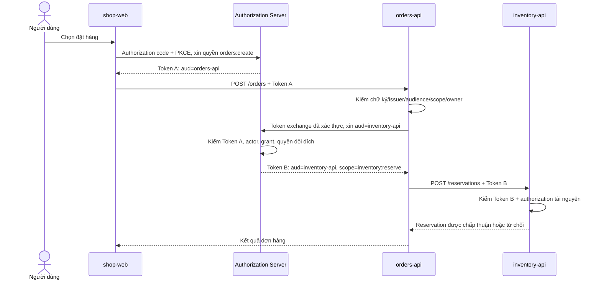

# Đổi token giữa các audience

Một người dùng đăng nhập vào ứng dụng bán hàng và nhận **access token dành cho `orders-api`**. Khi xử lý đơn hàng, `orders-api` cần gọi tiếp `inventory-api` để giữ hàng. Cả hai API đều tin cùng authorization server (AS), nhưng điều đó **không có nghĩa** token mà `orders-api` vừa nhận được có thể chuyển thẳng sang `inventory-api`.

Giả sử token đầu vào chứa:

```json
{
  "iss": "https://auth.example.test",
  "sub": "user-123",
  "aud": "orders-api",
  "client_id": "shop-web",
  "scope": "orders:create",
  "exp": 1893456900
}
```

Nếu `inventory-api` chấp nhận token này chỉ vì chữ ký và issuer hợp lệ, nó đã bỏ qua một ranh giới tin cậy: token **không được cấp cho inventory**. Để thực hiện lời gọi hợp lệ, `orders-api` có thể cần một **token mới** với `aud=inventory-api`, phạm vi quyền thích hợp và mối quan hệ đại diện/ủy quyền được AS kiểm soát.

Đó là bài toán **đổi token giữa các audience** (*cross-audience token exchange*). Trong chương **OAuth2 flows** của module **SECURITY_TOKEN_SECURITY_FUNDAMENTALS**, bài học giải thích cơ chế OAuth 2.0 Token Exchange (RFC 8693), khác biệt với Resource Indicators (RFC 8707) và `client_credentials`, cách xử lý `subject`/`actor`, scope, audience, JWT/opaque token, refresh token, OIDC, phát hành, kiểm tra, lưu trữ, thu hồi và nguy cơ đánh cắp/phát lại.

> **Nguyên tắc:** chuyển token sang audience khác là **một quyết định cấp quyền mới do AS kiểm soát**, không phải thao tác sửa claim `aud`, chuyển tiếp bearer token qua mạng nội bộ hay tin rằng mọi API cùng issuer có thể dùng chung token.

## 1. Ôn lại: issuer, audience và scope giải quyết ba câu hỏi riêng

| Thành phần | Ý nghĩa | Ví dụ | Nếu kiểm tra sai |
| --- | --- | --- | --- |
| `iss` (*issuer*) | Ai phát hành token? | `https://auth.example.test` | Tin token từ issuer không được cấu hình |
| `aud` (*audience*) | Token được cấp cho bên nhận nào? | `orders-api` | Token substitution giữa API |
| `scope` | Những phạm vi thao tác nào đã được cấp? | `orders:create` | Gọi thao tác ngoài quyền |
| `sub` (*subject*) | Chủ thể mà token nói về | `user-123` | Nhầm người dùng với client/service |
| `client_id` | OAuth client liên quan tới token | `shop-web` | Nhầm ứng dụng xin token với API đích |
| `exp` | Token hết hiệu lực khi nào? | Mốc Unix time | Tiếp nhận token hết hạn |

Với JWT, claim `aud` có thể là chuỗi hoặc mảng chuỗi. Resource server phải tìm **audience của chính mình** bằng phép so sánh chính xác, theo profile và policy; không so substring, prefix hay tự động coi `client_id`/`iss` là audience.

**`orders-api` và `inventory-api` cùng tin `iss` không làm `aud` của chúng tương đương.** JWT có chữ ký hợp lệ vẫn có thể bị **từ chối đúng** tại một resource server không thuộc audience của token.

### 1.1. Vì sao không chỉ cấp một token cho mọi API?

Một access token bearer càng được nhiều service nhận thì khi bị đánh cắp, phạm vi có thể thử dùng token càng rộng. Token đa audience có thể hợp lệ nếu được AS và các RS thiết kế rõ, nhưng dễ gặp:

- Scope cùng tên được hiểu khác nhau ở các API.
- Token lộ ở service A có thể được trình lại tại service B cũng có trong `aud`.
- Các service không biết rõ khi nào được phép chuyển token tiếp.
- Thu hồi, cache introspection và ràng buộc sender khó điều phối.

**Ưu tiên audience hẹp theo logical resource**, rồi cấp/đổi token riêng khi thật sự cần đi qua ranh giới. «Mỗi API một token» là chiến lược giảm rủi ro hữu ích, không phải quy tắc buộc mọi kiến trúc phải có một audience cho mỗi URL hoặc endpoint.

## 2. Tình huống điển hình: service vừa là RS, vừa là OAuth client

Trong lời gọi đầu tiên, `orders-api` đóng vai trò **resource server**: nó nhận access token từ client và xác minh quyền tạo đơn. Khi cần gọi `inventory-api`, `orders-api` lại đóng vai trò **OAuth client** của một request hướng tới downstream service.



**Chuyển đổi vai trò không làm service tự có thêm quyền.** Khi `orders-api` trở thành client của AS, AS vẫn phải kiểm danh tính dịch vụ, token nguồn, grant, các audience được phép và chính sách ủy quyền. Service không được tự xác định rằng «vì đang xử lý đơn hàng nên tôi có thể xin mọi scope ở inventory».

### 2.1. Những ranh giới tin cậy

| Ranh giới | Bên xác minh | Bằng chứng cần thiết |
| --- | --- | --- |
| `shop-web → orders-api` | `orders-api` | Token A đúng issuer, audience, type, thời hạn, `orders:create` và quyền user |
| `orders-api → AS /token` | AS | Client/service được xác thực, subject token hợp lệ, yêu cầu exchange được phép |
| `AS → orders-api` | Client thực hiện exchange | Response token B từ token endpoint HTTPS đáng tin; lưu và dùng đúng mục đích |
| `orders-api → inventory-api` | `inventory-api` | Token B đúng issuer, `aud=inventory-api`, scope, thời hạn, actor/principal và quyền tài nguyên |

Đừng tin rằng mạng nội bộ tự là một trust boundary đủ mạnh. Gateway, service mesh hay mTLS có thể hỗ trợ xác thực service, nhưng không thay thế quyết định **audience và authorization**.

## 3. OAuth 2.0 Token Exchange theo RFC 8693

RFC 8693 mô tả **OAuth 2.0 Token Exchange**: một client gửi token đại diện cho chủ thể hiện có và yêu cầu AS phát token mới theo mục đích, audience, resource và phạm vi được phép. Grant type là:

```text
urn:ietf:params:oauth:grant-type:token-exchange
```

Kết quả **không được bảo đảm thành công** chỉ vì token nguồn còn hạn; AS có quyền từ chối nếu không cho phép đổi sang target hoặc client không có quyền.

### 3.1. Những tham số quan trọng

| Tham số request | Vai trò | Bắt buộc? |
| --- | --- | --- |
| `grant_type` | Chỉ định token exchange grant | Có |
| `subject_token` | Token đại diện subject/authority ban đầu | Có |
| `subject_token_type` | Loại token nguồn, ví dụ access token | Có |
| `audience` | Logical audience mong muốn cho token đầu ra | Không bắt buộc ở cấp cú pháp RFC, nhưng thường cần theo policy |
| `resource` | URI tài nguyên đích được yêu cầu | Không bắt buộc ở cấp cú pháp RFC |
| `scope` | Phạm vi quyền mong muốn của token mới | Tùy chọn |
| `requested_token_type` | Kiểu token muốn được cấp | Tùy chọn |
| `actor_token` | Token đại diện actor khi mô hình yêu cầu cung cấp rõ actor | Tùy chọn |
| `actor_token_type` | Loại actor token | Cần đi kèm khi truyền `actor_token` |

Client còn phải **xác thực với token endpoint khi được yêu cầu**, theo client type và phương thức đã đăng ký. Việc truyền `client_id` trong body **không tự chứng minh** quyền của caller.

### 3.2. Ví dụ request đổi access token của orders sang inventory

```http
POST /oauth2/token HTTP/1.1
Host: auth.example.test
Content-Type: application/x-www-form-urlencoded
Authorization: Basic <authenticated-confidential-client>

grant_type=urn%3Aietf%3Aparams%3Aoauth%3Agrant-type%3Atoken-exchange
&subject_token=<token-A-for-orders-api>
&subject_token_type=urn%3Aietf%3Aparams%3Aoauth%3Atoken-type%3Aaccess_token
&audience=inventory-api
&scope=inventory%3Areserve
&requested_token_type=urn%3Aietf%3Aparams%3Aoauth%3Atoken-type%3Aaccess_token
```

Đây là request **minh họa đã chia dòng để đọc**, không phải body form được mã hóa hoàn chỉnh và dùng trực tiếp. Trong thực tế:

- Dùng **HTTPS**, không gửi token qua query string hoặc log.
- Mã hóa form đúng `application/x-www-form-urlencoded`.
- `orders-api` phải đăng ký và xác thực như OAuth client được phép thực hiện token exchange.
- `subject_token` là **Token A**, không phải dữ liệu client tự tạo.
- `audience=inventory-api` là **yêu cầu**, không phải quyết định đã được cấp.
- `scope=inventory:reserve` chỉ được cấp nếu có **quy tắc ủy quyền hợp lệ** từ hành động đặt hàng sang việc giữ tồn kho; không suy quyền từ việc trùng ký tự tên scope.

Ví dụ response khi AS chấp nhận:

```http
HTTP/1.1 200 OK
Content-Type: application/json
Cache-Control: no-store
Pragma: no-cache

{
  "access_token": "<token-B-for-inventory-api>",
  "issued_token_type": "urn:ietf:params:oauth:token-type:access_token",
  "token_type": "Bearer",
  "expires_in": 120,
  "scope": "inventory:reserve"
}
```

Trong phản hồi trên:

- `access_token` là **token mới**. Không giả định nó luôn là JWT; AS có thể cấp opaque token theo profile và RS tương ứng.
- `issued_token_type` mô tả kiểu token được phát hành theo RFC 8693.
- `token_type` xác định cách sử dụng access token; `Bearer` là một ví dụ phổ biến, còn sender-constrained token phải tuân thủ profile tương ứng.
- `expires_in=120` mô tả lifetime access token đầu ra bằng giây, **không tự là thời hạn refresh token**.
- `scope` biểu diễn phạm vi thực tế được cấp; client không được tự coi mọi scope đã yêu cầu đều được chấp nhận.

**RFC 8693 không có nghĩa một lần exchange mặc định sinh refresh token.** Khả năng phát token khác và quyền dùng lâu dài phụ thuộc vào chính sách AS, requested token type, grant và profile. Không thiết kế client tự yêu cầu refresh token chỉ vì đã có access token nguồn.

### 3.3. Source token và output token là hai credential riêng

```text
Token A:
  iss=https://auth.example.test
  aud=orders-api
  scope=orders:create
  sub=user-123

Token B:
  iss=https://auth.example.test
  aud=inventory-api
  scope=inventory:reserve
  sub=user-123
  actor=orders-service (nếu mô hình delegation phát biểu actor)
```

Việc AS phát Token B **không mặc nhiên thu hồi hoặc tiêu thụ Token A**. Nếu ứng dụng muốn token nguồn chỉ dùng một lần hoặc muốn revoke cả chuỗi token khi người dùng rút quyền, phải có **chính sách và trạng thái liên kết** cụ thể. Không dựa vào token exchange như một cơ chế one-time token hay revoke mặc định.

## 4. `audience`, `resource` và `scope` không đồng nghĩa

### 4.1. Audience: token mới dành cho ai?

`audience` trong RFC 8693 cho biết **đối tượng nhận mong muốn**. AS có thể ánh xạ giá trị này vào claim `aud` của JWT đầu ra hoặc metadata resource binding của opaque token. Backend đích chỉ chấp nhận token mới khi xác minh rằng nó là audience được phép.

### 4.2. Resource: định danh tài nguyên đích

`resource` mô tả tài nguyên bằng URI. Ví dụ:

```text
resource=https://api.example.test/inventory
```

Tùy AS, đây có thể được ánh xạ sang:

```text
aud=inventory-api
```

**Không buộc chuỗi `resource` phải giống hệt `aud`**; quan hệ ánh xạ cần được đăng ký và kiểm soát. AS không nên tin mọi URL mà client cung cấp, cũng không dùng `resource` tự do làm điểm gửi token để tránh confused deputy và token leakage.

### 4.3. Scope: token mới làm được gì?

`scope=inventory:reserve` nói về **hành động**, không tự nói resource đích hay actor được quyền thực hiện nó. AS phải kiểm ba mặt cùng lúc:

```text
Allowed exchange = authenticated caller
                AND valid subject token/context
                AND target audience/resource permitted
                AND requested authority justified by original grant + policy
                AND requested token type/profile permitted
                AND security constraints satisfied
```

**Không thể yêu cầu một phép giao tập chuỗi scope đơn giản trong mọi token exchange.** Source scope `orders:create` và target scope `inventory:reserve` có tên khác nhau nhưng có thể là một **mapping ủy quyền hợp lệ** trong quy trình đặt hàng. Quan trọng là **không mở rộng thực quyền trái phép**, có ràng buộc nghiệp vụ và nguyên tắc least privilege.

### 4.4. Tập audience nhiều giá trị

RFC 8693 cho phép request nêu nhiều target theo các tham số thích hợp, và JWT cũng có thể có `aud` là mảng. Tuy nhiên, AS **phải xét quyền đối với toàn bộ target**, không ghép bừa nhiều audience để tiện đi qua nhiều service.

Ví dụ, một token có:

```json
{"aud":["inventory-api","billing-api"]}
```

chỉ nên xuất hiện nếu policy thực sự cho phép cùng một token tới hai RS. Nó tăng bề mặt sử dụng bearer token; nhiều hệ thống an toàn hơn khi cấp **hai token audience hẹp**.

## 5. Token Exchange khác Resource Indicators và những grant khác

### 5.1. Resource Indicators theo RFC 8707

Resource Indicators giúp **client yêu cầu access token cho resource cụ thể** khi AS hỗ trợ, thường qua tham số `resource` tại authorization/token endpoint theo flow áp dụng.

Ví dụ một first-party client trực tiếp cần `orders-api` và `reports-api`:

```text
Xin token cho resource=https://api.example.test/orders
    -> access token aud=orders-api

Xin token cho resource=https://api.example.test/reports
    -> access token aud=reports-api
```

Không phải trường hợp nào cũng cần **token exchange**. Nếu client đã có grant cho tài nguyên khác và AS hỗ trợ cấp token thích hợp qua luồng thông thường, có thể yêu cầu token **đúng audience ngay từ đầu**.

### 5.2. So sánh lựa chọn

| Cơ chế | Khi nên cân nhắc | Chủ thể và quyền |
| --- | --- | --- |
| **Authorization code + PKCE** | Client xin quyền người dùng qua AS, thường ở phiên bắt đầu đăng nhập/ủy quyền | User/grant được AS xác thực và cho phép |
| **RFC 8707 resource indicator** | Client chỉ rõ resource mong muốn khi xin token theo grant được hỗ trợ | AS quyết định audience theo client/grant/resource |
| **`client_credentials`** | Service gọi downstream **với quyền của service** | Service principal; không mặc nhiên đại diện user |
| **RFC 8693 token exchange** | Thành phần nhận token/context nguồn và cần token mới dành cho một target khác, thường có delegation | AS kiểm subject token, actor/client, target và policy |
| **Refresh token grant** | Client xin access token mới từ AS với refresh credential còn hiệu lực | Không được tự mở rộng scope/resource ngoài grant và policy |
| **Gateway internal assertion** | Gateway xác minh token ngoài rồi chuyển context tới backend qua profile nội bộ | Cần tin issuer/assertion riêng, audience, TTL và gateway identity |

**Đừng dùng `client_credentials` để giả lập một user.** Nếu `inventory-api` cần biết đơn hàng được đặt thay mặt người dùng nào, token service-only không tự có ngữ nghĩa đó. Ngược lại, nếu inventory chỉ cần xác thực `orders-service` để đồng bộ trạng thái máy móc, việc mang user context qua token exchange có thể không cần thiết hoặc làm tăng lộ dữ liệu.

### 5.3. Refresh token không phải công cụ «đổi audience tùy ý»

Refresh token là credential tại **AS token endpoint**, được cấp theo grant và gắn client theo chính sách. Một lần refresh có thể dẫn tới access token mới trong phạm vi được phép, nhưng **không cho phép client nâng scope hoặc chuyển sang API bất kỳ**. Nếu cần target khác, client phải dùng luồng được AS hỗ trợ, ví dụ resource indicator, delegation hoặc token exchange theo policy.

Không gửi refresh token qua gateway đến resource server. Việc trao đổi access token theo RFC 8693 cũng không tự kéo dài **absolute/idle lifetime của refresh token family**.

## 6. Delegation và impersonation: ai là subject, ai là actor?

Một token exchange có thể phục vụ những ngữ nghĩa khác nhau. Hai khái niệm quan trọng:

- **Delegation (ủy quyền đại diện):** service A hành động **thay mặt subject** và hệ thống có thể ghi nhận actor đang thực thi. Trách nhiệm của actor và subject không bị nhập làm một.
- **Impersonation (hành động dưới danh tính subject):** token đầu ra có thể trình subject theo cách bên nhận không nhìn thấy đầy đủ actor trung gian. Đây là lựa chọn rủi ro cao hơn cho audit và kiểm soát trách nhiệm nếu không có chính sách rõ.

RFC 8693 mô tả mô hình **subject** và **actor**, gồm claim `act` khi sử dụng cách biểu diễn tương ứng trong JWT. Ví dụ payload minh họa của token delegation:

```json
{
  "iss": "https://auth.example.test",
  "sub": "user-123",
  "aud": "inventory-api",
  "client_id": "orders-service",
  "scope": "inventory:reserve",
  "act": {
    "sub": "orders-service"
  },
  "iat": 1893456000,
  "exp": 1893456120
}
```

Đây là **payload minh họa**, chưa phải JWT ký. Token có thể cần thêm claims/header theo profile access token thực tế (ví dụ JWT access token RFC 9068).

Trong ví dụ:

- `sub=user-123` chỉ user liên quan đến delegation.
- `act.sub=orders-service` cho biết actor đang hành động theo ngữ nghĩa đã thống nhất.
- `client_id=orders-service` cho biết OAuth client có liên quan, **không tự thay thế `act`**.
- `aud=inventory-api` giới hạn nơi có thể tiếp nhận token.
- `scope=inventory:reserve` giới hạn thao tác, không phải mọi hành động trong inventory.

**Không tự thêm claim `act` vào token nguồn để được quyền đại diện.** AS phải xác thực actor và quyết định actor có quyền hành động cho subject hay không. Một hệ thống có thể sử dụng claim `may_act` hoặc cơ chế policy khác để biểu diễn khả năng actor được ủy quyền, nhưng RS chỉ được diễn giải những claim đã được xác minh theo profile và hợp đồng.

### 6.1. Khi token không có `act` thì sao?

Không phải mọi token do AS cấp đều có actor claim. Điều đó không chứng minh token là impersonation hợp lệ hoặc caller được quyền giả danh ai. Nếu nghiệp vụ cần audit trách nhiệm của service trung gian, **thiếu actor provenance có thể là lý do từ chối hoặc đòi profile khác**, thay vì suy actor từ `X-Service-Name` do request tự khai.

### 6.2. Dấu vết chuỗi actor nhiều hop

Nếu `orders-service` gọi `inventory-service`, rồi inventory cần gọi tiếp `warehouse-service`, AS có thể lưu lịch sử ủy quyền theo profile, ví dụ:

```json
{
  "sub": "user-123",
  "aud": "warehouse-api",
  "act": {
    "sub": "inventory-service",
    "act": {
      "sub": "orders-service"
    }
  }
}
```

Đây là một dạng biểu diễn chuỗi actor theo RFC 8693, **không mặc nhiên bắt buộc mọi token trao đổi phải có cấu trúc này**. Chính sách phải giới hạn số hop, actor được phép và scope; nếu không, chuỗi quá dài/không kiểm soát sẽ làm audit khó hiểu và mở rộng quyền qua nhiều service.

## 7. Authorization Server phải xác minh gì trước khi đổi token?

Token exchange là **điểm ra quyết định quyền mới**. AS cần phân biệt:

1. **Ai gọi token endpoint?** Client/service identity được xác thực bằng cơ chế đã đăng ký; áp dụng rate limit và trạng thái client.
2. **`subject_token` có thật và thuộc nguồn đáng tin không?** Xác minh JWT signature/issuer/type/time hoặc tra cứu opaque token; token không bị thu hồi theo policy.
3. **Caller có được dùng token nguồn cho exchange không?** Token bị đánh cắp từ service khác không tự là giấy phép đổi sang đích mới. Áp dụng client binding, audience nguồn và policy delegate.
4. **Subject là ai?** User/service principal và trạng thái grant, consent, session assurance nếu liên quan; không tin `sub` trong payload chưa xác minh.
5. **Actor là ai?** Nếu có `actor_token` hoặc actor claim, AS xác minh token và ngữ nghĩa actor; không chấp nhận actor do client tự chọn.
6. **Target được phép không?** `audience`/`resource` có nằm trong allowlist đã đăng ký và policy delegated flow không?
7. **Quyền output có hợp lệ không?** Scope/role/tenant/operation được phép sau mapping, không mở rộng quyền trái grant hoặc consent.
8. **Thời hạn và dạng token output?** Giới hạn lifetime, loại token, sender binding và policy revoke; không phát token mới «bất tử».
9. **Có cần audit/linkage không?** Ghi token family/chain và actor, target, grant, quyết định; tránh ghi raw tokens.

### 7.1. Chống confused deputy

**Confused deputy** xảy ra khi service có quyền mạnh bị dụ dùng quyền đó vì request từ bên ít quyền hơn. Ví dụ:

```text
Attacker có token hợp lệ nhưng chỉ aud=public-api
    |
    v
Gửi token cho orders-service và yêu cầu đổi sang aud=admin-api
    |
    v
Nếu orders-service/AS không kiểm quyền:
    -> có thể cấp token admin hoặc gọi API nhạy cảm thay attacker
```

Các kiểm soát cần thiết:

- AS giới hạn **audience/resource đích theo client và source grant**, không nhận mọi chuỗi client gửi.
- Service không cho client tùy ý chọn `audience` qua query/header rồi chuyển thẳng cho AS.
- AS không coi token nguồn do issuer đáng tin ký là đủ: phải biết **được phép exchange trong ngữ cảnh nào**.
- Mọi quyền output phải có **nguồn ủy quyền cụ thể**, kể cả khi scope giữa hai API dùng tên khác nhau.
- Nếu client cần truy cập API quản trị, phải có grant/role và step-up thích hợp, không đi vòng qua service thông thường.

### 7.2. Token gốc sai audience có được dùng làm subject token?

Một access token được cấp cho `orders-api` có thể là **đầu vào hợp lệ của token exchange tại AS** nếu AS và client đã thiết kế như vậy. Điều này **khác** với việc AS hoặc service khác chấp nhận token đó làm bearer credential gọi API bất kỳ.

AS xác minh **subject token trong ngữ cảnh exchange grant**, đối chiếu nguồn phát hành, audience ban đầu, service được phép nhận/trao đổi token, binding và policy. **Không quy định máy móc rằng `aud` của token nguồn phải chứa AS**, cũng không được bỏ kiểm tra audience/context nguồn chỉ vì token trình tới token endpoint.

## 8. Ví dụ Java: policy engine đổi token an toàn

Đoạn dưới là **pseudocode Java** trình bày quyết định ở AS. Các kiểu `ExchangeRequest`, `AuthenticatedClient`, `VerifiedSourceToken`, `DelegationGrant` và các service liên quan là abstraction minh họa, **không phải API có sẵn** của một thư viện OAuth cụ thể.

```java
TokenResponse exchange(
    ExchangeRequest request,
    AuthenticatedClient caller
) {
    // 1. Caller phải được AS xác thực theo registration của nó.
    clientRegistry.requireEnabled(caller.id());
    clientPolicy.requireGrantAllowed(
        caller, "urn:ietf:params:oauth:grant-type:token-exchange"
    );

    // 2. Không lấy expected issuer/audience từ dữ liệu client tự khai.
    ExchangeSourcePolicy sourcePolicy =
        exchangePolicies.sourcePolicyFor(caller.id());

    VerifiedSourceToken source = tokenVerifier.verifyForExchange(
        request.subjectToken(),
        request.subjectTokenType(),
        sourcePolicy.trustedIssuers(),
        sourcePolicy.allowedSourceAudiences()
    );

    // 3. Caller phải được quyền exchange chính token nguồn này.
    tokenExchangeBinding.requireAuthorizedPresenter(
        caller, source, request.senderProof()
    );

    // 4. Target là định danh đã đăng ký, không phải URL tùy ý của request.
    TargetResource target = targetRegistry.resolveAndAuthorize(
        caller, request.requestedAudience(), request.requestedResource()
    );

    // 5. Policy xác định actor và authority thực sự được ủy quyền.
    DelegationGrant delegation = delegationPolicy.authorize(
        caller,
        source,
        request.actorTokenOrNone(),
        target,
        request.requestedScopes()
    );

    // Ví dụ: mapping orders:create -> inventory:reserve
    // chỉ hợp lệ trong workflow đặt hàng theo policy, không phải phép
    // "copy scope" hoặc quyền mặc định của mọi client.
    Set<String> grantedScopes = delegation.grantedTargetScopes();
    if (grantedScopes.isEmpty()) {
        throw insufficientDelegation();
    }

    // 6. Lifetime phải theo policy target, grant và source authorization.
    Duration ttl = tokenLifetimePolicy.forExchange(
        caller, source, delegation, target
    );

    // 7. Phát token mới, đúng audience/type và có provenance khi cần.
    return tokenIssuer.issueAccessToken(
        delegation.subject(),
        delegation.actorOrNone(),
        caller.id(),
        target.audience(),
        grantedScopes,
        ttl,
        delegation.senderBindingOrNone()
    );
}
```

**Những giả định cần làm rõ:**

- `verifyForExchange` phải thực sự xác minh token nguồn; **decode Base64JWT không phải validation**.
- `allowedSourceAudiences` đến từ policy gắn với caller và đường đi của token, không nhận một danh sách bất kỳ từ request.
- `resolveAndAuthorize` ánh xạ resource/audience theo registration và cho phép target theo policy.
- `delegationPolicy.authorize` phải xét **subject, actor, client, consent/grant, scope mapping, tenant và business context**; không tự cấp quyền chỉ vì caller là backend nội bộ.
- Nếu source có thể bị revoke sớm, token output có còn được dùng sau revoke hay không phải được quyết định rõ; có thể cần liên kết trạng thái grant/chain.
- Việc phát token đúng profile, JOSE header, khóa ký, introspection, audit và error mapping cần một AS framework/implementation đã kiểm thử.

### 8.1. Nếu dựa vào nguồn token JWT của người dùng

AS hoặc policy engine không nên:

```java
// SAI: raw JWT chưa xác minh và target do client tự chọn.
String subject = decodeJwt(request.subjectToken()).getSubject();
return issueJwt(subject, request.requestedAudience(),
                request.requestedScopes());
```

Lỗi này cho phép giả claim, đổi đích và leo thang scope; ngay cả chữ ký nguồn đúng cũng không chứng minh quyền exchange theo target.

### 8.2. Lời gọi tại `orders-service`

```java
Reservation reserveForOrder(
    VerifiedIncomingAccessToken userToken,
    Order order
) {
    // Order service đã validate token vào: aud=orders-api,
    // scope=orders:create, principal và quyền đặt đơn.
    if (!order.ownerId().equals(userToken.subject())
            || !order.tenantId().equals(userToken.tenantId())) {
        throw forbidden("order_not_owned");
    }

    TokenResponse downstream = tokenExchangeClient.exchange(
        userToken.originalTokenForAuthorizedExchange(),
        "inventory-api",
        Set.of("inventory:reserve")
    );

    // Access token mới chỉ đi đến đúng backend đích.
    return inventoryClient.reserve(
        order.items(),
        downstream.accessToken(),
        "https://inventory.internal.example.test"
    );
}
```

Trong thực tế, việc giữ token nguồn để exchange phải hạn chế quyền truy cập trong memory/storage; **không log raw token**. `inventoryClient` cần pin endpoint từ cấu hình, bảo vệ HTTPS/mTLS, xử lý redirect/retry không leak `Authorization` và tránh gọi URL tùy ý do client truyền lên.

## 9. Resource server đích phải xác minh token mới như thế nào?

**Token exchange thành công không thay thế việc xác minh tại RS.** `inventory-api` tiếp nhận Token B như một access token độc lập:

```java
Response reserveInventory(String rawToken, ReservationRequest req) {
    VerifiedAccessToken token = resourceServerVerifier.verify(
        rawToken,
        "https://auth.example.test",
        "inventory-api",
        "oauth_access_token"
    );

    if (!token.scopes().contains("inventory:reserve")) {
        return forbidden("insufficient_scope");
    }
    if (!actorPolicy.isAllowedToReserve(
            token.actorOrNone(), token.clientId())) {
        return forbidden("actor_not_allowed");
    }

    InventoryBatch batch = inventory.find(req.batchId());
    if (batch == null) {
        return notFound();
    }
    if (!authorization.canReserve(
            token.subject(), token.tenantId(), batch, req.quantity())) {
        return forbidden("resource_not_authorized");
    }

    return reservations.create(batch, req);
}
```

`resourceServerVerifier.verify` biểu diễn kiểm tra **đầy đủ** theo token profile: chữ ký/JWKS và thuật toán allowlist hoặc opaque introspection, issuer, audience, thời hạn, token type và binding nếu có. `actorPolicy` và `authorization` là policy nghiệp vụ của RS; không tin actor từ header tự khai.

### 9.1. JWT access token: ví dụ claims

Khi AS phát token mới dưới dạng JWT access token (ví dụ theo RFC 9068), JOSE header có thể như:

```json
{
  "alg": "RS256",
  "typ": "at+jwt",
  "kid": "signing-key-01"
}
```

Payload minh họa:

```json
{
  "iss": "https://auth.example.test",
  "sub": "user-123",
  "aud": "inventory-api",
  "client_id": "orders-service",
  "scope": "inventory:reserve",
  "act": {"sub": "orders-service"},
  "iat": 1893456000,
  "exp": 1893456120,
  "jti": "2dc94dbd-c441-4ee4-8d6a-abd8a7f0c3e0"
}
```

Đây là **hai JSON minh họa**, không phải JWT đã ký. Không lấy `kid`, `alg` hay `jku` trong header làm chỉ thị tự do tìm khóa/thuật toán do attacker chọn. Validator phải giới hạn issuer/JWKS và thuật toán từ cấu hình tin cậy.

### 9.2. Opaque token đầu ra

AS có thể trả Token B ở dạng opaque. `inventory-api` dùng introspection (RFC 7662) hoặc cơ chế xác minh trạng thái đã thiết kế. Một phản hồi minh họa:

```json
{
  "active": true,
  "iss": "https://auth.example.test",
  "sub": "user-123",
  "aud": "inventory-api",
  "client_id": "orders-service",
  "scope": "inventory:reserve",
  "exp": 1893456120
}
```

`aud` trong introspection là metadata có thể có, **không phải mọi AS đều trả đầy đủ tùy chọn**. Nếu introspection chỉ trả `active=true`, RS phải có **cam kết tương đương về resource binding theo danh tính RS** trước khi chấp nhận. Không coi `active=true` hoặc cùng issuer là quyền sử dụng token ở mọi API.

### 9.3. Sai audience được xử lý như thế nào?

Nếu client gửi Token A (`aud=orders-api`) tới `inventory-api`:

```http
HTTP/1.1 401 Unauthorized
WWW-Authenticate: Bearer error="invalid_token"
```

Một access token đã hợp lệ cho inventory nhưng **thiếu scope** có thể bị từ chối bằng `403 Forbidden` / `insufficient_scope` theo RFC 6750. Phải phân biệt **token không hợp lệ tại RS này** với **token hợp lệ nhưng không có quyền hành động**.

## 10. Vòng đời hai token sau exchange

Token A và Token B có thể có thời hạn, trạng thái và cơ chế lưu trữ khác nhau:

| Yếu tố | Token A, `aud=orders-api` | Token B, `aud=inventory-api` |
| --- | --- | --- |
| Đối tượng nhận | `orders-api` | `inventory-api` |
| Nguồn | Grant ban đầu của user/client | Exchange grant theo policy AS |
| Phạm vi | `orders:create` | `inventory:reserve` |
| Thời hạn | Theo chính sách access token ngoài | Theo chính sách downstream, thường ngắn và hẹp |
| Đánh giá quyền | Tạo đơn cho user/tenant | Giữ hàng cho đơn/tài nguyên hợp lệ |
| Thu hồi | Theo cơ chế revoke/grant ban đầu | Có thể cần liên kết với grant nguồn và chain |
| Sender binding | Nếu có ở client→orders hop | Phải áp dụng theo sender ở orders→inventory hop |

**Không có quy tắc mặc định bắt buộc `exp(Token B) <= exp(Token A)` cho mọi profile token exchange**. Tuy nhiên, nếu quyền B dựa trên quyền A, AS cần thiết kế **giới hạn lifetime và hành vi sau khi source grant hết hiệu lực** để tránh token downstream tiếp tục tồn tại quá mức rủi ro chấp nhận được. Một policy bảo thủ là ràng buộc TTL B bởi lifetime còn lại của nguồn và giới hạn ngắn cho downstream; các hệ thống khác có thể dùng introspection/revocation chain để xử lý khác.

### 10.1. Điều gì xảy ra khi Token A bị thu hồi?

**Không giả định** mọi Token B đã được phát tự bị revoke. Tùy token format và trạng thái AS:

- Token B JWT được RS xác minh offline có thể tiếp tục hợp lệ tới `exp` nếu không có denylist hoặc online authorization check.
- Token B opaque có thể bị introspection trả `active=false` nếu AS quản lý và liên kết trạng thái grant.
- Một hệ thống có sự kiện thu hồi theo chain có thể invalidation downstream tokens với độ trễ cần được đo.

Nếu nghiệp vụ yêu cầu ngắt quyền gần tức thì, phải thiết kế **revoke propagation, TTL, cache policy và kiểm quyền hiện hành**, không chỉ viết «revoke source token» trong một endpoint.

### 10.2. Cache token exchange có rủi ro stale

Cache có thể giảm số lần gọi AS, nhưng một bản ghi kiểu:

```text
cache["user-123:inventory-api"] = Token B
```

là **quá rộng**: bỏ qua source grant, actor, client, scope, tenant, target policy và sender binding. Nó có thể làm token của user bị dùng sai bối cảnh hoặc tiếp tục được sử dụng sau khi quyền thay đổi.

Nếu cache Token B, cần đặt khóa theo **ngữ cảnh quyền đã xác minh**, bảo vệ secret, không dùng raw token làm cache key/log, TTL không vượt `exp`/policy và có invalidation khi grant/actor/policy thay đổi. Với thao tác nhạy cảm, cân nhắc **không cache** hoặc buộc kiểm tra quyền mới.

### 10.3. Dùng token mới ở nhiều downstream requests

Token B có thể dùng nhiều lần trong thời gian sống nếu AS cấp dạng access token thường và chính sách cho phép; token exchange không tự bảo đảm one-time semantics. Nếu yêu cầu một lần, cần cơ chế token `jti`/nonce hoặc chính sách replay riêng được thiết kế và thực thi tại RS.

**Không retry mù quáng** thao tác đặt hàng/giữ tồn kho khi mạng lỗi. Token hợp lệ không giải quyết tính idempotent của business transaction; dùng idempotency key, transaction state hoặc saga theo nghiệp vụ.

## 11. Sender-constrained token: DPoP và mTLS qua nhiều hop

Một access token bearer bị lộ tại gateway, log hoặc service có thể bị sử dụng lại tại **đúng audience**. Đổi token giảm phạm vi tài nguyên được nhận, nhưng **không tự ngăn replay ở audience đích**.

### 11.1. DPoP

DPoP (RFC 9449) ràng buộc access token với khóa và yêu cầu proof cho HTTP request theo method, URI, timestamp, `jti` và `ath` khi áp dụng. Nếu Token A được ràng buộc với khóa của `shop-web`:

```text
shop-web -- Token A + DPoP proof A --> orders-api
```

thì `orders-api` **không thể lấy nguyên proof A** để gọi `inventory-api`, vì URL/method và khóa sender khác. Khi AS cấp Token B sender-constrained cho `orders-service`, service phải **sử dụng khóa của chính nó** và tạo proof B dành cho request tới inventory.

```text
orders-service -- Token B + DPoP proof B --> inventory-api
```

AS cần quyết định việc chuyển ràng buộc sender từ token nguồn sang token đích theo chính sách; **không tự bỏ sender constraint** vì exchange được thực hiện trong mạng nội bộ.

### 11.2. mTLS

Với mTLS-bound access token (RFC 8705), token gắn với certificate/key theo profile. Token A ràng buộc client→orders không thể tự forward tới inventory nếu `orders-service` không sở hữu khóa của client. Token B có thể được cấp ràng buộc với certificate của `orders-service`; inventory xác minh proof ở kết nối thích hợp.

Khi có TLS termination tại gateway, không coi `X-Client-Cert` tự khai là bằng chứng mTLS. Gateway phải xác minh certificate tại hop ngoài và chuyển context qua **kênh đã xác thực hoặc internal assertion** theo thiết kế.

### 11.3. Những ràng buộc không được bỏ quên

| Kiểm soát | Áp dụng ở hop nào? |
| --- | --- |
| JWT signature/issuer/audience | Tại mỗi RS nhận token dành cho mình |
| DPoP proof/`jti` replay | Theo từng request ở verifier được chỉ định |
| mTLS client binding | Tại TLS connection/termination được thiết kế |
| Scope + owner/tenant | Tại từng service khi thực hiện thao tác |
| Token exchange client authentication | Tại AS/token endpoint |
| Header sanitization | Tại gateway/ingress trước khi tạo identity context |
| Revocation và freshness | AS/RS theo token/grant và mức rủi ro |

## 12. Gateway và microservice: không forward header làm giả một lần exchange

Giả sử API gateway nhận Token A rồi forward:

```http
Authorization: Bearer <token-A-for-orders>
X-Audience: inventory-api
X-Act-As: orders-service
X-Scope: inventory:reserve
```

**Các header này không đổi được audience hay scope của Token A.** Nếu inventory nhận nó vì tin `X-Audience`/`X-Scope`, token substitution và header spoofing xuất hiện.

Hai phương án an toàn có thể cân nhắc:

1. **Token exchange thực sự tại AS:** gateway hoặc orders-service được AS cho phép xin Token B, rồi chỉ chuyển Token B tới đúng service đích.
2. **Internal assertion theo trust model riêng:** gateway xác minh Token A rồi phát assertion ký có `aud=inventory-service` và quyền được mapping theo policy, trên kênh service identity đáng tin. Assertion này là credential mới theo profile nội bộ, **không phải chỉ là copy/sửa header user/role**.

Khi gateway chọn mô hình thứ hai, phải loại bỏ mọi header identity do Internet gửi, tránh duplicate/case-insensitive header bypass, giới hạn issuer/keys/TTL/audience và chặn đường gọi trực tiếp tới service không qua gateway. Dù trust gateway, backend vẫn kiểm **quyền trên tài nguyên**.

## 13. OAuth/OIDC: không đổi ID token thành access token bằng cách tự suy

OIDC ID token được phát cho **Relying Party/client**; `aud` thường chứa `client_id`. Nó chứng minh kết quả xác thực theo OIDC profile, **không tự cấp quyền gọi API**.

Ví dụ ID token:

```json
{
  "iss": "https://auth.example.test",
  "sub": "user-123",
  "aud": "shop-web",
  "iat": 1893456000,
  "exp": 1893456900,
  "nonce": "login-request-nonce"
}
```

Không nhận ID token ở `orders-api` như bearer credential. Cũng **không tự chuyển `aud=shop-web` thành `aud=inventory-api` bằng cách ký lại JWT** ở service bất kỳ.

Một AS có thể hỗ trợ các kiểu token exchange khác nhau theo RFC 8693 và profile cụ thể, nhưng nếu hệ thống muốn dùng identity từ OIDC để gọi API, nó phải có **grant/delegation policy rõ**, không giả định bất kỳ ID token nào đều đổi được thành access token cho resource tùy ý. Để gọi RS, client thường cần **OAuth access token đúng audience và scope**.

## 14. Phân tích lỗi và HTTP response

### 14.1. Lỗi tại AS/token endpoint

| Tình huống | Hành vi mong muốn |
| --- | --- |
| Client không được đăng ký/đã bị khóa | Từ chối exchange; dùng lỗi OAuth thích hợp |
| Confidential client authentication sai | Từ chối với lỗi client authentication thích hợp, ví dụ `invalid_client` |
| Subject token giả, hết hạn hoặc không thuộc nguồn tin | Từ chối; không trích `sub` chưa xác minh để cấp token |
| Target `audience`/`resource` không được AS cho phép | Từ chối; RFC 8693 định nghĩa lỗi `invalid_target` cho target không chấp nhận được |
| Scope xin rộng hơn grant/actor policy | Từ chối hoặc giới hạn theo hợp đồng; có thể dùng `invalid_scope` khi phù hợp |
| Actor không có quyền đại diện user | Từ chối; không mặc định impersonation |
| AS không hỗ trợ token type yêu cầu | Từ chối theo profile/lỗi thích hợp |
| Token endpoint tạm lỗi | Xử lý lỗi hạ tầng, không fallback sang token A sai audience |

Ví dụ lỗi target:

```http
HTTP/1.1 400 Bad Request
Content-Type: application/json
Cache-Control: no-store
Pragma: no-cache

{"error":"invalid_target"}
```

Không trả raw subject token, credential, private key hoặc thông tin nội bộ nhạy cảm trong error description. Ghi audit an toàn phía server bằng request ID, client ID, target, loại lỗi và các định danh đã làm mờ phù hợp.

### 14.2. Lỗi tại RS

Nếu `inventory-api` nhận Token A sai audience: thường **401 Unauthorized** với `WWW-Authenticate: Bearer error="invalid_token"` theo RFC 6750. Nếu Token B được xác minh nhưng thiếu scope, có thể **403 Forbidden** / `insufficient_scope`. Nếu scope đạt mà quyền trên InventoryBatch không đạt, từ chối theo authorization policy.

**Không đồng nhất `invalid_target` ở AS với `invalid_token` ở RS**: đây là lỗi ở **hai bước** khác nhau.

## 15. Case study: đặt hàng, giữ kho và thanh toán

Một nền tảng thương mại có ba API:

```text
orders-api      - tạo đơn, aud=orders-api
inventory-api   - giữ kho, aud=inventory-api
payments-api    - tạo yêu cầu thanh toán, aud=payments-api
```

Người dùng cho phép `shop-web` đặt đơn với scope `orders:create`. Người dùng **không cấp quyền hoàn tiền**. `orders-service` cần giữ hàng và tạo yêu cầu thanh toán theo quy trình được phép.

### 15.1. Thiết kế sai

1. `shop-web` nhận Token A `aud=orders-api`.
2. `orders-service` forward Token A xuống inventory và payments.
3. Cả hai backend chỉ check `iss`, chữ ký và `exp`, không check `aud`.
4. `payments-service` suy role từ header `X-User-Role=ADMIN` do client có thể giả.

Hệ quả: trust boundary bị vượt; kẻ tấn công có thể lợi dụng token hợp lệ ở sai resource và thông tin quyền tự khai.

### 15.2. Thiết kế đúng

1. `orders-api` xác minh Token A, kiểm `orders:create` và quyền user/tenant với giỏ/đơn.
2. `orders-service` xác thực với AS; AS chỉ cho exchange sang `inventory-api` với `inventory:reserve` trong bối cảnh order hợp lệ.
3. AS cấp Token B audience hẹp, TTL ngắn, actor `orders-service` và subject user khi profile delegation yêu cầu.
4. `inventory-api` tự xác minh Token B và chỉ giữ hàng đúng tenant, số lượng/trạng thái cho phép.
5. Khi cần `payments-api`, AS **đánh giá một exchange khác** hoặc `orders-service` dùng service credential theo policy phù hợp; không dùng Token B của inventory.
6. `payments-api` kiểm riêng `aud=payments-api` và quyền tạo payment intent; **không cấp quyền refund** chỉ vì token xuất phát từ một đơn hàng hợp lệ.
7. Khi user rút consent hoặc token nguồn bị thu hồi, AS/RS áp dụng TTL và propagation theo chính sách đã cam kết.

### 15.3. Một quy tắc mapping minh họa

```yaml
# Pseudoconfiguration: không phải schema chuẩn của OAuth AS.
token_exchange_policies:
  - requesting_client: orders-service
    accepted_subject_token_issuers:
      - https://auth.example.test
    accepted_source_audiences: [orders-api]
    source_scope_required: orders:create
    allowed_targets:
      - audience: inventory-api
        scope: inventory:reserve
        max_ttl_seconds: 120
        require_delegation_context: true
        preserve_subject: true
        include_actor: true
      - audience: payments-api
        scope: payments:intent:create
        max_ttl_seconds: 60
        require_business_approval: true
    prohibited_target_scopes:
      - payments:refund
      - admin:all
```

AS thực tế phải thực thi **grant/consent, client authentication, token lifetime, actor authorization và resource binding**. Cấu hình ở đây chỉ minh họa chính sách không nâng quyền: từ `orders:create` có thể cho phép một hành động downstream phục vụ đặt hàng, **không cho phép hoàn tiền hay quản trị tài nguyên khác**.

## 16. Ma trận kiểm thử token exchange giữa các audience

| Kiểm thử | Đầu vào/tình huống | Kết quả mong đợi |
| --- | --- | --- |
| Exchange hợp lệ | Service auth đúng, Token A đúng issuer/aud/grant, target inventory được phép | AS có thể cấp Token B `aud=inventory-api` |
| Trình Token A trực tiếp tới inventory | `aud=orders-api`, chữ ký hợp lệ | Inventory từ chối |
| Target không đăng ký | Yêu cầu `aud=admin-api` ngoài policy | AS từ chối, ví dụ `invalid_target` |
| Client đổi token không được phép | Public client lạ gửi Token A do nó thu thập | AS từ chối dù Token A còn hạn |
| Client authentication sai | Secret/cert/assertion client sai | AS từ chối, không phát Token B |
| Subject token giả | Payload `sub`/`scope` bị sửa, signature sai | AS từ chối |
| Token nguồn hết hạn | `now >= exp(Token A)` | AS từ chối theo policy |
| Token nguồn đã bị revoke | AS coi Token A/grant inactive | Không được cấp quyền output trái policy |
| Token nguồn sai issuer | Token ký bởi issuer không tin | Từ chối |
| Token nguồn sai source audience | Caller cố exchange token thuộc service khác | Từ chối theo source-binding policy |
| Token nguồn sai type | ID token/refresh token bị trình làm access token khi profile không cho phép | Từ chối |
| Scope nguồn không đủ workflow | Token chỉ có `orders:read` xin `inventory:reserve` | AS từ chối nếu mapping đòi `orders:create` |
| Scope đích không hợp lệ | Xin `inventory:delete_all` | Từ chối |
| User không sở hữu Order 42 | Subject token hợp lệ nhưng order thuộc user khác | Service/AS/RS từ chối theo ngữ cảnh |
| Actor không được ủy quyền | `orders-service` không có quyền hành động cho subject | AS từ chối |
| `actor_token` giả | Actor token sai chữ ký/type | AS từ chối |
| Chuyển từ user sang service principal không hợp lệ | Caller tự sửa `sub` thành service admin | Không chấp nhận |
| Token B đúng issuer, sai audience | `aud=payments-api` tại inventory | Inventory từ chối |
| Token B thiếu scope | `aud=inventory-api` nhưng không có `inventory:reserve` | Inventory từ chối phân quyền |
| Token B quá hạn | `now >= exp(Token B)` | Inventory từ chối |
| Token B có chữ ký sai | Payload tự sửa aud/scope | Inventory từ chối |
| Opaque Token B active, sai resource | Introspection `active=true` nhưng `aud=orders-api` | Inventory từ chối |
| Opaque introspection thiếu binding | Không aud và AS không bảo đảm RS-specific binding | Fail closed theo contract |
| Token nhiều audience trái policy | `aud=["inventory-api","payments-api"]` khi chỉ cho riêng inventory | Từ chối theo policy |
| Token B lưu cache hết hạn | Cached token đã `exp` | Không được tiếp tục sử dụng |
| Token A bị revoke sau khi phát B | Token B chưa hết hạn | Hành vi theo revoke chain/TTL đã cam kết, không giả định thu hồi tức thì |
| DPoP proof A chuyển sang B | Proof `htu`/khóa cho orders được gửi inventory | Từ chối; cần proof/token B phù hợp |
| DPoP proof B replay | Dùng lại `jti`/proof cũ | Từ chối proof replay theo policy |
| mTLS token B với certificate khác | Sender không sở hữu khóa đã bind | Từ chối |
| Gateway forward `X-Audience` | Header ghi inventory nhưng raw token aud=orders | Không đổi quyền; inventory từ chối |
| Token B lộ trong logs | Audit/access logs chứa bearer token | Test/monitor phải phát hiện và loại bỏ dữ liệu nhạy cảm |
| Concurrent exchange | Nhiều request song song với cùng token nguồn | AS áp dụng rate limit và policy; không tự coi token exchange là one-time |
| Payments escalation | Scope `orders:create` xin `payments:refund` | AS từ chối trái policy |
| Nhiều hop | Inventory xin đổi tiếp sang warehouse | Chỉ được cấp nếu actor chain và target policy cho phép |
| AS không sẵn sàng | Không đổi được token mới | Không fallback bằng token A sai audience hoặc bypass auth |

**Cần kiểm thử cả AS lẫn các RS**, dùng JWT ký thật bằng khóa kiểm thử và opaque introspection theo contract; decode JSON đơn thuần không chứng minh signature, client binding hay authorization. Kiểm thử tích hợp qua gateway/service mesh giúp phát hiện trường hợp một hop bỏ kiểm audience hoặc vô tình forward raw credential.

## 17. Anti-pattern và biện pháp thay thế

| Anti-pattern | Rủi ro | Giải pháp |
| --- | --- | --- |
| Chỉ sửa `aud` rồi ký lại JWT tại service | Service tự mở rộng quyền, mất AS policy | Dùng AS token exchange hoặc internal assertion theo trust model riêng |
| Cùng issuer nên token dùng ở mọi API | Token substitution | Mỗi RS check audience; cấp token đích đúng |
| AS chỉ xem chữ ký Token A rồi đổi target bất kỳ | Confused deputy và privilege escalation | Auth client, bind source, allow target và mapping authority |
| `scope` tên giống là đủ | Scope không chứng minh target/subject | Kiểm issuer, audience, scope, actor và business policy |
| Tự copy `sub` rồi thêm `role=ADMIN` | Giả mạo đặc quyền | AS/RS kiểm nguồn claims và policy |
| `client_credentials` được dùng để giả làm user | Service principal không là user delegated grant | Dùng token exchange/delegation nếu thực sự cần user context |
| Luôn trả Token B nhiều audience | Mở rộng nơi bearer token dùng được | Ưu tiên token riêng audience hẹp |
| Bỏ `act` khi nghiệp vụ cần audit actor | Không biết ai đã thực sự hành động | Profile delegation với provenance rõ |
| Forward DPoP proof qua URL đích khác | Proof không gắn request mới | Tạo proof mới từ khóa sender của hop đích |
| Dựa vào `X-Audience`/`X-Scope` client gửi | Header spoofing | Dùng claims từ token đã xác minh hoặc assertion ký |
| Coi exchange là revoke Token A | Token A có thể vẫn active | Xác định revoke/linkage riêng |
| Coi revoke Token A lập tức revoke B | JWT output có thể sống tới `exp` | Revoke propagation, online check, TTL ngắn |
| Cache Token B chỉ theo user ID | Sai actor/scope/tenant/target; stale privilege | Cache theo verified context, hạn và policy |
| Dùng OIDC ID token như API access token | Nhầm token purpose/audience | Chỉ dùng access token phù hợp RS |
| Đưa refresh token tới downstream service | Lộ credential dài hạn | Refresh chỉ tại AS; dùng grant/exchange đúng policy |
| Cho client tự nhập downstream URL để gateway forward | SSRF và token leakage | Backend target registry/allowlist |
| Không kiểm owner/tenant vì token đã exchange | BOLA/IDOR vẫn tồn tại | Authorization tại service trên resource thật |
| Chọn token type tùy ý từ input | Cross-JWT confusion | Allowlist token profile/type tại AS/RS |

## 18. Checklist triển khai production

1. **Định danh resource:** mỗi logical RS có audience theo hợp đồng; client biết cần token nào, không tự coi cùng issuer là đủ?
2. **Chọn đúng flow:** cần user delegation thực sự, hay chỉ cần `client_credentials`/resource indicator theo grant sẵn có?
3. **RFC 8693:** AS hỗ trợ đúng grant type, request/response contract, token types, `subject_token`/`actor_token` và lỗi?
4. **Caller authentication:** token endpoint xác thực client/service, kiểm registration, grant và trạng thái client, không chỉ xem `client_id`?
5. **Source binding:** AS xác minh issuer/signature/introspection, type, lifetime, source audience và caller có quyền exchange token nguồn?
6. **Target policy:** audience/resource được allowlist, scope output dựa trên grant và mapping nghiệp vụ, không nâng quyền trái phép?
7. **Delegation provenance:** subject/actor được xác định và audit đúng; dùng `act` khi profile yêu cầu, không tin header tự khai?
8. **Token output:** JWT/opaque theo profile; output có issuer, audience, scope, expiry, sender binding và type chính xác?
9. **Downstream validation:** mỗi RS tự xác minh Token B hoặc introspection, kiểm audience, scope, actor/tenant/owner và trạng thái tài nguyên?
10. **Multiple hops:** không forward Token B sai audience, giới hạn actor chain, số hop và mapping scope?
11. **Transport:** HTTPS/mTLS, gateway strip identity headers, không redirect credential sang host lạ; DPoP proof/mTLS binding xử lý đúng hop?
12. **Refresh/OIDC:** refresh token chỉ tới AS; ID token chỉ cho RP; không dùng chúng làm access token sai mục đích?
13. **Lifecycle:** TTL đầu ra, source revocation, revoke propagation, introspection/JWKS cache và grant changes có mục tiêu freshness rõ?
14. **Storage/audit:** không log raw subject token/Token B; hạn truy cập secret/token và định danh tương quan an toàn?
15. **Failure mode:** lỗi AS, invalid target, thiếu scope, token sai audience đều fail closed; không fallback sang token nguồn hoặc bypass auth?
16. **Testing:** đã thử client không được phép, fake subject, wrong aud, scope escalation, ID token confusion, revoked source, actor giả, replay và cross-tenant?

## Tổng kết

**Đổi token giữa các audience** là cách một thành phần nhận token nguồn xin **token mới dành cho resource khác** theo quyết định của authorization server, thường bằng **OAuth 2.0 Token Exchange (RFC 8693)**. Token nguồn có `aud=orders-api` **không tự trở thành** token dùng cho `inventory-api`. AS phải xác minh client thực hiện exchange, token nguồn, quyền đại diện, audience/resource đích, phạm vi quyền được phép và giới hạn thời gian. Resource server đích vẫn phải xác minh token đầu ra và kiểm authorization trên tài nguyên.

Cần phân biệt token exchange với **Resource Indicators (RFC 8707)**, `client_credentials`, refresh token grant và internal assertion của gateway. Delegation phải giữ đúng ngữ nghĩa **subject và actor** khi nghiệp vụ cần, tránh confused deputy và nâng quyền qua nhiều hop. Đổi token giúp giới hạn audience nhưng **không tự thu hồi token nguồn, không tự chống bearer replay và không thay thế kiểm issuer/scope/tenant/owner, DPoP/mTLS hoặc vòng đời thu hồi**.

**Tài liệu tham khảo:** RFC 8693 (OAuth 2.0 Token Exchange); RFC 8707 (Resource Indicators for OAuth 2.0); RFC 6749 (OAuth 2.0 Authorization Framework); RFC 6750 (Bearer Token Usage); RFC 7519 (JSON Web Token); RFC 8725 (JWT Best Current Practices); RFC 9068 (JWT Profile for OAuth 2.0 Access Tokens); RFC 7662 (OAuth 2.0 Token Introspection); RFC 7009 (OAuth 2.0 Token Revocation); RFC 7636 (Proof Key for Code Exchange); RFC 8705 (OAuth 2.0 mTLS); RFC 9449 (DPoP); RFC 9700 (OAuth 2.0 Security Best Current Practice); OpenID Connect Core 1.0.
