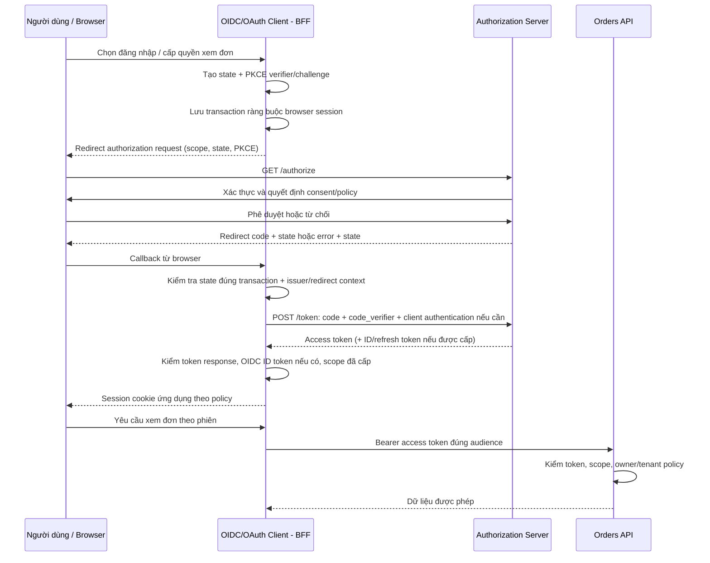
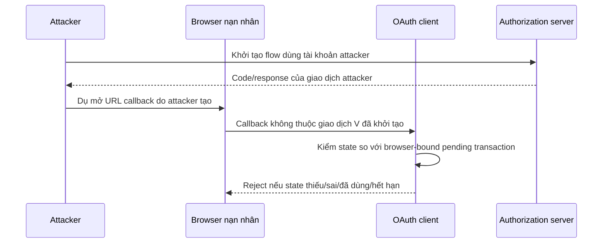
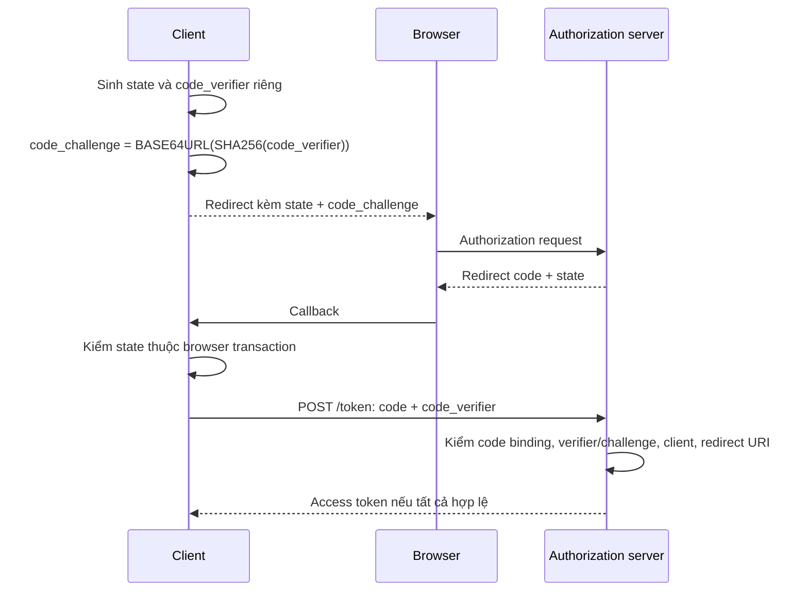

# Scope and state

Một ứng dụng web muốn người dùng đăng nhập và cho phép xem đơn hàng. Nó chuyển hướng trình duyệt đến authorization server bằng một **Authorization Code request** có hai tham số quan trọng:

```http
GET /authorize?response_type=code
    &client_id=orders-web
    &redirect_uri=https%3A%2F%2Fshop.example.com%2Foauth%2Fcallback
    &scope=openid%20orders.read
    &state=sTg7Yq...random-correlation-value
    &code_challenge=base64url-sha256-of-verifier
    &code_challenge_method=S256 HTTP/1.1
Host: login.example.com
```

Request trên được xuống dòng để dễ đọc; trong HTTP thực tế, query parameters phải nằm trong **một request-target/URL được URL-encode đúng cách**, không gửi các dòng `&...` như các header độc lập.

**`scope`** nói về **những quyền mà client yêu cầu**. **`state`** là giá trị client tạo để **liên kết authorization response với đúng giao dịch đã bắt đầu trên chính trình duyệt/phiên của người dùng** và hỗ trợ phòng chống CSRF, login CSRF hoặc nhầm lẫn giữa các yêu cầu. Hai tham số xuất hiện trong cùng authorization request nhưng **không được dùng thay nhau**.

Bài nằm trong chương **Authorization Code** của module **SECURITY_TOKEN_SECURITY_FUNDAMENTALS**. Mục tiêu là hiểu trust boundaries và vòng đời token bảo mật trong OAuth 2.0/OIDC: cách phát hành access token và refresh token; cách hiểu scope, audience, JWT/opaque token; kiểm tra claims; lưu trữ, thu hồi và giảm nguy cơ token bị đánh cắp hoặc phát lại. **Trọng tâm của bài chỉ là Scope and state trong Authorization Code flow**, đặt trong bối cảnh các lớp bảo vệ liên quan như PKCE, redirect URI và OIDC nonce.

**Kết quả học tập:**

- Phân biệt **requested scope**, **granted scope** và **scope thực sự được API chấp nhận**, tránh xem yêu cầu như quyền đã được cấp.
- Tạo và xử lý tham số **`state`** có entropy đủ cao, ràng buộc với **phiên browser và một authorization transaction**.
- Trình bày đúng authorization request, callback, kiểm tra `state`, đổi code bằng **PKCE**, xử lý token response và gọi resource server.
- Hiểu ranh giới giữa **`state`, `code_verifier`/`code_challenge`, `nonce`, `iss`, `aud`**.
- Xử lý nhiều tab, callback lỗi, callback lặp, thay đổi scope, re-consent, incremental authorization và nhiều authorization servers.
- Xây dựng kiểm thử chống CSRF, authorization response injection, mix-up, state replay, sai scope và object-level authorization.

## 1. Ôn lại bốn vai trò trong Authorization Code flow

| Vai trò | Trách nhiệm | Ví dụ |
| --- | --- | --- |
| **Resource owner** | Thực thể có thể cấp quyền truy cập tài nguyên, thường là người dùng cuối | Người sở hữu tài khoản bán hàng |
| **OAuth client** | Khởi tạo authorization request, quản lý `state`/PKCE, đổi code thành token | Web backend/BFF `orders-web` |
| **Authorization server (AS)** | Xác thực/đánh giá consent và policy, phát authorization code rồi token | `https://login.example.com` |
| **Resource server (RS)** | Nhận access token, kiểm audience/scope và quyền trên dữ liệu | `https://api.example.com/orders` |

Trong OIDC, **OpenID Provider (OP)** bổ sung chức năng xác thực danh tính và phát **ID token** cho OIDC client/Relying Party. **OAuth 2.0 cốt lõi là ủy quyền**, không mặc nhiên thay thế xác thực danh tính OIDC. Khi request có `scope=openid` và OP hỗ trợ OIDC, client phải xử lý kết quả đăng nhập theo quy tắc OIDC tương ứng.

**Authorization Code không phải access token.** Code là credential ngắn hạn, một lần, dùng ở token endpoint kèm điều kiện bảo vệ; API không nhận code để cấp dữ liệu.

## 2. Vòng đời authorization request và callback



**`scope` được AS diễn giải ở bước yêu cầu cấp quyền; `state` được client xác minh khi nhận callback.** Điều kiện kiểm state phải xảy ra **trước** khi client tin/đổi authorization code. Sau khi có access token, **resource server** là bên kiểm quyền thao tác và dữ liệu — không thể bỏ bước này vì login đã hoàn tất.

## 3. `scope` là gì?

Trong OAuth 2.0, **scope** là cách client diễn đạt **phạm vi quyền truy cập đang yêu cầu**. Theo RFC 6749 mục 3.3, giá trị scope thường là một chuỗi **các scope-token được phân tách bằng khoảng trắng**; từng tên scope có ngữ nghĩa do AS và các resource servers thống nhất.

Ví dụ:

```text
scope=orders.read orders.create
```

Khi chuyển thành URL-encoded query:

```text
scope=orders.read%20orders.create
```

AS có thể yêu cầu người dùng cho phép những quyền này, nhưng **việc client xin `orders.create` không làm nó tự có quyền tạo đơn**. AS có thể cấp, thu hẹp hoặc từ chối theo chính sách, consent, client registration và trạng thái người dùng.

### 3.1. Scope không phải role, audience hay subject

| Thuộc tính | Câu hỏi được trả lời | Ví dụ |
| --- | --- | --- |
| `scope` | Token được cấp **phạm vi thao tác** gì? | `orders.read` |
| `aud` | Access token dành cho **resource server/API nào**? | `https://api.example.com/orders` |
| `sub` | Token nói về **chủ thể** nào? | `user-42` |
| `client_id` | OAuth client nào đã yêu cầu/được cấp quyền? | `orders-web` |
| `roles` hoặc permissions riêng | Role/quyền nghiệp vụ theo profile/policy | `sales_viewer` |
| `state` trong request/response | Callback này thuộc **giao dịch nào của client**? | Giá trị ngẫu nhiên một lần |

Một token có `scope=orders.read` nhưng `aud=billing-api` **không dành cho Orders API**. Một token đúng audience/scope vẫn **không thể** đọc đơn của tenant khác nếu object policy cấm.

### 3.2. Scope names do hệ thống định nghĩa

Ví dụ `orders.read`, `orders.update`, `payments.refund` chỉ là các tên tự đặt. OAuth 2.0 **không chuẩn hóa** những scopes nghiệp vụ này. Client, AS và RS cần hợp đồng chung:

- Scope nào có hiệu lực tại API nào?
- Scope cho phép thao tác nào, và còn cần role/owner/tenant policy nào?
- Scope có phân biệt hoa/thường không? **Scope-token là case-sensitive**.
- Khi một scope bị thu hồi hoặc thay đổi ngữ nghĩa, token cũ được xử lý thế nào?
- Endpoint nào cần nhiều scopes; yêu cầu **tất cả** hay **một trong số** các scopes?

RS nên parse scope thành **các token riêng** và so khớp chính xác theo hợp đồng; không dùng substring kiểu `scope.contains("read")` để suy quyền.

## 4. Requested, granted và effective scopes

Ba tập hợp cần phân biệt:

1. **Requested scopes**: những scope client gửi trong authorization request. Đây là đề nghị, **không phải quyền đã có**.
2. **Granted scopes**: những scope AS thực sự cấp cho token sau khi đánh giá client, grant, consent và chính sách. Có thể **ít hơn** tập requested.
3. **Effective permissions**: quyết định RS có thực hiện thao tác trên dữ liệu cụ thể không, kết hợp granted scopes, audience, user/workload identity và policy hiện hành.

Ví dụ:

| Giai đoạn | Giá trị | Diễn giải |
| --- | --- | --- |
| Client xin | `orders.read orders.create orders.cancel` | Muốn xem, tạo, hủy đơn |
| AS phê duyệt | `orders.read orders.create` | Không cấp quyền hủy |
| Access token | `scope=orders.read orders.create` theo profile | Chỉ có hai scopes đã cấp |
| Client gọi `GET /orders/42` | Có `orders.read` | RS còn kiểm owner/tenant |
| Client gọi `POST /orders/42/cancel` | Thiếu `orders.cancel` | RS từ chối |
| Client gọi `GET /orders/9001` tenant khác | Có `orders.read` | RS vẫn từ chối do object policy |

**Không lấy requested scopes từ browser session rồi coi là granted scopes.** Quyền phải dựa trên token/metadata cấp bởi AS hoặc trạng thái grant đáng tin, và luôn kết hợp policy của resource server.

### 4.1. Phản hồi token có trường `scope` hay không?

Theo RFC 6749 mục 5.1, trường `scope` trong **token response**:

- **Không bắt buộc** nếu scope được cấp **giống scope đã yêu cầu**.
- **Bắt buộc** nếu scope được cấp **khác scope đã yêu cầu**.

Ví dụ khi AS chỉ cấp quyền đọc:

```json
{
  "access_token": "<opaque-or-jwt-access-token>",
  "token_type": "Bearer",
  "expires_in": 600,
  "scope": "orders.read"
}
```

Client phải phản ánh scopes **đã cấp**, không tiếp tục hiển thị `orders.cancel` như quyền sẵn có. Nếu AS không cung cấp scope theo cách phù hợp profile/hợp đồng, client nên xử lý **tường minh**, không dùng thiếu thông tin làm lý do nâng quyền. RS mới là bên thực thi quyền cuối cùng.

### 4.2. Response không có `scope` không mặc nhiên là lỗi

Trong server tuân thủ RFC 6749, nếu granted scopes bằng requested scopes, token response có thể bỏ trường `scope`. Ứng dụng cần hiểu quy tắc này **trong bối cảnh token response** thay vì áp quy tắc “thiếu scope ⇒ admin” hoặc “thiếu scope ⇒ tất cả quyền”.

Nếu đang dùng một SDK/AS riêng có metadata khác chuẩn, làm theo **hợp đồng đã kiểm chứng**, không suy đoán từ tên scope ở UI. Resource server không nên dựa vào bản sao danh sách scopes chưa được xác minh từ phía client.

## 5. Scope bị bỏ trống hoặc AS áp dụng scope mặc định

`scope` là tham số **tùy chọn** trong authorization request của OAuth 2.0. Theo RFC 6749 mục 3.3, nếu client **không gửi scope**, authorization server phải **xử lý bằng scope mặc định được định nghĩa trước** hoặc **từ chối request**.

Không thể suy ra `scope` bị thiếu nghĩa là:

- Quyền bằng không trong mọi AS.
- Toàn bộ quyền của người dùng hoặc toàn bộ scopes của client.
- Chỉ có quyền đọc.
- Có quyền mà ứng dụng đang hiển thị.

**Default scopes là policy của AS** và cần được audit, đặc biệt khi application registration có scopes nhạy cảm.

Ví dụ chính sách tốt:

```text
client=orders-web
default_scopes=orders.read
allowed_scopes=orders.read orders.create
forbidden_scopes=payments.refund
```

Đây chỉ là cấu hình minh họa, không phải cú pháp chuẩn của AS nào. Nếu client yêu cầu `payments.refund`, AS không được cấp quyền chỉ vì user có tài khoản đăng nhập; phải áp dụng registration/grant/consent policy.

### 5.1. OIDC scope `openid`

Trong **OpenID Connect authentication request**, `openid` là scope đặc biệt để yêu cầu OIDC. Request không có `openid` không nên được client **mặc nhiên coi là một lần đăng nhập OIDC** với ID token, ngay cả khi OAuth Authorization Code được chấp nhận.

Các scopes như `profile`, `email` cung cấp khả năng xin claims về danh tính theo OIDC. Chúng **không biến ID token thành access token có quyền gọi Orders API**. Không mặc định `email` đã được xác minh; khi cần, kiểm `email_verified` theo ngữ nghĩa OP và chính sách liên kết tài khoản.

## 6. Scope, consent và least privilege

**Least privilege** nghĩa là yêu cầu/được cấp **chỉ những quyền cần thiết cho tác vụ hiện tại**, trong khoảng thời gian và resource phù hợp.

Ví dụ hai thiết kế:

| Thiết kế | Request ban đầu | Rủi ro/ưu điểm |
| --- | --- | --- |
| Yêu cầu mọi quyền ngay | `openid orders.read orders.create orders.cancel payments.refund` | Consent khó hiểu, blast radius lớn nếu token bị lộ |
| Yêu cầu tối thiểu | `openid orders.read` | Giảm quyền ban đầu; xin scope tăng thêm khi thực sự cần |

AS có thể hiện màn hình consent, bỏ qua consent nhờ prior grant hoặc chính sách tổ chức, hoặc từ chối scope. Client **không được tự giả định người dùng đã consent** chỉ vì có một authorization code. Quyền được thể hiện bởi grant/token hợp lệ sau khi AS hoàn tất đánh giá.

### 6.1. Incremental authorization

Nếu user sau này chọn “Hủy đơn”:

1. Client xác định đang thiếu `orders.cancel`.
2. Client khởi tạo **authorization request mới** với scope bổ sung theo chính sách AS.
3. AS quyết định có yêu cầu consent/step-up hay không.
4. Client nhận token/metadata mới phản ánh granted scopes.
5. Orders API vẫn kiểm `orders.cancel` **và** quyền hủy với đơn cụ thể.

Không tự sửa payload JWT cũ hoặc thêm chuỗi scope vào session rồi gọi API. Mỗi authorization request mới cần **`state` mới** và PKCE verifier/challenge mới.

### 6.2. Scope không tương đương sự kiện xác thực mạnh

Nếu nghiệp vụ hoàn tiền yêu cầu MFA vừa hoàn thành, scope `payments.refund` **chưa đủ** để chứng minh MFA mới. OIDC `auth_time`, `acr` và policy reauthentication/step-up cần được xử lý đúng hợp đồng. `iat` của access token mới không đồng nghĩa user vừa thực hiện MFA.

## 7. `state` là gì?

Trong OAuth 2.0 Authorization Code flow, `state` là **giá trị opaque do client tạo**, được gửi trong authorization request và **được authorization server trả lại nguyên vẹn** trong authorization response, nếu request ban đầu có giá trị đó.

Client sử dụng `state` để:

- **Liên kết callback với authorization request đã khởi tạo**.
- Bảo vệ chống **cross-site request forgery (CSRF)** và một số dạng **login CSRF/authorization response injection**.
- Phân biệt **nhiều giao dịch đang chờ** từ nhiều tab hoặc nhiều thao tác.
- Khôi phục **điểm đến UI dự kiến** sau login/consent, nhưng nên lưu destination ở phía client/server, **không tin redirect URL tùy ý trong state**.

`state` **không phải**:

- Scope hoặc permission của token.
- Authorization code, access token, refresh token hoặc ID token.
- PKCE `code_verifier` hoặc `code_challenge`.
- OIDC `nonce` dùng ràng buộc ID token.
- Bằng chứng user đã xác thực hoặc AS đã chấp thuận scopes.

### 7.1. Ai tạo và ai kiểm `state`?

**Client tạo** `state`, lưu bản ghi tương ứng trước redirect và **chính client kiểm** giá trị callback. AS thường chỉ phải **trả lại chính xác** giá trị trong authorization response. Không được phụ thuộc vào AS để “xác minh CSRF” thay client.

Một `state` có thể là chuỗi ngẫu nhiên; nếu chứa dữ liệu ứng dụng, dữ liệu đó phải có bảo vệ **tính toàn vẹn**, kiểm **ràng buộc phiên**, thời hạn và chống replay. Cách dễ audit là dùng **random opaque identifier** rồi tra trong server-side transaction store.

## 8. Vì sao client cần `state`? Ví dụ login CSRF

Giả sử client có endpoint `/oauth/callback` nhận `code`. Nếu endpoint không xác minh callback thuộc một giao dịch browser đã bắt đầu, attacker có thể tự tạo authorization code cho **tài khoản của attacker** rồi dụ nạn nhân mở callback chứa code đó. Tùy flow và điều kiện PKCE/client, nạn nhân có thể bị gắn phiên với tài khoản attacker (**login CSRF/account confusion**).



**Điểm phòng vệ:** client chỉ chấp nhận callback có **state khớp chính xác với một pending transaction của chính browser/phiên**, không phải giá trị bất kỳ client tìm thấy trong URL.

PKCE cũng góp phần chống authorization code injection theo flow: code phải gắn với đúng `code_verifier`. Nhưng **state và PKCE giải các mục tiêu bảo vệ khác nhau**, và cách triển khai phải tuân theo security BCP/profile đang dùng. Không bỏ state chỉ vì “đã có PKCE” mà chưa đánh giá đầy đủ CSRF, login context, multi-provider, nonce và hướng dẫn SDK/AS.

## 9. Sinh `state` an toàn và ràng buộc với phiên

Một cách thường dùng là sinh chuỗi **ngẫu nhiên mật mã học (CSPRNG)** với entropy đủ cao, ví dụ **32 byte ngẫu nhiên** rồi mã hóa Base64URL không padding. Đây là lựa chọn triển khai minh họa tốt, **không phải độ dài bắt buộc duy nhất trong RFC 6749**.

```text
randomBytes = CSPRNG(32 bytes)
state = base64urlWithoutPadding(randomBytes)

serverSidePendingTransactions[state] = {
    browserSessionBinding,
    expectedIssuer,
    redirectUri,
    requestedScopes,
    codeVerifier,
    nonceIfOidcUsed,
    safeReturnPath,
    createdAt,
    expiresAt,
    consumed: false
}
```

Không dùng:

- Timestamp đơn thuần, `userId`, email hoặc session ID có thể đoán được làm `state`.
- `Math.random()` hoặc bộ đếm tuần tự để tạo token bảo mật.
- Một `state` cố định cho cả vòng đời login/logout hoặc mọi tab.
- Chuỗi state chỉ do client gửi nhưng không có **binding với browser transaction**.
- Toàn bộ dữ liệu nhạy cảm, user PII, access token hoặc refresh token nhét vào state.

### 9.1. Trạng thái server-side cho BFF/confidential client

Backend có thể giữ bản ghi pending transaction trong session store, Redis/DB bảo vệ, hoặc kho giao dịch ngắn hạn tương đương. Browser chỉ cầm **session cookie** được bảo vệ và state xuất hiện trong URL authorization/callback. Lưu ý:

1. Transaction phải gắn với **browser session trước khi redirect**, không chỉ gắn với một user ID.
2. Khi callback tới, xác định session/browser-bound context một cách an toàn.
3. Tìm transaction bằng `state`, so sánh **exact match** và kiểm ràng buộc session.
4. Kiểm transaction chưa hết hạn/chưa consumed, issuer/redirect context đúng.
5. Đánh dấu consumed **nguyên tử** hoặc bảo đảm one-time handling, kể cả callback lặp.
6. Sau login thành công, cân nhắc **rotate session ID** để tránh session fixation.

Không cho attacker tự gửi một `state` bất kỳ để client tạo phiên “chỉ vì state tồn tại trong global cache”. **Binding với chính browser transaction là phần quan trọng nhất.**

### 9.2. SPA hoặc native client

Với SPA, việc redirect ra khỏi trang làm JS memory thường bị mất; SDK có thể giữ transient transaction metadata trong `sessionStorage` hoặc cơ chế được thiết kế khác. Điều đó **không làm Web Storage an toàn trước XSS**, nên phải bảo vệ script, giao diện callback, scope, PKCE verifier và giới hạn thời gian.

Với native client, sử dụng OAuth SDK và system browser + Authorization Code with PKCE; transient `state`/`code_verifier` nên nằm trong vùng được app quản lý cho một giao dịch, gắn với redirect URI/app instance và xử lý deep link/claimed HTTPS redirect an toàn. Không tin mọi URL callback được OS mở chỉ vì nó chứa `code`.

## 10. Callback phải kiểm `state` trước khi tin authorization code

Authorization response thành công thường có:

```http
HTTP/1.1 302 Found
Location: https://shop.example.com/oauth/callback?code=SplxlOBeZQQYbYS6WxSbIA&state=sTg7Yq...random-correlation-value
```

Khi browser theo redirect, client nhận `code` và `state` qua callback. Một pipeline an toàn:

1. Xác minh callback đi qua **redirect URI hợp lệ** của client và đúng endpoint dự kiến.
2. Parse tham số theo HTTP/OAuth framework; từ chối **duplicate/ambiguous state**, hoặc callback bất thường theo policy.
3. Xác minh `state` tồn tại, thuộc một **pending transaction**, **chưa hết hạn**, **chưa sử dụng**, **khớp browser session**.
4. Ràng buộc đúng **authorization server/issuer** của giao dịch, đặc biệt nếu client hỗ trợ nhiều AS.
5. Khi callback lỗi, xử lý `error` **chỉ sau khi kiểm state**, không coi lỗi của request lạ là lỗi của phiên hiện tại.
6. Với callback thành công, dùng **authorization code đúng transaction** và `code_verifier` tương ứng để đổi token.
7. Kiểm token response, ID token nếu dùng OIDC, scope đã cấp; tạo phiên/điều hướng theo path đã allowlist.
8. Tiêu thụ state/transaction và xóa transient secrets.

**Nếu state không khớp, từ chối ngay**; không “thử tiếp với transaction gần nhất”, không đổi code trước rồi mới kiểm state, và không tự tạo transaction mới từ tham số callback.

### 10.1. Kiểm `state` cho cả callback lỗi

AS có thể redirect:

```http
HTTP/1.1 302 Found
Location: https://shop.example.com/oauth/callback?error=access_denied&state=sTg7Yq...random-correlation-value
```

RFC 6749 yêu cầu AS **bao gồm `state` trong authorization response khi client đã gửi state** (với những response qua redirect URI theo điều kiện giao thức). Client nên đối chiếu state của **cả success và error responses** để không cho request giả tạo lỗi phiên hoặc phá transaction khác.

Nếu thiếu `state` trong response cho một request vốn có state, client không nên chấp nhận callback như hợp lệ. Nếu AS không thể xác định redirect URI hợp lệ thì nó **không nên tự redirect kèm code/error tới URI tùy ý**; flow phải tuân thủ kiểm soát redirect.

### 10.2. Callback bị gửi hai lần

Authorization code và state dùng cho **một giao dịch**. Browser refresh trang callback hoặc attacker replay URL cũ không được tạo hai lần session/truy cập:

- Giao dịch state được **consume một lần**, có biện pháp atomicity nếu backend đa instance.
- Authorization code bị AS từ chối nếu đã sử dụng lại theo OAuth.
- Client không retry token exchange vô hạn khi không biết code đã bị consume.
- Log/audit chỉ ghi correlation ID an toàn, không ghi nguyên code/state/token ở nơi dễ lộ.

## 11. Phân biệt `state` và PKCE

PKCE (*Proof Key for Code Exchange*, RFC 7636) giúp client **ràng buộc authorization code với bên đã bắt đầu authorization request**, giảm rủi ro code bị chặn/đánh cắp rồi đổi token bởi bên không nắm `code_verifier`.

| Yếu tố | Ai tạo? | Được gửi ở đâu? | Mục tiêu |
| --- | --- | --- | --- |
| `state` | Client | Authorization request và callback response | Ràng buộc browser/transaction, chống CSRF/callback injection và hỗ trợ app state |
| `code_verifier` | Client | **Token request**, không lộ trên authorization URL | Chứng minh client sở hữu verifier gốc của flow |
| `code_challenge` | Client tính từ verifier | Authorization request | AS lưu ràng buộc với authorization code |
| `code_challenge_method=S256` | Client | Authorization request | Khai báo hash SHA-256 cho challenge |
| Authorization `code` | AS | Redirect về client | Credential ngắn hạn một lần, được đổi tại token endpoint |



**Không dùng `state` làm `code_verifier`**, không tái sử dụng verifier giữa nhiều flows và không đặt `code_verifier` vào authorization URL. Hai giá trị thường được sinh bằng CSPRNG nhưng có mục đích và thời điểm sử dụng khác nhau.

### 11.1. PKCE có thể giảm CSRF, vậy state còn cần không?

Security BCP (RFC 9700) phân tích các biện pháp chống CSRF và cho biết **PKCE có thể cung cấp bảo vệ CSRF trong những điều kiện thích hợp**, đặc biệt khi AS hỗ trợ và thực thi PKCE đúng cách. Tuy nhiên:

- Một hệ thống **nhiều AS**, nhiều tab, consent actions và workflow UI vẫn cần cơ chế liên kết callback với **giao dịch browser cụ thể**.
- Framework/SDK có thể dùng `state`, OIDC `nonce` hoặc cơ chế transaction binding khác theo profile. Không tự ý bỏ giá trị yêu cầu của framework.
- **PKCE không phải thay thế tự động cho kiểm issuer, audience, redirect URI, OIDC ID token nonce hoặc quyền nghiệp vụ**.

Đối với mẫu bài học này, **sử dụng cả `state` giao dịch và PKCE S256** là phương án thực hành dễ kiểm thử, dễ giải thích và giúp tránh nhiều sai sót triển khai.

## 12. Phân biệt `state` và OIDC `nonce`

**OIDC nonce** là chuỗi client gửi tới OP để liên kết **ID token** với authentication request và giảm nguy cơ replay/token injection. Theo flow/profile OIDC, khi client gửi `nonce`, giá trị đó phải được kiểm trong **ID token đã xác minh**.

| Trường | Xuất hiện ở đâu? | Client kiểm cái gì? |
| --- | --- | --- |
| OAuth `state` | Authorization request; authorization success/error response | Callback có thuộc đúng **pending transaction/browser session** không? |
| OIDC `nonce` | Authentication request; **ID token claim** | ID token có gắn với **authentication request** đúng không? |
| `aud` trong ID token | ID token | Token có dành cho **OIDC client_id** này không? |
| `aud` trong access token | JWT access token hoặc metadata tin cậy theo profile | Token có dành cho **resource server** đích không? |
| `iss` | ID/access token, đôi khi authorization response theo RFC 9207 | Có đúng **issuer** mà client/RS tin không? |

Một ví dụ OIDC code-flow request có:

```text
scope=openid orders.read
state=<random-browser-transaction>
nonce=<random-oidc-request-nonce>
```

Trong **OIDC Authorization Code Flow**, `nonce` không phải luôn bắt buộc giống các flow OIDC khác, nhưng **nếu đã gửi nonce thì phải xác minh ID token claim tương ứng** theo OIDC. Không dùng nonce thay cho kiểm `state` một cách tùy ý, và không kiểm nonce trong access token như thể đó là điều kiện chung của OAuth.

Một ID token có `nonce` đúng nhưng `aud` của client khác **vẫn phải từ chối**. Một callback có `state` đúng không khiến client được bỏ qua xác minh ID token.

## 13. State có được chứa URL quay lại, tenant hoặc user ID không?

Ví dụ app muốn sau login đưa user trở về `/orders/42`. Cách an toàn dễ kiểm soát:

1. Client chỉ chấp nhận destination nội bộ theo **allowlist/path policy**.
2. Lưu `safeReturnPath="/orders/42"` trong transaction store phía client/server.
3. Gửi một `state` ngẫu nhiên không mang thông tin nhạy cảm.
4. Sau callback, kiểm state và tiêu thụ transaction.
5. Điều hướng tới **path đã lưu** khi đã kiểm phiên và quyền theo ứng dụng.

Không nên nhận từ query như:

```text
?return_to=https://attacker.example/collect
```

rồi copy thẳng vào state/redirect sau login. Nếu state hoặc target URL điều khiển nơi client redirect sau khi đổi code, có thể phát sinh **open redirect**, leakage hoặc login flow abuse.

### 13.1. Nếu phải dùng state tự chứa

Một số hệ thống dùng state được ký (ví dụ HMAC) hoặc mã hóa để lưu metadata mà không cần lookup. Khi đó vẫn phải bảo đảm:

- Tính **không thể đoán/giả** và **toàn vẹn** của dữ liệu.
- **Ràng buộc browser session và transaction**, không chỉ “chữ ký hợp lệ”.
- **Expiry ngắn**, one-time replay control; chữ ký không tự làm state dùng một lần.
- Không chứa access token, refresh token, `code_verifier` hoặc thông tin nhạy cảm dễ rò qua URL.
- Đích redirect phải **allowlist** và được kiểm trước khi sử dụng.

**Signed state không tự ngăn CSRF nếu nó không được ràng buộc với browser đã bắt đầu flow.** Một token state hợp lệ của attacker vẫn có thể bị đưa vào browser nạn nhân nếu client không kiểm transaction binding.

## 14. Một người dùng mở hai tab: state được lưu thế nào?

Giả sử người dùng:

1. Ở tab A nhấn “Đăng nhập”.
2. Ở tab B nhấn “Kết nối thêm quyền”.
3. AS phản hồi cho tab B trước tab A.

Nếu backend chỉ lưu một biến `session.latestState`, yêu cầu thứ hai có thể **ghi đè state của tab A**. Kết quả: callback hợp lệ của tab A bị từ chối, hoặc client nhầm PKCE verifier/scope/redirect destination.

**Thiết kế đúng:** lưu **nhiều pending transactions**, mỗi giao dịch có state riêng:

| Transaction | State | Requested scopes | PKCE verifier | Return path |
| --- | --- | --- | --- | --- |
| A | `state-A-random` | `openid orders.read` | `verifier-A` | `/orders` |
| B | `state-B-random` | `openid orders.cancel` | `verifier-B` | `/orders/42` |

Khi callback:

- Dùng `state` để chọn **đúng transaction** của browser/phiên.
- Chỉ dùng **PKCE verifier/nonce/issuer/scopes của chính transaction đó**.
- Tiêu thụ transaction khi hoàn tất, **không xóa nhầm** giao dịch khác.
- Giới hạn số pending flows, TTL và rate; tránh attacker khởi tạo hàng nghìn transactions để gây DoS.

**Không chỉ dựa vào thứ tự callback.** Mạng và thao tác người dùng không bảo đảm các yêu cầu hoàn tất cùng thứ tự được tạo.

## 15. Multi-issuer, OAuth mix-up và callback context

Một client hỗ trợ đăng nhập qua **AS A** và **AS B** có thể bị nhầm giữa hai issuer nếu không ràng buộc request và callback với đúng AS (authorization server mix-up). Chỉ có state ngẫu nhiên **chưa đủ** nếu client lưu mapping sai hoặc chọn token endpoint theo input không tin cậy.

Mỗi pending transaction cần gắn:

- **Expected issuer / authorization server identifier**.
- Trusted authorization/token endpoints và redirect URI hợp lệ.
- Client ID/registration tương ứng issuer đó.
- Scope/resource đã yêu cầu và PKCE verifier của giao dịch.

### 15.1. RFC 9207 `iss` trong authorization response

RFC 9207 định nghĩa **authorization server issuer identification** trong authorization response. Nếu AS/client hỗ trợ cơ chế này, AS có thể trả tham số `iss`; client xác minh nó **đúng issuer kỳ vọng** của transaction.

Ví dụ:

```http
HTTP/1.1 302 Found
Location: https://shop.example.com/oauth/callback?code=code-value&state=state-value&iss=https%3A%2F%2Flogin.example.com
```

Phải kiểm **issuer trước khi đổi code**, theo profile. Không dùng `iss` chưa kiểm từ request để tự chọn **token endpoint** bất kỳ, đặc biệt khi giá trị do attacker điều khiển. Nếu hệ thống không dùng RFC 9207, cần biện pháp mix-up defense tương đương được chuẩn/profile chấp nhận, như redirect URI phân biệt từng issuer khi phù hợp.

Sau token exchange, client còn phải kiểm issuer của ID token (OIDC) và token profile liên quan. **State xác định transaction; issuer xác định AS** — cần cả hai khi trust model có nhiều AS.

## 16. Redirect URI, authorization code và token exchange

`state` và PKCE phát huy tác dụng chỉ khi **redirect URI và token endpoint** cũng được bảo vệ:

1. **Redirect URI** được đăng ký trước và AS phải so khớp theo quy tắc/profile, tránh open redirect.
2. Authorization code được AS ràng buộc với **client**, redirect URI (nếu áp dụng) và **PKCE challenge**.
3. Confidential client phải xác thực với token endpoint theo cơ chế đã đăng ký; public client dùng PKCE, không giả vờ bảo vệ shared secret trong SPA/mobile.
4. Token request gửi `code`, `redirect_uri` khi yêu cầu của flow/hợp đồng, và `code_verifier`.
5. AS xác minh code còn hiệu lực, chưa dùng, thuộc đúng client/redirect context, PKCE hợp lệ; sau thành công **tiêu thụ code**.

Ví dụ token request với public client minh họa:

```http
POST /oauth2/token HTTP/1.1
Host: login.example.com
Content-Type: application/x-www-form-urlencoded

grant_type=authorization_code&code=<one-time-authorization-code>&redirect_uri=https%3A%2F%2Fshop.example.com%2Foauth%2Fcallback&client_id=orders-web&code_verifier=<original-high-entropy-code-verifier>
```

Nếu là **confidential backend client**, token endpoint còn phải xác thực client, ví dụ private-key JWT, mTLS hoặc client secret qua cơ chế đã đăng ký. **Không gửi `state` để thay client authentication hoặc PKCE proof**; state được client kiểm ở callback.

### 16.1. Authorization code bị lộ qua URL

Code đi qua browser redirect nên có thể bị ghi trong URL history, proxy logs, analytics, referrer hoặc một script bị xâm nhập. PKCE, redirect URI binding và code one-time/short lifetime giảm khả năng code bị đổi trái phép. Client nên:

- Không log nguyên `code`, `state`, `nonce`, token hoặc `code_verifier`.
- Cấu hình `Referrer-Policy`, cache policy, tránh tài nguyên/JS bên thứ ba trên callback page trước khi hoàn tất xử lý.
- Dọn query string khỏi URL sau khi xử lý bằng redirect sạch hoặc cơ chế tương đương.
- Không tái sử dụng code cũ, không gửi code vào resource API.

## 17. Resource indicator và audience không thay `scope`

Khi hệ thống có nhiều APIs, **scope** diễn tả thao tác, còn **resource/audience** chỉ ra API đích. RFC 8707 cho phép client dùng tham số `resource` ở các request OAuth phù hợp nếu AS hỗ trợ.

Ví dụ:

```http
GET /authorize?response_type=code
  &client_id=orders-web
  &redirect_uri=https%3A%2F%2Fshop.example.com%2Foauth%2Fcallback
  &scope=orders.read
  &resource=https%3A%2F%2Fapi.example.com%2Forders
  &state=<new-random-state>
  &code_challenge=<pkce-challenge>
  &code_challenge_method=S256 HTTP/1.1
Host: login.example.com
```

`resource` ở đây **không bắt buộc** với mọi AS. AS sẽ quyết định resource được cấp. Nếu JWT access token được phát theo RFC 9068, `aud` phải đại diện intended resource server theo profile; với opaque token, RS cần introspection/resource binding đáng tin.

| Trường hợp | Scope | Audience thực tế | RS xử lý |
| --- | --- | --- | --- |
| Đọc Orders | `orders.read` | Orders API | Xét tiếp owner/tenant policy |
| Đọc Orders bằng token Billing | `orders.read` | Billing API | Orders API **từ chối** |
| Hủy Orders bằng token chỉ đọc | `orders.read` | Orders API | **403** nếu thiếu `orders.cancel` |
| Đọc đơn tenant B bằng token tenant A | `orders.read` | Orders API | **403/404** theo object policy |

**Đúng scope không chữa được sai audience**, và đúng audience/scope không thay owner/tenant validation.

## 18. JWT và opaque access tokens mang granted scopes thế nào?

Sau Authorization Code exchange, access token có thể là **JWT** hoặc **opaque**; client không nên đoán quyền bằng cách base64-decode mọi chuỗi.

### 18.1. JWT access token theo profile

Payload minh họa:

```json
{
  "iss": "https://login.example.com",
  "sub": "user-42",
  "aud": "https://api.example.com/orders",
  "client_id": "orders-web",
  "scope": "orders.read",
  "iat": 1795000000,
  "nbf": 1795000000,
  "exp": 1795000600,
  "jti": "example-token-001"
}
```

Đây là **payload minh họa**, chưa phải JWT hợp lệ nếu chưa xác minh chữ ký/claims. Resource server kiểm issuer, signature/algorithm/JWKS, audience, expiry, token profile, scopes và quyền trên dữ liệu. `jti` không tự ngăn bearer token replay.

### 18.2. Opaque access token và introspection

Ví dụ response introspection từ AS có thẩm quyền:

```json
{
  "active": true,
  "sub": "user-42",
  "client_id": "orders-web",
  "aud": "https://api.example.com/orders",
  "scope": "orders.read",
  "exp": 1795000600
}
```

Response này là **hợp đồng minh họa**: RFC 7662 không bắt buộc mọi AS trả `aud` trong mọi trường hợp. Nếu không có `aud`, RS phải có **resource binding đáng tin** qua AS/introspection policy; `active=true` đơn lẻ không đủ.

Trong cả hai mô hình, **scope thực cấp** phải đến từ AS/nguồn tin cậy. Không lấy requested scopes lưu trong client và gửi dưới header `X-Scopes` rồi để API tự tin.

## 19. State và token storage: giữ bí mật nào ở đâu?

Những credential/transient values khác nhau có nơi dùng khác nhau:

| Giá trị | Bên giữ chính | Thời gian/vai trò | Rủi ro nếu lộ |
| --- | --- | --- | --- |
| `state` | Client/browser transaction + callback URL | Tạm thời, một authorization request | CSRF/correlation leakage, callback manipulation nếu binding sai |
| `code_verifier` | Client, tách khỏi authorization URL | Tạm thời đến token exchange | Attacker có code + verifier có thể thử đổi token |
| `nonce` OIDC | Client transaction; xác minh trong ID token | Tạm thời cho authentication request | ID-token request binding suy yếu |
| Authorization `code` | Browser redirect → client | Ngắn hạn, một lần | Code interception; PKCE/redirect binding quan trọng |
| Access token | Client dùng để gọi RS | Thường ngắn hạn | Bearer token theft/replay ở API đúng audience |
| Refresh token | Client dùng tại AS/token endpoint | Có thể dài hơn; theo grant/expiry | Quyền truy cập tiếp diễn nếu bị đánh cắp |
| Session cookie | Browser ↔ web backend/BFF | Theo phiên ứng dụng | Session hijacking/session riding |

### 19.1. BFF để giảm OAuth token trong browser

Với **Backend-for-Frontend**, backend/confidential client quản lý `state`, PKCE verifier và OAuth token phía server; browser chỉ có session cookie `HttpOnly`/`Secure`/`SameSite` phù hợp. Backend phải bảo vệ token store, CSRF/XSS, session fixation, quyền KMS/DB và không dùng access token sai audience.

Cookie `HttpOnly` làm JavaScript khó đọc trực tiếp session ID, **không ngăn script XSS gửi request trong phiên**. Nếu cookie không được gửi tại callback do SameSite/response mode, cần thiết kế callback/session correlation đúng chuẩn, **không bỏ kiểm state** để vá lỗi.

### 19.2. SPA/public client

SPA có thể cần transient transaction metadata tồn tại qua full-page redirect, nhưng nên tránh giữ access/refresh token bền trong browser nếu không cần. `sessionStorage`, memory, Web Worker và token storage đều có trade-off trước XSS. **PKCE không bảo vệ token đã phát khỏi XSS**; refresh token cho public client cần rotation hoặc sender constraint theo OAuth Security BCP khi được cấp.

## 20. Các lỗi thiết kế scope và state thường gặp

| Anti-pattern | Vì sao sai? | Cách sửa |
| --- | --- | --- |
| Xem requested scopes là granted scopes | AS có thể thu hẹp/từ chối | Đọc token response/AS metadata, RS kiểm scope thực |
| Coi `scope` trống nghĩa là quyền admin | Default policy do AS quyết định | Xác định scope mặc định/hoặc reject theo RFC |
| So khớp scope bằng substring | Dễ nhận nhầm `orders.read.all` với `orders.read` | Parse và so exact scope-token |
| Dùng `scope` thay `aud` | Token đúng quyền nhưng sai resource | Kiểm audience riêng |
| Xem `openid`/`email` là quyền Orders API | OIDC scopes khác quyền nghiệp vụ | Tách authentication scopes và API scopes |
| Không gửi `state` và không có CSRF defense khác được đánh giá | Callback có thể bị injection/login CSRF | Random transaction state và PKCE theo profile |
| Dùng `state="user-42"` hoặc timestamp | Dễ đoán, không đủ ràng buộc | CSPRNG state, browser-session binding |
| Đọc state từ callback rồi tự tạo pending transaction | Attacker đặt callback arbitrary | Tra pending transaction đã có, fail closed |
| Global `latestState` cho nhiều tab | Ghi đè verifier/context, sai flow | Nhiều transaction IDs, atomic consume |
| Kiểm state sau token exchange | Đã xử lý code không tin cậy | Kiểm state trước đổi code |
| Chấp nhận state đã dùng/hết hạn | Callback replay | TTL ngắn và one-time consume |
| Nhét arbitrary redirect URL vào state | Open redirect, token/code leakage | Server-side safe path allowlist |
| Dùng state làm PKCE verifier | Trộn nhiệm vụ bảo mật | Sinh/kiểm riêng state và PKCE |
| Bỏ kiểm `nonce` vì có state | ID token replay/injection theo OIDC | Kiểm nonce nếu đã gửi theo OIDC |
| Chọn token endpoint từ `iss` chưa xác minh | OAuth mix-up, exfiltration | Bind expected issuer vào transaction, RFC 9207/biện pháp tương đương |
| Lấy grant scope mới rồi sửa JWT cũ | Forged/inconsistent token | Xin token mới qua AS, RS verify đúng |
| 403 do thiếu scope thì refresh mãi | Không tự tăng grant | Incremental authorization/consent khi hỗ trợ |
| Log callback chứa code/state | Lộ correlation secret/code | Redact, referrer policy, URL cleanup |

## 21. Tình huống thực hành 1: callback từ giao dịch không tồn tại

Ứng dụng nhận:

```http
GET /oauth/callback?code=attacker-code&state=unknown-state HTTP/1.1
Host: shop.example.com
```

**Sai:** ứng dụng đổi code ngay ở token endpoint rồi tạo session dựa trên user claims, bỏ qua state vì “code cũng sẽ bị AS kiểm”.

**Đúng:** từ chối callback vì `unknown-state` không khớp pending transaction của browser. Không tạo transaction mới, không đoán verifier, không dùng response để tạo phiên. Ghi audit metadata không chứa code/state thô.

### 21.1. Nếu code không thể đổi do PKCE, state có còn giá trị?

Có. PKCE bảo vệ bước đổi code; state bảo đảm callback thuộc đúng transaction và giúp xử lý context, error response, multi-tab/multi-issuer. **Một biện pháp không làm mọi biện pháp còn lại trở nên thừa.**

## 22. Tình huống thực hành 2: AS cấp ít scope hơn yêu cầu

Client xin `openid orders.read orders.create`. Người dùng chỉ cho phép đọc, AS cấp access token scope `orders.read` (cùng ngữ cảnh OIDC liên quan theo hợp đồng).

Hành vi đúng:

1. Client kiểm state/PKCE và token response.
2. Client lưu **granted scopes** theo thông tin AS cung cấp; không coi `orders.create` là đã cấp.
3. UI không bật “Tạo đơn” dựa trên requested scopes.
4. Nếu người dùng muốn tạo, client khởi tạo một authorization request mới xin scope tương ứng, `state` mới và PKCE verifier mới.
5. Orders API xác minh granted scope và owner/tenant policy, kể cả khi UI hiển thị nhầm.

**Lưu ý:** việc client không có quyền tạo không nhất thiết là lỗi authentication. Đừng buộc user login lại nếu chỉ cần bổ sung grant/consent theo flow được AS hỗ trợ.

## 23. Tình huống thực hành 3: hai tabs và hai authorization servers

Tab A mở flow qua AS A để đọc Orders; tab B mở flow qua AS B cho tài khoản doanh nghiệp. Nếu client lưu duy nhất `lastIssuer` và `lastVerifier`, callback tab A có thể bị xử lý bằng token endpoint AS B.

Để tránh:

- Mỗi transaction lưu `state`, `codeVerifier`, `expectedIssuer`, `clientId`, `redirectUri`, `requestedScopes` và expiry riêng.
- Callback chọn đúng transaction bằng state **và session binding**.
- Xác minh `iss` trong authorization response theo RFC 9207 khi dùng, hoặc áp dụng mix-up defense profile tương đương.
- Token exchange gọi **đúng token endpoint đã cấu hình** cho issuer của transaction.
- Không ghi đè state/verifier bằng “flow mới nhất” trong cả phiên.

**Bài học:** state chỉ hữu ích khi **khóa đúng một transaction có đủ ngữ cảnh tin cậy**, không chỉ khi tồn tại một chuỗi random trong URL.

## 24. Ma trận kiểm thử: Scope and state

| # | Đầu vào/điều kiện | Kết quả mong đợi |
| --- | --- | --- |
| 1 | Request scope `orders.read`, AS cấp đúng | Client ghi nhận quyền đọc, RS còn kiểm dữ liệu |
| 2 | Request `orders.read orders.cancel`, AS chỉ cấp `orders.read` | Client không coi `orders.cancel` đã được cấp |
| 3 | Authorization request bỏ `scope` | AS dùng default policy hoặc reject theo RFC |
| 4 | Scope không được đăng ký/không được phép | AS từ chối/thu hẹp theo policy |
| 5 | Scope string chứa token gần giống như `orders.read.all` | RS không so substring thành `orders.read` |
| 6 | Token có `scope=orders.read` nhưng `aud=Billing API` | Orders API từ chối |
| 7 | Token đúng audience/scope, order của tenant khác | RS từ chối |
| 8 | OIDC request không có `openid` | Client không mặc định nhận ID token/đăng nhập OIDC |
| 9 | Authorization response trả đúng `state` của browser transaction | Client tiếp tục nếu các điều kiện khác đúng |
| 10 | Callback thiếu state dù request có state | Client từ chối |
| 11 | Callback state ngẫu nhiên không nằm trong pending store | Client từ chối |
| 12 | Callback state của phiên/browser khác | Client từ chối |
| 13 | Callback state đã consumed | Client từ chối replay |
| 14 | Callback state đã hết hạn | Client từ chối |
| 15 | Callback có duplicate/ambiguous `state` fields | Client từ chối theo parser policy |
| 16 | AS trả `error=access_denied` với state hợp lệ | Client xử lý lỗi của đúng transaction, không đổi code |
| 17 | Attacker tạo callback code+state của phiên khác | Không tạo session dưới nạn nhân |
| 18 | PKCE verifier sai dù state đúng | Token exchange bị AS từ chối |
| 19 | State đúng nhưng ID token nonce sai | OIDC client từ chối ID token |
| 20 | State đúng nhưng ID token `aud` của client khác | OIDC client từ chối |
| 21 | Hai tab authorize cùng lúc, callback đảo thứ tự | Mỗi flow dùng đúng verifier/scopes/destination |
| 22 | Hai AS dùng chung callback, response issuer không khớp | Client từ chối trước token exchange |
| 23 | State chứa `return_to` URL ngoài allowlist | Không redirect ra host attacker |
| 24 | Callback URL bị ghi vào analytics/tracing | Log redaction và URL cleanup tránh lộ code/state |
| 25 | User xin thêm scope sau khi login | Client tạo state và PKCE mới; AS xét grant mới |
| 26 | Access token hết hạn nhưng refresh còn hợp lệ | Client dùng refresh theo grant, không tái sử dụng state cũ |
| 27 | JWT access token bị thu hồi grant nhưng chưa hết `exp` | RS hành xử đúng policy revocation latency |
| 28 | Opaque introspection `active=true` nhưng không có resource binding đáng tin | RS không tự cho phép |
| 29 | Authorization code được dùng lần hai | AS từ chối code reuse |
| 30 | Token endpoint timeout sau callback hợp lệ | Client có recovery/re-auth policy, không retry mù vô hạn |

**Phân lớp kiểm thử:** unit tests cho generator/transaction store, integration tests cho AS + PKCE + scope, browser/E2E tests cho multi-tab/error callbacks, security tests cho CSRF/mix-up/open redirects và resource server authorization tests. Không chỉ kiểm `HTTP 200` của callback.

## 25. Checklist production

1. **Scope policy rõ chưa?** Mỗi endpoint/API có tên scope/meaning cụ thể, requested và granted scopes được phân biệt?
2. **Scope mặc định được kiểm?** Khi request thiếu `scope`, AS xử lý bằng policy rõ hay từ chối, không ngầm nâng quyền?
3. **Client xin quyền tối thiểu?** Đã đánh giá incremental authorization, scopes nhạy cảm, consent và token lifetime?
4. **Authorization request đúng?** `response_type=code`, `client_id`, registered `redirect_uri`, `scope`, `state`, PKCE S256 và `resource` khi AS hỗ trợ?
5. **State đủ entropy và một lần?** Sinh CSPRNG, TTL ngắn, không reuse giữa flows/tab?
6. **State có browser binding?** Pending transaction được tạo **trước redirect**, gắn đúng session và không được tạo từ callback?
7. **Callback kiểm state trước code exchange?** Thiếu/sai/hết hạn/đã dùng/duplicate state đều từ chối?
8. **Multi-tab xử lý đúng?** Mỗi state ánh xạ đúng PKCE verifier, issuer, scopes, nonce, redirect URI và safe return path?
9. **Multi-issuer được bảo vệ?** Bind expected issuer, kiểm RFC 9207 `iss` hoặc biện pháp mix-up defense tương đương?
10. **PKCE được enforce?** Client tạo verifier riêng, gửi challenge S256 và token endpoint kiểm đúng verifier?
11. **OIDC nonce được xử lý đúng?** Nếu đã gửi nonce, kiểm claim trong ID token; `aud`/`iss`/signature/exp vẫn cần?
12. **Token response được kiểm đúng?** `token_type`, scope thực cấp, expiry và audience/resource theo hợp đồng; không tự coi request scope là grant?
13. **Resource server có chính sách?** JWT signature hoặc opaque introspection, issuer, audience, scope và owner/tenant policy được thực thi?
14. **Không lộ bí mật?** Không log `code`/`state`/`code_verifier`/tokens, giảm referrer và dọn callback URL?
15. **Phiên và refresh được bảo vệ?** BFF session cookie, CSRF/XSS defense, rotation/revocation và access-token TTL phù hợp?
16. **Đã chạy negative tests?** Callback CSRF, mismatched state, multi-tab, mix-up, nonce sai, scope bị thu hẹp, open redirect và code reuse?

**Tóm lại:** **`scope` trả lời “client đang xin và được cấp quyền nào?”**, còn **`state` trả lời “authorization response này có thuộc đúng giao dịch client đã bắt đầu trên browser/phiên hiện tại không?”**. Scope được AS quyết định cấp và RS thực thi cùng audience/object policy; state do client tạo, ràng buộc với pending transaction và xác minh trước code exchange. Dùng **state + PKCE + issuer/redirect URI binding**, kiểm OIDC nonce khi áp dụng, tôn trọng granted scopes và duy trì bảo vệ token sau login để Authorization Code flow không trở thành điểm phát sinh CSRF, token substitution hoặc leo thang quyền.

## Tài liệu tham khảo

- [RFC 6749 — The OAuth 2.0 Authorization Framework](https://www.rfc-editor.org/rfc/rfc6749): mục 3.3 Scope, mục 4.1 Authorization Code Grant, mục 5.1 token response và mục 10.12 CSRF.
- [RFC 7636 — Proof Key for Code Exchange (PKCE)](https://www.rfc-editor.org/rfc/rfc7636): `code_verifier`, `code_challenge` và S256.
- [RFC 9700 — Best Current Practice for OAuth 2.0 Security](https://www.rfc-editor.org/rfc/rfc9700): CSRF, PKCE, OAuth mix-up, redirect URI, token leakage, scope và authorization security.
- [RFC 9207 — OAuth 2.0 Authorization Server Issuer Identification](https://www.rfc-editor.org/rfc/rfc9207): `iss` trong authorization response để chống mix-up.
- [RFC 8707 — Resource Indicators for OAuth 2.0](https://www.rfc-editor.org/rfc/rfc8707): `resource` và audience restriction.
- [RFC 6750 — OAuth 2.0 Bearer Token Usage](https://www.rfc-editor.org/rfc/rfc6750): gửi access token tới resource server, 401/403 và bảo vệ bearer token.
- [RFC 7519 — JSON Web Token (JWT)](https://www.rfc-editor.org/rfc/rfc7519): JWT claims `iss`, `aud`, `exp`, `iat` và `sub`.
- [RFC 8725 — JWT Best Current Practices](https://www.rfc-editor.org/rfc/rfc8725): JWT issuer/audience/type validation và chống token confusion.
- [RFC 9068 — JWT Profile for OAuth 2.0 Access Tokens](https://www.rfc-editor.org/rfc/rfc9068): access-token JWT profile và `scope`.
- [RFC 7662 — OAuth 2.0 Token Introspection](https://www.rfc-editor.org/rfc/rfc7662): trạng thái opaque token và metadata đã cấp.
- [RFC 7009 — OAuth 2.0 Token Revocation](https://www.rfc-editor.org/rfc/rfc7009): thu hồi refresh/access tokens.
- [OpenID Connect Core 1.0](https://openid.net/specs/openid-connect-core-1_0.html): `openid`, `nonce`, ID token, `auth_time` và client validation.
- [OWASP OAuth 2.0 Cheat Sheet](https://cheatsheetseries.owasp.org/cheatsheets/OAuth2_Cheat_Sheet.html): OAuth client/redirect/PKCE và token security practices.
- [OWASP Cross-Site Request Forgery Prevention Cheat Sheet](https://cheatsheetseries.owasp.org/cheatsheets/Cross-Site_Request_Forgery_Prevention_Cheat_Sheet.html): CSRF defenses và transaction/session binding.
