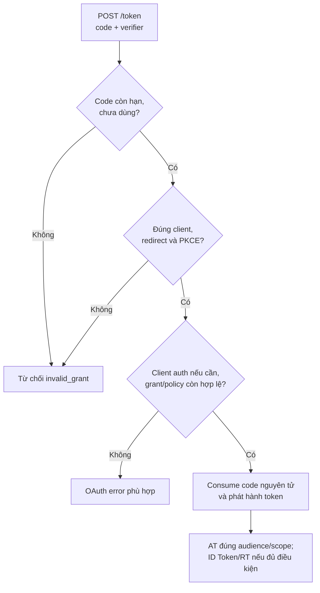
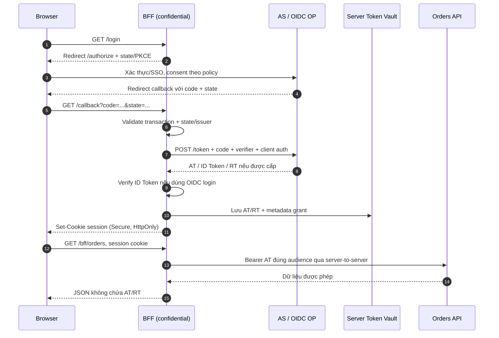

# User authentication at authorization endpoint

## Mục tiêu học tập

Trong module **SECURITY_TOKEN_SECURITY_FUNDAMENTALS**, chúng ta nghiên cứu mô hình tin cậy và vòng đời token: phân biệt JWT với opaque token, access token với refresh token, phát hành và kiểm tra claims, scope, audience, nơi lưu, thu hồi và phòng chống token bị đánh cắp hoặc phát lại trong OAuth 2.0/OIDC. Bài thuộc chương **Authorization Code** này tập trung vào một nguyên lý thiết kế quan trọng: **người dùng được xác thực dưới sự kiểm soát của Authorization Server (AS) tại bước authorization, thay vì đưa mật khẩu của mình cho OAuth client**.

Sau bài này, bạn có thể:

- Phân biệt vai trò **authorization endpoint**, **authentication UI/Identity Provider**, **token endpoint** và **Resource Server**.
- Mô tả khi nào AS yêu cầu login mới, dùng lại phiên SSO, yêu cầu MFA/passkey hoặc điều hướng tới IdP liên kết.
- Phân biệt **user authentication**, **AS session**, **consent**, **OAuth authorization grant**, **client authentication** và **phân quyền API**.
- Giải thích lý do client nhận **authorization code**, không nhận mật khẩu người dùng; mô tả Authorization Code + PKCE.
- Sử dụng đúng `state`, `code_challenge`/`code_verifier`, redirect URI và biện pháp chống AS mix-up/code injection.
- Hiểu vai trò của OIDC `nonce`, `prompt`, `max_age`, `auth_time`, `acr` và `amr` khi client cần xác minh danh tính/độ mới của lần đăng nhập.
- Theo dõi code exchange đến access token JWT/opaque, ID Token và refresh token; biết Resource Server vẫn kiểm tra `iss`, `aud`, `scope`, thời hạn và quyền đối tượng.
- So sánh public client, confidential client, BFF, xây dựng ma trận test và xử lý lỗi an toàn.

> **Điểm cốt lõi:** Authorization endpoint **điều phối việc xác thực và ủy quyền ở ranh giới tin cậy của AS**. Client nhận kết quả ủy quyền (authorization code), sau đó đổi code lấy token bằng token endpoint. Client **không thu hoặc chuyển tiếp password của Resource Owner**.

## 1. Authorization endpoint đứng ở đâu?

OAuth 2.0 định nghĩa các vai trò:

| Vai trò | Nhiệm vụ | Ví dụ |
| --- | --- | --- |
| **Resource Owner (RO)** | Chủ thể có thẩm quyền cho phép hoặc từ chối việc truy cập tài nguyên theo policy. | User được phép xem đơn hàng của mình. |
| **OAuth Client** | Ứng dụng yêu cầu quyền và dùng access token để gọi API. | `sales-portal` hoặc ứng dụng mobile. |
| **Authorization Server (AS)** | Xác thực theo ngữ cảnh, kiểm tra grant/policy, phát hành code và token. | `https://identity.example.com`. |
| **Resource Server (RS)** | API tiếp nhận access token và kiểm tra quyền trên dữ liệu. | Orders API, audience `api://orders`. |

AS thường cung cấp những giao diện khác mục đích:

| Giao diện | Ai gọi? | Kết quả |
| --- | --- | --- |
| **Authorization endpoint** (ví dụ `/authorize`) | Browser/user-agent theo redirect từ client. | AS xác thực user khi cần, đánh giá authorization/consent rồi redirect về client với **code** hoặc lỗi. |
| **Authentication UI/IdP** | User theo điều phối của AS hoặc OP. | Nhập credential/đăng nhập bằng passkey, MFA, SSO hoặc federation; cập nhật session xác thực. |
| **Token endpoint** (ví dụ `/token`) | Client trao đổi authorization code theo giao thức. | AS kiểm tra code, PKCE, client binding và grant rồi phát hành token. |
| **Resource endpoint** (ví dụ `/orders`) | Client với OAuth access token. | Trả tài nguyên nếu token và object-level authorization đều hợp lệ. |

Các đường dẫn trên chỉ minh họa: URI thực tế do AS cung cấp qua cấu hình/discovery. Khi hỗ trợ **OpenID Connect (OIDC)**, AS đóng vai trò **OpenID Provider (OP)** và client có thể xác minh kết quả authentication qua **ID Token** theo profile OIDC.

### “Xác thực tại authorization endpoint” có bắt buộc gửi password tới `GET /authorize` không?

**Không.** Authorization endpoint nhận yêu cầu ủy quyền, **không phải nơi OAuth client đính kèm password của user vào query string**. AS quyết định:

- Đã có browser session đủ hợp lệ? Có thể dùng SSO session.
- Chưa có session? Hiển thị login page do AS/IdP kiểm soát.
- Cần authentication mạnh hơn? Hướng tới MFA/passkey/step-up.
- Dùng federation? Chuyển đến IdP được tin cậy rồi kiểm chứng assertion/response.

Form xác thực có thể nằm ở đường dẫn login **khác** với `/authorize`. Ranh giới tin cậy là **client không tự thu password**, không phải việc hai endpoint dùng chung path. Đây là lý do Authorization Code khác với **Resource Owner Password Credentials (ROPC)**, luồng cũ yêu cầu client nhận username/password và bị RFC 9700 khuyến nghị **không sử dụng**.

## 2. Luồng tổng thể: user xác thực với AS, client nhận code

Giả sử `sales-portal` muốn xem đơn hàng của user qua Orders API. AS hỗ trợ Authorization Code + PKCE và OIDC khi cần login.

```mermaid
sequenceDiagram
    autonumber
    actor U as User
    participant C as OAuth Client
    participant B as Browser
    participant AS as Authorization Server / OP
    participant RS as Orders API
    U->>C: Chọn Đăng nhập / Xem đơn
    C->>C: Tạo state, code_verifier và challenge S256
    C-->>B: Redirect đến authorization endpoint
    B->>AS: GET /authorize?response_type=code...
    alt Không có AS session phù hợp
        AS-->>B: Login UI hoặc redirect tới IdP tin cậy
        U->>AS: Xác thực tại AS/IdP
        AS->>AS: MFA/passkey/risk policy nếu yêu cầu
    else AS session còn đủ hiệu lực/assurance
        AS->>AS: Tái sử dụng phiên SSO
    end
    AS->>AS: Kiểm tra client, scope, resource, consent
    AS-->>B: Redirect callback với code + state
    B->>C: Callback code + state
    C->>C: So khớp state và giao dịch ban đầu
    C->>AS: POST /token: code + verifier + client auth nếu cần
    AS->>AS: Code một-lần-dùng, redirect/client/PKCE
    AS-->>C: Access token; ID Token/RT nếu đủ điều kiện
    C->>RS: Authorization: Bearer AT qua HTTPS
    RS->>RS: Xác minh token, audience, scope, object policy
    RS-->>C: Dữ liệu được phép
```

**Sáu mốc quyết định:**

1. **Authorization request:** client khởi động giao dịch xin quyền, chưa có token API.
2. **User authentication:** AS/IdP xác thực hoặc sử dụng session có sẵn phù hợp. User **không nhất thiết nhìn thấy trang login ở mỗi lần authorization**.
3. **Authorization decision/consent:** AS đánh giá client, resource, scope, user và policy. Xác thực user thành công **không đồng nghĩa cấp mọi quyền**.
4. **Authorization response:** AS chuyển **code** về redirect URI tin cậy, không gửi password cho client.
5. **Code exchange:** client chứng minh mình thuộc giao dịch bằng PKCE, client authentication nếu yêu cầu; AS cấp token sau khi kiểm tra.
6. **Resource access:** Resource Server kiểm chứng access token và quyền đối tượng; việc user đã login ở AS **chưa đủ** để API cho truy cập.

### Hai con đường xác thực ở AS

```text
Client -> AS authorization endpoint
                  |
                  +-- Session hợp lệ và đủ assurance
                  |        -> tiếp tục ủy quyền
                  |
                  +-- Chưa có session / session quá cũ / chưa đủ assurance
                           |
                           +-- Password + MFA tại AS/IdP
                           +-- Passkey / WebAuthn
                           +-- SSO / IdP federation
                           +-- Step-up theo chính sách rủi ro

AS đánh giá consent, scope, resource -> phát hành code hoặc lỗi.
```

Authorization Code **không bắt buộc người dùng phải có password**. AS/OP có thể sử dụng passkeys, MFA hoặc federation mà OAuth client không cần hiểu cách kiểm chứng credential.

## 3. Authorization request gồm những gì?

Ví dụ Authorization Code + PKCE với **OIDC** (các giá trị trong dấu ngoặc nhọn là placeholder):

```http
GET /authorize?response_type=code&client_id=sales-portal&redirect_uri=https%3A%2F%2Fportal.example.com%2Fcallback&scope=openid%20orders%3Aread&state=<unguessable-state>&code_challenge=<s256-challenge>&code_challenge_method=S256&nonce=<unguessable-nonce> HTTP/1.1
Host: identity.example.com
```

Request **không chứa** `username`, `password`, `refresh_token` hoặc `access_token`. Dùng SDK OAuth/OIDC đã được kiểm chứng để dựng request, quản lý phiên và xác minh callback thay vì tự ghép URL không kiểm soát.

| Tham số | Mục đích | Bảo mật cần lưu ý |
| --- | --- | --- |
| `response_type=code` | Chọn Authorization Code flow. | Không trả access token qua browser front-channel như implicit flow cũ. |
| `client_id` | Định danh client registration. | **Không phải** secret hoặc bằng chứng client đã xác thực. |
| `redirect_uri` | URI nhận authorization response. | So khớp chặt với giá trị đã đăng ký; không open redirect. |
| `scope` | Quyền client yêu cầu; `openid` là yêu cầu OIDC. | Scope yêu cầu không tự bằng scope được cấp. |
| `state` | Liên kết response với giao dịch được client khởi tạo. | Tạo khó đoán, kiểm tra đúng request, chống reuse/login CSRF. |
| `code_challenge` | Giá trị dẫn xuất từ `code_verifier` (PKCE). | Gửi challenge ở authorization request; không đưa verifier lên front-channel. |
| `code_challenge_method=S256` | Phương pháp PKCE. | Ưu tiên `S256`; không hạ cấp/bỏ PKCE khi lỗi. |
| `nonce` (OIDC) | Liên kết ID Token với authentication request. | Client đối chiếu giá trị khi ID Token có yêu cầu `nonce` theo profile. |
| `resource` (RFC 8707) | Resource Server đích client muốn xin token khi AS hỗ trợ. | AS phải kiểm tra client/permission; không cấp audience theo request tùy ý. |
| `prompt` / `max_age` (OIDC) | Tương tác/độ mới authentication mong muốn. | Không tự chứng minh MFA; cần xác minh kết quả và claims. |
| `login_hint` (OIDC) | Gợi ý username/account cho OP. | Không phải chứng cứ user đã được xác thực. |
| `acr_values` (OIDC) | Authentication context client mong muốn. | Cần hiểu/kiểm tra assurance OP thực sự đạt. |

**Không truyền bearer token hoặc password qua query.** `state`, `nonce` và code challenge không phải access token nhưng vẫn gắn với giao dịch bảo mật; tránh đưa các giá trị không cần thiết/nhạy cảm vào analytics, logs và URL tự động chia sẻ.

### Audience của access token được quyết định sau authorization

Giả sử Orders API yêu cầu `aud=api://orders`. Với RFC 8707, client có thể đề xuất:

```text
client_id=sales-portal
scope=openid orders:read
resource=https://api.example.com/orders
```

AS sẽ xác định audience/scope cuối cùng dựa trên registration, authorization grant và policy. Không có quy tắc rằng `aud` trong token **bắt buộc bằng nguyên văn** tham số `resource` nếu AS/RS dùng identifier khác như `api://orders`. User login thành công không tự tạo quyền `orders:admin` hoặc quyền gọi Billing API.

## 4. AS thực hiện user authentication như thế nào?

Authorization endpoint thường **điều phối** authentication:

1. **Kiểm tra authorization request:** client registration, redirect URI, PKCE, scope/resource, response type.
2. **Kiểm tra AS browser session:** session nào đang active, tài khoản nào, tuổi xác thực, trạng thái revoke, mức assurance?
3. **Chọn biện pháp xác thực:** dùng SSO, login mới, reauthentication, MFA, passkey hoặc IdP federation.
4. **Xác minh danh tính:** chống password spraying/brute force, xử lý các bước challenge và risk policy của AS.
5. **Kiểm tra ủy quyền:** consent nếu cần, quyền của user, resource/scope client được phép nhận.
6. **Cấp code một-lần-dùng hoặc lỗi:** chỉ sau khi điều kiện authentication và authorization thỏa.

### 4.1. SSO session không đồng nghĩa vừa nhập password

```text
09:00  User đăng nhập tại AS, hoàn thành MFA theo policy
09:10  Client A xin authorization code -> dùng session hiện tại
09:20  Client B xin authorization code -> có thể dùng SSO session
10:00  Client yêu cầu login đủ mới cho thao tác nhạy cảm
       -> AS có thể yêu cầu xác thực lại
```

Đây là mốc minh họa. Session có thể hết hạn do inactivity/absolute TTL, bị revoke, không đủ assurance hoặc bị ảnh hưởng bởi chính sách tổ chức. **Nhận code lúc 09:20 không chứng minh user vừa được xác thực lúc 09:20**.

### 4.2. Cookie phiên AS

Ví dụ:

```http
Set-Cookie: __Host-as-session=<opaque-session-id>; Path=/; Secure; HttpOnly; SameSite=Lax
```

Các thuộc tính:

- `Secure` chỉ gửi cookie qua kênh bảo mật theo quy tắc trình duyệt.
- `HttpOnly` hạn chế JavaScript đọc trực tiếp cookie, **không ngăn XSS gửi request bằng phiên**.
- `SameSite` giảm một số CSRF nhưng không thay CSRF protection; cấu hình cần xét redirect/federation.
- Tiền tố `__Host-` yêu cầu `Secure`, `Path=/` và không dùng `Domain` ở browser hỗ trợ.
- Session **server-side** vẫn phải có expiry, inactivity/revocation policy và quản lý fixation/hijacking.

**AS cookie và BFF/client session cookie là hai phiên khác nhau.** Có session OP hợp lệ chưa làm client tự đăng nhập: client phải nhận callback, xác minh giao dịch và các token liên quan trước khi tạo session ứng dụng.

### 4.3. MFA, passkey và step-up

AS/OP có thể chọn phương thức xác thực phù hợp với rủi ro:

- **Authorization Code không tự bắt buộc MFA**; lựa chọn authentication phụ thuộc policy AS/OP.
- `prompt=login` trong OIDC yêu cầu OP thực hiện reauthentication theo profile, không có nghĩa tự chứng minh passkey/MFA.
- `max_age` yêu cầu độ mới xác thực; OIDC client kiểm tra `auth_time` từ **ID Token đã verify** khi dùng tham số này.
- `acr_values` thể hiện authentication contexts mong muốn; client phải biết OP hỗ trợ gì và kiểm chứng kết quả theo hợp đồng.
- `amr` có thể phản ánh phương thức xác thực; không dùng giá trị chưa verify để ra quyết định.
- Resource Server cần một nguồn bằng chứng assurance **được tin cậy** nếu API thực thi step-up policy, bên cạnh scope/audience.

Không nên quyết định “cho phép phê duyệt thanh toán vì vừa có access token mới”: token có thể được cấp qua **SSO session cũ**. Yêu cầu độ mới/assurance cần policy rõ và bằng chứng phù hợp.

## 5. Authentication khác authorization và consent

Một user được AS xác thực thành công **không đồng nghĩa client được cấp tất cả scope hoặc mọi API**.

| Bước | Câu hỏi | Nguồn quyết định |
| --- | --- | --- |
| **User authentication** | User là ai, có session/xác thực đủ mạnh và đủ mới? | AS session, IdP, MFA/passkey, auth policy. |
| **Client registration/authentication** | Client nào yêu cầu, có được đăng ký và xác thực nếu cần? | Client ID, registration, credential của confidential client. |
| **Authorization request validation** | Redirect, PKCE, scope/resource và response type hợp lệ? | AS protocol/policy. |
| **Consent/authorization grant** | Client có được cấp quyền đối với tài nguyên của subject? | Consent khi áp dụng, policy tổ chức và quyền RO. |
| **Token issuance** | Phát hành AT/RT/ID Token nào, audience/scope/TTL ra sao? | Grant, issuer, resource, client/user bindings. |
| **Resource Server authorization** | User/client có quyền trên bản ghi/tenant/hành động cụ thể? | API scope và object-level policy. |

Ví dụ:

```text
User xác thực tại AS: PASS
Client: sales-portal
Scope yêu cầu: orders:read orders:admin
Scope AS cho phép: orders:read
Access token audience: api://orders
```

AS có thể cấp scope đọc hoặc từ chối tùy policy; client không tự thêm `orders:admin` vào JWT và RS không cho phép admin chỉ vì user đã login.

### Consent có phải luôn xuất hiện?

Không. AS có thể yêu cầu consent tương tác, dùng consent đã tồn tại, hoặc quyết định theo policy của tổ chức và loại client. **Consent khác authentication**: user có thể login nhưng từ chối cấp quyền. Khi authorization thất bại, AS không nên phát hành code dùng được; có thể redirect về client cùng lỗi như `access_denied` nếu redirect URI tin cậy.

### Nhiều tài khoản trong một browser

AS có thể có session của user A, trong khi client kỳ vọng user B. Nếu client chọn tài khoản dựa trên `login_hint` hoặc email chưa verify, có thể xảy ra **account confusion/login CSRF**. Khi dùng OIDC, client cần verify ID Token, đối chiếu subject với session/identity policy; `prompt=select_account` có thể hỗ trợ UI chọn user nếu OP hỗ trợ nhưng **không phải bằng chứng account đúng**.

## 6. OAuth 2.0 khác OpenID Connect ở điểm nào?

**OAuth 2.0** chủ yếu chuẩn hóa ủy quyền truy cập tài nguyên, không định nghĩa đầy đủ cơ chế xác minh user login ở OAuth client chỉ bằng access token. **OIDC** bổ sung lớp identity trên OAuth để client/Relying Party xác minh việc xác thực.

Ví dụ token response trong Authorization Code + OIDC:

```json
{
  "access_token": "<orders-access-token>",
  "token_type": "Bearer",
  "expires_in": 900,
  "id_token": "<signed-id-token>",
  "refresh_token": "<refresh-token-if-granted>",
  "scope": "openid orders:read"
}
```

Payload ID Token **minh họa**, chỉ được tin sau khi verify:

```json
{
  "iss": "https://identity.example.com",
  "sub": "user-42",
  "aud": "sales-portal",
  "iat": 1800000000,
  "exp": 1800000900,
  "auth_time": 1799999700,
  "nonce": "nonce-bound-to-oidc-request",
  "acr": "urn:example:assurance:high",
  "amr": ["pwd", "otp"]
}
```

Claims `acr`/`amr` là giá trị ví dụ do OP/profile định nghĩa, không phải một mức bảo đảm chung cho mọi hệ thống.

| Credential | Bên nhận và mục đích | Cần kiểm tra |
| --- | --- | --- |
| **ID Token** | **OIDC client** xác minh authentication của user. | Chữ ký, issuer, audience = client, `exp`/`iat`, `nonce` khi yêu cầu, `auth_time`/assurance theo profile. |
| **Access token** | **Resource Server** truy cập API. | Chữ ký JWT hoặc introspection opaque, `iss`, `aud` API, `exp`, token type, scope và object policy. |
| **Refresh token** | AS token endpoint xin token mới. | Client/grant binding, TTL, rotation/reuse detection, revocation, sender proof nếu dùng. |
| **Authorization code** | OAuth client đổi token với AS. | Một-lần-dùng, TTL ngắn, redirect/client binding và PKCE. |

**Không dùng ID Token gọi Orders API.** ID Token `aud=sales-portal` không phải access token `aud=api://orders` dù được cùng OP ký. Refresh token/authorization code cũng không phải access token.

### OIDC `auth_time`, `acr` và `amr`

- `auth_time` là thời điểm OP xác thực user (NumericDate), **khác `iat` của access token**. Khi dùng `max_age`, client cần kiểm tra `auth_time` theo OIDC profile.
- `acr` là authentication context class do OP định nghĩa; phải thống nhất ý nghĩa với tổ chức trước khi áp step-up authorization.
- `amr` liệt kê phương thức được sử dụng nếu OP cung cấp. Không suy mọi OP có cùng giá trị/mức bảo đảm.
- `nonce` giúp liên kết ID Token với authentication request, cần đối chiếu khi client gửi yêu cầu theo profile.

Một API yêu cầu “MFA gần đây” không thể chỉ kiểm tra `scope=payments:approve` rồi kết luận đủ assurance; cần policy rõ và chứng cứ identity đáng tin đến điểm ra quyết định.

## 7. Bảo vệ authorization response: `state`, PKCE và issuer

Authorization response đi qua browser trở về client. Cần chống **code injection**, **login CSRF**, **AS mix-up** và redirect không đáng tin.

### 7.1. `state` ràng buộc callback với request ban đầu

Client tạo `state` khó đoán riêng cho từng giao dịch và liên kết nó với **browser session/transaction**. Khi callback tới, cần:

1. Kiểm tra có giao dịch authorization hợp lệ đang chờ.
2. Đối chiếu `state` từ response với `state` đã lưu cho chính giao dịch ấy.
3. Từ chối thiếu/sai/reused `state`; không tạo session từ một code “trông hợp lệ” nhưng không có request gốc.
4. Đánh dấu giao dịch consumed khi xử lý xong.

Không nhét access token, refresh token, password hoặc session secret vào `state`. Nếu cần mang return URL, lưu server-side hoặc kiểm tra allowlist/format để không biến callback thành open redirect.

### 7.2. PKCE bảo vệ code exchange

```text
code_verifier  = chuỗi ngẫu nhiên độ entropy cao theo RFC 7636
code_challenge = BASE64URL-ENCODE(SHA256(ASCII(code_verifier)))
method         = S256

Authorization request: gửi code_challenge, KHÔNG gửi code_verifier.
Token request:         gửi code_verifier, AS tự tính challenge và so khớp.
```

Nếu attacker chỉ đánh cắp authorization code nhưng không có verifier, họ **không nên đổi được code thành token**. PKCE không thay `state`/issuer/redirect validation và không bảo vệ bearer token **sau issuance** khỏi XSS.

### 7.3. Chống code injection và login CSRF

- `state` phải ràng buộc với browser transaction, không phải một hằng số toàn app.
- AS và client đều thực thi PKCE và binding client/redirect URI.
- AS kiểm tra redirect URI đã đăng ký, không cho wildcard/open redirect tùy ý.
- Client hoàn thành callback validation/code exchange và **ID Token verification nếu login OIDC** trước khi tạo session.
- Nếu client dùng nhiều AS/OP, ràng buộc **expected issuer** với giao dịch; RFC 9207 hoặc biện pháp mix-up protection theo profile có thể giúp kiểm chứng issuer trong authorization response.
- Không tin `iss` hoặc URL endpoint tự khai chưa được xác minh làm nguồn lựa chọn JWKS/token endpoint bất kỳ.

### 7.4. Authorization code trong query không phải access token trong query

```http
HTTP/1.1 302 Found
Location: https://portal.example.com/callback?code=<one-time-code>&state=<original-state>
Cache-Control: no-store
```

`code` được giao thức thiết kế như một credential **ngắn hạn, dùng một lần để đổi token tại AS**. Nó vẫn nhạy cảm: không log code, không copy callback query sang redirect ngoài, dùng referrer policy và URL redaction phù hợp. Access/refresh token không được đặt vào URL query để gọi API, và fragment cũng không phải giải pháp an toàn trước XSS.

## 8. Token endpoint: kiểm chứng giao dịch trước khi cấp token

Khi nhận authorization code, client cần **đổi token theo giao thức**, không dùng code trực tiếp tại API. Ví dụ confidential BFF `portal-bff`:

```http
POST /oauth2/token HTTP/1.1
Host: identity.example.com
Authorization: Basic <encoded-registered-client-credentials>
Content-Type: application/x-www-form-urlencoded

grant_type=authorization_code&code=<one-time-code>&redirect_uri=https%3A%2F%2Fportal.example.com%2Fcallback&code_verifier=<original-code-verifier>
```

Đây là request minh họa. **Public client** không dùng `client_secret` nhúng sẵn vào SPA/native app; nó gửi `client_id`, `code_verifier` và các tham số theo profile/registration. **Client authentication** ở token endpoint chứng minh danh tính confidential client, **không phải user authentication**.

### 8.1. Checklist phía AS trước khi phát hành token

1. **Code tồn tại, còn hạn và chưa được dùng**; token endpoint phải ngăn hai request song song cùng dùng code thành công.
2. **Code thuộc đúng client** và redirect URI đã gắn với authorization request.
3. **PKCE chính xác:** `code_verifier` phải tạo ra challenge trùng với `code_challenge` đã lưu; không bỏ PKCE khi client gửi thiếu.
4. **Client authentication** hợp lệ khi registration yêu cầu; không coi `client_id` tự khai là shared secret.
5. **Grant/consent vẫn hợp lệ**; scope và resource đã được phê duyệt, không cho client tự thêm quyền qua token request.
6. **Token được tạo đúng purpose:** JWT hoặc opaque access token gắn issuer/audience/scope/expiry, ID Token nếu dùng OIDC, refresh token nếu grant/policy cho phép.
7. **Dùng code một lần có tính nguyên tử**, ghi issuance metadata/audit phù hợp nhưng không lưu raw credential trong log.
8. **Response an toàn:** dùng HTTPS, `Cache-Control: no-store`, không trả token sang URL hoặc log body.



**Đăng nhập thành công tại AS không bảo đảm token request sẽ thành công.** Nếu authorization code hết hạn, bị dùng lại, sai redirect URI, sai PKCE hoặc client authentication thất bại, AS vẫn phải từ chối.

### 8.2. Lỗi tại token endpoint

| Tình huống | OAuth error thường gặp | Điều cần hiểu |
| --- | --- | --- |
| Code sai, hết hạn, đã sử dụng, client/redirect binding sai. | `invalid_grant` | Không có authorization grant hợp lệ để đổi. |
| Confidential client xác thực thất bại. | `invalid_client` | Không xác lập được client theo phương thức đã đăng ký. |
| Client không được phép dùng loại grant này. | `unauthorized_client` | Đúng loại grant nhưng không cho phép client cụ thể. |
| Request thiếu/sai tham số. | `invalid_request` | Sai cấu trúc hoặc điều kiện request. |
| AS không hỗ trợ loại grant. | `unsupported_grant_type` | Grant type không được AS hỗ trợ. |

Mã lỗi cụ thể tuân thủ RFC 6749, PKCE và profile triển khai; không tiết lộ authorization code, verifier, session secret hoặc thông tin nội bộ không cần thiết qua error message.

## 9. Public client, confidential client và BFF

Việc **user xác thực tại AS** là nguyên tắc chung, nhưng **ai giữ code, token và client credential** phụ thuộc kiến trúc.

| Kiến trúc | Client type điển hình | Điểm cần bảo vệ |
| --- | --- | --- |
| **SPA browser-only** | Public client. | Authorization Code + PKCE, `state`, chống XSS, lưu token an toàn tương đối, TTL/scope hẹp. |
| **Native/mobile/desktop** | Public client thông thường. | External user-agent, PKCE, redirect mechanism phù hợp, secure storage của nền tảng. |
| **Server-side web app** | Confidential client nếu AS đăng ký/xác thực phù hợp. | Client credentials server-side, callback/session, token vault. |
| **SPA + BFF** | **BFF** là confidential OAuth client; browser không phải nơi giữ shared secret. | Token nằm server-side; browser dùng session, chống XSS/CSRF và backend compromise. |

### 9.1. SPA browser-only

SPA có thể bắt đầu redirect, nhận authorization code, so `state` rồi đổi code tại AS token endpoint nếu CORS/registration và profile cho phép. PKCE là cần thiết, nhưng:

- `localStorage`, `sessionStorage`, IndexedDB đều có thể được đọc bởi JavaScript cùng origin; XSS có thể đánh cắp bearer token.
- Access token chỉ trong memory giảm persistence nhưng **không ngăn XSS đang hoạt động sử dụng token**.
- Nếu public client được cấp refresh token, AS cần rotation hoặc sender-constraining theo OAuth Security BCP (RFC 9700) và policy phù hợp.
- SPA không thành confidential bằng cách hard-code `client_secret` trong bundle/minified code.

### 9.2. BFF giữ token server-side

Trong mô hình **Backend for Frontend**, browser không cần nhận access/refresh token:



**Lợi ích:** XSS trong browser không thể đơn giản đọc raw refresh token từ `localStorage` vì token không nằm ở JS runtime. **Giới hạn:** script XSS vẫn có thể gọi BFF bằng session đang hoạt động và đọc response cùng origin; cần kiểm tra CSRF, chống session fixation/hijacking, Origin policy, XSS và object authorization tại API.

### 9.3. Native app và external user-agent

Theo RFC 8252, native app nên dùng **external user-agent** (browser hoặc cơ chế authentication tab do hệ điều hành hỗ trợ) thay vì embedded webview do app kiểm soát hoàn toàn.

- Authorization Code + PKCE; redirect URI theo nền tảng: claimed HTTPS/app links, loopback URI hoặc custom scheme theo profile.
- Tránh app khác chiếm callback; state/PKCE/issuer binding phải có hiệu lực.
- Không nhúng shared client secret trong APK/IPA/Desktop bundle; dùng secure storage bảo vệ token theo khả năng nền tảng.
- OIDC client xác minh ID Token/subject và chính sách session nếu dùng để đăng nhập.

## 10. Threat model tại authorization endpoint

| Rủi ro | Kịch bản | Biện pháp |
| --- | --- | --- |
| **Phishing** | User bị đưa đến website giả OP để nhập mật khẩu. | Chỉ dùng issuer/domain tin cậy, bảo vệ redirect, MFA chống phishing/passkeys và biện pháp tổ chức. |
| **ROPC / client thu password** | Client nhận username/password rồi POST `grant_type=password`. | Loại bỏ password grant, dùng AS-controlled login qua Authorization Code. |
| **Authorization/login CSRF** | Victim browser nhận callback do attacker khởi tạo. | `state` ràng buộc session, PKCE, xử lý callback chặt. |
| **Code injection/substitution** | Code của giao dịch khác bị gắn vào callback. | PKCE, code một-lần-dùng, client/redirect/state binding. |
| **AS mix-up** | Client nhiều AS gửi code hoặc nhận response từ sai issuer. | RFC 9207 hoặc biện pháp chống mix-up theo profile, allowlist endpoint/issuer. |
| **Open redirect** | `redirect_uri` hoặc `next` đưa code sang host tùy ý. | Exact redirect matching, cấm open redirect ở callback. |
| **Session fixation** | User tiếp tục dùng session ID do attacker gán trước login. | Đổi session ID khi đăng nhập/nâng quyền, cookie scope và server-side state. |
| **SSO stale** | AS session cũ được dùng cho thao tác cần assurance cao. | `max_age`/`auth_time`, `acr` và step-up policy. |
| **Account confusion** | Client mong user B, AS session lại là user A. | Verify ID Token subject, account-binding và chọn tài khoản theo policy. |
| **Consent phishing/scope escalation** | Client xin `orders:admin` để thực hiện thao tác đọc. | AS giới hạn scope, resource, consent/policy và RS kiểm tra quyền. |
| **Code/token rò qua URL/log** | Callback được ghi vào APM hoặc redirect không tin. | Redact code/query, giảm referrer, không để raw AT/RT vào URL/log. |
| **Cross-token confusion** | API chấp nhận ID Token hoặc client assertion thay access token. | Token type và audience validator theo profile. |
| **JWT/opaque validation yếu** | RS chỉ xem chữ ký hay `active=true` mà bỏ `aud`. | Verify issuer/audience/scope/expiry và resource policy. |
| **Refresh token replay** | Bản sao RT được dùng lại hoặc dùng ở client khác. | Rotation/reuse detection, client binding, sender-constraining khi hỗ trợ. |

Không tin `login_hint=user@example.com`, email trong query hoặc `client_id` tự khai là bằng chứng danh tính đã được xác thực.

## 11. Authorization endpoint trả lỗi an toàn

Không phải request nào đến authorization endpoint cũng trả code. AS có thể yêu cầu login, consent hoặc từ chối theo policy.

### 11.1. Lỗi authorization response

Nếu redirect URI đã được xác minh và được phép gửi response đến client, AS có thể chuyển lỗi kèm `state` gốc:

```http
HTTP/1.1 302 Found
Location: https://portal.example.com/callback?error=access_denied&state=<original-state>
Cache-Control: no-store
```

| Tình huống | Error OAuth thường gặp | Lưu ý |
| --- | --- | --- |
| User từ chối authorization/consent. | `access_denied` | Không phát hành code/token. |
| Unsupported response type. | `unsupported_response_type` | Request không phù hợp flow. |
| Scope không hợp lệ. | `invalid_scope` | Không tự cấp scope bằng cách sửa request. |
| Authorization request sai định dạng. | `invalid_request` | Không phản chiếu nội dung nhạy cảm. |
| AS lỗi tạm thời. | `server_error` / `temporarily_unavailable` | Trả lỗi theo protocol, không lộ stack trace. |

**Nếu redirect URI sai hoặc chưa đăng ký, AS không được redirect lỗi tới URI tùy ý do request cung cấp**, vì có thể thành open redirect hoặc rò code.

### 11.2. OIDC `prompt=none`

Client OIDC có thể yêu cầu giải quyết authentication/authorization không tương tác:

```text
GET /authorize?...&scope=openid&prompt=none
```

Nếu OP không thể hoàn tất mà không tương tác, nó có thể trả những lỗi OIDC như:

- `login_required`: cần người dùng đăng nhập/tái xác thực.
- `consent_required`: cần bước consent.
- `interaction_required`: cần tương tác bổ sung.
- `account_selection_required`: cần user chọn tài khoản.

Đây là **tín hiệu về tương tác cần thiết**, không nhất thiết nghĩa mật khẩu sai hoặc người dùng không tồn tại. Client không nên retry `prompt=none` vô hạn hoặc fallback sang ROPC để tránh trang đăng nhập.

### 11.3. Tách public response và audit nội bộ

Không trả password, OTP, secret, raw authorization code, code verifier, AT/RT, session cookie, full ID Token, stack trace, claims cá nhân hoặc chi tiết policy nhạy cảm trong lỗi công khai.

Audit nội bộ có thể ghi `AUTHENTICATION_COMPLETED`, `AUTHORIZATION_DENIED`, `CODE_ISSUED`, `CODE_EXCHANGED`, correlation ID, client ID đã xác thực và subject reference được bảo vệ. Đừng coi user ID/email do request chưa verify tự khai là một identity đã được chứng minh.

## 12. Pseudocode: trách nhiệm client và AS

Hai đoạn sau chỉ minh họa **trình tự kiểm soát**, không phải thư viện Java/Spring Security có thể sao chép vào production. Dùng OAuth/OIDC SDK đã được kiểm chứng thay vì tự viết protocol khi triển khai.

### 12.1. Callback handler ở OIDC BFF

```java
void handleOidcCallback(HttpRequest request) {
    PendingAuthorization tx = pendingStore.forBrowserSession(request);
    requireNotExpiredAndUnused(tx);

    // Callback phải gắn với request thật do client khởi tạo.
    requireEqual(tx.state(), request.query("state"));
    requireExpectedTrustedIssuer(tx.expectedIssuer(), request);

    if (request.query("error") != null) {
        pendingStore.consume(tx);
        throw safePublicAuthorizationError(request.query("error"));
    }

    String code = requireNonEmpty(request.query("code"));
    TokenResponse tokens = oauthClient.exchangeCode(
        tx.expectedTokenEndpoint(),
        code,
        tx.redirectUri(),
        tx.codeVerifier(),
        tx.confidentialClientAuthIfRequired()
    );

    // Chỉ với OIDC login: xác minh bằng khóa/issuer/nonce tin cậy.
    VerifiedIdToken idToken = oidcVerifier.verify(
        tokens.idToken(),
        tx.expectedIssuer(),
        tx.clientId(),
        tx.oidcNonce(),
        tx.requiredAuthPolicy()
    );

    pendingStore.consume(tx);
    Session session = sessionStore.createWithFreshId(idToken.subject());
    tokenVault.store(session.id(), tokens); // Không trả raw AT/RT cho JS.
    sendProtectedSessionCookie(session.id());
}
```

Lưu ý: `expectedIssuer` phải đến từ **giao dịch/cấu hình tin cậy**, không tin URL `iss` bất kỳ trong callback. Nếu client chỉ dùng **OAuth authorization** mà không phải OIDC login, không bắt buộc có ID Token; ứng dụng không được tự suy user identity từ access token tùy ý. Các thao tác consume giao dịch, tạo phiên và lưu token cần tính nguyên tử hoặc phương án lỗi phù hợp để chống callback replay/session fixation.

### 12.2. Authorization Server xử lý `/authorize`

```java
AuthorizationOutcome authorize(AuthorizationRequest req, BrowserSession browser) {
    RegisteredClient client = registry.requireClient(req.clientId());
    validateRedirectAndResponseType(client, req);
    validatePkceChallengeAndRequestedResources(client, req);

    // Có thể dùng SSO session hoặc yêu cầu tương tác login/step-up.
    AuthenticatedUser user = authenticationService
        .requireAppropriateAuthentication(browser, req.oidcRequirements());

    AuthorizationDecision decision = authorizationPolicy.authorize(
        user, client, req.requestedScopes(), req.requestedResources()
    );

    if (!decision.allowed()) {
        return safeAuthorizationError(decision);
    }

    OneTimeAuthorizationCode code = codeStore.createAtomic(
        user, client, req, decision
    );
    return redirectWithCodeAndOriginalState(
        client.registeredRedirectUri(req), code, req.state()
    );
}
```

AS không cần yêu cầu nhập password trong mỗi request; `requireAppropriateAuthentication` có thể dùng session hợp lệ hoặc yêu cầu reauthentication. **Chỉ sau authentication và authorization thành công mới cấp code**. Việc kiểm tra PKCE tại authorization stage và code exchange cần nhất quán; secret/code/token không được đưa vào log.

## 13. Kịch bản thực hành: Login, SSO và step-up

Hệ thống mẫu:

```text
AS/OP:                 https://identity.example.com
OIDC Client:           portal-bff
Orders API audience:   api://orders
Billing API audience:  api://billing
Scopes:                orders:read, orders:write, billing:approve
Flow:                  authorization_code + PKCE
```

### 13.1. User lần đầu mở Portal

Client tạo `state`, `code_verifier`/challenge rồi redirect. AS chưa có session, yêu cầu user xác thực theo policy, có thể là passkey/MFA. Khi consent/authorization hợp lệ, AS trả code, BFF đổi code, verify ID Token nếu OIDC, tạo session ứng dụng và dùng access token `aud=api://orders` để xem Orders.

**Portal không nhận password hoặc OTP của user.**

### 13.2. User đã có SSO session

AS có thể cấp code không cần login UI vì session vẫn đủ hiệu lực. Client **không được** suy “vừa dùng MFA” chỉ vì nhận được code mới. Nếu yêu cầu độ mới, sử dụng OIDC `max_age`/`auth_time` và policy tương ứng.

### 13.3. User phê duyệt hóa đơn nhạy cảm

Ứng dụng có thể yêu cầu step-up tại AS với assurance đủ mạnh, xác minh kết quả theo profile. **Xác thực mạnh không đồng nghĩa được duyệt mọi hóa đơn**: Billing API vẫn phải kiểm chứng access token `aud=api://billing`, `billing:approve` và owner/tenant/object policy.

### 13.4. Login bị hủy hoặc callback cũ

User hủy consent hoặc đóng tab. Client phải hết hạn giao dịch authorization đang chờ, không chấp nhận code cũ, không tạo phiên “nửa đăng nhập” có quyền cao và không fallback `grant_type=password` để cố đăng nhập.

## 14. Bảng kiểm thử bảo mật

| Tình huống | Kết quả mong đợi |
| --- | --- |
| Chưa có AS session, request Authorization Code + PKCE hợp lệ. | AS yêu cầu login/IdP theo policy; chưa cấp code trước khi authentication/authorization hoàn thành. |
| AS có SSO session còn hiệu lực. | Có thể dùng session theo policy; client không mặc định authentication vừa mới xảy ra. |
| Session cũ hơn yêu cầu `max_age`. | OP yêu cầu authentication đủ mới hoặc lỗi thích hợp; client kiểm tra `auth_time` đã verify. |
| Client gửi `prompt=login`. | OP xử lý reauthentication theo OIDC; không coi là bằng chứng MFA nếu không kiểm tra. |
| `prompt=none` nhưng cần login/consent. | OP trả `login_required`/`consent_required`/`interaction_required` phù hợp; không phát code trái policy. |
| User từ chối consent. | Không cấp code; trả `access_denied` qua redirect hợp lệ khi được phép. |
| Redirect URI không đăng ký. | AS từ chối, không redirect tới URI tùy ý. |
| Callback thiếu `state` hoặc sai phiên. | Client từ chối; không tạo session user. |
| Code từ transaction A bị đưa vào callback B. | Chặn bằng state, PKCE, client/redirect binding và kiểm tra issuer. |
| Authorization code đã dùng/hết hạn. | Token endpoint từ chối `invalid_grant`. |
| `code_verifier` sai. | AS từ chối token issuance theo PKCE. |
| Confidential client gửi secret sai khi exchange. | AS từ chối client authentication; không cấp AT/RT. |
| SPA cố dùng shared secret hard-code. | Kiểm tra thiết kế nhận diện sai; chuyển sang public client flow. |
| OIDC ID Token `aud` thuộc client khác. | Client verifier từ chối; không lập session. |
| OIDC ID Token `nonce` sai với giao dịch. | Client verifier từ chối theo profile. |
| Client nhiều AS nhận response issuer sai. | Chặn mix-up, không gửi code tới token endpoint sai. |
| User login thành công nhưng xin `orders:admin` vượt quyền. | AS từ chối/giới hạn scope theo policy; RS không tự cấp admin. |
| AT cho Orders gửi tới Billing. | Billing từ chối do sai audience dù issuer/chữ ký đúng. |
| ID Token/refresh token được dùng gọi Orders API. | Resource Server từ chối sai token purpose. |
| Script lộ callback query hoặc browser lưu code trong telemetry. | Test fail; khắc phục URL/log redaction, CSP và ứng dụng. |
| Token endpoint/log ghi code_verifier hoặc token response. | Test fail; mask/allowlist telemetry từ tầng đầu. |
| User xác thực qua passkey/MFA. | AS quyết định theo policy; OAuth client không tự nhận password hay MFA secret. |
| Token đủ scope nhưng order thuộc tenant khác. | RS từ chối object authorization, không lộ dữ liệu. |
| Logout BFF chỉ xóa cookie, refresh family còn active. | Phải xét revocation/session cleanup theo yêu cầu; không tự coi JWT cũ vô hiệu. |

### Câu hỏi tự kiểm tra

1. “User authentication at authorization endpoint” có nghĩa user gửi password vào `GET /authorize` của client không?
2. Vì sao AS có thể cấp code mà không hiển thị login UI lần thứ hai?
3. `state`, PKCE và OIDC `nonce` khác nhau thế nào?
4. User đã xác thực tại AS thì có được cấp mọi scope không?
5. Token endpoint kiểm tra gì trước khi đổi code?
6. OAuth access token có tự đủ để một client chứng minh user đã login như OIDC ID Token không?
7. `prompt=login` có tự chứng minh MFA? Độ mới authentication kiểm tra từ đâu?
8. SPA có `client_secret` trong JavaScript có trở thành confidential client không?
9. Cookie AS session và cookie BFF session khác nhau thế nào?
10. Code trong callback query có cần bảo vệ dù không phải access token không?
11. User đã login OIDC, sao RS vẫn kiểm tra `aud`, `scope` và owner/tenant?
12. Hệ thống có nhiều AS có rủi ro gì nếu client không kiểm tra issuer của authorization response?

**Gợi ý trả lời:**

1. Không. AS điều phối authentication ở login UI/IdP/SSO; OAuth client không thu password.
2. Vì AS có thể dùng session SSO còn đủ hiệu lực và assurance.
3. `state` ràng buộc authorization response với request, PKCE ràng buộc code exchange, `nonce` ràng buộc ID Token với authentication request theo profile.
4. Không. AS kiểm tra policy, client registration, scope/resource và consent.
5. Code một-lần-dùng/còn hạn, client và redirect binding, PKCE, client auth khi cần, trạng thái grant.
6. Không. OAuth chủ yếu là ủy quyền; OIDC ID Token được client verify để xác thực identity theo profile.
7. Không. Xem `auth_time`, `acr`/`amr` đã verify và policy OP.
8. Không. Secret trong client public có thể bị trích xuất.
9. AS session là trạng thái xác thực tại OP; BFF session được lập sau callback và token/ID Token validation.
10. Có. Code là credential dùng một lần vẫn có thể bị lấy trước khi trao đổi; không log/referrer tùy tiện.
11. Authentication không tự trao quyền gọi mọi API hoặc xem mọi bản ghi.
12. AS mix-up/cross-issuer confusion có thể làm client đổi code sai endpoint hoặc nhận nhầm kết quả.

## 15. Checklist triển khai

- [ ] Client bắt đầu Authorization Code bằng redirect đến AS/OP **được cấu hình tin cậy**; không trực tiếp thu password user để xin token.
- [ ] Request dùng `response_type=code`, redirect đã đăng ký, `state` ngẫu nhiên và **PKCE `S256`**.
- [ ] AS xác thực user dưới ranh giới của mình, dùng SSO/passkey/MFA/federation theo policy; không coi mọi authorization là đăng nhập mới.
- [ ] AS tách authentication, consent/authorization, client registration, scope/resource và token issuance.
- [ ] Client lưu và đối chiếu transaction, `state`, expected issuer, chống code injection, login CSRF và AS mix-up.
- [ ] AS kiểm tra redirect URI chặt, không open redirect; không gửi code/lỗi tới URL attacker tự chọn.
- [ ] Token endpoint kiểm chứng code một-lần-dùng, TTL, client/redirect/PKCE, client auth nếu yêu cầu và grant.
- [ ] OIDC client verify ID Token: issuer, audience client, chữ ký, `exp`, `nonce` khi yêu cầu và `auth_time`/assurance theo policy.
- [ ] Không dùng ID Token, refresh token, client assertion hoặc authorization code thay OAuth access token tại RS.
- [ ] RS xác minh JWT hoặc introspect opaque token đúng `iss`, `aud`, thời hạn, token type, `scope` và object-level permission.
- [ ] Với SPA public client, áp biện pháp XSS/token storage, refresh rotation hoặc sender-constraining; không hard-code shared secret.
- [ ] Với BFF, browser giữ cookie session phù hợp, token ở server; chống CSRF/XSS/session fixation và bảo vệ token vault.
- [ ] Không log raw authorization code, verifier, AT/RT, password, OTP, session cookie hoặc client secret trong URL/tracing/analytics.
- [ ] Khi cần reauthentication/step-up, dùng `prompt`, `max_age`, `acr` theo OIDC và **xác minh kết quả**, không suy MFA từ PKCE.
- [ ] Xử lý authorization error, `prompt=none` và callback lỗi đúng giao thức; không fallback ROPC.
- [ ] Logout/revoke refresh family/session theo policy, đánh giá JWT access token còn hiệu lực tại RS.
- [ ] Kiểm thử login mới, SSO session, consent denied, wrong state, replay code, sai verifier/redirect/issuer/audience và quyền cross-tenant.

## Tài liệu nền tảng

- **RFC 6749 — The OAuth 2.0 Authorization Framework:** authorization endpoint, Authorization Code grant, token endpoint, các vai trò và lỗi OAuth.
- **RFC 7636 — Proof Key for Code Exchange (PKCE):** `code_verifier`, `code_challenge`, `S256` và ràng buộc code exchange.
- **RFC 9700 — Best Current Practice for OAuth 2.0 Security:** PKCE, chống CSRF/mix-up, loại bỏ ROPC, bảo vệ refresh token.
- **RFC 9207 — OAuth 2.0 Authorization Server Issuer Identification:** issuer trong authorization response giúp giảm AS mix-up.
- **RFC 8707 — Resource Indicators for OAuth 2.0:** lựa chọn Resource Server đích khi AS hỗ trợ.
- **RFC 8252 — OAuth 2.0 for Native Apps:** external user-agent và redirect URI native client.
- **RFC 7519 / RFC 9068:** JWT và JWT Profile for OAuth 2.0 Access Tokens, issuer/audience/time/token type.
- **RFC 7662 / RFC 7009:** Token Introspection và Token Revocation.
- **RFC 9449 / RFC 8705:** DPoP và mTLS sender-constrained token khi hệ thống hỗ trợ.
- **OpenID Connect Core 1.0:** OIDC Authorization Code, ID Token, `nonce`, `prompt`, `max_age`, `auth_time`, `acr`, `amr`.
- **OpenID Connect Discovery 1.0:** issuer và OP metadata/configuration đáng tin.
- **OWASP OAuth 2.0 Cheat Sheet / Browser-Based Apps guidance:** chống login CSRF, bảo vệ redirect, BFF, session và token storage.

**Ghi nhớ:** Trong **Authorization Code flow**, **AS/IdP chịu trách nhiệm xác thực người dùng** hoặc dùng phiên SSO đủ điều kiện; OAuth client **không cần và không nên biết password**. AS chỉ cấp code sau khi xem xét **authentication, client request, consent và policy**. Client kiểm tra `state`/issuer rồi đổi code với **PKCE** tại token endpoint; OIDC client xác minh **ID Token** nếu cần login identity. Resource Server vẫn phải kiểm tra **access token đúng issuer, audience, thời hạn, loại token, scope và quyền trên từng resource**: user đăng nhập thành công **không tự đồng nghĩa** được truy cập mọi API.
